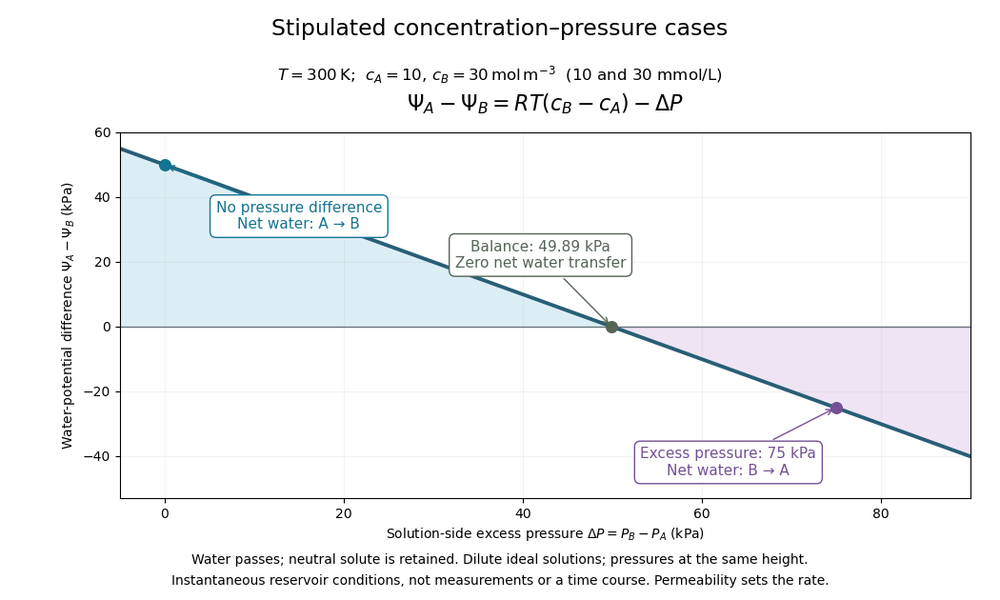

# Osmosis concentration-pressure example

↑ **Parent:** [Osmotic pressure](osmotic-pressure.md)

Take two reservoirs separated by a [semipermeable membrane](semipermeable-membrane.md) that passes [water](water.md) and retains one neutral [solute](solute.md). Stipulate $T=300\,\mathrm K$, $c_A=10\,\mathrm{mol\,m^{-3}}$ and $c_B=30\,\mathrm{mol\,m^{-3}}$, equivalent to $10$ and $30\,\mathrm{mmol\,L^{-1}}$. Treat both [chemical solutions](solution-chemistry.md) as dilute and ideal. These are invented model conditions, not measurements or recommended biological conditions.

For [pressures](pressure-split.md) measured at the same height beside the membrane, define $\Delta P=P_B-P_A$. The model predicts

$$
\Psi_A-\Psi_B=RT(c_B-c_A)-\Delta P,\qquad
RT(c_B-c_A)\simeq49.89\,\mathrm{kPa}.
$$

At $\Delta P=0$, net [water](water.md) transfer favors A to B. At $\Delta P\simeq49.89\,\mathrm{kPa}$, the opposing [pressure](pressure-split.md) balances the [osmotic pressure](osmotic-pressure.md) difference, giving zero net transfer with unequal [concentrations](concentration.md). At $\Delta P=75\,\mathrm{kPa}$, the sign reverses and net [water](water.md) transfer favors B to A, toward the more dilute reservoir. Raising [pressure](pressure-split.md) changes the total [water potential](water-potential.md), rather than changing the membrane into a one-way gate.

**[Figure 7](#image-stipulated-concentration-and-pressure-conditions-determine-net-water-transfer). Stipulated concentration and pressure conditions determine net water transfer**. Original computed comparison for ideal retained [solute](solute.md) at $300\,\mathrm K$, with A at $10\,\mathrm{mol\,m^{-3}}$ and B at $30\,\mathrm{mol\,m^{-3}}$. The horizontal axis is $P_B-P_A$; the vertical axis is $\Psi_A-\Psi_B$. Three marked cases show forward transfer, balance and reversed transfer. These are instantaneous reservoir conditions, not a time course or measured biological data; slope does not specify permeability or speed.

Fixed [concentrations](concentration.md) require large maintained reservoirs or an instantaneous comparison. In a closed [membrane osmometer](membrane-osmometer.md), entering [water](water.md) causes [dilution](dilution.md) of the receiving [chemical solution](solution-chemistry.md) and changes its [volume](volume.md); the final balance must use final [concentrations](concentration.md). A supported [cell wall](cell-wall.md) provides another way to develop the opposing [pressure](pressure-split.md), as explained under [turgor pressure](turgor-pressure.md).

## ↑ Ancestors (8)

1. [Osmotic pressure](osmotic-pressure.md)
2. [Osmosis](osmosis.md)
3. [Passive transport](passive-transport.md)
4. [Membrane transport](membrane-transport.md)
5. [Cell membrane](cell-membrane-split.md)
6. [Biological cell](biological-cell-split.md)
7. [Biology](biology-split.md)
8. [Codex Wiki](split.md)
