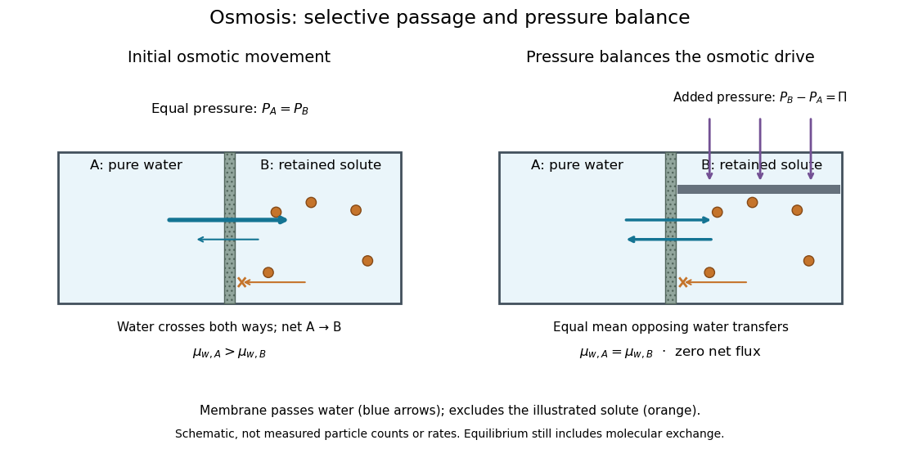

# Osmosis

↑ **Parent:** [Passive transport](passive-transport.md)  
ⓦ [Wiki](https://en.wikipedia.org/wiki/Osmosis)

[Osmosis](osmosis.md) is net movement of [water](water.md) across a boundary whose permeability differs for [water](water.md) and relevant [solutes](solute.md). The direction depends on the [chemical potential](chemical-potential-split.md) of [water](water.md), including both dissolved material and [pressure](pressure-split.md). A [cell wall](cell-wall.md) can let [water](water.md) reach the [cell membrane](cell-membrane-split.md), yet oppose expansion through [turgor pressure](turgor-pressure.md). Zero net movement does not mean individual [water](water.md) [molecules](molecule-split.md) have stopped crossing.

Imagine pure [water](water.md) on side A and a [chemical solution](solution-chemistry.md) on side B of a [semipermeable membrane](semipermeable-membrane.md). At equal [temperature](temperature-split.md) and [pressure](pressure-split.md), dissolved particles lower the [chemical potential](chemical-potential-split.md) of [water](water.md) in B, and net [water](water.md) transfer initially favors A to B. Retaining the [solutes](solute.md) lets [water](water.md) redistribute without simply mixing everything. Increasing B's [pressure](pressure-split.md) opposes entry; enough [pressure](pressure-split.md) gives [thermodynamic equilibrium](thermodynamic-equilibrium.md) with unequal [solute](solute.md) [concentrations](concentration.md). This is why “[water](water.md) moves toward more [solute](solute.md)” requires a pressure condition.[§5.2, Osmosis and Mechanism: selective passage and pressure opposing entry](biology-2e-by-mary-ann-clark-and-others/5-2-passive-transport.md)

**[Figure 6](#image-selective-permeability-and-the-pressure-that-balances-osmosis). Selective permeability and the pressure that balances osmosis**. Original schematic of a boundary passing [water](water.md) and retaining the illustrated [solute](solute.md). Left: equal [pressures](pressure-split.md) allow net transfer toward the [chemical solution](solution-chemistry.md). Right: excess [pressure](pressure-split.md) on the solution side balances the osmotic drive while [water](water.md) exchanges in both directions. Equal opposing arrows denote zero net transfer, not a measured molecular rate. Particle counts and dimensions are illustrative.

At [thermodynamic equilibrium](thermodynamic-equilibrium.md), the [chemical potentials](chemical-potential-split.md) of exchangeable [water](water.md) are equal. Individual [water](water.md) [molecules](molecule-split.md) still move and cross in both directions, with equal mean opposing transfer rates and zero net [flux](flux.md). A stationary liquid level alone does not prove this: a blocked route can also give no visible transfer. [Selective permeability](selective-permeability.md) provides a route; [water potential](water-potential.md) supplies the direction, and neither alone determines the speed. The [cell wall](cell-wall.md), [turgor pressure](turgor-pressure.md) and [plasmolysis](plasmolysis.md) articles show why a living boundary's mechanical support and its [selective permeability](selective-permeability.md) must be distinguished.

**Table of contents**

- [Water potential](water-potential.md)
  - [Solute potential](solute-potential.md)
- [Osmotic pressure](osmotic-pressure.md)
  - [Osmometry](osmometry.md)
    - [Reduced osmotic-pressure intercept](reduced-osmotic-pressure-intercept.md)
  - [Osmosis concentration-pressure example](osmosis-concentration-pressure-example.md)
- [Membrane osmometer](membrane-osmometer.md)
- [Osmotic concentration](osmotic-concentration.md)
- [Tonicity](tonicity.md)
  - [Permeating solute](permeating-solute.md)
  - [Hypotonic solution](hypotonic-solution.md)
  - [Hypertonic solution](hypertonic-solution.md)
  - [Isotonic solution](isotonic-solution.md)
- [Cytolysis](cytolysis.md)

## ↑ Ancestors (6)

1. [Passive transport](passive-transport.md)
2. [Membrane transport](membrane-transport.md)
3. [Cell membrane](cell-membrane-split.md)
4. [Biological cell](biological-cell-split.md)
5. [Biology](biology-split.md)
6. [Codex Wiki](split.md)

## ← Incoming links (8)

- [Cell wall](cell-wall.md)
- [Membrane osmometer](membrane-osmometer.md)
- [Osmosis](osmosis.md)
- [Repeated-bath dialysis model](repeated-bath-dialysis-model.md)
- [Selective permeability](selective-permeability.md)
- [Semipermeable membrane](semipermeable-membrane.md)
- [Tonicity](tonicity.md)
- [Turgor pressure](turgor-pressure.md)
