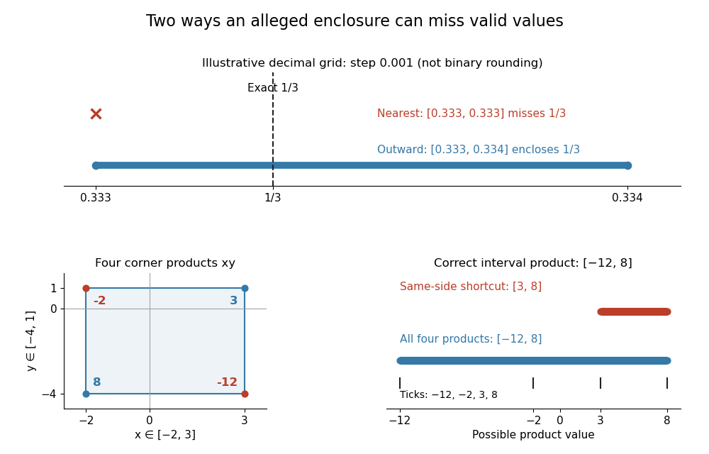

# Outward rounding

↑ **Parent:** [Interval arithmetic](interval-arithmetic.md)

[Outward rounding](outward-rounding.md) replaces an exact lower endpoint by a representable value no larger than it, and an exact upper endpoint by a representable value no smaller than it. This preserves an [interval enclosure](interval-enclosure.md) under [floating-point arithmetic](floating-point-arithmetic.md). In the [binary numeral system](binary-numeral-system.md), most [rational numbers](rational-number.md) cannot be represented exactly with finitely many digits, so the rounding direction is essential even for elementary calculations. Rump explains directed rounding and its use in interval bounds in §§4 and 5.3 of his survey.[Siegfried M. Rump, Verification methods: rigorous results using floating-point arithmetic, Acta Numerica 19, 287–449, 2010, §§4 and 5.3](https://www.tuhh.de/ti3/paper/rump/Ru10.pdf)

To see the issue without long binary digit strings, use an illustrative decimal grid with step $0.001$. Exact interval [division](division-mathematics.md) gives $[1,1]/[3,3]=[1/3,1/3]$. Rounding both endpoints to the nearest grid value gives $[0.333,0.333]$, which excludes the true answer because $0.333<1/3$. [Outward rounding](outward-rounding.md) instead gives

$$
\left[\frac{333}{1000},\frac{334}{1000}\right]=[0.333,0.334],\qquad \frac{333}{1000}<\frac13<\frac{334}{1000}.
$$

This decimal toy illustrates the rule; its displayed endpoints are not the results of binary directed rounding. Real implementations need valid [outward rounding](outward-rounding.md) throughout the calculation, including input conversion and intermediate [interval arithmetic operations](interval-arithmetic-operations.md); rounding only the final output cannot repair an earlier lost bound. INTLAB's tutorial demonstrates why decimal input strings and previously rounded intermediate values need care.[Rump, Interval computations in INTLAB, How to define an interval II and Invoking interval operations](https://www.tuhh.de/ti3/rump/intlab/demos/html/dintval.html)

**[Figure 7](#image-outward-rounding-encloses-one-third-on-a-decimal-toy-grid-sign-changing-interval-products-require-all-four-endpoint-combinations). Outward rounding encloses one third on a decimal toy grid; sign-changing interval products require all four endpoint combinations**. Above: rounding to the nearest decimal grid point misses $1/3$, while down to $0.333$ and up to $0.334$ enclose it. Below: the [Cartesian product](cartesian-product.md) of $[-2,3]$ and $[-4,1]$ has endpoint [products](product-of-numbers.md) $8,-2,-12,3$, giving $[-12,8]$. The two same-side endpoint [products](product-of-numbers.md) alone give the invalid enclosure $[3,8]$.

## ↑ Ancestors (6)

1. [Interval arithmetic](interval-arithmetic.md)
2. [Numerical analysis](numerical-analysis-split.md)
3. [Analysis](analysis-split.md)
4. [Area of mathematics](area-of-mathematics.md)
5. [Mathematics](mathematics-split.md)
6. [Codex Wiki](split.md)

## ← Incoming links (5)

- [Axis-aligned bounding box](axis-aligned-bounding-box.md)
- [Bounding volume](bounding-volume.md)
- [Interval arithmetic](interval-arithmetic.md)
- [Interval arithmetic operations](interval-arithmetic-operations.md)
- [Outward rounding](outward-rounding.md)
