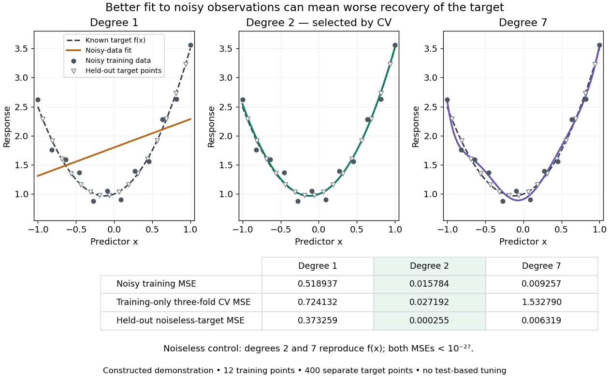

# Overfitting

↑ **Parent:** [Statistical learning](statistical-learning-split.md)  
ⓦ [Wiki](https://en.wikipedia.org/wiki/Overfitting)

Overfitting occurs when further adaptation improves [training error](training-error.md) while degrading performance on new data, for example by fitting incidental disturbances instead of a stable [regression function](regression-function.md). A gap between [training error](training-error.md) and [test error](test-error.md) alone does not prove that a simpler rule would generalize better. Compare candidates using [cross-validation](cross-validation.md) or a [validation set](validation-set.md); reserve the [test set](test-set.md) for assessment. [Regularization](regularization.md) and [early stopping](early-stopping.md) can limit adaptation. [ISLR chapter 2 slides, assessing model accuracy](https://web.stanford.edu/~hastie/ISLR2/Slides/Ch2_Statistical_Learning.pdf)

Evaluate the [training error](training-error.md) example at $z_j=-1+2(j+1/2)/400$, $j=0,\ldots,399$, none coinciding with a training input. The mean squared discrepancy $400^{-1}\sum_j(\widehat f(z_j)-f(z_j))^2$ is $0.373259$, $0.000255$, and $0.006319$ for degrees 1, 2, and 7. Thus degree 7 improves [training error](training-error.md) but worsens recovery of the target relative to degree 2. Degree 1 misses the target's curvature, illustrating [underfitting](underfitting.md).

These are errors against a known noiseless target, not [test errors](test-error.md) against fresh noisy responses. In a separate noiseless control, degrees 2 and 7 both recover this target exactly; their numerical held-out errors are approximately $3.77\times10^{-31}$ and $3.72\times10^{-31}$. The fixed-disturbance simulation illustrates a mechanism, not a universal numerical benchmark or a claim that higher [polynomial degree](degree-of-a-polynomial.md) always harms [generalization](generalization-in-statistical-learning.md).

**[Figure 3](#image-noisy-polynomial-fitting-training-only-degree-selection-and-separate-noiseless-target-evaluation). Noisy polynomial fitting, training-only degree selection, and separate noiseless-target evaluation**.

**Table of contents**

- [Underfitting](underfitting.md)

## ↑ Ancestors (7)

1. [Statistical learning](statistical-learning-split.md)
2. [Statistical modelling](statistical-modelling-split.md)
3. [Statistical model](statistical-model-split.md)
4. [Probability and statistics](probability-and-statistics-split.md)
5. [Area of mathematics](area-of-mathematics.md)
6. [Mathematics](mathematics-split.md)
7. [Codex Wiki](split.md)

## ← Incoming links (7)

- [Kullback-Leibler divergence](kullback-leibler-divergence.md)
- [Mixture identifiability](mixture-identifiability.md)
- [Solution](past-exam-of-the-mathematics-course-of-the-university-of-cambridge/2005/iii/paper-46/3/solution.md)
- [Solution](past-exam-of-the-mathematics-course-of-the-university-of-cambridge/2024/iii/paper-218/2/e/solution.md)
- [Solution](past-exam-of-the-mathematics-course-of-the-university-of-cambridge/2026/iii/paper-218/5/d/solution.md)
- [Test set](test-set.md)
- [Training error](training-error.md)
