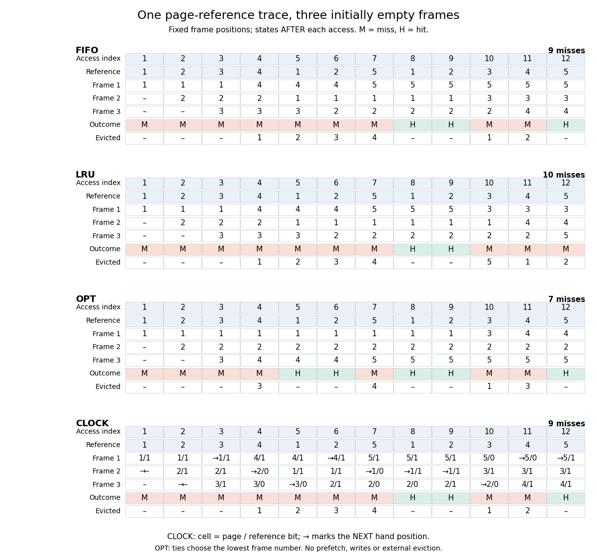

# Page-reference trace

↑ **Parent:** [Page replacement](page-replacement.md)

A [memory access trace](memory-access-trace.md) reduced to the ordered [sequence](sequence.md) of accessed [memory page](memory-page.md) identities, retaining repetitions. An address-only reduction loses read/write information, so annotate writes when studying [dirty memory pages](dirty-memory-page.md). Use the following classic [Belady anomaly](belady-s-anomaly.md) [sequence](sequence.md), where the numbers label [memory pages](memory-page.md), not [physical addresses](physical-address.md):

$$
1,2,3,4,1,2,5,1,2,3,4,5.
$$

Start with three empty, equal-sized [page frames](page-frame.md) allocated to one [operating-system process](process-computing.md). Every [memory page](memory-page.md) can occupy any [page frame](page-frame.md), and every resident [memory page](memory-page.md) is eligible for eviction. Use [demand paging](demand-paging.md): a hit finds the requested [memory page](memory-page.md) in the [resident set](resident-set.md); a miss causes exactly one nonresident [page fault](page-fault.md) and loads it before the next access. Fill the lowest-numbered empty [page frame](page-frame.md), then reuse the victim's [page frame](page-frame.md). Assume only reads, no fetching ahead of requests, no competing [operating-system processes](process-computing.md), and no external removal of [memory pages](memory-page.md). [CLOCK page replacement](clock-page-replacement.md) uses its declared hand rule, which fills the same initial [page frames](page-frame.md) here. The [memory page](memory-page.md) labels alone do not determine the result without these assumptions.

**[Figure 10](#image-all-twelve-accesses-with-three-page-frames-fifo-page-replacement-exact-lru-replacement-offline-optimal-page-replacement-and-the-stated-clock-page-replacement-variant). All twelve accesses with three page frames: FIFO page replacement, exact LRU replacement, offline optimal page replacement and the stated CLOCK page replacement variant**.

Each column shows the state after servicing that access. Rows keep physical [page frame](page-frame.md) positions fixed, rather than silently sorting the [resident set](resident-set.md). The [CLOCK page replacement](clock-page-replacement.md) entries also show reference [bits](bit.md) and the next hand position. The independently computed totals are:

| Policy | Miss indices, counted from 1 | Misses | Hits |
| --- | --- | --- | --- |
| [FIFO page replacement](fifo-page-replacement.md) | 1, 2, 3, 4, 5, 6, 7, 10, 11 | 9 | 3 |
| [LRU replacement](lru-replacement.md) | 1, 2, 3, 4, 5, 6, 7, 10, 11, 12 | 10 | 2 |
| [Optimal page replacement](optimal-page-replacement.md) | 1, 2, 3, 4, 7, 10, 11 | 7 | 5 |
| [CLOCK page replacement](clock-page-replacement.md) | 1, 2, 3, 4, 5, 6, 7, 10, 11 | 9 | 3 |

The first three misses fill unused [page frames](page-frame.md); the fourth miss needs eviction. At access 4, [FIFO page replacement](fifo-page-replacement.md) and [LRU replacement](lru-replacement.md) evict [memory page](memory-page.md) 1. [Optimal page replacement](optimal-page-replacement.md) instead evicts [memory page](memory-page.md) 3: the next uses of resident [memory pages](memory-page.md) 1, 2 and 3 are at indices 5, 6 and 10. At access 10, [FIFO page replacement](fifo-page-replacement.md) evicts [memory page](memory-page.md) 1 while [LRU replacement](lru-replacement.md) evicts [memory page](memory-page.md) 5. Consequently the last access to [memory page](memory-page.md) 5 hits under [FIFO page replacement](fifo-page-replacement.md) but misses under [LRU replacement](lru-replacement.md). Matching totals for [FIFO page replacement](fifo-page-replacement.md) and [CLOCK page replacement](clock-page-replacement.md) on this [sequence](sequence.md) do not make the policies equivalent. The generators compute every displayed state; a separate search over all legal victims confirms the seven-miss [optimal page replacement](optimal-page-replacement.md) bound for three [page frames](page-frame.md).

## ↑ Ancestors (6)

1. [Page replacement](page-replacement.md)
2. [Paging](paging.md)
3. [Virtual memory](virtual-memory-split.md)
4. [Operating system](operating-system-split.md)
5. [Computer science](computer-science-split.md)
6. [Codex Wiki](split.md)

## ← Incoming links (8)

- [Bélády's anomaly](belady-s-anomaly.md)
- [CLOCK page replacement](clock-page-replacement.md)
- [FIFO page replacement](fifo-page-replacement.md)
- [LRU replacement](lru-replacement.md)
- [LRU stack property](lru-stack-property.md)
- [Optimal page replacement](optimal-page-replacement.md)
- [Page replacement](page-replacement.md)
- [Page-replacement cost accounting](page-replacement-cost-accounting.md)
