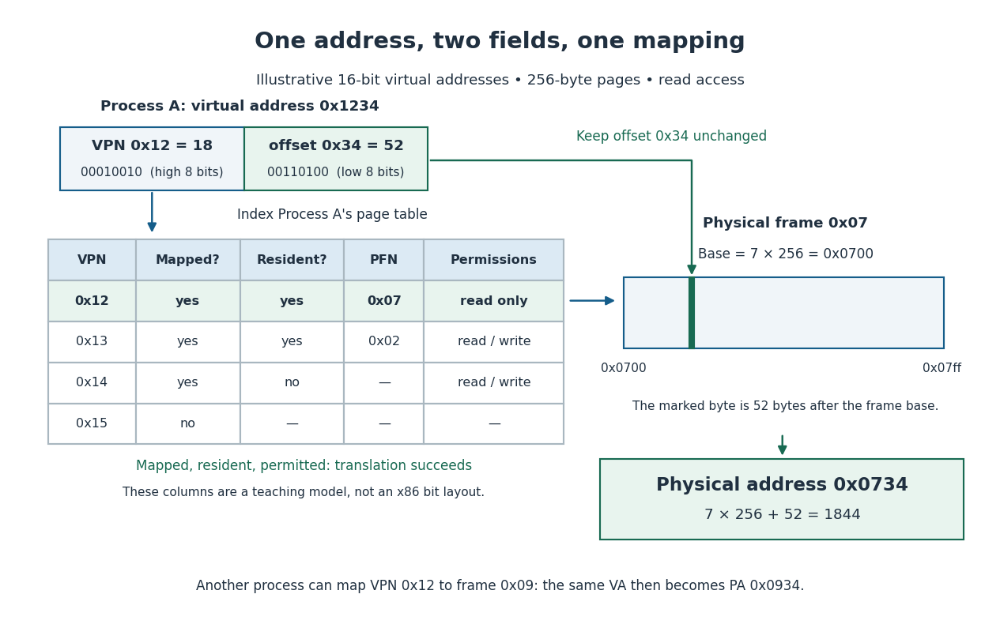

# Paging

↑ **Parent:** [Virtual memory](virtual-memory-split.md)  
ⓦ [Wiki](https://en.wikipedia.org/wiki/Paging)

[Paging](paging.md) divides an [address space](address-space.md) into fixed-size [memory pages](memory-page.md) and main [computer memory](computer-memory.md) into equally sized [page frames](page-frame.md). Here assume [byte](byte.md) addressing, one [memory page](memory-page.md) size $P=2^b$ [bytes](byte.md), and an unsigned [virtual address](virtual-address.md) $v$. Its virtual page number $q$ and offset $d$ are

$$
q=\left\lfloor\frac{v}{P}\right\rfloor,\qquad d=v\bmod P,\qquad 0\leq d<P.
$$

The brackets denote the [floor function](floor-function.md), and $\bmod$ gives the [remainder](remainder.md) in [Euclidean division](euclidean-division.md). If the [page table](page-table.md) maps $q$ to physical frame number $f$ and permits the access, the [physical address](physical-address.md) is

$$
a=fP+d.
$$

The low $b$ [bits](bit.md) are unchanged; the other [bits](bit.md) select the [memory page](memory-page.md) or [page frame](page-frame.md). A [bit shift](bit-shift.md) and [bit mask](bit-mask.md) can extract these fields. [Arpaci-Dusseau and Arpaci-Dusseau, OSTEP chapter 18: Paging, Introduction, sections 18.1–18.2](https://pages.cs.wisc.edu/~remzi/OSTEP/vm-paging.pdf)

For a 16-[bit](bit.md) [virtual address](virtual-address.md) and $P=256=2^8$ [bytes](byte.md), take $v=\mathtt{0x1234}=4660$ in [hexadecimal](hexadecimal.md). Then $q=18=\mathtt{0x12}$ and $d=52=\mathtt{0x34}$. A mapping to $f=7=\mathtt{0x07}$ gives

$$
a=7\cdot256+52=1844=\mathtt{0x0734}.
$$

Thus the eight high [bits](bit.md) choose a mapping; the eight low [bits](bit.md) choose the same position in the resulting [page frame](page-frame.md). The 256-[byte](byte.md) size is for illustration, not a claim about an actual architecture's supported [memory page](memory-page.md) sizes.

**[Figure 9](#image-translating-0x1234-through-an-illustrative-page-table-with-a-separate-offset-and-access-check). Translating 0x1234 through an illustrative page table, with a separate offset and access check**.

The useful freedom is that adjacent [memory pages](memory-page.md) can occupy unrelated [page frames](page-frame.md). In the diagram, virtual pages `0x12` and `0x13` occupy [page frames](page-frame.md) `0x07` and `0x02`; [virtual addresses](virtual-address.md) `0x12ff` and `0x1300` are consecutive, but translate to [physical addresses](physical-address.md) `0x07ff` and `0x0200`. Uniform units simplify placement and [page replacement](page-replacement.md), at the cost of [page table](page-table.md) storage and unused [bytes](byte.md) within partly filled [memory pages](memory-page.md). For example, placing 300 [bytes](byte.md) in exclusive 256-[byte](byte.md) [page frames](page-frame.md) requires two [page frames](page-frame.md), leaving $512-300=212$ [bytes](byte.md) unused.

**Table of contents**

- [Memory page](memory-page.md)
- [Page frame](page-frame.md)
- [Demand paging](demand-paging.md)
- [Page replacement](page-replacement.md)
  - [CLOCK page replacement](clock-page-replacement.md)
  - [LRU replacement](lru-replacement.md)
    - [LRU cache](lru-cache.md)
    - [LRU stack property](lru-stack-property.md)
  - [FIFO page replacement](fifo-page-replacement.md)
    - [FIFO cache](fifo-cache.md)
  - [Page-reference trace](page-reference-trace.md)
  - [Optimal page replacement](optimal-page-replacement.md)
  - [Bélády's anomaly](belady-s-anomaly.md)
  - [Dirty memory page](dirty-memory-page.md)
    - [Page writeback](page-writeback.md)
  - [Page-replacement cost accounting](page-replacement-cost-accounting.md)
- [Page fault](page-fault.md)
  - [Page fault rate](page-fault-rate.md)
- [Translation lookaside buffer](translation-lookaside-buffer.md)
  - [TLB hit](tlb-hit.md)
  - [TLB miss](tlb-miss.md)
  - [Address space identifier](address-space-identifier.md)
- [Page table](page-table.md)
  - [Page table entry](page-table-entry.md)
  - [Multi-level page table](multi-level-page-table.md)
    - [Two-level address translation](two-level-address-translation.md)
    - [Sparse page table allocation](sparse-page-table-allocation.md)
    - [Sv39 page table](sv39-page-table.md)
  - [Page table walk](page-table-walk.md)

## ↑ Ancestors (4)

1. [Virtual memory](virtual-memory-split.md)
2. [Operating system](operating-system-split.md)
3. [Computer science](computer-science-split.md)
4. [Codex Wiki](split.md)

## ← Incoming links (11)

- [Address translation](address-translation.md)
- [Copy-on-write](copy-on-write.md)
- [Memory management unit](memory-management-unit.md)
- [Memory page](memory-page.md)
- [Memory protection](memory-protection.md)
- [Page fault](page-fault.md)
- [Page table](page-table.md)
- [Page table walk](page-table-walk.md)
- [Paging](paging.md)
- [Solution](past-exam-of-the-mathematics-course-of-the-university-of-cambridge/2007/ia/paper-5/7/c/solution.md)
- [Virtual memory](virtual-memory-split.md)
