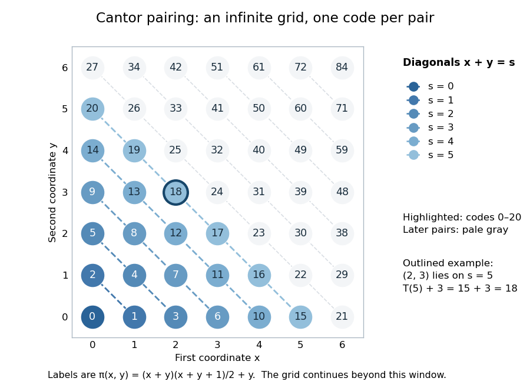
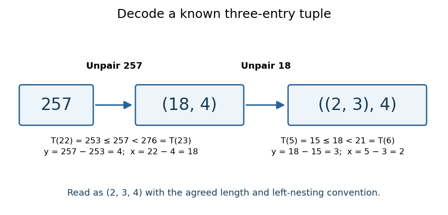

# Pairing function

↑ **Parent:** [Computability theory](computability-theory.md)  
ⓦ [Wiki](https://en.wikipedia.org/wiki/Pairing_function)

A [pairing function](pairing-function.md) is a [computable function](computable-function.md) that gives a [bijection](bijection.md) from the [Cartesian product](cartesian-product.md) $\mathbb N_0^2$ to $\mathbb N_0$, with two [computable functions](computable-function.md) recovering its coordinates. Here $\mathbb N_0=\{0,1,2,\ldots\}$ consists of the [natural numbers](natural-number.md), including zero. If $p$ is the [pairing function](pairing-function.md) and $L,R$ its decoding [functions](function-split.md), the requirements are

$$
L(p(x,y))=x,\qquad R(p(x,y))=y,\qquad p(L(z),R(z))=z.
$$

Every [ordered pair](ordered-pair.md) has exactly one code, every code represents an [ordered pair](ordered-pair.md), and decoding always terminates. For a [bijection](bijection.md) given by a [total computable function](total-computable-function.md), computability of the [inverse function](inverse-function.md) also follows by enumerating all [ordered pairs](ordered-pair.md) until the one with code $z$ appears. A [primitive recursive pairing function](primitive-recursive-pairing-function.md) makes the stronger requirement that both encoding and coordinate decoding are [primitive recursive](primitive-recursive-function.md).

The [Cantor pairing function](cantor-pairing-function.md) makes this concrete through [triangular numbers](triangular-number.md):

$$
T(s)=\frac{s(s+1)}2,\qquad \pi(x,y)=T(x+y)+y.
$$

On the diagonal $x+y=s$, list $(s,0),(s-1,1),\ldots,(0,s)$. There are $s+1$ [ordered pairs](ordered-pair.md) there, and $T(s)$ [ordered pairs](ordered-pair.md) on earlier diagonals. Their codes therefore occupy precisely the consecutive [natural numbers](natural-number.md) from $T(s)$ through $T(s+1)-1$. These intervals touch without overlapping and cover all [natural numbers](natural-number.md); within each interval the offset $y$ determines the [ordered pair](ordered-pair.md). This proves both [injectivity](injective-function.md) and [surjectivity](surjective-function.md), hence the [bijection](bijection.md). It also explains why the infinite grid is a [countably infinite set](countably-infinite-set.md): every [ordered pair](ordered-pair.md) is reached after finitely many steps. A row-by-row listing would never finish its first infinite row. Authored treatments give the same diagonal construction with the coordinates exchanged.[Klaus Sutner, Primitive Recursion, Carnegie Mellon University, spring 2021, slides 9–13: pairing systems and the Cantor polynomial](https://www.cs.cmu.edu/~cdm/resources/02-coding.pdf)

For example, the [Cantor pairing function](cantor-pairing-function.md) gives

$$
\pi(0,0)=0,\qquad \pi(1,0)=1,\qquad \pi(0,1)=2,\qquad \pi(2,3)=T(5)+3=18.
$$

The order of the coordinates matters: $(1,0)$ and $(0,1)$ are different [ordered pairs](ordered-pair.md) with different codes.

**[Figure 1](#image-the-cantor-pairing-function-on-a-finite-window-labels-are-codes-and-the-first-21-ordered-pairs-fill-diagonals-zero-through-five). The Cantor pairing function on a finite window: labels are codes, and the first 21 ordered pairs fill diagonals zero through five**.

To decode a [natural number](natural-number.md) $z$, find the unique diagonal index $s$ satisfying

$$
T(s)\leq z<T(s+1),\qquad y=z-T(s),\qquad x=s-y.
$$

The [inequality](inequality-mathematics.md) gives $0\leq y\leq s$, so both recovered coordinates are [natural numbers](natural-number.md). At $z=18$, $T(5)=15\leq18<T(6)=21$, hence $s=5$, $y=18-15=3$, and $x=5-3=2$. At $z=0$, $s=0$ and both coordinates are zero. Solving the quadratic [inequality](inequality-mathematics.md) gives the equivalent [floor function](floor-function.md) expression

$$
s=\left\lfloor\frac{\sqrt{8z+1}-1}{2}\right\rfloor.
$$

This is exact as a statement about the [real numbers](real-number.md) and their [square roots](square-root.md). An implementation using [floating-point arithmetic](floating-point-arithmetic.md) can round across a diagonal boundary, especially for large $z$. Use an exact integer [square root](square-root.md) instead: with $q=\lfloor\sqrt{8z+1}\rfloor$ computed using integer arithmetic, $s=\lfloor(q-1)/2\rfloor$. Alternatively, search for the diagonal using exact integer comparisons. The [primitive recursive pairing function](primitive-recursive-pairing-function.md) proof below uses [bounded minimization](bounded-minimization.md) and needs no approximate [square root](square-root.md).

A [pairing function](pairing-function.md) is a reversible encoding: unlike a [hash function](hash-function.md) mapping arbitrarily many inputs into a fixed finite range, it loses no coordinates. This works because the mathematical [natural numbers](natural-number.md) have no upper bound. A machine word with $b$ [binary digits](binary-digit.md) has $2^b$ possible values, while two such words have $2^{2b}$ possible [ordered pairs](ordered-pair.md); a [bijection](bijection.md) into one word of the same width is impossible. Evaluating the [Cantor pairing function](cantor-pairing-function.md) in a fixed-width integer type can overflow, including in the intermediate product $(x+y)(x+y+1)$. Exact implementation requires sufficiently large integer storage or an explicit restricted input range. One mathematical code need not occupy fewer [binary digits](binary-digit.md) than its two inputs.

Iterating a [pairing function](pairing-function.md) gives a reversible encoding of [tuples](finite-tuple.md) of any fixed positive length. With the left-nesting convention, the [Cantor pairing function](cantor-pairing-function.md) encodes $(2,3,4)$ as

$$
\pi(\pi(2,3),4)=\pi(18,4)=T(22)+4=253+4=257.
$$

Decode the outer [ordered pair](ordered-pair.md) first: $T(22)\leq257<T(23)=276$ gives $(18,4)$. Decode its first coordinate $18$ to recover $(2,3)$, giving the nested [ordered pair](ordered-pair.md) $((2,3),4)$ and thus the original [tuple](finite-tuple.md) $(2,3,4)$.

**[Figure 2](#image-decoding-a-known-three-entry-tuple-first-unpair-257-into-18-4-then-unpair-18-into-2-3). Decoding a known three-entry tuple: first unpair 257 into (18, 4), then unpair 18 into (2, 3)**

The [tuple](finite-tuple.md) length and nesting convention must be known. The same code $257$ represents $(18,4)$ as a two-entry [tuple](finite-tuple.md) and $(2,3,4)$ as a three-entry [tuple](finite-tuple.md); nesting alone does not make variable-length [tuples](finite-tuple.md) self-describing. To encode variable-length [tuples](finite-tuple.md), supply their length or another explicit termination convention as part of the encoding. This simple change of representation is useful in [computability theory](computability-theory.md) and [Gödel numbering](godel-numbering.md): a [function](function-split.md) of several [natural numbers](natural-number.md) can be studied through a single numerical input, while all coordinates remain recoverable. The striking fact is that a whole infinite grid can be serialized without omitting a point.

A historical reference for comparing [sets](set-split.md) through [bijections](bijection.md) is Georg Cantor's paper _Ein Beitrag zur Mannigfaltigkeitslehre_, published in 1878 in volume 84 of _Journal für die reine und angewandte Mathematik_, pages 242–258.[Georg Cantor, Ein Beitrag zur Mannigfaltigkeitslehre, 1878: publisher bibliographic record](https://doi.org/10.1515/crelle-1878-18788413)

**Table of contents**

- [Primitive recursive pairing function](primitive-recursive-pairing-function.md)
- [Decimal trailing-zero pairing function](decimal-trailing-zero-pairing-function.md)

## ↑ Ancestors (5)

1. [Computability theory](computability-theory.md)
2. [Foundations of mathematics](foundations-of-mathematics-split.md)
3. [Area of mathematics](area-of-mathematics.md)
4. [Mathematics](mathematics-split.md)
5. [Codex Wiki](split.md)

## ← Incoming links (4)

- [Pairing function](pairing-function.md)
- [Solution](past-exam-of-the-mathematics-course-of-the-university-of-cambridge/2002/iii/paper-76/7/solution.md)
- [Solution](past-exam-of-the-mathematics-course-of-the-university-of-cambridge/2019/ii/paper-2/4h/b/solution.md)
- [Primitive recursive pairing function](primitive-recursive-pairing-function.md)
