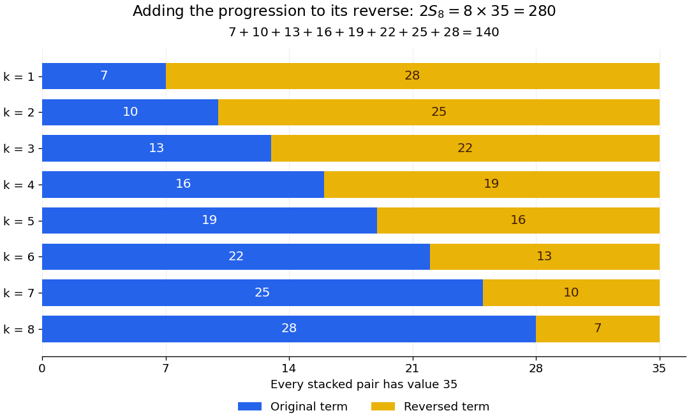

# Pairing proof for an arithmetic series

↑ **Parent:** [Arithmetic series](arithmetic-series.md)

Reverse the finite list of [sequence terms](sequence-term.md) and add it to the original list. At position $k$,

$$
a_k+a_{n+1-k}
=\bigl(a_1+(k-1)d\bigr)+\bigl(a_1+(n-k)d\bigr)
=2a_1+(n-1)d=a_1+a_n.
$$

Every position therefore contributes the same value. Reversal preserves the [sum](sum.md), giving $2S_n=n(a_1+a_n)$ and the stated formula. The symmetry explains why the endpoint average represents the whole list; one does not need to add each entry separately.

**[Figure 14](#image-an-arithmetic-progression-and-its-reverse-make-eight-equal-pairs-each-of-value-thirty-five). An arithmetic progression and its reverse make eight equal pairs, each of value thirty-five**. Original positive-value example $7,10,13,16,19,22,25,28$. Blue bars show the original entries; yellow bars show the reversed entries. The combined [sum](sum.md) is $280$, twice the original [sum](sum.md) $140$. The algebraic argument also applies when some entries are negative.

The reversal argument works for both [even](even-function.md) and [odd](odd-function.md) lengths. For $2,5,8,11,14$, the two outer pairs each total sixteen and the middle entry is eight. Adding the list to its reverse counts that middle entry twice too, giving $2S_5=5\times16$ and $S_5=40$. No half-entry is required for an [odd](odd-function.md) number of entries.

## ↑ Ancestors (6)

1. [Arithmetic series](arithmetic-series.md)
2. [Arithmetic progression](arithmetic-progression.md)
3. [Arithmetic](arithmetic-split.md)
4. [Area of mathematics](area-of-mathematics.md)
5. [Mathematics](mathematics-split.md)
6. [Codex Wiki](split.md)
