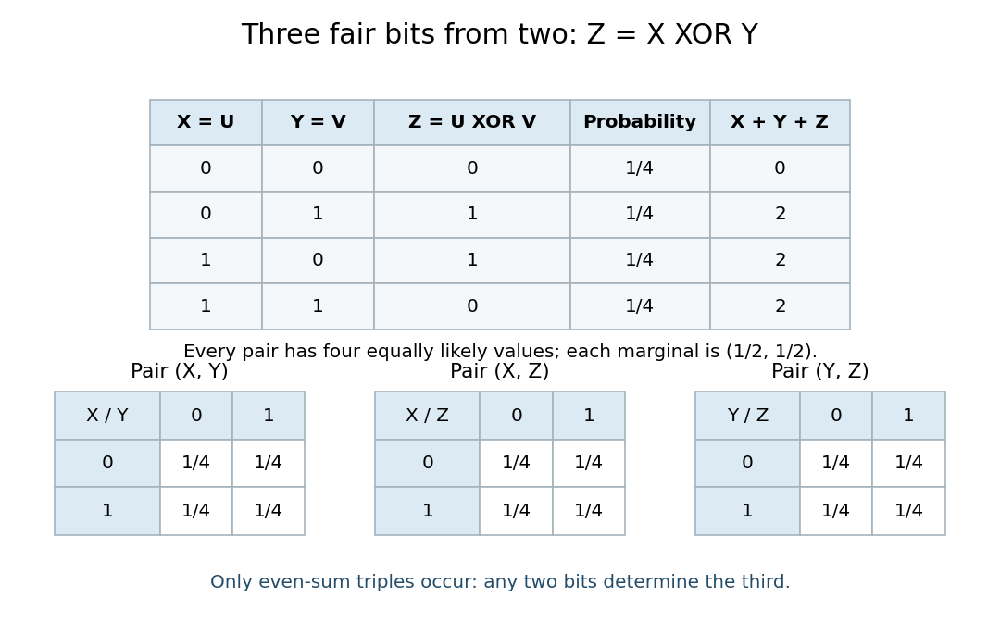

# Pairwise independent events

↑ **Parent:** [Probability theory](probability-theory-split.md)

[Pairwise independent events](pairwise-independent-events.md) describe a subtle kind of uncertainty: learning that one [event](event.md) occurred leaves each other [event](event.md)'s [probability](probability.md) unchanged, yet learning that two occurred can reveal a third completely. Checking every pair therefore answers a weaker question than checking the whole collection. The [parity construction of pairwise independent bits](parity-construction-of-pairwise-independent-bits.md) makes this distinction visible with just four equally likely outcomes.

A family of [events](event.md) $A_i$ is pairwise independent when

$$
\mathbb P(A_i\cap A_j)=\mathbb P(A_i)\mathbb P(A_j)\qquad(i\ne j).
$$

If $\mathbb P(A_j)>0$, this is equivalent to the [conditional probability](conditional-probability.md) identity $\mathbb P(A_i\mid A_j)=\mathbb P(A_i)$. The product definition also handles [events](event.md) of [probability](probability.md) zero. [Independent events](independent-events.md), meaning mutually independent [events](event.md), require the same product rule for every finite subfamily, including triples. For three [events](event.md), the three pair equations and the triple equation are four separate requirements. [Kyle Siegrist, Random Services: independence of two events and general independence of events](https://www.randomservices.org/random/prob/Independence.html).

For a worked example, take [independent](independent-random-variables.md) fair [bits](bit.md) $U,V$: the [sample space](sample-space.md) is $\{00,01,10,11\}$ with [probability](probability.md) $1/4$ per outcome. Set $X=U$, $Y=V$, and $Z=U\mathbin\oplus V$, using [exclusive or](exclusive-or.md), which is one precisely when its inputs differ. The [events](event.md) $A=\{X=1\}$, $B=\{Y=1\}$, and $C=\{Z=1\}$ each contain two outcomes. Their pair [intersections](set-intersection.md) are

$$
A\cap B=\{11\},\qquad A\cap C=\{10\},\qquad B\cap C=\{01\}.
$$

Thus each [event](event.md) has [probability](probability.md) $1/2$ and each pair [intersection](set-intersection.md) has [probability](probability.md) $1/4=(1/2)^2$: these are [pairwise independent events](pairwise-independent-events.md). But $X=Y=1$ forces $Z=0$, so

$$
A\cap B\cap C=\varnothing,\qquad
\mathbb P(A\cap B\cap C)=0\ne\frac18=\mathbb P(A)\mathbb P(B)\mathbb P(C).
$$

The three are not [independent events](independent-events.md). This is the complementary-third-event version of the two-toss example in [Tsitsiklis and Jaillet, MIT Introduction to Probability, Lecture 3, slides 7–8](https://ocw.mit.edu/courses/res-6-012-introduction-to-probability-spring-2018/09ea15bdcd65f91318c38285884983f9_MITRES_6_012S18_L03.pdf).

**[Figure 1](#image-four-outcomes-give-three-pairwise-independent-bits-with-a-joint-parity-constraint). Four outcomes give three pairwise independent bits with a joint parity constraint**. Each row has [probability](probability.md) $1/4$. Each pair's [joint probability mass function](joint-probability-mass-function.md) contains all four value combinations with [probability](probability.md) $1/4$, although only four of the eight triple combinations can occur.

Another useful diagnostic preserves a special common-[intersection](set-intersection.md) case. Suppose three [events](event.md) have common [probability](probability.md) $s$ and every pair and triple intersect in the same [event](event.md), of [probability](probability.md) $q$. [Pairwise independence](pairwise-independent-events.md) requires $q=s^2$, while mutual [independence](independent-random-variables.md) additionally requires $q=s^3$. Both hold only for $s=0$ or $s=1$. For a concrete nontrivial instance, assign [probability](probability.md) $1/4$ to each of four outcomes, let all three [events](event.md) contain the first outcome, and give each [event](event.md) one different additional outcome. Then $s=1/2$ and $q=1/4$: the pair equations hold, while the triple equation fails. Unlike the [exclusive or](exclusive-or.md) example above, this triple [intersection](set-intersection.md) is nonempty.

**Table of contents**

- [Parity construction of pairwise independent bits](parity-construction-of-pairwise-independent-bits.md)

## ↑ Ancestors (5)

1. [Probability theory](probability-theory-split.md)
2. [Probability and statistics](probability-and-statistics-split.md)
3. [Area of mathematics](area-of-mathematics.md)
4. [Mathematics](mathematics-split.md)
5. [Codex Wiki](split.md)

## ← Incoming links (2)

- [Pairwise independent events](pairwise-independent-events.md)
- [Solution](past-exam-of-the-mathematics-course-of-the-university-of-cambridge/2011/ia/paper-2/4f/solution.md)
