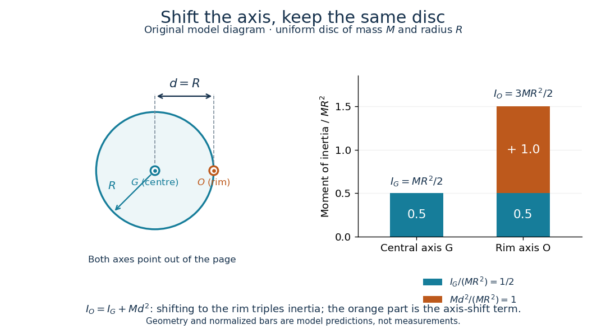

# Parallel axis theorem

↑ **Parent:** [Moment of inertia](moment-of-inertia.md)  
ⓦ [Wiki](https://en.wikipedia.org/wiki/Parallel_axis_theorem)

The [parallel axis theorem](parallel-axis-theorem.md) transfers a [moment of inertia](moment-of-inertia.md) from an axis through the [centre of mass](center-of-mass.md) $G$ to a parallel axis through $O$:

$$
I_O=I_G+Md^2.
$$

Here $M$ is the total [mass](mass.md) and $d$ is the shortest perpendicular distance between the two axes. Both [moments of inertia](moment-of-inertia.md) concern the same [mass](mass.md) distribution and the same axis direction. The axis for $I_G$ must pass through the [centre of mass](center-of-mass.md); $I_O$ may refer to an axis outside the body. No uniform-density or planar-shape assumption is needed. Within any family of parallel axes, the [centre of mass](center-of-mass.md) axis minimizes the [moment of inertia](moment-of-inertia.md).[§10.5](university-physics-volume-1-by-william-moebs-and-others/10-5-calculating-moments-of-inertia.md)

A short proof isolates why the [centre of mass](center-of-mass.md) matters. Choose parallel axes perpendicular to an $xy$ plane, put $G$ at the origin, and place $O$ at $(d,0)$. Then

$$
I_O=\int\bigl[(x-d)^2+y^2\bigr]\,dm
=I_G-2d\int x\,dm+d^2\int dm
=I_G+Md^2,
$$

because $\int x\,dm=0$ in [centre of mass](center-of-mass.md) coordinates. Individual [mass](mass.md) elements can move closer to the new axis, but their weighted cross terms cancel. For arbitrary parallel axes $A$ and $B$, use $I_B-I_A=M(d_B^2-d_A^2)$, where each distance is measured from the parallel [centre of mass](center-of-mass.md) axis; adding $M$ times the squared separation of $A$ and $B$ is generally incorrect. A displacement along the axis has $d=0$. Changing the axis direction instead requires the [inertia tensor](inertia-tensor.md) or, in its applicable planar setting, the [perpendicular axis theorem](perpendicular-axis-theorem.md).

For a uniform disc, [mass](mass.md) $M$ and radius $R$, the central perpendicular [moment of inertia](moment-of-inertia.md) is $I_G=MR^2/2$. Shifting that axis to the rim gives $d=R$ and $I_O=3MR^2/2$, three times $I_G$. In the computed $M=2\,\mathrm{kg}$, $R=0.30\,\mathrm m$ example, $I_G=0.090\,\mathrm{kg\,m^2}$, $Md^2=0.180\,\mathrm{kg\,m^2}$ and $I_O=0.270\,\mathrm{kg\,m^2}$. At [angular speed](angular-speed.md) $10\,\mathrm{rad/s}$ the rim-pivoted disc has [rotational kinetic energy](rotational-kinetic-energy.md) $13.5\,\mathrm J$. Its [centre of mass](center-of-mass.md) now moves, so $\tfrac12I_O\omega^2$ already includes that translation; adding a separate [centre of mass](center-of-mass.md) translation term to it would count that contribution twice.

**[Figure 40](#image-parallel-axis-theorem-a-uniform-disc-s-central-and-rim-axes). Parallel axis theorem: a uniform disc's central and rim axes**. Original geometric and numerical model, not measured data. Both axes are perpendicular to the disc; the separation is $d=R$. The bar chart separates $I_G=MR^2/2$ from the additional $Md^2=MR^2$ in $I_O=3MR^2/2$, normalized by $MR^2$. All parts of the disc remain in the calculation, including those nearer to the shifted axis.

The [physical pendulum](physical-pendulum.md) measurement described under [moment of inertia](moment-of-inertia.md) provides a practical check: infer $I_O=Mgh(P/2\pi)^2$ at several pivot positions, then subtract $Mh^2$ to obtain $I_G$. Keep all pivot axes parallel and measure $h$ to the [centre of mass](center-of-mass.md) of the entire moving assembly. The same assembly should yield the same $I_G$ within measurement precision. If a smartphone is attached, its [mass](mass.md) and its own [moment of inertia](moment-of-inertia.md) belong in both the geometric prediction and the [centre of mass](center-of-mass.md) calculation. The published bar-and-phone study explicitly adds both contributions using the [parallel axis theorem](parallel-axis-theorem.md).[equations 2-4](experimental-analysis-of-a-physical-pendulum-with-variable-suspension-point-by-martin-monteiro-and-others.md)

For a careful replication, release small swings without a push, repeat timings at several small [amplitudes](wave-amplitude.md), and check that the extrapolated [oscillation period](period-of-an-oscillation.md) is stable as [amplitude](wave-amplitude.md) decreases. Time many complete [oscillations](oscillation.md) and repeat the run; two crossings of a photogate per cycle must not be mistaken for two cycles. Inspect decay of [amplitude](wave-amplitude.md) and compare early and late timings to detect significant pivot [friction](friction.md) or air [drag](drag-physics.md). Mark the bar and phone mount to detect relative slip, tighten the attachment, and check that the pivot support does not rock or migrate between holes. Repeat with an independent photogate or video readout to check the phone's timing. These are proposed controls for the replication, not additional results reported by the authors. The ideal model excludes appreciable [damping](damping.md), large swings and flexing; subtraction of $Mh^2$ also magnifies relative errors when $I_G$ is much smaller than $I_O$.

The [oscillation period](period-of-an-oscillation.md) need not increase monotonically with pivot distance: the shift raises the [moment of inertia](moment-of-inertia.md) but also increases the gravitational restoring [torque](torque.md). For a computed slender uniform bar model of length $L$, $I_G=ML^2/12$ and

$$
\frac{P^2}{4\pi^2}=\frac1g\left(h+\frac{L^2}{12h}\right),
\qquad h>0.
$$

This expression has its minimum at $h=L/\sqrt{12}$. With $L=1\,\mathrm m$, $h=0.50\,\mathrm m$ and stipulated $g=9.81\,\mathrm{m/s^2}$, the prediction is $P\simeq1.638\,\mathrm s$; it is not a recorded timing or a prediction for the bar with a phone attached. The competing terms explain why a timing experiment can reveal a [mass](mass.md) distribution rather than merely its weight.

## ↑ Ancestors (6)

1. [Moment of inertia](moment-of-inertia.md)
2. [Rigid body dynamics](rigid-body-dynamics.md)
3. [Classical mechanics](classical-mechanics-split.md)
4. [Branches of physics](branches-of-physics.md)
5. [Physics](physics-split.md)
6. [Codex Wiki](split.md)

## ← Incoming links (14)

- [Moment of inertia](moment-of-inertia.md)
- [Moment of inertia of a uniform solid hemisphere](moment-of-inertia-of-a-uniform-solid-hemisphere.md)
- [Parallel axis theorem](parallel-axis-theorem.md)
- [Solution](past-exam-of-the-mathematics-course-of-the-university-of-cambridge/2003/ia/paper-4/11e/solution.md)
- [Solution](past-exam-of-the-mathematics-course-of-the-university-of-cambridge/2012/ia/paper-4/11b/a/solution.md)
- [Solution](past-exam-of-the-mathematics-course-of-the-university-of-cambridge/2012/ia/paper-4/11b/b/solution.md)
- [Solution](past-exam-of-the-mathematics-course-of-the-university-of-cambridge/2017/ii/paper-2/13e/solution.md)
- [Solution](past-exam-of-the-mathematics-course-of-the-university-of-cambridge/2018/ia/paper-4/9a/b/solution.md)
- [Solution](past-exam-of-the-mathematics-course-of-the-university-of-cambridge/2022/ia/paper-3/12a/a/solution.md)
- [Solution](past-exam-of-the-mathematics-course-of-the-university-of-cambridge/2022/ia/paper-4/11c/a/ii/solution.md)
- [Solution](past-exam-of-the-mathematics-course-of-the-university-of-cambridge/2024/ia/paper-4/3c/a/solution.md)
- [Slow steady gyroscope precession](slow-steady-gyroscope-precession.md)
- [Tensor parallel-axis theorem](tensor-parallel-axis-theorem.md)
- [Uniform disc pivoted at its rim](uniform-disc-pivoted-at-its-rim.md)
