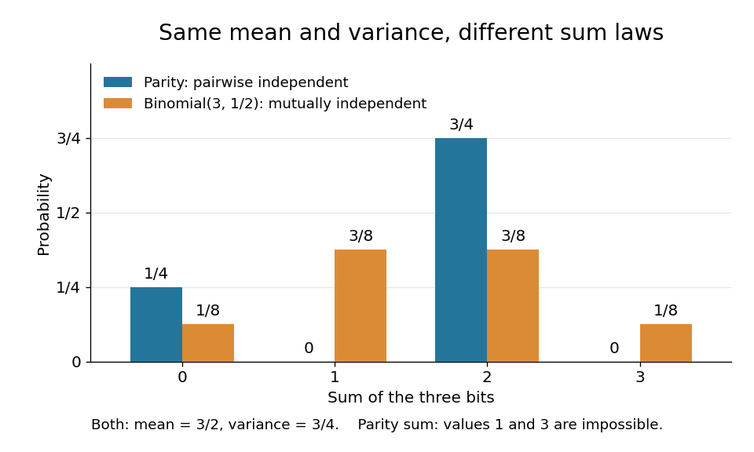

# Parity construction of pairwise independent bits

↑ **Parent:** [Pairwise independent events](pairwise-independent-events.md)

The [parity construction of pairwise independent bits](parity-construction-of-pairwise-independent-bits.md) turns two [independent](independent-random-variables.md) fair [bits](bit.md) into three [pairwise independent random variables](pairwise-independent-random-variables.md). With $X=U$, $Y=V$, and $Z=U\mathbin\oplus V$, their allowed triples are $000,011,101,110$, each of [probability](probability.md) $1/4$. Every coordinate has the [Bernoulli distribution](bernoulli-distribution.md) with parameter $1/2$. Every pair has the same [joint probability mass function](joint-probability-mass-function.md):

$$
\begin{array}{c|cccc}
(a,b)&(0,0)&(0,1)&(1,0)&(1,1)\\\hline
\mathbb P(X=a,Y=b)&1/4&1/4&1/4&1/4\\
\mathbb P(X=a,Z=b)&1/4&1/4&1/4&1/4\\
\mathbb P(Y=a,Z=b)&1/4&1/4&1/4&1/4
\end{array}
$$

All twelve pair cells equal the product of the corresponding [probabilities](probability.md) in their [marginal distributions](marginal-distribution.md). This establishes [pairwise independent random variables](pairwise-independent-random-variables.md), a requirement involving every pair of value-[events](event.md), rather than merely one chosen [event](event.md) per coordinate. For general real-valued [random variables](random-variable-split.md) $R_i$, the requirement is

$$
\mathbb P(R_i\in D,R_j\in E)=\mathbb P(R_i\in D)\mathbb P(R_j\in E)
\qquad(i\ne j)
$$

for every pair of [Borel sets](borel-set.md) $D,E$. For these binary [random variables](random-variable-split.md), checking all four cells of each pair suffices: any value-[event](event.md) is a union of the checked cells. In fact, for binary [random variables](random-variable-split.md), [independence](independent-random-variables.md) of their one-value [events](event.md) also gives the other cells by taking complements. Siegrist gives the all-set definition and its connection to [indicator random variables](indicator-random-variable.md) in [Random Services: independence of random variables](https://www.randomservices.org/random/prob/Independence.html).

The full [joint probability mass function](joint-probability-mass-function.md) tells a different story:

$$
\begin{array}{c|cccccccc}
(x,y,z)&000&001&010&011&100&101&110&111\\\hline
\mathbb P(X=x,Y=y,Z=z)&1/4&0&0&1/4&0&1/4&1/4&0\\
\mathbb P(X=x)\mathbb P(Y=y)\mathbb P(Z=z)&1/8&1/8&1/8&1/8&1/8&1/8&1/8&1/8
\end{array}
$$

The [integer parity](parity-mathematics.md) of $X+Y+Z$ is always even. Any two [bits](bit.md) determine the third: $Z=X\mathbin\oplus Y$, $X=Y\mathbin\oplus Z$, and $Y=X\mathbin\oplus Z$. Each coordinate is [independent](independent-random-variables.md) of either other coordinate individually, but is dependent on the pair together. For example, the [conditional probabilities](conditional-probability.md) satisfy $\mathbb P(Z=1\mid X=1)=1/2$ and $\mathbb P(Z=1\mid X=1,Y=1)=0$. See also [pairwise independence does not imply joint independence](pairwise-independence-does-not-imply-joint-independence.md) for the general distinction.

The constraint changes the sum's [probability distribution](probability-distribution.md) without changing its [expected value](expected-value.md) or [variance](variance-split.md). Let $S=X+Y+Z$. Only $000$ gives $S=0$; each other allowed triple gives $S=2$. Direct calculation gives

$$
\mathbb P(S=0)=\frac14,\qquad \mathbb P(S=2)=\frac34,\qquad
\mathbb E[S]=0\cdot\frac14+2\cdot\frac34=\frac32,\qquad
\mathbb E[S^2]=4\cdot\frac34=3,\qquad
\operatorname{Var}(S)=3-\left(\frac32\right)^2=\frac34.
$$

The same [variance](variance-split.md) follows from the [variance of a sum](variance-of-a-sum.md): each [Bernoulli distribution](bernoulli-distribution.md) has [variance](variance-split.md) $1/4$, and [pairwise independent random variables](pairwise-independent-random-variables.md) have zero cross [covariances](covariance.md). [Linearity of expectation](linearity-of-expectation.md) gives the [expected value](expected-value.md) $3/2$ even without [independence](independent-random-variables.md).

For comparison, the sum $T$ of three mutually [independent](independent-random-variables.md) fair [bits](bit.md) has the [binomial distribution](binomial-distribution.md) $\operatorname{Binomial}(3,1/2)$:

$$
\begin{array}{c|cccc}
t&0&1&2&3\\\hline
\mathbb P(T=t)&1/8&3/8&3/8&1/8
\end{array}
\qquad \mathbb E[T]=\frac32,\qquad \operatorname{Var}(T)=\frac34.
$$

Both sums have identical [expected values](expected-value.md) and [variances](variance-split.md), but $S$ never takes the values one or three. Even their third [moments](moment.md) differ: $\mathbb E[S^3]=6$, whereas $\mathbb E[T^3]=27/4$. [Pairwise independence](pairwise-independent-events.md) preserves these first two sum summaries while allowing a different [joint probability distribution](joint-probability-distribution.md) and a different sum law. The calculation is an exact finite example.

**[Figure 2](#image-pairwise-independence-preserves-the-mean-and-variance-but-changes-the-sum-distribution). Pairwise independence preserves the mean and variance but changes the sum distribution**. The [parity construction of pairwise independent bits](parity-construction-of-pairwise-independent-bits.md) gives sum [probabilities](probability.md) $(1/4,0,3/4,0)$; three mutually [independent](independent-random-variables.md) fair [bits](bit.md) give the [binomial distribution](binomial-distribution.md) [probabilities](probability.md) $(1/8,3/8,3/8,1/8)$. Both [expected values](expected-value.md) are $3/2$ and both [variances](variance-split.md) are $3/4$.

## ↑ Ancestors (6)

1. [Pairwise independent events](pairwise-independent-events.md)
2. [Probability theory](probability-theory-split.md)
3. [Probability and statistics](probability-and-statistics-split.md)
4. [Area of mathematics](area-of-mathematics.md)
5. [Mathematics](mathematics-split.md)
6. [Codex Wiki](split.md)

## ← Incoming links (2)

- [Pairwise independent events](pairwise-independent-events.md)
- [Parity construction of pairwise independent bits](parity-construction-of-pairwise-independent-bits.md)
