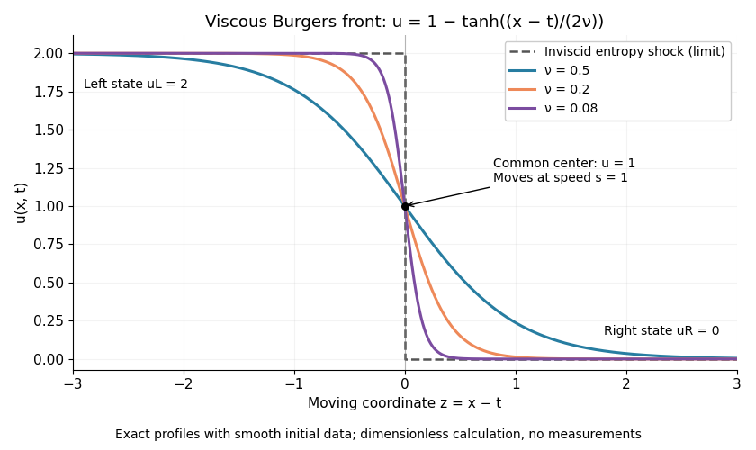

# Partial differential equation

↑ **Parent:** [Analysis](analysis.md)  
ⓦ [Wiki](https://en.wikipedia.org/wiki/Partial_differential_equation)

A [partial differential equation](partial-differential-equation.md) relates an unknown [function](function.md) of several independent variables to its [partial derivatives](multivariable-calculus.md#partial-derivative). For $u(x,t)$, the notation $u_t=\partial u/\partial t$ means changing time while holding position fixed; $u_{xx}=\partial^2u/\partial x^2$ measures how its spatial slope changes. Unlike an [ordinary differential equation](differential-equation.md#ordinary-differential-equation), a [partial differential equation](partial-differential-equation.md) can describe an entire evolving profile rather than a single trajectory.

The [heat equation](diffusion-equation.md#heat-equation) $u_t=D u_{xx}$ smooths spatial variations, the [transport equation](transport-equation.md) $u_t+c u_x=0$ moves them, and [Laplace's equation](#laplace-equation) $\Delta u=0$ describes a spatial equilibrium. Here $D>0$ is a [diffusivity](brownian-motion.md#diffusion-coefficient), $c$ is a [velocity](classical-mechanics.md#velocity), and $\Delta$ is the [Laplacian](multivariable-calculus.md#laplacian). The [periodic heat and transport comparison](transport-equation.md#periodic-heat-and-transport-comparison) makes the difference visible using identical [initial conditions](differential-equation.md#initial-condition).

A [partial differential equation](partial-differential-equation.md) usually supplies a local rule rather than a complete answer. For example, every $u(x,t)=A+Bx$ satisfies the [heat equation](diffusion-equation.md#heat-equation) with zero [PDE source term](#source-term-in-a-partial-differential-equation); data select which profile is relevant. A complete problem specifies its [domain of a function](function.md#domain-of-a-function), coefficients, [initial conditions](differential-equation.md#initial-condition), [boundary conditions](differential-equation.md#boundary-condition), and meaning of [solution of a partial differential equation](#solution-of-a-partial-differential-equation). A [well-posed problem](inverse-problem.md#well-posed-problem) has existence, uniqueness, and [continuous dependence on initial data](#continuous-dependence-on-initial-data) in stated spaces; the equation alone guarantees none of these.[Victor Ivrii, Initial and Boundary Value Problems](https://www.math.toronto.edu/ivrii/PDE-textbook/Chapter1/S1.2.html)

**Table of contents**

- [Initial and boundary data for evolution equations](#initial-and-boundary-data-for-evolution-equations)
  - [Source term in a partial differential equation](#source-term-in-a-partial-differential-equation)
- [Kuramoto-Sivashinsky equation](#kuramoto-sivashinsky-equation)
  - [Primary periodic bifurcation of the Kuramoto-Sivashinsky equation](#primary-periodic-bifurcation-of-the-kuramoto-sivashinsky-equation)
- [Green's identities](#green-s-identities)
  - [Green's third identity](#green-s-third-identity)
  - [Green's first identity](#green-s-first-identity)
    - [Gradient pairing with a boundary-constant function and a harmonic function](#gradient-pairing-with-a-boundary-constant-function-and-a-harmonic-function)
      - [Boundary flux from a singular harmonic potential](#boundary-flux-from-a-singular-harmonic-potential)
- [Maximum principle](#maximum-principle)
  - [Strong maximum principle for harmonic functions](#strong-maximum-principle-for-harmonic-functions)
  - [Maximum principle for harmonic functions](#maximum-principle-for-harmonic-functions)
- [Burgers' equation](#burgers-equation)
  - [Viscous Burgers equation](#viscous-burgers-equation)
    - [Viscous Burgers travelling shock](#viscous-burgers-travelling-shock)
    - [Modified Burgers equation with cubic flux](#modified-burgers-equation-with-cubic-flux)
      - [Traveling front of the cubic-flux Burgers equation](#traveling-front-of-the-cubic-flux-burgers-equation)
    - [Fay solution](#fay-solution)
      - [Fay shock-layer asymptotics](#fay-shock-layer-asymptotics)
    - [Burgers N-wave](#burgers-n-wave)
      - [Cole-Hopf solution for a Burgers N-wave](#cole-hopf-solution-for-a-burgers-n-wave)
    - [Viscous Burgers step solution with negative flux](#viscous-burgers-step-solution-with-negative-flux)
      - [Midpoint symmetry of a viscous Burgers step](#midpoint-symmetry-of-a-viscous-burgers-step)
    - [Cole-Hopf transformation](#cole-hopf-transformation)
      - [Time normalization in the Cole-Hopf transformation](#time-normalization-in-the-cole-hopf-transformation)
      - [Sinusoidal Cole-Hopf solution for negative-flux Burgers flow](#sinusoidal-cole-hopf-solution-for-negative-flux-burgers-flow)
      - [Finite-exponential Cole-Hopf solution](#finite-exponential-cole-hopf-solution)
        - [Extremal-state asymptotics of exponential Burgers solutions](#extremal-state-asymptotics-of-exponential-burgers-solutions)
- [Semilinear partial differential equation](#semilinear-partial-differential-equation)
  - [Semilinear heat equation](#semilinear-heat-equation)
- [Obstacle problem](#obstacle-problem)
- [Parabolic comparison principle](#parabolic-comparison-principle)
  - [Invariant interval for a cubic reaction-diffusion equation](#invariant-interval-for-a-cubic-reaction-diffusion-equation)
- [Domain of dependence](#domain-of-dependence)
- [Linear partial differential equation](#linear-partial-differential-equation)
- [Ill-posed problem](#ill-posed-problem)
- [Linear partial differential operator](#linear-partial-differential-operator)
- [Liouville equation](#liouville-equation)
- [Radial function](#radial-function)
- [Periodic domain](#periodic-domain)
- [Energy estimate](#energy-estimate)
  - [Bootstrap argument](#bootstrap-argument)
  - [Wave energy estimate](#wave-energy-estimate)
    - [Local wave energy estimate](#local-wave-energy-estimate)
  - [Hole-filling argument](#hole-filling-argument)
    - [Dyadic energy decay](#dyadic-energy-decay)
  - [Signed power test for a Laplacian eigenfunction](#signed-power-test-for-a-laplacian-eigenfunction)
  - [Caccioppoli inequality](#caccioppoli-inequality)
    - [Caccioppoli inequality with bounded lower-order terms](#caccioppoli-inequality-with-bounded-lower-order-terms)
      - [Strong local Sobolev compactness for a fixed elliptic equation](#strong-local-sobolev-compactness-for-a-fixed-elliptic-equation)
    - [Annular Caccioppoli inequality](#annular-caccioppoli-inequality)
    - [Power Caccioppoli inequality](#power-caccioppoli-inequality)
      - [Uniform power gain for elliptic solutions](#uniform-power-gain-for-elliptic-solutions)
    - [Logarithmic Caccioppoli inequality](#logarithmic-caccioppoli-inequality)
- [Second-order partial differential equation](#second-order-partial-differential-equation)
- [Quasilinear partial differential equation](#quasilinear-partial-differential-equation)
  - [Averaged linearization of a nonlinear divergence-form equation](#averaged-linearization-of-a-nonlinear-divergence-form-equation)
  - [p-Laplacian](#p-laplacian)
  - [Principal symbol of a partial differential equation](#principal-symbol-of-a-partial-differential-equation)
    - [Characteristic hypersurface](#characteristic-hypersurface)
      - [Characteristic plane](#characteristic-plane)
      - [Non-characteristic hypersurface](#non-characteristic-hypersurface)
      - [Characteristic coordinate](#characteristic-coordinate)
        - [Expanding-flow transformation of a wave equation](#expanding-flow-transformation-of-a-wave-equation)
    - [Hyperbolic partial differential equation](#hyperbolic-partial-differential-equation)
      - [Hyperbolicity](#hyperbolicity)
      - [Travel-time coordinate for a one-dimensional variable-speed wave equation](#travel-time-coordinate-for-a-one-dimensional-variable-speed-wave-equation)
        - [Characteristic curves for speed one minus y squared](#characteristic-curves-for-speed-one-minus-y-squared)
- [Cauchy problem](#cauchy-problem)
  - [Noncharacteristic Cauchy data](#noncharacteristic-cauchy-data)
  - [Continuous dependence on initial data](#continuous-dependence-on-initial-data)
  - [Cauchy data](#cauchy-data)
    - [Boundary jet](#boundary-jet)
  - [Cauchy-Kovalevskaya theorem](#cauchy-kovalevskaya-theorem)
    - [Holmgren uniqueness theorem](#holmgren-uniqueness-theorem)
      - [Parabolic-cap proof of Holmgren uniqueness](#parabolic-cap-proof-of-holmgren-uniqueness)
    - [Uniform Cauchy radius for polynomial forcing](#uniform-cauchy-radius-for-polynomial-forcing)
    - [General-order Cauchy-Kovalevskaya theorem](#general-order-cauchy-kovalevskaya-theorem)
    - [Analytic Goursat problem for a Klein--Gordon equation](#analytic-goursat-problem-for-a-klein-gordon-equation)
      - [Global continuation for the analytic Goursat problem](#global-continuation-for-the-analytic-goursat-problem)
- [Solution of a partial differential equation](#solution-of-a-partial-differential-equation)
  - [Classical solution](#classical-solution)
    - [Positive-time smoothing for a semilinear heat equation](#positive-time-smoothing-for-a-semilinear-heat-equation)
    - [Bounded parabolic differentiability class](#bounded-parabolic-differentiability-class)
  - [Weak solution](#weak-solution)
    - [Viscosity solution](#viscosity-solution)
      - [Continuous viscosity harmonic functions are classical](#continuous-viscosity-harmonic-functions-are-classical)
    - [Weak-strong uniqueness principle](#weak-strong-uniqueness-principle)
    - [Weak energy solution of a variable-coefficient wave equation](#weak-energy-solution-of-a-variable-coefficient-wave-equation)
    - [Weak formulation](#weak-formulation)
    - [Galerkin method](#galerkin-method)
      - [Petrov-Galerkin method](#petrov-galerkin-method)
      - [Fourier truncation](#fourier-truncation)
      - [Aubin-Lions lemma](#aubin-lions-lemma)
        - [Weak continuity from evolution-space bounds](#weak-continuity-from-evolution-space-bounds)
          - [Strong continuity from weak continuity and an energy equality](#strong-continuity-from-weak-continuity-and-an-energy-equality)
- [Elliptic boundary value problem](elliptic-boundary-value-problem.md)
  - [Direct spherical-shell H2 estimate](elliptic-boundary-value-problem.md#direct-spherical-shell-h2-estimate)
  - [Dirichlet realization of an elliptic operator](elliptic-boundary-value-problem.md#dirichlet-realization-of-an-elliptic-operator)
  - [Nonlinear elliptic boundary value problem](elliptic-boundary-value-problem.md#nonlinear-elliptic-boundary-value-problem)
    - [Ordered subsolution and supersolution](elliptic-boundary-value-problem.md#ordered-subsolution-and-supersolution)
      - [Monotone iteration for a semilinear elliptic equation](elliptic-boundary-value-problem.md#monotone-iteration-for-a-semilinear-elliptic-equation)
    - [Small-data existence for a nonlinear elliptic Dirichlet problem](elliptic-boundary-value-problem.md#small-data-existence-for-a-nonlinear-elliptic-dirichlet-problem)
    - [Cubic gradient nonlinearity](elliptic-boundary-value-problem.md#cubic-gradient-nonlinearity)
  - [Fredholm alternative for an elliptic Dirichlet problem](elliptic-boundary-value-problem.md#fredholm-alternative-for-an-elliptic-dirichlet-problem)
    - [Small positive zeroth-order perturbation of a Dirichlet problem](elliptic-boundary-value-problem.md#small-positive-zeroth-order-perturbation-of-a-dirichlet-problem)
    - [Boundary compatibility in the self-adjoint Fredholm alternative](elliptic-boundary-value-problem.md#boundary-compatibility-in-the-self-adjoint-fredholm-alternative)
  - [Uniformly elliptic operator](elliptic-boundary-value-problem.md#uniformly-elliptic-operator)
    - [Quadratic ellipticity does not bound a nonsymmetric coefficient matrix](elliptic-boundary-value-problem.md#quadratic-ellipticity-does-not-bound-a-nonsymmetric-coefficient-matrix)
    - [Nondivergence-form elliptic operator](elliptic-boundary-value-problem.md#nondivergence-form-elliptic-operator)
    - [Divergence-form elliptic operator](elliptic-boundary-value-problem.md#divergence-form-elliptic-operator)
      - [Constant flux for a one-dimensional divergence-form equation](elliptic-boundary-value-problem.md#constant-flux-for-a-one-dimensional-divergence-form-equation)
      - [Constant shifts of a divergence-form equation](elliptic-boundary-value-problem.md#constant-shifts-of-a-divergence-form-equation)
      - [Homogeneous divergence-form elliptic equation](elliptic-boundary-value-problem.md#homogeneous-divergence-form-elliptic-equation)
      - [Weak supersolution of a divergence-form elliptic equation](elliptic-boundary-value-problem.md#weak-supersolution-of-a-divergence-form-elliptic-equation)
      - [Weak subsolution of a divergence-form elliptic equation](elliptic-boundary-value-problem.md#weak-subsolution-of-a-divergence-form-elliptic-equation)
        - [Local boundedness of weak elliptic subsolutions](elliptic-boundary-value-problem.md#local-boundedness-of-weak-elliptic-subsolutions)
    - [Strict positivity implies coercivity for an elliptic Dirichlet form](elliptic-boundary-value-problem.md#strict-positivity-implies-coercivity-for-an-elliptic-dirichlet-form)
    - [Constant-coefficient elliptic second-derivative estimate](elliptic-boundary-value-problem.md#constant-coefficient-elliptic-second-derivative-estimate)
      - [Perturbation of a constant-coefficient elliptic second-derivative estimate](elliptic-boundary-value-problem.md#perturbation-of-a-constant-coefficient-elliptic-second-derivative-estimate)
        - [Coefficient-freezing interior second-derivative estimate](elliptic-boundary-value-problem.md#coefficient-freezing-interior-second-derivative-estimate)
          - [Interior H2 regularity for continuous nondivergence coefficients](elliptic-boundary-value-problem.md#interior-h2-regularity-for-continuous-nondivergence-coefficients)
    - [Strictly elliptic operator](elliptic-boundary-value-problem.md#strictly-elliptic-operator)
    - [Weak maximum principle for elliptic operators](elliptic-boundary-value-problem.md#weak-maximum-principle-for-elliptic-operators)
      - [Maximum bound for a monotone reaction term](elliptic-boundary-value-problem.md#maximum-bound-for-a-monotone-reaction-term)
      - [Supremum norm barrier for an elliptic Dirichlet problem](elliptic-boundary-value-problem.md#supremum-norm-barrier-for-an-elliptic-dirichlet-problem)
      - [Strong maximum principle for elliptic operators](elliptic-boundary-value-problem.md#strong-maximum-principle-for-elliptic-operators)
      - [Exponential perturbation proof of the weak maximum principle with drift](elliptic-boundary-value-problem.md#exponential-perturbation-proof-of-the-weak-maximum-principle-with-drift)
      - [Failure of the weak maximum principle with a positive zeroth-order coefficient](elliptic-boundary-value-problem.md#failure-of-the-weak-maximum-principle-with-a-positive-zeroth-order-coefficient)
      - [Alexandrov–Bakelman–Pucci estimate](elliptic-boundary-value-problem.md#alexandrov-bakelman-pucci-estimate)
      - [Strong minimum principle for elliptic operators](elliptic-boundary-value-problem.md#strong-minimum-principle-for-elliptic-operators)
    - [Schauder estimates](elliptic-boundary-value-problem.md#schauder-estimates)
      - [Interpolation inequality in Holder spaces](elliptic-boundary-value-problem.md#interpolation-inequality-in-holder-spaces)
      - [Interior Schauder estimate](elliptic-boundary-value-problem.md#interior-schauder-estimate)
        - [Necessity of Hölder forcing for Schauder estimates](elliptic-boundary-value-problem.md#necessity-of-holder-forcing-for-schauder-estimates)
        - [Blow-up compactness proof of an interior Schauder estimate](elliptic-boundary-value-problem.md#blow-up-compactness-proof-of-an-interior-schauder-estimate)
          - [Taylor normalization in elliptic blow-up arguments](elliptic-boundary-value-problem.md#taylor-normalization-in-elliptic-blow-up-arguments)
      - [Boundary Schauder estimate](elliptic-boundary-value-problem.md#boundary-schauder-estimate)
        - [Global Schauder estimate](elliptic-boundary-value-problem.md#global-schauder-estimate)
          - [Compactness of zero-boundary Poisson solutions](elliptic-boundary-value-problem.md#compactness-of-zero-boundary-poisson-solutions)
          - [Compactness proof of a nonnegative elliptic solution estimate](elliptic-boundary-value-problem.md#compactness-proof-of-a-nonnegative-elliptic-solution-estimate)
      - [Simon absorption lemma](elliptic-boundary-value-problem.md#simon-absorption-lemma)
    - [De Giorgi-Nash-Moser theorem](elliptic-boundary-value-problem.md#de-giorgi-nash-moser-theorem)
      - [Compactness of normalized weak elliptic solutions](elliptic-boundary-value-problem.md#compactness-of-normalized-weak-elliptic-solutions)
      - [Moser iteration](elliptic-boundary-value-problem.md#moser-iteration)
        - [Moser product on geometric radii](elliptic-boundary-value-problem.md#moser-product-on-geometric-radii)
        - [Liouville theorem for integrable nonnegative elliptic subsolutions](elliptic-boundary-value-problem.md#liouville-theorem-for-integrable-nonnegative-elliptic-subsolutions)
        - [Weak Harnack inequality](elliptic-boundary-value-problem.md#weak-harnack-inequality)
          - [Propagation of zeros by the weak Harnack inequality](elliptic-boundary-value-problem.md#propagation-of-zeros-by-the-weak-harnack-inequality)
          - [Oscillation decay estimate](elliptic-boundary-value-problem.md#oscillation-decay-estimate)
            - [Inhomogeneous oscillation decay implies Hölder continuity](elliptic-boundary-value-problem.md#inhomogeneous-oscillation-decay-implies-holder-continuity)
          - [Harnack inequality for uniformly elliptic divergence-form equations](elliptic-boundary-value-problem.md#harnack-inequality-for-uniformly-elliptic-divergence-form-equations)
  - [Degenerate elliptic operator](elliptic-boundary-value-problem.md#degenerate-elliptic-operator)
    - [Sine-mode expansion for a quadratically degenerate elliptic equation](elliptic-boundary-value-problem.md#sine-mode-expansion-for-a-quadratically-degenerate-elliptic-equation)
      - [Forced zero trace at a quadratically degenerate boundary](elliptic-boundary-value-problem.md#forced-zero-trace-at-a-quadratically-degenerate-boundary)
    - [Failure of a coercive Dirichlet estimate under degeneracy](elliptic-boundary-value-problem.md#failure-of-a-coercive-dirichlet-estimate-under-degeneracy)
  - [Method of continuity](elliptic-boundary-value-problem.md#method-of-continuity)
  - [Hopf lemma](elliptic-boundary-value-problem.md#hopf-lemma)
    - [Hopf dichotomy with classical regularity away from the zero set](elliptic-boundary-value-problem.md#hopf-dichotomy-with-classical-regularity-away-from-the-zero-set)
    - [Interior sphere condition](elliptic-boundary-value-problem.md#interior-sphere-condition)
- [Transport equation](transport-equation.md)
  - [Periodic heat and transport comparison](transport-equation.md#periodic-heat-and-transport-comparison)
  - [Compact third-order advection stencil](transport-equation.md#compact-third-order-advection-stencil)
  - [Hamiltonian transport equation](transport-equation.md#hamiltonian-transport-equation)
    - [Casimir invariant of a transport equation](transport-equation.md#casimir-invariant-of-a-transport-equation)
  - [Commuting velocity derivative for kinetic transport](transport-equation.md#commuting-velocity-derivative-for-kinetic-transport)
  - [Dispersion with a nonlinear velocity map](transport-equation.md#dispersion-with-a-nonlinear-velocity-map)
  - [Free transport equation](transport-equation.md#free-transport-equation)
    - [Free transport dispersion](transport-equation.md#free-transport-dispersion)
    - [Absolutely continuous representative along free characteristics](transport-equation.md#absolutely-continuous-representative-along-free-characteristics)
    - [Free-transport semigroup](transport-equation.md#free-transport-semigroup)
  - [Characteristic curve](transport-equation.md#characteristic-curve)
    - [Characteristic flow map](transport-equation.md#characteristic-flow-map)
      - [Phase-space flow Jacobian](transport-equation.md#phase-space-flow-jacobian)
      - [Global characteristic flow under linear growth](transport-equation.md#global-characteristic-flow-under-linear-growth)
    - [Method of characteristics](transport-equation.md#method-of-characteristics)
      - [Elliptic characteristics of a planar transport equation](transport-equation.md#elliptic-characteristics-of-a-planar-transport-equation)
      - [Characteristic components of a hyperbolic first-order equation](transport-equation.md#characteristic-components-of-a-hyperbolic-first-order-equation)
      - [Weighted Euler first-order equation](transport-equation.md#weighted-euler-first-order-equation)
      - [Fold tangency obstruction for characteristic data](transport-equation.md#fold-tangency-obstruction-for-characteristic-data)
      - [Characteristic equations for a transport equation](transport-equation.md#characteristic-equations-for-a-transport-equation)
  - [Linear transport equation](transport-equation.md#linear-transport-equation)
    - [Transport of a Dirac point mass](transport-equation.md#transport-of-a-dirac-point-mass)
    - [Coercive energy estimate for kinetic transport](transport-equation.md#coercive-energy-estimate-for-kinetic-transport)
    - [Lp conservation for incompressible transport](transport-equation.md#lp-conservation-for-incompressible-transport)
    - [Inflow transport boundary condition](transport-equation.md#inflow-transport-boundary-condition)
      - [Corner compatibility for constant-speed transport](transport-equation.md#corner-compatibility-for-constant-speed-transport)
    - [Weak transport solution under characteristic coordinates](transport-equation.md#weak-transport-solution-under-characteristic-coordinates)
    - [Adjoint transport equation](transport-equation.md#adjoint-transport-equation)
  - [System of conservation laws](transport-equation.md#system-of-conservation-laws)
    - [Riemann problem](transport-equation.md#riemann-problem)
      - [Single-rarefaction matching conditions for an ideal-gas Riemann problem](transport-equation.md#single-rarefaction-matching-conditions-for-an-ideal-gas-riemann-problem)
      - [Contact discontinuity](transport-equation.md#contact-discontinuity)
    - [Conservation law flux](transport-equation.md#conservation-law-flux)
    - [Quasilinear system](transport-equation.md#quasilinear-system)
      - [Hyperbolic system](transport-equation.md#hyperbolic-system)
    - [Flux Jacobian](transport-equation.md#flux-jacobian)
      - [Characteristic speed](transport-equation.md#characteristic-speed)
        - [Kinematic wave](transport-equation.md#kinematic-wave)
  - [Scalar conservation law](transport-equation.md#scalar-conservation-law)
    - [Sonic point of a scalar flux](transport-equation.md#sonic-point-of-a-scalar-flux)
    - [Uniformly convex scalar flux](transport-equation.md#uniformly-convex-scalar-flux)
    - [Viscous scalar conservation law](transport-equation.md#viscous-scalar-conservation-law)
      - [Vanishing viscosity approximation](transport-equation.md#vanishing-viscosity-approximation)
    - [Maximum representation for a concave conservation law](transport-equation.md#maximum-representation-for-a-concave-conservation-law)
      - [Square-root decay before characteristic crossing](transport-equation.md#square-root-decay-before-characteristic-crossing)
    - [Characteristic solution of a scalar conservation law](transport-equation.md#characteristic-solution-of-a-scalar-conservation-law)
    - [Concave-flux characteristic lifespan](transport-equation.md#concave-flux-characteristic-lifespan)
    - [Bounded-derivative Burgers flux](transport-equation.md#bounded-derivative-burgers-flux)
    - [Shock wave](transport-equation.md#shock-wave)
      - [Shock speed in a symmetric cloud collision](transport-equation.md#shock-speed-in-a-symmetric-cloud-collision)
      - [Radiative shock](transport-equation.md#radiative-shock)
        - [Shock cooling length](transport-equation.md#shock-cooling-length)
      - [Blast wave](transport-equation.md#blast-wave)
        - [Atmospheric blast-wave range](transport-equation.md#atmospheric-blast-wave-range)
      - [Rankine-Hugoniot conditions](transport-equation.md#rankine-hugoniot-conditions)
      - [Entropy shock](transport-equation.md#entropy-shock)
    - [Rarefaction wave](transport-equation.md#rarefaction-wave)
      - [Self-similar ideal-gas rarefaction](transport-equation.md#self-similar-ideal-gas-rarefaction)
    - [Inviscid Burgers equation](transport-equation.md#inviscid-burgers-equation)
      - [Burgers characteristic breaking](transport-equation.md#burgers-characteristic-breaking)
      - [Burgers Riemann problem with positive flux](transport-equation.md#burgers-riemann-problem-with-positive-flux)
      - [Periodic backward-sawtooth Burgers solution](transport-equation.md#periodic-backward-sawtooth-burgers-solution)
      - [Burgers Riemann problem with negative flux](transport-equation.md#burgers-riemann-problem-with-negative-flux)
      - [Entropy solution](transport-equation.md#entropy-solution)
        - [Kruzhkov entropy inequality](transport-equation.md#kruzhkov-entropy-inequality)
        - [Discrete entropy inequality](transport-equation.md#discrete-entropy-inequality)
        - [Averaged initial trace of an entropy solution](transport-equation.md#averaged-initial-trace-of-an-entropy-solution)
        - [Entropy flux for a scalar conservation law](transport-equation.md#entropy-flux-for-a-scalar-conservation-law)
          - [Kruzhkov entropy flux](transport-equation.md#kruzhkov-entropy-flux)
            - [Doubling of variables for scalar conservation laws](transport-equation.md#doubling-of-variables-for-scalar-conservation-laws)
              - [Kato inequality for scalar conservation laws](transport-equation.md#kato-inequality-for-scalar-conservation-laws)
                - [Local L1 contraction for scalar conservation laws](transport-equation.md#local-l1-contraction-for-scalar-conservation-laws)
                  - [Order preservation for scalar entropy solutions](transport-equation.md#order-preservation-for-scalar-entropy-solutions)
    - [Characteristic crossing](transport-equation.md#characteristic-crossing)
      - [Gradient blow-up](transport-equation.md#gradient-blow-up)
- [Helmholtz equation](#helmholtz-equation)
  - [Radial Dirichlet modes of a spherical cavity](#radial-dirichlet-modes-of-a-spherical-cavity)
  - [Dirichlet and Neumann spectra of a square](#dirichlet-and-neumann-spectra-of-a-square)
  - [Helmholtz Green-function reciprocity](#helmholtz-green-function-reciprocity)
  - [Discrete Helmholtz resonance](#discrete-helmholtz-resonance)
  - [Dirichlet-to-Neumann map for a Helmholtz half-space](#dirichlet-to-neumann-map-for-a-helmholtz-half-space)
  - [Outgoing Green function for the three-dimensional Helmholtz equation](#outgoing-green-function-for-the-three-dimensional-helmholtz-equation)
    - [Neumann representation for a radiating Helmholtz half-space](#neumann-representation-for-a-radiating-helmholtz-half-space)
    - [Radial Fourier representation of the Helmholtz Green function](#radial-fourier-representation-of-the-helmholtz-green-function)
    - [Dirichlet image kernel for the three-dimensional Helmholtz equation](#dirichlet-image-kernel-for-the-three-dimensional-helmholtz-equation)
    - [Weyl plane-wave representation](#weyl-plane-wave-representation)
  - [Wave scattering at a planar interface](#wave-scattering-at-a-planar-interface)
    - [Vertical wavenumber](#vertical-wavenumber)
    - [Snell's law](#snell-s-law)
    - [Scalar-wave interface condition](#scalar-wave-interface-condition)
    - [Reflection and transmission coefficients at a scalar-wave interface](#reflection-and-transmission-coefficients-at-a-scalar-wave-interface)
      - [Reflection coefficient](#reflection-coefficient)
      - [Transmission coefficient](#transmission-coefficient)
  - [Phase screen](#phase-screen)
    - [Phase-to-intensity conversion near a deterministic phase screen](#phase-to-intensity-conversion-near-a-deterministic-phase-screen)
    - [Random phase screen](#random-phase-screen)
      - [Stationary phase-screen power spectrum](#stationary-phase-screen-power-spectrum)
      - [Gaussian phase-screen correlation](#gaussian-phase-screen-correlation)
      - [Gaussian phase averaging](#gaussian-phase-averaging)
    - [Parabolic wave equation](#parabolic-wave-equation)
      - [Stationary intensity under free paraxial propagation](#stationary-intensity-under-free-paraxial-propagation)
      - [Mutual coherence in a white-noise parabolic medium](#mutual-coherence-in-a-white-noise-parabolic-medium)
      - [Norm conservation for the scalar parabolic wave equation](#norm-conservation-for-the-scalar-parabolic-wave-equation)
      - [Colored Gaussian paraxial mean propagator](#colored-gaussian-paraxial-mean-propagator)
      - [Paraxial approximation](#paraxial-approximation)
      - [Split-step Fourier method](#split-step-fourier-method)
      - [Free-space diffraction](#free-space-diffraction)
        - [Sommerfeld half-plane diffraction](#sommerfeld-half-plane-diffraction)
          - [Wiener-Hopf solution of rigid half-plane diffraction](#wiener-hopf-solution-of-rigid-half-plane-diffraction)
        - [Fresnel propagator](#fresnel-propagator)
          - [One-dimensional transverse Fresnel propagation](#one-dimensional-transverse-fresnel-propagation)
        - [Free-space fourth-moment propagator](#free-space-fourth-moment-propagator)
    - [Coherent and diffuse wave fields](#coherent-and-diffuse-wave-fields)
      - [Coherent attenuation by a Gaussian phase screen](#coherent-attenuation-by-a-gaussian-phase-screen)
      - [Coherent attenuation in a white-noise random medium](#coherent-attenuation-in-a-white-noise-random-medium)
    - [Phase curvature](#phase-curvature)
- [Modified Helmholtz equation](#modified-helmholtz-equation)
  - [Zero Dirichlet solution of the modified Helmholtz equation](#zero-dirichlet-solution-of-the-modified-helmholtz-equation)
  - [Yukawa kernel convolution](#yukawa-kernel-convolution)
  - [Quadrant modified Helmholtz Dirichlet Poisson formula](#quadrant-modified-helmholtz-dirichlet-poisson-formula)
  - [Modified Helmholtz closed spectral one-form](#modified-helmholtz-closed-spectral-one-form)
  - [Two-dimensional modified Helmholtz fundamental solution](#two-dimensional-modified-helmholtz-fundamental-solution)
  - [Modified Helmholtz adjoint plane wave](#modified-helmholtz-adjoint-plane-wave)
    - [Side localization of modified Helmholtz plane waves](#side-localization-of-modified-helmholtz-plane-waves)
  - [Radial modified Helmholtz equation](#radial-modified-helmholtz-equation)
- [Poisson's equation](#poisson-s-equation)
  - [Poisson equation with a spherical harmonic source](#poisson-equation-with-a-spherical-harmonic-source)
  - [Power-law angular mode for the planar Poisson equation](#power-law-angular-mode-for-the-planar-poisson-equation)
  - [Poisson potential of an exponential-over-radius source](#poisson-potential-of-an-exponential-over-radius-source)
  - [Poisson equation on a disk with angular forcing](#poisson-equation-on-a-disk-with-angular-forcing)
  - [Neumann Poisson problem](#neumann-poisson-problem)
    - [Neumann point source on a half-space boundary](#neumann-point-source-on-a-half-space-boundary)
  - [Radial Poisson gradient estimate](#radial-poisson-gradient-estimate)
    - [Failure of L2-to-Linfinity Poisson gradient bounds in three dimensions](#failure-of-l2-to-linfinity-poisson-gradient-bounds-in-three-dimensions)
  - [Poisson kernel](#poisson-kernel)
    - [Poisson kernel for the upper half-space](#poisson-kernel-for-the-upper-half-space)
      - [Axial Poisson extension of a circular boundary patch](#axial-poisson-extension-of-a-circular-boundary-patch)
      - [Poisson kernel for the upper half-plane](#poisson-kernel-for-the-upper-half-plane)
      - [Poisson integral](#poisson-integral)
        - [Poisson extension of interval boundary data](#poisson-extension-of-interval-boundary-data)
        - [Dirichlet Poisson integral in a quadrant](#dirichlet-poisson-integral-in-a-quadrant)
          - [Bounded Dirichlet uniqueness in a quadrant](#bounded-dirichlet-uniqueness-in-a-quadrant)
          - [Zero-boundary harmonic growth in a quadrant](#zero-boundary-harmonic-growth-in-a-quadrant)
          - [Holomorphic derivative of a quadrant Dirichlet solution](#holomorphic-derivative-of-a-quadrant-dirichlet-solution)
        - [Schwarz integral formula](#schwarz-integral-formula)
          - [Schwarz integral on the unit disk](#schwarz-integral-on-the-unit-disk)
          - [Harmonic quadrant solution from tangential boundary derivatives](#harmonic-quadrant-solution-from-tangential-boundary-derivatives)
- [Nonlinear partial differential equation](#nonlinear-partial-differential-equation)
  - [Nonlinear Schrödinger equation](#nonlinear-schrodinger-equation)
  - [Complex Ginzburg–Landau equation](#complex-ginzburg-landau-equation)
    - [Benjamin-Feir stability condition](#benjamin-feir-stability-condition)
      - [Long-wave phase reduction of the complex Ginzburg-Landau equation](#long-wave-phase-reduction-of-the-complex-ginzburg-landau-equation)
    - [Real-coefficient cubic-quintic amplitude equation](#real-coefficient-cubic-quintic-amplitude-equation)
      - [Stationary front of a cubic-quintic amplitude equation](#stationary-front-of-a-cubic-quintic-amplitude-equation)
    - [Nonlinear Ginzburg-Landau equation](#nonlinear-ginzburg-landau-equation)
      - [Ginzburg-Landau plane wave](#ginzburg-landau-plane-wave)
        - [Cubic amplitude saturation](#cubic-amplitude-saturation)
    - [Linear complex Ginzburg-Landau equation](#linear-complex-ginzburg-landau-equation)
      - [Airy global modes of a linearly confined Ginzburg-Landau equation](#airy-global-modes-of-a-linearly-confined-ginzburg-landau-equation)
      - [Green function of the linear complex Ginzburg-Landau equation](#green-function-of-the-linear-complex-ginzburg-landau-equation)
    - [Radial flow near a driven vortex core](#radial-flow-near-a-driven-vortex-core)
- [Moving-boundary problem](#moving-boundary-problem)
- [Diffusion equation](diffusion-equation.md)
  - [Scalar integrating factor for a reaction-diffusion equation](diffusion-equation.md#scalar-integrating-factor-for-a-reaction-diffusion-equation)
  - [Squared diffusion-residual action](diffusion-equation.md#squared-diffusion-residual-action)
    - [Time reversal of the squared diffusion-residual action](diffusion-equation.md#time-reversal-of-the-squared-diffusion-residual-action)
  - [Robin diffusion with a growing mode](diffusion-equation.md#robin-diffusion-with-a-growing-mode)
  - [Drift-diffusion equation with a potential](diffusion-equation.md#drift-diffusion-equation-with-a-potential)
  - [Diffusive time scale](diffusion-equation.md#diffusive-time-scale)
  - [Variable-coefficient conservative diffusion equation](diffusion-equation.md#variable-coefficient-conservative-diffusion-equation)
  - [Infinite propagation speed](diffusion-equation.md#infinite-propagation-speed)
  - [Periodic homogenization of a diffusion equation](diffusion-equation.md#periodic-homogenization-of-a-diffusion-equation)
  - [Porous medium equation](diffusion-equation.md#porous-medium-equation)
    - [Spherical nonlinear-diffusion source profile](diffusion-equation.md#spherical-nonlinear-diffusion-source-profile)
    - [Compact radial cubic-diffusion profile](diffusion-equation.md#compact-radial-cubic-diffusion-profile)
    - [Finite propagation in porous-medium diffusion](diffusion-equation.md#finite-propagation-in-porous-medium-diffusion)
    - [Forced filling similarity for power-law diffusion](diffusion-equation.md#forced-filling-similarity-for-power-law-diffusion)
    - [Separable draining profile for power-law diffusion](diffusion-equation.md#separable-draining-profile-for-power-law-diffusion)
    - [Barenblatt solution](diffusion-equation.md#barenblatt-solution)
      - [Radial cubic-diffusion source profile](diffusion-equation.md#radial-cubic-diffusion-source-profile)
      - [Planar volume-conserving nonlinear-diffusion similarity](diffusion-equation.md#planar-volume-conserving-nonlinear-diffusion-similarity)
        - [Semicircular pulse under cubic diffusion](diffusion-equation.md#semicircular-pulse-under-cubic-diffusion)
      - [Two-dimensional Barenblatt profile for quadratic porous-medium diffusion](diffusion-equation.md#two-dimensional-barenblatt-profile-for-quadratic-porous-medium-diffusion)
  - [Fick's first law](diffusion-equation.md#fick-s-first-law)
  - [Heat equation](diffusion-equation.md#heat-equation)
    - [Heat balance with volumetric heat generation](diffusion-equation.md#heat-balance-with-volumetric-heat-generation)
    - [Annual ground-temperature wave](diffusion-equation.md#annual-ground-temperature-wave)
    - [Fixed-temperature and fixed-flux heat equation on an interval](diffusion-equation.md#fixed-temperature-and-fixed-flux-heat-equation-on-an-interval)
    - [Heat flow from a triangular initial temperature](diffusion-equation.md#heat-flow-from-a-triangular-initial-temperature)
      - [Heat flow from a triangular initial temperature with insulated endpoints](diffusion-equation.md#heat-flow-from-a-triangular-initial-temperature-with-insulated-endpoints)
    - [Cooling of an initially uniform square](diffusion-equation.md#cooling-of-an-initially-uniform-square)
    - [Periodic diffusion on a circle](diffusion-equation.md#periodic-diffusion-on-a-circle)
      - [Periodic sine with an endpoint-correcting linear term](diffusion-equation.md#periodic-sine-with-an-endpoint-correcting-linear-term)
    - [Heat equation with a single stationary sine forcing](diffusion-equation.md#heat-equation-with-a-single-stationary-sine-forcing)
    - [Steady temperature of a uniformly heated cylindrical wire](diffusion-equation.md#steady-temperature-of-a-uniformly-heated-cylindrical-wire)
    - [Fundamental diffusion mode](diffusion-equation.md#fundamental-diffusion-mode)
    - [Heat equation on a rectangle with two insulated sides](diffusion-equation.md#heat-equation-on-a-rectangle-with-two-insulated-sides)
    - [Reaction-diffusion spectral decay threshold](diffusion-equation.md#reaction-diffusion-spectral-decay-threshold)
      - [Spherical reaction-diffusion growth threshold](diffusion-equation.md#spherical-reaction-diffusion-growth-threshold)
    - [Heat evolution of bounded data need not converge at large times](diffusion-equation.md#heat-evolution-of-bounded-data-need-not-converge-at-large-times)
    - [Dirichlet heat-reaction threshold on the unit square](diffusion-equation.md#dirichlet-heat-reaction-threshold-on-the-unit-square)
    - [Heat operator](diffusion-equation.md#heat-operator)
    - [Heat-equation uniqueness under Gaussian growth](diffusion-equation.md#heat-equation-uniqueness-under-gaussian-growth)
    - [Backward heat equation](diffusion-equation.md#backward-heat-equation)
      - [Space-time harmonic functions along Brownian motion](diffusion-equation.md#space-time-harmonic-functions-along-brownian-motion)
    - [Heat equation maximum principle](diffusion-equation.md#heat-equation-maximum-principle)
    - [Heat equation energy identity](diffusion-equation.md#heat-equation-energy-identity)
    - [Dirichlet boundary-forcing heat-kernel formula](diffusion-equation.md#dirichlet-boundary-forcing-heat-kernel-formula)
      - [Half-line drift boundary kernel](diffusion-equation.md#half-line-drift-boundary-kernel)
    - [Dirichlet energy dissipation for the heat equation](diffusion-equation.md#dirichlet-energy-dissipation-for-the-heat-equation)
    - [Radial heat equation in three dimensions](diffusion-equation.md#radial-heat-equation-in-three-dimensions)
      - [Spherical-shell heat equation via radial rescaling](diffusion-equation.md#spherical-shell-heat-equation-via-radial-rescaling)
    - [Sinusoidally forced heat equation on a half-line](diffusion-equation.md#sinusoidally-forced-heat-equation-on-a-half-line)
    - [Potential Burgers equation](diffusion-equation.md#potential-burgers-equation)
    - [Heat kernel](diffusion-equation.md#heat-kernel)
      - [Heat kernel trace formula](diffusion-equation.md#heat-kernel-trace-formula)
      - [Positive diffusivity requirement for the forward heat kernel](diffusion-equation.md#positive-diffusivity-requirement-for-the-forward-heat-kernel)
      - [Heat-kernel convolution](diffusion-equation.md#heat-kernel-convolution)
      - [Riemannian heat kernel](diffusion-equation.md#riemannian-heat-kernel)
        - [Heat kernel on a finite isometric quotient](diffusion-equation.md#heat-kernel-on-a-finite-isometric-quotient)
          - [Heat semigroup descent through a finite normal covering](diffusion-equation.md#heat-semigroup-descent-through-a-finite-normal-covering)
        - [Spectral expansion of the Riemannian heat kernel](diffusion-equation.md#spectral-expansion-of-the-riemannian-heat-kernel)
        - [Heat parametrix](diffusion-equation.md#heat-parametrix)
          - [Heat-kernel transport equations](diffusion-equation.md#heat-kernel-transport-equations)
          - [Volterra parametrix correction](diffusion-equation.md#volterra-parametrix-correction)
      - [Gaussian interval mass](diffusion-equation.md#gaussian-interval-mass)
      - [Heat Poisson kernel](diffusion-equation.md#heat-poisson-kernel)
      - [Dirichlet heat kernel on an interval](diffusion-equation.md#dirichlet-heat-kernel-on-an-interval)
        - [Survival probability from an absorbing transition density](diffusion-equation.md#survival-probability-from-an-absorbing-transition-density)
          - [Symmetric absorbing-interval survival probability](diffusion-equation.md#symmetric-absorbing-interval-survival-probability)
        - [Thermal trace of an interval image kernel](diffusion-equation.md#thermal-trace-of-an-interval-image-kernel)
      - [Gaussian heat kernel](diffusion-equation.md#gaussian-heat-kernel)
        - [Gaussian initial data for the heat equation](diffusion-equation.md#gaussian-initial-data-for-the-heat-equation)
          - [Odd pair of Gaussian profiles under diffusion](diffusion-equation.md#odd-pair-of-gaussian-profiles-under-diffusion)
        - [Newtonian potential of the Brownian heat kernel](diffusion-equation.md#newtonian-potential-of-the-brownian-heat-kernel)
      - [Neumann heat kernel on an interval](diffusion-equation.md#neumann-heat-kernel-on-an-interval)
      - [Heat semigroup](diffusion-equation.md#heat-semigroup)
        - [Spectral construction of a parabolic solution](diffusion-equation.md#spectral-construction-of-a-parabolic-solution)
      - [Heat kernel expansion](diffusion-equation.md#heat-kernel-expansion)
        - [Heat invariants](diffusion-equation.md#heat-invariants)
          - [Integrated second scalar heat coefficient](diffusion-equation.md#integrated-second-scalar-heat-coefficient)
          - [Spectral determination of hyperbolic curvature on a surface](diffusion-equation.md#spectral-determination-of-hyperbolic-curvature-on-a-surface)
        - [Curvature coefficient of the scalar heat kernel](diffusion-equation.md#curvature-coefficient-of-the-scalar-heat-kernel)
        - [Normal-coordinate divergence-form heat parametrix](diffusion-equation.md#normal-coordinate-divergence-form-heat-parametrix)
      - [Gaussian approximate identity](diffusion-equation.md#gaussian-approximate-identity)
      - [Heat-kernel solution](diffusion-equation.md#heat-kernel-solution)
        - [Heat-kernel convergence from a conditionally convergent Gaussian integral](diffusion-equation.md#heat-kernel-convergence-from-a-conditionally-convergent-gaussian-integral)
        - [Heat-kernel convergence for Gaussian-integrable initial data](diffusion-equation.md#heat-kernel-convergence-for-gaussian-integrable-initial-data)
        - [Heat equation with interval-indicator initial data](diffusion-equation.md#heat-equation-with-interval-indicator-initial-data)
      - [Neumann heat kernel on a half-line](diffusion-equation.md#neumann-heat-kernel-on-a-half-line)
    - [Probabilistic representation of the heat equation with time-dependent Dirichlet data](diffusion-equation.md#probabilistic-representation-of-the-heat-equation-with-time-dependent-dirichlet-data)
    - [Duhamel's principle](diffusion-equation.md#duhamel-s-principle)
      - [Causal diffusion from a finite-duration planar point source](diffusion-equation.md#causal-diffusion-from-a-finite-duration-planar-point-source)
      - [Cancellation of two heat-kernel impulses](diffusion-equation.md#cancellation-of-two-heat-kernel-impulses)
  - [Advection-diffusion equation](diffusion-equation.md#advection-diffusion-equation)
    - [Drift-diffusion decay time](diffusion-equation.md#drift-diffusion-decay-time)
    - [Homogenization of a periodic advection-diffusion equation](diffusion-equation.md#homogenization-of-a-periodic-advection-diffusion-equation)
    - [Transported step forcing in an advection-diffusion equation](diffusion-equation.md#transported-step-forcing-in-an-advection-diffusion-equation)
    - [Half-line advection-diffusion global relation](diffusion-equation.md#half-line-advection-diffusion-global-relation)
    - [Constant-flux tracer inlet solution](diffusion-equation.md#constant-flux-tracer-inlet-solution)
    - [Constant-concentration inlet solution](diffusion-equation.md#constant-concentration-inlet-solution)
    - [Dirichlet gauge transform for constant drift](diffusion-equation.md#dirichlet-gauge-transform-for-constant-drift)
      - [Mixed-boundary drift-diffusion eigenmodes on a rectangle](diffusion-equation.md#mixed-boundary-drift-diffusion-eigenmodes-on-a-rectangle)
      - [Weighted sine transform for half-line drift diffusion](diffusion-equation.md#weighted-sine-transform-for-half-line-drift-diffusion)
      - [Resolvent kernel for Dirichlet advection-diffusion on an interval](diffusion-equation.md#resolvent-kernel-for-dirichlet-advection-diffusion-on-an-interval)
    - [Gamma impulse solution for linearly increasing diffusivity](diffusion-equation.md#gamma-impulse-solution-for-linearly-increasing-diffusivity)
    - [Robin gauge transform for constant drift](diffusion-equation.md#robin-gauge-transform-for-constant-drift)
    - [Weighted Neumann heat kernel with constant drift](diffusion-equation.md#weighted-neumann-heat-kernel-with-constant-drift)
      - [Resolvent kernel for Neumann advection-diffusion on an interval](diffusion-equation.md#resolvent-kernel-for-neumann-advection-diffusion-on-an-interval)
      - [Neumann boundary-forcing formula](diffusion-equation.md#neumann-boundary-forcing-formula)
    - [Advection-diffusion heat-kernel solution](diffusion-equation.md#advection-diffusion-heat-kernel-solution)
      - [Half-line drift reflection kernel](diffusion-equation.md#half-line-drift-reflection-kernel)
  - [Nonlinear diffusion equation](diffusion-equation.md#nonlinear-diffusion-equation)
    - [Quadratic profiles for nonlinear diffusion with constant loss](diffusion-equation.md#quadratic-profiles-for-nonlinear-diffusion-with-constant-loss)
    - [Logarithmic diffusion](diffusion-equation.md#logarithmic-diffusion)
    - [Principal diffusion coefficients](diffusion-equation.md#principal-diffusion-coefficients)
    - [Perona-Malik equation](diffusion-equation.md#perona-malik-equation)
      - [Forward-backward threshold for gradient-weighted exponential diffusion](diffusion-equation.md#forward-backward-threshold-for-gradient-weighted-exponential-diffusion)
      - [Regularized Perona-Malik diffusion](diffusion-equation.md#regularized-perona-malik-diffusion)
    - [Two-dimensional Barenblatt solution with diffusivity proportional to concentration](diffusion-equation.md#two-dimensional-barenblatt-solution-with-diffusivity-proportional-to-concentration)
      - [Linear-reaction time change for quadratic nonlinear diffusion](diffusion-equation.md#linear-reaction-time-change-for-quadratic-nonlinear-diffusion)
  - [Reaction–diffusion system](diffusion-equation.md#reaction-diffusion-system)
    - [Cubic fast-slow reaction-diffusion model](diffusion-equation.md#cubic-fast-slow-reaction-diffusion-model)
    - [Diffusion-driven stationary instability](diffusion-equation.md#diffusion-driven-stationary-instability)
      - [Finite-domain selection of a reaction-diffusion instability](diffusion-equation.md#finite-domain-selection-of-a-reaction-diffusion-instability)
      - [Equal diffusion cannot destabilize a stable reaction Jacobian](diffusion-equation.md#equal-diffusion-cannot-destabilize-a-stable-reaction-jacobian)
    - [Removing a variable scalar reaction rate by an integrating factor](diffusion-equation.md#removing-a-variable-scalar-reaction-rate-by-an-integrating-factor)
    - [Positivity of the first Dirichlet reaction-diffusion coefficient](diffusion-equation.md#positivity-of-the-first-dirichlet-reaction-diffusion-coefficient)
    - [Dirichlet reaction-diffusion growth threshold in a cuboid](diffusion-equation.md#dirichlet-reaction-diffusion-growth-threshold-in-a-cuboid)
    - [Bistable cubic reaction-diffusion equation](diffusion-equation.md#bistable-cubic-reaction-diffusion-equation)
      - [Logistic front of a bistable cubic equation](diffusion-equation.md#logistic-front-of-a-bistable-cubic-equation)
    - [Basally forced quadratic activator-inhibitor model](diffusion-equation.md#basally-forced-quadratic-activator-inhibitor-model)
      - [Weak focus at the Hopf threshold of a basal activator-inhibitor model](diffusion-equation.md#weak-focus-at-the-hopf-threshold-of-a-basal-activator-inhibitor-model)
      - [Turing threshold of a basally forced quadratic activator-inhibitor model](diffusion-equation.md#turing-threshold-of-a-basally-forced-quadratic-activator-inhibitor-model)
    - [Inhibitor in a reaction-diffusion system](diffusion-equation.md#inhibitor-in-a-reaction-diffusion-system)
    - [Activator in a reaction-diffusion system](diffusion-equation.md#activator-in-a-reaction-diffusion-system)
    - [Quadratic activator-inhibitor model](diffusion-equation.md#quadratic-activator-inhibitor-model)
      - [Turing threshold of the quadratic activator-inhibitor model](diffusion-equation.md#turing-threshold-of-the-quadratic-activator-inhibitor-model)
      - [Positive-quadrant Dulac multiplier for quadratic activation](diffusion-equation.md#positive-quadrant-dulac-multiplier-for-quadratic-activation)
    - [Spatially homogeneous equilibrium](diffusion-equation.md#spatially-homogeneous-equilibrium)
    - [Morphogen reaction-diffusion equation](diffusion-equation.md#morphogen-reaction-diffusion-equation)
      - [Mixed Dirichlet-Neumann modes on an interval](diffusion-equation.md#mixed-dirichlet-neumann-modes-on-an-interval)
        - [Critical length for a linearly growing morphogen](diffusion-equation.md#critical-length-for-a-linearly-growing-morphogen)
    - [Fast-inhibitor elimination in a reaction-diffusion system](diffusion-equation.md#fast-inhibitor-elimination-in-a-reaction-diffusion-system)
      - [Dispersion relation after fast-inhibitor elimination](diffusion-equation.md#dispersion-relation-after-fast-inhibitor-elimination)
    - [Turing pattern](diffusion-equation.md#turing-pattern)
      - [Turing instability](diffusion-equation.md#turing-instability)
        - [Fast-inhibitor cubic activator growth rate](diffusion-equation.md#fast-inhibitor-cubic-activator-growth-rate)
        - [Two-species diffusion-driven instability criterion](diffusion-equation.md#two-species-diffusion-driven-instability-criterion)
          - [Impossibility of a two-species Turing instability at equal diffusivities](diffusion-equation.md#impossibility-of-a-two-species-turing-instability-at-equal-diffusivities)
          - [Near-unity diffusivity ratio for a Turing instability](diffusion-equation.md#near-unity-diffusivity-ratio-for-a-turing-instability)
    - [Brusselator](diffusion-equation.md#brusselator)
      - [Hopf coefficient of the Brusselator](diffusion-equation.md#hopf-coefficient-of-the-brusselator)
      - [Brusselator trapping region](diffusion-equation.md#brusselator-trapping-region)
      - [Brusselator periodic-orbit criterion](diffusion-equation.md#brusselator-periodic-orbit-criterion)
      - [Turing threshold of the Brusselator](diffusion-equation.md#turing-threshold-of-the-brusselator)
        - [Discrete-mode Turing threshold for the Brusselator](diffusion-equation.md#discrete-mode-turing-threshold-for-the-brusselator)
        - [Brusselator Turing-before-Hopf diffusivity condition](diffusion-equation.md#brusselator-turing-before-hopf-diffusivity-condition)
- [Similarity solution](#similarity-solution)
  - [Similarity reduction](#similarity-reduction)
  - [Similarity ansatz](#similarity-ansatz)
  - [Similarity profile](#similarity-profile)
- [Separation of variables](#separation-of-variables)
  - [Decay of a Fourier mode in a third-order spatial evolution equation](#decay-of-a-fourier-mode-in-a-third-order-spatial-evolution-equation)
  - [Separation constant](#separation-constant)
  - [Dirichlet problem on an annulus for one Fourier mode](#dirichlet-problem-on-an-annulus-for-one-fourier-mode)
- [Polynomial ansatz](#polynomial-ansatz)
- [Harmonic function](#harmonic-function)
  - [Harmonic function in a rectangle with one constant boundary value](#harmonic-function-in-a-rectangle-with-one-constant-boundary-value)
  - [Axisymmetric harmonic interpolation between concentric spheres](#axisymmetric-harmonic-interpolation-between-concentric-spheres)
  - [Nondegenerate stationary points of a planar harmonic function](#nondegenerate-stationary-points-of-a-planar-harmonic-function)
  - [Componentwise harmonic vector field](#componentwise-harmonic-vector-field)
  - [Harmonic odd reflection across a hyperplane](#harmonic-odd-reflection-across-a-hyperplane)
  - [Harmonic Hardy space of the upper half-space](#harmonic-hardy-space-of-the-upper-half-space)
    - [Poisson representation of harmonic h1 by finite measures](#poisson-representation-of-harmonic-h1-by-finite-measures)
  - [Gradient of a dipole potential](#gradient-of-a-dipole-potential)
  - [Kelvin transform](#kelvin-transform)
    - [Spherical inversion preserves angular derivatives](#spherical-inversion-preserves-angular-derivatives)
  - [Harmonic functions of Brownian motion](#harmonic-functions-of-brownian-motion)
  - [Pluriharmonic function](#pluriharmonic-function)
  - [Compact convergence of locally bounded harmonic functions](#compact-convergence-of-locally-bounded-harmonic-functions)
  - [Poisson integral on the unit disk](#poisson-integral-on-the-unit-disk)
    - [Poisson integral converges nontangentially at Lebesgue points](#poisson-integral-converges-nontangentially-at-lebesgue-points)
    - [Poisson kernel on the circle](#poisson-kernel-on-the-circle)
      - [Uniform Poisson summability of continuous circle functions](#uniform-poisson-summability-of-continuous-circle-functions)
      - [Conjugate Poisson kernel on the circle](#conjugate-poisson-kernel-on-the-circle)
        - [One-sided Fourier spectrum excludes jumps](#one-sided-fourier-spectrum-excludes-jumps)
  - [Angular average of a logarithmic potential](#angular-average-of-a-logarithmic-potential)
  - [Vanishing harmonic function by level-set integration](#vanishing-harmonic-function-by-level-set-integration)
  - [Weakly harmonic Sobolev function](#weakly-harmonic-sobolev-function)
  - [Discrete harmonic function](#discrete-harmonic-function)
    - [Bounded harmonic function theorem on a recurrent graph](#bounded-harmonic-function-theorem-on-a-recurrent-graph)
    - [Harmonic maximum principle on a finite graph](#harmonic-maximum-principle-on-a-finite-graph)
    - [Bounded harmonic function theorem on the integer lattice](#bounded-harmonic-function-theorem-on-the-integer-lattice)
  - [Removable singularity for a bounded harmonic function](#removable-singularity-for-a-bounded-harmonic-function)
  - [Harmonic replacement](#harmonic-replacement)
  - [Mean value property for harmonic functions](#mean-value-property-for-harmonic-functions)
    - [Harnack inequality for harmonic functions](#harnack-inequality-for-harmonic-functions)
      - [Harnack inequality on the unit disk](#harnack-inequality-on-the-unit-disk)
        - [Sharp gradient bound for positive harmonic functions](#sharp-gradient-bound-for-positive-harmonic-functions)
    - [Local converse to the mean value property](#local-converse-to-the-mean-value-property)
  - [Weyl lemma](#weyl-lemma)
  - [Interior derivative estimate for a harmonic function](#interior-derivative-estimate-for-a-harmonic-function)
  - [Polynomial-growth Liouville theorem for harmonic functions](#polynomial-growth-liouville-theorem-for-harmonic-functions)
    - [Liouville lemma for globally Hölder harmonic functions](#liouville-lemma-for-globally-holder-harmonic-functions)
  - [Harmonic function as the real part of a holomorphic function](#harmonic-function-as-the-real-part-of-a-holomorphic-function)
  - [Subharmonic function](#subharmonic-function)
    - [Modulus powers of holomorphic functions are subharmonic](#modulus-powers-of-holomorphic-functions-are-subharmonic)
    - [Laplacian identity for the squared modulus of a holomorphic function](#laplacian-identity-for-the-squared-modulus-of-a-holomorphic-function)
    - [Harmonic majorant](#harmonic-majorant)
      - [Least harmonic majorant by expanding disk lifts](#least-harmonic-majorant-by-expanding-disk-lifts)
    - [Harmonic lifting of a continuous subharmonic function](#harmonic-lifting-of-a-continuous-subharmonic-function)
    - [Locally integrable supremum theorem for subharmonic functions](#locally-integrable-supremum-theorem-for-subharmonic-functions)
    - [Superharmonic function](#superharmonic-function)
    - [Canonical representative of a subharmonic distribution](#canonical-representative-of-a-subharmonic-distribution)
    - [Maximum principle for subharmonic functions](#maximum-principle-for-subharmonic-functions)
      - [Strong maximum principle for subharmonic functions](#strong-maximum-principle-for-subharmonic-functions)
      - [Gradient maximum principle for harmonic functions](#gradient-maximum-principle-for-harmonic-functions)
  - [Harmonic Liouville theorem](#harmonic-liouville-theorem)
    - [Gaussian heat-kernel proof of the harmonic Liouville theorem](#gaussian-heat-kernel-proof-of-the-harmonic-liouville-theorem)
    - [One-sided bounded harmonic functions on the punctured plane are constant](#one-sided-bounded-harmonic-functions-on-the-punctured-plane-are-constant)
    - [Brownian coupling proof of the harmonic Liouville theorem](#brownian-coupling-proof-of-the-harmonic-liouville-theorem)
    - [Surjectivity of a nonconstant entire harmonic function](#surjectivity-of-a-nonconstant-entire-harmonic-function)
  - [Scale-periodic harmonic function from an elliptic function](#scale-periodic-harmonic-function-from-an-elliptic-function)
  - [Harmonic polynomial](#harmonic-polynomial)
    - [Harmonic decomposition of homogeneous polynomials](#harmonic-decomposition-of-homogeneous-polynomials)
  - [Harmonic conjugate](#harmonic-conjugate)
    - [Orthogonal level curves of harmonic conjugates](#orthogonal-level-curves-of-harmonic-conjugates)
    - [Global harmonic conjugate criterion by vanishing periods](#global-harmonic-conjugate-criterion-by-vanishing-periods)
      - [Logarithmic cancellation on an exterior annulus](#logarithmic-cancellation-on-an-exterior-annulus)
    - [Composition of harmonic conjugate pairs](#composition-of-harmonic-conjugate-pairs)
    - [Harmonic angle and logarithmic radius](#harmonic-angle-and-logarithmic-radius)
    - [Local harmonic conjugate](#local-harmonic-conjugate)
    - [Log modulus has no global harmonic conjugate on the punctured plane](#log-modulus-has-no-global-harmonic-conjugate-on-the-punctured-plane)
  - [Harmonic functions are smooth](#harmonic-functions-are-smooth)
  - [Harmonic functions are real analytic](#harmonic-functions-are-real-analytic)
    - [Unique continuation for harmonic functions](#unique-continuation-for-harmonic-functions)
- [Smooth bump function](#smooth-bump-function)
  - [Disjoint-support zero-product construction](#disjoint-support-zero-product-construction)
- [Laplace operator](#laplace-operator)
  - [Neumann Laplacian](#neumann-laplacian)
  - [Dirichlet Laplacian](#dirichlet-laplacian)
    - [Dirichlet eigensystem of a rectangle](#dirichlet-eigensystem-of-a-rectangle)
    - [Dirichlet resonance in an equilateral triangle](#dirichlet-resonance-in-an-equilateral-triangle)
    - [Fractional Dirichlet domain scale](#fractional-dirichlet-domain-scale)
  - [Polar-coordinate Laplacian identity](#polar-coordinate-laplacian-identity)
  - [Rotational commutator for the Laplacian](#rotational-commutator-for-the-laplacian)
  - [Laplace equation](#laplace-equation)
    - [Poisson kernel for the unit disk](#poisson-kernel-for-the-unit-disk)
      - [Disk potential with two semicircular boundary values](#disk-potential-with-two-semicircular-boundary-values)
      - [Area norm of the Poisson extension in the unit disk](#area-norm-of-the-poisson-extension-in-the-unit-disk)
    - [Harmonic potential between a grounded line and a circular boundary](#harmonic-potential-between-a-grounded-line-and-a-circular-boundary)
    - [Harmonic Fourier expansions in planar concentric domains](#harmonic-fourier-expansions-in-planar-concentric-domains)
      - [Two-boundary annular harmonic interpolation](#two-boundary-annular-harmonic-interpolation)
    - [Separated Laplace mode with a Robin edge](#separated-laplace-mode-with-a-robin-edge)
    - [Spherical harmonic matching with a derivative jump](#spherical-harmonic-matching-with-a-derivative-jump)
    - [Fourier solution of the strip Dirichlet problem](#fourier-solution-of-the-strip-dirichlet-problem)
    - [Harmonic matching across a circle with a derivative jump](#harmonic-matching-across-a-circle-with-a-derivative-jump)
    - [Zero-boundary harmonic function with pointwise vertical decay](#zero-boundary-harmonic-function-with-pointwise-vertical-decay)
    - [Exterior harmonic potential with no flux through a sphere](#exterior-harmonic-potential-with-no-flux-through-a-sphere)
    - [Green function of the Laplacian](#green-function-of-the-laplacian)
      - [Point-source potential with one compact spatial dimension](#point-source-potential-with-one-compact-spatial-dimension)
      - [Fundamental solution of the Laplace equation](#fundamental-solution-of-the-laplace-equation)
    - [Laplace equation in polar coordinates](#laplace-equation-in-polar-coordinates)
      - [Harmonic extension in a circular sector](#harmonic-extension-in-a-circular-sector)
    - [Laplace equation in cylindrical coordinates](#laplace-equation-in-cylindrical-coordinates)
      - [Side boundary data do not determine a bounded harmonic function in a half-cylinder](#side-boundary-data-do-not-determine-a-bounded-harmonic-function-in-a-half-cylinder)
  - [Radial Laplacian](#radial-laplacian)
    - [Radial reduction and growth at infinity](#radial-reduction-and-growth-at-infinity)
  - [Laplacian in spherical coordinates](#laplacian-in-spherical-coordinates)
    - [Axisymmetric harmonic function](#axisymmetric-harmonic-function)
      - [Axisymmetric harmonic extension from a sphere](#axisymmetric-harmonic-extension-from-a-sphere)
        - [Odd Legendre extension for an equatorial Dirichlet plane](#odd-legendre-extension-for-an-equatorial-dirichlet-plane)
  - [Laplacian eigenfunction](#laplacian-eigenfunction)
    - [Laplacian eigenvalue](#laplacian-eigenvalue)
    - [Dirichlet Laplacian eigenfunction](#dirichlet-laplacian-eigenfunction)
      - [Dirichlet eigenfunction supremum estimate](#dirichlet-eigenfunction-supremum-estimate)
      - [Dirichlet Laplacian eigenvalue](#dirichlet-laplacian-eigenvalue)
- [Wave equation](wave-equation.md)
  - [Elastic energy of a small-slope string](wave-equation.md#elastic-energy-of-a-small-slope-string)
  - [Vibrating membrane](wave-equation.md#vibrating-membrane)
    - [Rectangular membrane normal mode](wave-equation.md#rectangular-membrane-normal-mode)
      - [Energy in a rectangular membrane mode](wave-equation.md#energy-in-a-rectangular-membrane-mode)
  - [Midpoint-plucked fixed-end string](wave-equation.md#midpoint-plucked-fixed-end-string)
  - [Radial vibrations of a circular membrane](wave-equation.md#radial-vibrations-of-a-circular-membrane)
    - [Power-law variational bound for a circular membrane](wave-equation.md#power-law-variational-bound-for-a-circular-membrane)
  - [Damped wave equation](wave-equation.md#damped-wave-equation)
    - [Fourier-mode Green function of the telegraph equation](wave-equation.md#fourier-mode-green-function-of-the-telegraph-equation)
      - [Diffusion limit of the damped heat-transmission equation](wave-equation.md#diffusion-limit-of-the-damped-heat-transmission-equation)
  - [Exponentially conjugated wave equation](wave-equation.md#exponentially-conjugated-wave-equation)
  - [Causal Fourier resolvent of a point-driven fixed string](wave-equation.md#causal-fourier-resolvent-of-a-point-driven-fixed-string)
  - [Membrane waveguide](wave-equation.md#membrane-waveguide)
    - [Membrane-guide phase and energy speeds](wave-equation.md#membrane-guide-phase-and-energy-speeds)
    - [Bending stiffness in a membrane waveguide](wave-equation.md#bending-stiffness-in-a-membrane-waveguide)
    - [Cutoff frequency of a membrane waveguide](wave-equation.md#cutoff-frequency-of-a-membrane-waveguide)
      - [Nonpropagating mode at waveguide cutoff](wave-equation.md#nonpropagating-mode-at-waveguide-cutoff)
  - [Neumann cosine modes of a one-dimensional wave equation](wave-equation.md#neumann-cosine-modes-of-a-one-dimensional-wave-equation)
  - [Regular time-harmonic spherical wave](wave-equation.md#regular-time-harmonic-spherical-wave)
  - [Retarded acoustic Green function](wave-equation.md#retarded-acoustic-green-function)
  - [All-time boundedness of a wave equation with a reaction term](wave-equation.md#all-time-boundedness-of-a-wave-equation-with-a-reaction-term)
  - [Vector field method for wave equations](wave-equation.md#vector-field-method-for-wave-equations)
    - [Commuted wave energy](wave-equation.md#commuted-wave-energy)
    - [Klainerman-Sobolev inequality](wave-equation.md#klainerman-sobolev-inequality)
    - [Commutation vector field for the wave equation](wave-equation.md#commutation-vector-field-for-the-wave-equation)
      - [Scaling vector field](wave-equation.md#scaling-vector-field)
      - [Lorentz boost vector field](wave-equation.md#lorentz-boost-vector-field)
      - [Spatial rotation vector field](wave-equation.md#spatial-rotation-vector-field)
      - [Spacetime translation vector field](wave-equation.md#spacetime-translation-vector-field)
  - [Wave energy](wave-equation.md#wave-energy)
  - [Reflected-step solution of the wave equation](wave-equation.md#reflected-step-solution-of-the-wave-equation)
  - [Wave speed](wave-equation.md#wave-speed)
    - [Acoustic time-of-flight speed measurement](wave-equation.md#acoustic-time-of-flight-speed-measurement)
      - [Timing calibration for acoustic speed measurements](wave-equation.md#timing-calibration-for-acoustic-speed-measurements)
      - [Microphone](wave-equation.md#microphone)
      - [Sampling rate](wave-equation.md#sampling-rate)
    - [Slowness](wave-equation.md#slowness)
  - [Kirchhoff formula](wave-equation.md#kirchhoff-formula)
    - [Method of descent for the wave equation](wave-equation.md#method-of-descent-for-the-wave-equation)
    - [Strong Huygens principle](wave-equation.md#strong-huygens-principle)
  - [Finite propagation speed](wave-equation.md#finite-propagation-speed)
    - [Causal cone for the constant-speed wave equation](wave-equation.md#causal-cone-for-the-constant-speed-wave-equation)
    - [Support widening for the wave equation](wave-equation.md#support-widening-for-the-wave-equation)
    - [Weak Huygens principle](wave-equation.md#weak-huygens-principle)
    - [Shrinking cone energy argument](wave-equation.md#shrinking-cone-energy-argument)
    - [Characteristic diamond for speed one minus y squared](wave-equation.md#characteristic-diamond-for-speed-one-minus-y-squared)
  - [Radiation field](wave-equation.md#radiation-field)
    - [Scattering map](wave-equation.md#scattering-map)
  - [One-dimensional wave equation](wave-equation.md#one-dimensional-wave-equation)
    - [One-dimensional retarded wave Green function](wave-equation.md#one-dimensional-retarded-wave-green-function)
    - [Characteristic line for the one-dimensional wave equation](wave-equation.md#characteristic-line-for-the-one-dimensional-wave-equation)
    - [Countertravelling decomposition of the one-dimensional wave equation](wave-equation.md#countertravelling-decomposition-of-the-one-dimensional-wave-equation)
  - [d'Alembert operator](wave-equation.md#d-alembert-operator)
  - [Semilinear wave equation](wave-equation.md#semilinear-wave-equation)
    - [Wave map](wave-equation.md#wave-map)
      - [Small data global regularity for wave maps](wave-equation.md#small-data-global-regularity-for-wave-maps)
      - [Global regularity for one-dimensional wave maps](wave-equation.md#global-regularity-for-one-dimensional-wave-maps)
      - [Stationary wave map](wave-equation.md#stationary-wave-map)
      - [Wave map energy](wave-equation.md#wave-map-energy)
        - [Wave map energy and criticality](wave-equation.md#wave-map-energy-and-criticality)
      - [Wave map Cauchy data](wave-equation.md#wave-map-cauchy-data)
    - [Null form for wave equations](wave-equation.md#null-form-for-wave-equations)
      - [Classical null condition for wave equations](wave-equation.md#classical-null-condition-for-wave-equations)
    - [Focusing semilinear wave equation](wave-equation.md#focusing-semilinear-wave-equation)
      - [Localized ordinary differential equation blowup for a wave equation](wave-equation.md#localized-ordinary-differential-equation-blowup-for-a-wave-equation)
    - [Smooth continuation criterion for semilinear wave equations](wave-equation.md#smooth-continuation-criterion-for-semilinear-wave-equations)
    - [Almost global existence for wave equations](wave-equation.md#almost-global-existence-for-wave-equations)
    - [Defocusing semilinear wave equation](wave-equation.md#defocusing-semilinear-wave-equation)
      - [H2 bound for the defocusing cubic wave equation](wave-equation.md#h2-bound-for-the-defocusing-cubic-wave-equation)
      - [Morawetz identity for the defocusing wave equation](wave-equation.md#morawetz-identity-for-the-defocusing-wave-equation)
        - [Distributional bilaplacian of the radial coordinate in three dimensions](wave-equation.md#distributional-bilaplacian-of-the-radial-coordinate-in-three-dimensions)
        - [Morawetz estimate for the defocusing wave equation](wave-equation.md#morawetz-estimate-for-the-defocusing-wave-equation)
      - [Radial reduction of the three-dimensional wave equation](wave-equation.md#radial-reduction-of-the-three-dimensional-wave-equation)
        - [Outgoing shell source estimate for a radial wave](wave-equation.md#outgoing-shell-source-estimate-for-a-radial-wave)
        - [Outgoing-energy identity for a radial defocusing wave](wave-equation.md#outgoing-energy-identity-for-a-radial-defocusing-wave)
    - [Local weak solution by contraction for a semilinear wave equation](wave-equation.md#local-weak-solution-by-contraction-for-a-semilinear-wave-equation)
  - [Elastic wave](wave-equation.md#elastic-wave)
    - [Seismic mode conversion](wave-equation.md#seismic-mode-conversion)
    - [Seismic head wave](wave-equation.md#seismic-head-wave)
      - [Seismic critical angle](wave-equation.md#seismic-critical-angle)
      - [First-arrival crossover distance](wave-equation.md#first-arrival-crossover-distance)
    - [Torsional waves in a solid circular rod](wave-equation.md#torsional-waves-in-a-solid-circular-rod)
      - [Energy flux of a torsional wave](wave-equation.md#energy-flux-of-a-torsional-wave)
      - [Torsional wave equation in a circular shaft](wave-equation.md#torsional-wave-equation-in-a-circular-shaft)
    - [Characteristic crossing in a boundary-generated elastic simple wave](wave-equation.md#characteristic-crossing-in-a-boundary-generated-elastic-simple-wave)
    - [Elastic slowness surface](wave-equation.md#elastic-slowness-surface)
      - [Vertical slowness sextic of an anisotropic solid](wave-equation.md#vertical-slowness-sextic-of-an-anisotropic-solid)
      - [Elastic wave surface](wave-equation.md#elastic-wave-surface)
        - [Slowness curvature and wave-surface cusps](wave-equation.md#slowness-curvature-and-wave-surface-cusps)
      - [Elastic energy velocity](wave-equation.md#elastic-energy-velocity)
        - [Elastic mode classification by vertical energy flux](wave-equation.md#elastic-mode-classification-by-vertical-energy-flux)
          - [Free-surface anisotropic reflection amplitudes](wave-equation.md#free-surface-anisotropic-reflection-amplitudes)
    - [Elastodynamic Green tensor](wave-equation.md#elastodynamic-green-tensor)
      - [Far-field P and S radiation from a point force](wave-equation.md#far-field-p-and-s-radiation-from-a-point-force)
      - [Elastodynamic surface-jump representation](wave-equation.md#elastodynamic-surface-jump-representation)
      - [Point-moment elastodynamic displacement](wave-equation.md#point-moment-elastodynamic-displacement)
    - [Seismic moment tensor](wave-equation.md#seismic-moment-tensor)
      - [Seismic moment](wave-equation.md#seismic-moment)
      - [Double-couple seismic source](wave-equation.md#double-couple-seismic-source)
      - [Normal-mode response to a step seismic moment](wave-equation.md#normal-mode-response-to-a-step-seismic-moment)
      - [Stress glut tensor](wave-equation.md#stress-glut-tensor)
      - [Isotropic explosion source](wave-equation.md#isotropic-explosion-source)
      - [Focal mechanism](wave-equation.md#focal-mechanism)
        - [Earthquake pressure and tension axes](wave-equation.md#earthquake-pressure-and-tension-axes)
        - [Fault-plane ambiguity](wave-equation.md#fault-plane-ambiguity)
        - [Focal sphere](wave-equation.md#focal-sphere)
        - [P-wave first-motion polarity](wave-equation.md#p-wave-first-motion-polarity)
      - [Explosion radiation in an isotropic elastic solid](wave-equation.md#explosion-radiation-in-an-isotropic-elastic-solid)
      - [Double-couple fault source](wave-equation.md#double-couple-fault-source)
        - [Double-couple radiation pattern](wave-equation.md#double-couple-radiation-pattern)
          - [Nodal plane of a double couple](wave-equation.md#nodal-plane-of-a-double-couple)
      - [Tensile-crack seismic source](wave-equation.md#tensile-crack-seismic-source)
        - [Tensile-crack radiation pattern](wave-equation.md#tensile-crack-radiation-pattern)
    - [Energy uniqueness for traction-driven elasticity](wave-equation.md#energy-uniqueness-for-traction-driven-elasticity)
      - [Elastic energy uniqueness with restoring boundary springs](wave-equation.md#elastic-energy-uniqueness-with-restoring-boundary-springs)
    - [Seismic impedance](wave-equation.md#seismic-impedance)
      - [Seismic layer transfer matrix](wave-equation.md#seismic-layer-transfer-matrix)
        - [Periodic seismic multilayer stop band](wave-equation.md#periodic-seismic-multilayer-stop-band)
      - [Flux-normalized elastic characteristic amplitudes](wave-equation.md#flux-normalized-elastic-characteristic-amplitudes)
        - [Zero-frequency scattering through an elastic layer](wave-equation.md#zero-frequency-scattering-through-an-elastic-layer)
    - [Love wave](wave-equation.md#love-wave)
      - [Anisotropic Love-wave dispersion](wave-equation.md#anisotropic-love-wave-dispersion)
      - [Rigid-base approximation to Love waves](wave-equation.md#rigid-base-approximation-to-love-waves)
        - [Group-velocity minimum of a high-contrast Love wave](wave-equation.md#group-velocity-minimum-of-a-high-contrast-love-wave)
      - [Love-wave cutoff frequencies](wave-equation.md#love-wave-cutoff-frequencies)
      - [Love-wave interface reflection phase](wave-equation.md#love-wave-interface-reflection-phase)
      - [Strict cutoff of the second Love-wave mode](wave-equation.md#strict-cutoff-of-the-second-love-wave-mode)
    - [Rayleigh wave](wave-equation.md#rayleigh-wave)
    - [Rigid elastic waveguide mode](wave-equation.md#rigid-elastic-waveguide-mode)
      - [Ray asymptotics of a clamped elastic waveguide mode](wave-equation.md#ray-asymptotics-of-a-clamped-elastic-waveguide-mode)
    - [Helmholtz separation of elastic waves](wave-equation.md#helmholtz-separation-of-elastic-waves)
      - [P-SV displacement potentials](wave-equation.md#p-sv-displacement-potentials)
    - [P wave](wave-equation.md#p-wave)
      - [P-wavefront discontinuity transport](wave-equation.md#p-wavefront-discontinuity-transport)
        - [Transmitted jump at a collimating solid-fluid interface](wave-equation.md#transmitted-jump-at-a-collimating-solid-fluid-interface)
        - [Ray-tube conservation for a P-wave jump](wave-equation.md#ray-tube-conservation-for-a-p-wave-jump)
      - [Reflection of a P-wave from a rigid plane](wave-equation.md#reflection-of-a-p-wave-from-a-rigid-plane)
      - [Longitudinal polarization](wave-equation.md#longitudinal-polarization)
    - [S wave](wave-equation.md#s-wave)
      - [SH and SV polarizations](wave-equation.md#sh-and-sv-polarizations)
      - [Transverse polarization](wave-equation.md#transverse-polarization)
      - [SV-wave](wave-equation.md#sv-wave)
      - [SH-wave](wave-equation.md#sh-wave)
        - [SH-wave travel times in a crustal waveguide](wave-equation.md#sh-wave-travel-times-in-a-crustal-waveguide)
          - [Leaking and trapped SH-wave reverberations](wave-equation.md#leaking-and-trapped-sh-wave-reverberations)
        - [SH ray-tube amplitude transport](wave-equation.md#sh-ray-tube-amplitude-transport)
          - [Refraction of a cylindrical SH wavefront](wave-equation.md#refraction-of-a-cylindrical-sh-wavefront)
        - [SH line-source near-field singularity](wave-equation.md#sh-line-source-near-field-singularity)
        - [Guided SH modes between rigid and free planes](wave-equation.md#guided-sh-modes-between-rigid-and-free-planes)
    - [Elastic-interface boundary conditions](wave-equation.md#elastic-interface-boundary-conditions)
      - [P-SV mode conversion at a solid interface](wave-equation.md#p-sv-mode-conversion-at-a-solid-interface)
      - [Snell law for elastic waves](wave-equation.md#snell-law-for-elastic-waves)
    - [Acoustic reflection and transmission at an interface](wave-equation.md#acoustic-reflection-and-transmission-at-an-interface)
      - [Normal-incidence acoustic velocity reflection coefficient](wave-equation.md#normal-incidence-acoustic-velocity-reflection-coefficient)
      - [Lossless acoustic membrane scattering](wave-equation.md#lossless-acoustic-membrane-scattering)
      - [Equal displacement-amplitude condition at an acoustic interface](wave-equation.md#equal-displacement-amplitude-condition-at-an-acoustic-interface)
  - [Damping](wave-equation.md#damping)
    - [Antidamping](wave-equation.md#antidamping)
    - [Critical damping](wave-equation.md#critical-damping)
      - [Critical-damping overshoot from initial velocity](wave-equation.md#critical-damping-overshoot-from-initial-velocity)
    - [Viscous damping](wave-equation.md#viscous-damping)
      - [Damping ratio](wave-equation.md#damping-ratio)
        - [Resonance versus oscillatory damping thresholds](wave-equation.md#resonance-versus-oscillatory-damping-thresholds)
      - [Oscillator energy dissipation](wave-equation.md#oscillator-energy-dissipation)
    - [Underdamping](wave-equation.md#underdamping)
      - [Turning points of an underdamped release from rest](wave-equation.md#turning-points-of-an-underdamped-release-from-rest)
    - [Overdamping](wave-equation.md#overdamping)
    - [Damping measurement from free decay](wave-equation.md#damping-measurement-from-free-decay)
      - [Air track](wave-equation.md#air-track)
      - [Ultrasonic motion sensor](wave-equation.md#ultrasonic-motion-sensor)
      - [Logarithmic decrement](wave-equation.md#logarithmic-decrement)
        - [Energy ratio between equal-phase damped crossings](wave-equation.md#energy-ratio-between-equal-phase-damped-crossings)
    - [Eddy-current damping](wave-equation.md#eddy-current-damping)
  - [Wave equation on a string](wave-equation.md#wave-equation-on-a-string)
    - [Two-sided string data with zero slope](wave-equation.md#two-sided-string-data-with-zero-slope)
      - [Displacement cancellation without slope cancellation in crossing pulses](wave-equation.md#displacement-cancellation-without-slope-cancellation-in-crossing-pulses)
    - [Free-end reflection of a transverse string wave](wave-equation.md#free-end-reflection-of-a-transverse-string-wave)
    - [Energy flux of a transverse string wave](wave-equation.md#energy-flux-of-a-transverse-string-wave)
    - [Driven-string endpoint power](wave-equation.md#driven-string-endpoint-power)
    - [String with an endpoint mass](wave-equation.md#string-with-an-endpoint-mass)
    - [Characteristic impedance of a stretched string](wave-equation.md#characteristic-impedance-of-a-stretched-string)
      - [Amplitude scaling along a slowly tapered string](wave-equation.md#amplitude-scaling-along-a-slowly-tapered-string)
      - [Viscous termination of a stretched string](wave-equation.md#viscous-termination-of-a-stretched-string)
      - [Reflection at a density step on a string](wave-equation.md#reflection-at-a-density-step-on-a-string)
      - [String density ratio for prescribed reflected power](wave-equation.md#string-density-ratio-for-prescribed-reflected-power)
    - [Impulsively struck fixed-end string](wave-equation.md#impulsively-struck-fixed-end-string)
    - [Modal energy of a localized velocity impulse on a string](wave-equation.md#modal-energy-of-a-localized-velocity-impulse-on-a-string)
    - [Periodic reflection for a fixed-end string](wave-equation.md#periodic-reflection-for-a-fixed-end-string)
    - [Linearly damped string](wave-equation.md#linearly-damped-string)
      - [Velocity-impulse Green function for a damped string](wave-equation.md#velocity-impulse-green-function-for-a-damped-string)
      - [Separated solution of the damped string equation](wave-equation.md#separated-solution-of-the-damped-string-equation)
      - [Energy dissipation identity for a linearly damped string](wave-equation.md#energy-dissipation-identity-for-a-linearly-damped-string)
  - [Normal mode](wave-equation.md#normal-mode)
    - [Mixed-axis trajectory of a prestressed spring pair](wave-equation.md#mixed-axis-trajectory-of-a-prestressed-spring-pair)
    - [Normal modes of a rigid beam on two end springs](wave-equation.md#normal-modes-of-a-rigid-beam-on-two-end-springs)
    - [Overtone](wave-equation.md#overtone)
      - [First overtone](wave-equation.md#first-overtone)
    - [Fundamental mode](wave-equation.md#fundamental-mode)
    - [Free three-mass spring chain](wave-equation.md#free-three-mass-spring-chain)
    - [Circular modes of a charged isotropic oscillator](wave-equation.md#circular-modes-of-a-charged-isotropic-oscillator)
    - [Three-ion axial normal modes](wave-equation.md#three-ion-axial-normal-modes)
      - [Breathing excitation after a trap-frequency quench](wave-equation.md#breathing-excitation-after-a-trap-frequency-quench)
    - [Mass-weighted elastic normal modes](wave-equation.md#mass-weighted-elastic-normal-modes)
      - [Normal-mode impulse projection](wave-equation.md#normal-mode-impulse-projection)
    - [Normal modes of inductively coupled LC circuits](wave-equation.md#normal-modes-of-inductively-coupled-lc-circuits)
      - [Positive inductance matrix for two identical coils](wave-equation.md#positive-inductance-matrix-for-two-identical-coils)
    - [Force constant matrix](wave-equation.md#force-constant-matrix)
    - [Dynamical matrix](wave-equation.md#dynamical-matrix)
    - [Mass-weighted coordinate](wave-equation.md#mass-weighted-coordinate)
    - [Breathing mode](wave-equation.md#breathing-mode)
    - [Normal modes of a symmetric three-mass string](wave-equation.md#normal-modes-of-a-symmetric-three-mass-string)
    - [Stationary middle mass in a three-mass spring chain](wave-equation.md#stationary-middle-mass-in-a-three-mass-spring-chain)
    - [Initial-data decomposition into two normal modes](wave-equation.md#initial-data-decomposition-into-two-normal-modes)
    - [Normal modes of a uniformly loaded finite string](wave-equation.md#normal-modes-of-a-uniformly-loaded-finite-string)
    - [Degeneracy of normal modes](wave-equation.md#degeneracy-of-normal-modes)
    - [Even and odd pendulum-ring modes](wave-equation.md#even-and-odd-pendulum-ring-modes)
    - [Normal modes of three freely ended coupled pendulums](wave-equation.md#normal-modes-of-three-freely-ended-coupled-pendulums)
    - [Transverse degeneracy of unstretched spring-coupled pendulums](wave-equation.md#transverse-degeneracy-of-unstretched-spring-coupled-pendulums)
    - [Axial normal modes of an octahedral spring framework](wave-equation.md#axial-normal-modes-of-an-octahedral-spring-framework)
    - [Two-mass three-spring normal modes](wave-equation.md#two-mass-three-spring-normal-modes)
    - [Mode shape](wave-equation.md#mode-shape)
    - [Countability of elastic eigenfrequencies](wave-equation.md#countability-of-elastic-eigenfrequencies)
    - [Eigenfrequency](wave-equation.md#eigenfrequency)
    - [Modal energy distribution](wave-equation.md#modal-energy-distribution)
    - [Normal-mode energy exchange](wave-equation.md#normal-mode-energy-exchange)
    - [Node (physics)](wave-equation.md#node-physics)
      - [Wavefunction node](wave-equation.md#wavefunction-node)
    - [Antinode](wave-equation.md#antinode)
  - [Fourier transform method for the wave equation](wave-equation.md#fourier-transform-method-for-the-wave-equation)
    - [Low-frequency decomposition of the wave propagator](wave-equation.md#low-frequency-decomposition-of-the-wave-propagator)
    - [Entire wave cosine multiplier](wave-equation.md#entire-wave-cosine-multiplier)
  - [D'Alembert's formula](wave-equation.md#d-alembert-s-formula)
    - [Triangular pulse splitting under the wave equation](wave-equation.md#triangular-pulse-splitting-under-the-wave-equation)
    - [Gaussian pulse splitting from zero initial velocity](wave-equation.md#gaussian-pulse-splitting-from-zero-initial-velocity)
    - [Rectangular pulse splitting under the wave equation](wave-equation.md#rectangular-pulse-splitting-under-the-wave-equation)
    - [D'Alembert formula with initial velocity](wave-equation.md#d-alembert-formula-with-initial-velocity)
      - [Central zero region for odd compactly supported initial velocity](wave-equation.md#central-zero-region-for-odd-compactly-supported-initial-velocity)
  - [Wavenumber](wave-equation.md#wavenumber)
    - [Complex wavenumber](wave-equation.md#complex-wavenumber)
    - [Spectroscopic wavenumber](wave-equation.md#spectroscopic-wavenumber)
    - [Spatial sampling of a wave](wave-equation.md#spatial-sampling-of-a-wave)
    - [Wavelength](wave-equation.md#wavelength)
      - [Acoustic wavelength measurement](wave-equation.md#acoustic-wavelength-measurement)
        - [Oscilloscope](wave-equation.md#oscilloscope)
          - [Oscilloscope probe](wave-equation.md#oscilloscope-probe)
          - [Cathode-ray oscilloscope](wave-equation.md#cathode-ray-oscilloscope)
        - [Propagation of uncertainty](wave-equation.md#propagation-of-uncertainty)
          - [Background-subtracted radiative temperature uncertainty](wave-equation.md#background-subtracted-radiative-temperature-uncertainty)
          - [Ratio-minus-one uncertainty](wave-equation.md#ratio-minus-one-uncertainty)
          - [Magnitude uncertainty of a series RL impedance](wave-equation.md#magnitude-uncertainty-of-a-series-rl-impedance)
          - [Refractive-index uncertainty from Snell's law](wave-equation.md#refractive-index-uncertainty-from-snell-s-law)
          - [Moment-of-inertia uncertainty for an annulus](wave-equation.md#moment-of-inertia-uncertainty-for-an-annulus)
          - [Uncertainty in a cosine of a measured angle](wave-equation.md#uncertainty-in-a-cosine-of-a-measured-angle)
          - [Monomial uncertainty propagation](wave-equation.md#monomial-uncertainty-propagation)
            - [Mass ratio from spring oscillation frequencies](wave-equation.md#mass-ratio-from-spring-oscillation-frequencies)
          - [Repeated-timing uncertainty in a pendulum gravity measurement](wave-equation.md#repeated-timing-uncertainty-in-a-pendulum-gravity-measurement)
      - [Local wavelength](wave-equation.md#local-wavelength)
  - [Dispersion relation](dispersion-relation.md)
    - [Dispersive wave](dispersion-relation.md#dispersive-wave)
    - [Weak-stiffness string frequency shift](dispersion-relation.md#weak-stiffness-string-frequency-shift)
    - [Spatial root of a dispersion relation](dispersion-relation.md#spatial-root-of-a-dispersion-relation)
    - [Spatiotemporal wave-packet stability](dispersion-relation.md#spatiotemporal-wave-packet-stability)
      - [Modulational instability](dispersion-relation.md#modulational-instability)
        - [Fibre modulational instability](dispersion-relation.md#fibre-modulational-instability)
          - [Sideband coupling](dispersion-relation.md#sideband-coupling)
        - [Benjamin-Feir instability](dispersion-relation.md#benjamin-feir-instability)
        - [Focusing nonlinear Schrodinger modulation dispersion](dispersion-relation.md#focusing-nonlinear-schrodinger-modulation-dispersion)
      - [Briggs-Bers criterion](dispersion-relation.md#briggs-bers-criterion)
        - [Bounded temporal growth condition for cubic dispersion](dispersion-relation.md#bounded-temporal-growth-condition-for-cubic-dispersion)
        - [Quartic impulse-response Laplace resolvent](dispersion-relation.md#quartic-impulse-response-laplace-resolvent)
          - [Physical-sheet growth rate of a quartic impulse response](dispersion-relation.md#physical-sheet-growth-rate-of-a-quartic-impulse-response)
        - [Spatial pinch point](dispersion-relation.md#spatial-pinch-point)
          - [False complex saddle in dissipative cubic dispersion](dispersion-relation.md#false-complex-saddle-in-dissipative-cubic-dispersion)
          - [False spatial saddle in quartic dispersion](dispersion-relation.md#false-spatial-saddle-in-quartic-dispersion)
      - [Convective wave-packet instability](dispersion-relation.md#convective-wave-packet-instability)
      - [Absolute wave-packet instability](dispersion-relation.md#absolute-wave-packet-instability)
      - [Finite maximum temporal growth rate](dispersion-relation.md#finite-maximum-temporal-growth-rate)
    - [Wave dispersion](dispersion-relation.md#wave-dispersion)
      - [Intermodal dispersion](dispersion-relation.md#intermodal-dispersion)
      - [Nondispersive wave](dispersion-relation.md#nondispersive-wave)
    - [Dispersion diagram](dispersion-relation.md#dispersion-diagram)
    - [Ray tracing](dispersion-relation.md#ray-tracing)
      - [Travel time](dispersion-relation.md#travel-time)
      - [Elastic ray](dispersion-relation.md#elastic-ray)
        - [Spherical elastic ray invariant](dispersion-relation.md#spherical-elastic-ray-invariant)
          - [Herglotz–Wiechert inversion](dispersion-relation.md#herglotz-wiechert-inversion)
            - [Hidden turning-ray zone from nonmonotone spherical slowness](dispersion-relation.md#hidden-turning-ray-zone-from-nonmonotone-spherical-slowness)
          - [Core-reflected travel time](dispersion-relation.md#core-reflected-travel-time)
        - [Hyperbolic interface collimation of P-waves](dispersion-relation.md#hyperbolic-interface-collimation-of-p-waves)
      - [Hamiltonian ray equations for a local dispersion relation](dispersion-relation.md#hamiltonian-ray-equations-for-a-local-dispersion-relation)
        - [Simple turning point of a variable-speed wave](dispersion-relation.md#simple-turning-point-of-a-variable-speed-wave)
          - [Airy scaling at a variable-speed wave turning point](dispersion-relation.md#airy-scaling-at-a-variable-speed-wave-turning-point)
            - [Decaying Airy continuation and ray reflection](dispersion-relation.md#decaying-airy-continuation-and-ray-reflection)
            - [Turning-point enhancement of wave amplitude](dispersion-relation.md#turning-point-enhancement-of-wave-amplitude)
      - [Stationary square-root-dispersion wake](dispersion-relation.md#stationary-square-root-dispersion-wake)
    - [Growth rate](dispersion-relation.md#growth-rate)
    - [Phase velocity and group velocity](dispersion-relation.md#phase-velocity-and-group-velocity)
      - [Klein-Gordon packet velocities](dispersion-relation.md#klein-gordon-packet-velocities)
      - [Phase-group orthogonality for degree-zero dispersion](dispersion-relation.md#phase-group-orthogonality-for-degree-zero-dispersion)
      - [Phase velocity](dispersion-relation.md#phase-velocity)
        - [Horizontal phase velocity](dispersion-relation.md#horizontal-phase-velocity)
        - [Phase speed](dispersion-relation.md#phase-speed)
      - [Group velocity](dispersion-relation.md#group-velocity)
        - [Group velocity from a period-dependent phase velocity](dispersion-relation.md#group-velocity-from-a-period-dependent-phase-velocity)
        - [Group-velocity mismatch](dispersion-relation.md#group-velocity-mismatch)
        - [Group velocity in material and vacuum wavelength coordinates](dispersion-relation.md#group-velocity-in-material-and-vacuum-wavelength-coordinates)
        - [Group velocity dispersion](dispersion-relation.md#group-velocity-dispersion)
          - [Dispersion-limited digital-fibre link length](dispersion-relation.md#dispersion-limited-digital-fibre-link-length)
            - [Digital optical pulse regeneration](dispersion-relation.md#digital-optical-pulse-regeneration)
          - [Dispersion length](dispersion-relation.md#dispersion-length)
      - [Front velocity](dispersion-relation.md#front-velocity)
      - [Information velocity](dispersion-relation.md#information-velocity)
      - [Crest and trough](dispersion-relation.md#crest-and-trough)
        - [Wave crest](dispersion-relation.md#wave-crest)
        - [Wave trough](dispersion-relation.md#wave-trough)
      - [Wave packet](dispersion-relation.md#wave-packet)
        - [Crest crossings through a dispersive wave packet](dispersion-relation.md#crest-crossings-through-a-dispersive-wave-packet)
        - [Envelope (waves)](dispersion-relation.md#envelope-waves)
        - [Carrier wave](dispersion-relation.md#carrier-wave)
        - [Gaussian envelope in a Klein-Gordon medium](dispersion-relation.md#gaussian-envelope-in-a-klein-gordon-medium)
      - [Ninth-order dispersive advection equation](dispersion-relation.md#ninth-order-dispersive-advection-equation)
  - [Klein-Gordon equation](wave-equation.md#klein-gordon-equation)
    - [Two coupled real Klein-Gordon fields](wave-equation.md#two-coupled-real-klein-gordon-fields)
      - [Field-amplitude beating of coupled Klein-Gordon modes](wave-equation.md#field-amplitude-beating-of-coupled-klein-gordon-modes)
    - [Klein paradox](wave-equation.md#klein-paradox)
      - [Klein-Gordon step amplification](wave-equation.md#klein-gordon-step-amplification)
      - [Outgoing analytic branch of Klein-Gordon step momentum](wave-equation.md#outgoing-analytic-branch-of-klein-gordon-step-momentum)
    - [Nonlinear Klein-Gordon equation](wave-equation.md#nonlinear-klein-gordon-equation)
      - [Power-law nonlinear Klein-Gordon pulse](wave-equation.md#power-law-nonlinear-klein-gordon-pulse)
    - [Homogeneous massive-scalar equation in an expanding universe](wave-equation.md#homogeneous-massive-scalar-equation-in-an-expanding-universe)
    - [Real bounded Fourier modes of the Klein-Gordon equation](wave-equation.md#real-bounded-fourier-modes-of-the-klein-gordon-equation)
    - [Exponential initial-velocity tail for the Klein-Gordon equation](wave-equation.md#exponential-initial-velocity-tail-for-the-klein-gordon-equation)
    - [Stationary-phase asymptotic of a Klein-Gordon wave along a subluminal ray](wave-equation.md#stationary-phase-asymptotic-of-a-klein-gordon-wave-along-a-subluminal-ray)
      - [Upward zero crossings of an oscillatory stationary-phase tail](wave-equation.md#upward-zero-crossings-of-an-oscillatory-stationary-phase-tail)
- [Green second identity](#green-second-identity)
  - [Boundary term at infinity in Green's second identity](#boundary-term-at-infinity-in-green-s-second-identity)
- [Lie point symmetry](#lie-point-symmetry)
  - [Infinitesimal generator of a Lie point symmetry](#infinitesimal-generator-of-a-lie-point-symmetry)
  - [Prolongation of a Lie point symmetry](#prolongation-of-a-lie-point-symmetry)
    - [Second prolongation of a Lie point symmetry](#second-prolongation-of-a-lie-point-symmetry)
  - [Scaling symmetry](#scaling-symmetry)
    - [Scaling symmetry of a partial differential equation](#scaling-symmetry-of-a-partial-differential-equation)
      - [Simultaneous spacetime scaling symmetry of the wave equation](#simultaneous-spacetime-scaling-symmetry-of-the-wave-equation)
  - [Symmetry reduction of a partial differential equation](#symmetry-reduction-of-a-partial-differential-equation)
    - [Group-invariant solution](#group-invariant-solution)
    - [Projective Lie symmetry of the potential Burgers equation](#projective-lie-symmetry-of-the-potential-burgers-equation)
    - [Similarity variable](#similarity-variable)

## Initial and boundary data for evolution equations

↑ **Parent:** [Partial differential equation](partial-differential-equation.md)

On $0<x<L$, $t>0$, an [initial condition](differential-equation.md#initial-condition) $u(x,0)=g(x)$ gives the starting profile. For the [heat equation](diffusion-equation.md#heat-equation), [Dirichlet boundary conditions](differential-equation.md#dirichlet-boundary-condition) $u(0,t)=a(t)$, $u(L,t)=b(t)$ can model ends held at prescribed [temperatures](temperature.md). Alternatively, zero [Neumann boundary conditions](differential-equation.md#neumann-boundary-condition) describe insulated ends in the constant-conductivity model. These choices can produce different evolutions from the same [initial condition](differential-equation.md#initial-condition).

For a continuous [classical solution](#classical-solution) reaching the corners, the [Dirichlet boundary data](differential-equation.md#dirichlet-boundary-data) must satisfy $g(0)=a(0)$ and $g(L)=b(0)$; higher smoothness can require further compatibility. In dimensionless variables, a complete worked [heat equation](diffusion-equation.md#heat-equation) problem is

$$
u_t=u_{xx},\quad 0<x<1,\quad t>0,\qquad u(x,0)=x+\sin(\pi x),\quad u(0,t)=0,\quad u(1,t)=1.
$$

Its exact [classical solution](#classical-solution) is $u(x,t)=x+e^{-\pi^2t}\sin(\pi x)$. The straight profile $x$ is the equilibrium; the extra bump decays. Substituting verifies the equation and every datum, and the [energy estimate](#energy-estimate) proves uniqueness among smooth solutions with these data.

For the [transport equation](transport-equation.md) with $c>0$ on the same [interval](real-analysis.md#interval-mathematics), prescribe an [inflow transport boundary condition](transport-equation.md#inflow-transport-boundary-condition) only at $x=0$. Backtracking a [characteristic curve](transport-equation.md#characteristic-curve) gives $g(x-ct)$ if $x\geq ct$, and $a(t-x/c)$ otherwise. Values at $x=L$ are determined by this formula; independently prescribing them can make the problem inconsistent.[Victor Ivrii, First order PDEs, initial-boundary value problems](https://www.math.utoronto.ca/ivrii/PDE-textbook/Chapter2/S2.1.html)

**[Figure 1](#image-heat-flow-uses-initial-and-both-endpoint-data-rightward-transport-uses-initial-and-inflow-data). Heat flow uses initial and both endpoint data; rightward transport uses initial and inflow data**.

### Source term in a partial differential equation

↑ **Parent:** [Initial and boundary data for evolution equations](#initial-and-boundary-data-for-evolution-equations)

A prescribed [PDE source term](#source-term-in-a-partial-differential-equation) changes the [heat equation](diffusion-equation.md#heat-equation) to $u_t=D u_{xx}+f(x,t)$, or the [transport equation](transport-equation.md) to $u_t+c u_x=f(x,t)$. If $u$ is a [temperature](temperature.md), $f$ has units of temperature per time. The formulas below assume $f=0$; a nonzero [PDE source term](#source-term-in-a-partial-differential-equation) can change the spatial average even with [periodic boundary conditions](differential-equation.md#periodic-boundary-conditions).

## Kuramoto-Sivashinsky equation

↑ **Parent:** [Partial differential equation](partial-differential-equation.md)

The Kuramoto-Sivashinsky equation $u_t+uu_x+u_{xx}+u_{xxxx}=0$ combines destabilizing long-wave growth, stabilizing fourth-order [diffusion](thermodynamics.md#diffusion), and nonlinear transport. Its potential form is $\Phi_t=-\Phi_{xx}-\Phi_{xxxx}+(\Phi_x)^2$, with $u=-2\Phi_x$. It arises as a long-wave phase [amplitude equation](bifurcation-theory.md#amplitude-equation) near loss of the [Benjamin-Feir stability condition](#benjamin-feir-stability-condition). On a domain of period $P$, the zero solution's [Fourier modes](fourier-analysis.md#fourier-mode) grow at rate $k^2-k^4$, $k=2\pi n/P$.

### Primary periodic bifurcation of the Kuramoto-Sivashinsky equation

↑ **Parent:** [Kuramoto-Sivashinsky equation](#kuramoto-sivashinsky-equation)

Fix zero mean and period $P$ in the [Kuramoto-Sivashinsky equation](#kuramoto-sivashinsky-equation). At $P=2\pi$ the first [Fourier mode](fourier-analysis.md#fourier-mode) becomes neutral and all higher modes are damped. For $k=2\pi/P$, expand $u=a\sin(kx)+b\sin(2kx)+\cdots$. The first equations are $\dot a=\lambda_1a+kab/2+\cdots$, $\dot b=\lambda_2b-ka^2/2+\cdots$, with $\lambda_j=(jk)^2-(jk)^4$. Slaving the second harmonic gives $\dot a=\lambda_1a+k^2a^3/(4\lambda_2)+\cdots$. Since $\lambda_2=-12$ at onset, this is a [supercritical bifurcation](bifurcation-theory.md#supercritical-bifurcation). The small nonzero branch is stable in the sense of [orbital stability](dynamical-systems.md#orbital-stability) against disturbances of the same fixed period, modulo [translation](geometry-and-topology.md#translation-geometry); stability against disturbances of larger period does not follow from this local argument.

<h2 id="green-s-identities">Green's identities</h2>

↑ **Parent:** [Partial differential equation](partial-differential-equation.md)  
ⓦ [Wiki](https://en.wikipedia.org/wiki/Green's_identities)

Green's identities relate volume integrals involving gradients and Laplacians to boundary values and normal derivatives. They follow from the divergence theorem and include [Green's first identity](#green-s-first-identity), [Green second identity](#green-second-identity) and [Green's third identity](#green-s-third-identity).

<h3 id="green-s-third-identity">Green's third identity</h3>

↑ **Parent:** [Green's identities](#green-s-identities)

Green's third identity represents a function inside a domain through its boundary values, normal derivatives, and a volume term involving its Laplacian.

<h3 id="green-s-first-identity">Green's first identity</h3>

↑ **Parent:** [Green's identities](#green-s-identities)

For smooth functions $u,v$ on a region $V$,

$$
\int_V\left(u\Delta v+\nabla u\cdot\nabla v\right)dV
=\int_{\partial V}u\frac{\partial v}{\partial n}\,dS.
$$

#### Gradient pairing with a boundary-constant function and a harmonic function

↑ **Parent:** [Green's first identity](#green-s-first-identity)

If $f$ is constant on the boundary and $g$ is a regular [harmonic function](#harmonic-function) throughout a volume, the [divergence theorem](multivariable-calculus.md#divergence-theorem) applied to $f\nabla g$ gives $\int_V\nabla f\cdot\nabla g=\int_{\partial V}f\partial_ng$. The constant boundary value factors out; a second application of the divergence theorem makes the remaining flux $\int_V\Delta g=0$. This requires enough regularity to use [Green's first identity](#green-s-first-identity) over the entire volume.

##### Boundary flux from a singular harmonic potential

↑ **Parent:** [Gradient pairing with a boundary-constant function and a harmonic function](#gradient-pairing-with-a-boundary-constant-function-and-a-harmonic-function)

Although $1/r$ is harmonic away from the origin in three dimensions, it is not a regular [harmonic function](#harmonic-function) on a ball containing the origin. Its [gradient](multivariable-calculus.md#gradient) is $-\widehat r/r^2$, so the displayed improper volume integral follows by canceling the $r^2$ in the spherical volume element. On the annulus $\varepsilon<r<a$, [Green's first identity](#green-s-first-identity) gives outer boundary contribution $-4\pi$ and inner contribution $4\pi\varepsilon/a$, recovering the same limit. Its global [Laplacian](multivariable-calculus.md#laplacian) contains a [Dirac delta distribution](distribution-theory.md#dirac-delta-function), so the regular-harmonic gradient-pairing theorem is inapplicable.

## Maximum principle

↑ **Parent:** [Partial differential equation](partial-differential-equation.md)  
ⓦ [Wiki](https://en.wikipedia.org/wiki/Maximum_principle)

A maximum principle bounds a solution through its boundary or initial data, often forbidding nonconstant solutions from attaining an interior extremum. Weak and strong versions depend on the differential operator and hypotheses. The [maximum principle for harmonic functions](#maximum-principle-for-harmonic-functions) and its strong counterpart are examples.

### Strong maximum principle for harmonic functions

↑ **Parent:** [Maximum principle](#maximum-principle)

If a harmonic function on a connected domain attains an interior maximum or minimum, it is constant. The mean value property forces equality throughout every sufficiently small ball around an interior extremum, and connectedness propagates the equality.

This is the strong harmonic instance of the [maximum principle](#maximum-principle).

### Maximum principle for harmonic functions

↑ **Parent:** [Maximum principle](#maximum-principle)

A continuous function harmonic on a bounded domain attains its maximum and minimum on the boundary. Apply the strictly subharmonic result to $u+\epsilon|x|^2$ and let $\epsilon\downarrow0$, then apply the same argument to $-u$.

## Burgers' equation

↑ **Parent:** [Partial differential equation](partial-differential-equation.md)  
ⓦ [Wiki](https://en.wikipedia.org/wiki/Burgers'_equation)

[Burgers' equation](#burgers-equation) is the one-dimensional [partial differential equation](partial-differential-equation.md)

$$
u_t+uu_x=\nu u_{xx},\qquad \nu\geq0.
$$

The term $uu_x$ supplies nonlinear transport in a [transport equation](transport-equation.md): the transported value $u$ is also its own [characteristic speed](transport-equation.md#characteristic-speed) when $\nu=0$. Larger values catch up with smaller values ahead of them, steepening a decreasing profile. The [diffusion](thermodynamics.md#diffusion) term $\nu u_{xx}$ opposes this steepening. Positive $\nu$ gives the [viscous Burgers equation](#viscous-burgers-equation); setting $\nu=0$ gives the [Inviscid Burgers equation](transport-equation.md#inviscid-burgers-equation).

This small equation makes three different behaviors accessible in one model: [Burgers characteristic breaking](transport-equation.md#burgers-characteristic-breaking) from continuous decreasing data, an [entropy shock](transport-equation.md#entropy-shock) for a downward step, and a [rarefaction wave](transport-equation.md#rarefaction-wave) for an upward step. The [Burgers Riemann problem with positive flux](transport-equation.md#burgers-riemann-problem-with-positive-flux) and the [Viscous Burgers travelling shock](#viscous-burgers-travelling-shock) below give exact examples. These are mathematical calculations with chosen data; the figures contain no experimental measurements.

Unless stated otherwise, take $x\in\mathbb R$, $t\geq0$, constant $\nu$, no [PDE source term](#source-term-in-a-partial-differential-equation), and an [initial condition](differential-equation.md#initial-condition) $u(x,0)=u_0(x)$. There are no finite endpoints requiring [boundary conditions](differential-equation.md#boundary-condition). Where a profile has different limiting states at $x=\pm\infty$, those states are specified explicitly. On a finite [interval](real-analysis.md#interval-mathematics), [boundary conditions](differential-equation.md#boundary-condition) become part of the problem: positive [diffusion](thermodynamics.md#diffusion) normally requires a condition at each endpoint, whereas the [Inviscid Burgers equation](transport-equation.md#inviscid-burgers-equation) requires appropriate [inflow transport boundary conditions](transport-equation.md#inflow-transport-boundary-condition). With dimensional variables, $u$ has units of [velocity](classical-mechanics.md#velocity) and $\nu$ of [kinematic viscosity](dynamic-viscosity.md#kinematic-viscosity); all numerical examples below use [dimensionless quantities](physics.md#dimensionless-quantity).

### Viscous Burgers equation

↑ **Parent:** [Burgers' equation](#burgers-equation)

The [viscous Burgers equation](#viscous-burgers-equation) combines a nonlinear [transport equation](transport-equation.md) with [diffusion](thermodynamics.md#diffusion) with constant $\nu>0$. On the infinite line, a bounded [initial condition](differential-equation.md#initial-condition) gives a [smooth function](analysis.md#smooth-function) solving the equation for every positive time; a jump in the [initial condition](differential-equation.md#initial-condition) is smoothed rather than retained as a discontinuity. Small $\nu$ can nevertheless produce a steep layer, as the [Viscous Burgers travelling shock](#viscous-burgers-travelling-shock) illustrates. The [Cole-Hopf transformation](#cole-hopf-transformation) $u=-2\nu\,\partial_x\log\phi$, with positive $\phi$, converts this equation to the [heat equation](diffusion-equation.md#heat-equation) $\phi_t=\nu\phi_{xx}$.[§9.1, Problem set-up, (9.1.1)–(9.1.2); Cole-Hopf transform, (9.1.11)–(9.1.13)](mathematics-bibliography.md#asymptotic-and-perturbation-methods-by-victor-ivrii/burgers-equation-1)

Positive [diffusion](thermodynamics.md#diffusion) also explains the admissibility of the inviscid limit. For the [entropy flux for a scalar conservation law](transport-equation.md#entropy-flux-for-a-scalar-conservation-law) associated with $\eta(u)=u^2/2$, direct multiplication by $u$ gives

$$
\partial_t\frac{u^2}{2}+\partial_x\frac{u^3}{3}=\nu\partial_{xx}\frac{u^2}{2}-\nu u_x^2.
$$

The last term is nonpositive. With convergence sufficient to pass to the limit, the [vanishing viscosity approximation](transport-equation.md#vanishing-viscosity-approximation) therefore retains an entropy inequality rather than just the [weak solution](#weak-solution) equation. For general bounded data, the full [Kruzhkov entropy inequalities](transport-equation.md#kruzhkov-entropy-inequality) specify the [entropy solution](transport-equation.md#entropy-solution); the quadratic identity is a useful illustration of dissipation.[§9.1, Case epsilon=0 as a limit, identity following (9.1.10)](mathematics-bibliography.md#asymptotic-and-perturbation-methods-by-victor-ivrii/burgers-equation-1)

#### Viscous Burgers travelling shock

↑ **Parent:** [Viscous Burgers equation](#viscous-burgers-equation)

A [travelling wave](analysis.md#travelling-wave) of the [viscous Burgers equation](#viscous-burgers-equation) can connect constant states $u_L>u_R$ through a smooth decreasing layer. Require $u(x,t)=U(z)$, $z=x-st$, $U(-\infty)=u_L$, $U(+\infty)=u_R$, and $U'\to0$ at both ends. Substitution and one [integration](integral.md) give

$$
(U-s)U'=\nu U'',\qquad \nu U'=\frac12(U-u_L)(U-u_R),\qquad s=\frac{u_L+u_R}{2}.
$$

The speed follows by evaluating the integration constant at both end states. It is precisely the [Rankine-Hugoniot condition](transport-equation.md#rankine-hugoniot-conditions) for [conservation law flux](transport-equation.md#conservation-law-flux) $f(u)=u^2/2$. Choosing the center $U(0)=s$ gives the displayed [hyperbolic tangent](calculus.md#hyperbolic-tangent) profile. Its characteristic width scales as $\nu/(u_L-u_R)$; a smaller positive $\nu$ makes a thinner smooth layer.

For an original worked example in [dimensionless quantities](physics.md#dimensionless-quantity), take $u_L=2$, $u_R=0$ and $s=1$:

$$
u(x,t)=1-\tanh\frac{x-t}{2\nu}=\frac{2}{1+\exp((x-t)/\nu)}.
$$

This is an exact [classical solution](#classical-solution) on $\mathbb R$ with its own smooth [initial condition](differential-equation.md#initial-condition) $u(x,0)=1-\tanh(x/(2\nu))$ and limiting states $2,0$. It is a family of moving profiles, not the finite-$\nu$ solution starting from an exact discontinuous step. For that different [initial condition](differential-equation.md#initial-condition), the [Cole-Hopf transformation](#cole-hopf-transformation) supplies the evolution. At $\nu=1/2$, this front starts from the same $1-\tanh x$ profile as the [Burgers characteristic breaking](transport-equation.md#burgers-characteristic-breaking) example: positive [diffusion](thermodynamics.md#diffusion) maintains a smooth moving layer while the inviscid profile breaks at $t=1$.

To check the [partial differential equation](partial-differential-equation.md) explicitly, set $w=(x-t)/(2\nu)$ and $S=1-\tanh^2w$. Then

$$
u_t=\frac{S}{2\nu},\qquad u_x=-\frac{S}{2\nu},\qquad u_{xx}=\frac{S\tanh w}{2\nu^2},\qquad u_t+uu_x=\frac{S\tanh w}{2\nu}=\nu u_{xx}.
$$

The independent [Rankine-Hugoniot condition](transport-equation.md#rankine-hugoniot-conditions) check gives $s=(0-2)/(0-2)=1$, using $f(2)=2$ and $f(0)=0$. At fixed $x\ne t$, the [vanishing viscosity approximation](transport-equation.md#vanishing-viscosity-approximation) tends to the [entropy shock](transport-equation.md#entropy-shock) $2$ for $x<t$ and $0$ for $x>t$. At the center the smooth profiles stay at $1$; changing the value on the discontinuity does not change the limiting [weak solution](#weak-solution).

**[Figure 2](#image-exact-viscous-fronts-from-2-to-0-the-speed-stays-1-while-the-layer-narrows-with-viscosity). Exact viscous fronts from 2 to 0: the speed stays 1 while the layer narrows with viscosity**.

For $u_L<u_R$, the same integrated [ordinary differential equation](differential-equation.md#ordinary-differential-equation) has $U'<0$ between the two states when $\nu>0$, so it cannot supply an increasing connecting front. The inviscid admissible expansion is the [rarefaction wave](transport-equation.md#rarefaction-wave) of the [Burgers Riemann problem with positive flux](transport-equation.md#burgers-riemann-problem-with-positive-flux).

#### Modified Burgers equation with cubic flux

↑ **Parent:** [Viscous Burgers equation](#viscous-burgers-equation)

The cubic-flux variant replaces the quadratic conservative flux of [Burgers' equation](#burgers-equation) by $-q^3/3$. Its inviscid [characteristic speed](transport-equation.md#characteristic-speed) is $-q^2$, while positive diffusivity regularizes [shock waves](transport-equation.md#shock-wave). It is not linearized by the usual [Cole-Hopf transformation](#cole-hopf-transformation).

##### Traveling front of the cubic-flux Burgers equation

↑ **Parent:** [Modified Burgers equation with cubic flux](#modified-burgers-equation-with-cubic-flux)

For a front written in $s=Z+c\theta$ connecting $0$ at $s=-\infty$ to nonzero $\beta$ at $s=+\infty$, one integration gives $\epsilon c^2q'=q-cq^3/3$. The endpoint condition fixes $c=3/\beta^2$. Setting $w=q^2$ gives a logistic equation and the displayed profile, with the sign of $q$ selected by $\beta$. The propagation speed in the $\theta$ coordinate is $-\beta^2/3$, agreeing with the [Rankine-Hugoniot condition](transport-equation.md#rankine-hugoniot-conditions) for flux $-q^3/3$.

#### Fay solution

↑ **Parent:** [Viscous Burgers equation](#viscous-burgers-equation)

The Fay solution is a periodic solution of the negative-flux [viscous Burgers equation](#viscous-burgers-equation) for $Z>0$. Its [Fourier series](fourier-series.md) has exponentially decreasing coefficients at each positive $\delta Z$. Expanding $1/\sinh(ns)=2\sum_{j\ge0}e^{-(2j+1)ns}$ and summing the sine series gives

$$
q=2\delta\sin\theta\sum_{j\ge0}\frac1{\cosh((2j+1)s)-\cos\theta},\qquad s=\delta Z.
$$

For $s\gg1$, the first harmonic gives $q\sim4\delta e^{-s}\sin\theta$. The [Fay shock-layer asymptotics](#fay-shock-layer-asymptotics) describe its opposite, small-$s$ regime.

##### Fay shock-layer asymptotics

↑ **Parent:** [Fay solution](#fay-solution)

For $|\theta|\ll1$ and $s=\delta Z\ll1$, the [Fay solution](#fay-solution) becomes $q\sim4\delta\theta\sum_{j\ge0}[((2j+1)s)^2+\theta^2]^{-1}$. The partial-fraction identity for the [hyperbolic tangent](calculus.md#hyperbolic-tangent) sums this to the displayed smooth shock layer. It resolves the odd transition from $-\pi/Z$ to $+\pi/Z$ on angular thickness $O(\delta Z)$; at $\theta=0$ both sides vanish and the comparison is read through their derivatives.

#### Burgers N-wave

↑ **Parent:** [Viscous Burgers equation](#viscous-burgers-equation)

A localized negative-flux Burgers N-wave has initial profile $-U\theta$ on $|\theta|<L$ and zero outside, for $U,L>0$. The [Cole-Hopf solution for a Burgers N-wave](#cole-hopf-solution-for-a-burgers-n-wave) expresses its viscous evolution in Gaussian interval masses. In the [vanishing-viscosity limit](viscous-fluid-flow.md#vanishing-viscosity-limit), the interior slope becomes $-U/(1+UZ)$ and its entropy-shock fronts move to $\pm L\sqrt{1+UZ}$.

##### Cole-Hopf solution for a Burgers N-wave

↑ **Parent:** [Burgers N-wave](#burgers-n-wave)

For the negative-flux [viscous Burgers equation](#viscous-burgers-equation), the [Cole-Hopf transformation](#cole-hopf-transformation) uses $f=2\alpha\partial_\theta\log\psi$. Initial N-wave data give $\psi_0=\exp[U(L^2-\theta^2)/(4\alpha)]$ inside $[-L,L]$ and one outside. Completing the square in the [heat kernel](diffusion-equation.md#heat-kernel) convolution gives, with $a=1+UZ$,

$$
\psi=1-I_\alpha(\theta,L,Z)+I_\alpha(\theta,La,Za)a^{-1/2}e^{U(L^2-\theta^2/a)/(4\alpha)}.
$$

The [Gaussian interval masses](diffusion-equation.md#gaussian-interval-mass) and their exponentially weighted tails must be treated together when taking the small-diffusion limit.

#### Viscous Burgers step solution with negative flux

↑ **Parent:** [Viscous Burgers equation](#viscous-burgers-equation)

For positive diffusivity, the [Cole-Hopf transformation](#cole-hopf-transformation) with $f=2\alpha\partial_\theta\log\psi$ converts the negative-flux equation into the [heat equation](diffusion-equation.md#heat-equation). Step data give a ratio of two Gaussian-tail integrals $J$. At $\theta=-UZ/2$, $J=1$ and $f=U/2$. Its [vanishing-viscosity limit](viscous-fluid-flow.md#vanishing-viscosity-limit) selects the shock or [rarefaction wave](transport-equation.md#rarefaction-wave) in the [Burgers Riemann problem with negative flux](transport-equation.md#burgers-riemann-problem-with-negative-flux), depending on the sign of $U$.

##### Midpoint symmetry of a viscous Burgers step

↑ **Parent:** [Viscous Burgers step solution with negative flux](#viscous-burgers-step-solution-with-negative-flux)

The [viscous Burgers step solution with negative flux](#viscous-burgers-step-solution-with-negative-flux) is symmetric around $\theta=-Uz/2$ after subtracting $U/2$. Its Gaussian-tail ratio equals one precisely at this midpoint, giving $f=U/2$ for either sign of $U$. For $U>0$ this point becomes the entropy-shock center in the [vanishing viscosity approximation](transport-equation.md#vanishing-viscosity-approximation); for $U<0$ it is the center of a [rarefaction wave](transport-equation.md#rarefaction-wave). The same trajectory therefore does not by itself identify a [shock](transport-equation.md#shock-wave).

#### Cole-Hopf transformation

↑ **Parent:** [Viscous Burgers equation](#viscous-burgers-equation)  
ⓦ [Wiki](https://en.wikipedia.org/wiki/Cole-Hopf_transformation)

The Cole-Hopf transformation $u=-2\nu\phi_x/\phi$ converts the [viscous Burgers equation](#viscous-burgers-equation) into the [heat equation](diffusion-equation.md#heat-equation) $\phi_t=\nu\phi_{xx}$. Initial data $u(x,0)=g(x)$ correspond to $\phi(x,0)=C\exp[-(2\nu)^{-1}\int^xg(s)\,ds]$.

##### Time normalization in the Cole-Hopf transformation

↑ **Parent:** [Cole-Hopf transformation](#cole-hopf-transformation)

Substituting $u=-2\nu\partial_x\log\Psi$ into the [viscous Burgers equation](#viscous-burgers-equation) gives $\partial_x[(\Psi_t-\nu\Psi_{xx})/\Psi]=0$. Integration permits the arbitrary function $C(t)$ in the title. Multiplication of $\Psi$ by $e^{-\int C(t)dt}$ preserves $u$ and reduces its equation to the [heat equation](diffusion-equation.md#heat-equation). Thus the heat-equation representation uses a permissible time normalization rather than a condition uniquely imposed on every representative $\Psi$.

##### Sinusoidal Cole-Hopf solution for negative-flux Burgers flow

↑ **Parent:** [Cole-Hopf transformation](#cole-hopf-transformation)

For $q_Z-qq_\theta=\delta q_{\theta\theta}$ and initial data $q=\sin\theta$, the [Cole-Hopf transformation](#cole-hopf-transformation) $q=2\delta\psi_\theta/\psi$ gives $\psi(\theta,0)=\exp[-\cos\theta/(2\delta)]$. The [Fourier series](fourier-series.md) of this exponential and the [heat equation](diffusion-equation.md#heat-equation) give the displayed exact positive diffusion solution. Its first harmonic gives $q\sim4\delta[I_1(a)/I_0(a)]e^{-\delta Z}\sin\theta$. The [large-argument asymptotic expansion of a modified Bessel function](bessel-function.md#large-argument-asymptotic-expansion-of-a-modified-bessel-function) makes the ratio tend to one as $\delta\to0$.

##### Finite-exponential Cole-Hopf solution

↑ **Parent:** [Cole-Hopf transformation](#cole-hopf-transformation)

For the negative-flux [viscous Burgers equation](#viscous-burgers-equation) $q_Z-qq_\theta=\epsilon q_{\theta\theta}$, set $q=2\epsilon\partial_\theta\log\psi$. A sum of exponentials in the initial heat data evolves into $\psi=\sum_je^{A_j}$, giving the displayed [softmax function](statistical-learning.md#softmax-function) average. Two terms produce a traveling tanh shock from the lower to the higher state, with speed minus their mean.

###### Extremal-state asymptotics of exponential Burgers solutions

↑ **Parent:** [Finite-exponential Cole-Hopf solution](#finite-exponential-cole-hopf-solution)

For ordered states $q_1<\cdots<q_N$, in the moving frame $\theta=sZ+\xi$ the first and last exponents in the [finite-exponential Cole-Hopf solution](#finite-exponential-cole-hopf-solution) have the same leading coefficient. Each interior state's coefficient is smaller by $(q_j-q_1)(q_N-q_j)/(4\epsilon)>0$. Thus the large-$Z$ moving-frame profile is the two-state shock between the extremes. At fixed $\theta$, the endpoint of largest absolute value dominates; equal opposite extremes leave a stationary shock.

## Semilinear partial differential equation

↑ **Parent:** [Partial differential equation](partial-differential-equation.md)

A semilinear partial differential equation is linear in its highest-order derivatives, with their coefficients depending only on the independent variables; lower-order terms may depend nonlinearly on the solution and its lower derivatives. A [semilinear heat equation](#semilinear-heat-equation) such as $u_t=\Delta u+f(u)$ is an example. This differs from a quasilinear equation, whose highest-order derivative coefficients can depend on the solution or its lower derivatives.

### Semilinear heat equation

↑ **Parent:** [Semilinear partial differential equation](#semilinear-partial-differential-equation)

A [heat equation](diffusion-equation.md#heat-equation) with a nonlinear reaction term depending on the value of its solution.

## Obstacle problem

↑ **Parent:** [Partial differential equation](partial-differential-equation.md)  
ⓦ [Wiki](https://en.wikipedia.org/wiki/Obstacle_problem)

An obstacle constraint requires a solution to lie above a given function. In an [optimal stopping](martingale.md#optimal-stopping) problem, the value dominates the payoff, satisfies a generator equation where continuation is optimal, and a generator inequality where stopping is optimal. The complementary conditions can be expressed as a maximum equal to zero.

## Parabolic comparison principle

↑ **Parent:** [Partial differential equation](partial-differential-equation.md)

A first-contact argument compares a smooth solution with a subsolution or supersolution. At a first spatial minimum of their difference, the Hessian is nonnegative; a strictly favorable time derivative then contradicts contact. For $u_t=u^2u_{xx}+u^3$, a positive decreasing constant-in-space barrier proves that positive periodic initial data stay positive for the lifetime of the smooth solution.

### Invariant interval for a cubic reaction-diffusion equation

↑ **Parent:** [Parabolic comparison principle](#parabolic-comparison-principle)

For $u_t=\Delta u+\lambda u-u^3$ with zero [Dirichlet boundary condition](differential-equation.md#dirichlet-boundary-condition), choose $K\geq\max(\|u_0\|_\infty,\sqrt{\max(\lambda,0)})$. The constants $K$ and $-K$ are a supersolution and a subsolution. More explicitly, testing with $(u-K)_+$ gives $\frac12\frac d{dt}\|(u-K)_+\|_2^2\leq\lambda\|(u-K)_+\|_2^2$, since the reaction derivative is at most $\lambda$ and the reaction at $K$ is nonpositive. The [Gronwall inequality](probability-and-statistics.md#gronwall-inequality) and the corresponding argument for $-u$ prove that $[-K,K]$ is invariant. A local [variation-of-constants formula](functional-analysis.md#variation-of-constants-formula) in the supremum norm then has a lifespan depending only on $K$, which prevents finite-time loss of the [classical solution](#classical-solution).

## Domain of dependence

↑ **Parent:** [Partial differential equation](partial-differential-equation.md)

The domain of dependence of a solution value consists of the initial and boundary locations whose data can influence it. For $u_t+a u_x=0$ on the whole line, $u(x,t)=u(x-at,0)$, so its initial-data domain of dependence is the foot of the characteristic. For a finite-difference scheme, repeated stencil dependencies determine a numerical domain of dependence. The [Courant–Friedrichs–Lewy condition](finite-difference.md#courant-friedrichs-lewy-condition) requires the numerical domain to cover the physical one for convergence; it is necessary under its usual hyperbolic hypotheses, but not in general sufficient for [stability](numerical-analysis.md#stability-of-a-numerical-method).

## Linear partial differential equation

↑ **Parent:** [Partial differential equation](partial-differential-equation.md)

A linear partial differential equation is a [partial differential equation](partial-differential-equation.md) in which the unknown function and its [partial derivatives](multivariable-calculus.md#partial-derivative) occur linearly, with coefficients independent of the unknown. Its homogeneous solutions obey the [superposition principle](vector-space.md#superposition-principle).

For example, the [heat equation](diffusion-equation.md#heat-equation) permits adding independently decaying [Fourier modes](fourier-analysis.md#fourier-mode). For an equation $Lu=f$ with a fixed nonzero [PDE source term](#source-term-in-a-partial-differential-equation), adding two solutions gives $L(u+v)=2f$, so the sum generally solves a different problem. Likewise, adding solutions adds their [initial conditions](differential-equation.md#initial-condition) and [boundary conditions](differential-equation.md#boundary-condition).

## Ill-posed problem

↑ **Parent:** [Partial differential equation](partial-differential-equation.md)

An ill-posed problem fails existence, uniqueness or continuous dependence in the specified function spaces. Backward [heat equation](diffusion-equation.md#heat-equation) evolution is unstable because its [Fourier modes](fourier-analysis.md#fourier-mode) grow like $e^{t|\xi|^2}$, making arbitrarily small high-frequency errors grow without a uniform bound.

## Linear partial differential operator

↑ **Parent:** [Partial differential equation](partial-differential-equation.md)

A linear partial differential operator sends a function to a linear combination of its partial derivatives. If its coefficients are constant, the [Fourier transform of a derivative](fourier-analysis.md#fourier-transform-of-a-derivative) turns it into multiplication by its polynomial symbol $P(\xi)$.

## Liouville equation

↑ **Parent:** [Partial differential equation](partial-differential-equation.md)

The elliptic Liouville equation $\Delta u=e^{2u}$ describes conformal metrics of constant negative Gaussian curvature under a common sign convention.

## Radial function

↑ **Parent:** [Partial differential equation](partial-differential-equation.md)  
ⓦ [Wiki](https://en.wikipedia.org/wiki/Radial_function)

A radial function depends only on the distance from the origin: $f(x)=g(|x|)$. Differential operators then reduce to radial formulas such as $\Delta f=g''+(n-1)g'/r$.

## Periodic domain

↑ **Parent:** [Partial differential equation](partial-differential-equation.md)

A [periodic domain](#periodic-domain) identifies opposite faces of a fundamental cell, producing a [flat torus](second-fundamental-form.md#flat-torus). On an [interval](real-analysis.md#interval-mathematics) $[0,L]$, smooth [periodic boundary conditions](differential-equation.md#periodic-boundary-conditions) require $u(0,t)=u(L,t)$ and matching spatial [derivatives](calculus.md#derivative). These endpoints are one location, rather than two independently controlled walls. Periodic [integration by parts](calculus.md#integration-by-parts) has no boundary term, and zero-mean [functions](function.md) have no zero [Fourier mode](fourier-analysis.md#fourier-mode).

## Energy estimate

↑ **Parent:** [Partial differential equation](partial-differential-equation.md)  
ⓦ [Wiki](https://en.wikipedia.org/wiki/Energy_estimate)

An energy estimate tests a differential equation against the solution or one of its derivatives to control a norm by initial data and forcing. Coercive terms represent dissipation, while [Young inequality](nonlinear-analysis.md#young-s-inequality-for-products) and the [Gronwall inequality](probability-and-statistics.md#gronwall-inequality) control lower-order terms.

For the difference $w$ of two smooth [heat equation](diffusion-equation.md#heat-equation) solutions with $D>0$, identical [PDE source term](#source-term-in-a-partial-differential-equation), [initial conditions](differential-equation.md#initial-condition), and either [periodic boundary conditions](differential-equation.md#periodic-boundary-conditions) or [Dirichlet boundary data](differential-equation.md#dirichlet-boundary-data), [integration by parts](calculus.md#integration-by-parts) gives

$$
\frac{d}{dt}\int w^2\,dx=-2D\int w_x^2\,dx\leq0.
$$

The initially zero nonnegative [integral](integral.md) stays zero, proving uniqueness. The same computation bounds changes in the [L2 norm](real-analysis.md#l2-norm) when the [initial conditions](differential-equation.md#initial-condition) differ. Specifying data and a solution class makes this argument meaningful.[Stanford Math 220B heat-equation notes, section 2.8.3](https://web.stanford.edu/class/math220b/handouts/heateqn.pdf)

### Bootstrap argument

↑ **Parent:** [Energy estimate](#energy-estimate)

A bootstrap argument assumes an a priori bound on an initial time interval and derives a strict improvement using an [energy estimate](#energy-estimate) or another inequality. [Continuity](calculus.md#continuous-function) extends the improved bound to the entire interval under consideration. For example $A(t)\leq C\varepsilon+C\int_0^t(1+s)^{-1}A(s)^2\,ds$ closes $A\leq2C\varepsilon$ when $\varepsilon\log(1+t)$ is sufficiently small. The strict improvement is what prevents a first failure time.

### Wave energy estimate

↑ **Parent:** [Energy estimate](#energy-estimate)

If $\Box u=F$ with [d'Alembert operator](wave-equation.md#d-alembert-operator) $\Box=-\partial_t^2+\Delta$, then $\|\partial u(t)\|_2\leq\|\partial u(0)\|_2+\int_0^t\|F(s)\|_2\,ds$, where $\partial u=(u_t,\nabla u)$. Test the [wave equation](wave-equation.md) against $u_t$, use [integration by parts](calculus.md#integration-by-parts), and apply the [Cauchy-Schwarz inequality](probability-and-statistics.md#cauchy-schwarz-inequality). The same [energy estimate](#energy-estimate) applies to a finite system of [wave equations](wave-equation.md).

#### Local wave energy estimate

↑ **Parent:** [Wave energy estimate](#wave-energy-estimate)

For the unit-speed [wave equation](wave-equation.md), the integral of $(u_t^2+|\nabla u|^2)/2$ over $B_r(x_0)$ at time $T\geq0$ is at most its initial integral over $B_{r+T}(x_0)$. On a shrinking ball the outward energy flux minus the loss from its moving boundary is $-((u_t-\partial_nu)^2+|\nabla_{\mathrm{tan}}u|^2)/2$, hence nonpositive. This estimate establishes the [domain of dependence](#domain-of-dependence) and [finite propagation speed](wave-equation.md#finite-propagation-speed) without any assumptions at spatial infinity.

### Hole-filling argument

↑ **Parent:** [Energy estimate](#energy-estimate)

An estimate $E(R)\leq C(E(2R)-E(R))$ bounds the energy in a ball by the energy in the surrounding [annulus](topology.md#annulus-mathematics). Moving the smaller-ball energy to the left gives the strict contraction $E(R)\leq\theta E(2R)$ with $\theta=C/(1+C)<1$. Iteration turns this contraction into decay at small scales.

#### Dyadic energy decay

↑ **Parent:** [Hole-filling argument](#hole-filling-argument)

If $E(R/2)\leq\theta E(R)$ and $E$ is nondecreasing, then $E(2^{-k}R)\leq\theta^kE(R)$. Between dyadic radii, monotonicity gives $E(r)\leq2^\mu(r/R)^\mu E(R)$ for any $0<\mu\leq-\log_2\theta$. This transfers a discrete contraction into a uniform power bound.

### Signed power test for a Laplacian eigenfunction

↑ **Parent:** [Energy estimate](#energy-estimate)

For a smooth [Dirichlet Laplacian eigenfunction](#dirichlet-laplacian-eigenfunction), testing $-\Delta u=\lambda u$ with $|u|^{\gamma-2}u$ for $\gamma\geq2$ gives the displayed [energy estimate](#energy-estimate). The [Sobolev chain rule](distribution-theory.md#sobolev-chain-rule) for $v=|u|^{\gamma/2}$ then yields $\int|Dv|^2=\lambda\gamma^2/[4(\gamma-1)]\int|u|^\gamma$. The absolute value and the sign in the test function permit nodal changes. At $\gamma=2$, use the Lipschitz absolute-value chain rule and the fact that a [gradient of a Sobolev function vanishes on a level set](distribution-theory.md#gradient-of-a-sobolev-function-vanishes-on-a-level-set).

### Caccioppoli inequality

↑ **Parent:** [Energy estimate](#energy-estimate)  
ⓦ [Wiki](https://en.wikipedia.org/wiki/Caccioppoli_inequality)

A Caccioppoli inequality is a local energy estimate obtained by testing an elliptic equation with a cutoff times the solution. It controls the gradient on a smaller ball by the function and forcing on a larger ball.

#### Caccioppoli inequality with bounded lower-order terms

↑ **Parent:** [Caccioppoli inequality](#caccioppoli-inequality)

For $\operatorname{div}(A Du)+b\cdot Du+cu=f$ with bounded measurable coefficients and uniformly elliptic $A$, testing with $\eta^2u$ and using [Young inequality](nonlinear-analysis.md#young-s-inequality-for-products) gives $\int\eta^2|Du|^2\leq C\int(1+|D\eta|^2)u^2+C\int\eta^2f^2$. No sign condition on $c$ is needed for this interior estimate. A cutoff equal to one on $U$ and supported in $V$ yields the displayed bound; the constant depends only on dimension, ellipticity, coefficient bounds and the separation of $U$ from the boundary of $V$.

##### Strong local Sobolev compactness for a fixed elliptic equation

↑ **Parent:** [Caccioppoli inequality with bounded lower-order terms](#caccioppoli-inequality-with-bounded-lower-order-terms)

Solutions of one fixed bounded-coefficient uniformly elliptic equation $Lu=f$ that are bounded in global $L^2$ have a subsequence converging strongly in $H^1$ on every relatively compact subdomain. Local energy bounds and the [Rellich-Kondrachov compactness theorem](sobolev-space.md#rellich-kondrachov-theorem) first give local strong $L^2$ and weak $H^1$ convergence on a smooth exhaustion. Pass to the weak equation to identify the limit. Differences solve $L(u_k-u)=0$, so the interior [Caccioppoli inequality](#caccioppoli-inequality) upgrades the local strong $L^2$ convergence to strong gradient convergence. Global weak $L^2$ convergence preserves the original global bound.

#### Annular Caccioppoli inequality

↑ **Parent:** [Caccioppoli inequality](#caccioppoli-inequality)

For a [weak solution](#weak-solution) of a [uniformly elliptic](elliptic-boundary-value-problem.md#uniformly-elliptic-operator) homogeneous [divergence-form elliptic operator](elliptic-boundary-value-problem.md#divergence-form-elliptic-operator), testing with $\eta^2(u-c)$ and choosing the [gradient](multivariable-calculus.md#gradient) of the [cutoff function](distribution-theory.md#cutoff-function) in $B_{2R}\setminus B_R$ gives $\int_{B_R}|\nabla u|^2\leq CR^{-2}\int_{B_{2R}\setminus B_R}|u-c|^2$. The arbitrary constant $c$ can be chosen as an annular average, which makes the estimate suitable for a [hole-filling argument](#hole-filling-argument).

#### Power Caccioppoli inequality

↑ **Parent:** [Caccioppoli inequality](#caccioppoli-inequality)

For a nonnegative bounded [weak subsolution](elliptic-boundary-value-problem.md#weak-subsolution-of-a-divergence-form-elliptic-equation) and $\beta>1$, test with $\eta^2(u+\varepsilon)^{\beta-1}$. Uniform ellipticity and [Cauchy-Schwarz inequality](probability-and-statistics.md#cauchy-schwarz-inequality) give $\int |Du|^2u^{\beta-2}\eta^2\leq4\Lambda_*^2/[\lambda^2(\beta-1)^2]\int u^\beta|D\eta|^2$, with $\Lambda_*$ an [operator norm](continuous-dual-space.md#operator-norm) bound for the coefficient [matrix](vector-space.md#matrix). The [Sobolev chain rule](distribution-theory.md#sobolev-chain-rule) and $\varepsilon\downarrow0$ justify fractional powers and zero values. An entrywise bound $\Lambda$ yields $\Lambda_*\leq n\Lambda$.

##### Uniform power gain for elliptic solutions

↑ **Parent:** [Power Caccioppoli inequality](#power-caccioppoli-inequality)

For a nonnegative $H^1$ [weak solution](#weak-solution) of a [homogeneous divergence-form elliptic equation](elliptic-boundary-value-problem.md#homogeneous-divergence-form-elliptic-equation) on $B_1\subset\mathbb R^\ell$, $\ell\ge2$, with symmetric measurable $\lambda I\le A\le\Lambda I$, set $R=\Lambda/\lambda$ and $\alpha=1+1/\ell$. There is $D_\ell\ge1$ independent of $q\ge2$ such that

$$
\|u\|_{L^{q\alpha}(B_{r_1})}\le\left(\frac{D_\ell R}{r_2-r_1}\right)^{2/q}\|u\|_{L^q(B_{r_2})},\qquad0<r_1<r_2\le1.
$$

Test the equation with a cutoff times $u^{q-1}$, first regularized or truncated, to get $\int\zeta^2|\nabla u^{q/2}|^2\le[q/(q-1)]^2R^2\int u^q|\nabla\zeta|^2$. Apply a fixed-domain [Sobolev embedding theorem](sobolev-space.md#sobolev-embedding-theorem) to $\zeta u^{q/2}$ and take the $2/q$ power. Keeping the constant inside that power is crucial for [Moser iteration](elliptic-boundary-value-problem.md#moser-iteration).

#### Logarithmic Caccioppoli inequality

↑ **Parent:** [Caccioppoli inequality](#caccioppoli-inequality)

For a positive weak supersolution $u$ of a uniformly elliptic divergence-form equation, testing with $\eta^2/u$ gives

$$
\int\eta^2|D\log u|^2\leq C\int|D\eta|^2.
$$

The constant depends only on the ellipticity bounds.

## Second-order partial differential equation

↑ **Parent:** [Partial differential equation](partial-differential-equation.md)

A second-order partial differential equation contains derivatives of the unknown function of order at most two and at least one second derivative. Its [principal symbol](#principal-symbol-of-a-partial-differential-equation) determines its characteristic directions and elliptic, parabolic or hyperbolic type.

## Quasilinear partial differential equation

↑ **Parent:** [Partial differential equation](partial-differential-equation.md)  
ⓦ [Wiki](https://en.wikipedia.org/wiki/Quasilinear_partial_differential_equation)

A quasilinear partial differential equation is linear in its highest-order derivatives, while its coefficients may depend on the independent variables, the unknown function, and lower-order derivatives.

### Averaged linearization of a nonlinear divergence-form equation

↑ **Parent:** [Quasilinear partial differential equation](#quasilinear-partial-differential-equation)

For a $C^1$ flux $F$ and a [weak solution](#weak-solution) of $\operatorname{div}F(Du)=0$, [discrete integration by parts](calculus.md#discrete-integration-by-parts) and the [fundamental theorem of calculus along a line segment](multivariable-calculus.md#fundamental-theorem-of-calculus-along-a-line-segment) show that $w_h=\delta_{\ell,-h}u$ solves $\operatorname{div}(A_hDw_h)=0$, with $p_-=Du(x-he_\ell)$ and $p_+=Du(x)$. Coercive quadratic-form bounds and [operator norm](continuous-dual-space.md#operator-norm) bounds for $DF$ on all segments between these [gradients](multivariable-calculus.md#gradient) pass to $A_h$. This produces a [divergence-form elliptic operator](elliptic-boundary-value-problem.md#divergence-form-elliptic-operator) without initially assuming second [partial derivatives](multivariable-calculus.md#partial-derivative) of $u$.

### p-Laplacian

↑ **Parent:** [Quasilinear partial differential equation](#quasilinear-partial-differential-equation)  
ⓦ [Wiki](https://en.wikipedia.org/wiki/p-Laplacian)

The p-Laplacian is the nonlinear divergence-form operator

$$
\Delta_pu=\operatorname{div}(|Du|^{p-2}Du).
$$

It is the [Euler-Lagrange operator](analysis.md#euler-lagrange-equation) of the [p-energy](calculus-of-variations.md#p-energy). For $p>2$ it is [degenerately elliptic](elliptic-boundary-value-problem.md#degenerate-elliptic-operator) where $Du=0$.

### Principal symbol of a partial differential equation

↑ **Parent:** [Quasilinear partial differential equation](#quasilinear-partial-differential-equation)

For a scalar differential operator of order $k$, the principal symbol replaces each order-$k$ derivative $\partial^\alpha$ by $\xi^\alpha$ and discards lower-order terms. For a [quasilinear partial differential equation](#quasilinear-partial-differential-equation), the coefficients are evaluated at the prescribed lower-order data.

#### Characteristic hypersurface

↑ **Parent:** [Principal symbol of a partial differential equation](#principal-symbol-of-a-partial-differential-equation)

A [hypersurface](smooth-manifold.md#hypersurface) $\Sigma=\{\phi=0\}$ is characteristic for a differential equation at $x\in\Sigma$ when its [principal symbol](#principal-symbol-of-a-partial-differential-equation) vanishes on the conormal $d\phi(x)$:

$$
p(x,d\phi(x))=0.
$$

It is non-characteristic where this quantity is nonzero.

##### Characteristic plane

↑ **Parent:** [Characteristic hypersurface](#characteristic-hypersurface)

A characteristic plane is a planar [characteristic hypersurface](#characteristic-hypersurface). For $u_{zz}-m^2u_{xx}=0$, the planes $x\pm mz=\text{constant}$ carry the two travelling-wave families.

##### Non-characteristic hypersurface

↑ **Parent:** [Characteristic hypersurface](#characteristic-hypersurface)

A non-characteristic hypersurface satisfies $p(x,d\phi(x))\ne0$. This lets the equation solve for the highest derivative normal to the hypersurface.

##### Characteristic coordinate

↑ **Parent:** [Characteristic hypersurface](#characteristic-hypersurface)

A characteristic coordinate is a function constant along one family of [characteristics](#characteristic-hypersurface). For a second-order equation in two variables, two independent characteristic coordinates reduce the principal part to a mixed derivative.

###### Expanding-flow transformation of a wave equation

↑ **Parent:** [Characteristic coordinate](#characteristic-coordinate)

The change of variables $X=\rho e^{-t}$, $S=e^{-t}>0$ turns

$$
u_{tt}-\partial_\rho((1-\rho^2)u_\rho)+\partial_\rho(\rho u_t)+\rho u_{\rho t}=0
$$

into $w_{SS}-w_{XX}=0$. Indeed, with $D=\partial_t+\rho\partial_\rho$, the original operator is $D^2+D-\partial_\rho^2$, while $D=-S\partial_S$ and $\partial_\rho=S\partial_X$. Its [characteristic curves](transport-equation.md#characteristic-curve) are $\rho=-1+Ce^t$ and $\rho=1+Ce^t$, including the characteristic lines $\rho=\pm1$. General smooth solutions have the form $F(e^{-t}(\rho+1))+G(e^{-t}(\rho-1))$. Zero [Cauchy data](#cauchy-data) on $-1<\rho<1$ at $t=0$ force vanishing throughout that strip for $t\geq0$, but not for all negative time: $u=(e^{-t}(\rho+1)-2)_+^3$ is a global $C^2$ counterexample. Thus the characteristic barriers describe a forward domain of dependence, not a barrier in both time directions.

#### Hyperbolic partial differential equation

↑ **Parent:** [Principal symbol of a partial differential equation](#principal-symbol-of-a-partial-differential-equation)  
ⓦ [Wiki](https://en.wikipedia.org/wiki/Hyperbolic_partial_differential_equation)

A scalar second-order equation

$$
Au_{tt}+2Bu_{tx}+Cu_{xx}+\text{lower-order terms}=0
$$

is hyperbolic where $B^2-AC>0$. Equivalently, its [principal symbol](#principal-symbol-of-a-partial-differential-equation) has two distinct real characteristic directions.

##### Hyperbolicity

↑ **Parent:** [Hyperbolic partial differential equation](#hyperbolic-partial-differential-equation)

For a one-dimensional first-order system $v_t+A(v,x,t)v_x=s$, hyperbolicity means that the coefficient [matrix](vector-space.md#matrix) has real [eigenvalues](linear-operator-theory.md#eigenvalue) and a complete set of [eigenvectors](linear-operator-theory.md#eigenvector). Distinct real eigenvalues give strict hyperbolicity and separate [characteristic curves](transport-equation.md#characteristic-curve). Along a curve of speed $\lambda$, a left [eigenvector](linear-operator-theory.md#eigenvector) $\ell A=\lambda\ell$ gives the compatibility equation $\ell\,dv/dt=\ell s$.

##### Travel-time coordinate for a one-dimensional variable-speed wave equation

↑ **Parent:** [Hyperbolic partial differential equation](#hyperbolic-partial-differential-equation)

For a one-dimensional [wave equation](wave-equation.md) whose [principal symbol](#principal-symbol-of-a-partial-differential-equation) is $\xi_t^2-c(y)^2\xi_y^2$, a travel-time coordinate is

$$
s(y)=\int^y\frac{dr}{c(r)}.
$$

Its two families of [characteristic curves](transport-equation.md#characteristic-curve) are $s(y)-t=\text{constant}$ and $s(y)+t=\text{constant}$ wherever the [wave speed](wave-equation.md#wave-speed) $c$ is positive.

###### Characteristic curves for speed one minus y squared

↑ **Parent:** [Travel-time coordinate for a one-dimensional variable-speed wave equation](#travel-time-coordinate-for-a-one-dimensional-variable-speed-wave-equation)

For $c(y)=1-y^2$ in the strip $|y|<1$, the travel-time coordinate is $s(y)=\operatorname{artanh}y$. The [characteristic curves](transport-equation.md#characteristic-curve) are

$$
\operatorname{artanh}y\pm x=\text{constant},
$$

equivalently $y=\tanh(C\mp x)$. Outside the strip the same separated [ordinary differential equation](differential-equation.md#ordinary-differential-equation) gives [hyperbolic cotangent](calculus.md#hyperbolic-cotangent) branches, and the equilibrium curves $y=\pm1$ are also characteristic.

## Cauchy problem

↑ **Parent:** [Partial differential equation](partial-differential-equation.md)  
ⓦ [Wiki](https://en.wikipedia.org/wiki/Cauchy_problem)

A Cauchy problem prescribes a solution and enough of its derivatives on a hypersurface to determine local evolution away from that hypersurface.

### Noncharacteristic Cauchy data

↑ **Parent:** [Cauchy problem](#cauchy-problem)

For $au_{x_1}+bu_{x_2}=c$ with data along $(\xi(s),\eta(s))$, the initial curve is noncharacteristic when its tangent is linearly independent of the projected characteristic vector $(a,b)$ evaluated at the initial value of $u$. The determinant is $a\eta'-b\xi'$, up to sign. For $C^1$ coefficients and data this permits the [inverse function theorem](multivariable-calculus.md#inverse-function-theorem) to invert the local characteristic parametrization and gives a unique local [classical solution](#classical-solution).

### Continuous dependence on initial data

↑ **Parent:** [Cauchy problem](#cauchy-problem)

Continuous dependence means that convergence of the initial data in a specified topology implies convergence of the corresponding solutions in the specified solution topology. It is a stability requirement, not merely existence or uniqueness. [Smooth-data instability of the Cauchy-Riemann Cauchy problem](analysis.md#smooth-data-instability-of-the-cauchy-riemann-cauchy-problem) gives a counterexample even when the initial data converge uniformly with every fixed number of derivatives.

### Cauchy data

↑ **Parent:** [Cauchy problem](#cauchy-problem)

For a scalar equation of order $k$, Cauchy data consist of the first $k$ normal jets $u,\partial_Nu,\ldots,\partial_N^{k-1}u$ on the initial hypersurface.

These prescribed values define the initial conditions of a [Cauchy problem](#cauchy-problem).

#### Boundary jet

↑ **Parent:** [Cauchy data](#cauchy-data)

The boundary jet through order $m-1$ is the collection of traces $\partial^\alpha u|_{\partial\Omega}$ with $|\alpha|\le m-1$. Vanishing of the whole jet is stronger than vanishing of one [derivative](calculus.md#derivative). On a smooth [hypersurface](smooth-manifold.md#hypersurface), zero normal Cauchy [derivatives](calculus.md#derivative) through order $m-1$, together with their tangential [derivatives](calculus.md#derivative), give a zero full boundary jet.

### Cauchy-Kovalevskaya theorem

↑ **Parent:** [Cauchy problem](#cauchy-problem)  
ⓦ [Wiki](https://en.wikipedia.org/wiki/Cauchy–Kovalevskaya_theorem)

For an order-$k$ scalar [quasilinear partial differential equation](#quasilinear-partial-differential-equation) with real-analytic coefficients, real-analytic [Cauchy data](#cauchy-data) on a real-analytic [non-characteristic hypersurface](#non-characteristic-hypersurface) determine a unique real-analytic solution in a neighbourhood of each point of that hypersurface.

#### Holmgren uniqueness theorem

↑ **Parent:** [Cauchy-Kovalevskaya theorem](#cauchy-kovalevskaya-theorem)

For a linear differential operator with [real analytic](analysis.md#real-analytic-function) coefficients, a classical solution with zero [Cauchy data](#cauchy-data) on a [real analytic](analysis.md#real-analytic-function) [non-characteristic hypersurface](#non-characteristic-hypersurface) vanishes locally near that [hypersurface](smooth-manifold.md#hypersurface). The solution itself need not be [real analytic](analysis.md#real-analytic-function). A proof solves the [real analytic](analysis.md#real-analytic-function) inhomogeneous [formal adjoint](hilbert-space.md#formal-adjoint) problem against [polynomial](polynomial.md) sources, annihilates all [polynomial](polynomial.md) moments using boundary jets, and uses [polynomial](polynomial.md) density to force the solution to vanish.

##### Parabolic-cap proof of Holmgren uniqueness

↑ **Parent:** [Holmgren uniqueness theorem](#holmgren-uniqueness-theorem)

Near a non-characteristic plane $x=0$, use the small cap $\omega_\varepsilon=\{x>0,\ x+y^2<\varepsilon\}$. Its curved face is non-characteristic by continuity of the [principal symbol](#principal-symbol-of-a-partial-differential-equation). A [polynomial](polynomial.md) coordinate change flattens that face. Uniform [real analytic](analysis.md#real-analytic-function) coefficient bounds and the [uniform Cauchy radius for polynomial forcing](#uniform-cauchy-radius-for-polynomial-forcing) solve $P^*v=g$ throughout a common cap, with zero [boundary jet](#boundary-jet) on the curved face. The [complete boundary-jet condition for formal adjoints](hilbert-space.md#complete-boundary-jet-condition-for-formal-adjoints) then gives $\int_{\omega_\varepsilon}ug=0$ for every [polynomial](polynomial.md) $g$. Uniform approximation of $\bar u$ gives $\int|u|^2=0$. Repeating on the other side of the plane proves two-sided local uniqueness.

#### Uniform Cauchy radius for polynomial forcing

↑ **Parent:** [Cauchy-Kovalevskaya theorem](#cauchy-kovalevskaya-theorem)

For a linear [real analytic](analysis.md#real-analytic-function) non-characteristic [Cauchy problem for a partial differential equation](#cauchy-problem) with zero data, the local [real analytic](analysis.md#real-analytic-function) radius may be chosen uniformly over [polynomial](polynomial.md) forcing terms. Fix an analyticity exponent $R^{-1}$. Each [polynomial](polynomial.md), including a [polynomial](polynomial.md) obtained by a [polynomial](polynomial.md) coordinate change, satisfies the corresponding factorial [derivative](calculus.md#derivative) bound with some finite prefactor, uniformly over a compact parameter range. Divide the forcing by that prefactor to put all such data in one fixed majorant class. The [Cauchy-Kovalevskaya theorem](#cauchy-kovalevskaya-theorem) supplies a common radius, and linearity rescales the solution back without shrinking it. This argument does not bound the amplitudes of the resulting solutions uniformly.

#### General-order Cauchy-Kovalevskaya theorem

↑ **Parent:** [Cauchy-Kovalevskaya theorem](#cauchy-kovalevskaya-theorem)

A [real analytic](analysis.md#real-analytic-function) system solved for the highest [normal derivatives](differential-geometry.md#normal-derivative), with [real analytic](analysis.md#real-analytic-function) [Cauchy data](#cauchy-data), has a unique local [real analytic](analysis.md#real-analytic-function) solution. For common order $m$, its normal form is $\partial_t^mU=F(t,x,\{\partial_t^j\partial_x^\alpha U:j<m,\ j+|\alpha|\le m\})$. An invertible coefficient/Jacobian matrix for the highest [normal derivatives](differential-geometry.md#normal-derivative) is the system's [non-characteristic hypersurface](#non-characteristic-hypersurface) condition. A [real analytic](analysis.md#real-analytic-function) coordinate change flattens the initial [hypersurface](smooth-manifold.md#hypersurface), and adjoining [derivatives](calculus.md#derivative) through order $m-1$ reduces the problem to a first-order [real analytic](analysis.md#real-analytic-function) system. Uniqueness here is in the [real analytic](analysis.md#real-analytic-function) class; it does not assert [Hadamard well-posedness](inverse-problem.md#well-posed-problem) in smooth or Sobolev [norms](normed-vector-space.md#norm).

<h4 id="analytic-goursat-problem-for-a-klein-gordon-equation">Analytic Goursat problem for a Klein--Gordon equation</h4>

↑ **Parent:** [Cauchy-Kovalevskaya theorem](#cauchy-kovalevskaya-theorem)

In null coordinates, the characteristic boundary problem

$$
u_{\xi\eta}=-\frac14u,\qquad
u(\xi,0)=a(\xi),\qquad
u(0,\eta)=b(\eta)
$$

is a Volterra integral equation. Compatible analytic boundary data determine a unique analytic solution.

##### Global continuation for the analytic Goursat problem

↑ **Parent:** [Analytic Goursat problem for a Klein--Gordon equation](#analytic-goursat-problem-for-a-klein-gordon-equation)

On a compact characteristic rectangle, the Volterra iterates for the analytic Goursat problem are bounded by $C^m/(m!)^2$. Their series and differentiated series converge throughout the rectangle, extending the local analytic solution globally across it.

## Solution of a partial differential equation

↑ **Parent:** [Partial differential equation](partial-differential-equation.md)

A solution of a partial differential equation is a function satisfying the equation in a specified sense and obeying its initial or boundary data.

### Classical solution

↑ **Parent:** [Solution of a partial differential equation](#solution-of-a-partial-differential-equation)

A [classical solution](#classical-solution) has enough ordinary [derivatives](calculus.md#derivative) for the [differential equation](differential-equation.md) and its data to hold pointwise. For the [heat equation](diffusion-equation.md#heat-equation), $u_t$ and $u_{xx}$ should be continuous in the interior, with the specified initial and boundary traces. A [weak solution](#weak-solution) instead imposes an integrated identity, allowing less regular data; uniqueness must always be stated for the solution class used.

#### Positive-time smoothing for a semilinear heat equation

↑ **Parent:** [Classical solution](#classical-solution)

For a [semilinear partial differential equation](#semilinear-partial-differential-equation) $u_t=\Delta u+F(u)$ with smooth $F$ and smooth fixed boundary data, local boundedness permits positive-time [elliptic regularity](distribution-theory.md#elliptic-regularity) and parabolic smoothing. If $u_t$ is continuous with values in a [Hölder space](sobolev-space.md#holder-space), elliptic estimates first give continuous $C^{2,\beta}$ spatial regularity for $u$. Time difference quotients then solve a linear parabolic equation with coefficient converging to $F'(u)$; smoothing away from the initial time gives $u_t\in C(C^2)$, hence $u\in C^1(C^2)$. It is essential to gain spatial regularity for the time derivative too; $u\in C(C^2)\cap C^1(C^0)$ alone does not imply $C^1(C^2)$.

#### Bounded parabolic differentiability class

↑ **Parent:** [Classical solution](#classical-solution)

The notation $C_b^{1,2}([0,\infty)\times\mathbb R)$ ordinarily denotes functions with continuous time derivative and two continuous space derivatives, with the function and indicated derivatives bounded globally. A different condition, often intended in finite-horizon [partial differential equations](partial-differential-equation.md), is membership in $C_b^{1,2}([0,T]\times\mathbb R)$ for each finite $T$, allowing bounds to grow with $T$. These conventions must be distinguished in a long-time growth problem: the second permits divergence with time; the first does not. There is no universal notation for the finite-horizon condition, so it should be stated explicitly.

### Weak solution

↑ **Parent:** [Solution of a partial differential equation](#solution-of-a-partial-differential-equation)  
ⓦ [Wiki](https://en.wikipedia.org/wiki/Weak_solution)

A weak solution satisfies an integrated identity in which derivatives are transferred to test functions. It can therefore exist with fewer classical derivatives.

#### Viscosity solution

↑ **Parent:** [Weak solution](#weak-solution)  
ⓦ [Wiki](https://en.wikipedia.org/wiki/Viscosity_solution)

For a [partial differential equation](partial-differential-equation.md) $F(x,u,Du,D^2u)=0$ whose operator is nonincreasing in the Hessian variable, a continuous viscosity subsolution satisfies $F(x_0,u(x_0),D\phi(x_0),D^2\phi(x_0))\leq0$ whenever a smooth [test function](distribution-theory.md#test-function) $\phi$ touches it from above. A viscosity supersolution satisfies the reverse inequality for tests touching from below. A viscosity solution satisfies both conditions. For $F=-\operatorname{tr}D^2u$, these conditions are respectively $\Delta\phi\geq0$ and $\Delta\phi\leq0$. They make sense even when $u$ has no classical second derivatives.

##### Continuous viscosity harmonic functions are classical

↑ **Parent:** [Viscosity solution](#viscosity-solution)

Let a continuous function satisfy both viscosity inequalities for the [Laplace operator](#laplace-operator). On any relatively compact ball, take its [harmonic replacement](#harmonic-replacement) $h$ with matching boundary values. If $u-h$ has a positive maximum, the function $h+\varepsilon(R^2-|x-a|^2)$ still lies below $u$ somewhere for sufficiently small positive $\varepsilon$, while matching it on the boundary. At an interior maximum of their difference it is a valid upper test, but its Laplacian is $-2n\varepsilon<0$, a contradiction. The opposite perturbation excludes a negative minimum. Thus $u=h$ throughout the ball and is a smooth [harmonic function](#harmonic-function). A locally defined test is extended near its touching point using a smooth [cutoff function](distribution-theory.md#cutoff-function) when global tests are required.

#### Weak-strong uniqueness principle

↑ **Parent:** [Weak solution](#weak-solution)

A weak-strong uniqueness principle says that a [weak solution](#weak-solution) with the same data as a sufficiently regular [classical solution](#classical-solution) agrees with that solution throughout its interval of regular existence, within the specified weak class. The conclusion is class-dependent: all bounded weak solutions of a prescribed $C^1$ linear transport field satisfy it, while nonlinear conservation laws require an admissibility condition such as an [entropy solution](transport-equation.md#entropy-solution) condition.

#### Weak energy solution of a variable-coefficient wave equation

↑ **Parent:** [Weak solution](#weak-solution)

For $u_{tt}+L(t)u=f$ with homogeneous [Dirichlet boundary conditions](differential-equation.md#dirichlet-boundary-condition), smooth uniformly elliptic principal coefficients, and initial data $(\psi_0,\psi_1)\in H_0^1(U)\times L^2(U)$, a space-time $H^1$ [weak solution](#weak-solution) has zero lateral trace, trace $u(0)=\psi_0$, and satisfies

$$
\int_0^T\bigl[-(u_t,v_t)_{L^2}+B_t[u,v]\bigr]dt
=\int_0^T(f,v)_{L^2}dt+(\psi_1,v(0))_{L^2}
$$

for every space-time $H^1$ test function with zero lateral trace and $v(T)=0$. The velocity initial condition is encoded by the last term; an arbitrary space-time $H^1$ function need not have an $L^2$ trace of its time derivative. The equation itself gives $u_{tt}\in L^2(0,T;H^{-1}(U))$, so $u_t$ has a continuous $H^{-1}$ representative.

#### Weak formulation

↑ **Parent:** [Weak solution](#weak-solution)  
ⓦ [Wiki](https://en.wikipedia.org/wiki/Weak_formulation)

A weak formulation multiplies a differential equation by a [test function](distribution-theory.md#test-function), integrates, and uses [integration by parts](calculus.md#integration-by-parts) to move derivatives away from the unknown function. Natural boundary conditions appear in the resulting boundary terms.

#### Galerkin method

↑ **Parent:** [Weak solution](#weak-solution)  
ⓦ [Wiki](https://en.wikipedia.org/wiki/Galerkin_method)

The Galerkin method seeks an approximate solution in a finite-dimensional subspace and requires the equation's residual to be orthogonal to that subspace. Uniform energy estimates and compactness can then produce a [weak solution](#weak-solution) as the subspaces become dense.

##### Petrov-Galerkin method

↑ **Parent:** [Galerkin method](#galerkin-method)  
ⓦ [Wiki](https://en.wikipedia.org/wiki/Petrov–Galerkin_method)

The [Petrov-Galerkin method](#petrov-galerkin-method) chooses an approximate solution $u_h$ in a finite-dimensional trial [vector space](vector-space.md) $V_h$ and tests a [weak formulation](#weak-formulation) against a possibly different test space $W_h$. For a [bilinear form](bilinear-form.md) $a$ and a [linear functional](dual-space.md#linear-functional) $\ell$, it imposes $a(u_h,v_h)=\ell(v_h)$ for every $v_h\in W_h$. Taking $W_h=V_h$ recovers the usual [Galerkin method](#galerkin-method). Different test functions can alter stability and accuracy; the [Galerkin orthogonality](finite-element-method.md#galerkin-orthogonality) is then against the test space and need not be an [orthogonal projection](hilbert-space.md#orthogonal-projection) in an [energy norm](finite-element-method.md#energy-norm).

##### Fourier truncation

↑ **Parent:** [Galerkin method](#galerkin-method)

A [Fourier truncation](#fourier-truncation) retains a finite set of boundary-compatible [Fourier modes](fourier-analysis.md#fourier-mode) and projects the PDE onto their span by the Galerkin method. Nonlinear products can generate unretained harmonics, so their coefficients are discarded by projection rather than declared zero pointwise. Agreement with a perturbation expansion through cubic order requires retention of every quadratically forced mode that feeds back on the critical mode at cubic order.

// Destination: dynamical-systems.bigb

##### Aubin-Lions lemma

↑ **Parent:** [Galerkin method](#galerkin-method)  
ⓦ [Wiki](https://en.wikipedia.org/wiki/Aubin-Lions_lemma)

If $X_0$ embeds compactly into $X$ and $X$ embeds continuously into $X_1$, then boundedness in $L^p(0,T;X_0)$ together with a suitable time-derivative bound in $L^q(0,T;X_1)$ makes a family relatively compact in $L^p(0,T;X)$. A standard case is

$$
L^2(0,T;H^1)\cap H^1(0,T;H^{-1})Subset L^2(0,T;L^2).
$$

###### Weak continuity from evolution-space bounds

↑ **Parent:** [Aubin-Lions lemma](#aubin-lions-lemma)

If $u\in L^\infty(0,T;H)$ and $u_t\in L^q(0,T;V')$ for a dense continuous embedding $V\hookrightarrow H$ and some $q>1$, then $u$ has a representative in $C([0,T];H_{\rm weak})$. Indeed, its pairing with each element of a dense subset of $V$ is absolutely continuous, and the uniform $H$ bound extends continuity to every element of $H$.

###### Strong continuity from weak continuity and an energy equality

↑ **Parent:** [Weak continuity from evolution-space bounds](#weak-continuity-from-evolution-space-bounds)

If $u:[0,T]\to H$ is weakly continuous and an energy equality makes $t\mapsto\|u(t)\|_H$ continuous, then $u$ is strongly continuous. This follows from the [Radon-Riesz theorem](hilbert-space.md#radon-riesz-theorem) applied whenever $t_n\to t$.

## Elliptic boundary value problem

↑ **Parent:** [Partial differential equation](partial-differential-equation.md)

[This section is present in another page, follow this link to view it.](elliptic-boundary-value-problem.md)

## Transport equation

↑ **Parent:** [Partial differential equation](partial-differential-equation.md)

[This section is present in another page, follow this link to view it.](transport-equation.md)

## Helmholtz equation

↑ **Parent:** [Partial differential equation](partial-differential-equation.md)  
ⓦ [Wiki](https://en.wikipedia.org/wiki/Helmholtz_equation)

The Helmholtz equation is the constant-coefficient elliptic equation

$$
\Delta u+k^2u=0.
$$

On a bounded domain, nonzero Dirichlet solutions occur when $k^2$ is an eigenvalue of the negative Laplacian.

### Radial Dirichlet modes of a spherical cavity

↑ **Parent:** [Helmholtz equation](#helmholtz-equation)

A bounded spherically symmetric solution of the [Helmholtz equation](#helmholtz-equation) in a ball with zero value at radius $a$ satisfies $-(r^2\psi')'=k^2r^2\psi$. The substitution $u=r\psi$ gives $u''+k^2u=0$ with $u(0)=u(a)=0$, so the displayed modes have $n\geq1$; the apparent singularity at zero is removable. Their [Rayleigh quotient](linear-operator-theory.md#rayleigh-quotient) is $\int_0^ar^2\psi'^2dr/\int_0^ar^2\psi^2dr$. The trial profile $1-r^2/a^2$ gives the upper bound $21/(2a^2)$, compared with the exact lowest value $\pi^2/a^2$. Boundedness at zero eliminates the $1/r$ solution and makes the endpoint term in the [Sturm-Liouville problem](sturm-liouville-theory.md#sturm-liouville-problem) vanish.

### Dirichlet and Neumann spectra of a square

↑ **Parent:** [Helmholtz equation](#helmholtz-equation)

For $-\Delta\Phi=\lambda\Phi$ on the square, [separation of variables](#separation-of-variables) gives [Dirichlet eigenfunctions](linear-operator-theory.md#dirichlet-eigenfunction) $\sin(jx)\sin(ky)$ with $j,k\geq1$, and [Neumann eigenfunctions](differential-equation.md#neumann-eigenfunction) $\cos(jx)\cos(ky)$ with $j,k\geq0$. The [eigenvalues](linear-operator-theory.md#eigenvalue) in both cases are $j^2+k^2$, with multiplicity equal to the number of ordered admissible pairs. In particular, an arbitrary expression $\lambda=m^2+p^2$ with integers $m,p$ need not be a [Dirichlet eigenvalue](sturm-liouville-theory.md#dirichlet-eigenvalue) when one index is zero. The Neumann zero eigenvalue has the constant eigenfunction, whereas the Dirichlet zero problem has only the zero solution by [Dirichlet uniqueness for the Poisson equation](analysis.md#dirichlet-uniqueness-for-the-poisson-equation).

### Helmholtz Green-function reciprocity

↑ **Parent:** [Helmholtz equation](#helmholtz-equation)

Two [Green functions](green-s-function.md) of the same [Helmholtz equation](#helmholtz-equation) with the same homogeneous [Robin boundary condition](differential-equation.md#robin-boundary-condition) satisfy the displayed reciprocity by [Green's second identity](#green-second-identity). It is a bilinear identity without complex conjugation, so it concerns the transpose rather than the Hermitian adjoint. In an exterior problem both kernels use the same radiation convention.

### Discrete Helmholtz resonance

↑ **Parent:** [Helmholtz equation](#helmholtz-equation)

On a square Dirichlet grid with spacing $h=1/J$ and interior indices $1,\ldots,J-1$, the [five-point Laplacian](finite-difference.md#five-point-laplacian) is diagonalized by products of the sine modes used in the [discrete sine transform](discrete-fourier-transform.md#discrete-sine-transform). The discrete equation $(\Delta_h+\lambda I)U=F$ is nonsingular exactly when $\lambda$ is not one of the displayed positive [eigenvalues](linear-operator-theory.md#eigenvalue) of $-\Delta_h$, with $1\leq p,q\leq J-1$. Values below the first resonance are sufficient but not necessary for invertibility.

### Dirichlet-to-Neumann map for a Helmholtz half-space

↑ **Parent:** [Helmholtz equation](#helmholtz-equation)

For the upward derivative at a flat boundary, the [Dirichlet-to-Neumann map for a Helmholtz half-space](#dirichlet-to-neumann-map-for-a-helmholtz-half-space) is the [Fourier multiplier](fourier-transform.md#fourier-multiplier) $i\beta(q)$. The outward normal of the upper half-space points downward and has the opposite sign. Its evanescent multiplier grows like $|q|$, explaining why fine roughness matters even when the height is small.

### Outgoing Green function for the three-dimensional Helmholtz equation

↑ **Parent:** [Helmholtz equation](#helmholtz-equation)

The outgoing [Green function](green-s-function.md) satisfies $(\Delta+k^2)G_k=-\delta_{\mathbf r'}$ and the [Sommerfeld radiation condition](inverse-problem.md#sommerfeld-radiation-condition). For time dependence $e^{-i\omega t}$, its radial phase travels outward. Away from its source it solves the homogeneous [Helmholtz equation](#helmholtz-equation). At large $r$, $G_k=e^{ikr}e^{-ik\widehat{\mathbf r}\cdot\mathbf r'}/(4\pi r)+O(r^{-2})$.

#### Neumann representation for a radiating Helmholtz half-space

↑ **Parent:** [Outgoing Green function for the three-dimensional Helmholtz equation](#outgoing-green-function-for-the-three-dimensional-helmholtz-equation)

Let $(\Delta+k^2)u=0$ for $x_3>0$, with real $k>0$, $u=O(r^{-1})$ and $r(\partial_ru-iku)\to0$ uniformly in direction. With sufficient boundary regularity, [Green's second identity](#green-second-identity) on an expanding half-ball gives the title formula. The plane integral is interpreted as the limit over expanding disks when it is not absolutely convergent. Its sign uses the upward derivative $\partial_3u$; the outward [normal derivative](differential-geometry.md#normal-derivative) is $-\partial_3u$.

For $G=e^{ik|x-y|}/(4\pi|x-y|)$, $G=O(r^{-1})$ and $(\partial_r-ik)G=O(r^{-2})$ at large $|y|=r$. The hemispherical integrand can be written $u(\partial_r-ik)G-G(\partial_r-ik)u$, whose integral tends to zero by the [Sommerfeld radiation condition](inverse-problem.md#sommerfeld-radiation-condition). Add the boundary identities for a source point $x$ and its reflected point $x^*=(x_1,x_2,-x_3)$. On the plane $G(x,y)=G(x^*,y)$ and their normal derivatives are opposite. The terms involving boundary values of $u$ cancel, leaving twice $G\partial_3u$ and hence the title formula. In particular, zero [Neumann boundary data](differential-equation.md#neumann-boundary-data) imply $u=0$ in this radiating class.

#### Radial Fourier representation of the Helmholtz Green function

↑ **Parent:** [Outgoing Green function for the three-dimensional Helmholtz equation](#outgoing-green-function-for-the-three-dimensional-helmholtz-equation)

For $k_0>0$, $l=|r-r'|>0$ and the convention $(\Delta+k_0^2)G=-\delta$, the spatial [Fourier transform](fourier-transform.md) gives the multiplier $(k^2-k_0^2)^{-1}$. Aligning the Fourier polar axis with $r-r'$ gives $\int_{S^2}e^{ikl\cos\theta}d\Omega=4\pi\sin(kl)/(kl)$ and hence the displayed radial integral.

The pole on the integration path requires a prescription. The [Cauchy principal value](complex-analysis.md#cauchy-principal-value) gives $G_{\rm PV}(l)=\cos(k_0l)/(4\pi l)$. The outgoing prescription is $k^2-k_0^2-i0$, yielding $G_+(l)=e^{ik_0l}/(4\pi l)$; the opposite prescription gives the incoming exponential. The [Sokhotski–Plemelj formula](holomorphic-function.md#sokhotski-plemelj-theorem) $1/(q-i0)=\operatorname{PV}(1/q)+i\pi\delta(q)$ shows that the additional radial contribution is $i\sin(k_0l)/(4\pi l)$.

For the inverse-kernel convention $(\Delta+k_0^2)H=+\delta$, use $H=-G$. Thus a source equation $(\Delta+k_0^2)\Phi=V$ has $\Phi=H*V=-G*V$, with the same boundary or radiation convention throughout. Without a pole prescription or an equivalent condition at infinity, the real-frequency source problem does not specify a unique Green function.

#### Dirichlet image kernel for the three-dimensional Helmholtz equation

↑ **Parent:** [Outgoing Green function for the three-dimensional Helmholtz equation](#outgoing-green-function-for-the-three-dimensional-helmholtz-equation)

For the upper half-space and the sign convention $(\Delta+k^2)G_D=\delta_{r'}$, reflect the source $r'=(x',y',z')$ to $r'^*=(x',y',-z')$ and use the displayed difference. This is the negative of the conventional outgoing kernel, whose source sign is $-\delta$. The [method of images](mathematics.md#method-of-images) makes the [Dirichlet boundary condition](differential-equation.md#dirichlet-boundary-condition) zero on the plane. With $R=|r'-r|$ and $\cos\theta=z'/R$, its outward normal derivative there is

$$
\boxed{\partial_nG_D=-\frac{ik}{2\pi}\frac{e^{ikR}}R\left(1+\frac{i}{kR}\right)\cos\theta.}
$$

The outward [unit normal](differential-geometry.md#unit-normal) is $-e_z$. Differentiating $e^{ikR}/R$ gives $e^{ikR}(ik/R-1/R^2)$; the real and reflected source contributions add in the normal derivative. [Green's second identity](#green-second-identity) therefore expresses a solution of the [Helmholtz equation](#helmholtz-equation) as $\phi(r')=\int_{z=0}\phi(r)\partial_nG_D(r,r')\,dS$ when the boundary term at infinity vanishes. Suitable decay or compatible outgoing [Sommerfeld radiation conditions](inverse-problem.md#sommerfeld-radiation-condition) are needed; vanishing at infinity without further control is not a general uniqueness condition for a real-frequency Helmholtz problem.

#### Weyl plane-wave representation

↑ **Parent:** [Outgoing Green function for the three-dimensional Helmholtz equation](#outgoing-green-function-for-the-three-dimensional-helmholtz-equation)

Here $m=\sqrt{1-p^2-q^2}$ has nonnegative imaginary part. This representation of the outgoing [Helmholtz equation](#helmholtz-equation) kernel separates propagating [plane waves](wave-function.md#plane-wave) from [evanescent waves](elasticity-physics.md#evanescent-wave). The absolute vertical separation is required for fields on either side of a source; choosing its sign fixes the upward or downward angular spectrum.

### Wave scattering at a planar interface

↑ **Parent:** [Helmholtz equation](#helmholtz-equation)

Wave scattering at a planar interface separates an incident [plane wave](wave-function.md#plane-wave) into reflected and transmitted plane waves. Translation invariance parallel to the interface conserves the tangential component of the wavevector.

#### Vertical wavenumber

↑ **Parent:** [Wave scattering at a planar interface](#wave-scattering-at-a-planar-interface)

Relative to a distinguished propagation coordinate $z$, the vertical wavenumber is the corresponding wavevector component $q$. For a plane wave of wavenumber $k$ making angle $\theta$ with the vertical, $q=k\cos\theta$.

<h4 id="snell-s-law">Snell's law</h4>

↑ **Parent:** [Wave scattering at a planar interface](#wave-scattering-at-a-planar-interface)  
ⓦ [Wiki](https://en.wikipedia.org/wiki/Snell's_law)

Snell's law follows from conservation of tangential wavenumber across a planar interface. If angles are measured from the interface normal, it reads $n_1\sin\theta_1=n_2\sin\theta_2$.

#### Scalar-wave interface condition

↑ **Parent:** [Wave scattering at a planar interface](#wave-scattering-at-a-planar-interface)

For a scalar field satisfying second-order wave equations with the same leading coefficient on either side of an interface, continuity of the field and its normal derivative supplies two interface conditions. Different constitutive laws can instead impose weighted normal-derivative continuity.

#### Reflection and transmission coefficients at a scalar-wave interface

↑ **Parent:** [Wave scattering at a planar interface](#wave-scattering-at-a-planar-interface)

For incident and transmitted normal wavenumbers $q_0$ and $q_1$, continuity of a scalar field and its normal derivative gives

$$
R=\frac{q_0-q_1}{q_0+q_1},
\qquad
T=\frac{2q_0}{q_0+q_1}.
$$

##### Reflection coefficient

↑ **Parent:** [Reflection and transmission coefficients at a scalar-wave interface](#reflection-and-transmission-coefficients-at-a-scalar-wave-interface)  
ⓦ [Wiki](https://en.wikipedia.org/wiki/Reflection_coefficient)

The reflection coefficient is the complex ratio between reflected and incident wave amplitudes. Its modulus determines amplitude attenuation and its argument determines the phase shift on reflection.

##### Transmission coefficient

↑ **Parent:** [Reflection and transmission coefficients at a scalar-wave interface](#reflection-and-transmission-coefficients-at-a-scalar-wave-interface)  
ⓦ [Wiki](https://en.wikipedia.org/wiki/Transmission_coefficient)

The transmission coefficient is the complex ratio between transmitted and incident wave amplitudes. Flux transmission may also contain an impedance or normal-wavenumber factor and therefore need not equal $|T|^2$.

### Phase screen

↑ **Parent:** [Helmholtz equation](#helmholtz-equation)  
ⓦ [Wiki](https://en.wikipedia.org/wiki/Phase_screen)

A phase screen is a thin inhomogeneous layer idealized as changing only a wave's phase. A random phase screen converts a coherent incident wave into coherent and diffuse components whose moments are determined by the phase covariance.

#### Phase-to-intensity conversion near a deterministic phase screen

↑ **Parent:** [Phase screen](#phase-screen)

For $E(0,z)=e^{i\phi(z)}$ and sufficiently smooth real phase, expand free [paraxial propagation](#paraxial-approximation) as $E=E_0+ixE_0''/(2k)-x^2E_0''''/(8k^2)+O(x^3)$. Taking the squared modulus gives the displayed intensity. Negative phase curvature initially focuses the field. With $\phi=\cos z$, $I=1+(x/k)\cos z+(x/k)^2\cos2z+O(x^3)$, with transverse length scaled so the modulation wavenumber is one. Period-averaged intensity stays one.

#### Random phase screen

↑ **Parent:** [Phase screen](#phase-screen)

##### Stationary phase-screen power spectrum

↑ **Parent:** [Random phase screen](#random-phase-screen)

For the [random phase screen](#random-phase-screen) $E(z)=e^{i\beta W(z)}$, the [Gaussian phase-screen correlation](#gaussian-phase-screen-correlation) and [spectral measure of a stationary random field](time-series.md#spectral-measure-of-a-stationary-random-field) give

$$
S_E(\nu)=\frac1{2\pi}\int_{\mathbb R}e^{-\beta^2(1-\rho(\zeta))}e^{-i\nu\zeta}\,d\zeta.
$$

If $\rho(\zeta)\to0$ and $e^{\beta^2\rho}-1$ is integrable, this is $e^{-\beta^2}\delta(\nu)$ plus the continuous density $(2\pi)^{-1}e^{-\beta^2}\int(e^{\beta^2\rho(\zeta)}-1)e^{-i\nu\zeta}d\zeta$. The total mass is one, split into coherent mass $e^{-\beta^2}$ and diffuse mass $1-e^{-\beta^2}$. Without the decay and integrability assumptions there may be additional spectral atoms or singular components.

##### Gaussian phase-screen correlation

↑ **Parent:** [Random phase screen](#random-phase-screen)

Let $W(z)$ be a stationary real [Gaussian process](gaussian-process.md) of mean zero and [variance](variance.md) one, with [autocorrelation](time-series.md#autocorrelation) $\rho(\zeta)$. The [random phase screen](#random-phase-screen) $E(z)=e^{i\beta W(z)}$ has uncentered correlation $C_E(\zeta)=\mathbb E[E(z+\zeta)\overline{E(z)}]=e^{-\beta^2(1-\rho(\zeta))}$. This follows from the [characteristic function](characteristic-function.md) of the Gaussian difference, whose [variance](variance.md) is $2(1-\rho(\zeta))$. Joint Gaussianity is essential; normal one-point [marginal distributions](probability-distribution.md#marginal-distribution) alone are insufficient.

##### Gaussian phase averaging

↑ **Parent:** [Random phase screen](#random-phase-screen)

For a centered real [Gaussian random variable](probability-distribution.md#gaussian-random-variable) $\phi$, its [characteristic function](characteristic-function.md) gives $\mathbb E e^{i\phi}=\exp[-\operatorname{Var}(\phi)/2]$. Applied to a [random phase screen](#random-phase-screen), this controls the [coherent and diffuse wave fields](#coherent-and-diffuse-wave-fields).

#### Parabolic wave equation

↑ **Parent:** [Phase screen](#phase-screen)  
ⓦ [Wiki](https://en.wikipedia.org/wiki/Parabolic_wave_equation)

The parabolic wave equation is a one-way, slowly varying envelope approximation to the [Helmholtz equation](#helmholtz-equation). For carrier wavenumber $k$ and transverse coordinate $z$, a common form is $2ikE_x+E_{zz}=0$.

##### Stationary intensity under free paraxial propagation

↑ **Parent:** [Parabolic wave equation](#parabolic-wave-equation)

The free [parabolic wave equation](#parabolic-wave-equation) multiplies each transverse [Fourier mode](fourier-analysis.md#fourier-mode) by $e^{-i\nu^2x/(2k)}$, of unit modulus. A statistically stationary input therefore keeps its uncentered spectral measure and mean intensity. A pure phase screen of unit incident amplitude has total mean intensity one even when its coherent intensity is smaller. This statement does not require a Gaussian joint phase distribution; second-order stationarity and free paraxial propagation suffice.

##### Mutual coherence in a white-noise parabolic medium

↑ **Parent:** [Parabolic wave equation](#parabolic-wave-equation)

A [parabolic wave equation](#parabolic-wave-equation) driven by longitudinal [Gaussian white noise](gaussian-process.md#gaussian-white-noise) with transverse [covariance kernel](random-variable.md#covariance-kernel) $C$ has the displayed closed [mutual coherence](numerical-analysis.md#coherence-of-a-normalized-matrix) equation. The noise is the derivative of a [longitudinal Brownian field with transverse covariance](brownian-motion.md#longitudinal-brownian-field-with-transverse-covariance); the physical smooth-noise limit uses the [Stratonovich integral](stochastic-calculus.md#stratonovich-integral). Conversion to the [Itô integral](stochastic-calculus.md#ito-integral) supplies the attenuation drift and the cross variation supplies the $C(\mathbf s_1-\mathbf s_2)$ term. For unit plane-wave incidence and transverse [statistical homogeneity](probability-and-statistics.md#statistical-homogeneity), $\Gamma=\exp[-k^2\mu^2x(C(0)-C(\mathbf s_1-\mathbf s_2))]$. General Gaussian colored media do not have this local closure.

##### Norm conservation for the scalar parabolic wave equation

↑ **Parent:** [Parabolic wave equation](#parabolic-wave-equation)

For $U_x=iL(x)U$ with a self-adjoint transverse [differential operator](analysis.md#differential-operator) $L(x)$, differentiating the squared [L2 norm](real-analysis.md#l2-norm) gives $i\langle U,LU\rangle-i\langle LU,U\rangle=0$. Reality of the refractive coefficient and vanishing transverse boundary flux are required. This is exact for the scalar envelope model. Its physical interpretation as leading paraxial power uses a fixed reference impedance; a varying local impedance or a longitudinal electromagnetic polarization requires a consistent Maxwell calculation and cannot be inferred from this invariant alone.

##### Colored Gaussian paraxial mean propagator

↑ **Parent:** [Parabolic wave equation](#parabolic-wave-equation)

For $E_x=i\Delta_\perp E/(2k)+ik\mu WE$, a jointly Gaussian colored medium has covariance $C(s,\mathbf r)$. Averaging the equation gives a term $\langle WE\rangle$; the [Furutsu–Novikov formula](gaussian-process.md#novikov-s-theorem) expresses it through the random propagator and the functional derivative of $E$. It does not generally close in the mean field alone. A phase-screen product followed by Gaussian averaging gives a formal exact mean propagator, with factor $\exp[-k^2\mu^2\Delta x^2\sum_{j,l}C(x_j-x_l,\mathbf r_j-\mathbf r_l)/2]$ for each transverse path. In the longitudinal white-noise limit the covariance collapses to equal slices, and the mean closes as $m_x=i\Delta_\perp m/(2k)-k^2\mu^2A(0)m/2$.

##### Paraxial approximation

↑ **Parent:** [Parabolic wave equation](#parabolic-wave-equation)  
ⓦ [Wiki](https://en.wikipedia.org/wiki/Paraxial_approximation)

The paraxial approximation describes waves whose propagation directions make small angles with a preferred axis. Factoring out a carrier $e^{ikx}$ and neglecting the envelope's second longitudinal derivative turns the [Helmholtz equation](#helmholtz-equation) into a [parabolic wave equation](#parabolic-wave-equation) and suppresses backward propagation.

##### Split-step Fourier method

↑ **Parent:** [Parabolic wave equation](#parabolic-wave-equation)  
ⓦ [Wiki](https://en.wikipedia.org/wiki/Split-step_Fourier_method)

The split-step Fourier method alternates local phase accumulation with free diffraction. For $E_x=(D+S)E$ over a step $\Delta x$, [Lie-Trotter splitting](numerical-analysis.md#lie-product-formula) gives

$$
E(x+\Delta x)\simeq e^{\Delta xD}e^{\Delta xS}E(x),
$$

and a transverse [Fourier transform](fourier-transform.md) applies the constant-coefficient diffraction exponential efficiently.

##### Free-space diffraction

↑ **Parent:** [Parabolic wave equation](#parabolic-wave-equation)

In a homogeneous medium, a paraxial envelope satisfies $E_x=i\Delta_\perp E/(2k)$. This free-space diffraction spreads transverse Fourier modes by the phase factor $\exp(-ix|\mathbf p|^2/(2k))$.

###### Sommerfeld half-plane diffraction

↑ **Parent:** [Free-space diffraction](#free-space-diffraction)

For a Neumann screen on the negative horizontal axis, the [Helmholtz equation](#helmholtz-equation) has an exact solution in [Fresnel integrals](fourier-transform.md#fresnel-integral). With time dependence $e^{i\omega t}$, a wave incident from angle $0<\theta_0<\pi$ has total field $e^{ikr\cos(\theta-\theta_0)}\mathcal F(s_-)+e^{ikr\cos(\theta+\theta_0)}\mathcal F(-s_+)$, where $s_\pm=\sqrt{2kr}\cos[(\theta\pm\theta_0)/2]$ and $\mathcal F(s)=\tfrac12\operatorname{erfc}(-e^{i\pi/4}s)$. The angular derivatives cancel on both faces of the screen. Away from the two shadow boundaries, the [Fresnel tail expansion](fourier-transform.md#fresnel-tail-expansion) splits this into incident/reflected [geometrical optics](geometrical-optics.md) fields and an outgoing edge wave proportional to $r^{-1/2}e^{-ikr}$.

###### Wiener-Hopf solution of rigid half-plane diffraction

↑ **Parent:** [Sommerfeld half-plane diffraction](#sommerfeld-half-plane-diffraction)

For a rigid screen $x<0$, use time dependence $e^{i\omega t}$ and inverse [Fourier transform](fourier-transform.md) $e^{-i\kappa x}$. The scattered field is odd in $y$. Its upper-face trace is supported on $x<0$, while its normal derivative on $x>0$ is unknown. With the outgoing factor $\gamma=\sqrt{\kappa^2-k_0^2}$, these traces satisfy $\gamma\widehat\phi^-+G^+=b/(\kappa+a)$, where $a=k_0\cos\theta_0$ and $b=k_0\sin\theta_0$. Factor $\gamma=\sqrt{\kappa-k_0}\sqrt{\kappa+k_0}$ into upper/lower analytic factors. [Pole subtraction in a Wiener-Hopf equation](boundary-value-problem.md#pole-subtraction-in-a-wiener-hopf-equation) and the finite-energy edge condition give the displayed trace. The forcing-pole [residue](analysis.md#residue) yields [geometrical optics](geometrical-optics.md), while [stationary phase](analysis.md#stationary-phase-method) yields the outgoing edge wave

$$
\phi_d\sim\sqrt{\frac{2}{\pi k_0r}}\frac{\sin(\theta_0/2)\sin(\theta/2)}{\cos\theta+\cos\theta_0}e^{-ik_0r-i\pi/4}.
$$

The angular formula excludes the shadow-boundary transition regions; the exact integral supplies their uniform continuation.

###### Fresnel propagator

↑ **Parent:** [Free-space diffraction](#free-space-diffraction)

In two transverse dimensions, the [Fresnel propagator](#fresnel-propagator) has kernel $k_0(2\pi i x)^{-1}\exp(ik_0|\mathbf z-\mathbf z'|^2/(2x))$ for $x>0$. It evolves the homogeneous [parabolic wave equation](#parabolic-wave-equation).

###### One-dimensional transverse Fresnel propagation

↑ **Parent:** [Fresnel propagator](#fresnel-propagator)

For one transverse coordinate, the [parabolic wave equation](#parabolic-wave-equation) $2ikE_x+E_{zz}=0$ has the [Fresnel propagator](#fresnel-propagator) kernel

$$
(U_x f)(z)=\sqrt{\frac{k}{2\pi ix}}\int_{\mathbb R}
e^{ik(z-z')^2/(2x)}f(z')\,dz',\qquad x>0.
$$

The square root uses $\sqrt{1/i}=e^{-i\pi/4}$. With $\widehat f(\nu)=(2\pi)^{-1}\int f(z)e^{-i\nu z}dz$, its [Fourier transform](fourier-transform.md) multiplier is $e^{-i\nu^2x/(2k)}$. This distinguishes the one-transverse-coordinate prefactor from the two-coordinate kernel. The operator is unitary on $L^2(\mathbb R)$, although its spatial integral is interpreted as an oscillatory integral.

###### Free-space fourth-moment propagator

↑ **Parent:** [Free-space diffraction](#free-space-diffraction)

For $m_x=(i/k)m_{r_1r_2}$, the free-space fourth-moment propagator multiplies the two-dimensional Fourier transform by $e^{-ixp_1p_2/k}$. In physical coordinates its oscillatory kernel is

$$
K_x(r_1,r_2)=\frac{k}{2\pi x}e^{ikr_1r_2/x}.
$$

#### Coherent and diffuse wave fields

↑ **Parent:** [Phase screen](#phase-screen)

The coherent field is the ensemble mean $\langle E\rangle$ of a randomly scattered wave. The zero-mean remainder $E-\langle E\rangle$ is the diffuse or incoherent field.

##### Coherent attenuation by a Gaussian phase screen

↑ **Parent:** [Coherent and diffuse wave fields](#coherent-and-diffuse-wave-fields)

For a unit-amplitude [random phase screen](#random-phase-screen) $e^{i\beta W}$ with standard normal [marginal distribution](probability-distribution.md#marginal-distribution), the [characteristic function](characteristic-function.md) gives coherent amplitude $m=\mathbb E[e^{i\beta W}]=e^{-\beta^2/2}$. The coherent power is $|m|^2=e^{-\beta^2}$, although the total power remains one. In homogeneous paraxial space the mean constant transverse field propagates without additional attenuation. Under decorrelation at large separation, the remaining power $1-e^{-\beta^2}$ is diffuse.

##### Coherent attenuation in a white-noise random medium

↑ **Parent:** [Coherent and diffuse wave fields](#coherent-and-diffuse-wave-fields)

For a [parabolic wave equation](#parabolic-wave-equation) driven by longitudinal [Gaussian white noise](gaussian-process.md#gaussian-white-noise) with transverse [covariance kernel](random-variable.md#covariance-kernel) $B$, the mean envelope obeys $\partial_x m=i\Delta_\perp m/(2k_0)-\gamma m$. This closure requires [independent increments](stochastic-process.md#independent-increments) in the longitudinal direction; [statistical homogeneity](probability-and-statistics.md#statistical-homogeneity) and one-point [Gaussian distributions](probability-distribution.md#normal-distribution) alone are insufficient.

#### Phase curvature

↑ **Parent:** [Phase screen](#phase-screen)

Phase curvature is a transverse second derivative of wave phase. Under subsequent free-space propagation, positive and negative curvature cause local defocusing and focusing and thereby convert phase modulation into amplitude modulation.

## Modified Helmholtz equation

↑ **Parent:** [Partial differential equation](partial-differential-equation.md)

The modified Helmholtz equation is

$$
\Delta u-m^2u=0.
$$

It reduces to the [Laplace equation](#laplace-equation) when $m=0$.

### Zero Dirichlet solution of the modified Helmholtz equation

↑ **Parent:** [Modified Helmholtz equation](#modified-helmholtz-equation)

Let $\mu>0$ and let $u$ be a real smooth solution on a bounded regular domain with zero [Dirichlet boundary conditions](differential-equation.md#dirichlet-boundary-condition). [Green's first identity](#green-s-first-identity) gives

$$
\mu^2\int_\Omega u^2\,dV=\int_\Omega u\Delta u\,dV=-\int_\Omega|\nabla u|^2\,dV.
$$

The two sides have opposite signs unless both vanish, so $u=0$. This [energy method](numerical-analysis.md#energy-method) also proves uniqueness for prescribed boundary data by applying it to the difference of two solutions. For complex solutions use the complex conjugate in the integral. This argument does not apply with the same sign to the [Helmholtz equation](#helmholtz-equation), which can have nonzero zero-boundary [eigenfunctions](linear-operator-theory.md#eigenfunction).

### Yukawa kernel convolution

↑ **Parent:** [Modified Helmholtz equation](#modified-helmholtz-equation)

For $m,\beta>0$, set $K_m(r)=e^{-mr}/r$. Distributionally, $(\Delta-m^2)K_m=-4\pi\delta$, so the [modified Helmholtz equation](#modified-helmholtz-equation) with unit delta source has [Green function](green-s-function.md) $-K_m/(4\pi)$. The difference $[K_\beta-K_m]/(\beta^2-m^2)$ solves the equation with source $K_\beta$: the two delta terms cancel. It has no added point source at zero and decays at infinity. The [Green function](green-s-function.md) representation proves the displayed convolution with its positive sign.

At coincident rates, the continuous limit is $e^{-mr}/(2m)$; at $r=0$, it is $1/(m+\beta)$. The latter also follows by directly integrating $e^{-(m+\beta)r'}dr'$ after the spherical factors cancel. These limits prevent the formula's apparent singular denominators from being mistaken for physical divergences.

### Quadrant modified Helmholtz Dirichlet Poisson formula

↑ **Parent:** [Modified Helmholtz equation](#modified-helmholtz-equation)

Here $B(p)=\sqrt{p^2+4\lambda}$ and $S_j$ are the [Fourier sine transforms](fourier-transform.md#fourier-sine-transform) of the boundary values. The [modified Helmholtz closed spectral one-form](#modified-helmholtz-closed-spectral-one-form) and its reflected [global relations](boundary-value-problem.md#global-relation-for-a-linear-boundary-value-problem) remove the unknown normal traces. Equivalently, four reflected [fundamental solutions](distribution-theory.md#fundamental-solution-of-a-linear-differential-operator) give a zero-boundary [Green function](green-s-function.md) in the quadrant. Its inward derivatives give the displayed formula. The two terms recover the bottom and left traces respectively; matching corner values ensure continuity at the corner.

### Modified Helmholtz closed spectral one-form

↑ **Parent:** [Modified Helmholtz equation](#modified-helmholtz-equation)

For $k\ne0$, differentiation gives $dW=-2e^{-ikz-\lambda\bar z/(ik)}(q_{z\bar z}-\lambda q)dz\wedge d\bar z$. Thus the [differential form](differential-form.md) is closed precisely for the [modified Helmholtz equation](#modified-helmholtz-equation) $\Delta q-4\lambda q=0$. Integrating around an oriented domain gives a [global relation](boundary-value-problem.md#global-relation-for-a-linear-boundary-value-problem). The primitive $\mu e^{-ikz-\lambda\bar z/(ik)}$ also produces compatible first-order equations whose spectral jumps reconstruct $q$.

### Two-dimensional modified Helmholtz fundamental solution

↑ **Parent:** [Modified Helmholtz equation](#modified-helmholtz-equation)

For $m>0$, the decaying fundamental solution of $-\Delta+m^2$ in two dimensions is $K_0(mr)/(2\pi)$, with $K_0$ the [Modified Bessel function of the second kind](bessel-function.md#modified-bessel-function-of-the-second-kind). [Green second identity](#green-second-identity) reconstructs an interior solution from its [Dirichlet boundary condition](differential-equation.md#dirichlet-boundary-condition) $f$ and outward [normal derivative](differential-geometry.md#normal-derivative) $h$ as $q(r)=\int_{\partial\Omega}(\Gamma_m h-f\partial_n\Gamma_m)ds$.

### Modified Helmholtz adjoint plane wave

↑ **Parent:** [Modified Helmholtz equation](#modified-helmholtz-equation)

For $k>0$, a nonzero [spectral parameter for a linear boundary value problem](boundary-value-problem.md#spectral-parameter-for-a-linear-boundary-value-problem) gives

$$
v_\lambda=\exp[ik(\lambda z-\overline z/\lambda)/2]=e^{Ax+By},\quad A=ik(\lambda-\lambda^{-1})/2,\quad B=-k(\lambda+\lambda^{-1})/2.
$$

The identity $A^2+B^2=k^2$ proves that this solves the [modified Helmholtz equation](#modified-helmholtz-equation). The reciprocal companion is $v_{1/\lambda}=\overline{v_{\overline\lambda}}$.

#### Side localization of modified Helmholtz plane waves

↑ **Parent:** [Modified Helmholtz adjoint plane wave](#modified-helmholtz-adjoint-plane-wave)

On a square, a normalized [modified Helmholtz adjoint plane wave](#modified-helmholtz-adjoint-plane-wave) with positive normal growth toward one side has magnitude one there, magnitude $e^{-2\eta}$ on the opposite side, and an adjacent-side magnitude integral bounded by $1/\eta$. Thus large tangential spectral frequencies suppress remote-side normal-trace coefficients. Paired [sine collocation of square modified Helmholtz global relations](boundary-value-problem.md#sine-collocation-of-square-modified-helmholtz-global-relations) further cancels adjacent-side unknown traces exactly.

### Radial modified Helmholtz equation

↑ **Parent:** [Modified Helmholtz equation](#modified-helmholtz-equation)

For a [radial function](#radial-function) in three dimensions, $(\Delta-1)y=g(x)$ becomes $y''+2y'/x-y=g(x)$. Setting $u=xy$ gives $u''-u=xg(x)$, reducing it to a constant-coefficient [linear ordinary differential equation](linear-ordinary-differential-equation.md). If $g=e^{-3x}/x^2$, a decaying particular solution obtained by [variation of parameters](linear-ordinary-differential-equation.md#variation-of-parameters) is

$$
y(x)=\alpha\frac{e^{-x}}x+\frac{e^{-x}E_1(2x)-e^xE_1(4x)}{2x}.
$$

The [small-argument expansion of the exponential integral](complex-analysis.md#small-argument-expansion-of-the-exponential-integral) gives

$$
y(x)=\frac{\alpha+\tfrac12\log2}{x}+\log x-\alpha+\tfrac32\log2+\gamma-1+O(x\log x).
$$

The undetermined decaying homogeneous coefficient $\alpha$ is fixed by a boundary condition or by a [matched asymptotic expansion](singular-perturbation.md#matched-asymptotic-expansion).

<h2 id="poisson-s-equation">Poisson's equation</h2>

↑ **Parent:** [Partial differential equation](partial-differential-equation.md)  
ⓦ [Wiki](https://en.wikipedia.org/wiki/Poisson's_equation)

### Poisson equation with a spherical harmonic source

↑ **Parent:** [Poisson's equation](#poisson-s-equation)

Let $Y_\ell$ be a [spherical harmonic](analysis.md#spherical-harmonic) of degree $\ell$ on the unit [sphere](euclidean-geometry.md#sphere). The [Laplacian](multivariable-calculus.md#laplacian) in [spherical coordinates](multivariable-calculus.md#spherical-coordinate-system) separates its angular part from a radial power, giving the displayed identity for $r>0$. Thus a [Poisson equation](#poisson-s-equation) $\Delta\Phi=r^qY_\ell$ has the particular solution $\Phi=r^{q+2}Y_\ell/[(q+2)(q+3)-\ell(\ell+1)]$ when the denominator is nonzero. Add $Ar^\ell Y_\ell+Br^{-\ell-1}Y_\ell$ to impose the radial [boundary conditions](differential-equation.md#boundary-condition). If the denominator vanishes at $p=q+2$, differentiating the displayed identity with respect to $p$ gives instead $\Delta(r^p\log r\,Y_\ell)=(2p+1)r^{p-2}Y_\ell$. Regularity at the origin and decay at infinity must be checked separately; the radial identity alone is local away from zero.

### Power-law angular mode for the planar Poisson equation

↑ **Parent:** [Poisson's equation](#poisson-s-equation)

For integer angular frequency $m\geq0$, the [Laplacian](multivariable-calculus.md#laplacian) in [polar coordinates](multivariable-calculus.md#polar-coordinates) gives the displayed identity on $r>0$ by direct differentiation. Consequently a source $\beta r^q\cos(m\theta)$ has particular solution $\beta r^{q+2}\cos(m\theta)/[(q+2)^2-m^2]$ when the denominator is nonzero. The sine case is identical. If $s=q+2=\pm m\ne0$, differentiating the identity with respect to $s$ gives the resonant particular solution $\beta r^s\ln r\cos(m\theta)/(2s)$. For $s=m=0$, the radial source $\beta r^{-2}$ instead has particular solution $\beta(\ln r)^2/2$. These are local statements on the punctured plane; boundedness, smoothness at the origin and boundary data must be imposed separately by adding suitable [harmonic functions](#harmonic-function).

### Poisson potential of an exponential-over-radius source

↑ **Parent:** [Poisson's equation](#poisson-s-equation)

For $\beta>0$, solve $\nabla^2\phi=-\rho$ in three dimensions with $\rho(r)=Ae^{-\beta r}/r$, finite potential at the origin and decay at infinity. The [Green function](green-s-function.md) is $1/(4\pi|\mathbf r-\mathbf r'|)$ in this sign convention. The angular integral supplied by the [spherical shell theorem](mathematical-physics.md#spherical-shell-theorem) gives

$$
\phi(r)=\frac1r\int_0^r s^2\rho(s)\,ds+\int_r^\infty s\rho(s)\,ds
=\boxed{\frac{A(1-e^{-\beta r})}{\beta^2r}}.
$$

The value at the origin is the limit $A/\beta$. A second derivation sets $u=r\phi$: the radial [Poisson equation](#poisson-s-equation) becomes $u''=-Ae^{-\beta r}$. Decay excludes the constant-potential term and boundedness at the origin cancels the remaining $1/r$ singularity. Although the source is locally [integrable](measure-theory.md#integrability), it is singular at the origin; the resulting potential solves the equation there in the sense of [distributions](distribution-theory.md#distribution-mathematical-analysis), without an extra [Dirac delta](distribution-theory.md#dirac-delta-function).

### Poisson equation on a disk with angular forcing

↑ **Parent:** [Poisson's equation](#poisson-s-equation)

For the [Poisson equation](#poisson-s-equation) $\Delta u=\sum_{n\geq1}b_n\sin(n\theta)$ on the unit disk with zero [Dirichlet boundary condition](differential-equation.md#dirichlet-boundary-condition), [separation of variables](#separation-of-variables) in [polar coordinates](multivariable-calculus.md#polar-coordinates) gives $r^2R_n''+rR_n'-n^2R_n=r^2$. For $n\ne2$, boundedness at $r=0$ and $R_n(1)=0$ select $R_n=(r^n-r^2)/(n^2-4)$. The resonant mode is $R_2=r^2\log r/4$. For discontinuous angular data, the [Poisson equation](#poisson-s-equation) is interpreted in its [weak formulation](#weak-formulation); its [Dirichlet energy](differential-geometry.md#dirichlet-energy) gives uniqueness. [Orthogonality](inner-product.md#orthogonal-vectors) of the angular [Fourier modes](fourier-analysis.md#fourier-mode) gives $\int u f\,dA=-\sum_n\pi b_n^2/[4(n+2)^2]$, with the resonant case obtained directly or by the limit $n\to2$.

### Neumann Poisson problem

↑ **Parent:** [Poisson's equation](#poisson-s-equation)

On a smooth bounded connected domain, the homogeneous Neumann problem seeks $u\in H^1(U)$ such that $\int\nabla u\cdot\nabla v=\int fv$ for every $v\in H^1(U)$. For $f\in L^2(U)$ it is solvable exactly when $\int f=0$, and the [weak solution](#weak-solution) is unique up to constants. The [Poincare-Wirtinger inequality](sobolev-space.md#poincare-wirtinger-inequality) and the [Riesz representation theorem](hilbert-space.md#riesz-representation-theorem) give existence on the [mean-zero Sobolev space](sobolev-space.md#mean-zero-sobolev-space). The test function one gives necessity of the compatibility condition.

#### Neumann point source on a half-space boundary

↑ **Parent:** [Neumann Poisson problem](#neumann-poisson-problem)

In the upper half-space $z>0$, the displayed decaying [harmonic function](#harmonic-function) has outward normal derivative $\partial_n\Phi=-\partial_z\Phi=z/[2\pi(x^2+y^2+z^2)^{3/2}]$. This is the [Poisson kernel for the upper half-space](#poisson-kernel-for-the-upper-half-space), whose integral on a horizontal plane is one and whose limit as $z\downarrow0$ is the two-dimensional [Dirac delta](distribution-theory.md#dirac-delta-function). Thus $\partial_n\Phi=\delta(x)\delta(y)$ in the distributional boundary sense. The compensating flux through a large hemisphere is minus one. This illustrates why a nonzero total boundary source is possible on an unbounded [domain](topology.md#domain-mathematical-analysis) even when the interior source is zero.

### Radial Poisson gradient estimate

↑ **Parent:** [Poisson's equation](#poisson-s-equation)

For a radial Dirichlet solution on a fixed three-dimensional shell $a<r<b$, $(r^2U')'=r^2F$. Thus $r^2U'=C_0+\int_a^rs^2F(s)\,ds$, and $U(a)=U(b)=0$ bounds $|C_0|$ by the supremum of that integral. [Cauchy-Schwarz inequality](probability-and-statistics.md#cauchy-schwarz-inequality) in the radial volume measure bounds the integral by $C\|f\|_2$. Since $r\ge a>0$, the displayed [gradient](multivariable-calculus.md#gradient) bound follows. The estimate exploits radiality and does not extend to arbitrary forcing in three dimensions.

#### Failure of L2-to-Linfinity Poisson gradient bounds in three dimensions

↑ **Parent:** [Radial Poisson gradient estimate](#radial-poisson-gradient-estimate)

Inside any three-dimensional domain containing a ball, let $u_\varepsilon(x)=\varepsilon^{1/2}\phi((x-x_0)/\varepsilon)$ for a fixed smooth compactly supported nonconstant function. The right-hand side $f_\varepsilon=\Delta u_\varepsilon$ has constant $L^2$ [norm](normed-vector-space.md#norm), whereas $\|\nabla u_\varepsilon\|_\infty=\varepsilon^{-1/2}\|\nabla\phi\|_\infty$ diverges. The functions have zero boundary trace, giving a scaling counterexample to a uniform $L^2$-forcing [gradient](multivariable-calculus.md#gradient) estimate.

### Poisson kernel

↑ **Parent:** [Poisson's equation](#poisson-s-equation)  
ⓦ [Wiki](https://en.wikipedia.org/wiki/Poisson_kernel)

A Poisson kernel represents the [harmonic extension](analysis.md#harmonic-extension) of [Dirichlet boundary data](differential-equation.md#dirichlet-boundary-data) by an integral over the boundary. When the [Dirichlet Green function](green-s-function.md#dirichlet-green-function) is normalized by $-\Delta G_\Omega=\delta$, its negative outward normal [derivative](calculus.md#derivative) gives the displayed kernel. The [Poisson kernel for the upper half-space](#poisson-kernel-for-the-upper-half-space) and the [Poisson kernel for the upper half-plane](#poisson-kernel-for-the-upper-half-plane) give explicit examples with different boundary dimensions. Boundedness or other stated growth conditions are needed when selecting a solution in an unbounded domain.

#### Poisson kernel for the upper half-space

↑ **Parent:** [Poisson kernel](#poisson-kernel)

In three dimensions the [Poisson kernel for the upper half-space](#poisson-kernel-for-the-upper-half-space) is

$$
P_z(u,v)=\frac{z}{2\pi(u^2+v^2+z^2)^{3/2}},\qquad z>0.
$$

It gives the [harmonic function](#harmonic-function) $\phi(x,y,z)=\int_{\mathbb R^2}P_z(x-\xi,y-\eta)f(\xi,\eta)\,d\xi\,d\eta$ for compatible boundary data. The [method of images](mathematics.md#method-of-images) constructs the zero-boundary [Dirichlet Green function](green-s-function.md#dirichlet-green-function) by subtracting the reflected-source [Green function of the Laplacian](#green-function-of-the-laplacian) from the source kernel. On the boundary plane the outward [unit normal](differential-geometry.md#unit-normal) is $-e_z$, and $-\partial_nG=P_z$, giving the integral formula through [Green's second identity](#green-second-identity).

The kernel is positive and has integral one: in [polar coordinates](multivariable-calculus.md#polar-coordinates) this is $z\int_0^\infty r(r^2+z^2)^{-3/2}dr=1$. Its mass outside any fixed disk tends to zero as $z\downarrow0$. It is therefore an [approximate identity](fourier-analysis.md#approximate-identity), recovering bounded boundary data at continuity points. At a jump across a smooth curve, the vertical limit gives the average of the two adjacent values; assigning a different value only on that curve does not change the harmonic extension.

##### Axial Poisson extension of a circular boundary patch

↑ **Parent:** [Poisson kernel for the upper half-space](#poisson-kernel-for-the-upper-half-space)

Take boundary data one on a disk of radius $a>0$ and zero outside. The [Poisson kernel for the upper half-space](#poisson-kernel-for-the-upper-half-space) gives on the axis

$$
\boxed{\phi(0,0,z)=z\int_0^a\frac{r\,dr}{(r^2+z^2)^{3/2}}=1-\frac{z}{\sqrt{a^2+z^2}},\qquad z>0.}
$$

The axis value tends to one at the boundary and behaves as $a^2/(2z^2)$ far away. The boundary data at the circular rim are understood almost everywhere: changing a value on the rim, a set of planar measure zero, leaves the integral unchanged. This does not assert a continuous boundary extension across the jump.

##### Poisson kernel for the upper half-plane

↑ **Parent:** [Poisson kernel for the upper half-space](#poisson-kernel-for-the-upper-half-space)

For the [complex upper half-plane](complex-analysis.md#upper-half-plane-complex-analysis), the Poisson kernel is

$$
P_y(x-v)=\frac1\pi\frac{y}{(x-v)^2+y^2}.
$$

It is the density of [harmonic measure](brownian-motion.md#harmonic-measure) on the real boundary as viewed from $x+iy$.

##### Poisson integral

↑ **Parent:** [Poisson kernel for the upper half-space](#poisson-kernel-for-the-upper-half-space)

The Poisson integral convolves boundary data with the [Poisson kernel](#poisson-kernel) to produce a [harmonic function](#harmonic-function) in a half-space. In the upper half-plane,

$$
u(x,y)=\frac1\pi\int_{\mathbb R}\frac{y f(v)}{(x-v)^2+y^2}\,dv.
$$

###### Poisson extension of interval boundary data

↑ **Parent:** [Poisson integral](#poisson-integral)

For boundary value $c$ on $(-a,a)$ and zero outside, integrating the [Poisson kernel for the upper half-plane](#poisson-kernel-for-the-upper-half-plane) gives the displayed bounded [harmonic function](#harmonic-function) for $y>0$. It approaches the assigned values at boundary continuity points and the midpoint value $c/2$ at either jump. Changing the value at an isolated endpoint does not alter the integral. This is the unique bounded harmonic extension; pointwise decay in the vertical direction alone, without a spatial growth restriction, does not give uniqueness.

###### Dirichlet Poisson integral in a quadrant

↑ **Parent:** [Poisson integral](#poisson-integral)

The [conformal map](geometry-and-topology.md#conformal-map) $w=z^2$ sends $x,y>0$ to the [complex upper half-plane](complex-analysis.md#upper-half-plane-complex-analysis). For bounded continuous boundary values $g_2$ on the horizontal axis and $g_1$ on the vertical axis with equal corner values, set $f(s)=g_2(\sqrt s)$ for $s>0$ and $f(s)=g_1(\sqrt{-s})$ for $s<0$. The bounded [harmonic function](#harmonic-function) with those [Dirichlet boundary conditions](differential-equation.md#dirichlet-boundary-condition) is

$$
u(z)=\frac1\pi\int_{\mathbb R}\frac{\operatorname{Im}(z^2)f(s)}{|s-z^2|^2}\,ds.
$$

Equivalently, if $z^2=a+ic$ with $c>0$, this is $\frac{2c}{\pi}\int_0^\infty r\left[g_2(r)/((r^2-a)^2+c^2)+g_1(r)/((r^2+a)^2+c^2)\right]dr$. The [Poisson kernel](#poisson-kernel) is a positive [approximate identity](fourier-analysis.md#approximate-identity), so the prescribed edge values are attained. Boundedness is essential for uniqueness on this unbounded domain.

###### Bounded Dirichlet uniqueness in a quadrant

↑ **Parent:** [Dirichlet Poisson integral in a quadrant](#dirichlet-poisson-integral-in-a-quadrant)

Two bounded [harmonic functions](#harmonic-function) continuous to the quadrant edges with the same [Dirichlet boundary conditions](differential-equation.md#dirichlet-boundary-condition) are equal. Their difference is bounded and zero on both axes. [Odd reflection](sobolev-space.md#odd-reflection) across each axis gives a bounded harmonic extension away from the corner; the [removable singularity for a bounded harmonic function](#removable-singularity-for-a-bounded-harmonic-function) fills in that corner. The [harmonic Liouville theorem](#harmonic-liouville-theorem) makes that extension constant, and oddness makes the constant zero. This does not exclude unbounded examples such as the [zero-boundary harmonic growth in a quadrant](#zero-boundary-harmonic-growth-in-a-quadrant).

###### Zero-boundary harmonic growth in a quadrant

↑ **Parent:** [Dirichlet Poisson integral in a quadrant](#dirichlet-poisson-integral-in-a-quadrant)

The [harmonic function](#harmonic-function) $v(x,y)=xy$ vanishes on both axes but is nonzero in the quadrant, and $v_z=-iz/2$. More generally $\operatorname{Im}z^{2m}$, for a positive integer $m$, vanishes on both axes and is harmonic. Adding these unbounded functions leaves all edge [Dirichlet boundary conditions](differential-equation.md#dirichlet-boundary-condition) unchanged. Thus decay of the boundary data does not imply decay of every solution, and an edge-data-only formula cannot determine an arbitrary solution's [Wirtinger derivative](analysis.md#wirtinger-derivatives). A boundedness or suitable growth condition must select the solution.

###### Holomorphic derivative of a quadrant Dirichlet solution

↑ **Parent:** [Dirichlet Poisson integral in a quadrant](#dirichlet-poisson-integral-in-a-quadrant)

For the bounded [Dirichlet Poisson integral in a quadrant](#dirichlet-poisson-integral-in-a-quadrant), the [Wirtinger derivative](analysis.md#wirtinger-derivatives) is

$$
u_z(z)=\frac{2z}{\pi i}\int_0^\infty r\left[\frac{g_2(r)}{(r^2-z^2)^2}+\frac{g_1(r)}{(r^2+z^2)^2}\right]dr.
$$

This follows by differentiating the [Schwarz integral formula](#schwarz-integral-formula) composed with $z^2$, remembering that for real boundary data $u_z$ is half the derivative of a [holomorphic function](holomorphic-function.md) whose [real part](complex-analysis.md#real-part) is $u$. For complex boundary data, apply the construction to the real and imaginary parts separately and use linearity. If the data and their [derivatives](calculus.md#derivative) decay sufficiently, [integration by parts](calculus.md#integration-by-parts) gives

$$
u_z(z)=\frac z{\pi i}\left[\int_0^\infty\frac{g_2'(r)}{r^2-z^2}\,dr+\int_0^\infty\frac{g_1'(r)}{r^2+z^2}\,dr\right].
$$

The endpoint terms cancel exactly when $g_1(0)=g_2(0)$. Interior denominators do not vanish because $\operatorname{Im}z^2>0$.

###### Schwarz integral formula

↑ **Parent:** [Poisson integral](#poisson-integral)  
ⓦ [Wiki](https://en.wikipedia.org/wiki/Schwarz_integral_formula)

The Schwarz integral formula reconstructs a [holomorphic function](holomorphic-function.md) from boundary values of its [real part](complex-analysis.md#real-part). For a real boundary function $f$ on the [complex upper half-plane](complex-analysis.md#upper-half-plane-complex-analysis) satisfying $\int_{\mathbb R}|f(s)|/(1+s^2)\,ds<\infty$, the regularized form is

$$
W(w)=\frac1{\pi i}\int_{\mathbb R}f(s)\left[\frac1{s-w}-\frac{s}{1+s^2}\right]ds.
$$

Its [real part](complex-analysis.md#real-part) is the [Poisson integral](#poisson-integral) of $f$. The subtraction makes the integral converge and changes only the imaginary normalization. [Integration by parts](calculus.md#integration-by-parts), when the boundary terms vanish, gives $W'(w)=(\pi i)^{-1}\int f'(s)/(s-w)\,ds$; jumps of $f$ are included as [Dirac delta function](distribution-theory.md#dirac-delta-function) terms in its [distributional derivative](distribution-theory.md#distributional-derivative).

###### Schwarz integral on the unit disk

↑ **Parent:** [Schwarz integral formula](#schwarz-integral-formula)

For real boundary data $u$, the displayed holomorphic integral has real part equal to the disk [Poisson integral](#poisson-integral) of $u$ and imaginary part its normalized [harmonic conjugate](#harmonic-conjugate). If $u\geq0$ is not identically zero, the real part is strictly positive inside the disk. A [holomorphic logarithm](complex-analysis.md#holomorphic-logarithm) then has imaginary part between $-\pi/2$ and $\pi/2$, while its real part records the logarithm of the magnitude. This separates uniform imaginary-part control from large real parts on small boundary sets.

###### Harmonic quadrant solution from tangential boundary derivatives

↑ **Parent:** [Schwarz integral formula](#schwarz-integral-formula)

For a [harmonic function](#harmonic-function) in the quadrant with boundary derivatives $u_y(0,y)=g_1(y)$ and $u_x(x,0)=g_2(x)$, integrating the data to equal corner values and applying the [Schwarz integral formula](#schwarz-integral-formula) after the [conformal map](geometry-and-topology.md#conformal-map) $w=z^2$ gives

$$
u_z(z)=\frac z{\pi i}\left[\int_0^\infty\frac{g_2(r)}{r^2-z^2}\,dr+\int_0^\infty\frac{g_1(r)}{r^2+z^2}\,dr\right].
$$

These are [tangential boundary derivatives](differential-equation.md#tangential-boundary-derivative), so uniqueness requires an additional normalization or growth restriction. A homogeneous contribution has the form $ih(z^2)/z$ with $h$ [holomorphic](holomorphic-function.md) in the [complex upper half-plane](complex-analysis.md#upper-half-plane-complex-analysis) and real on its boundary away from zero. For example, $u=xy$ has zero prescribed derivatives on both edges.

## Nonlinear partial differential equation

↑ **Parent:** [Partial differential equation](partial-differential-equation.md)  
ⓦ [Wiki](https://en.wikipedia.org/wiki/Nonlinear_partial_differential_equation)

A nonlinear partial differential equation depends nonlinearly on the unknown function or one of its derivatives.

<h3 id="nonlinear-schrodinger-equation">Nonlinear Schrödinger equation</h3>

↑ **Parent:** [Nonlinear partial differential equation](#nonlinear-partial-differential-equation)  
ⓦ [Wiki](https://en.wikipedia.org/wiki/Nonlinear_Schrödinger_equation)

The nonlinear Schrödinger equation adds an amplitude-dependent interaction to Schrödinger-type wave evolution. Its [Laplacian](multivariable-calculus.md#laplacian) term disperses the complex wave amplitude, while the sign and form of the nonlinear term determine focusing or defocusing behavior. A one-dimensional cubic specialization is the [focusing nonlinear Schrodinger equation](integrable-systems.md#focusing-nonlinear-schrodinger-equation); members of this broader family need not be [integrable systems](integrable-systems.md).

<h3 id="complex-ginzburg-landau-equation">Complex Ginzburg–Landau equation</h3>

↑ **Parent:** [Nonlinear partial differential equation](#nonlinear-partial-differential-equation)

The [complex Ginzburg–Landau equation](#complex-ginzburg-landau-equation) is a nonlinear complex-amplitude evolution equation with linear and cubic terms and generally complex coefficients. The driven-condensate form $\Psi_t=(\alpha-\beta|\Psi|^2)\Psi+i(\nabla^2-g|\Psi|^2+s)\Psi$ has gain/loss coefficients $\alpha,\beta$ and conservative interaction/frequency coefficients $g,s$. A uniform nonzero state has [number density](statistical-physics.md#number-density) $\alpha/\beta$ when $\alpha,\beta>0$.

A [complex Ginzburg–Landau equation](#complex-ginzburg-landau-equation) describes a [complex number](complex-analysis.md#complex-number) disturbance amplitude through linear amplification, [advection](fluid-mechanics.md#advection), complex [diffusion equation](diffusion-equation.md) terms, and often [cubic amplitude saturation](#cubic-amplitude-saturation). A constant-coefficient example is $\psi_t+U\psi_x=\mu\psi+(1+ic_d)\psi_{xx}-|\psi|^2\psi$. Here real $U,\mu,c_d$ describe transport, linear [growth rate](dispersion-relation.md#growth-rate) and dispersive [diffusion equation](diffusion-equation.md) terms. Omitting the cubic term gives the [linear complex Ginzburg-Landau equation](#linear-complex-ginzburg-landau-equation).

#### Benjamin-Feir stability condition

↑ **Parent:** [Complex Ginzburg–Landau equation](#complex-ginzburg-landau-equation)

For $A_t=A+(1+ib)A_{xx}-(1+ic)|A|^2A$, the uniform oscillation $A=e^{-ict}$ has phase [diffusion](thermodynamics.md#diffusion) coefficient $D=1+bc$. Its amplitude-phase [dispersion relation](dispersion-relation.md) is $\lambda^2+(2+2k^2)\lambda+2Dk^2+(1+b^2)k^4=0$. Thus $D<0$ gives a long-wavelength [modulational instability](dispersion-relation.md#modulational-instability), whereas $D>0$ gives [linear stability](dynamical-systems.md#linear-stability) of all nonzero [Fourier modes](fourier-analysis.md#fourier-mode). On a fixed periodic domain, instability requires an allowed wavenumber with $k^2<-2D/(1+b^2)$.

##### Long-wave phase reduction of the complex Ginzburg-Landau equation

↑ **Parent:** [Benjamin-Feir stability condition](#benjamin-feir-stability-condition)

Write $A=e^{-ict}(1+r)e^{i\phi}$. The amplitude relaxes at rate two, while the phase is neutral under constant shifts. Eliminating the damped amplitude on long scales gives $\phi_t=(1+bc)\phi_{xx}+(c-b)(\phi_x)^2-E\phi_{xxxx}+\cdots$, where the linear phase branch has $E=b^2(1+c^2)/2$. Near $1+bc=0$, $E=(1+b^2)/2$ at leading order. Constant phase [symmetry](physics.md#symmetry-physics) forbids undifferentiated phase terms; spatial parity of the leading amplitude equation forbids odd linear derivatives. Balancing negative phase diffusion against the fourth derivative produces the [Kuramoto-Sivashinsky equation](#kuramoto-sivashinsky-equation).

#### Real-coefficient cubic-quintic amplitude equation

↑ **Parent:** [Complex Ginzburg–Landau equation](#complex-ginzburg-landau-equation)

For real $\mu$ and $\alpha>0$, this complex [amplitude equation](bifurcation-theory.md#amplitude-equation) has a destabilizing cubic term and a saturating quintic term. Nonzero uniform intensities solve $\mu+\alpha q-q^2=0$. The upper branch is radially stable and the lower branch radially unstable; constant phase is neutral because multiplication by $e^{i\phi_0}$ preserves the equation. Stable conduction and the stable upper pattern coexist for $-\alpha^2/4<\mu<0$. At the fold, a zero radial eigenvalue conceals one-sided nonlinear instability, so strict stability cannot be inferred from eigenvalues alone.

##### Stationary front of a cubic-quintic amplitude equation

↑ **Parent:** [Real-coefficient cubic-quintic amplitude equation](#real-coefficient-cubic-quintic-amplitude-equation)

A nontrivial stationary front of the [real-coefficient cubic-quintic amplitude equation](#real-coefficient-cubic-quintic-amplitude-equation) joining a nonzero pattern to zero must have constant phase. Writing $A=Re^{i\phi}$ gives $R^2\phi'=J$; the finite first integral contains $J^2/(2R^2)$, so approaching zero forces $J=0$. Equal endpoint potentials then give $R_-^2=3\alpha/4$ and the unique parameter $\mu_M=-3\alpha^2/16$. The explicit profile is $A=e^{i\phi_0}\sqrt{(3\alpha/4)/(1+e^{\sqrt3\alpha(x-x_0)/2})}$. This proves existence as well as the necessary equal-potential condition. The zero solution is excluded from the term front.

#### Nonlinear Ginzburg-Landau equation

↑ **Parent:** [Complex Ginzburg–Landau equation](#complex-ginzburg-landau-equation)

This nondispersive cubic [complex Ginzburg–Landau equation](#complex-ginzburg-landau-equation) balances linear growth against nonlinear damping. Its real-wavenumber [Ginzburg-Landau plane wave](#ginzburg-landau-plane-wave) has amplitude $\sqrt{\mu-k^2}$ when $\mu>k^2$. Relaxation within that single-mode amplitude family does not by itself establish stability against general perturbations.

##### Ginzburg-Landau plane wave

↑ **Parent:** [Nonlinear Ginzburg-Landau equation](#nonlinear-ginzburg-landau-equation)

With real $k,U$ and $\mu>k^2$, substitution into the [nonlinear Ginzburg-Landau equation](#nonlinear-ginzburg-landau-equation) cancels the [material derivative](continuum-mechanics.md#material-derivative) and gives $Q^2=\mu-k^2$. A complex $k$ makes the modulus spatially varying, so it generally does not admit this constant-amplitude [nonlinear Ginzburg-Landau equation](#nonlinear-ginzburg-landau-equation) ansatz.

###### Cubic amplitude saturation

↑ **Parent:** [Ginzburg-Landau plane wave](#ginzburg-landau-plane-wave)

For $a>0$, the positive amplitude [ordinary differential equation](differential-equation.md#ordinary-differential-equation) $R'=aR-R^3$ has solution $R(t)=\sqrt a[1+(a/R_0^2-1)e^{-2at}]^{-1/2}$. This follows from the [logistic differential equation](differential-equation.md#logistic-differential-equation) for $R^2$. Every $R_0>0$ approaches $\sqrt a$ as a [monotone function](calculus.md#monotonic-function), and the positive distance to this limit decreases; an oscillating complex wave carrying this amplitude has no ordinary monotone ordering.

#### Linear complex Ginzburg-Landau equation

↑ **Parent:** [Complex Ginzburg–Landau equation](#complex-ginzburg-landau-equation)

A [normal mode](wave-equation.md#normal-mode) $e^{i(kx-\omega t)}$ has [dispersion relation](dispersion-relation.md) $\omega=Uk+(c_d-i)k^2+i\mu$. The [absolute wavenumber](hydrodynamic-stability.md#absolute-wavenumber) is the saddle where $d\omega/dk=0$. The [Green function of the linear complex Ginzburg-Landau equation](#green-function-of-the-linear-complex-ginzburg-landau-equation) distinguishes [convective hydrodynamic instability](hydrodynamic-stability.md#convective-hydrodynamic-instability) from [absolute hydrodynamic instability](hydrodynamic-stability.md#absolute-hydrodynamic-instability).

##### Airy global modes of a linearly confined Ginzburg-Landau equation

↑ **Parent:** [Linear complex Ginzburg-Landau equation](#linear-complex-ginzburg-landau-equation)

On $x>0$ with a homogeneous wall condition, positive [diffusion](thermodynamics.md#diffusion) $\gamma$ and growth $\mu(x)=\mu_0-\epsilon\lambda x$, remove constant drift by $A=e^{Ux/(2\gamma)-i\omega t}f$. The scale $\xi=(\epsilon\lambda/\gamma)^{1/3}x$ reduces the [eigenvalue problem](linear-operator-theory.md#eigenvalue-problem) to the [Airy ordinary differential equation](linear-ordinary-differential-equation.md#airy-ordinary-differential-equation). Decay selects $f=\operatorname{Ai}(\xi+z_n)$, where $\operatorname{Ai}(z_n)=0$ enforces the wall. The least negative zero $z_1$ sets the [global instability](hydrodynamic-stability.md#global-hydrodynamic-instability) threshold $\mu_0>U^2/(4\gamma)+|z_1|(\epsilon^2\gamma\lambda^2)^{1/3}$. A locally absolutely unstable pocket can therefore exist without an unstable [global mode](hydrodynamic-stability.md#global-hydrodynamic-mode).

##### Green function of the linear complex Ginzburg-Landau equation

↑ **Parent:** [Linear complex Ginzburg-Landau equation](#linear-complex-ginzburg-landau-equation)

For $t>0$ this [Green function](green-s-function.md) is the response to a point impulse on the infinite line, using the continuous [square root](algebra.md#square-root) of $1+ic_d$. The [Fourier transform](fourier-transform.md) multiplies the initial transform by $e^{\mu t-ikUt-(1+ic_d)k^2t}$; its Gaussian inverse gives the displayed expression. At fixed $x$, its exponential rate is $\mu-U^2/[4(1+c_d^2)]$, whereas along $x=Ut$ it is $\mu$. Thus a temporally growing flow with $0<\mu<U^2/[4(1+c_d^2)]$ is convectively rather than absolutely unstable.

#### Radial flow near a driven vortex core

↑ **Parent:** [Complex Ginzburg–Landau equation](#complex-ginzburg-landau-equation)

For $[\nabla^2+\xi(1-|\psi|^2)]\psi=0$ and a regular unit-charge core $\psi=f(r)e^{i[\theta+\chi(r)]}$, write current [velocity](classical-mechanics.md#velocity) $u_r=2\chi'$ when the time-dependent kinetic operator is $-\nabla^2$. Separating the imaginary part gives

$$
(rf^2u_r)'=-2\operatorname{Im}\xi\;rf^2(1-f^2).
$$

With $f=ar+O(r^3)$ and no singular core flux, integration gives $u_r=-\operatorname{Im}\xi\,r/2+O(r^3)$. If $\xi=gn_\infty-i\alpha$, the slope is $\alpha/2$. The phase-gradient convention $k=\chi'$ has half this slope, $\alpha/4$. These are local regularity results, not a global vortex-existence assertion.

## Moving-boundary problem

↑ **Parent:** [Partial differential equation](partial-differential-equation.md)  
ⓦ [Wiki](https://en.wikipedia.org/wiki/Moving-boundary_problem)

A moving-boundary problem determines both a field and part of the domain boundary on which that field is posed. An additional kinematic or conservation law determines the boundary motion.

## Diffusion equation

↑ **Parent:** [Partial differential equation](partial-differential-equation.md)

[This section is present in another page, follow this link to view it.](diffusion-equation.md)

## Similarity solution

↑ **Parent:** [Partial differential equation](partial-differential-equation.md)

A similarity solution combines independent variables into scale-invariant coordinates and reduces a PDE to an ODE.

### Similarity reduction

↑ **Parent:** [Similarity solution](#similarity-solution)

A reduction obtained by substituting a scale-invariant ansatz into a differential equation.

### Similarity ansatz

↑ **Parent:** [Similarity solution](#similarity-solution)

A similarity ansatz assumes a profile invariant under a prescribed rescaling, commonly in the displayed power-law form. Substitution into a [partial differential equation](partial-differential-equation.md) fixes compatible exponents and can reduce it to an [ordinary differential equation](differential-equation.md#ordinary-differential-equation) for $F$. Boundary conditions and conserved quantities must also be compatible with the scaling; the ansatz alone does not establish existence of a solution.

### Similarity profile

↑ **Parent:** [Similarity solution](#similarity-solution)

A [similarity profile](#similarity-profile) is the time-independent function left after expressing a evolving field in its scaled coordinate, for example $\rho(z,t)=\rho_0f(z/Z(t))$. Integrating such profiles converts a global [conservation law](mathematical-physics.md#conservation-law) into an algebraic relation among the time-dependent scales.

## Separation of variables

↑ **Parent:** [Partial differential equation](partial-differential-equation.md)  
ⓦ [Wiki](https://en.wikipedia.org/wiki/Separation_of_variables)

Separation of variables seeks a product of one-variable factors, reducing a PDE to ordinary differential equations.

### Decay of a Fourier mode in a third-order spatial evolution equation

↑ **Parent:** [Separation of variables](#separation-of-variables)

A separated [Fourier mode](fourier-analysis.md#fourier-mode) with initial value $e^{iky}$ at $x=0$ obeys $X'=-k^3X/2$ and $X(0)=1$. Its amplitude decays for $x\to+\infty$ precisely when $k>0$. The zero mode stays constant and negative modes grow. Thus a decay requirement on a half-space imposes a sign condition on the real wave number; a formal separated expression alone does not establish compatibility of both [boundary conditions](differential-equation.md#boundary-condition).

### Separation constant

↑ **Parent:** [Separation of variables](#separation-of-variables)

A [separation constant](#separation-constant) arises when an equation is a sum of functions of independent variables. If $F(r)+G(\theta)=0$ on a product region, each function is constant, with opposite signs. Boundary or regularity conditions can then select discrete values, as for [scalar spheroidal harmonics](black-hole.md#scalar-spheroidal-harmonic).

### Dirichlet problem on an annulus for one Fourier mode

↑ **Parent:** [Separation of variables](#separation-of-variables)

The harmonic function on $a<r<b$ with boundary values $u(a,\theta)=0$ and $u(b,\theta)=\cos(n\theta)$ is

$$
u(r,\theta)=
\frac{b^n(r^{2n}-a^{2n})}{r^n(b^{2n}-a^{2n})}
\cos(n\theta).
$$

## Polynomial ansatz

↑ **Parent:** [Partial differential equation](partial-differential-equation.md)  
ⓦ [Wiki](https://en.wikipedia.org/wiki/Polynomial_ansatz)

A polynomial ansatz determines an unknown polynomial solution by matching coefficients after applying the differential operator.

## Harmonic function

↑ **Parent:** [Partial differential equation](partial-differential-equation.md)  
ⓦ [Wiki](https://en.wikipedia.org/wiki/Harmonic_function)

A harmonic function satisfies Laplace's equation $\Delta u=0$.

### Harmonic function in a rectangle with one constant boundary value

↑ **Parent:** [Harmonic function](#harmonic-function)

On $0<x<a$, $0<y<b$, the bounded [harmonic function](#harmonic-function) with value $F$ on the open upper edge and zero on the other three open edges has the sine-hyperbolic series in the title. [Separation of variables](#separation-of-variables) gives the modes, and the [Fourier sine series](fourier-series.md#fourier-sine-series) of a constant selects only odd $n$. The series converges exponentially on compact subsets of the interior, justifying its derivatives in [Laplace's equation](#laplace-equation).

For $F\ne0$, the upper corners have incompatible one-sided boundary limits, so the solution cannot extend continuously to them. Assigning isolated corner values does not alter the bounded interior [Dirichlet problem](analysis.md#dirichlet-problem). For numerical evaluation, the stable mode ratio is

$$
\frac{\sinh(ky)}{\sinh(kb)}=e^{-k(b-y)}\frac{1-e^{-2ky}}{1-e^{-2kb}},\qquad k>0.
$$

This avoids overflow from separately evaluating large hyperbolic sines.

### Axisymmetric harmonic interpolation between concentric spheres

↑ **Parent:** [Harmonic function](#harmonic-function)

Suppose the inner and outer boundary values on spheres of radii $0<a<b$ have convergent [Legendre polynomial](linear-ordinary-differential-equation.md#legendre-polynomial) expansions with coefficients $u_n,v_n$. For each degree set $F_n(r)=r^n-a^{2n+1}r^{-n-1}$ and $H_n(r)=r^n-b^{2n+1}r^{-n-1}$. Then

$$
R_n(r)=u_n\frac{H_n(r)}{H_n(a)}+v_n\frac{F_n(r)}{F_n(b)}.
$$

Both radial terms solve $(r^2R_n')'=n(n+1)R_n$, so the displayed angular expansion is [harmonic](#harmonic-function) wherever the series and required derivatives converge. The two radial factors take endpoint values $(1,0)$ and $(0,1)$, respectively, proving the boundary matching. For continuous data with the usual harmonic-extension convergence, the [maximum principle for harmonic functions](#maximum-principle-for-harmonic-functions) gives uniqueness. The construction separates the angular [orthogonality](inner-product.md#orthogonal-vectors) from the two-boundary radial interpolation.

### Nondegenerate stationary points of a planar harmonic function

↑ **Parent:** [Harmonic function](#harmonic-function)

For a planar [harmonic function](#harmonic-function), $u_{yy}=-u_{xx}$. Its [Hessian matrix](multivariable-calculus.md#hessian-matrix) is therefore $\begin{pmatrix}a&b\\b&-a\end{pmatrix}$, with [eigenvalues](linear-operator-theory.md#eigenvalue) $\pm\sqrt{a^2+b^2}$. At a [stationary point](calculus-of-variations.md#stationary-point) with nonzero [Hessian matrix](multivariable-calculus.md#hessian-matrix) [determinant](multilinear-algebra.md#determinant), both signs occur, so the point is a [saddle point](analysis.md#saddle-point). A zero determinant requires separate treatment and is not covered by this nondegenerate test. The result is the local quadratic counterpart of the [maximum principle](#maximum-principle) for [harmonic functions](#harmonic-function).

### Componentwise harmonic vector field

↑ **Parent:** [Harmonic function](#harmonic-function)

A vector field in Euclidean space is componentwise harmonic when each Cartesian component is a [harmonic function](#harmonic-function), equivalently its componentwise [Laplacian](multivariable-calculus.md#laplacian) vanishes. Constant and linear vector fields are examples, as are constant linear combinations of derivatives of $1/r$ away from the origin in three dimensions. Such fields supply the vector potentials in the [Papkovich–Neuber representation](stokes-flow.md#papkovich-neuber-representation). Componentwise harmonicity does not by itself require zero divergence or zero curl.

### Harmonic odd reflection across a hyperplane

↑ **Parent:** [Harmonic function](#harmonic-function)

A [harmonic function](#harmonic-function) on one side of a hyperplane that is continuous up to an open portion of the hyperplane and zero there extends harmonically by odd reflection. One local proof takes a ball centered on the boundary and assigns odd continuous boundary data on its sphere. The [Poisson integral](#poisson-integral) on the ball is odd, so it vanishes on the equatorial disk. Uniqueness by the [maximum principle for harmonic functions](#maximum-principle-for-harmonic-functions) identifies it with the original function on the half-ball. Thus the odd extension is harmonic near each boundary point. A globally bounded zero-boundary harmonic function on a half-space is consequently zero by the [Liouville theorem for harmonic functions](#harmonic-liouville-theorem).

### Harmonic Hardy space of the upper half-space

↑ **Parent:** [Harmonic function](#harmonic-function)

For the upper half-space $H^{d+1}=\mathbb R^d\times(0,\infty)$, this is the space of [harmonic functions](#harmonic-function) with finite [norm](normed-vector-space.md#norm) $\|u\|_{h^1}=\sup_{t>0}\int_{\mathbb R^d}|u(x,t)|\,dx$. It differs from an analytic [Hardy space](harmonic-analysis.md#hardy-space): no [holomorphic function](holomorphic-function.md) condition is imposed, and its boundary object can be a singular finite [Borel measure](measure.md#borel-measure).

#### Poisson representation of harmonic h1 by finite measures

↑ **Parent:** [Harmonic Hardy space of the upper half-space](#harmonic-hardy-space-of-the-upper-half-space)

The [Poisson kernel for the upper half-space](#poisson-kernel-for-the-upper-half-space) gives an isometric bijection from finite real or complex [Borel measures](measure.md#borel-measure), with their [total variation norm of a measure](measure.md#total-variation-norm-of-a-measure), onto the [harmonic Hardy space of the upper half-space](#harmonic-hardy-space-of-the-upper-half-space). The kernel has unit mass, so [Tonelli theorem](measure-theory.md#tonelli-theorem) gives the upper norm bound. Its [approximate identity](fourier-analysis.md#approximate-identity) property gives weak-star convergence to the original measure and hence the reverse norm bound. For surjectivity, the [mean value property for harmonic functions](#mean-value-property-for-harmonic-functions) bounds each shifted harmonic function; bounded harmonic uniqueness gives $u(\cdot,s+t)=P_t*u(\cdot,s)$. A weak-star limit of the uniformly bounded measures $u(\cdot,s)\,dx$ then gives the required boundary measure. In particular $|u(x,t)|\leq c_dt^{-d}\|u\|_{h^1}$, where $c_d=\Gamma((d+1)/2)/\pi^{(d+1)/2}$.

### Gradient of a dipole potential

↑ **Parent:** [Harmonic function](#harmonic-function)

Away from the origin, a dipole potential $(d\cdot x)/|x|^3$ is [harmonic](#harmonic-function). Its [gradient](multivariable-calculus.md#gradient) is angularly nonuniform, decays as $r^{-3}$, and has zero spherical mean because $\langle n\otimes n\rangle=I/3$. That cancellation distinguishes a self-dipole field from the regular incident field that excites a small inclusion.

### Kelvin transform

↑ **Parent:** [Harmonic function](#harmonic-function)  
ⓦ [Wiki](https://en.wikipedia.org/wiki/Kelvin_transform)

In three-dimensional [Euclidean space](normed-vector-space.md#euclidean-norm), spherical inversion together with the displayed weight maps [harmonic functions](#harmonic-function) to [harmonic functions](#harmonic-function) on the inverted domain. The [Laplacian](multivariable-calculus.md#laplacian) satisfies $\Delta K_a u(\mathbf x)=(a/r)^5(\Delta u)(a^2\mathbf x/r^2)$. The formula is for $r>0$; a new singularity may occur at the origin.

#### Spherical inversion preserves angular derivatives

↑ **Parent:** [Kelvin transform](#kelvin-transform)

For $\overline{\mathbf r}=a^2\mathbf r/r^2$, the [chain rule](calculus.md#chain-rule) gives $\nabla_{\mathbf r}=(a^2/r^2)(I-2\widehat{\mathbf r}\widehat{\mathbf r}^{\,T})\nabla_{\overline{\mathbf r}}$. The radial term is killed by crossing with $\mathbf r$, giving the identity. Purely angular [vector spherical harmonics](analysis.md#vector-spherical-harmonic) are therefore unchanged as angular basis functions. This is distinct from pushing forward a physical vector field by the inversion Jacobian.

### Harmonic functions of Brownian motion

↑ **Parent:** [Harmonic function](#harmonic-function)

For a $C^2$ [harmonic function](#harmonic-function) $u$ and [Brownian motion](brownian-motion.md) stopped before leaving its domain, [Itô formula](stochastic-calculus.md#ito-s-lemma) gives $du(B_t)=\nabla u(B_t)\cdot dB_t+\frac12\Delta u(B_t)dt$. The drift vanishes. On a compact subdomain, the stopped process is a bounded [martingale](martingale.md). [Optional stopping theorem](martingale.md#optional-sampling-theorem-for-a-supermartingale) at an almost-surely finite exit time therefore gives the boundary mean formula. At the centre of a disk, [rotational invariance of planar Brownian motion](brownian-motion.md#rotational-invariance-of-planar-brownian-motion) makes the exit law uniform on the boundary circle. This proves the [mean value property for harmonic functions](#mean-value-property-for-harmonic-functions) probabilistically.

### Pluriharmonic function

↑ **Parent:** [Harmonic function](#harmonic-function)

A smooth real function on a [complex manifold](complex-geometry.md#complex-manifold) is pluriharmonic if $\partial\bar\partial f=0$. A complex-valued function satisfies the same equation exactly when both real and imaginary parts are pluriharmonic. Restrictions to complex coordinate lines are [harmonic functions](#harmonic-function). On a compact connected [complex manifold](complex-geometry.md#complex-manifold), choose a maximum of $|f|$ and apply the harmonic maximum principle successively along coordinate lines; the function is constant on a polydisc, then on the manifold by open-and-closed propagation. Without connectedness, constancy is componentwise.

### Compact convergence of locally bounded harmonic functions

↑ **Parent:** [Harmonic function](#harmonic-function)

A locally uniformly bounded sequence of [harmonic functions](#harmonic-function) with a pointwise limit converges uniformly on compact subsets, and its limit is harmonic. A radial [mollifier](distribution-theory.md#mollifier) of fixed local radius reproduces each harmonic function by the [mean value property for harmonic functions](#mean-value-property-for-harmonic-functions). Differentiating that convolution gives uniform interior gradient bounds, hence equicontinuity. A finite covering of a compact set converts pointwise convergence to uniform convergence. Passing to the limit in the radial convolution identity proves smoothness; passing to the limit against the Laplacian of each [test function](distribution-theory.md#test-function) proves harmonicity.

### Poisson integral on the unit disk

↑ **Parent:** [Harmonic function](#harmonic-function)

The disk [Poisson integral](#poisson-integral) is the [harmonic function](#harmonic-function) with boundary data $u$, given by

$$
P_r[u](t)=\int_{\mathbb T}\frac{1-r^2}{|e^{2\pi is}-re^{2\pi it}|^2}u(s)\,ds.
$$

It is the real part of the [Schwarz integral on the unit disk](#schwarz-integral-on-the-unit-disk) for real data. The nonnegative kernel has integral one; smooth boundary data extend smoothly to the circle. This disk formula should be distinguished from the half-plane formula.

#### Poisson integral converges nontangentially at Lebesgue points

↑ **Parent:** [Poisson integral on the unit disk](#poisson-integral-on-the-unit-disk)

For $F\in L^1(\partial\mathbb D)$ and a [Lebesgue point](measure-theory.md#lebesgue-point) $\xi_0$, its [Poisson integral](#poisson-integral) tends to $F(\xi_0)$ through every fixed [Stolz region](complex-analysis.md#stolz-region). If $\delta=1-|z|$, the [Poisson kernel](#poisson-kernel) there is at most $C_A\delta/(\delta^2+d(\xi,\xi_0)^2)$, where $d$ is shorter angular distance. Dyadic annuli about $\xi_0$ bound the near contribution by small local averages of $|F-F(\xi_0)|$ times a summable sequence $C_A2^{-k}$. The contribution outside a fixed small arc is $O(\delta)\|F-F(\xi_0)\|_1$ and vanishes. This is the local kernel argument underlying the [Fatou theorem for bounded holomorphic functions](harmonic-analysis.md#fatou-theorem-for-bounded-holomorphic-functions).

#### Poisson kernel on the circle

↑ **Parent:** [Poisson integral on the unit disk](#poisson-integral-on-the-unit-disk)

For $0<r<1$, the [geometric series](sequence-and-series.md#geometric-series) gives $P_r(t)=1+2\sum_{n\ge1}r^n\cos nt$. Hence this positive even kernel has normalized integral one, and normalized [convolution](fourier-analysis.md#convolution) with it multiplies the $n$th [Fourier coefficient](fourier-series.md#fourier-coefficient) by $r^{|n|}$. Its mass outside any fixed neighbourhood of zero tends to zero as $r\uparrow1$. If an integrable function has finite one-sided limits $A,B$ at zero, evenness gives half the mass to each side and the convolution tends to $(A+B)/2$.

##### Uniform Poisson summability of continuous circle functions

↑ **Parent:** [Poisson kernel on the circle](#poisson-kernel-on-the-circle)

The [Poisson kernel on the circle](#poisson-kernel-on-the-circle) is nonnegative, has normalized integral one, and its mass outside any fixed arc about zero tends to zero as $r\uparrow1$. Split the convolution error into a short arc, controlled by the [modulus of continuity](topological-analysis.md#modulus-of-continuity), and its complement, controlled by the vanishing kernel mass. This proves [uniform convergence](sequence-and-series.md#uniform-convergence) for every continuous periodic function. Its Fourier multiplier is $r^{|n|}$, so the convolution is the Abel sum of the [Fourier series](fourier-series.md).

##### Conjugate Poisson kernel on the circle

↑ **Parent:** [Poisson kernel on the circle](#poisson-kernel-on-the-circle)

The [geometric series](sequence-and-series.md#geometric-series) gives $Q_r(t)=2\sum_{n\ge1}r^n\sin nt$. Its [convolution](fourier-analysis.md#convolution) multiplier is $-i\operatorname{sgn}(n)r^{|n|}$ for nonzero frequencies and zero at frequency zero. Since the series is uniformly absolutely convergent for $r<1$, these identities hold for every [Lebesgue integrable function](measure-theory.md#lebesgue-integrable-function) by termwise integration. If all negative [Fourier coefficients](fourier-series.md#fourier-coefficient) vanish, $Q_r*f=-i(P_r*f-\widehat f(0))$.

###### One-sided Fourier spectrum excludes jumps

↑ **Parent:** [Conjugate Poisson kernel on the circle](#conjugate-poisson-kernel-on-the-circle)

Let an integrable function have finite one-sided limits $A,B$ at zero. Oddness gives $(Q_r*f)(0)=(2\pi)^{-1}\int_0^\pi Q_r(t)[f(-t)-f(t)]\,dt$. Also $\int_0^\delta Q_r(t)\,dt=\log[(1-2r\cos\delta+r^2)/(1-r)^2]=2\log(1/(1-r))+O_\delta(1)$. Thus $(Q_r*f)(0)/\log(1/(1-r))\to(A-B)/\pi$: make the near-zero error in $f(-t)-f(t)$ arbitrarily small and bound the remaining integral uniformly. When negative [Fourier coefficients](fourier-series.md#fourier-coefficient) vanish, the conjugate-kernel identity makes this convolution bounded because $P_r*f$ tends to $(A+B)/2$. Therefore $A=B$. A [removable discontinuity](calculus.md#removable-discontinuity) caused solely by altering a point value is not excluded.

### Angular average of a logarithmic potential

↑ **Parent:** [Harmonic function](#harmonic-function)

For $r<1$, average the real part of the convergent power series for $\log(1+re^{i\theta})$: every nonconstant Fourier mode vanishes. For $r>1$, factor out $r$ and apply the same argument to $r^{-1}$. The boundary singularity at $r=1$ is logarithmically integrable. This identity computes the expected logarithmic distance after an isotropic Gaussian displacement.

### Vanishing harmonic function by level-set integration

↑ **Parent:** [Harmonic function](#harmonic-function)

For a smooth [harmonic function](#harmonic-function) on a manifold without boundary, assume its nonzero superlevel sets are compact. On a regular positive superlevel set $\{U>\varepsilon\}$, [integration by parts](calculus.md#integration-by-parts) gives $\int|\nabla U|^2=-\varepsilon\int_{\partial\{U>\varepsilon\}}|\nabla U|\leq0$. Applying the same argument to $-U$ proves $U=0$. This avoids assuming an unstated decay rate for the boundary flux at infinity.

### Weakly harmonic Sobolev function

↑ **Parent:** [Harmonic function](#harmonic-function)

An element $h\in H^1_{\mathrm{loc}}(U)$ is weakly harmonic on an [open set](topology.md#open-set) $U$ when $\int_U\nabla h\cdot\nabla\phi=0$ for every [test function](distribution-theory.md#test-function) $\phi\in C_c^\infty(U)$. This is the statement $\Delta h=0$ in [distributions](distribution-theory.md#distribution-mathematical-analysis). It requires no regularity of the [domain boundary](topology.md#boundary-of-a-domain). The [Weyl lemma](#weyl-lemma), a form of [elliptic regularity](distribution-theory.md#elliptic-regularity), identifies such an element with a [smooth](analysis.md#smooth-function) [harmonic function](#harmonic-function).

### Discrete harmonic function

↑ **Parent:** [Harmonic function](#harmonic-function)  
ⓦ [Wiki](https://en.wikipedia.org/wiki/Discrete_harmonic_function)

A real function $h$ on the [vertices of a graph](graph.md#vertex-graph-theory) of an unweighted [locally finite graph](graph-theory.md#locally-finite-graph) is a [discrete harmonic function](#discrete-harmonic-function) at $u$ when $\deg(u)h(u)=\sum_{v\sim u}h(v)$, equivalently $Lh(u)=0$ for the [Graph Laplacian](graph-theory.md#laplacian-matrix). For positive degree this says its value is the average over its [graph neighbours](graph-theory.md#neighbour-of-a-vertex); at an isolated [vertex of a graph](graph.md#vertex-graph-theory) the Laplacian condition is vacuous. On an [electrical network](random-walk.md#electrical-network) the corresponding equation uses conductance weights and the [Weighted graph Laplacian](graph-theory.md#weighted-graph-laplacian). [Voltages](random-walk.md#voltage) away from sources and sinks, and hitting [probabilities](probability-theory.md#probability) away from their prescribed boundaries, are [discrete harmonic functions](#discrete-harmonic-function).

#### Bounded harmonic function theorem on a recurrent graph

↑ **Parent:** [Discrete harmonic function](#discrete-harmonic-function)

Every bounded [harmonic function on a graph](#discrete-harmonic-function) is constant if the connected [locally finite graph](graph-theory.md#locally-finite-graph) is recurrent. Along its [random walk on a graph](random-walk.md#random-walk-on-a-graph), the harmonic values form a bounded [martingale](martingale.md) and converge almost surely. Recurrence visits each vertex infinitely often, making every vertex value a subsequential limit of the same convergent sequence. Thus every value agrees.

#### Harmonic maximum principle on a finite graph

↑ **Parent:** [Discrete harmonic function](#discrete-harmonic-function)

A real function $h$ on a finite [connected graph](graph.md#connected-graph) satisfying $Lh=0$ everywhere is constant. At a maximum [graph vertex](graph.md#vertex-graph-theory), the identity $\deg(u)h(u)=\sum_{v\sim u}h(v)$ forces every [graph neighbour](graph-theory.md#neighbour-of-a-vertex) to have the same maximum. Connectedness propagates it to every [graph vertex](graph.md#vertex-graph-theory). This proves uniqueness of [voltage](random-walk.md#voltage) up to an additive constant, and identifies sums of oppositely directed occupation [voltages](random-walk.md#voltage).

#### Bounded harmonic function theorem on the integer lattice

↑ **Parent:** [Discrete harmonic function](#discrete-harmonic-function)

Every bounded [discrete harmonic function](#discrete-harmonic-function) on $\mathbb Z^d$ is constant. After rescaling its range to $[0,1]$, place it in the compact convex set of all such functions; translation invariance and the mean-value identity force every extreme point to be constant, and the [Krein-Milman theorem](functional-analysis.md#krein-milman-theorem) finishes the proof.

### Removable singularity for a bounded harmonic function

↑ **Parent:** [Harmonic function](#harmonic-function)

A [harmonic function](#harmonic-function) on a punctured ball that is bounded near the missing point extends uniquely to a harmonic function on the whole ball. The extension can be defined by the [mean value property for harmonic functions](#mean-value-property-for-harmonic-functions); interior estimates then give smoothness across the point.

### Harmonic replacement

↑ **Parent:** [Harmonic function](#harmonic-function)

The harmonic replacement of $u$ in a domain $D$ is the [harmonic function](#harmonic-function) $w$ having the same boundary trace as $u$. Thus $u-w\in H_0^1(D)$, and subtracting the weak equations permits local energy estimates for the error $u-w$.

### Mean value property for harmonic functions

↑ **Parent:** [Harmonic function](#harmonic-function)

For every closed ball contained in the domain of a harmonic function, the value at its centre equals both its average over the ball and its average over the boundary sphere.

#### Harnack inequality for harmonic functions

↑ **Parent:** [Mean value property for harmonic functions](#mean-value-property-for-harmonic-functions)

If $u\geq0$ is a [harmonic function](#harmonic-function) on a neighbourhood of $\overline{B_{4r}(y)}$, then

$$
\sup_{B_r(y)}u\leq3^n\inf_{B_r(y)}u.
$$

For $x,z\in B_r(y)$, use $B_r(x)\subset B_{3r}(z)\subset B_{4r}(y)$ and the [mean value property for harmonic functions](#mean-value-property-for-harmonic-functions). Nonnegativity lets us enlarge the integral, and the ratio of volumes is $3^n$. This compares values without requiring derivative bounds.

##### Harnack inequality on the unit disk

↑ **Parent:** [Harnack inequality for harmonic functions](#harnack-inequality-for-harmonic-functions)

For a nonnegative [harmonic function](#harmonic-function) on the [unit disc](topology.md#unit-disc), the displayed inequalities are sharp. Apply the [Poisson integral on the unit disk](#poisson-integral-on-the-unit-disk) on radius $R>|z|$, bound its positive kernel between $(R-|z|)/(R+|z|)$ and its reciprocal, and use the [mean value property for harmonic functions](#mean-value-property-for-harmonic-functions). Letting $R\uparrow1$ proves the assertion. Positive [Poisson kernels](#poisson-kernel) with one boundary pole give equality in the appropriate radial directions.

###### Sharp gradient bound for positive harmonic functions

↑ **Parent:** [Harnack inequality on the unit disk](#harnack-inequality-on-the-unit-disk)

For a positive [harmonic function](#harmonic-function) on the [unit disc](topology.md#unit-disc), choose a global [harmonic conjugate](#harmonic-conjugate) and apply the [Carathéodory derivative bound for the right half-plane](analysis.md#caratheodory-derivative-bound-for-the-right-half-plane) to $u+iv$. This gives $|\nabla u(0)|\le2u(0)$ by the [Cauchy-Riemann equations](analysis.md#cauchy-riemann-equations). A [disk automorphism](topology.md#automorphism-of-the-unit-disk) sending zero to $z$ has derivative modulus $1-|z|^2$, so the [chain rule](calculus.md#chain-rule) gives the displayed bound. Composing a boundary-pole [Poisson kernel](#poisson-kernel) with a [disk automorphism](topology.md#automorphism-of-the-unit-disk) attains equality, proving the coefficient is optimal at every point.

#### Local converse to the mean value property

↑ **Parent:** [Mean value property for harmonic functions](#mean-value-property-for-harmonic-functions)

If a continuous function has the spherical mean value property at every point for some sequence of radii decreasing to zero, then it is harmonic. Comparison on each relatively compact ball with the harmonic function having the same boundary data proves the result by propagating any hypothetical interior extremum along one of the admissible spheres.

### Weyl lemma

↑ **Parent:** [Harmonic function](#harmonic-function)

The Weyl lemma says that every locally integrable distributional solution of $\Delta u=0$ agrees almost everywhere with a smooth harmonic function. Convolution with a [mollifier](distribution-theory.md#mollifier) and the harmonic mean value property provide a standard proof.

### Interior derivative estimate for a harmonic function

↑ **Parent:** [Harmonic function](#harmonic-function)

If $u$ is harmonic on $B_r(x_0)$, then for every integer $m\geq1$,

$$
|D^mu(x_0)|\leq C(n,m)r^{-m}\sup_{B_r(x_0)}|u|.
$$

The first-order estimate follows by differentiating the ball mean-value formula and applying the divergence theorem; iteration gives higher orders.

### Polynomial-growth Liouville theorem for harmonic functions

↑ **Parent:** [Harmonic function](#harmonic-function)

If an entire harmonic function on $\mathbb R^n$ grows like $O(1+|x|^{k+\alpha})$ with $k\in\mathbb N$ and $0<\alpha<1$, then it is a harmonic polynomial of degree at most $k$. Apply the interior derivative estimate of order $k+1$ on expanding balls.

<h4 id="liouville-lemma-for-globally-holder-harmonic-functions">Liouville lemma for globally Hölder harmonic functions</h4>

↑ **Parent:** [Polynomial-growth Liouville theorem for harmonic functions](#polynomial-growth-liouville-theorem-for-harmonic-functions)

A [harmonic function](#harmonic-function) on all of $\mathbb R^n$ with a finite global [Hölder seminorm](sobolev-space.md#holder-seminorm) of exponent $0<\mu<1$ is constant. Indeed $|w(x)-w(0)|\leq C|x|^\mu$, and the [interior derivative estimate for a harmonic function](#interior-derivative-estimate-for-a-harmonic-function) on balls of radius $R$ bounds $|\nabla w(0)|$ by $CR^{\mu-1}$. Letting $R\to\infty$ makes this [gradient](multivariable-calculus.md#gradient) zero, and translating the centre proves the assertion everywhere.

### Harmonic function as the real part of a holomorphic function

↑ **Parent:** [Harmonic function](#harmonic-function)

A real-valued function $u$ on a [simply connected domain](complex-analysis.md#simply-connected-domain) is [harmonic](#harmonic-function) exactly when

$$
u=\operatorname{Re}f
$$

for some [holomorphic function](holomorphic-function.md) $f$. One construction observes that $u_x-iu_y$ is holomorphic and takes its [holomorphic primitive](complex-analysis.md#primitive-of-a-holomorphic-function-on-a-simply-connected-domain).

### Subharmonic function

↑ **Parent:** [Harmonic function](#harmonic-function)  
ⓦ [Wiki](https://en.wikipedia.org/wiki/Subharmonic_function)

A twice differentiable function is strictly subharmonic where $\Delta u>0$. It cannot have an interior local maximum because the Hessian at such a maximum is negative semidefinite.

#### Modulus powers of holomorphic functions are subharmonic

↑ **Parent:** [Subharmonic function](#subharmonic-function)

For every [holomorphic function](holomorphic-function.md) and $p>0$, $|f|^p$ is [subharmonic](#subharmonic-function). Away from its zeros the displayed [Laplacian](multivariable-calculus.md#laplacian) calculation proves this. At the zeros, use the smooth approximations $(|f|^2+\varepsilon)^{p/2}$, whose [Laplacians](multivariable-calculus.md#laplacian) are nonnegative, and let $\varepsilon\downarrow0$ in their mean inequalities. This permits [Poisson integral](#poisson-integral) comparison for fractional modulus powers even when a global analytic fractional power does not exist.

#### Laplacian identity for the squared modulus of a holomorphic function

↑ **Parent:** [Subharmonic function](#subharmonic-function)

Write a [holomorphic function](holomorphic-function.md) as $f=u+iv$. The [Cauchy-Riemann equations](analysis.md#cauchy-riemann-equations) make $u,v$ [harmonic functions](#harmonic-function) and give $u_x=v_y$, $u_y=-v_x$. The [product rule](calculus.md#product-rule) therefore gives $\Delta(u^2+v^2)=2(|\nabla u|^2+|\nabla v|^2)=4|f'|^2$. Thus its squared [modulus](complex-analysis.md#modulus) is [subharmonic](#subharmonic-function) and is harmonic only where $f'$ vanishes.

#### Harmonic majorant

↑ **Parent:** [Subharmonic function](#subharmonic-function)

A harmonic majorant of a real function $u$ is a real [harmonic function](#harmonic-function) $h$ with $h\geq u$ pointwise. A least harmonic majorant lies below every other harmonic majorant. A continuous [subharmonic function](#subharmonic-function) need not have one: $u(z)=(1-|z|^2)^{-1}$ on the [unit disk](euclidean-geometry.md#unit-disk) has increasing circular means diverging to infinity, whereas any harmonic majorant would have the same finite mean on every centered circle.

##### Least harmonic majorant by expanding disk lifts

↑ **Parent:** [Harmonic majorant](#harmonic-majorant)

For continuous [subharmonic function](#subharmonic-function) $u$ on the [unit disk](euclidean-geometry.md#unit-disk), let $H_r$ be the [Poisson integral](#poisson-integral) of its values on $|z|=r$, evaluated inside that disk. Harmonic comparison gives $H_s\geq H_r\geq u$ for $|z|<r<s<1$. The [Harnack inequality for harmonic functions](#harnack-inequality-for-harmonic-functions) makes their limit either finite and harmonic everywhere or everywhere infinite. In the finite case every [harmonic majorant](#harmonic-majorant) dominates every $H_r$, so their limit is the least harmonic majorant. The supremum must restrict $r>|z|$; the Poisson expression evaluated outside its circle does not have this interpretation.

#### Harmonic lifting of a continuous subharmonic function

↑ **Parent:** [Subharmonic function](#subharmonic-function)

On a relatively compact coordinate disk $V$ in a [Riemann surface](riemann-surfaces.md), replace a continuous [subharmonic function](#subharmonic-function) $u$ inside $V$ by the [Poisson integral](#poisson-integral) of its boundary values, leaving it unchanged outside. The resulting function $L_Vu$ is continuous and subharmonic, equals $u$ off $V$, is harmonic on $V$, and satisfies $L_Vu\geq u$. The [maximum principle for subharmonic functions](#maximum-principle-for-subharmonic-functions) proves the inequality. The pasting assertion follows from harmonic comparison: a harmonic comparison function dominating the pasted function on the boundary of a test domain first dominates $u$, then dominates the disk lift on its part inside $V$.

#### Locally integrable supremum theorem for subharmonic functions

↑ **Parent:** [Subharmonic function](#subharmonic-function)

For a countable family of [subharmonic functions](#subharmonic-function), a [locally integrable](distribution-theory.md#locally-integrable-function) pointwise supremum is subharmonic in the [distributional derivative](distribution-theory.md#distributional-derivative) sense. Finite maxima preserve subharmonicity: approximate the maximum by the smooth convex coordinatewise increasing function $(s+t+\sqrt{(s-t)^2+\delta^2})/2$, apply the [chain rule](calculus.md#chain-rule) after mollification, then pass to a local [L1 norm](normed-vector-space.md#l1-norm) convergence limit. The maxima $g_N=\max(f_1,\ldots,f_N)$ increase to $g$ and are bounded in absolute value by $|f_1|+|g|$ on compact sets, so the [dominated convergence theorem](measure-theory.md#dominated-convergence-theorem) completes the proof. The hypothesis cannot be omitted: $f_j=j$ has infinite supremum. To obtain a pointwise [subharmonic function](#subharmonic-function), take the [canonical representative of a subharmonic distribution](#canonical-representative-of-a-subharmonic-distribution).

#### Superharmonic function

↑ **Parent:** [Subharmonic function](#subharmonic-function)

A locally integrable real function is superharmonic in the distributional sense if its [Laplacian](multivariable-calculus.md#laplacian) is nonpositive on every nonnegative [test function](distribution-theory.md#test-function). Equivalently its negative is a [subharmonic function](#subharmonic-function). The canonical lower semicontinuous representative satisfies the reverse ball mean inequality. A function both subharmonic and superharmonic has zero distributional Laplacian and a smooth [harmonic function](#harmonic-function) representative by the [Weyl lemma](#weyl-lemma).

#### Canonical representative of a subharmonic distribution

↑ **Parent:** [Subharmonic function](#subharmonic-function)

For locally integrable real $u$ with nonnegative [distributional derivative](distribution-theory.md#distributional-derivative) $\Delta u$, its ball means increase with radius. To see this, mollify: for a smooth subharmonic function the derivative of its spherical mean is the integral of $\Delta u$ over the ball divided by the sphere area. The ball means inherit monotonicity; local $L^1$ convergence passes this to $u$. Their decreasing-radius limit exists, may be minus infinity at exceptional points, and equals $u$ almost everywhere by the [Lebesgue differentiation theorem](measure-theory.md#lebesgue-differentiation-theorem). It is upper semicontinuous as an infimum of continuous ball means and satisfies the mean-value inequality. Arbitrary changes of a representative on a null set can destroy its pointwise maximum principle.

#### Maximum principle for subharmonic functions

↑ **Parent:** [Subharmonic function](#subharmonic-function)

A continuous [subharmonic function](#subharmonic-function) on the closure of a bounded domain attains its maximum on the boundary. If it is twice differentiable, the strict condition $\Delta u>0$ rules out an interior maximum immediately because the [Hessian matrix](multivariable-calculus.md#hessian-matrix) there would be negative semidefinite.

##### Strong maximum principle for subharmonic functions

↑ **Parent:** [Maximum principle for subharmonic functions](#maximum-principle-for-subharmonic-functions)

If the [canonical representative of a subharmonic distribution](#canonical-representative-of-a-subharmonic-distribution) on a connected domain attains a finite global maximum at an interior point, it is constant. The ball mean inequality forces equality almost everywhere on a small ball around the maximum. The canonical representative then equals the maximum everywhere on that ball. The maximum set is open by this argument and closed by upper semicontinuity; [connectedness](geometry-and-topology.md#connected-space) makes it the whole domain.

##### Gradient maximum principle for harmonic functions

↑ **Parent:** [Maximum principle for subharmonic functions](#maximum-principle-for-subharmonic-functions)

For a [harmonic function](#harmonic-function) $w$ smooth inside a bounded domain and $C^1$ on its closure, $\Delta|Dw|^2=2|D^2w|^2\geq0$. The [weak maximum principle for elliptic operators](elliptic-boundary-value-problem.md#weak-maximum-principle-for-elliptic-operators) and continuity of the [gradient](multivariable-calculus.md#gradient) imply $\sup_\Omega|Dw|=\sup_{\partial\Omega}|Dw|$.

### Harmonic Liouville theorem

↑ **Parent:** [Harmonic function](#harmonic-function)

A bounded [harmonic function](#harmonic-function) on the [complex plane](complex-analysis.md#complex-plane) is constant. More generally, an entire harmonic function bounded on either side is constant: write it as $\operatorname{Re}f$ by [harmonic function as the real part of a holomorphic function](#harmonic-function-as-the-real-part-of-a-holomorphic-function), then apply the [Liouville theorem](complex-analysis.md#liouville-theorem) to $e^f$ or $e^{-f}$.

#### Gaussian heat-kernel proof of the harmonic Liouville theorem

↑ **Parent:** [Harmonic Liouville theorem](#harmonic-liouville-theorem)

A bounded entire [harmonic function](#harmonic-function) satisfies $u(x)=\mathbb E_xu(B_t)$ because $u(B)$ is a bounded [local martingale](martingale.md#local-martingale). The [Gaussian heat kernel](diffusion-equation.md#gaussian-heat-kernel) has a directional derivative with $L^1$ norm $\sqrt{2/\pi}/\sqrt t$. Consequently $|u(x)-u(y)|\leq\|u\|_\infty\sqrt{2/\pi}|x-y|/\sqrt t$; letting $t\to\infty$ proves the [harmonic Liouville theorem](#harmonic-liouville-theorem) in every dimension.

#### One-sided bounded harmonic functions on the punctured plane are constant

↑ **Parent:** [Harmonic Liouville theorem](#harmonic-liouville-theorem)

A [harmonic function](#harmonic-function) on $\mathbb R^2\setminus\{0\}$ bounded on one side is constant. Shift and change sign to make it nonnegative. Its circular mean has the form $a\log r+b$; positivity for every $r>0$ forces $a=0$. For $|x|=r$, the [mean value property for harmonic functions](#mean-value-property-for-harmonic-functions) bounds its value by the mean integral over $r/2<|z|<3r/2$, giving at most $8b$. A [removable singularity for a bounded harmonic function](#removable-singularity-for-a-bounded-harmonic-function) fills the origin, and the [harmonic Liouville theorem](#harmonic-liouville-theorem) finishes the proof. The dimensional distinction matters: $|x|^{2-n}$ is a positive nonconstant [harmonic function](#harmonic-function) on punctured $\mathbb R^n$ for $n\geq3$.

#### Brownian coupling proof of the harmonic Liouville theorem

↑ **Parent:** [Harmonic Liouville theorem](#harmonic-liouville-theorem)

For a bounded harmonic function $f$ on $\mathbb R^d$, the processes $f(B_t^x)$ and $f(B_t^y)$ are bounded martingales. Couple the Brownian motions from $x$ and $y$ so that they coalesce in finite time almost surely. Then

$$
|f(x)-f(y)|
\leq2\lVert f\rVert_\infty\mathbb P(T>t)
\longrightarrow0,
$$

which proves that $f$ is constant in every dimension.

#### Surjectivity of a nonconstant entire harmonic function

↑ **Parent:** [Harmonic Liouville theorem](#harmonic-liouville-theorem)

Every nonconstant harmonic function $u:\mathbb C\to\mathbb R$ is unbounded above and below by the [harmonic Liouville theorem](#harmonic-liouville-theorem). The [intermediate value theorem](calculus.md#intermediate-value-theorem) then gives $u(\mathbb C)=\mathbb R$.

### Scale-periodic harmonic function from an elliptic function

↑ **Parent:** [Harmonic function](#harmonic-function)

Let $\wp_\Lambda$ be the [Weierstrass elliptic function](complex-analysis.md#weierstrass-elliptic-function) for

$$
\Lambda=(\log q)\mathbb Z+2\pi i\mathbb Z,
\qquad q>1.
$$

Because $2\pi i$ is a [period](complex-analysis.md#period-lattice), the formula

$$
u(z)=\operatorname{Re}\wp_\Lambda(\log z)
$$

is independent of the branch of the [complex logarithm](analysis.md#complex-logarithm). It is a nonconstant harmonic function on

$$
\mathbb C^*\setminus\{q^m:m\in\mathbb Z\}
$$

and its other period gives $u(qz)=u(z)$.

### Harmonic polynomial

↑ **Parent:** [Harmonic function](#harmonic-function)  
ⓦ [Wiki](https://en.wikipedia.org/wiki/Harmonic_polynomial)

A harmonic polynomial is a polynomial annihilated by the Laplacian.

#### Harmonic decomposition of homogeneous polynomials

↑ **Parent:** [Harmonic polynomial](#harmonic-polynomial)

If $\mathcal P_\ell$ is the space of degree-$\ell$ [homogeneous polynomials](algebra.md#homogeneous-polynomial) and $\mathcal H_\ell$ its [harmonic polynomials](#harmonic-polynomial), then $\mathcal P_\ell=\mathcal H_\ell\oplus|x|^2\mathcal P_{\ell-2}$. Under the [Fischer inner product](inner-product.md#fischer-inner-product), the second summand is orthogonal to the kernel of the [Laplacian](multivariable-calculus.md#laplacian). Iteration expresses every polynomial restricted to the unit [sphere](euclidean-geometry.md#sphere) as a sum of [spherical harmonics](analysis.md#spherical-harmonic).

### Harmonic conjugate

↑ **Parent:** [Harmonic function](#harmonic-function)  
ⓦ [Wiki](https://en.wikipedia.org/wiki/Harmonic_conjugate)

A harmonic conjugate v makes u+iv holomorphic; it exists globally on simply connected domains.

#### Orthogonal level curves of harmonic conjugates

↑ **Parent:** [Harmonic conjugate](#harmonic-conjugate)

For a [holomorphic function](holomorphic-function.md) $f=u+iv$, the [Cauchy-Riemann equations](analysis.md#cauchy-riemann-equations) imply $\nabla u\cdot\nabla v=0$ and $|\nabla u|=|\nabla v|=|f'|$. At a point where $f'\ne0$, the two regular level curves therefore meet at right angles, since each tangent is perpendicular to its nonzero gradient. The noncritical condition is necessary: for $f(z)=z^2$, the zero level sets are the coordinate axes and the two diagonals, which meet at angles of $\pi/4$ at the critical point zero. Orthogonality at regular points is one geometric expression of conformality.

#### Global harmonic conjugate criterion by vanishing periods

↑ **Parent:** [Harmonic conjugate](#harmonic-conjugate)

For a [harmonic function](#harmonic-function) $u$, the function $g=u_x-iu_y$ is holomorphic. It is the [derivative](calculus.md#derivative) of a single-valued [holomorphic function](holomorphic-function.md) exactly when its integrals around all closed curves vanish. A primitive then has [real part](complex-analysis.md#real-part) $u$ after adjusting a real constant. [Simply connected](algebraic-topology.md#simply-connected-space) domains satisfy this condition; on an [annulus](topology.md#annulus-mathematics) $u=\log|z|$ fails because the [derivative](calculus.md#derivative) has period $2\pi i$.

##### Logarithmic cancellation on an exterior annulus

↑ **Parent:** [Global harmonic conjugate criterion by vanishing periods](#global-harmonic-conjugate-criterion-by-vanishing-periods)

For $|z|>1$, both logarithms in the display can use their [principal logarithms](analysis.md#principal-complex-logarithm). The [real part](complex-analysis.md#real-part) is $\log(|z+1|^2/|z-1|^2)$ and the [derivative](calculus.md#derivative) is $2/(z+1)-2/(z-1)$. The two [residues](analysis.md#residue) cancel on a loop surrounding both points. Equivalently $f=4\sum_{m\ge0}z^{-(2m+1)}/(2m+1)$ is globally single-valued outside the unit [circle](topology.md#circle), although individual logarithms of $z+1$ and $z-1$ are not.

// Destination: complex-dynamics.bigb

#### Composition of harmonic conjugate pairs

↑ **Parent:** [Harmonic conjugate](#harmonic-conjugate)

If $u+iv$ and $p+iq$ are [holomorphic functions](holomorphic-function.md), with the image of the first inside the domain of the second, then $p(u,v)+iq(u,v)$ is holomorphic by the [chain rule](calculus.md#chain-rule). Directly, their [Cauchy-Riemann equations](analysis.md#cauchy-riemann-equations) imply $[p(u,v)]_x=[q(u,v)]_y$ and $[p(u,v)]_y=-[q(u,v)]_x$. Differentiating these relations proves harmonicity of both parts. No nonvanishing derivative hypothesis is required.

#### Harmonic angle and logarithmic radius

↑ **Parent:** [Harmonic conjugate](#harmonic-conjugate)

On a domain carrying a [branch of the complex logarithm](analysis.md#branch-of-the-complex-logarithm), the [holomorphic function](holomorphic-function.md) $-i\operatorname{Log}z$ has real part equal to the chosen angle and imaginary part $-\log|z|$. These are [harmonic conjugates](#harmonic-conjugate); their [level sets](topology.md#level-set) are rays and circles, meeting orthogonally. For the principal real arctangent $\phi=\arctan(y/x)$, its domain has the two components $x>0$ and $x<0$. The corresponding [holomorphic functions](holomorphic-function.md) are $-i\operatorname{Log}z$ and $-i\operatorname{Log}(-z)$, using the [complex logarithm](analysis.md#complex-logarithm) on the right half-plane. This formulation does not assert a globally single-valued angle on the punctured plane.

#### Local harmonic conjugate

↑ **Parent:** [Harmonic conjugate](#harmonic-conjugate)

On a disc, the closed one-form $-u_y\,dx+u_x\,dy$ has a potential $v$ when $\Delta u=0$. The Cauchy--Riemann equations then make $u+iv$ holomorphic.

#### Log modulus has no global harmonic conjugate on the punctured plane

↑ **Parent:** [Harmonic conjugate](#harmonic-conjugate)

The function $\log|z|$ is [harmonic](#harmonic-function) on the [punctured complex plane](riemann-surfaces.md#punctured-complex-plane), but it is not globally the real part of a [holomorphic function](holomorphic-function.md) there. Such a function would have derivative $1/z$, whose integral around the unit circle is $2\pi i$, whereas the integral of a derivative around a closed curve is zero.

### Harmonic functions are smooth

↑ **Parent:** [Harmonic function](#harmonic-function)

Every $C^2$ harmonic function is locally the real part of a holomorphic function and is therefore infinitely differentiable.

### Harmonic functions are real analytic

↑ **Parent:** [Harmonic function](#harmonic-function)

Harmonic functions admit locally convergent power-series expansions.

#### Unique continuation for harmonic functions

↑ **Parent:** [Harmonic functions are real analytic](#harmonic-functions-are-real-analytic)

A harmonic function on a connected domain that vanishes on a nonempty open subset vanishes everywhere.

## Smooth bump function

↑ **Parent:** [Partial differential equation](partial-differential-equation.md)

A smooth bump function is a smooth function with compact support. The flat exponential construction gives bumps supported in prescribed balls.

### Disjoint-support zero-product construction

↑ **Parent:** [Smooth bump function](#smooth-bump-function)

Two nonzero functions with disjoint supports have identically zero pointwise product. Separated continuous tent functions or smooth bumps provide examples.

## Laplace operator

↑ **Parent:** [Partial differential equation](partial-differential-equation.md)  
ⓦ [Wiki](https://en.wikipedia.org/wiki/Laplace_operator)

The Laplace operator is the divergence of the gradient, $\Delta=\nabla\cdot\nabla$.

### Neumann Laplacian

↑ **Parent:** [Laplace operator](#laplace-operator)

The nonnegative Neumann Laplacian is the [self-adjoint](linear-operator-theory.md#self-adjoint-operator) realization of $-\operatorname{div}\operatorname{grad}$ with vanishing outward [normal derivative](differential-geometry.md#normal-derivative). Its weak quadratic form is the [Dirichlet energy](differential-geometry.md#dirichlet-energy) on $H^1$. On a connected compact domain the constants give a one-dimensional zero [eigenvalue](linear-operator-theory.md#eigenvalue) space.

### Dirichlet Laplacian

↑ **Parent:** [Laplace operator](#laplace-operator)

The nonnegative Dirichlet Laplacian is the [self-adjoint](linear-operator-theory.md#self-adjoint-operator) realization of $-\operatorname{div}\operatorname{grad}$ with zero boundary values. On a bounded domain, its weak form is the [Dirichlet energy](differential-geometry.md#dirichlet-energy) on $H_0^1$. For polygonal domains the weak operator domain is preferable to a requirement of smoothness at corners.

#### Dirichlet eigensystem of a rectangle

↑ **Parent:** [Dirichlet Laplacian](#dirichlet-laplacian)

On $0<x<L_x$, $0<y<L_y$ with positive side lengths and zero [Dirichlet boundary conditions](differential-equation.md#dirichlet-boundary-condition), [separation of variables](#separation-of-variables) for $-\Delta u=\lambda u$ gives

$$
u_{mn}(x,y)=\sin(m\pi x/L_x)\sin(n\pi y/L_y),\qquad m,n\geq1,
$$

with the displayed [eigenvalues](linear-operator-theory.md#eigenvalue). The one-dimensional endpoint conditions exclude constant and hyperbolic factors and force the positive integer sine frequencies. The product [Fourier sine series](fourier-series.md#fourier-sine-series) basis is complete in the square-integrable functions on the rectangle. Consequently an [eigenfunction](linear-operator-theory.md#eigenfunction) with prescribed $\lambda$ is a [linear combination](vector-space.md#linear-combination) of exactly those modes with $\lambda_{mn}=\lambda$; if none match, only the zero solution exists. Distinct pairs with the same sum give an [eigenvalue](linear-operator-theory.md#eigenvalue) with [geometric multiplicity](linear-operator-theory.md#geometric-multiplicity) greater than one. On a square of side $\pi$, for instance, $\lambda=25$ has precisely the pairs $(3,4)$ and $(4,3)$, so its [eigenspace](linear-operator-theory.md#eigenspace) has [dimension](vector-space.md#dimension-vector-space) two.

#### Dirichlet resonance in an equilateral triangle

↑ **Parent:** [Dirichlet Laplacian](#dirichlet-laplacian)

If $\beta_1,\beta_2,\beta_3$ are the affine barycentric coordinates of an [equilateral triangle](euclidean-geometry.md#equilateral-triangle) of side $\ell$, then $h=\prod_j\sin(\pi\beta_j)=\frac14\sum_j\sin(2\pi\beta_j)$ vanishes on the boundary and satisfies $\Delta h=-16\pi^2h/(3\ell^2)$. Thus the problem $\Delta q-4\lambda q=0$ with zero [Dirichlet boundary data](differential-equation.md#dirichlet-boundary-data) has distinct solutions zero and $h$ at the displayed negative parameter. Their normal traces differ, demonstrating failure of a uniquely determined [Dirichlet-to-Neumann map](boundary-value-problem.md#dirichlet-to-neumann-map) at resonance.

#### Fractional Dirichlet domain scale

↑ **Parent:** [Dirichlet Laplacian](#dirichlet-laplacian)

For the positive [Dirichlet Laplacian](#dirichlet-laplacian) $A$ on a bounded smooth domain, with normalized [eigenfunctions](linear-operator-theory.md#eigenfunction) $e_j$ and positive [eigenvalues](linear-operator-theory.md#eigenvalue) $\mu_j$, define $A^\alpha u=\sum_j\mu_j^\alpha(u,e_j)e_j$ on the vectors for which $\sum_j\mu_j^{2\alpha}|(u,e_j)|^2<\infty$. The resulting [Hilbert space](hilbert-space.md) embeds in the [Sobolev space](sobolev-space.md) $H^{2\alpha}$, with the boundary conditions appropriate to the exponent. In particular $H_\alpha$ embeds in $C^{0,\beta}$ whenever $0<\beta<\min(1,2\alpha-n/2)$. High powers impose further boundary compatibility; ordinary smoothness alone does not imply membership in every fractional domain.

### Polar-coordinate Laplacian identity

↑ **Parent:** [Laplace operator](#laplace-operator)

In $\mathbb R^{d+1}$, $g=dr^2+r^2g_{S^d}$ and the volume density is $r^d$. With the nonnegative [Laplacian](multivariable-calculus.md#laplacian) convention, $\widetilde\Delta=-\partial_r^2-(d/r)\partial_r+r^{-2}\Delta_{S^d}$. The identity separates radial homogeneity from the angular [Laplace-Beltrami operator](differential-geometry.md#laplace-beltrami-operator) and derives the [spectrum of the Laplacian on a sphere](riemannian-geometry.md#spectrum-of-the-laplacian-on-a-sphere).

### Rotational commutator for the Laplacian

↑ **Parent:** [Laplace operator](#laplace-operator)

The infinitesimal rotation $R_{ij}=x_i\partial_j-x_j\partial_i$ commutes with the [Laplacian](multivariable-calculus.md#laplacian): the extra terms $2\partial_i\partial_j$ cancel. It is tangent to every sphere, so it preserves zero Dirichlet traces on spherical shells. If $\Delta u=f$ and $f$ is radial, uniqueness applied to $R_{ij}u$ forces all these rotation [derivatives](calculus.md#derivative) to vanish, hence $u$ is radial.

### Laplace equation

↑ **Parent:** [Laplace operator](#laplace-operator)  
ⓦ [Wiki](https://en.wikipedia.org/wiki/Laplace_equation)

Laplace's equation is

$$
\Delta u=0.
$$

Its solutions are [harmonic functions](#harmonic-function).

#### Poisson kernel for the unit disk

↑ **Parent:** [Laplace equation](#laplace-equation)

For $0\le r<1$, this [Poisson kernel for the unit disk](#poisson-kernel-for-the-unit-disk) has the uniformly convergent [Fourier series](fourier-series.md)

$$
P_r(\theta)=1+2\sum_{n=1}^\infty r^n\cos(n\theta).
$$

The identity follows by taking the [real part](complex-analysis.md#real-part) of the [geometric series](sequence-and-series.md#geometric-series) $1+2\sum_{n\ge1}(re^{i\theta})^n$. For integrable $2\pi$-periodic boundary data $f$, its Poisson extension is

$$
u(r,\theta)=\frac1{2\pi}\int_{-\pi}^{\pi}P_r(\theta-t)f(t)\,dt
=\frac{a_0}{2}+\sum_{n=1}^\infty r^n[a_n\cos(n\theta)+b_n\sin(n\theta)],
$$

where $a_n,b_n$ are the usual [Fourier coefficients](fourier-series.md#fourier-coefficient). Each term is a [harmonic function](#harmonic-function) in the open [disk](topology.md#disk-mathematics). For continuous boundary data, the extension solves the [Dirichlet problem](analysis.md#dirichlet-problem) with those boundary values.

##### Disk potential with two semicircular boundary values

↑ **Parent:** [Poisson kernel for the unit disk](#poisson-kernel-for-the-unit-disk)

On a disk of radius $a$, prescribe $V_1$ on the upper open semicircle and $V_2$ on the lower one. The bounded [harmonic extension](analysis.md#harmonic-extension) has the formula in the title for $r<a$. The boundary data have only a constant term and odd sine [Fourier coefficients](fourier-series.md#fourier-coefficient), giving $u=(V_1+V_2)/2+[2(V_1-V_2)/\pi]\sum_{m\geq0}(r/a)^{2m+1}\sin((2m+1)\theta)/(2m+1)$. The complex series is half of $\log[(1+w)/(1-w)]$, where $w=(r/a)e^{i\theta}$. Its quotient has positive real part, so taking the imaginary part yields the displayed principal [arctangent](geometry-and-topology.md#inverse-tangent) without an argument ambiguity. At the two boundary jumps, the radial limit is the mean; the harmonic function has no continuous extension matching both adjacent constant arcs there.

##### Area norm of the Poisson extension in the unit disk

↑ **Parent:** [Poisson kernel for the unit disk](#poisson-kernel-for-the-unit-disk)

For square-integrable periodic boundary data and the [Fourier coefficients](fourier-series.md#fourier-coefficient) used in the [Poisson kernel for the unit disk](#poisson-kernel-for-the-unit-disk), the displayed identity gives the squared area norm of its Poisson extension $u$. At fixed radius $r$, [Parseval's identity](fourier-analysis.md#parseval-identity) gives

$$
\int_{-\pi}^{\pi}|u(r,\theta)|^2\,d\theta
=\pi\left[\frac{|a_0|^2}{2}+\sum_{n=1}^\infty r^{2n}(|a_n|^2+|b_n|^2)\right].
$$

Multiply by the [polar coordinates](multivariable-calculus.md#polar-coordinates) [area element](differential-geometry.md#area-element-of-a-surface) factor $r\,dr$ and integrate from zero to one. The constant term contributes $\pi|a_0|^2/4$, and $\int_0^1r^{2n+1}\,dr=1/[2(n+1)]$. Interchanging the nonnegative sum and radial [integral](integral.md) is justified by the [monotone convergence theorem](measure-theory.md#monotone-convergence-theorem). The resulting factor $1/(n+1)$ shows how higher angular frequencies contribute less to the interior area norm.

#### Harmonic potential between a grounded line and a circular boundary

↑ **Parent:** [Laplace equation](#laplace-equation)

In the upper half-plane outside a circle of radius $R$ centered at $iy_0$, with $y_0>R$, set $b=\sqrt{y_0^2-R^2}$. The displayed [harmonic function](#harmonic-function) is zero on the real axis and equals $V_0$ on the circle. Indeed, the [Apollonius circle](euclidean-geometry.md#circles-of-apollonius) with ratio $P>1$ has center $ib(P^2+1)/(P^2-1)$ and radius $2bP/(P^2-1)$; hence $\log P=\operatorname{arcosh}(y_0/R)$. The logarithmic singularity at $ib$ is inside the excluded circle, and the one at $-ib$ is below the real axis. The [real part](complex-analysis.md#real-part) of a local [holomorphic logarithm](complex-analysis.md#holomorphic-logarithm) is harmonic even if its imaginary part is multivalued. The potential tends to zero at infinity. Finite boundary values alone do not impose a growth condition at infinity; uniqueness in the unbounded domain needs such an additional condition, for example boundedness with the prescribed limit.

#### Harmonic Fourier expansions in planar concentric domains

↑ **Parent:** [Laplace equation](#laplace-equation)

A single-valued [harmonic function](#harmonic-function) in a planar [annulus](topology.md#annulus-mathematics) has radial [Fourier modes](fourier-analysis.md#fourier-mode) $1,\log r$ and $r^n,r^{-n}$ multiplying $\cos(n\theta),\sin(n\theta)$ for integers $n\ge1$. Substitute $R(r)\Theta(\theta)$ in [Laplace's equation](#laplace-equation): periodicity gives $\Theta''+n^2\Theta=0$, while $r^2R''+rR'-n^2R=0$. Regularity at the origin excludes $\log r,r^{-n}$; boundedness at infinity excludes $\log r,r^n$. Coefficients must give locally convergent [series](sequence-and-series.md#series-mathematics), with the boundary regularity required by the particular [Dirichlet problem](analysis.md#dirichlet-problem). Mere finiteness at each finite exterior point does not imply boundedness at infinity.

##### Two-boundary annular harmonic interpolation

↑ **Parent:** [Harmonic Fourier expansions in planar concentric domains](#harmonic-fourier-expansions-in-planar-concentric-domains)

For a [harmonic function](#harmonic-function) on the planar [annulus](topology.md#annulus-mathematics) $a<r<b$, the radial amplitude of a sine or cosine [Fourier mode](fourier-analysis.md#fourier-mode) of positive integer index $n$ is a linear combination of $r^n$ and $r^{-n}$. If its values at $a,b$ are $A_n,B_n$, respectively, the displayed hyperbolic-sine formula gives that combination. It follows either by solving the two boundary equations or by putting $s=\log(r/a)$, which changes the radial equation to $R_{ss}-n^2R=0$. The zero angular mode is instead affine in $\log r$:

$$
R_0(r)=A_0\frac{\log(b/r)}{\log(b/a)}+B_0\frac{\log(r/a)}{\log(b/a)}.
$$

Superposing the modes gives the [harmonic function](#harmonic-function) with suitable prescribed [Dirichlet boundary conditions](differential-equation.md#dirichlet-boundary-condition). For a fixed interior radius, high angular modes from either boundary are exponentially suppressed. Piecewise smooth boundary data are attained at continuity points, while jumps have the usual mean-value Fourier limit.

#### Separated Laplace mode with a Robin edge

↑ **Parent:** [Laplace equation](#laplace-equation)

For $0<x<L$, $0<y<H$, choose $k=m\pi/H>0$ and seek a [harmonic function](#harmonic-function) with zero values on the horizontal edges, boundary value $\sin(ky)$ at $x=L$, and $\phi+\alpha\partial_n\phi=0$ at $x=0$, with constant $\alpha\ge0$. [Separation of variables](#separation-of-variables) gives $\phi=[\alpha k\cosh(kx)+\sinh(kx)]\sin(ky)/[\alpha k\cosh(kL)+\sinh(kL)]$. The outward derivative at the left edge is $-\partial_x$, giving $F(0)-\alpha F'(0)=0$. The denominator is positive and [Poisson uniqueness with a nonnegative Robin normal coefficient](differential-equation.md#poisson-uniqueness-with-a-nonnegative-robin-normal-coefficient) proves uniqueness in the regular solution class.

#### Spherical harmonic matching with a derivative jump

↑ **Parent:** [Laplace equation](#laplace-equation)

For a regular interior and a decaying exterior harmonic potential with continuous values on the unit sphere, the same coefficient multiplies the two radial branches of each [Legendre polynomial](linear-ordinary-differential-equation.md#legendre-polynomial) mode. Its exterior-minus-interior radial derivative is $-(2n+1)a_nP_n$. Thus an axisymmetric prescribed jump $j_nP_n(\cos\theta)$ produces coefficient $a_n=-j_n/(2n+1)$. This diagonal matching rule reduces a spherical interface problem to its angular-mode coefficients.

#### Fourier solution of the strip Dirichlet problem

↑ **Parent:** [Laplace equation](#laplace-equation)

For the [Laplace equation](#laplace-equation) on $0<y<1$, prescribe bottom data $g$ and zero top data. A horizontal [Fourier transform](fourier-transform.md) reduces the equation to $\widehat u_{yy}-s^2\widehat u=0$, giving the displayed multiplier and its limit $1-y$ at $s=0$. Integrable transformed data give a bounded inverse-transform solution. The bounded solution is unique by the [maximum principle for harmonic functions](#maximum-principle-for-harmonic-functions), using barriers $\varepsilon\cosh(\delta x)\cos(\delta(y-1/2))$ for $0<\delta<\pi$ on expanding rectangles. Without a growth condition, one can add $e^{\pi x}\sin(\pi y)$, so the two boundary traces alone do not determine an arbitrary harmonic function on an infinite strip.

#### Harmonic matching across a circle with a derivative jump

↑ **Parent:** [Laplace equation](#laplace-equation)

For a single-valued [harmonic function](#harmonic-function) tending to zero both at the origin and at infinity, match an angular [Fourier series](fourier-series.md) across the unit circle. A nonzero mode with continuous interface value $K_n\cos(n\theta)$ has interior field $K_nr^n\cos(n\theta)$ and exterior field $K_nr^{-n}\cos(n\theta)$. Its exterior-minus-interior radial [derivative](calculus.md#derivative) is $-2nK_n\cos(n\theta)$. Thus a prescribed jump coefficient $j_n$ determines $K_n=-j_n/(2n)$. Sine modes obey the same relation. The constant mode must have zero jump under these decay conditions.

#### Zero-boundary harmonic function with pointwise vertical decay

↑ **Parent:** [Laplace equation](#laplace-equation)

The imaginary part of the entire function $e^{z^2}$ is a [harmonic function](#harmonic-function). On the upper half-plane it vanishes at $y=0$ and tends to zero as $y\to\infty$ for every fixed $x$, but is nonzero and grows rapidly in the horizontal direction. Adding it to a [Poisson integral](#poisson-integral) preserves those boundary and vertical-decay conditions. A boundedness or suitable transform-growth condition is therefore needed to make the half-plane [Dirichlet problem](analysis.md#dirichlet-problem) unique.

#### Exterior harmonic potential with no flux through a sphere

↑ **Parent:** [Laplace equation](#laplace-equation)

An axisymmetric harmonic potential outside a sphere of radius $r_0$, with far field $v_0r\cos\theta$ and zero radial derivative on the sphere, is

$$
U=v_0(r+r_0^3/(2r^2))\cos\theta.
$$

The regular spherical expansion in [Legendre polynomials](linear-ordinary-differential-equation.md#legendre-polynomial) fixes all coefficients. A spatial constant remains arbitrary if only the far-field gradient is specified, and is fixed by prescribing the potential difference at infinity.

#### Green function of the Laplacian

↑ **Parent:** [Laplace equation](#laplace-equation)

In three dimensions,

$$
-\nabla^2\frac1{4\pi|x-x'|}=\delta^{(3)}(x-x').
$$

Consequently the decaying solution of $-\nabla^2u=f$ in free space is

$$
u(x)=\frac1{4\pi}\int_{\mathbb R^3}\frac{f(x')}{|x-x'|}\,d^3x'.
$$

This is the free-space [Green function](green-s-function.md) for the negative [Laplace operator](#laplace-operator).

##### Point-source potential with one compact spatial dimension

↑ **Parent:** [Green function of the Laplacian](#green-function-of-the-laplacian)

For three noncompact spatial coordinates of radius $r$ and a circle of circumference $L$, the positive Laplace Green function on the source slice is $G(r,0)=\sum_{n\in\mathbb Z}[4\pi^2(r^2+n^2L^2)]^{-1}=(4\pi Lr)^{-1}\coth(\pi r/L)$. At $r\ll L$ this is $1/(4\pi^2r^2)$; at $r\gg L$ it is $1/(4\pi Lr)$ with exponentially small corrections. The long-distance coefficient also follows by replacing the dense image sum with $L^{-1}\int_{-\infty}^{\infty}dy/(r^2+y^2)=\pi/(Lr)$. Electric and gravitational potentials inherit this crossover after multiplying by their signed source couplings.

##### Fundamental solution of the Laplace equation

↑ **Parent:** [Green function of the Laplacian](#green-function-of-the-laplacian)

Up to normalization and sign convention, a fundamental solution of the Laplace equation is $\Phi(x)=|x|^{2-n}$ for $n\geq3$ and $\Phi(x)=\log|x|$ for $n=2$. It is harmonic away from the origin and satisfies $\Delta\Phi=c_n\delta_0$ distributionally.

#### Laplace equation in polar coordinates

↑ **Parent:** [Laplace equation](#laplace-equation)

In plane [polar coordinates](multivariable-calculus.md#polar-coordinates), [Laplace's equation](#laplace-equation) is

$$
\frac1r\frac{\partial}{\partial r}
\left(r\frac{\partial\phi}{\partial r}\right)
+\frac1{r^2}\frac{\partial^2\phi}{\partial\theta^2}=0.
$$

[Separation of variables](#separation-of-variables) gives radial powers $r^n,r^{-n}$ for positive angular modes and $1,\log r$ for the zero mode.

##### Harmonic extension in a circular sector

↑ **Parent:** [Laplace equation in polar coordinates](#laplace-equation-in-polar-coordinates)

For $0<\theta<\gamma$ and $0<r<R$, a bounded [harmonic function](#harmonic-function) that vanishes on the straight edges and has outer boundary data $\varphi$ has coefficients

$$
b_n=\frac2\gamma\int_0^\gamma\varphi(\theta)\sin\frac{n\pi\theta}\gamma\,d\theta.
$$

This follows by [separation of variables](#separation-of-variables) and [Fourier orthogonality](fourier-series.md#fourier-orthogonality). Negative radial powers are excluded by boundedness at the vertex. Reflection-symmetric data $\varphi(\theta)=\varphi(\gamma-\theta)$ have only odd [Fourier modes](fourier-analysis.md#fourier-mode). Knowing the resulting solution on the bisector determines all these odd coefficients by its radial [power series](sequence-and-series.md#power-series). Without reflection symmetry, the even angular modes vanish on the bisector and cannot be recovered from that restriction alone.

#### Laplace equation in cylindrical coordinates

↑ **Parent:** [Laplace equation](#laplace-equation)

In cylindrical coordinates $(r,\theta,z)$, [Laplace's equation](#laplace-equation) is

$$
\frac1r\frac{\partial}{\partial r}
\left(r\frac{\partial\phi}{\partial r}\right)
+\frac1{r^2}\frac{\partial^2\phi}{\partial\theta^2}
+\frac{\partial^2\phi}{\partial z^2}=0.
$$

##### Side boundary data do not determine a bounded harmonic function in a half-cylinder

↑ **Parent:** [Laplace equation in cylindrical coordinates](#laplace-equation-in-cylindrical-coordinates)

In the unit half-cylinder $z\ge0$, specifying only the curved-side boundary values does not determine a bounded [harmonic function](#harmonic-function). The displayed nonzero function, where $j_{0,1}$ is a positive zero of the [Bessel function of the first kind](bessel-function.md#bessel-function-of-the-first-kind) $J_0$, is regular at the axis, bounded, harmonic, and zero on $r=1$. It may be added to any particular solution without changing the side data, and even decays at infinity. Boundary information at the base $z=0$ is still required for uniqueness.

### Radial Laplacian

↑ **Parent:** [Laplace operator](#laplace-operator)  
ⓦ [Wiki](https://en.wikipedia.org/wiki/Radial_Laplacian)

For radial $u(r)$ in $n$ dimensions, $\Delta u=u\prime\prime+(n-1)u\prime/r$.

#### Radial reduction and growth at infinity

↑ **Parent:** [Radial Laplacian](#radial-laplacian)

For $r>0$, the substitution $y=ru$ removes the first derivative in the three-dimensional [radial Laplacian](#radial-laplacian), since $u''+2u'/r=y''/r$. Bounded $u$ at zero implies $y(0)=0$. Bounded $u$ at infinity means $y=O(r)$; it does not require bounded $y$. For example, constant forcing $g=1$ has the bounded particular solution $u=-1$, whose reduced function is $y=-r$. A [Dirichlet half-line Green function for d2 minus 1](green-s-function.md#dirichlet-half-line-green-function-for-d2-minus-1) can still represent this solution when its integral converges, but the resulting reduced function has the growth demanded by the forcing.

### Laplacian in spherical coordinates

↑ **Parent:** [Laplace operator](#laplace-operator)  
ⓦ [Wiki](https://en.wikipedia.org/wiki/Laplacian_in_spherical_coordinates)

The spherical-coordinate Laplacian splits into a radial operator and the sphere’s angular Laplacian divided by $r^2$.

#### Axisymmetric harmonic function

↑ **Parent:** [Laplacian in spherical coordinates](#laplacian-in-spherical-coordinates)  
ⓦ [Wiki](https://en.wikipedia.org/wiki/Axisymmetric_harmonic_function)

Axisymmetric harmonic functions separate into radial powers times Legendre polynomials.

##### Axisymmetric harmonic extension from a sphere

↑ **Parent:** [Axisymmetric harmonic function](#axisymmetric-harmonic-function)

For boundary data $f(u)$ on the sphere $r=a$, with $u=\cos\theta$, define its [Legendre polynomial](linear-ordinary-differential-equation.md#legendre-polynomial) coefficients by $f_\ell=(2\ell+1)\int_{-1}^1f(u)P_\ell(u)\,du/2$. [Separation of variables](#separation-of-variables) in the [Laplace equation](#laplace-equation) gives radial factors $r^\ell$ and $r^{-\ell-1}$. Regularity at the origin selects the first for the interior [Dirichlet problem](analysis.md#dirichlet-problem); decay at infinity selects the second for the exterior problem. Matching each boundary coefficient gives the displayed [series](sequence-and-series.md#series-mathematics). For continuous boundary data the resulting [harmonic functions](#harmonic-function) attain those data, with convergence interpreted through their harmonic extension rather than requiring uniform convergence of the unweighted boundary series. The [maximum principle for harmonic functions](#maximum-principle-for-harmonic-functions) proves uniqueness in the bounded interior and decaying exterior classes.

###### Odd Legendre extension for an equatorial Dirichlet plane

↑ **Parent:** [Axisymmetric harmonic extension from a sphere](#axisymmetric-harmonic-extension-from-a-sphere)

Suppose the exterior of a sphere also has zero [Dirichlet boundary conditions](differential-equation.md#dirichlet-boundary-condition) on the part of its equatorial plane outside the sphere. The plane separates the upper and lower domains. Extend the sphere data of each hemisphere oddly across the equator, and apply the [axisymmetric harmonic extension from a sphere](#axisymmetric-harmonic-extension-from-a-sphere) separately to these two odd extensions. Only odd-degree [Legendre polynomials](linear-ordinary-differential-equation.md#legendre-polynomial) occur, and every such polynomial vanishes at $u=\cos\theta=0$. Thus the resulting [harmonic function](#harmonic-function) vanishes on the plane. For upper data $f(u)$ on $0\le u\le1$, the exterior coefficients are $(2\ell+1)\int_0^1f(u)P_\ell(u)\,du$ for odd $\ell$. If $f(0)=0$, the plane and sphere data agree at their shared edge. The same construction with the lower data gives the lower solution; their normal [derivatives](calculus.md#derivative) need not match through a conducting sheet.

### Laplacian eigenfunction

↑ **Parent:** [Laplace operator](#laplace-operator)  
ⓦ [Wiki](https://en.wikipedia.org/wiki/Laplacian_eigenfunction)

A Laplacian eigenfunction satisfies $-\Delta u=\lambda u$ together with specified boundary conditions.

#### Laplacian eigenvalue

↑ **Parent:** [Laplacian eigenfunction](#laplacian-eigenfunction)

A scalar $\lambda$ for which a nonzero [Laplacian eigenfunction](#laplacian-eigenfunction) satisfies this equation, with specified boundary conditions or on a closed [manifold](topological-manifold.md), is an eigenvalue of the positive [Laplacian](multivariable-calculus.md#laplacian). A [Dirichlet Laplacian eigenvalue](#dirichlet-laplacian-eigenvalue) imposes zero boundary values; other boundary conditions generally change the [spectrum](linear-operator-theory.md#spectrum-functional-analysis).

#### Dirichlet Laplacian eigenfunction

↑ **Parent:** [Laplacian eigenfunction](#laplacian-eigenfunction)  
ⓦ [Wiki](https://en.wikipedia.org/wiki/Dirichlet_Laplacian_eigenfunction)

A Dirichlet Laplacian eigenfunction vanishes on the boundary and satisfies $-\Delta u=\lambda u$.

##### Dirichlet eigenfunction supremum estimate

↑ **Parent:** [Dirichlet Laplacian eigenfunction](#dirichlet-laplacian-eigenfunction)

For $n\geq3$ and a bounded smooth domain, a [Dirichlet Laplacian eigenfunction](#dirichlet-laplacian-eigenfunction) with [eigenvalue](linear-operator-theory.md#eigenvalue) $\lambda$ satisfies the displayed estimate. A [signed power test for a Laplacian eigenfunction](#signed-power-test-for-a-laplacian-eigenfunction) and the zero-boundary [Sobolev inequality](sobolev-space.md#sobolev-inequality) give a [Moser iteration](elliptic-boundary-value-problem.md#moser-iteration) with exponents $p_j=2[n/(n-2)]^j$. The [geometric series](sequence-and-series.md#geometric-series) $\sum_j1/p_j=n/4$ gives the exact power of $\lambda$, while $\sum_j(\log p_j)/p_j<\infty$ controls the remaining constant. The constant depends only on dimension, because the zero-boundary [Sobolev inequality](sobolev-space.md#sobolev-inequality) follows by extension by zero to the whole space.

##### Dirichlet Laplacian eigenvalue

↑ **Parent:** [Dirichlet Laplacian eigenfunction](#dirichlet-laplacian-eigenfunction)

A Dirichlet Laplacian eigenvalue is a number $\lambda$ for which $-\Delta u=\lambda u$ has a nonzero solution with zero boundary trace. At such a value, the shifted operator $\Delta+\lambda$ is not invertible.

## Wave equation

↑ **Parent:** [Partial differential equation](partial-differential-equation.md)

[This section is present in another page, follow this link to view it.](wave-equation.md)

## Green second identity

↑ **Parent:** [Partial differential equation](partial-differential-equation.md)  
ⓦ [Wiki](https://en.wikipedia.org/wiki/Green_second_identity)

Green’s second identity is the divergence theorem applied to phi grad psi minus psi grad phi.

<h3 id="boundary-term-at-infinity-in-green-s-second-identity">Boundary term at infinity in Green's second identity</h3>

↑ **Parent:** [Green second identity](#green-second-identity)

The whole-space form of [Green's second identity](#green-second-identity) requires the displayed boundary limit, together with the existence of the relevant volume integrals. Pointwise decay of the fields does not by itself control their normal derivatives or the growing sphere area. In three dimensions, sufficient power bounds are $u=O(r^{-a})$, $\nabla u=O(r^{-a-1})$, $v=O(r^{-b})$ and $\nabla v=O(r^{-b-1})$, with $a+b>1$: the surface integral is then $O(R^{1-a-b})$.

For a smooth counterexample to pointwise decay alone, take $u=(1+r^2)^{-1/2}$ and $v=\cos r\,(1+r^2)^{-1/2}$. Both are smooth radial functions on all of $\mathbb R^3$ and tend to zero. Nevertheless $u v'-v u'=-\sin r/(1+r^2)$, giving surface integral $-4\pi R^2\sin R/(1+R^2)$, which has no zero limit. Screened [Green functions](green-s-function.md) with exponential decay avoid this particular problem.

## Lie point symmetry

↑ **Parent:** [Partial differential equation](partial-differential-equation.md)  
ⓦ [Wiki](https://en.wikipedia.org/wiki/Lie_point_symmetry)

A Lie point symmetry is a continuous transformation of independent and dependent variables that maps solutions of a differential equation to solutions.

### Infinitesimal generator of a Lie point symmetry

↑ **Parent:** [Lie point symmetry](#lie-point-symmetry)

A one-parameter point transformation has infinitesimal generator

$$
V=\sum_i\xi^i(x,u)\partial_{x_i}+\eta(x,u)\partial_u.
$$

Its flow recovers the finite transformations.

### Prolongation of a Lie point symmetry

↑ **Parent:** [Lie point symmetry](#lie-point-symmetry)

The prolongation of a point-symmetry generator is its induced vector field on derivatives of the dependent variable. A generator is a symmetry of a differential equation $F=0$ when its required prolongation sends $F$ to zero on the solution manifold.

#### Second prolongation of a Lie point symmetry

↑ **Parent:** [Prolongation of a Lie point symmetry](#prolongation-of-a-lie-point-symmetry)

For $V=\xi^i\partial_{x_i}+\eta\partial_u$, the second prolongation adds coefficients for $u_i$ and $u_{ij}$ obtained by total differentiation:

$$
\eta_i=D_i\eta-u_jD_i\xi^j,
\qquad
\eta_{ij}=D_j\eta_i-u_{ik}D_j\xi^k.
$$

### Scaling symmetry

↑ **Parent:** [Lie point symmetry](#lie-point-symmetry)

A scaling symmetry acts by weighted dilations of the independent and dependent variables. Its infinitesimal generator is a weighted sum of Euler vector fields such as $x\partial_x+pu\partial_u$.

#### Scaling symmetry of a partial differential equation

↑ **Parent:** [Scaling symmetry](#scaling-symmetry)

A scaling is a symmetry when every term of the equation transforms with the same weight.

##### Simultaneous spacetime scaling symmetry of the wave equation

↑ **Parent:** [Scaling symmetry of a partial differential equation](#scaling-symmetry-of-a-partial-differential-equation)

The flow of $V=t\partial_t+x\partial_x$ is $(t,x,u)\mapsto(e^\epsilon t,e^\epsilon x,u)$. Its second prolongation scales both $u_{tt}$ and $u_{xx}$ with weight minus two, so it preserves $u_{tt}-u_{xx}=0$.

### Symmetry reduction of a partial differential equation

↑ **Parent:** [Lie point symmetry](#lie-point-symmetry)

An invariant of a one-parameter symmetry group becomes a similarity variable that reduces a PDE to an ODE.

#### Group-invariant solution

↑ **Parent:** [Symmetry reduction of a partial differential equation](#symmetry-reduction-of-a-partial-differential-equation)

A group-invariant solution is constant along the prolonged symmetry orbits. For a scaling of two independent variables with fixed dependent variable, it depends only on a ratio such as $x/t$.

#### Projective Lie symmetry of the potential Burgers equation

↑ **Parent:** [Symmetry reduction of a partial differential equation](#symmetry-reduction-of-a-partial-differential-equation)

The vector field

$$
V=4t^2\partial_t+4tx\partial_x-(x^2+2t)\partial_u
$$

generates the local transformations

$$
T=\frac{t}{1-4\epsilon t},
\quad
X=\frac{x}{1-4\epsilon t},
\quad
U=u-\frac{\epsilon x^2}{1-4\epsilon t}
+\frac12\log(1-4\epsilon t).
$$

Its second prolongation sends $u_t-u_{xx}-u_x^2$ to $-8t$ times that expression, so it is a [Lie point symmetry](#lie-point-symmetry) of the [potential Burgers equation](diffusion-equation.md#potential-burgers-equation).

#### Similarity variable

↑ **Parent:** [Symmetry reduction of a partial differential equation](#symmetry-reduction-of-a-partial-differential-equation)

A similarity variable is constant along symmetry-group orbits and parametrizes group-invariant solutions.

## ↑ Ancestors (4)

1. [Analysis](analysis.md)
2. [Area of mathematics](mathematics.md#area-of-mathematics)
3. [Mathematics](mathematics.md)
4. [Codex Wiki](README.md)

## ← Incoming links (80)

- [Boundary trace of a function](boundary-value-problem.md#boundary-trace-of-a-function)
- [Bounded parabolic differentiability class](#bounded-parabolic-differentiability-class)
- [Burgers' equation](#burgers-equation)
- [Conserved-mean convection amplitude equations](bifurcation-theory.md#conserved-mean-convection-amplitude-equations)
- [Differential equation](differential-equation.md)
- [Error-function diffusion front](integral.md#error-function-diffusion-front)
- [Exponential payoff transform PDE](mathematical-finance.md#exponential-payoff-transform-pde)
- [Feynman-Kac formula](stochastic-calculus.md#feynman-kac-formula)
- [Finite-horizon extension of a boundary transform](boundary-value-problem.md#finite-horizon-extension-of-a-boundary-transform)
- [Finite propagation speed](wave-equation.md#finite-propagation-speed)
- [Finite-time spectral boundary transform](boundary-value-problem.md#finite-time-spectral-boundary-transform)
- [Finite-time stability versus power boundedness](finite-difference.md#finite-time-stability-versus-power-boundedness)
- [Fourier mode](fourier-analysis.md#fourier-mode)
- [Heat equation with a single stationary sine forcing](diffusion-equation.md#heat-equation-with-a-single-stationary-sine-forcing)
- [Hirota's bilinear method](integrable-systems.md#hirota-s-bilinear-method)
- [Infinite-dimensional Hamiltonian integrability](integrable-systems.md#infinite-dimensional-hamiltonian-integrability)
- [Linear partial differential equation](#linear-partial-differential-equation)
- [Logarithmic polar coordinate change](multivariable-calculus.md#logarithmic-polar-coordinate-change)
- [Multigrid method](multigrid-method.md)
- [Partial differential equation](partial-differential-equation.md)
- [Passive dendritic cable](neuroscience.md#passive-dendritic-cable)
- [Solution](past-exam-of-the-astrophysical-fluid-dynamics-course-of-the-university-of-cambridge/2022.md#section-b/5/c/solution)
- [Solution](past-exam-of-the-mathematics-course-of-the-university-of-cambridge/2001/iii/paper-22.md#4/solution)
- [Solution](past-exam-of-the-mathematics-course-of-the-university-of-cambridge/2001/iii/paper-54.md#2/a/solution)
- [Solution](past-exam-of-the-mathematics-course-of-the-university-of-cambridge/2001/iii/paper-54.md#2/b/solution)
- [Solution](past-exam-of-the-mathematics-course-of-the-university-of-cambridge/2002/iii/paper-56.md#4/a/solution)
- [Solution](past-exam-of-the-mathematics-course-of-the-university-of-cambridge/2003/iii/paper-59.md#2/a/solution)
- [Solution](past-exam-of-the-mathematics-course-of-the-university-of-cambridge/2004/iii/paper-61.md#1/b/solution)
- [Solution](past-exam-of-the-mathematics-course-of-the-university-of-cambridge/2005/ii/paper-3.md#29c/solution)
- [Solution](past-exam-of-the-mathematics-course-of-the-university-of-cambridge/2005/iii/paper-67.md#1/d/solution)
- [Solution](past-exam-of-the-mathematics-course-of-the-university-of-cambridge/2006/iii/paper-35.md#5/solution)
- [Solution](past-exam-of-the-mathematics-course-of-the-university-of-cambridge/2007/ia/paper-2.md#6b/solution)
- [Solution](past-exam-of-the-mathematics-course-of-the-university-of-cambridge/2007/ii/paper-1.md#29a/ii/solution)
- [Solution](past-exam-of-the-mathematics-course-of-the-university-of-cambridge/2007/iii/paper-83.md#4/b/solution)
- [Solution](past-exam-of-the-mathematics-course-of-the-university-of-cambridge/2009/iii/paper-71.md#1/d/solution)
- [Solution](past-exam-of-the-mathematics-course-of-the-university-of-cambridge/2009/iii/paper-72.md#5/b/solution)
- [Solution](past-exam-of-the-mathematics-course-of-the-university-of-cambridge/2009/iii/paper-72.md#6/solution)
- [Solution](past-exam-of-the-mathematics-course-of-the-university-of-cambridge/2010/ia/paper-2.md#2a/solution)
- [Solution](past-exam-of-the-mathematics-course-of-the-university-of-cambridge/2010/ii/paper-2.md#13a/solution)
- [Solution](past-exam-of-the-mathematics-course-of-the-university-of-cambridge/2013/iii/paper-39.md#1/a/solution)
- [Solution](past-exam-of-the-mathematics-course-of-the-university-of-cambridge/2013/iii/paper-39.md#1/b/solution)
- [Solution](past-exam-of-the-mathematics-course-of-the-university-of-cambridge/2013/iii/paper-39.md#1/c/solution)
- [Solution](past-exam-of-the-mathematics-course-of-the-university-of-cambridge/2014/iii/paper-69.md#1/iv/solution)
- [Solution](past-exam-of-the-mathematics-course-of-the-university-of-cambridge/2015/iii/paper-10.md#3/3/solution)
- [Solution](past-exam-of-the-mathematics-course-of-the-university-of-cambridge/2015/iii/paper-68.md#6/solution)
- [Solution](past-exam-of-the-mathematics-course-of-the-university-of-cambridge/2016/ia/paper-3.md#3c/solution)
- [Solution](past-exam-of-the-mathematics-course-of-the-university-of-cambridge/2016/iii/paper-328.md#1/ii/solution)
- [Solution](past-exam-of-the-mathematics-course-of-the-university-of-cambridge/2017/ib/paper-3.md#7a/solution)
- [Solution](past-exam-of-the-mathematics-course-of-the-university-of-cambridge/2017/iii/paper-202.md#6/a/solution)
- [Solution](past-exam-of-the-mathematics-course-of-the-university-of-cambridge/2017/iii/paper-202.md#6/b/solution)
- [Solution](past-exam-of-the-mathematics-course-of-the-university-of-cambridge/2017/iii/paper-341.md#7/solution)
- [Solution](past-exam-of-the-mathematics-course-of-the-university-of-cambridge/2018/iii/paper-211.md#5/c/solution)
- [Solution](past-exam-of-the-mathematics-course-of-the-university-of-cambridge/2019/iii/paper-328.md#3/solution)
- [Solution](past-exam-of-the-mathematics-course-of-the-university-of-cambridge/2024/iii/paper-332.md#1/ii/solution)
- [Solution](past-exam-of-the-mathematics-course-of-the-university-of-cambridge/2024/iii/paper-332.md#1/iv/solution)
- [Solution](past-exam-of-the-mathematics-course-of-the-university-of-cambridge/2025/iii/paper-105.md#1/a/solution)
- [Solution](past-exam-of-the-mathematics-course-of-the-year-1-of-the-natural-sciences-course-of-the-university-of-cambridge/2002/paper-2.md#11/c/solution)
- [Solution](past-exam-of-the-mathematics-course-of-the-year-1-of-the-natural-sciences-course-of-the-university-of-cambridge/2012/paper-2.md#6/solution)
- [Solution](past-exam-of-the-mathematics-course-of-the-year-1-of-the-natural-sciences-course-of-the-university-of-cambridge/2017/paper-2.md#9/b/solution)
- [Solution](past-exam-of-the-mathematics-course-of-the-year-1-of-the-natural-sciences-course-of-the-university-of-cambridge/2018/paper-2.md#20/a/i/solution)
- [Solution](past-exam-of-the-mathematics-course-of-the-year-1-of-the-natural-sciences-course-of-the-university-of-cambridge/2018/paper-2.md#20/a/ii/solution)
- [Solution](past-exam-of-the-mathematics-course-of-the-year-1-of-the-natural-sciences-course-of-the-university-of-cambridge/2018/paper-2.md#5/solution)
- [Solution](past-exam-of-the-mathematics-course-of-the-year-1-of-the-natural-sciences-course-of-the-university-of-cambridge/2019/paper-1.md#14/b/solution)
- [Solution](past-exam-of-the-mathematics-course-of-the-year-1-of-the-natural-sciences-course-of-the-university-of-cambridge/2022/paper-2.md#20/b/solution)
- [Solution](past-exam-of-the-mathematics-course-of-the-year-1-of-the-natural-sciences-course-of-the-university-of-cambridge/2022/paper-2.md#5/solution)
- [Solution](past-exam-of-the-mathematics-course-of-the-year-1-of-the-natural-sciences-course-of-the-university-of-cambridge/2023/paper-2.md#20/a/solution)
- [Solution](past-exam-of-the-mathematics-course-of-the-year-1-of-the-natural-sciences-course-of-the-university-of-cambridge/2025/paper-2.md#14/a/iii/solution)
- [Solution](past-exam-of-the-mathematics-course-of-the-year-1-of-the-natural-sciences-course-of-the-university-of-cambridge/2025/paper-2.md#14/b/solution)
- [Solution](past-exam-of-the-mathematics-course-of-the-year-2-of-the-natural-sciences-course-of-the-university-of-cambridge/2007/paper-1.md#3/ii/solution)
- [Solution](past-exam-of-the-mathematics-course-of-the-year-2-of-the-natural-sciences-course-of-the-university-of-cambridge/2022/paper-1.md#2/c/solution)
- [Solution](past-exam-of-the-mathematics-course-of-the-year-2-of-the-natural-sciences-course-of-the-university-of-cambridge/2023/paper-1.md#2/b/solution)
- [Solution](past-exam-of-the-physics-b-course-of-the-university-of-cambridge/2010/paper-2a.md#section-d/d17/b/solution)
- [Solution](past-exam-of-the-soft-matter-and-biological-physics-course-of-the-university-of-cambridge/2012/paper-1.md#3/c/solution)
- [Quadratic profiles for nonlinear diffusion with constant loss](diffusion-equation.md#quadratic-profiles-for-nonlinear-diffusion-with-constant-loss)
- [Second derivative identity for a degree-one homogeneous function](real-analysis.md#second-derivative-identity-for-a-degree-one-homogeneous-function)
- [Similarity ansatz](#similarity-ansatz)
- [Stationary solution](differential-equation.md#stationary-solution)
- [Viscosity solution](#viscosity-solution)
- [Viscous Burgers travelling shock](#viscous-burgers-travelling-shock)
- [Weighted Euler first-order equation](transport-equation.md#weighted-euler-first-order-equation)
