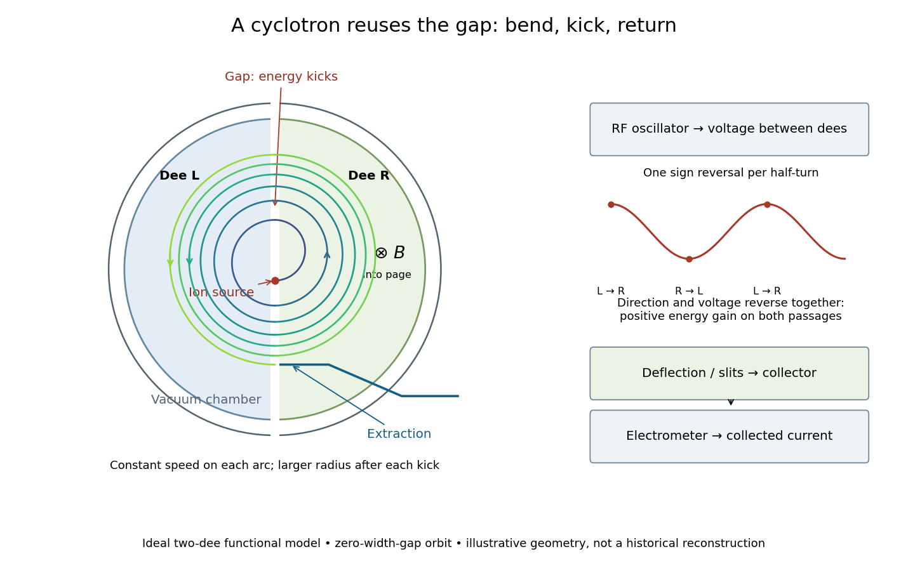
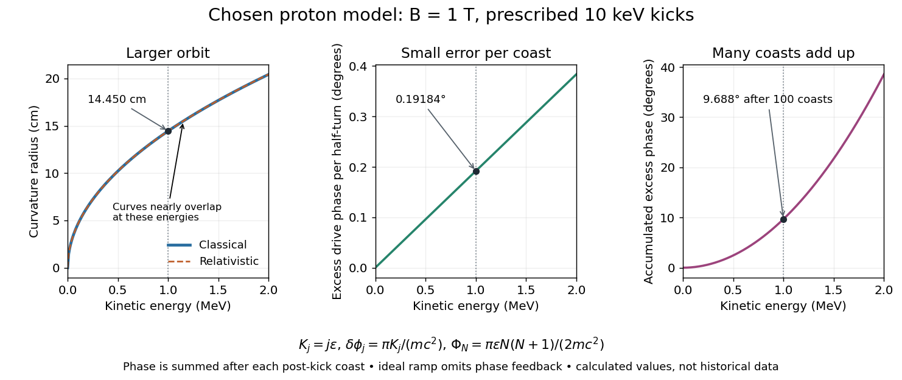
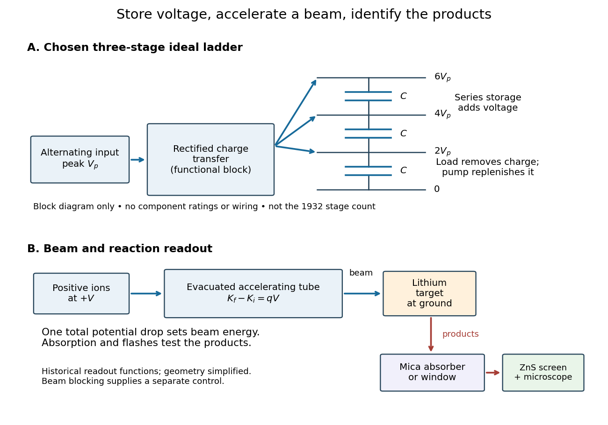
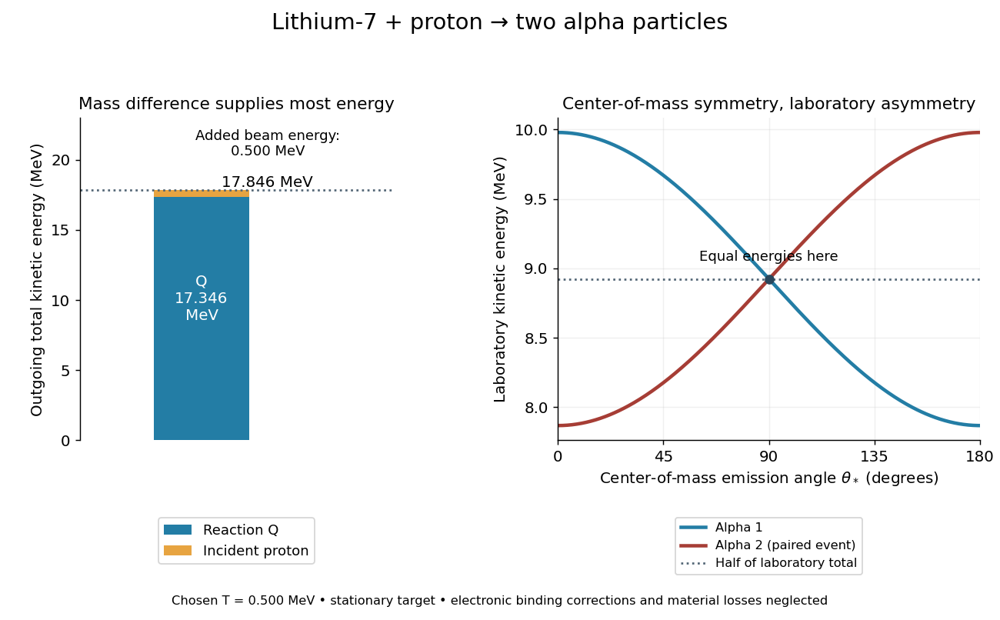
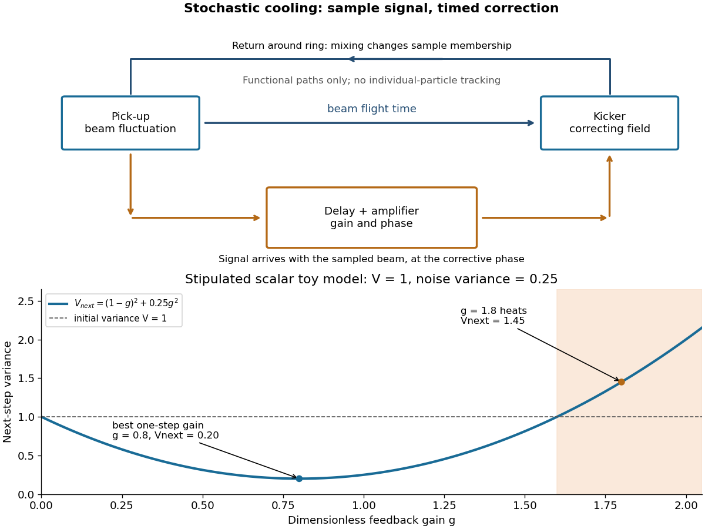

# Particle accelerator

↑ **Parent:** [Experimental apparatus](physics.md#experimental-apparatus)  
ⓦ [Wiki](https://en.wikipedia.org/wiki/Particle_accelerator)

A particle accelerator increases the [kinetic energy](energy.md#kinetic-energy) of [charged particles](electric-charge.md#charged-particle) through the [work](energy.md#work) of an [electric field](electric-field.md). A single [electric potential difference](electric-field.md#electric-potential-difference) $V$ gives an [energy](energy.md) gain of magnitude $|q|V$ to a particle of [electric charge](electric-charge.md) $q$ crossing in the accelerating direction. Reusing a smaller [electric potential difference](electric-field.md#electric-potential-difference) many times can give a much larger final [kinetic energy](energy.md#kinetic-energy) without requiring the whole apparatus to withstand the equivalent single voltage. A [magnetic field](magnetic-field.md) can return the particles to the accelerating region: [magnetic forces do no work](relativistic-electromagnetism.md#magnetic-forces-do-no-work), but they make repeated [energy](energy.md) gains possible. The [cyclotron](#cyclotron) turns this separation between bending and acceleration into a particularly elegant machine.

**Table of contents**

- [Beam diagnostics](#beam-diagnostics)
  - [DC beam current transformer](#dc-beam-current-transformer)
- [Beam lifetime](#beam-lifetime)
  - [Touschek effect](#touschek-effect)
- [Plasma wakefield acceleration](#plasma-wakefield-acceleration)
  - [Finite pulse-width conventions in laser wakefield estimates](#finite-pulse-width-conventions-in-laser-wakefield-estimates)
  - [Plasma wave-breaking field](#plasma-wave-breaking-field)
  - [Transformer ratio](#transformer-ratio)
- [Beam optics](#beam-optics)
  - [Beam transfer matrix](#beam-transfer-matrix)
  - [Astigmatism of an equal-strength quadrupole doublet](#astigmatism-of-an-equal-strength-quadrupole-doublet)
  - [Chirp requirement for longitudinal bunch compression](#chirp-requirement-for-longitudinal-bunch-compression)
  - [Double-bend achromat](#double-bend-achromat)
  - [Chromaticity](#chromaticity)
  - [Beam brightness](#beam-brightness)
    - [Fixed-beta brightness gain from emittance reduction](#fixed-beta-brightness-gain-from-emittance-reduction)
  - [FODO cell](#fodo-cell)
  - [Courant-Snyder parameters](#courant-snyder-parameters)
  - [Beam emittance](#beam-emittance)
    - [Vertical emittance](#vertical-emittance)
    - [Horizontal emittance](#horizontal-emittance)
    - [Natural emittance](#natural-emittance)
    - [Normalized emittance](#normalized-emittance)
    - [Geometric emittance](#geometric-emittance)
      - [Adiabatic damping of geometric emittance](#adiabatic-damping-of-geometric-emittance)
  - [Betatron oscillation](#betatron-oscillation)
    - [Betatron amplitude function](#betatron-amplitude-function)
  - [Strong focusing](#strong-focusing)
  - [Quadrupole magnet](#quadrupole-magnet)
    - [Thin-quadrupole energy dependence](#thin-quadrupole-energy-dependence)
    - [Final-focus quadrupole](#final-focus-quadrupole)
- [Electron-positron collider](#electron-positron-collider)
- [Large Electron–Positron Collider](#large-electron-positron-collider)
- [Large Hadron Collider](#large-hadron-collider)
  - [ATLAS experiment](#atlas-experiment)
    - [ATLAS Collaboration](#atlas-collaboration)
      - [Work by ATLAS Collaboration](#work-by-atlas-collaboration)
  - [Compact Muon Solenoid](#compact-muon-solenoid)
- [Synchrotron](#synchrotron)
  - [RF harmonic number](#rf-harmonic-number)
  - [Alternating Gradient Synchrotron](#alternating-gradient-synchrotron)
- [Bevatron](#bevatron)
- [Linear particle accelerator](#linear-particle-accelerator)
  - [Linear collider](#linear-collider)
    - [Compact Linear Collider](#compact-linear-collider)
    - [International Linear Collider](#international-linear-collider)
- [Cyclotron](#cyclotron)
  - [Cyclotron dee](#cyclotron-dee)
  - [Cyclotron resonance condition](#cyclotron-resonance-condition)
    - [Cyclotron gap energy gain](#cyclotron-gap-energy-gain)
  - [Cyclotron energy and orbit radius](#cyclotron-energy-and-orbit-radius)
  - [Lawrence-Livingston cyclotron experiment](#lawrence-livingston-cyclotron-experiment)
  - [Relativistic detuning of a cyclotron](#relativistic-detuning-of-a-cyclotron)
- [Electrostatic accelerator](#electrostatic-accelerator)
  - [Electrostatic acceleration energy gain](#electrostatic-acceleration-energy-gain)
  - [Cockcroft-Walton generator](#cockcroft-walton-generator)
    - [Cockcroft-Walton multiplier model](#cockcroft-walton-multiplier-model)
  - [Cockcroft-Walton lithium disintegration experiment](#cockcroft-walton-lithium-disintegration-experiment)
    - [Lithium proton reaction energy](#lithium-proton-reaction-energy)
      - [Lithium reaction laboratory recoil](#lithium-reaction-laboratory-recoil)
- [Accelerator technician](#accelerator-technician)
  - [List of accelerator technicians](#list-of-accelerator-technicians)
    - [John G. Wood](#john-g-wood)
      - [Work by John G. Wood](#work-by-john-g-wood)
- [Super Proton-Antiproton Synchrotron](#super-proton-antiproton-synchrotron)
- [Beam cooling](#beam-cooling)
  - [Electron cooling](#electron-cooling)
    - [Magnetized electron cooling](#magnetized-electron-cooling)
  - [Stochastic cooling](#stochastic-cooling)
    - [Beam mixing](#beam-mixing)
    - [Stochastic cooling variance model](#stochastic-cooling-variance-model)

## Beam diagnostics

↑ **Parent:** [Particle accelerator](particle-accelerator.md)

Measurements of beam properties such as intensity, position, transverse profile, bunch length, energy distribution, and losses. A diagnostic's calibration, bandwidth, and whether it intercepts the beam determine which changes can be inferred from its signal.

### DC beam current transformer

↑ **Parent:** [Beam diagnostics](#beam-diagnostics)

A nonintercepting circulating-beam current monitor that senses the beam's direct-current component through a magnetic core and feedback electronics. It is suitable for total stored intensity and [beam lifetime](#beam-lifetime) measurements; zero-offset drift and calibration must be controlled. Bunch-resolved signals instead require an appropriate time-dependent pickup or current-transformer bandwidth.

## Beam lifetime

↑ **Parent:** [Particle accelerator](particle-accelerator.md)

The inverse fractional particle-loss rate of a stored beam. A constant rate gives $N(t)=N_0e^{-t/\tau}$; density-dependent losses can make the instantaneous lifetime vary. At fixed revolution frequency, a calibrated beam-current measurement follows the same population decay, provided injection is absent or separately accounted for.

### Touschek effect

↑ **Parent:** [Beam lifetime](#beam-lifetime)

Intra-bunch Coulomb scattering can transfer transverse momentum into longitudinal momentum changes large enough to exceed a storage ring's accepted momentum range. This produces particle losses and a density-dependent contribution to the [beam lifetime](#beam-lifetime).

## Plasma wakefield acceleration

↑ **Parent:** [Particle accelerator](particle-accelerator.md)

A driver excites charge-density [oscillations](wave.md#oscillation) in a [plasma](physics.md#plasma-physics) whose longitudinal [electric field](electric-field.md) transfers [energy](energy.md) to a trailing witness beam. [Density](fluid-mechanics.md#density) fixes a characteristic [plasma frequency](physics.md#plasma-frequency) and wavelength, while driver shape and loading determine the actual field and transfer efficiency.

### Finite pulse-width conventions in laser wakefield estimates

↑ **Parent:** [Plasma wakefield acceleration](#plasma-wakefield-acceleration)

A full pulse duration of roughly half a [plasma](physics.md#plasma-physics) period and a Gaussian rms duration of order the inverse [plasma frequency](physics.md#plasma-frequency) are different conventions for a short resonant driver. Numerical estimates should state which width is meant. Maximum cold-wave fields also need not be produced by a specified driver with normalized [amplitude](wave.md#wave-amplitude) below unity.

### Plasma wave-breaking field

↑ **Parent:** [Plasma wakefield acceleration](#plasma-wakefield-acceleration)

The cold nonrelativistic [plasma](physics.md#plasma-physics) field scale $E_0=m_ec\omega_p/e$. It provides an order-of-magnitude density-gradient relation, not a complete nonlinear or relativistic wave-breaking criterion.

### Transformer ratio

↑ **Parent:** [Plasma wakefield acceleration](#plasma-wakefield-acceleration)

The ratio of the witness accelerating field to the driver decelerating field, with peak or loaded-field conventions stated. Under ideal common-length depletion, it also relates witness [energy](energy.md) gain to driver [energy](energy.md) loss.

## Beam optics

↑ **Parent:** [Particle accelerator](particle-accelerator.md)

The transverse transport of a charged-particle beam relative to a reference trajectory. Linear focusing gives [betatron oscillations](#betatron-oscillation), described by [Hill's equation](linear-ordinary-differential-equation.md#hill-s-equation) and [Courant-Snyder parameters](#courant-snyder-parameters); the beam envelope depends on its [geometric emittance](#geometric-emittance).

### Beam transfer matrix

↑ **Parent:** [Beam optics](#beam-optics)

A linear paraxial map between transverse position and trajectory angle at two beamline locations. A drift of length $d$ has $M=\begin{pmatrix}1&d\\0&1\end{pmatrix}$; a focusing thin quadrupole has $M=\begin{pmatrix}1&0\\-1/f&1\end{pmatrix}$. Lossless uncoupled maps have determinant one. Repeated-cell bounded oscillatory motion requires $|\operatorname{tr}M|<2$; at equality a Jordan block can still cause secular growth. This beam-optical map is distinct from a combinatorial transfer matrix.

### Astigmatism of an equal-strength quadrupole doublet

↑ **Parent:** [Beam optics](#beam-optics)

For an initially parallel bundle passing through opposite equal thin-quadrupole strengths separated by $L$, the two downstream focal distances differ as shown. Approximating the doublet by a common effective [focal length](geometrical-optics.md#focal-length) $f^2/L$ discards that difference. A real common final focus requires additional incoming optical information or adjusted strengths.

### Chirp requirement for longitudinal bunch compression

↑ **Parent:** [Beam optics](#beam-optics)

A magnetic chicane's momentum-dependent [path length](riemannian-geometry.md#arc-length) does not specify a compression factor from initial length and marginal [energy](energy.md) spread alone. A suitable longitudinal position-energy correlation is required. With zero correlation the [variance](variance.md) above is minimized at $R_{56}=0$, so such a chicane cannot shorten that ideal uncorrelated bunch. An imposed chirp and its uncorrelated residual determine the achievable minimum.

### Double-bend achromat

↑ **Parent:** [Beam optics](#beam-optics)

A lattice cell with two bending magnets whose dispersion and dispersion slope vanish at its boundaries. In an ideal identical-uniform-bend model with horizontal damping partition one, its minimum [geometric emittance](#geometric-emittance) is $C_q\gamma^2\theta^3/(4\sqrt{15})$, larger than the unconstrained theoretical minimum because of the achromatic [boundary conditions](differential-equation.md#boundary-condition).

### Chromaticity

↑ **Parent:** [Beam optics](#beam-optics)

The [derivative](calculus.md#derivative) of transverse betatron tune $Q$ with respect to relative [momentum](momentum.md) error $\delta$. For a thin-lens [FODO cell](#fodo-cell) with fixed quadrupole fields, natural cell chromaticity is $-\tan(\mu/2)/\pi$ on the stable phase-advance branch. Zero corrected chromaticity requires additional momentum-dependent focusing.

### Beam brightness

↑ **Parent:** [Beam optics](#beam-optics)

A beam intensity or photon flux per transverse phase-space [volume](geometry-and-topology.md#volume), with any spectral bandwidth convention stated. In the far-from-diffraction-limited case with fixed flux and negligible dispersion contributions, brightness scales inversely with $\varepsilon_x\varepsilon_y$.

#### Fixed-beta brightness gain from emittance reduction

↑ **Parent:** [Beam brightness](#beam-brightness)

[Photon](quantum-mechanics.md#photon) source widths combine [electron](physics.md#electron) and diffraction widths in quadrature. At fixed [optics](optics.md), reducing [electron](physics.md#electron) emittance eventually has little effect when both radiation size and divergence dominate. This criterion differs from comparing emittances alone if the optical [beta function](complex-analysis.md#beta-function) is not matched to the diffraction ellipse.

### FODO cell

↑ **Parent:** [Beam optics](#beam-optics)

A repeating focusing-drift-defocusing-drift lattice cell, with opposite quadrupole focusing in the two transverse planes. Stability and [phase](wave.md#phase-waves) advance depend on focal strengths and separations.

### Courant-Snyder parameters

↑ **Parent:** [Beam optics](#beam-optics)

The positive function $\beta(s)$ and the displayed associated parameters describe a stable linear beam ellipse. A trajectory with invariant $\epsilon$ obeys $\epsilon=\gamma_Tz^2+2\alpha_Tzz'+\beta z'^2$ and has phase advance $\phi'=1/\beta$. Writing $\omega=\sqrt\beta$ gives $\omega''+k(s)\omega=1/\omega^3$; the coefficient of $k$ is $\omega$, not one.

### Beam emittance

↑ **Parent:** [Beam optics](#beam-optics)

The area occupied by a beam in transverse position-momentum or position-angle [phase space](hamiltonian-mechanics.md#phase-space), with a stated area or rms convention. [Geometric emittance](#geometric-emittance) uses trajectory angle, while [normalized emittance](#normalized-emittance) removes the ideal kinematic damping due to acceleration.

#### Vertical emittance

↑ **Parent:** [Beam emittance](#beam-emittance)

The phase-space area measure in the vertical transverse plane. If coupling is described by $k=\varepsilon_y/\varepsilon_x$, changing the coupling and changing the [natural emittance](#natural-emittance) both alter its equilibrium value.

#### Horizontal emittance

↑ **Parent:** [Beam emittance](#beam-emittance)

The phase-space area measure of the horizontal transverse beam distribution. With negligible dispersion and a specified optical function, it determines beam size and angular spread.

#### Natural emittance

↑ **Parent:** [Beam emittance](#beam-emittance)

The equilibrium horizontal [beam emittance](#beam-emittance) set by synchrotron-radiation excitation and damping in an uncoupled storage ring. The radiation-integral relation is $\varepsilon_{x0}=C_q\gamma^2I_5/(J_xI_2)$; similar cell optics give a cubic dependence on bending angle.

#### Normalized emittance

↑ **Parent:** [Beam emittance](#beam-emittance)

The [geometric emittance](#geometric-emittance) multiplied by the relativistic velocity and Lorentz factor. For paraxial acceleration without dilution, this is proportional to transverse canonical [phase-space](hamiltonian-mechanics.md#phase-space) area and remains constant. Thus [geometric emittance](#geometric-emittance) decreases approximately as inverse beam [momentum](momentum.md).

#### Geometric emittance

↑ **Parent:** [Beam emittance](#beam-emittance)

For a centered beam, the displayed rms area in $(z,z')$ coordinates. A matched beam has $\langle z^2\rangle=\epsilon\beta$, where $\beta$ is one of the [Courant-Snyder parameters](#courant-snyder-parameters). Under ideal acceleration, [adiabatic damping of geometric emittance](#adiabatic-damping-of-geometric-emittance) decreases this area even when the canonical [phase-space](hamiltonian-mechanics.md#phase-space) area is preserved.

##### Adiabatic damping of geometric emittance

↑ **Parent:** [Geometric emittance](#geometric-emittance)

For slowly accelerated paraxial motion, $z'\simeq p_z/p_s$ decreases as longitudinal [momentum](momentum.md) grows while transverse canonical [phase-space](hamiltonian-mechanics.md#phase-space) area is conserved. The [normalized emittance](#normalized-emittance) stays constant in the ideal limit, so the [geometric emittance](#geometric-emittance) scales inversely with longitudinal [momentum](momentum.md). This is kinematic damping rather than dissipation of canonical area.

### Betatron oscillation

↑ **Parent:** [Beam optics](#beam-optics)

Small transverse oscillation about an accelerator's reference orbit. In a linear periodic lattice the displacement obeys [Hill's equation](linear-ordinary-differential-equation.md#hill-s-equation) $z''+k(s)z=0$.

#### Betatron amplitude function

↑ **Parent:** [Betatron oscillation](#betatron-oscillation)

For rms geometric [beam emittance](#beam-emittance) $\epsilon$, the transverse beam variance is $\sigma^2(s)=\epsilon\beta(s)$. At a beam waist, the angular variance is $\epsilon/\beta$. Reducing both transverse amplitude functions by a factor $a$ at fixed emittances increases the ideal head-on [collider luminosity](standard-model.md#collider-luminosity) by $a$; practical finite-bunch-length and crossing-angle effects can limit this gain.

### Strong focusing

↑ **Parent:** [Beam optics](#beam-optics)  
ⓦ [Wiki](https://en.wikipedia.org/wiki/Strong_focusing)

Alternating focusing and defocusing [quadrupole magnets](#quadrupole-magnet), separated by drifts, can give stable net focusing in both transverse planes. Stability depends on the full transfer matrix of the lattice cell, not on the sign of one magnet alone.

### Quadrupole magnet

↑ **Parent:** [Beam optics](#beam-optics)  
ⓦ [Wiki](https://en.wikipedia.org/wiki/Quadrupole_magnet)

A magnet whose transverse field varies linearly with displacement. Its Lorentz force focuses a charged-particle beam in one transverse plane and defocuses it in the other. Oppositely oriented elements provide [alternating-gradient focusing](#strong-focusing).

#### Thin-quadrupole energy dependence

↑ **Parent:** [Quadrupole magnet](#quadrupole-magnet)

At fixed gradient and magnet length, the signed thin-lens [focal length](geometrical-optics.md#focal-length) is proportional to particle [momentum](momentum.md). For total [energy](energy.md) error $\delta=(E-E_0)/E_0$, differentiating $p^2c^2=E^2-m^2c^4$ gives $d\ln p/d\ln E=1/\beta^2$. The ultrarelativistic result is $f=f_0(1+\delta)$ to first order. If energy means kinetic energy instead, the coefficient is $(K+mc^2)/(K+2mc^2)$.

#### Final-focus quadrupole

↑ **Parent:** [Quadrupole magnet](#quadrupole-magnet)

An element of the strong focusing system near a collider interaction point. It helps form a small transverse beam waist there, matched to the surrounding periodic lattice. Small collision-point beta functions generally imply large envelopes and strong chromatic effects in nearby magnets.

## Electron-positron collider

↑ **Parent:** [Particle accelerator](particle-accelerator.md)

A [particle accelerator](particle-accelerator.md) that brings counterpropagating [electron](physics.md#electron) and [Positron](physics.md#positron) beams into collision. The known initial [four-momentum](special-relativity.md#four-momentum) and tunable [center-of-mass energy](special-relativity.md#center-of-mass-energy) make resonance scans and missing-energy measurements possible.

<h2 id="large-electron-positron-collider">Large Electron–Positron Collider</h2>

↑ **Parent:** [Particle accelerator](particle-accelerator.md)

A CERN electron–positron collider. Its higher-energy operation made W-pair production available for measurements of [electroweak triple gauge couplings](standard-model.md#electroweak-triple-gauge-coupling).

## Large Hadron Collider

↑ **Parent:** [Particle accelerator](particle-accelerator.md)  
ⓦ [Wiki](https://en.wikipedia.org/wiki/Large_Hadron_Collider)

### ATLAS experiment

↑ **Parent:** [Large Hadron Collider](#large-hadron-collider)  
ⓦ [Wiki](https://en.wikipedia.org/wiki/ATLAS_experiment)

#### ATLAS Collaboration

↑ **Parent:** [ATLAS experiment](#atlas-experiment)

##### Work by ATLAS Collaboration

↑ **Parent:** [ATLAS Collaboration](#atlas-collaboration)

### Compact Muon Solenoid

↑ **Parent:** [Large Hadron Collider](#large-hadron-collider)  
ⓦ [Wiki](https://en.wikipedia.org/wiki/Compact_Muon_Solenoid)

## Synchrotron

↑ **Parent:** [Particle accelerator](particle-accelerator.md)  
ⓦ [Wiki](https://en.wikipedia.org/wiki/Synchrotron)

A circular [particle accelerator](particle-accelerator.md) with bending fields and accelerating fields varied in coordination with the increasing beam [momentum](momentum.md).

### RF harmonic number

↑ **Parent:** [Synchrotron](#synchrotron)

The integer number of radio-frequency cycles per revolution of a synchronous particle in a circular accelerator. It fixes $f_{\rm RF}=h f_{\rm rev}$ and the number of RF buckets around the ring. It is unrelated to an arithmetic harmonic number $H_n$.

### Alternating Gradient Synchrotron

↑ **Parent:** [Synchrotron](#synchrotron)  
ⓦ [Wiki](https://en.wikipedia.org/wiki/Alternating_Gradient_Synchrotron)

The Brookhaven [proton](physics.md#proton) [synchrotron](#synchrotron) used for the [Lederman-Schwartz-Steinberger two-neutrino beam experiment](particle-detection.md#lederman-schwartz-steinberger-two-neutrino-beam-experiment).

## Bevatron

↑ **Parent:** [Particle accelerator](particle-accelerator.md)  
ⓦ [Wiki](https://en.wikipedia.org/wiki/Bevatron)

## Linear particle accelerator

↑ **Parent:** [Particle accelerator](particle-accelerator.md)  
ⓦ [Wiki](https://en.wikipedia.org/wiki/Linear_particle_accelerator)

A [particle accelerator](particle-accelerator.md) in which a beam gains [kinetic energy](energy.md#kinetic-energy) along a substantially straight sequence of accelerating structures.

### Linear collider

↑ **Parent:** [Linear particle accelerator](#linear-particle-accelerator)

A collider whose main beams are accelerated along opposing linear beamlines and brought into collision without returning repeatedly around a storage ring. Sources, beam conditioning, final focus, extraction, and dumps are essential parts of the layout, as well as the main accelerating structures.

#### Compact Linear Collider

↑ **Parent:** [Linear collider](#linear-collider)  
ⓦ [Wiki](https://en.wikipedia.org/wiki/Compact_Linear_Collider)

A proposed electron–positron [linear collider](#linear-collider) using normal-conducting RF structures powered through a separate drive-beam deceleration system. The 2012 conceptual design studied multi-TeV operation and lower-energy stages; its $3$ TeV design used approximately $100$ MV/m main-linac gradients. Historical design targets should be distinguished from later staging revisions and from operating measurements. [CLIC Conceptual Design Report, CERN-2012-007, abstract and accelerator concept](https://cds.cern.ch/record/1500095)

#### International Linear Collider

↑ **Parent:** [Linear collider](#linear-collider)  
ⓦ [Wiki](https://en.wikipedia.org/wiki/International_Linear_Collider)

A proposed electron–positron [linear collider](#linear-collider) based on superconducting RF acceleration. The 2007 reference design relevant to an exam-era comparison targeted $500$ GeV centre-of-mass energy and peak [collider luminosity](standard-model.md#collider-luminosity) $2\times10^{34}\,\mathrm{cm^{-2}s^{-1}}$, with approximately $31$ km total footprint. These are historical design parameters, not achieved machine performance. [ILC Reference Design Report, Volume 3—Accelerator, abstract](https://arxiv.org/abs/0712.2361)

## Cyclotron

↑ **Parent:** [Particle accelerator](particle-accelerator.md)  
ⓦ [Wiki](https://en.wikipedia.org/wiki/Cyclotron)

A cyclotron repeatedly passes [ions](chemistry.md#ion) through an alternating [electric field](electric-field.md) between two hollow electrodes called [cyclotron dees](#cyclotron-dee). A nearly uniform [magnetic field](magnetic-field.md) perpendicular to their plane bends the [charged particles](electric-charge.md#charged-particle) back toward the gap. Inside each [cyclotron dee](#cyclotron-dee), ideal shielding suppresses the accelerating [electric field](electric-field.md), so each segment is a constant-[speed](classical-mechanics.md#speed) [circular motion](classical-mechanics.md#circular-motion). The next gap crossing increases the [speed](classical-mechanics.md#speed) and the [radius](topology.md#radius) of curvature. The complete path consists of connected, progressively larger arcs, rather than one circle or a smooth spiral with continuous acceleration everywhere.

The striking feature is a timing cancellation: the longer arc traveled by a faster particle takes the same time. This [cyclotron resonance condition](#cyclotron-resonance-condition) lets one fixed [radio frequency](wave.md#radio-frequency) accelerate many successive gap crossings. The following construction and [cyclotron energy and orbit radius](#cyclotron-energy-and-orbit-radius) example describe an ideal model; the [Lawrence-Livingston cyclotron experiment](#lawrence-livingston-cyclotron-experiment) explains what the builders actually measured.

**[Figure 1](#image-cyclotron-bending-gap-kicks-and-a-separate-beam-readout). Cyclotron bending, gap kicks, and a separate beam readout**. Original functional schematic, with illustrative dimensions only. The orbit is constructed from exact semicircles of successively increased speed in the zero-width-gap model; the white gap band marks where the finite-gap electric field would act. The architecture shows two ideal dees, not a scale reconstruction of the one-driven-dee 1932 apparatus. Extraction and readout are shown as a separate functional chain.

### Cyclotron dee

↑ **Parent:** [Cyclotron](#cyclotron)

A hollow D-shaped electrode that shields a circulating [ion](chemistry.md#ion) from the accelerating [electric field](electric-field.md) during one half-turn. Two opposed cyclotron dees provide two shielded regions separated by a gap; their [electric potential difference](electric-field.md#electric-potential-difference) alternates. The [vacuum](physics.md#vacuum) reduces collisions with residual gas. An [ion source](physics.md#ion-source) supplies particles near the center, and an extraction system directs an outer orbit toward a [particle detector](particle-detection.md#particle-detector) or target. Useful [electric current](electric-charge.md#electric-current) depends on retaining particles near the median plane and delivering them to the outlet, as well as on increasing their [kinetic energy](energy.md#kinetic-energy).

### Cyclotron resonance condition

↑ **Parent:** [Cyclotron](#cyclotron)

Take an [ion](chemistry.md#ion) of [mass](classical-mechanics.md#mass) $m$ and [electric charge](electric-charge.md) $q\ne0$, with [velocity](classical-mechanics.md#velocity) perpendicular to a uniform [magnetic field](magnetic-field.md) of magnitude $B>0$. In the [classical mechanics](classical-mechanics.md) limit, the [Lorentz force](relativistic-electromagnetism.md#lorentz-force) provides the [centripetal acceleration](classical-mechanics.md#centripetal-acceleration):

$$
|q|vB=\frac{mv^2}{r},\qquad
\omega_c=\frac vr=\frac{|q|B}{m},\qquad
r=\frac v{\omega_c}=\frac{mv}{|q|B}.
$$

Here $r$ is the local [radius](topology.md#radius) of curvature and $\omega_c$ is the [cyclotron frequency](quantum-theory.md#cyclotron-frequency), expressed as an [angular frequency](lagrangian-mechanics.md#angular-frequency). A half-turn takes

$$
\tau_{1/2}=\frac{\pi r}{v}=\frac{\pi}{\omega_c}=\frac{\pi m}{|q|B}.
$$

Increasing [speed](classical-mechanics.md#speed) increases the path length in exactly the same proportion. Drive the gap at [angular frequency](lagrangian-mechanics.md#angular-frequency) $\omega_{\mathrm{RF}}=\omega_c$, or ordinary [frequency](wave.md#frequency) $f_{\mathrm{RF}}=|q|B/(2\pi m)$. In each half-turn the gap [electric field](electric-field.md) reverses once, just as the particle reverses its direction of passage through the gap. The particle therefore receives two accelerating kicks per complete turn, using one oscillation per complete turn. This is the fundamental [resonance](dynamical-systems.md#resonance); transit time through the gap and departures from a uniform [magnetic field](magnetic-field.md) have been neglected.

#### Cyclotron gap energy gain

↑ **Parent:** [Cyclotron resonance condition](#cyclotron-resonance-condition)

Define $\Delta V=\Phi_{\mathrm{entry}}-\Phi_{\mathrm{exit}}$ as the [electric potential](electric-field.md#electric-potential) drop along the particle's passage. If the [electric field](electric-field.md) changes negligibly during that short crossing, the [work](energy.md#work) gives

$$
\Delta K=q\Delta V.
$$

The sign matters: a positive [ion](chemistry.md#ion) gains [kinetic energy](energy.md#kinetic-energy) while going to lower [electric potential](electric-field.md#electric-potential); a negative [ion](chemistry.md#ion) needs the opposite drop. A fixed-sign field would accelerate on one crossing and decelerate on the next. The alternating field must reverse before the particle comes back.

For a fixed [electric charge](electric-charge.md) sign and circulation direction, absorb this alternating crossing direction into the definition of the arrival [phase](wave.md#phase-waves) $\phi_n$. If $V_0$ is the peak [electric potential difference](electric-field.md#electric-potential-difference) across the whole gap, rather than the amplitude of either electrode relative to ground, a thin-gap model is

$$
K_{n+1}=K_n+|q|V_0\cos\phi_n.
$$

Arrival at $\phi_n=0$ gives the largest accelerating kick; $|\phi_n|<\pi/2$ gives a positive kick. Arrival at $\phi_n=\pi$ gives deceleration. For an ideal classical particle initially on crest, the [cyclotron resonance condition](#cyclotron-resonance-condition) keeps successive arrival [phases](wave.md#phase-waves) equal. It does not automatically bring an initially mistimed particle onto crest.

### Cyclotron energy and orbit radius

↑ **Parent:** [Cyclotron](#cyclotron)

Combining $r=mv/(|q|B)$ with the classical [kinetic energy](energy.md#kinetic-energy) gives

$$
E\equiv K=\frac12mv^2=\frac{|q|^2B^2r^2}{2m}.
$$

Here $E$ denotes [kinetic energy](energy.md#kinetic-energy), not relativistic total [energy](energy.md). At fixed [magnetic field](magnetic-field.md), twice the final [radius](topology.md#radius) allows four times the classical [kinetic energy](energy.md#kinetic-energy). At fixed final [kinetic energy](energy.md#kinetic-energy), a larger accelerating gap voltage reduces the number of crossings needed, but does not change the required orbit [radius](topology.md#radius).

For an illustrative [proton](physics.md#proton) with $B=1.00\,\mathrm T$ and peak gap voltage $V_0=10.0\,\mathrm{kV}$, take negligible injection [kinetic energy](energy.md#kinetic-energy), on-crest kicks, a zero-width gap, and no losses. Each crossing adds $10.0\,\mathrm{keV}$, so $100$ crossings give $1.00\,\mathrm{MeV}$, using [electronvolts](electronegativity.md#electronvolt). With $e=1.602176634\times10^{-19}\,\mathrm C$ and $m_p=1.67262192595\times10^{-27}\,\mathrm{kg}$,

$$
f_{\mathrm{RF}}=15.2452\,\mathrm{MHz},\qquad
\tau_{1/2}=32.7972\,\mathrm{ns},\qquad
r(1.00\,\mathrm{MeV})=0.144497\,\mathrm m.
$$

The $100$th kick arrives after $99$ intervening half-turns, about $3.247\,\mu\mathrm s$ after the first kick in this idealization. The final two curvature [radii](topology.md#radius) differ by $r(1\,\mathrm{MeV})[1-\sqrt{99/100}]\simeq0.724\,\mathrm{mm}$. That difference is a curvature-radius increment, not a general formula for separation of real extracted turns: successive arc centers shift, and extraction also depends on focusing and the gap geometry. These chosen settings are a calculation, not historical measurements.

### Lawrence-Livingston cyclotron experiment

↑ **Parent:** [Cyclotron](#cyclotron)

[Ernest Orlando Lawrence](nuclear-physicist.md#ernest-lawrence) and [Milton Stanley Livingston](nuclear-physicist.md#m-stanley-livingston) reported repeated [ion](chemistry.md#ion) acceleration in 1932. Their evacuated brass chamber used one driven hollow [cyclotron dee](#cyclotron-dee); the grounded box and slotted divider supplied the other electrode. Filament [electrons](physics.md#electron) ionized [hydrogen](chemical-substance.md#hydrogen) near the gap. A perpendicular [magnetic field](magnetic-field.md) bent the [ions](chemistry.md#ion); a high-frequency [oscillator](wave.md#oscillator) drove the gap. Deflecting plates and slits selected particles for a [Faraday cup](physics.md#faraday-cup), read by an [electrometer](electric-charge.md#electrometer).[Lawrence and Livingston, 1932, pp. 25–28, Figs. 2–4: actual accelerating electrode, source, collector and oscillator](physics-bibliography.md#the-production-of-high-speed-light-ions-without-the-use-of-high-voltages-by-ernest-orlando-lawrence-and-milton-stanley-livingston)

Scanning the [magnetic field](magnetic-field.md) produced narrow [resonance](dynamical-systems.md#resonance) peaks. The optimum deflecting voltage tracked the [kinetic energy](energy.md#kinetic-energy) predicted from field and orbit [radius](topology.md#radius), supporting the reported $1.22\,\mathrm{MeV}$ [protons](physics.md#proton). Source width and slit geometry limited this check; it was not a direct [energy](energy.md) measurement of every particle.[pp. 31–33, Figs. 7–9: resonance scans, field and wavelength measurements, deflection-voltage energy check and geometric uncertainty; p. 19: maximum reported proton energy](physics-bibliography.md#the-production-of-high-speed-light-ions-without-the-use-of-high-voltages-by-ernest-orlando-lawrence-and-milton-stanley-livingston)

This combination distinguishes producing a circulating [electric current](electric-charge.md#electric-current) from establishing its [kinetic energy](energy.md#kinetic-energy). The [electrometer](electric-charge.md#electrometer) measures collected [electric charge](electric-charge.md) per unit time; it cannot by itself tell whether the collected particles are fast. The separate deflection selection supplies a speed-dependent test. Agreement of two consequences of the model, the [cyclotron resonance condition](#cyclotron-resonance-condition) and the [cyclotron energy and orbit radius](#cyclotron-energy-and-orbit-radius) relation, makes the inference stronger than either a current signal or a predicted orbit alone.

[Milton Stanley Livingston](nuclear-physicist.md#m-stanley-livingston) built the early [cyclotrons](#cyclotron) with [Ernest Orlando Lawrence](nuclear-physicist.md#ernest-lawrence); the 1939 [Nobel Prize in Physics](nobel-prize-in-physics.md) went to [Ernest Orlando Lawrence](nuclear-physicist.md#ernest-lawrence). His lecture, The evolution of the cyclotron, was delivered on 11 December 1951.[Ernest Lawrence entry: 1939 prize and delayed lecture on 11 December 1951](physics-bibliography.md#more-timelines-by-lawrence-livermore-national-laboratory)[M. Stanley Livingston: co-inventor of the cyclotron and early Berkeley work](physics-bibliography.md#m-stanley-livingston-by-fermilab)

### Relativistic detuning of a cyclotron

↑ **Parent:** [Cyclotron](#cyclotron)

At larger [kinetic energy](energy.md#kinetic-energy), [special relativity](special-relativity.md) changes the relation between [momentum](momentum.md) and [velocity](classical-mechanics.md#velocity). With $m$ the invariant [mass](classical-mechanics.md#mass), the [Lorentz factor](special-relativity.md#lorentz-factor) is $\gamma=1+K/(mc^2)$, and a [relativistic cyclotron orbit](relativistic-electromagnetism.md#relativistic-cyclotron-orbit) in a fixed uniform [magnetic field](magnetic-field.md) satisfies

$$
p=\gamma mv=|q|Br,\qquad
\omega(K)=\frac{|q|B}{\gamma m},\qquad
r(K)=\frac{\sqrt{K(K+2mc^2)}}{|q|Bc}.
$$

The [cyclotron frequency](quantum-theory.md#cyclotron-frequency) decreases as the [kinetic energy](energy.md#kinetic-energy) increases. If the drive stays at the classical value $\omega_0=|q|B/m$, the half-turn time is $\pi\gamma/\omega_0$. During it the drive advances through $\pi\gamma$ rather than $\pi$ radians. Its excess [phase](wave.md#phase-waves) per half-turn is therefore

$$
\delta\phi=\omega_0\tau_{1/2}-\pi=\pi(\gamma-1)=\frac{\pi K}{mc^2},\qquad
\frac{\omega(K)-\omega_0}{\omega_0}=-\frac{K}{mc^2+K}.
$$

Even a small fractional [frequency](wave.md#frequency) mismatch accumulates across many turns. A particle eventually reaches a weak or decelerating gap [phase](wave.md#phase-waves), so the classical fixed-field, fixed-frequency design has a practical [kinetic energy](energy.md#kinetic-energy) limit. The limit depends on the kick size and acceptable accumulated [phase](wave.md#phase-waves) error, rather than one universal cutoff [energy](energy.md). Changing drive [frequency](wave.md#frequency) or shaping the [magnetic field](magnetic-field.md) can restore synchronism; the argument does not forbid relativistic circular accelerators.

For the illustrative [proton](physics.md#proton) at $1.00\,\mathrm{MeV}$, $\gamma-1\simeq0.00106579$: the [frequency](wave.md#frequency) is lower by about $0.1065\%$, and the next half-turn adds about $0.19184^\circ$ of drive [phase](wave.md#phase-waves) excess. To see cumulative sensitivity, prescribe an ideal ramp $K_j=j\epsilon$ with $\epsilon=10\,\mathrm{keV}$ and sum the errors of the first $N$ coasts after kicks:

$$
\Phi_N=\sum_{j=1}^N\frac{\pi K_j}{mc^2}
=\frac{\pi\epsilon N(N+1)}{2mc^2}.
$$

This gives $\Phi_{100}\simeq9.688^\circ$ after the coast following kick $100$; the arrival at kick $100$ instead has $\Phi_{99}\simeq9.496^\circ$. The prescribed ramp diagnoses detuning but does not feed the resulting [phase](wave.md#phase-waves) error back into the kicks. A self-consistent thin-gap model uses the [cyclotron gap energy gain](#cyclotron-gap-energy-gain) with $\cos\phi_n$, then advances the [phase](wave.md#phase-waves) with the new [kinetic energy](energy.md#kinetic-energy) during the following coast.

**[Figure 2](#image-orbit-radius-and-accumulating-timing-error-for-a-chosen-proton-cyclotron-model). Orbit radius and accumulating timing error for a chosen proton cyclotron model**. Original calculations for B = 1 T and prescribed 10 keV kicks, not historical data. Left: classical and relativistic curvature radius. Middle: excess drive phase during one half-turn at the indicated kinetic energy. Right: accumulated excess after N coasts for K\_j = j times 10 keV. At 1 MeV the single-coast error is small but its accumulated value is already nearly ten degrees. The prescribed ramp omits feedback of timing error on energy gain.

## Electrostatic accelerator

↑ **Parent:** [Particle accelerator](particle-accelerator.md)  
ⓦ [Wiki](https://en.wikipedia.org/wiki/Electrostatic_accelerator)

An electrostatic accelerator gives a [charged particle](electric-charge.md#charged-particle) [kinetic energy](energy.md#kinetic-energy) by taking it through a sustained [electric potential difference](electric-field.md#electric-potential-difference). Its [ion source](physics.md#ion-source), accelerating tube and target form a particularly direct chain: prepare a charge, let an [electric field](electric-field.md) do [work](energy.md#work), and measure what arrives or what the target emits. A [vacuum](physics.md#vacuum) reduces collisions with gas before the beam reaches its target. The [Cockcroft-Walton generator](#cockcroft-walton-generator) supplies the potential by accumulating [electric charge](electric-charge.md) on [capacitors](electromagnetism.md#capacitor).

### Electrostatic acceleration energy gain

↑ **Parent:** [Electrostatic accelerator](#electrostatic-accelerator)

For a fixed [electric charge](electric-charge.md) $q$, a time-independent [electric potential](electric-field.md#electric-potential) $\Phi$ and negligible collisions or radiation losses, conservation of [energy](energy.md) gives

$$
K_f-K_i=-\Delta(q\Phi)=q(\Phi_i-\Phi_f)=qV.
$$

Here $V$ is the signed potential drop along the trajectory. A [proton](physics.md#proton) starting nearly at rest at $+V$ and arriving at ground gains $eV$: a chosen $500\,\mathrm{kV}$ gives $500\,\mathrm{keV}$, by the definition of the [electronvolt](electronegativity.md#electronvolt). Several intermediate electrodes can distribute that drop along a tube, but the gains telescope to the same endpoint difference. Passing through more electrodes does not multiply the available [kinetic energy](energy.md#kinetic-energy) beyond $qV$.

This is the distinction from a [cyclotron](#cyclotron). In a static [electric field](electric-field.md), a closed trip gives zero net [work](energy.md#work). A [cyclotron](#cyclotron) changes the gap [electric field](electric-field.md) between successive visits, so correctly timed particles repeatedly gain [kinetic energy](energy.md#kinetic-energy). Its limit involves the [cyclotron resonance condition](#cyclotron-resonance-condition) and [relativistic detuning of a cyclotron](#relativistic-detuning-of-a-cyclotron); a single-pass [electrostatic accelerator](#electrostatic-accelerator) instead requires the full accelerating [electric potential difference](electric-field.md#electric-potential-difference) to be sustained at once. Neither machine's beam energy by itself specifies the [energy](energy.md) released by a [nuclear reaction](physics.md#nuclear-reaction).

### Cockcroft-Walton generator

↑ **Parent:** [Electrostatic accelerator](#electrostatic-accelerator)  
ⓦ [Wiki](https://en.wikipedia.org/wiki/Cockcroft–Walton_generator)

A [voltage multiplier](electrical-circuit.md#voltage-multiplier) made of [rectifiers](electrical-circuit.md#rectifier) and [capacitors](electromagnetism.md#capacitor) that transfers [electric charge](electric-charge.md) from an alternating supply into a series stack of stored [electric potential differences](electric-field.md#electric-potential-difference). The [rectifiers](electrical-circuit.md#rectifier) allow charge transfer during selected portions of the cycle; the [capacitors](electromagnetism.md#capacitor) retain charge between transfers. The supply continually replaces charge removed by the load. Multiplication of voltage does not multiply [energy](energy.md): the input must supply the output [power](energy.md#power) and losses.

In his 1951 lecture The Artificial Production of Fast Particles, [Ernest Thomas Sinton Walton](nuclear-physicist.md#ernest-thomas-sinton-walton) describes the fourfold multiplier's series storage capacitors and alternating transfer capacitor in Fig. 2, p. 190. This is a mechanism for producing a nearly steady accelerating potential from an alternating input.[The Artificial Production of Fast Particles, lecture delivered 11 December 1951, p. 190, Fig. 2: storage and transfer capacitors; indexed primary text inspected](physics-bibliography.md#the-artificial-production-of-fast-particles-by-ernest-thomas-sinton-walton)

**[Figure 3](#image-voltage-accumulation-and-particle-acceleration-are-different-steps). Voltage accumulation and particle acceleration are different steps**. Original functional diagram. Three ideal storage stages illustrate a chosen multiplier model; charge transfer is shown as a functional block rather than a wiring diagram. The beam crosses one total potential drop. The lower chain summarizes the lithium experiment's target and scintillation readout, not the geometry or stage count of the 1932 apparatus.

#### Cockcroft-Walton multiplier model

↑ **Parent:** [Cockcroft-Walton generator](#cockcroft-walton-generator)

Define a stage as one storage increment of $2V_p$, with $V_p$ the alternating input's peak [electric potential difference](electric-field.md#electric-potential-difference) relative to its reference, not its peak-to-peak value. Assume ideal [rectifiers](electrical-circuit.md#rectifier), no load, no leakage or stray [capacitance](electromagnetism.md#capacitance), a stiff alternating source and enough cycles to reach equilibrium. For $N$ such stages,

$$
V_k=2kV_p,\qquad k=0,1,\ldots,N,\qquad V_{\mathrm{ideal}}=2NV_p.
$$

The factor two follows from adding the input's next opposite excursion to an already stored peak. The subsequent series increments add. This ideal argument concerns equilibrium voltage; it supplies neither the charge-up time nor the useful load [electric current](electric-charge.md#electric-current).

To isolate the effect of drawing charge, consider the following original reservoir model. Each storage stage has equal [capacitance](electromagnetism.md#capacitance) $C$; a constant output [electric current](electric-charge.md#electric-current) $I$ removes $\Delta q=I/f$ between replenishment events of [frequency](wave.md#frequency) $f$. Every series reservoir loses this charge, hence its voltage falls by $a=I/(fC)$ per interval. Suppose replenishment removes a fixed fraction $1-\lambda$ of each reservoir's accumulated deficit, with $0\leq\lambda<1$. This is an explicit phenomenological pump rule, not a solution of a particular multiplier's rectifier network. If $d_j$ is the deficit immediately after event $j$, then

$$
d_{j+1}=\lambda(d_j+a),\qquad
d_+=\frac{\lambda a}{1-\lambda},\qquad
d_-=\frac{a}{1-\lambda}.
$$

Here $d_+$ and $d_-$ are the equilibrium deficits just after and just before replenishment. Linear discharge between events gives the average output and peak-to-peak variation

$$
\overline V_{\mathrm{out}}=2NV_p-N\frac{I}{fC}\frac{1+\lambda}{2(1-\lambda)},\qquad
V_{\mathrm{pp}}=N\frac{I}{fC}.
$$

For chosen dimensionless settings $N=3$, $a/V_p=0.020$ and $\lambda=1/2$, the output varies between $5.88V_p$ and $5.94V_p$, averaging $5.91V_p$, instead of the unloaded $6V_p$. Starting with zero deficit, the recurrence approaches equilibrium geometrically with factor $\lambda$. Taking $I\to0$ recovers the ideal ladder; increasing $C$ or $f$ reduces droop in this model. As $\lambda\to1$, effective replenishment fails and the small-deficit assumption fails too.

Real multiplier stages have unequal charge-transfer burdens; their mean deficits need not be equal and depend on topology, input impedance and parasitic [capacitance](electromagnetism.md#capacitance). Thus this reservoir model explains droop and voltage variation without claiming their exact dependence on stage count for a real [Cockcroft-Walton generator](#cockcroft-walton-generator). In particular, adding more stages cannot be judged solely by the unloaded $2NV_p$. For a beam sampling a slowly varying output, the [electrostatic acceleration energy gain](#electrostatic-acceleration-energy-gain) follows that instantaneous potential drop, so voltage variation also produces a spread of beam [kinetic energies](energy.md#kinetic-energy).

### Cockcroft-Walton lithium disintegration experiment

↑ **Parent:** [Electrostatic accelerator](#electrostatic-accelerator)

In 1932 [John Douglas Cockcroft](nuclear-physicist.md#john-douglas-cockcroft) and [Ernest Thomas Sinton Walton](nuclear-physicist.md#ernest-thomas-sinton-walton) accelerated [hydrogen](chemical-substance.md#hydrogen) [ions](chemistry.md#ion) from a discharge source through an evacuated tube onto [lithium](chemical-substance.md#lithium) at $45^\circ$. A side-facing [zinc sulfide](chemical-substance.md#zinc-sulfide) screen, viewed by microscope, showed [particle scintillations](physics.md#scintillation-physics). Mica stopped scattered [protons](physics.md#proton); switching off or blocking the beam removed the flashes. An external screen allowed absorption-range measurements.[Experiments with High Velocity Positive Ions. II. The Disintegration of Elements by High Velocity Protons, 1932, pp. 230–232, sections 2–3, Fig. 1; primary text inspected in the Scribd transcription](physics-bibliography.md#experiments-with-high-velocity-positive-ions-ii-the-disintegration-of-elements-by-high-velocity-protons-by-john-douglas-cockcroft-and-ernest-thomas-sinton-walton)

Magnetic deflection checked voltage calibration. Opposite screens and independent observers found excess coincidences for a thin [lithium](chemical-substance.md#lithium) target, supporting paired [alpha particle](atomic-nucleus.md#alpha-particle) emission; geometry and screen efficiency limited detection.[pp. 231, 237–238, section 4, Figs. 5–6: corrected voltage calibration, paired screens and random-coincidence comparison](physics-bibliography.md#experiments-with-high-velocity-positive-ions-ii-the-disintegration-of-elements-by-high-velocity-protons-by-john-douglas-cockcroft-and-ernest-thomas-sinton-walton)

[John Douglas Cockcroft](nuclear-physicist.md#john-douglas-cockcroft)'s 1951 lecture recalls detection at $125\,\mathrm{kV}$ and an absorption range about $8.4\,\mathrm{cm}$, then refined [alpha particle](atomic-nucleus.md#alpha-particle) energies about $8.6\,\mathrm{MeV}$ each. He places the work under [Ernest Rutherford](nuclear-physicist.md#ernest-rutherford)'s direction. The inferred [nuclear reaction](physics.md#nuclear-reaction) was [lithium-7](chemical-substance.md#lithium-7) plus a [proton](physics.md#proton) producing two [alpha particles](atomic-nucleus.md#alpha-particle).[Experiments on the interaction of high-speed nucleons with atomic nuclei, lecture delivered 11 December 1951, pp. 167–170, Figs. 2–4; primary text inspected in the Scribd transcription](physics-bibliography.md#experiments-on-the-interaction-of-high-speed-nucleons-with-atomic-nuclei-by-john-douglas-cockcroft)

The logic has several independent links. Beam blocking tests whether the flashes depend on bombardment. An absorber tests whether scattered beam particles could reach the screen. A [particle range](particle-detection.md#particle-range) tests product identity and [kinetic energy](energy.md#kinetic-energy), while coincidences test whether two products belong to one event. These tests support a reaction interpretation jointly; counting flashes alone is not an isotope identification, and a range-to-energy conversion needs calibration. The [lithium proton reaction energy](#lithium-proton-reaction-energy) below is a modern calculation, separate from those historical measurements.

#### Lithium proton reaction energy

↑ **Parent:** [Cockcroft-Walton lithium disintegration experiment](#cockcroft-walton-lithium-disintegration-experiment)

The [nuclear reaction](physics.md#nuclear-reaction)

$$
{}^{7}_{3}\mathrm{Li}+{}^{1}_{1}\mathrm H\longrightarrow
{}^{4}_{2}\mathrm{He}+{}^{4}_{2}\mathrm{He}
$$

conserves [electric charge](electric-charge.md) and total [nucleon](physics.md#nucleon) count: $3+1=2+2$ and $7+1=4+4$. Its [nuclear reaction Q-value](physics.md#nuclear-reaction-q-value) is the initial minus final rest [energy](energy.md). It is additional to the incoming beam [kinetic energy](energy.md#kinetic-energy); the accelerator triggers a rearrangement whose products can carry much more [kinetic energy](energy.md#kinetic-energy) than the incident [proton](physics.md#proton).

Use one consistent set of neutral-atom isotope [masses](classical-mechanics.md#mass), in [unified atomic mass units](chemical-substance.md#dalton-unit), from the National Institute of Standards and Technology:

$$
M({}^{7}\mathrm{Li})=7.0160034366\,\mathrm u,\quad
M({}^{1}\mathrm H)=1.00782503223\,\mathrm u,\quad
M({}^{4}\mathrm{He})=4.00260325413\,\mathrm u.
$$

These are isotope masses, not element-averaged atomic weights.[Atomic Weights and Isotopic Compositions for All Elements, entries atomic number 1 mass number 1; atomic number 2 mass number 4; atomic number 3 mass number 7](physics-bibliography.md#atomic-weights-and-isotopic-compositions-for-all-elements-by-national-institute-of-standards-and-technology) With $\mathrm u c^2=931.49410372\,\mathrm{MeV}$,[CODATA recommended values of the fundamental physical constants: 2022, atomic mass constant, energy equivalent in MeV](physics-bibliography.md#codata-recommended-values-of-the-fundamental-physical-constants-2022-by-national-institute-of-standards-and-technology)

$$
\Delta M=0.01862196057\,\mathrm u,\qquad
Q_{\mathrm{atom}}=[M({}^{7}\mathrm{Li})+M({}^{1}\mathrm H)-2M({}^{4}\mathrm{He})]c^2
=17.34625\,\mathrm{MeV}\simeq17.3\,\mathrm{MeV}.
$$

The four electron rest [masses](classical-mechanics.md#mass) cancel between sides. Differences of total electronic [binding energies](energy.md#binding-energy) do not cancel exactly: this atomic-mass result approximates the bare-nucleus [nuclear reaction Q-value](physics.md#nuclear-reaction-q-value) at the displayed $0.001\,\mathrm{MeV}$ scale, not at arbitrary precision. No mixture of rounded nuclear [binding energies](energy.md#binding-energy) is needed. At chosen incident [kinetic energy](energy.md#kinetic-energy) $T=0.500\,\mathrm{MeV}$ on a stationary target, the two outgoing [alpha particles](atomic-nucleus.md#alpha-particle) together carry approximately $Q+T=17.846\,\mathrm{MeV}$ before losses in the target and detector window.

**[Figure 4](#image-reaction-energy-and-the-laboratory-recoil-of-two-alpha-particles). Reaction energy and the laboratory recoil of two alpha particles**. Original calculation using the stated neutral-atom isotope masses, electron-mass subtraction and neglected electronic binding corrections. Chosen incident proton energy 0.500 MeV and stationary lithium-7 target; no target or detector losses. Left: energy released by the mass difference plus incident kinetic energy. Right: exact two-body relativistic transformation within these mass assumptions; equal and opposite center-of-mass momenta need not give equal laboratory kinetic energies. Curves parameterize paired events and are not an angular probability distribution or historical data.

##### Lithium reaction laboratory recoil

↑ **Parent:** [Lithium proton reaction energy](#lithium-proton-reaction-energy)

Equal product [masses](classical-mechanics.md#mass) imply equal [kinetic energies](energy.md#kinetic-energy) and opposite [momenta](momentum.md) in the [center of mass](classical-mechanics.md#center-of-mass) frame. The laboratory frame has nonzero initial [momentum](momentum.md) because the [proton](physics.md#proton) is moving. [Conservation of momentum](momentum.md#momentum-conservation) therefore forbids the two laboratory [momenta](momentum.md) from always being equal and opposite. The products are equal in laboratory [kinetic energy](energy.md#kinetic-energy) only for particular emission directions, not for every event.

An exact two-body calculation makes this distinction quantitative. Write $a=m_pc^2$, $b=m_{\mathrm{Li}}c^2$, $h=m_\alpha c^2$, and $T$ for incident [kinetic energy](energy.md#kinetic-energy). Express every quantity below in the same [energy](energy.md) units; $\mathcal P=pc$ is [momentum](momentum.md) times the [speed of light](special-relativity.md#speed-of-light). For a stationary target,

$$
\mathcal P=\sqrt{T(T+2a)},\quad
W=\sqrt{(a+b)^2+2bT},\quad
\beta=\frac{\mathcal P}{a+b+T},\quad
\gamma=\frac{a+b+T}{W}.
$$

Here $W$ is the [center-of-mass energy](special-relativity.md#center-of-mass-energy), and $\beta$ is the center-of-mass [speed](classical-mechanics.md#speed) divided by the [speed of light](special-relativity.md#speed-of-light). Each outgoing [alpha particle](atomic-nucleus.md#alpha-particle) has center-of-mass total [energy](energy.md) $E_*=W/2$ and momentum-times-$c$ magnitude $\mathcal P_*=\sqrt{E_*^2-h^2}$. A [Lorentz transformation](special-relativity.md#lorentz-transformation) gives the paired laboratory [kinetic energies](energy.md#kinetic-energy), with $\theta_*$ measured from the incident beam in the [center of mass](classical-mechanics.md#center-of-mass) frame:

$$
K_1=\gamma(E_*+\beta\mathcal P_*\cos\theta_*)-h,\qquad
K_2=\gamma(E_*-\beta\mathcal P_*\cos\theta_*)-h.
$$

Their sum is independent of $\theta_*$ and equals $Q+T$. Their difference is $2\gamma\beta\mathcal P_*\cos\theta_*$; the symmetry belongs to the product interchange and the [center of mass](classical-mechanics.md#center-of-mass) frame.

For the chosen $T=0.500\,\mathrm{MeV}$ model, subtract $Z$ electron rest [masses](classical-mechanics.md#mass) from each neutral-atom mass, neglect electronic [binding energies](energy.md#binding-energy), and use $m_ec^2=0.51099895069\,\mathrm{MeV}$.[CODATA 2022 wall chart, electron mass, energy equivalent in MeV](physics-bibliography.md#codata-recommended-values-of-the-fundamental-physical-constants-2022-by-national-institute-of-standards-and-technology) At $\theta_*=0$, the paired laboratory [kinetic energies](energy.md#kinetic-energy) are approximately $9.979$ and $7.867\,\mathrm{MeV}$; at $\theta_*=90^\circ$ both are approximately $8.923\,\mathrm{MeV}$. In the latter case both products have a forward laboratory [momentum](momentum.md) component, so even equal laboratory [kinetic energies](energy.md#kinetic-energy) do not imply back-to-back laboratory trajectories. A real thick target and finite detector acceptance would broaden or select these ideal kinematic possibilities.

## Accelerator technician

↑ **Parent:** [Particle accelerator](particle-accelerator.md)

### List of accelerator technicians

↑ **Parent:** [Accelerator technician](#accelerator-technician)

#### John G. Wood

↑ **Parent:** [List of accelerator technicians](#list-of-accelerator-technicians)

An [accelerator technician](#accelerator-technician) who contributed to the development of the [hydrogen bubble chamber](particle-detection.md#hydrogen-bubble-chamber).[Alvarez lecture, UCRL-18696, printed pp. 13–15: John Wood's work as an accelerator technician and early hydrogen-chamber development](https://escholarship.org/content/qt2fw5366k/qt2fw5366k.pdf)

##### Work by John G. Wood

↑ **Parent:** [John G. Wood](#john-g-wood)

## Super Proton-Antiproton Synchrotron

↑ **Parent:** [Particle accelerator](particle-accelerator.md)  
ⓦ [Wiki](https://en.wikipedia.org/wiki/Super_Proton–Antiproton_Synchrotron)

The [Super Proton-Antiproton Synchrotron](#super-proton-antiproton-synchrotron) used the converted SPS ring for counterrotating [proton](physics.md#proton) and [antiproton](relativistic-quantum-field.md#antiproton) beams. In the discovery running, two $270\,\mathrm{GeV}$ beams provided $\sqrt{s}=540\,\mathrm{GeV}$, unlike a stationary-target collision at the same incident [energy](energy.md). Antiproton production, accumulation and [stochastic cooling](#stochastic-cooling) supplied the collisions used in the [W and Z discovery experiments](particle-detection.md#w-and-z-discovery-experiments).[Section 3, printed p.247 and Fig.5: counterrotating beams, accumulation and SPS conversion](physics-bibliography.md#experimental-observation-of-the-intermediate-vector-bosons-w-plus-w-minus-and-z0-by-carlo-rubbia)

Why can opposite [electric charges](electric-charge.md) share the bending magnets? Reversing both $q$ and [velocity](classical-mechanics.md#velocity) $\mathbf v$ leaves the [Lorentz force](relativistic-electromagnetism.md#lorentz-force) $q\mathbf v\times\mathbf B$ unchanged at a given point. Both circulating species can therefore bend toward the same ring center in the same [magnetic field](magnetic-field.md), with equal [magnetic rigidity](relativistic-electromagnetism.md#magnetic-rigidity) magnitudes. This argument explains the bending geometry; actual injection, focusing, timed acceleration and collisions still require a complete [particle accelerator](particle-accelerator.md) system.

## Beam cooling

↑ **Parent:** [Particle accelerator](particle-accelerator.md)

[Beam cooling](#beam-cooling) reduces random deviations around a beam's reference motion, such as its [momentum](momentum.md) spread and transverse spread. A highly energetic beam can be cool in this sense: its large common directed [kinetic energy](energy.md#kinetic-energy) is distinct from the spread. Concentrating the occupied [phase space](hamiltonian-mechanics.md#phase-space) helps accumulated [particles](physics.md#particle-physics) fit the next machine's acceptance. [Stochastic cooling](#stochastic-cooling) achieves this through measured beam fluctuations and [feedback control](control-theory.md#closed-loop-control).

### Electron cooling

↑ **Parent:** [Beam cooling](#beam-cooling)

Cooling an [ion](chemistry.md#ion) beam through Coulomb interactions with a co-moving low-spread [electron](physics.md#electron) beam. Friction reduces [ion](chemistry.md#ion) motion relative to the [electron](physics.md#electron) guiding flow while diffusion and external heating determine the eventual equilibrium.

#### Magnetized electron cooling

↑ **Parent:** [Electron cooling](#electron-cooling)

Strong longitudinal magnetic guidance can average rapid [electron](physics.md#electron) gyro-motion during relevant ion-electron interactions. The effective [ion](chemistry.md#ion) equilibrium scale can then be much lower than the transverse [electron](physics.md#electron) gyro-temperature, subject to gyroradius, collision-scale and beam-quality limits.

### Stochastic cooling

↑ **Parent:** [Beam cooling](#beam-cooling)  
ⓦ [Wiki](https://en.wikipedia.org/wiki/Stochastic_cooling)

[Simon van der Meer](electrical-engineering.md#simon-van-der-meer)'s [stochastic cooling](#stochastic-cooling) uses measured beam fluctuations, a pick-up, [amplifier](electrical-circuit.md#amplifier) and timed kicker. Finite samples supply the signal; other [particles](physics.md#particle-physics) and electronic [noise](electrical-engineering.md#noise-signal-processing) contribute unwanted kicks. Delay and oscillation phase must make the correction oppose the sampled deviation.[1984 lecture, sections 2–3, p.292 onward; section 5, p.295](physics-bibliography.md#stochastic-cooling-and-the-accumulation-of-antiprotons-by-simon-van-der-meer)

This active system dissipates [energy](energy.md); it is no one-particle [Maxwell's demon](thermodynamics.md#maxwell-s-demon) individually tracking [antiprotons](relativistic-quantum-field.md#antiproton). The [stochastic cooling variance model](#stochastic-cooling-variance-model) isolates the tradeoff.

**[Figure 5](#image-measured-beam-fluctuations-drive-a-delayed-kicker-while-excessive-gain-amplifies-noise). Measured beam fluctuations drive a delayed kicker, while excessive gain amplifies noise**. Original functional signal path, not a mechanical or scale drawing of a historical ring. Beam flight and electrical signal paths are distinct; phase and delay must make the correction oppose the sampled deviation. The graph is the stipulated scalar model with initial variance one and independent noise variance one quarter; it is not a measured cooling curve.

#### Beam mixing

↑ **Parent:** [Stochastic cooling](#stochastic-cooling)

[Beam mixing](#beam-mixing) changes sample membership between turns through revolution-time differences. Repeatedly correlated samples and thermal [noise](electrical-engineering.md#noise-signal-processing) limit [stochastic cooling](#stochastic-cooling).[Section 5, p.295, Mixing and thermal noise, Eqs.(3)–(4)](physics-bibliography.md#stochastic-cooling-and-the-accumulation-of-antiprotons-by-simon-van-der-meer)

Fresh samples help across turns; losing pick-up–kicker correlation hurts. Useful [feedback gain](control-theory.md#feedback-gain) therefore depends on [bandwidth](electrical-engineering.md#bandwidth-signal-processing), delay, beam dynamics and [signal-to-noise ratio](electrical-engineering.md#signal-to-noise-ratio).

#### Stochastic cooling variance model

↑ **Parent:** [Stochastic cooling](#stochastic-cooling)

Let $x_n$ be a centered scalar beam-deviation coordinate in a deliberately controlled toy model. Let the readout be $s_n=x_n+\eta_n$, where the centered measurement [noise](electrical-engineering.md#noise-signal-processing) $\eta_n$ has [variance](variance.md) $N$ and is independent of $x_n$ and of earlier [noise](electrical-engineering.md#noise-signal-processing). Stipulate a correctly timed correction of strength $g$: $x_{n+1}=x_n-gs_n$. This scalar observation is a teaching surrogate, not a claim that real cooling measures each particle. From [variance additivity for independent random variables](variance.md#variance-additivity-for-independent-random-variables),

$$
x_{n+1}=(1-g)x_n-g\eta_n,\qquad
V_{n+1}=(1-g)^2V_n+g^2N,\qquad V_n=\operatorname{Var}(x_n).
$$

For fixed current $V>0$ and $N\geq0$, differentiate the next-step [variance](variance.md) with respect to [feedback gain](control-theory.md#feedback-gain):

$$
\frac{dV_{\rm next}}{dg}=-2V+2g(V+N),\qquad
\frac{d^2V_{\rm next}}{dg^2}=2(V+N)>0.
$$

The unique one-step minimizing [feedback gain](control-theory.md#feedback-gain) and resulting [variance](variance.md) are

$$
g_* =\frac{V}{V+N},\qquad
V_{\rm next,min}=\frac{VN}{V+N}.
$$

The noisier the readout relative to the current spread, the smaller the useful correction. The exact one-step cooling condition follows by subtraction:

$$
V_{\rm next}-V=g\bigl[g(V+N)-2V\bigr]<0
\quad\Longleftrightarrow\quad
0<g<\frac{2V}{V+N}=2g_*.
$$

Thus excessive positive [feedback gain](control-theory.md#feedback-gain) heats this model. The threshold depends on the current [variance](variance.md): a gain that initially cools can later heat if the beam has become narrower or the [noise](electrical-engineering.md#noise-signal-processing) has grown.

For chosen dimensionless $V_0=1$ and $N=1/4$, $g_*=0.8$ gives $V_1=0.20$. Taking $g=1.8$ instead gives $V_1=1.45$, larger than the initial spread. Holding $g=0.8$ fixed gives

$$
V_n=\frac16+\frac56(0.04)^n,
$$

so the [variance](variance.md) approaches the nonzero noise floor $1/6$. More generally, for $0<g<2$ the fixed-gain limit is $V_\infty=gN/(2-g)$. This long-run stability condition differs from the condition for cooling the current beam on the very next step.

If the toy [feedback gain](control-theory.md#feedback-gain) is recomputed after every step and $N>0$, the reciprocal recurrence is even simpler:

$$
\frac1{V_{n+1}}=\frac1{V_n}+\frac1N,\qquad
V_n=\frac{V_0N}{N+nV_0}.
$$

With the chosen inputs, $V_5=1/21\simeq0.047619$. This ideal model has no additional diffusion, finite observation time or lost correlation; its indefinitely falling spread is not a prediction for an operating storage ring.

To expose the missing physics mathematically, replace $s=x+\eta$ by an arbitrary centered sample signal $s$. Defining $C=\operatorname{Cov}(x,s)$ and $S=\operatorname{Var}(s)>0$ gives

$$
\operatorname{Var}(x-gs)=V-2gC+g^2S,\qquad g_*=C/S.
$$

Unwanted contributions from other [particles](physics.md#particle-physics) or electronics can enlarge $S$ without increasing useful $C$; poor timing or lost correlation can reduce $C$ or even reverse its sign. This is why real [stochastic cooling](#stochastic-cooling) needs measured beam fluctuations, appropriate [beam mixing](#beam-mixing) and correctly phased [feedback control](control-theory.md#closed-loop-control), rather than an imagined catalogue of individual particle positions.

## ↑ Ancestors (3)

1. [Experimental apparatus](physics.md#experimental-apparatus)
2. [Physics](physics.md)
3. [Codex Wiki](README.md)

## ← Incoming links (7)

- [Electron-positron collider](#electron-positron-collider)
- [Linear particle accelerator](#linear-particle-accelerator)
- [Solution](past-exam-of-the-particle-physics-course-of-the-university-of-oxford/2019.md#2/d/solution)
- [Solution](past-exam-of-the-superconductivity-and-quantum-coherence-course-of-the-university-of-cambridge/2012/paper-1.md#3/solution)
- [Solution](past-exam-of-the-symmetry-and-relativity-course-of-the-university-of-oxford/2021.md#1/d/solution)
- [Super Proton-Antiproton Synchrotron](#super-proton-antiproton-synchrotron)
- [Synchrotron](#synchrotron)
