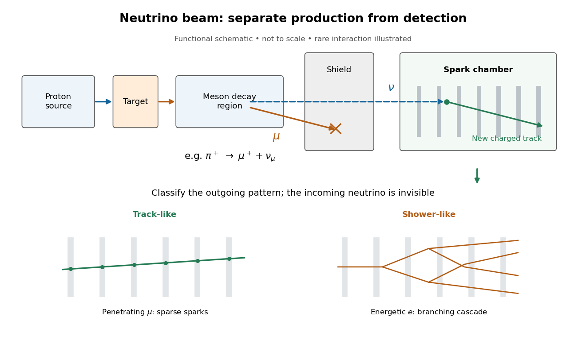
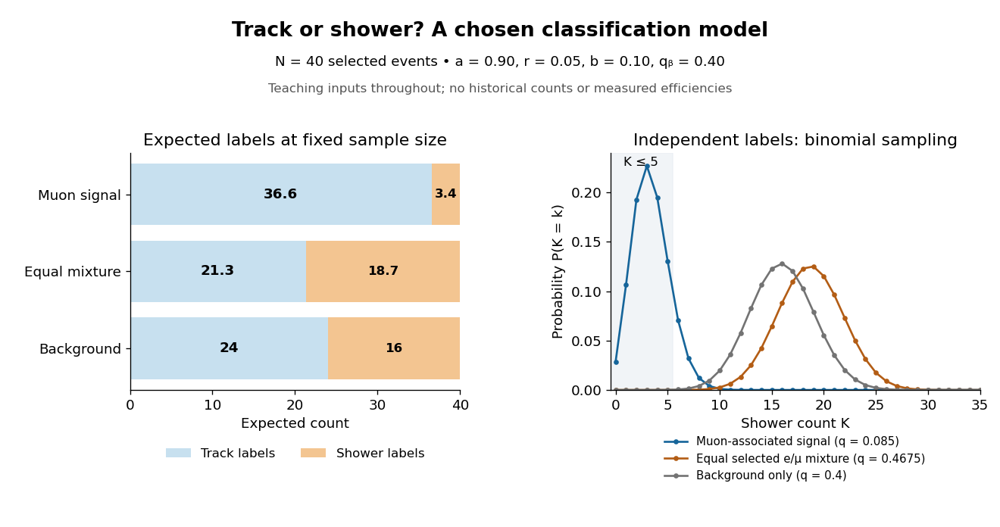
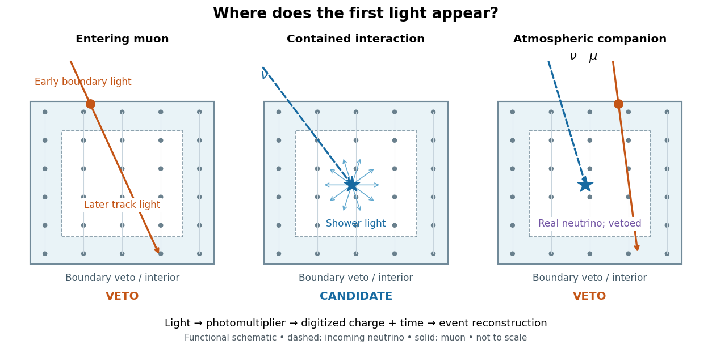
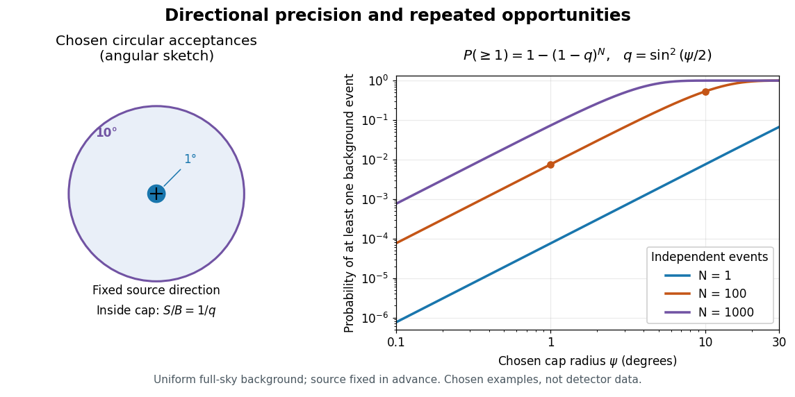
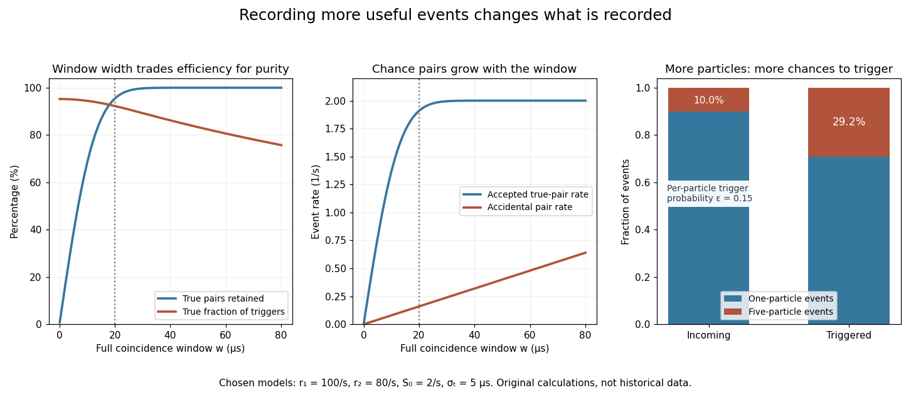
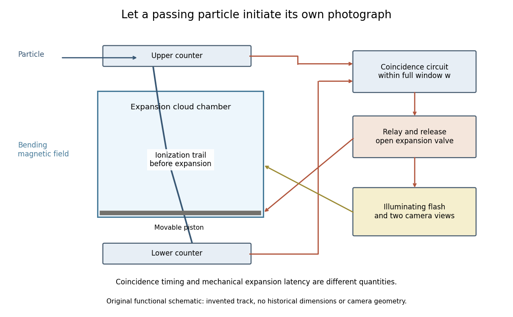
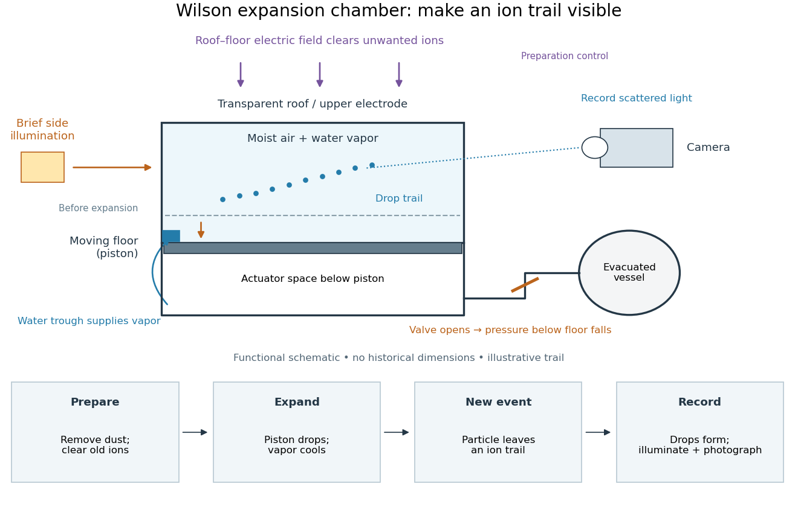
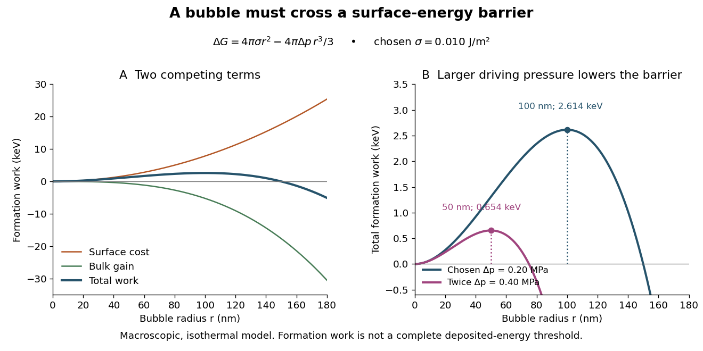
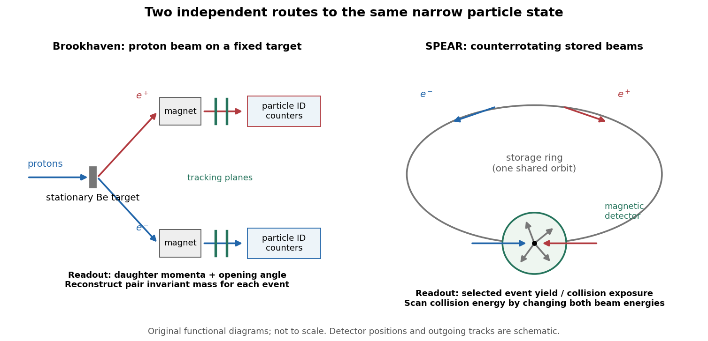
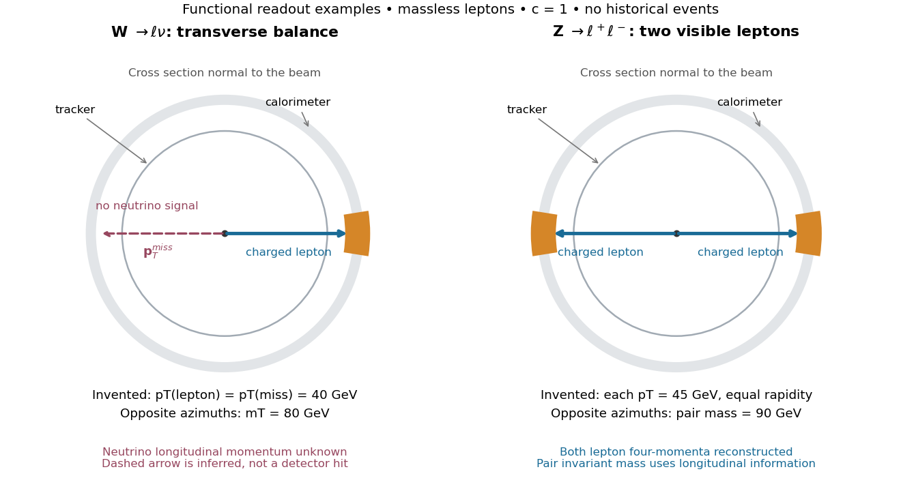

# Particle detection

↑ **Parent:** [Physics](physics.md)

[Particle detection](particle-detection.md) infers a [particle](physics.md#particle-physics)'s passage from a physical change in matter. A [cloud chamber](#cloud-chamber) makes the spatial pattern of [ionization](atomic-physics.md#ionization) visible; an [ionization chamber](physics.md#ionization-chamber) instead collects [electric charge](electric-charge.md) from [ionization](atomic-physics.md#ionization). Choosing the readout determines what can be inferred from a single event.

The [Richter-Ting independent J/psi discovery experiments](#richter-ting-independent-j-psi-discovery-experiments) show how different readouts can establish the same [particle resonance](quantum-scattering.md#particle-resonance): reconstruct daughter [invariant masses](special-relativity.md#invariant-mass) after a beam hits a stationary target, or tune the initial [center-of-mass energy](special-relativity.md#center-of-mass-energy) of two colliding beams. Both require an ensemble of events and calibrated [particle detectors](#particle-detector).

**Table of contents**

- [Collision pileup](#collision-pileup)
- [Active detector veto](#active-detector-veto)
- [Signal region](#signal-region)
- [Particle-physics control region](#particle-physics-control-region)
  - [Control-region transfer factor](#control-region-transfer-factor)
- [Detector acceptance](#detector-acceptance)
- [Displaced decay vertex](#displaced-decay-vertex)
- [Fiducial volume](#fiducial-volume)
- [Electron recoil](#electron-recoil)
- [Time projection chamber](#time-projection-chamber)
  - [Dual-phase xenon detector](#dual-phase-xenon-detector)
    - [Fiducial self-shielding in a xenon detector](#fiducial-self-shielding-in-a-xenon-detector)
    - [XENON100](#xenon100)
      - [XENON100 Collaboration](#xenon100-collaboration)
        - [Work by XENON100 Collaboration](#work-by-xenon100-collaboration)
- [Initial-state radiation](#initial-state-radiation)
- [Collider signal region](#collider-signal-region)
- [Collider control region](#collider-control-region)
- [Transition-edge sensor](#transition-edge-sensor)
- [Flavor tagging](#flavor-tagging)
- [Decay vertex](#decay-vertex)
- [Particle identification](#particle-identification)
- [Time of flight](#time-of-flight)
- [Track reconstruction](#track-reconstruction)
- [Stopping power](#stopping-power)
  - [Inverse-energy stopping-power model](#inverse-energy-stopping-power-model)
  - [Nuclear stopping](#nuclear-stopping)
  - [Electronic stopping](#electronic-stopping)
  - [High-speed charge and isotope scaling of electronic stopping](#high-speed-charge-and-isotope-scaling-of-electronic-stopping)
- [Particle shower](#particle-shower)
- [Particle detector](#particle-detector)
  - [AMS-02](#ams-02)
  - [L3 experiment](#l3-experiment)
  - [Anticoincidence detector](#anticoincidence-detector)
  - [Multiwire proportional chamber](#multiwire-proportional-chamber)
    - [Multiwire proportional chamber experiment](#multiwire-proportional-chamber-experiment)
    - [Wire pitch](#wire-pitch)
    - [Wire-address position model](#wire-address-position-model)
    - [Calibrated two-wire charge centroid](#calibrated-two-wire-charge-centroid)
  - [Lederman-Schwartz-Steinberger two-neutrino beam experiment](#lederman-schwartz-steinberger-two-neutrino-beam-experiment)
    - [Neutrino event classification model](#neutrino-event-classification-model)
  - [Calorimeter (particle physics)](#calorimeter-particle-physics)
    - [Electromagnetic calorimeter](#electromagnetic-calorimeter)
  - [Drift chamber](#drift-chamber)
  - [Spark chamber](#spark-chamber)
  - [Photomultiplier](#photomultiplier)
  - [Scintillation counter](#scintillation-counter)
  - [Cherenkov detector](#cherenkov-detector)
    - [Kajita-McDonald neutrino flavor-conversion experiments](#kajita-mcdonald-neutrino-flavor-conversion-experiments)
      - [Super-Kamiokande](#super-kamiokande)
        - [Super-Kamiokande atmospheric-neutrino experiment](#super-kamiokande-atmospheric-neutrino-experiment)
          - [Two-flavour vacuum survival model](#two-flavour-vacuum-survival-model)
      - [Sudbury Neutrino Observatory](#sudbury-neutrino-observatory)
        - [SNO solar-neutrino flavor experiment](#sno-solar-neutrino-flavor-experiment)
        - [Neutrino-flux sensitivity inversion](#neutrino-flux-sensitivity-inversion)
    - [IceCube Neutrino Observatory](#icecube-neutrino-observatory)
      - [Digital optical module](#digital-optical-module)
      - [IceCube ice-transparency calibration experiment](#icecube-ice-transparency-calibration-experiment)
      - [IceCube starting-event veto](#icecube-starting-event-veto)
      - [IceCube 2013 astrophysical-neutrino experiment](#icecube-2013-astrophysical-neutrino-experiment)
      - [Neutrino directional-coincidence model](#neutrino-directional-coincidence-model)
      - [IceCube-170922A multimessenger association](#icecube-170922a-multimessenger-association)
  - [Geiger counter](#geiger-counter)
  - [Trigger (particle physics)](#trigger-particle-physics)
    - [Coincidence circuit](#coincidence-circuit)
      - [Accidental coincidence](#accidental-coincidence)
    - [Multiplicity bias from a detector trigger](#multiplicity-bias-from-a-detector-trigger)
  - [Detector dead time](#detector-dead-time)
    - [Energy-biased detection probability](#energy-biased-detection-probability)
  - [Cloud chamber](#cloud-chamber)
    - [Expansion cloud chamber](#expansion-cloud-chamber)
      - [Triggered cloud chamber](#triggered-cloud-chamber)
        - [Blackett-Occhialini triggered cloud-chamber experiment](#blackett-occhialini-triggered-cloud-chamber-experiment)
      - [Wilson cloud-chamber experiment](#wilson-cloud-chamber-experiment)
      - [Cloud-chamber expansion model](#cloud-chamber-expansion-model)
    - [Diffusion cloud chamber](#diffusion-cloud-chamber)
  - [Bubble chamber](#bubble-chamber)
    - [Bubble-chamber track](#bubble-chamber-track)
    - [Glaser bubble-chamber experiment](#glaser-bubble-chamber-experiment)
    - [Bubble-chamber pressure cycle](#bubble-chamber-pressure-cycle)
    - [Bubble-chamber nucleation model](#bubble-chamber-nucleation-model)
    - [Bubble-chamber track readout](#bubble-chamber-track-readout)
    - [Hydrogen bubble chamber](#hydrogen-bubble-chamber)
      - [Alvarez hydrogen-bubble-chamber reconstruction and resonances](#alvarez-hydrogen-bubble-chamber-reconstruction-and-resonances)
        - [Bubble-chamber stereo reconstruction](#bubble-chamber-stereo-reconstruction)
        - [Bubble-chamber kinematic fitting](#bubble-chamber-kinematic-fitting)
        - [Invariant-mass selection of bubble-chamber events](#invariant-mass-selection-of-bubble-chamber-events)
          - [Simulated two-track invariant-mass example](#simulated-two-track-invariant-mass-example)
          - [Invariant-mass resolution](#invariant-mass-resolution)
- [Richter-Ting independent J/psi discovery experiments](#richter-ting-independent-j-psi-discovery-experiments)
  - [Brookhaven J pair-spectrometer experiment](#brookhaven-j-pair-spectrometer-experiment)
  - [SPEAR psi energy-scan experiment](#spear-psi-energy-scan-experiment)
  - [Pair mass versus collision energy](#pair-mass-versus-collision-energy)
  - [Narrow resonance and instrumental resolution](#narrow-resonance-and-instrumental-resolution)
- [Particle range](#particle-range)
- [W and Z discovery experiments](#w-and-z-discovery-experiments)
  - [UA1 experiment](#ua1-experiment)
  - [UA2 experiment](#ua2-experiment)
  - [Z pair mass and W transverse-mass limits](#z-pair-mass-and-w-transverse-mass-limits)
- [Transverse momentum](#transverse-momentum)
  - [Missing transverse momentum](#missing-transverse-momentum)
    - [Collider effective mass](#collider-effective-mass)
    - [Transverse mass](#transverse-mass)

## Collision pileup

↑ **Parent:** [Particle detection](particle-detection.md)

Additional collisions overlapping an event in the same beam crossing or detector response window. Extra tracks and [calorimeter](calorimetry.md#calorimeter) deposits affect particle-jet reconstruction, isolation and [missing transverse momentum](#missing-transverse-momentum). Vertex association, subtraction and response [calibration](differential-geometry.md#calibration-differential-geometry) reduce the effect but leave uncertainties that depend on collision conditions.

## Active detector veto

↑ **Parent:** [Particle detection](particle-detection.md)

An additional active detector region or system whose correlated signal identifies events to reject from a signal sample. Its efficiency, time window, dead time and accidental coincidences must be measured. It can reject some backgrounds without proving that every unvetoed event is signal.

## Signal region

↑ **Parent:** [Particle detection](particle-detection.md)

A pre-specified region of reconstructed event space selected for sensitivity to a hypothesized signal. Observed events are compared with a background prediction constrained by [particle-physics control regions](#particle-physics-control-region) and other measurements. A [blind analysis](statistical-inference.md#blind-analysis) can hide this region while choices and uncertainty estimates are finalized.

## Particle-physics control region

↑ **Parent:** [Particle detection](particle-detection.md)

An event sample designed to constrain a background contribution to a [signal region](#signal-region), while having little expected signal contamination. Changed particle-identification, kinematic or tagging requirements can isolate a process. The model must account for its relation to the signal sample, shared uncertainties and any signal leakage. A separate validation sample can test extrapolation without tuning the discovery selection.

### Control-region transfer factor

↑ **Parent:** [Particle-physics control region](#particle-physics-control-region)

A ratio translating a background yield in a [particle-physics control region](#particle-physics-control-region) into its yield in a [signal region](#signal-region). It may be estimated with simulation and [calibration](differential-geometry.md#calibration-differential-geometry) measurements. Its uncertainty must include acceptance, response and physics differences between the regions; contaminating backgrounds are subtracted or fitted jointly. A [profile likelihood](maximum-likelihood-estimation.md#profile-likelihood) can constrain the control and signal counts together rather than treating the transferred estimate as exact.

## Detector acceptance

↑ **Parent:** [Particle detection](particle-detection.md)

The fraction of produced events falling within a detector's geometrical and kinematic selection. Reconstruction and trigger efficiencies are additional factors; conventions must state whether they are folded into the quoted acceptance. A changed decay spectrum can alter acceptance even at the same parent [mass](classical-mechanics.md#mass).

## Displaced decay vertex

↑ **Parent:** [Particle detection](particle-detection.md)

A reconstructed decay position measurably separated from the primary collision point. Its distribution constrains a particle's flight distance and lifetime, after correcting for boost, geometry, resolution and selection. It is one possible signature of a long-lived new particle.

## Fiducial volume

↑ **Parent:** [Particle detection](particle-detection.md)

A selected inner detector volume in which the response and background rejection meet specified criteria. Position cuts can suppress surface backgrounds, but the selected target [mass](classical-mechanics.md#mass) and position-reconstruction uncertainty must be calibrated.

## Electron recoil

↑ **Parent:** [Particle detection](particle-detection.md)

An [energy](energy.md) deposition in a target's electronic degrees of freedom, as opposed to a [nuclear recoil](atomic-nucleus.md#nuclear-recoil). [gamma rays](quantum-mechanics.md#gamma-ray) and [beta decay](physics.md#beta-decay) can produce backgrounds in this channel. Detector discrimination is statistical because the measured light and charge distributions have finite widths.

## Time projection chamber

↑ **Parent:** [Particle detection](particle-detection.md)

A detector that reconstructs one coordinate from the time required for [ionization](atomic-physics.md#ionization) electrons to drift in an [electric field](electric-field.md), with the other coordinates measured by the charge or light pattern. A two-phase [xenon](chemical-substance.md#xenon) implementation obtains depth from the delay between prompt [particle scintillation](physics.md#scintillation-physics) and gas-phase charge readout.

### Dual-phase xenon detector

↑ **Parent:** [Time projection chamber](#time-projection-chamber)

A liquid target with a gaseous charge-readout layer. An interaction produces prompt [particle scintillation](physics.md#scintillation-physics), conventionally S1, and [ionization](atomic-physics.md#ionization) electrons that drift to the liquid surface. Extracted electrons produce gas [electroluminescence](optics.md#electroluminescence), conventionally S2. Timing and light-pattern information give three-dimensional position; the S2/S1 distribution helps distinguish [electron recoils](#electron-recoil) from [nuclear recoils](atomic-nucleus.md#nuclear-recoil). It does not remove neutron-induced single recoils, and the discrimination requires [calibration](differential-geometry.md#calibration-differential-geometry).

#### Fiducial self-shielding in a xenon detector

↑ **Parent:** [Dual-phase xenon detector](#dual-phase-xenon-detector)

Selecting an inner [fiducial volume](#fiducial-volume) reduces externally produced [radiation](physics.md#radiation) because outer [xenon](chemical-substance.md#xenon) attenuates it before it reaches the selected target. This trades target [mass](classical-mechanics.md#mass) for reduced background. It does not remove uniformly distributed internal radioactivity or every neutron recoil, so purification, veto information and [calibration](differential-geometry.md#calibration-differential-geometry) remain important.

#### XENON100

↑ **Parent:** [Dual-phase xenon detector](#dual-phase-xenon-detector)

An underground liquid-xenon [dark-matter direct detection](cosmology.md#dark-matter-direct-detection) experiment at Gran Sasso. Its two-phase [time projection chamber](#time-projection-chamber) combined position reconstruction with light-to-charge discrimination. The 2011–2012 search used a $34\ \mathrm{kg}$ inner target for $224.6$ live days and found candidate counts compatible with background.[Abstract](physics-bibliography.md#dark-matter-results-from-225-live-days-of-xenon100-data-by-the-xenon100-collaboration)

##### XENON100 Collaboration

↑ **Parent:** [XENON100](#xenon100)

###### Work by XENON100 Collaboration

↑ **Parent:** [XENON100 Collaboration](#xenon100-collaboration)

## Initial-state radiation

↑ **Parent:** [Particle detection](particle-detection.md)

[radiation](physics.md#radiation) emitted by an incoming particle before the hard collision. At a hadron collider an energetic recoil [jet](standard-model.md#jet-particle-physics) can help trigger and measure events whose nearly degenerate parent-daughter decays otherwise yield soft visible particles.

## Collider signal region

↑ **Parent:** [Particle detection](particle-detection.md)

A predefined event selection in which observed counts or distributions are tested against constrained background predictions. Validation selections and uncertainty propagation test the reliability of the background extrapolation.

## Collider control region

↑ **Parent:** [Particle detection](particle-detection.md)

A data selection enriched in a relevant background and used to constrain its normalization or shape. Transfer to a separate signal selection requires acceptance and systematic-uncertainty checks; a control fit is not itself a signal test.

## Transition-edge sensor

↑ **Parent:** [Particle detection](particle-detection.md)

A [transition-edge sensor](#transition-edge-sensor) detects deposited [energy](energy.md) using the strong change in [electrical resistance](electric-charge.md#electrical-resistance) near a [superconducting transition temperature](superconductivity.md#superconducting-transition-temperature).

## Flavor tagging

↑ **Parent:** [Particle detection](particle-detection.md)

Inferring a [quark flavor](standard-model.md#quark-flavor) from the charges and identities of observed decay products. A mistaken assignment dilutes a flavour-dependent [decay rate](relativistic-quantum-field.md#decay-width) difference.

## Decay vertex

↑ **Parent:** [Particle detection](particle-detection.md)

The reconstructed location at which a [particle](physics.md#particle-physics) decays, inferred from the trajectories of its decay products. Comparing two [decay vertices](#decay-vertex) can determine a decay-time difference when the motion of the parent system is known.

## Particle identification

↑ **Parent:** [Particle detection](particle-detection.md)

[Particle identification](#particle-identification) assigns a species hypothesis to a detector signal or reconstructed track. Curvature in a [magnetic field](magnetic-field.md) supplies [magnetic rigidity](relativistic-electromagnetism.md#magnetic-rigidity); additional responses, such as those of a [Cherenkov detector](#cherenkov-detector) or a [particle shower](#particle-shower), help distinguish an [electron](physics.md#electron) from a [hadron](physics.md#hadron). The identity hypothesis enters the [energy–momentum relation](special-relativity.md#energy-momentum-relation) and therefore the reconstructed [invariant mass](special-relativity.md#invariant-mass). An apparatus can observe a peak before it can identify every decay channel, as the [SPEAR psi energy-scan experiment](#spear-psi-energy-scan-experiment) illustrates.

## Time of flight

↑ **Parent:** [Particle detection](particle-detection.md)  
ⓦ [Wiki](https://en.wikipedia.org/wiki/Time_of_flight)

The elapsed time for a [particle](physics.md#particle-physics) to traverse a specified path. For constant [speed](classical-mechanics.md#speed) $v$ and known path [length](physics.md#length) $L$, $t=L/v$; varying [speed](classical-mechanics.md#speed) instead requires integrating $dt=ds/v(s)$.

## Track reconstruction

↑ **Parent:** [Particle detection](particle-detection.md)

Inferring a [particle](physics.md#particle-physics) [trajectory](classical-mechanics.md#trajectory) from recorded detector positions or a continuous trail. The inferred [trajectory](classical-mechanics.md#trajectory) depends on [spatial resolution](optics.md#spatial-resolution), detector geometry and the assumed particle-motion model; it is not a direct picture of the [particle](physics.md#particle-physics) itself.

## Stopping power

↑ **Parent:** [Particle detection](particle-detection.md)  
ⓦ [Wiki](https://en.wikipedia.org/wiki/Stopping_power_(particle_radiation))

The mean [energy](energy.md) lost by a [charged particle](electric-charge.md#charged-particle) per unit path [length](physics.md#length) through a material, with the [particle](physics.md#particle-physics) species, material and [energy](energy.md) specified. It is distinct from the [particle range](#particle-range) obtained by following the [particle](physics.md#particle-physics) until it stops.

### Inverse-energy stopping-power model

↑ **Parent:** [Stopping power](#stopping-power)

For an ideal particle energy-loss law $dE/dx=-k/E$, integration gives $E(x)=\sqrt{E_0^2-2kx}$ up to the formal range. [Stopping power](#stopping-power) grows as the endpoint is approached but its integral remains finite. This simple law does not describe endpoint broadening, scattering or every low-energy stopping mechanism.

### Nuclear stopping

↑ **Parent:** [Stopping power](#stopping-power)

Energy loss of a moving particle through collisions transferring [momentum](momentum.md) to target nuclei. Recoiling target atoms can initiate [displacement cascades](engineering.md#displacement-cascade).

### Electronic stopping

↑ **Parent:** [Stopping power](#stopping-power)

Energy loss of a moving particle to [electronic excitation](atomic-physics.md#electronic-excitation) and [ionization](atomic-physics.md#ionization). It is distinct from direct [momentum](momentum.md) transfer to target nuclei; electronic energy deposition can also couple to atomic motion in a material-dependent way.

### High-speed charge and isotope scaling of electronic stopping

↑ **Parent:** [Stopping power](#stopping-power)

For a fast ion traversing a fixed material thickness with only a small fractional [energy](energy.md) loss, the dipole excitation [probability](probability-theory.md#probability) per atomic encounter scales as $Z^2/v^2$ at fixed [impact parameter](classical-mechanics.md#impact-parameter). Summing transferred excitation energies and integrating the encounter measure $2\pi b\,db$ gives the leading electronic [stopping power](#stopping-power) scaling, with slower logarithmic dependence from the allowed excitation energies and impact-parameter range.

At fixed ion [kinetic energy](energy.md#kinetic-energy) $E=Mv^2/2$, a heavier isotope is slower, so the leading loss scales as $Z^2M/E$. At fixed velocity, isotopes of the same element instead have approximately the same electronic loss; plotting against energy per nucleon removes the leading isotope mass dependence. The charge should be the effective projectile charge if its bound electrons screen the nucleus. At lower speeds, excitation thresholds, slow-passage suppression, charge exchange and nuclear energy transfer invalidate a simple extrapolation of the high-speed law.

## Particle shower

↑ **Parent:** [Particle detection](particle-detection.md)  
ⓦ [Wiki](https://en.wikipedia.org/wiki/Particle_shower)

A cascade producing multiple secondary [particles](physics.md#particle-physics) from an initial energetic interaction. Its observed multiplicity depends on which particles reach the detector and on [detection efficiency](physics.md#detection-efficiency).

## Particle detector

↑ **Parent:** [Particle detection](particle-detection.md)  
ⓦ [Wiki](https://en.wikipedia.org/wiki/Particle_detector)

A [particle detector](#particle-detector) converts an interaction involving a [particle](physics.md#particle-physics) into a readable signal. A [cloud chamber](#cloud-chamber) is a particularly direct example: tiny [liquid](thermodynamics.md#liquid) drops turn an invisible [ion](chemistry.md#ion) trail into a photographable line.

### AMS-02

↑ **Parent:** [Particle detector](#particle-detector)

A magnetic spectrometer on the International Space Station measuring charged cosmic-ray composition and spectra. It searches indirectly for dark-matter annihilation products, not neutral halo WIMP nuclear scattering.

### L3 experiment

↑ **Parent:** [Particle detector](#particle-detector)

An experiment at the [Large Electron–Positron Collider](particle-accelerator.md#large-electron-positron-collider). Reconstructed W decays were used to test [electroweak triple gauge couplings](standard-model.md#electroweak-triple-gauge-coupling).

### Anticoincidence detector

↑ **Parent:** [Particle detector](#particle-detector)

An [anticoincidence detector](#anticoincidence-detector) vetoes a candidate event when another detector fires during the specified coincidence interval, helping reject penetrating [charged particles](electric-charge.md#charged-particle).

### Multiwire proportional chamber

↑ **Parent:** [Particle detector](#particle-detector)

A [multiwire proportional chamber](#multiwire-proportional-chamber) is a [proportional counter](physics.md#proportional-counter): parallel [anode](electrochemistry.md#anode) wires between [cathodes](electrochemistry.md#cathode) in a [gas](thermodynamics.md#gas). [Charged particle](electric-charge.md#charged-particle) [ionization](atomic-physics.md#ionization) frees [electrons](physics.md#electron); an [electric field](electric-field.md) drives them toward wires, triggering an [electron avalanche](atomic-physics.md#electron-avalanche) read by [electronic amplifiers](electrical-circuit.md#electronic-amplifier).[pp. 24–27, Figs. 1–5](physics-bibliography.md#electronic-imaging-of-ionizing-radiation-with-limited-avalanches-in-gases-by-georges-charpak)

[Georges Charpak](physicist.md#georges-charpak)'s electronic readout avoided film scanning and full [spark chamber](#spark-chamber) discharge.[pp. 23–24](physics-bibliography.md#electronic-imaging-of-ionizing-radiation-with-limited-avalanches-in-gases-by-georges-charpak)

**[Figure 1](#image-from-gas-ionization-to-an-electronic-wire-address). From gas ionization to an electronic wire address**. Original functional schematic; dimensions, pulse shapes and routing are illustrative. Wire cross-sections face the viewer.

Opposite polarities identify the avalanche wire. Positive [ion](chemistry.md#ion) motion dominates integrated signal; detection precedes complete collection. Calibrated [electron](physics.md#electron) travel times enable [drift chambers](#drift-chamber).[pp. 26–28](physics-bibliography.md#electronic-imaging-of-ionizing-radiation-with-limited-avalanches-in-gases-by-georges-charpak)

#### Multiwire proportional chamber experiment

↑ **Parent:** [Multiwire proportional chamber](#multiwire-proportional-chamber)

The original apparatus used $40\,\mu\mathrm m$ stainless-steel wires between meshes $7.5\,\mathrm{mm}$ away, flowing [argon](chemical-substance.md#argon) with organic [vapor](thermodynamics.md#vapor), negative mesh [voltage](random-walk.md#voltage) and individual [electronic amplifiers](electrical-circuit.md#electronic-amplifier). A $5.9\,\mathrm{keV}$ [X-ray](electromagnetic-radiation.md#x-ray) source calibrated pulse height while [voltage](random-walk.md#voltage) was varied.[CERN manuscript §§1–2.1, Fig. 3](physics-bibliography.md#the-use-of-multiwire-proportional-counters-to-select-and-localize-charged-particles-by-georges-charpak-and-others)

A [coincidence circuit](#coincidence-circuit) defined a narrow [proton](physics.md#proton) or [pion](standard-model.md#pion) beam. Scanning it across wires tested localization; the response edge matched the beam width, limiting the inference. Distant counts were attributed to [accidental coincidences](#accidental-coincidence). Separate [electron](physics.md#electron) scans measured pulse delay versus position, comparing [gas](thermodynamics.md#gas) mixtures and pulse-height-dependent electronics.[CERN manuscript §§2.3–2.4, Figs. 8–11](physics-bibliography.md#the-use-of-multiwire-proportional-counters-to-select-and-localize-charged-particles-by-georges-charpak-and-others)

Thresholds rejected small pulses, reducing [detection efficiency](physics.md#detection-efficiency). Wire-independence tests did not establish unlimited separation of overlapping tracks.[CERN manuscript §§2.2–2.4](physics-bibliography.md#the-use-of-multiwire-proportional-counters-to-select-and-localize-charged-particles-by-georges-charpak-and-others)

#### Wire pitch

↑ **Parent:** [Multiwire proportional chamber](#multiwire-proportional-chamber)

The centre-to-centre spacing $p$ of adjacent wires. A wire address alone specifies a cell, rather than a continuous position.

#### Wire-address position model

↑ **Parent:** [Multiwire proportional chamber](#multiwire-proportional-chamber)

Consider an original idealized [track reconstruction](#track-reconstruction) model. Let equally spaced wires have positions $x_k=kp$ and assign each event to the nearest wire, reporting $\widehat x=x_k$. Assume **exactly one correct wire address**, perfect [detection efficiency](physics.md#detection-efficiency), exact wire positions and a [uniform distribution](continuous-probability-distribution.md#continuous-uniform-distribution) of true positions within each cell. These assumptions explicitly exclude missed pulses, false addresses and several unresolved tracks.

Writing $u=x-x_k$, the [measurement error](probability-and-statistics.md#measurement-error) is $e=\widehat x-x=-u$, with $u$ uniform on $[-p/2,p/2]$. Symmetry gives zero [expected value](expected-value.md). Its [variance](variance.md) and [standard deviation](variance.md#standard-deviation) follow by integration:

$$
\mathbb E[e]=0,\qquad
\sigma_x^2=\mathbb E[e^2]=\frac{1}{p}\int_{-p/2}^{p/2}u^2\,du=\frac{p^2}{12},\qquad
\sigma_x=\frac{p}{\sqrt{12}}.
$$

For chosen [wire pitches](#wire-pitch) $p=2\,\mathrm{mm}$ and $1\,\mathrm{mm}$ this gives $0.577\,\mathrm{mm}$ and $0.289\,\mathrm{mm}$ respectively. These are model [standard deviations](variance.md#standard-deviation), not measured chamber [spatial resolutions](optics.md#spatial-resolution). The largest possible absolute error in this model is $p/2$, which is a different quantity.

A useful subtlety is that the formula depends on the illumination. For an unresolved pencil beam fixed at $x=x_k+0.4p$, every reconstructed position is $x_k$. The repeated estimates have zero [variance](variance.md), but every error is $-0.4p$. Small repeat-to-repeat spread can coexist with a biased position. The uniform-cell result therefore cannot be transferred to an arbitrary beam profile or detector selection.

The wire address supplies one transverse coordinate in this model. Combining several separated measurements supports [track reconstruction](#track-reconstruction); a single address does not specify a complete [trajectory](classical-mechanics.md#trajectory). If two [charged particles](electric-charge.md#charged-particle) enter the same cell during one accepted interval, an address-only record can be identical to that from one particle. No reconstruction of that record can recover the lost multiplicity without additional information.

**[Figure 2](#image-chosen-wire-address-errors-and-a-calibrated-two-wire-response-model). Chosen wire-address errors and a calibrated two-wire response model**. Original teaching calculations, not measured data. Left: uniform-cell address error. Right: stipulated linear charge response with independent small channel noise; the noise estimate is a first-order approximation, not a chamber performance claim.

#### Calibrated two-wire charge centroid

↑ **Parent:** [Multiwire proportional chamber](#multiwire-proportional-chamber)

Can two readout values locate a hit between wires? **Only with a specified response model.** Place two readout wires at $0$ and $p$, put $u=x/p\in[0,1]$, and stipulate calibrated, noiseless [electric charges](electric-charge.md)

$$
q_L=Q(1-u),\qquad q_R=Qu,\qquad Q>0.
$$

These are assumptions for a toy sensor response, not the natural response law of adjacent [anode](electrochemistry.md#anode) wires. Under these assumptions the [centroid](euclidean-geometry.md#centroid)

$$
\widehat x=\frac{0q_L+pq_R}{q_L+q_R}=pu=x
$$

recovers position exactly. The apparent gain in precision comes from adding calibrated analogue information. Taking the mean of two fired wire addresses without their [electric charges](electric-charge.md) would instead give the fixed midpoint $p/2$.

For a chosen noise model, replace the two [electric charges](electric-charge.md) by $q_L+n_L$ and $q_R+n_R$, with [independent random variables](random-variable.md#independent-random-variables) $n_L,n_R$ of zero [expected value](expected-value.md) and common [standard deviation](variance.md#standard-deviation) $s$. Assume $s/Q\ll1$ and no threshold censoring. First-order expansion of the ratio gives

$$
\delta x\simeq\frac{p}{Q}\bigl[(1-u)n_R-un_L\bigr],\qquad
\sigma_{\mathrm{lin}}(u)=\frac{ps}{Q}\sqrt{(1-u)^2+u^2}.
$$

For stipulated $p=2\,\mathrm{mm}$ and $s/Q=0.02$, this approximation gives $0.0283\,\mathrm{mm}$ at the midpoint and $0.0400\,\mathrm{mm}$ at either endpoint. The endpoint values describe uncensored signed channel readouts, including small negative values after baseline subtraction. They do not assume that both channels would pass a positive threshold. A ratio with a fluctuating denominator also need not have exactly zero bias; this is a local small-noise approximation.

Three original counterexamples show why calibration and selection matter:

- If the right channel retains a relative gain $g=1.10$, then $\widehat x/p=gu/(1-u+gu)$. At $u=1/2$, the bias is $p/42=0.0476\,\mathrm{mm}$ for the chosen pitch, larger than the midpoint noise estimate above.
- Suppose symmetric electronic leakage transforms the normalized right signal to $v=\epsilon+(1-2\epsilon)u$. Treating $v$ as $u$ gives a position bias $p\epsilon(1-2u)$. A known $\epsilon\ne1/2$ permits inversion; $\epsilon=1/2$ destroys position information entirely. This is a stipulated crosstalk model, not a measurement.
- Requiring both noiseless channels to exceed $0.1Q$ accepts only $0.1<u<0.9$: $80\%$ of uniformly distributed hits. Computing a position spread after that cut describes a selected sample. It does not establish improved [spatial resolution](optics.md#spatial-resolution) for all incident hits.

Likewise, two equal hits at $u=1/4$ and $u=3/4$ have exactly the same total two-channel response as one hit at $u=1/2$ with twice the [electric charge](electric-charge.md). A [centroid](euclidean-geometry.md#centroid) can hide multiplicity even when each charge measurement is exact.

[Diffusion](thermodynamics.md#diffusion) enabled the lecture's Orsay interpolation, without establishing this model's linear response.[p. 30](physics-bibliography.md#electronic-imaging-of-ionizing-radiation-with-limited-avalanches-in-gases-by-georges-charpak)

### Lederman-Schwartz-Steinberger two-neutrino beam experiment

↑ **Parent:** [Particle detector](#particle-detector)

In 1962, [Leon Max Lederman](physicist.md#leon-max-lederman), [Melvin Schwartz](physicist.md#melvin-schwartz), [Jack Steinberger](physicist.md#jack-steinberger) and collaborators distinguished [muon neutrinos](standard-model.md#muon-neutrino) from [electron neutrinos](standard-model.md#electron-neutrino) using a [neutrino beam](physics.md#neutrino-beam).[Discovery of the Muon Neutrino](physics-bibliography.md#1988-nobel-prize-by-brookhaven-national-laboratory)

The [Alternating Gradient Synchrotron](particle-accelerator.md#alternating-gradient-synchrotron) delivered $15\,\mathrm{GeV}$ [protons](physics.md#proton) onto [beryllium](chemical-substance.md#beryllium). [Particle decay](physics.md#particle-decay) of [pions](standard-model.md#pion) and [kaons](physics.md#kaon) supplied [neutrinos](standard-model.md#neutrino); a $13.5\,\mathrm m$ [iron](chemical-substance.md#iron) shield preceded a ten-ton [aluminium](chemical-substance.md#aluminium) [spark chamber](#spark-chamber).[pp. 37–38, Figs. 1–3](physics-bibliography.md#observation-of-high-energy-neutrino-reactions-and-the-existence-of-two-kinds-of-neutrinos-by-g-danby-and-others)

Production and detection are separate. In modern [neutrino flavour](standard-model.md#neutrino-flavor) notation,

$$
\pi^+\longrightarrow\mu^++\nu_\mu.
$$

Shielding suppresses the daughter [muon](standard-model.md#muon); a newly produced [muon](standard-model.md#muon) inside the [spark chamber](#spark-chamber)'s [aluminium](chemical-substance.md#aluminium) marks an interaction.[Decay and aluminium readout](physics-bibliography.md#1988-nobel-prize-by-brookhaven-national-laboratory)

**[Figure 3](#image-production-shielding-and-charged-particle-readout-in-a-neutrino-beam-experiment). Production, shielding and charged-particle readout in a neutrino beam experiment**. Original functional schematic, not a scale reconstruction. Only a rare interaction is drawn; most neutrinos traverse the detector. The lower patterns explain classification, rather than reproducing photographs.

Beam-timed [coincidence circuits](#coincidence-circuit) and veto counters rejected entering tracks. Machine-off runs measured [cosmic ray](galaxy.md#cosmic-ray) contamination; shield-thickness changes tested [neutrons](neutron.md). Placing [lead](chemical-substance.md#lead) near the target shortened the [meson](physics.md#meson) decay path and reduced events. Cosmotron [electron](physics.md#electron) calibration established [particle shower](#particle-shower) recognition.[pp. 38–42, Table II, Figs. 8–9](physics-bibliography.md#observation-of-high-energy-neutrino-reactions-and-the-existence-of-two-kinds-of-neutrinos-by-g-danby-and-others)

The paper compared $34$ single-[muon](standard-model.md#muon) candidates, including $5$ estimated [cosmic ray](galaxy.md#cosmic-ray) events, with six shower candidates unlike calibrated [electron](physics.md#electron) showers. [Kaon](physics.md#kaon) decays could supply genuine [electron neutrinos](standard-model.md#electron-neutrino). The deficit favored distinct [neutrino flavours](standard-model.md#neutrino-flavor) under [lepton universality](standard-model.md#lepton-universality).[p. 42, Figs. 8–9](physics-bibliography.md#observation-of-high-energy-neutrino-reactions-and-the-existence-of-two-kinds-of-neutrinos-by-g-danby-and-others)

The inference concerns production and detection channels. It does not measure [neutrino](standard-model.md#neutrino) [mass](classical-mechanics.md#mass) or establish permanently fixed [neutrino flavour](standard-model.md#neutrino-flavor). Later [neutrino oscillation](standard-model.md#neutrino-oscillation) experiments address changes during propagation.[Discovery of the Muon Neutrino; Super-Kamiokande](physics-bibliography.md#brookhaven-neutrino-research-by-brookhaven-national-laboratory)

#### Neutrino event classification model

↑ **Parent:** [Lederman-Schwartz-Steinberger two-neutrino beam experiment](#lederman-schwartz-steinberger-two-neutrino-beam-experiment)

How can the relative abundance of tracks and showers distinguish hypotheses? Consider an original teaching model, **with chosen inputs throughout**. Condition on a sample of $N$ selected events, each assigned exactly one of two labels: track or shower. Multitrack events and unclassified events lie outside this model. A shower label need not identify an [electron](physics.md#electron); background can imitate it. Conversely, a true [electron](physics.md#electron) interaction need not receive a shower label.

Let $b$ be the background fraction among selected events. Among the selected signal events, let $f$ be the fraction whose associated [charged lepton](standard-model.md#charged-lepton) is an [electron](physics.md#electron), with the remainder associated with a [muon](standard-model.md#muon). These are fractions after event selection, rather than fractions of the incident [neutrino](standard-model.md#neutrino) [particle flux](physics.md#particle-flux). Define the [conditional probabilities](probability-theory.md#conditional-probability)

$$
a=\Pr(\mathrm{shower}\mid e,\mathrm{signal}),\qquad
r=\Pr(\mathrm{shower}\mid\mu,\mathrm{signal}),\qquad
q_b=\Pr(\mathrm{shower}\mid\mathrm{background}).
$$

Here $a$ and $r$ describe classification within the selected sample. They are not measured historical [detection efficiencies](physics.md#detection-efficiency). The [law of total probability](probability-space.md#law-of-total-probability) gives the overall shower [probability](probability-theory.md#probability)

$$
q(f,b)=(1-b)\bigl[af+r(1-f)\bigr]+bq_b.
$$

This formula is the bridge between an interaction hypothesis and a visible label. It keeps beam contamination, background and mistaken classification conceptually distinct: genuine [electron neutrino](standard-model.md#electron-neutrino) interactions belong in $f$, while non-signal events belong in $b$.

Assume [independent random variables](random-variable.md#independent-random-variables) for the event labels, all with this same $q$. If $K$ counts shower labels, every specified pattern with $k$ showers has [probability](probability-theory.md#probability) $q^k(1-q)^{N-k}$. Counting those patterns with a [binomial coefficient](binomial-coefficient.md) yields the [binomial distribution](discrete-probability-distribution.md#binomial-distribution)

$$
\Pr(K=k)=\binom Nk q^k(1-q)^{N-k},\qquad
\mathbb E[K]=Nq,\qquad \operatorname{Var}(K)=Nq(1-q).
$$

The track count is $N-K$, so its [expected value](expected-value.md) is $N(1-q)$. At fixed $N$, the two counts cannot fluctuate independently. The [variance](variance.md) above measures sampling fluctuations under the stipulated model, not uncertainty in $a$, $r$, $b$ or $q_b$.

Choose $N=40$, $a=0.90$, $r=0.05$, $b=0.10$ and $q_b=0.40$. Compare a signal with only [muon](standard-model.md#muon)-associated interactions ($f=0$) against one with equal selected [electron](physics.md#electron)- and [muon](standard-model.md#muon)-associated interactions ($f=1/2$). These give $q=0.085$ and $q=0.4675$, respectively. Their expected shower counts are $3.4$ and $18.7$; their expected track counts are $36.6$ and $21.3$. A background-only model with the specified $q_b$ gives $16$ showers and $24$ tracks on average. These are expectations, so they need not be integers.

**[Figure 4](#image-chosen-binomial-distribution-model-expected-track-and-shower-counts-with-the-shower-count-distributions). Chosen binomial distribution model: expected track and shower counts, with the shower-count distributions**. Original calculations for forty selected events and the stipulated classification and background probabilities. No historical counts, fitted efficiencies or reconstructed significance are plotted.

For a hypothetical observation $K=4$, the [likelihood ratio](statistical-hypothesis-test.md#likelihood-ratio) of the two signal models is

$$
\frac{\mathcal L(f=0)}{\mathcal L(f=1/2)}
=\left(\frac{0.085}{0.4675}\right)^4
\left(\frac{0.915}{0.5325}\right)^{36}
\simeq3.18\times10^5.
$$

The [binomial coefficient](binomial-coefficient.md) cancels because the same hypothetical sample is used in both [likelihoods](maximum-likelihood-estimation.md#likelihood-function). This ratio is not the [probability](probability-theory.md#probability) that either hypothesis is true. A separate original check gives $\Pr(K\leq5)\simeq0.880$, $4.57\times10^{-6}$ and $1.44\times10^{-4}$ for the muon-associated, equal-mixture and specified background-only models, respectively.

Why are the controls essential? If the background-only model may choose any $q_b$, taking $q_b=K/N$ can fit the observed shower fraction. Counts alone then fail to distinguish it from a signal model. Independent background measurements and calibrated [particle identification](#particle-identification) constrain that freedom. Changing the decay path additionally tests where the candidate-producing [particles](physics.md#particle-physics) originate. The power of the experiment comes from combining apparatus interventions with event classification; the small [binomial distribution](discrete-probability-distribution.md#binomial-distribution) model isolates only the latter part of that reasoning.

### Calorimeter (particle physics)

↑ **Parent:** [Particle detector](#particle-detector)  
ⓦ [Wiki](https://en.wikipedia.org/wiki/Calorimeter_(particle_physics))

A [particle calorimeter](#calorimeter-particle-physics) infers incident [energy](energy.md) from the response to deposited [energy](energy.md), often after a [particle shower](#particle-shower). Segmentation supplies directional information relative to the collision position. A [particle calorimeter](#calorimeter-particle-physics) does not automatically measure the full [momentum](momentum.md) of every species: [muons](standard-model.md#muon), [neutrinos](standard-model.md#neutrino), incomplete coverage and unequal material response require separate treatment.

#### Electromagnetic calorimeter

↑ **Parent:** [Calorimeter (particle physics)](#calorimeter-particle-physics)

A [particle calorimeter](#calorimeter-particle-physics) designed to measure [electron](physics.md#electron) and [photon](quantum-mechanics.md#photon) [energies](energy.md) through [particle showers](#particle-shower). [Track reconstruction](#track-reconstruction) helps distinguish charged [electrons](physics.md#electron) from neutral [photons](quantum-mechanics.md#photon).

### Drift chamber

↑ **Parent:** [Particle detector](#particle-detector)

A [drift chamber](#drift-chamber) uses the drift times of [ionization](atomic-physics.md#ionization) [electrons](physics.md#electron) in a [gas](thermodynamics.md#gas) to infer positions along [charged particle](electric-charge.md#charged-particle) tracks. In a known [magnetic field](magnetic-field.md), [track reconstruction](#track-reconstruction) can estimate [momentum](momentum.md) and the sign of [electric charge](electric-charge.md).

### Spark chamber

↑ **Parent:** [Particle detector](#particle-detector)  
ⓦ [Wiki](https://en.wikipedia.org/wiki/Spark_chamber)

### Photomultiplier

↑ **Parent:** [Particle detector](#particle-detector)  
ⓦ [Wiki](https://en.wikipedia.org/wiki/Photomultiplier)

### Scintillation counter

↑ **Parent:** [Particle detector](#particle-detector)  
ⓦ [Wiki](https://en.wikipedia.org/wiki/Scintillation_counter)

### Cherenkov detector

↑ **Parent:** [Particle detector](#particle-detector)  
ⓦ [Wiki](https://en.wikipedia.org/wiki/Cherenkov_detector)

#### Kajita-McDonald neutrino flavor-conversion experiments

↑ **Parent:** [Cherenkov detector](#cherenkov-detector)

How can a detector establish that an unseen [particle](physics.md#particle-physics) changes identity? The [Super-Kamiokande atmospheric-neutrino experiment](#super-kamiokande-atmospheric-neutrino-experiment) compares different travel paths; the [Sudbury Neutrino Observatory](#sudbury-neutrino-observatory) compares different interaction channels. Both infer [neutrino flavor](standard-model.md#neutrino-flavor) from reaction products and calibrated responses. Their complementarity connects [particle detection](particle-detection.md) to [neutrino oscillation](standard-model.md#neutrino-oscillation), [neutrino mass](standard-model.md#neutrino-mass) and [neutrino astronomy](stellar-astrophysics.md#neutrino-astronomy).

[Takaaki Kajita](physicist.md#takaaki-kajita) and [Arthur B. McDonald](physicist.md#arthur-b-mcdonald) shared the 2015 physics Nobel Prize. These were collaboration achievements: [Yoichiro Suzuki](physicist.md#yoichiro-suzuki)'s [Super-Kamiokande](#super-kamiokande) work included the [solar neutrino](stellar-astrophysics.md#solar-neutrino) analysis, and [George Ewan](physicist.md#george-ewan) helped establish and lead the [Sudbury Neutrino Observatory](#sudbury-neutrino-observatory).[Research contributions of Kajita and Suzuki; shared 2015 prize](physics-bibliography.md#icrr’s-takaaki-kajita-to-share-breakthrough-prize-in-fundamental-physics-by-institute-for-cosmic-ray-research-university-of-tokyo)[17 December 2020: founding and joint leadership of SNO](https://www.queensu.ca/gazette/stories/queen-s-remembers-professor-emeritus-george-ewan/)

The older [Kamiokande](stellar-astrophysics.md#kamiokande) account explains [water Cherenkov neutrino reconstruction](stellar-astrophysics.md#water-cherenkov-neutrino-reconstruction); [Raymond Davis Jr.](chemistry.md#raymond-davis-jr)'s [Homestake experiment](stellar-astrophysics.md#homestake-experiment) explains why a deficit in an [electron neutrino](standard-model.md#electron-neutrino) channel alone leaves a source-versus-propagation ambiguity. Complementary channels can break that ambiguity.

**[Figure 5](#image-two-functional-routes-from-a-neutrino-interaction-to-a-recorded-light-pattern). Two functional routes from a neutrino interaction to a recorded light pattern**. Original schematics, not scale drawings or event photographs. Left: directional ring classification in [Super-Kamiokande](#super-kamiokande). Right: the pure-[heavy water](ionic-bonding.md#heavy-water) phase of the [Sudbury Neutrino Observatory](#sudbury-neutrino-observatory), including the indirect [neutron](neutron.md) channel. Sparse dots stand for [photomultipliers](#photomultiplier).

##### Super-Kamiokande

↑ **Parent:** [Kajita-McDonald neutrino flavor-conversion experiments](#kajita-mcdonald-neutrino-flavor-conversion-experiments)  
ⓦ [Wiki](https://en.wikipedia.org/wiki/Super-Kamiokande)

###### Super-Kamiokande atmospheric-neutrino experiment

↑ **Parent:** [Super-Kamiokande](#super-kamiokande)

Super-Kamiokande used $535$ days ($33.0$ kiloton-years) and $22.5$ fiducial kilotons of [water](chemical-substance.md#water). Inner [photomultiplier](#photomultiplier) times and charges reconstructed interactions; the outer [anticoincidence detector](#anticoincidence-detector) vetoed entering [particles](physics.md#particle-physics) and marked exits. Contained single-ring events used [likelihood](maximum-likelihood-estimation.md#likelihood-function) classification: [electron](physics.md#electron) [particle showers](#particle-shower) blur rings; [muons](standard-model.md#muon) give sharper edges. The $1.33\,\mathrm{GeV}$ visible-[energy](energy.md) sample division is not a universal detection threshold. Simulation estimated classification efficiency above about $98\%$, distinct from total [detection efficiency](physics.md#detection-efficiency); stopping [muons](standard-model.md#muon) and decay [electrons](physics.md#electron) checked classification.[PDF pp. 2–3, Table I: apparatus and classification](physics-bibliography.md#evidence-for-oscillation-of-atmospheric-neutrinos-by-y-fukuda-and-others)

Downward [neutrinos](standard-model.md#neutrino) travel about $15\,\mathrm{km}$; upward ones about $13000\,\mathrm{km}$. The multi-GeV [muon](standard-model.md#muon)-like up/down asymmetry was $-0.296\pm0.048\pm0.010$; [electron](physics.md#electron)-like events lacked a comparable effect. Calibration constrained directional bias. This was disappearance evidence; [tau neutrino](standard-model.md#tau-neutrino) appearance was untagged and sterile conversion remained possible.[PDF pp. 2–5, Fig. 1: zenith test and interpretation](physics-bibliography.md#evidence-for-oscillation-of-atmospheric-neutrinos-by-y-fukuda-and-others)

Writing $U$ and $D$ for the selected upward and downward populations, the asymmetry is $A=(U-D)/(U+D)$: a negative value means fewer upward events. An absolute source-normalization error alone rescales both populations and leaves this ratio unchanged. A direction-dependent response error need not cancel.

###### Two-flavour vacuum survival model

↑ **Parent:** [Super-Kamiokande atmospheric-neutrino experiment](#super-kamiokande-atmospheric-neutrino-experiment)

For a deliberately simplified [neutrino oscillation](standard-model.md#neutrino-oscillation) calculation, take two [neutrino flavors](standard-model.md#neutrino-flavor) related to two [mass eigenstates](finite-element-method.md#mass-eigenstate) by a real [rotation matrix](linear-algebra.md#rotation-matrix) with angle $\theta$. A [quantum superposition](quantum-system.md#quantum-superposition) acquires different phases during propagation; projecting back onto the initial [neutrino flavor](standard-model.md#neutrino-flavor) gives the [probability](probability-theory.md#probability)

$$
P_{\mu\mu}=1-\sin^2(2\theta)\sin^2\!\left(1.27\frac{\Delta m^2}{\mathrm{eV}^2}\frac{L}{\mathrm{km}}\frac{\mathrm{GeV}}{E}\right),\qquad \Delta m^2=m_2^2-m_1^2.
$$

Here $L$ is path [length](physics.md#length) and $E$ is [neutrino](standard-model.md#neutrino) [energy](energy.md); the numerical coefficient incorporates unit conversion.

The paper states the corresponding conversion formula.[PDF p. 2, Eq. (1)](physics-bibliography.md#evidence-for-oscillation-of-atmospheric-neutrinos-by-y-fukuda-and-others)

The path dependence has a geometrical origin. In an original spherical-[Earth](planetary-science.md#earth) model, let $R$ be the radius and $h$ a fixed production height, neglecting detector depth. Let $\Theta$ be the [zenith distance](astrophysics.md#zenith-distance) of the direction in the sky from which the [neutrino](standard-model.md#neutrino) arrives, so $c=\cos\Theta=+1$ means downward propagation. The backward ray from detector to production obeys $R^2+L^2+2RLc=(R+h)^2$. Its positive solution is

$$
L(c)=-Rc+\sqrt{(R+h)^2-R^2(1-c^2)}.
$$

Thus $L(+1)=h$ and $L(-1)=2R+h$. The calculation explains why opposite directions test very different baselines, rather than attributing every observed direction to the same travel distance. Actual production heights and the angle between the outgoing [charged lepton](standard-model.md#charged-lepton) and incoming [neutrino](standard-model.md#neutrino) smear that relationship.

For an original chosen example, set $\theta=\pi/4$ and $\Delta m^2=2.5\times10^{-3}\,\mathrm{eV}^2$. At $E=1\,\mathrm{GeV}$, $L=20\,\mathrm{km}$ gives $P_{\mu\mu}\simeq0.9960$, while $L=500\,\mathrm{km}$ gives $P_{\mu\mu}\simeq0.000279$. The first minimum is at $L/E\simeq494.7\,\mathrm{km/GeV}$. These are stipulated inputs, not a fit to the 1998 data. A broad distribution of true $L/E$, together with [energy](energy.md) and directional uncertainty, smooths the sharp minima.

A direct amplitude check makes the mechanism explicit. Define

$$
U=\begin{pmatrix}\cos\theta&\sin\theta\\-\sin\theta&\cos\theta\end{pmatrix},\qquad
S=U\begin{pmatrix}1&0\\0&e^{-2i\varphi}\end{pmatrix}U^T,
\qquad \varphi=1.27\frac{\Delta m^2}{\mathrm{eV}^2}\frac{L}{\mathrm{km}}\frac{\mathrm{GeV}}{E}.
$$

Then $S_{11}=\cos^2\theta+\sin^2\theta e^{-2i\varphi}$. Taking its squared [absolute value](real-analysis.md#absolute-value) yields the displayed survival formula because $1-\cos(2\varphi)=2\sin^2\varphi$. [Unitarity](vector-space.md#unitary-operator) gives $|S_{11}|^2+|S_{21}|^2=1$: disappearance from one channel becomes conversion to the other within this closed model.

This illustration does not describe all [solar neutrino](stellar-astrophysics.md#solar-neutrino) propagation. Coherent forward scattering in matter changes the effective propagation operator, and three active [neutrino flavors](standard-model.md#neutrino-flavor) require a larger mixing description. Even in the simplified model, [neutrino oscillation](standard-model.md#neutrino-oscillation) measures a squared-[mass](classical-mechanics.md#mass) difference; it does not determine the absolute [neutrino mass](standard-model.md#neutrino-mass).

##### Sudbury Neutrino Observatory

↑ **Parent:** [Kajita-McDonald neutrino flavor-conversion experiments](#kajita-mcdonald-neutrino-flavor-conversion-experiments)  
ⓦ [Wiki](https://en.wikipedia.org/wiki/Sudbury_Neutrino_Observatory)

The SNO Collaboration used $1000$ tonnes of [heavy water](ionic-bonding.md#heavy-water) in a $12\,\mathrm m$ acrylic sphere, surrounded by ordinary [water](chemical-substance.md#water) shielding and $9456$ [photomultipliers](#photomultiplier). [Weak charged current](standard-model.md#charged-current) (CC) breakup of a [deuteron](atomic-nucleus.md#deuteron) selects [electron neutrinos](standard-model.md#electron-neutrino); [weak neutral current](standard-model.md#neutral-current) (NC) breakup measures all active [neutrino flavors](standard-model.md#neutrino-flavor); [electron](physics.md#electron) [elastic scattering](quantum-scattering.md#elastic-scattering) (ES) has reduced non-electron sensitivity.[PDF p. 2: reactions and apparatus](physics-bibliography.md#measurement-of-the-rate-of-nu-e-plus-d-→-p-plus-p-plus-e-minus-interactions-produced-by-8b-solar-neutrinos-at-the-sudbury-neutrino-observatory-by-q-r-ahmad-and-others)

$$
\begin{aligned}
\nu_e+d&\longrightarrow p+p+e^-&&\mathrm{CC},\\
\nu_\alpha+d&\longrightarrow p+n+\nu_\alpha&&\mathrm{NC},\\
\nu_\alpha+e^-&\longrightarrow\nu_\alpha+e^-&&\mathrm{ES},\qquad\alpha=e,\mu,\tau.
\end{aligned}
$$

###### SNO solar-neutrino flavor experiment

↑ **Parent:** [Sudbury Neutrino Observatory](#sudbury-neutrino-observatory)

In 2001, $240.95$ live days, reconstructed radius below $5.50\,\mathrm m$ and effective [electron](physics.md#electron) kinetic [energy](energy.md) above $6.75\,\mathrm{MeV}$ gave a CC [neutrino flux](physics.md#neutrino-flux) of $1.75\times10^6\,\mathrm{cm}^{-2}\mathrm{s}^{-1}$ for the assumed [boron](chemical-substance.md#boron)-8 spectrum. Source calibrations measured $1.4\%$ instrumental-cut signal loss. SNO's own CC–ES difference was $1.6\sigma$; comparison with [Super-Kamiokande](#super-kamiokande)'s precise ES flux gave $3.3\sigma$ evidence for non-electron active [neutrinos](standard-model.md#neutrino). This was not an NC measurement.[PDF pp. 2–5: cuts, calibration and CC–ES inference; central flux](physics-bibliography.md#measurement-of-the-rate-of-nu-e-plus-d-→-p-plus-p-plus-e-minus-interactions-produced-by-8b-solar-neutrinos-at-the-sudbury-neutrino-observatory-by-q-r-ahmad-and-others)

In 2002 the pure-[heavy water](ionic-bonding.md#heavy-water) analysis used $306.4$ live days and a $5\,\mathrm{MeV}$ reconstructed kinetic-[energy](energy.md) threshold. NC [neutrons](neutron.md) captured on [deuterons](atomic-nucleus.md#deuteron) emitted $6.25\,\mathrm{MeV}$ [gamma rays](quantum-mechanics.md#gamma-ray), producing secondary [electron](physics.md#electron) light. The NC reaction threshold was $2.2\,\mathrm{MeV}$, a different quantity. [Californium](chemical-substance.md#californium)-252 calibrated $29.9\%$ capture efficiency, but only $14.4\%$ detection efficiency after fiducial and [energy](energy.md) cuts. Assays constrained backgrounds from [radioactive decay](physics.md#radioactive-decay) and photodisintegration.[PDF pp. 2–3: neutron calibration, thresholds and backgrounds](physics-bibliography.md#direct-evidence-for-neutrino-flavor-transformation-from-neutral-current-interactions-in-the-sudbury-neutrino-observatory-by-q-r-ahmad-and-others)

Energy, radius and direction relative to the [Sun](stellar-astrophysics.md#sun) statistically separated channels. Assuming the standard [boron](chemical-substance.md#boron)-8 spectral shape, the NC total active [neutrino flux](physics.md#neutrino-flux) was $5.09^{+0.44}_{-0.43}\,\mathrm{(stat.)}^{+0.46}_{-0.43}\,\mathrm{(syst.)}\times10^6\,\mathrm{cm}^{-2}\mathrm{s}^{-1}$, consistent with [stellar structure](stellar-structure.md) predictions. The non-electron active component differed from zero by $5.3\sigma$. This established active flavour conversion, without individually tagging [muon neutrinos](standard-model.md#muon-neutrino) and [tau neutrinos](standard-model.md#tau-neutrino). It did not exclude every sterile admixture.[PDF pp. 4–5, Fig. 3: constrained-spectrum fluxes and non-electron component](physics-bibliography.md#direct-evidence-for-neutrino-flavor-transformation-from-neutral-current-interactions-in-the-sudbury-neutrino-observatory-by-q-r-ahmad-and-others)

###### Neutrino-flux sensitivity inversion

↑ **Parent:** [Sudbury Neutrino Observatory](#sudbury-neutrino-observatory)

Why compare inferred [neutrino fluxes](physics.md#neutrino-flux) rather than raw event counts? For channel $j$, exposure time $T$, target population $N_j$, [cross section](physics.md#cross-section-physics) $\sigma_{j\alpha}$, and [detection efficiency](physics.md#detection-efficiency) $\epsilon_{j\alpha}$ including reconstruction and selection, a forward model is

$$
\mathbb E[N_j]-B_j=T N_j^{\mathrm{target}}\sum_\alpha\int\phi_\alpha(E)\sigma_{j\alpha}(E)\epsilon_{j\alpha}(E)\,dE.
$$

Here $B_j$ is expected background; $N_j$ on the left counts events, while $N_j^{\mathrm{target}}$ counts targets. Distinct [cross sections](physics.md#cross-section-physics), target numbers, thresholds and [detection efficiencies](physics.md#detection-efficiency) prevent a direct CC/NC count ratio from being an [electron neutrino](standard-model.md#electron-neutrino) fraction. Channel populations themselves can be correlated estimates from overlapping event patterns.

An original reduced [linear algebra](linear-algebra.md) model isolates the inference. Assume specified spectral shapes and divide each background-corrected channel rate by its own calibrated [electron neutrino](standard-model.md#electron-neutrino) response. Put $\phi_x=\phi_\mu+\phi_\tau$ and let $r$ be the spectrum- and response-weighted non-electron/electron ES sensitivity ratio. Then

$$
\begin{pmatrix}y_{\mathrm{CC}}\\y_{\mathrm{NC}}\\y_{\mathrm{ES}}\end{pmatrix}
=\begin{pmatrix}1&0\\1&1\\1&r\end{pmatrix}
\begin{pmatrix}\phi_e\\\phi_x\end{pmatrix}.
$$

The equal $\mu$ and $\tau$ responses determine their sum, not their separate [neutrino fluxes](physics.md#neutrino-flux). Changing the assumed spectra generally changes the integrated coefficients; with arbitrary unknown spectra this small [matrix](vector-space.md#matrix) is insufficient.

Choose **illustrative inputs**, not historical measurements: $r=0.15$, $\phi_e=2$ and $\phi_x=3$, with every [neutrino flux](physics.md#neutrino-flux) in the same arbitrary unit. The forward prediction is $(y_{\mathrm{CC}},y_{\mathrm{NC}},y_{\mathrm{ES}})=(2,5,2.45)$. CC and NC independently invert to $\phi_e=y_{\mathrm{CC}}=2$, $\phi_x=y_{\mathrm{NC}}-y_{\mathrm{CC}}=3$; substituting into ES returns $2+0.15(3)=2.45$. Alternatively, CC and ES give $\phi_x=(y_{\mathrm{ES}}-y_{\mathrm{CC}})/r=3$. Thus the third channel tests the response model and the inferred mixture.

**[Figure 6](#image-chosen-vacuum-survival-curve-and-complementary-neutrino-flux-constraints). Chosen vacuum survival curve and complementary neutrino flux constraints**. Original calculations only. Left: stipulated maximal two-flavour mixing and squared-mass splitting, with chosen paths at one GeV. Right: exact normalized-channel equations for chosen fluxes and ES sensitivity; lines are not experimental confidence bands.

CC alone admits any nonnegative $\phi_x$. CC and ES lose the second independent constraint when $r=0$; for small positive $r$, an ES-minus-CC error is amplified by $1/r$. With chosen independent errors $\sigma_{\mathrm{ES}}=\sigma_{\mathrm{CC}}=0.1$, their propagated [standard deviation](variance.md#standard-deviation) is $\sqrt{0.1^2+0.1^2}/0.15\simeq0.943$. If CC and NC instead have those independent errors, the difference has [standard deviation](variance.md#standard-deviation) $\sqrt{0.1^2+0.1^2}\simeq0.141$. Actual analyses must retain [covariances](variance.md#covariance), including those introduced by statistical channel separation. Complementarity supplies information; calibration establishes what information each channel carries.

#### IceCube Neutrino Observatory

↑ **Parent:** [Cherenkov detector](#cherenkov-detector)  
ⓦ [Wiki](https://en.wikipedia.org/wiki/IceCube_Neutrino_Observatory)

[IceCube](#icecube-neutrino-observatory) turns Antarctic [ice](chemical-substance.md#ice) into a [Cherenkov detector](#cherenkov-detector): $5160$ [digital optical modules](#digital-optical-module) on $86$ strings span depths of $1450$–$2450\,\mathrm m$. Hot-water drilling allowed deployment before refreezing. [Neutrino](standard-model.md#neutrino) interactions produce [charged particles](electric-charge.md#charged-particle); their [Cherenkov radiation](electromagnetic-wave.md#cherenkov-radiation), rather than the incoming [neutrino](standard-model.md#neutrino), supplies the optical readout.[Sections 1.1.1, 5.1: array and deployment](physics-bibliography.md#the-icecube-neutrino-observatory-instrumentation-and-online-systems-by-icecube-collaboration)

[Neutrino astronomy](stellar-astrophysics.md#neutrino-astronomy) asks where the incoming [neutrino](standard-model.md#neutrino) originated. A [Cherenkov detector](#cherenkov-detector) asks how its reaction products make measurable light. Connecting these questions requires [track reconstruction](#track-reconstruction), [detection efficiency](physics.md#detection-efficiency) and background tests. An astronomical messenger and the light carrying information inside the apparatus are different stages of one inference.

##### Digital optical module

↑ **Parent:** [IceCube Neutrino Observatory](#icecube-neutrino-observatory)

A glass-enclosed [photomultiplier](#photomultiplier) with local digitization: pulse times and charges enter event reconstruction. Reciprocal electrical pulses synchronize module clocks to the surface time base.[Sections 2.1, 3.3: module and reciprocal timing](physics-bibliography.md#the-icecube-neutrino-observatory-instrumentation-and-online-systems-by-icecube-collaboration)

[Weak charged current](standard-model.md#charged-current) interactions of [muon neutrinos](standard-model.md#muon-neutrino) usually give extended [muon](standard-model.md#muon) tracks. Compact [particle showers](#particle-shower) occur in other channels, including [weak neutral current](standard-model.md#neutral-current) interactions of every [neutrino flavor](standard-model.md#neutrino-flavor). Tracks generally constrain direction better; escaping [particles](physics.md#particle-physics) complicate [energy](energy.md) inference.[Section 1.1.1: tracks and showers](physics-bibliography.md#the-icecube-neutrino-observatory-instrumentation-and-online-systems-by-icecube-collaboration)

##### IceCube ice-transparency calibration experiment

↑ **Parent:** [IceCube Neutrino Observatory](#icecube-neutrino-observatory)

In the 2013 calibration study, six horizontal [light-emitting diodes](electrical-circuit.md#light-emitting-diode) per module on string 63 flashed sequentially; other strings recorded charges and [photon](quantum-mechanics.md#photon) arrival times. A global fit inferred depth-dependent [scattering of light](optics.md#scattering-of-light) and [absorption coefficients](astrophysics.md#absorption-coefficient). Dust-logger measurements checked layer structure; independent [muon](standard-model.md#muon) events tested simulated time patterns. [Photomultiplier](#photomultiplier) response and refrozen ice near modules remained limitations. Thus a late hit need not imply a late interaction: [scattering of light](optics.md#scattering-of-light) changes the path.[Sections 3, 8–11; Figs. 14, 20–23: flashing, cross-checks and limitations](physics-bibliography.md#measurement-of-south-pole-ice-transparency-with-the-icecube-led-calibration-system-by-icecube-collaboration)

An original limiting calculation isolates this issue. Suppose a compact source emits at time $t_0$ into homogeneous, nondispersive [ice](chemical-substance.md#ice) with stipulated [refractive index](electromagnetic-wave.md#refractive-index) $n=1.32$. At distance $r$, the unscattered light arrives at

$$
t_{\mathrm{direct}}=t_0+\frac{nr}{c},
$$

where $c$ is the vacuum [speed of light](special-relativity.md#speed-of-light). For chosen $r=100\,\mathrm m$, the delay is $440.3\,\mathrm{ns}$. A scattered path $30\,\mathrm m$ longer adds $132.1\,\mathrm{ns}$ even with perfect clocks. These chosen values are not calibration measurements. Real [ice](chemical-substance.md#ice) requires wavelength-dependent propagation, module response and a spatially varying light-transport model; replacing that response by one arrival time discards information.

##### IceCube starting-event veto

↑ **Parent:** [IceCube Neutrino Observatory](#icecube-neutrino-observatory)

The 2013 selection rejected early boundary light. Tagged [muons](standard-model.md#muon) checked leakage; [air shower](galaxy.md#air-shower) companion [muons](standard-model.md#muon) also vetoed downward [atmospheric neutrinos](standard-model.md#atmospheric-neutrino).[Event Selection; Atmospheric Muon Background](physics-bibliography.md#evidence-for-high-energy-extraterrestrial-neutrinos-at-the-icecube-detector-by-icecube-collaboration)

**[Figure 7](#image-entering-tracks-contained-interactions-and-an-accompanying-muon-veto). Entering tracks, contained interactions and an accompanying-muon veto**. Original schematic, not to scale or measured data. Dots: optical modules. Dashed arrows: unseen neutrinos; solid arrows: muons.

A simple original [conditional probability](probability-theory.md#conditional-probability) model explains why a veto changes the selected mixture. Let $A$ mean that an [atmospheric neutrino](standard-model.md#atmospheric-neutrino) interaction would pass all other cuts, $M$ that an accompanying [muon](standard-model.md#muon) reaches the veto, and $V$ that the veto fires. Set $a=P(M\mid A)$ and $\epsilon=P(V\mid M,A)$, and neglect unrelated veto hits. The [law of total probability](probability-space.md#law-of-total-probability) gives

$$
P(\text{passes veto}\mid A)=1-a\epsilon.
$$

For chosen $a=0.8$ and $\epsilon=0.95$, the passing fraction is $0.24$. Neither this value nor either input is an [IceCube](#icecube-neutrino-observatory) measurement. With equal incident candidate populations, this mechanism alone reduces the atmospheric contribution relative to a hypothetical population having $a=0$. It does not make every surviving event astronomical: $a=0$ or $\epsilon=0$ gives no suppression, while $a=\epsilon=1$ removes the entire chosen atmospheric population. If unrelated light vetoes a surviving event independently with [probability](probability-theory.md#probability) $u$, its passing fraction becomes $(1-u)(1-a\epsilon)$; independence is an additional assumption.

##### IceCube 2013 astrophysical-neutrino experiment

↑ **Parent:** [IceCube Neutrino Observatory](#icecube-neutrino-observatory)

In $662$ live days during 2010–2012, $28$ events exceeded the expected $10.6^{+5.0}_{-3.6}$ atmospheric events. [Energy](energy.md), direction and topology supported an extraterrestrial component. Combined searches gave $4.1\sigma$ with additional benchmark charm background; uncertain charm production affected significance. No source clustering was established.[Results; Discussion; Search for Neutrino Sources](physics-bibliography.md#evidence-for-high-energy-extraterrestrial-neutrinos-at-the-icecube-detector-by-icecube-collaboration)

A diffuse excess and an identified source answer different questions. The first compares populations against a background hypothesis; the second needs an association in direction, perhaps also in time.

Escaping [muons](standard-model.md#muon) or [neutrinos](standard-model.md#neutrino) can make deposited [energy](energy.md) smaller than incoming [neutrino](standard-model.md#neutrino) [energy](energy.md).[Table 1; Event Reconstruction](physics-bibliography.md#evidence-for-high-energy-extraterrestrial-neutrinos-at-the-icecube-detector-by-icecube-collaboration)

##### Neutrino directional-coincidence model

↑ **Parent:** [IceCube Neutrino Observatory](#icecube-neutrino-observatory)

How much does a small directional uncertainty help? Consider an original idealized model: a source direction fixed in advance, uniform background directions over the full [sphere](euclidean-geometry.md#sphere), and circular acceptance radius $\psi$. The accepted [solid angle](euclidean-geometry.md#solid-angle) and single-event background [probability](probability-theory.md#probability) are

$$
\Omega(\psi)=\int_0^{2\pi}\!d\phi\int_0^\psi\sin\theta\,d\theta=2\pi(1-\cos\psi),\qquad
q(\psi)=\frac{\Omega}{4\pi}=\frac{1-\cos\psi}{2}.
$$

The derivation integrates the area element on a unit [sphere](euclidean-geometry.md#sphere). For small $\psi$ in [radians](geometry-and-topology.md#radian), $q\simeq\psi^2/4$: halving the radius quarters the accidental acceptance, to leading order. At $psi=0$ acceptance vanishes; at $\psi=\pi$ it covers the full [sphere](euclidean-geometry.md#sphere). The [solid angle](euclidean-geometry.md#solid-angle) has units of [steradians](euclidean-geometry.md#steradian); $q$ is dimensionless.

For $0<\psi\leq\pi$, take a deliberately crude [point spread function](point-spread-function.md): stipulate that every signal direction lies uniformly inside that cap. The signal and background [probability density functions](continuous-probability-distribution.md#probability-density-function) per [steradian](euclidean-geometry.md#steradian) are $S=1/\Omega$ inside the cap and zero outside, and $B=1/(4\pi)$ everywhere. Both integrate to one. For an event inside the cap their [likelihood ratio](statistical-hypothesis-test.md#likelihood-ratio) is

$$
\frac{S}{B}=\frac1q.
$$

This ratio compares two specified directional models; it is not the [probability](probability-theory.md#probability) that the event came from the source. Such a [conditional probability](probability-theory.md#conditional-probability) would additionally require prior source odds and the other selection information. For fixed source fraction $f$ among selected events, a normalized [mixture distribution](probability-distribution.md#mixture-distribution) has density $(1-f)B+fS$. For independent events the [likelihood](maximum-likelihood-estimation.md#likelihood-function) is the product of those densities; its ratio to background alone is

$$
\Lambda(f)=\prod_i\left[1+f\left(\frac{S_i}{B_i}-1\right)\right].
$$

Outside-cap events contribute factors $1-f$ rather than being silently discarded. At $f=0$, $\Lambda=1$; for a full-sky cap, $S=B$ and every $f$ gives $\Lambda=1$. A directional model that cannot distinguish source from background carries no directional evidence.

**[Figure 8](#image-chosen-angular-acceptance-directional-likelihood-and-repeated-background-opportunities). Chosen angular acceptance, directional likelihood and repeated background opportunities**. Original exact spherical-cap calculation and uniform-cap signal model. Radii and event counts are chosen illustrations, not IceCube angular resolutions or discovery data. The fixed source direction and independent uniform background assumptions are essential.

As an original numerical example, radii $1^\circ$ and $10^\circ$ give $q\simeq7.615\times10^{-5}$ and $7.596\times10^{-3}$, respectively: nearly a hundredfold difference. For a fixed number $N$ of independent background events, the [binomial distribution](discrete-probability-distribution.md#binomial-distribution) gives

$$
P(\text{at least one inside})=1-(1-q)^N.
$$

With chosen $N=100$, those radii give approximately $0.00759$ and $0.5335$. A small single-event acceptance can become a common coincidence after many opportunities. This [probability](probability-theory.md#probability) concerns a fixed cap, rather than a scan for the most favorable cap anywhere. For $m$ independent searches with common local tail [probability](probability-theory.md#probability) $p$, the corresponding global tail [probability](probability-theory.md#probability) is $1-(1-p)^m$; overlapping sky searches generally violate that independence. Actual source tests must include directional response, nonuniform exposure, [energy](energy.md) information and the [look-elsewhere effect](statistical-hypothesis-test.md#look-elsewhere-effect) in their null calibration.

##### IceCube-170922A multimessenger association

↑ **Parent:** [IceCube Neutrino Observatory](#icecube-neutrino-observatory)

The 2018 collaboration paper associated the 22 September 2017 [neutrino](standard-model.md#neutrino) alert with the flaring [blazar](astrophysical-black-hole.md#blazar) [TXS 0506+056](astrophysical-black-hole.md#txs-0506-plus-056) through directional and multiwavelength observations. Its approximately $3\sigma$ evidence included trial corrections and assumed relationships between [neutrino](standard-model.md#neutrino) and [gamma ray](quantum-mechanics.md#gamma-ray) emission. A single association did not establish a production mechanism or explain the entire diffuse [neutrino flux](physics.md#neutrino-flux).[The neutrino alert; Neutrino-blazar coincidence analysis; Discussion, PDF pp. 2–3, 11–13, 62–66](physics-bibliography.md#multi-messenger-observations-of-a-flaring-blazar-coincident-with-high-energy-neutrino-icecube-170922a-by-icecube-collaboration-and-others)

### Geiger counter

↑ **Parent:** [Particle detector](#particle-detector)  
ⓦ [Wiki](https://en.wikipedia.org/wiki/Geiger_counter)

A [particle detector](#particle-detector) in which an ionizing event triggers a [gas](thermodynamics.md#gas) discharge and a counted electrical pulse.

### Trigger (particle physics)

↑ **Parent:** [Particle detector](#particle-detector)  
ⓦ [Wiki](https://en.wikipedia.org/wiki/Trigger_(particle_physics))

A [detector trigger](#trigger-particle-physics) decides which candidate events cause a readout or recording. It can concentrate a limited recording capacity on rare interactions, but the accepted events then form a selected sample. A [coincidence circuit](#coincidence-circuit) uses a timing relation between several detectors; the [Blackett-Occhialini triggered cloud-chamber experiment](#blackett-occhialini-triggered-cloud-chamber-experiment) made that relation operate an entire camera-and-expansion sequence.

#### Coincidence circuit

↑ **Parent:** [Trigger (particle physics)](#trigger-particle-physics)  
ⓦ [Wiki](https://en.wikipedia.org/wiki/Coincidence_circuit)

A [coincidence circuit](#coincidence-circuit) responds when detector signals occur within a specified time window. Two counters placed on opposite sides of a chamber can preferentially select a [charged particle](electric-charge.md#charged-particle) that crosses both. Simultaneity within the electronics' window alone does not establish that two signals have the same physical cause: unrelated detections produce [accidental coincidences](#accidental-coincidence).

##### Accidental coincidence

↑ **Parent:** [Coincidence circuit](#coincidence-circuit)

Suppose two independent background streams follow [Poisson processes](poisson-process.md) with rates $r_1$ and $r_2$. Define a coincidence by $|t_2-t_1|<w/2$: **$w$ is the full accepted time-difference width**. Around each first-counter signal, the expected number of second-counter signals is $r_2w$. The expected pair rate is therefore $r_1r_2w$. A circuit producing at most one output per first signal instead gives

$$
R_{\rm acc}=r_1(1-e^{-r_2w})\simeq r_1r_2w\qquad(r_2w\ll1).
$$

The distinction matters when multiple detections occur in one window. If a different convention accepts $|t_2-t_1|<\tau$, its full width is $w=2\tau$ and the dilute expression is $2r_1r_2\tau$.

For a chosen numerical model, take background rates $r_1=100\,\mathrm{s^{-1}}$, $r_2=80\,\mathrm{s^{-1}}$ and $w=20\,\mu\mathrm s$. The dilute pair rate is $0.16\,\mathrm{s^{-1}}$. These are stipulated teaching inputs, not measurements of the historical chamber.

Making $w$ smaller also rejects some genuine events. Suppose true pairs arrive at rate $S_0$ before the timing cut, and their time difference has a centered [normal distribution](probability-distribution.md#normal-distribution) with [standard deviation](variance.md#standard-deviation) $\sigma_t$. Its accepted fraction, using the [error function](integral.md#error-function), is

$$
\epsilon_t(w)=\operatorname{erf}\!\left(\frac{w}{2\sqrt2\sigma_t}\right),\qquad
S(w)=S_0\epsilon_t(w).
$$

For chosen $S_0=2.0\,\mathrm{s^{-1}}$ and $\sigma_t=5\,\mu\mathrm s$, the $20\,\mu\mathrm s$ window retains about $95.45\%$ of true pairs. In the dilute background model the fraction of accepted events that are true is $S/(S+R_{\rm acc})\simeq92.27\%$. A narrow window trades [detection efficiency](physics.md#detection-efficiency) against background; it does not make either quantity equal to one. Delaying one counter's signal far beyond genuine event correlations gives a proposed background check under stationarity, without assuming that the zero-delay excess itself is accidental.

#### Multiplicity bias from a detector trigger

↑ **Parent:** [Trigger (particle physics)](#trigger-particle-physics)

A trigger changes which particle populations are common in the recorded sample. Let $N$ be the number of particles in an event, and stipulate an independent [Bernoulli distribution](discrete-probability-distribution.md#bernoulli-distribution) for each particle's ability to produce an accepted telescope signal, with success [probability](probability-theory.md#probability) $\epsilon$. If any successful particle suffices, the event acceptance is

$$
A(n)=1-(1-\epsilon)^n.
$$

This is a deliberately simplified model. Its $\epsilon$ includes the joint geometrical acceptance and response of the whole telescope; it is not an assumed universal single-counter efficiency. Actual shower directions, spatial correlations and shared electronics can violate the independence assumption.

The [conditional probability](probability-theory.md#conditional-probability) formula gives

$$
\Pr(N=n\mid\mathrm{trigger})=
\frac{A(n)\Pr(N=n)}{\sum_m A(m)\Pr(N=m)}.
$$

For chosen underlying fractions $\Pr(N=1)=0.90$, $\Pr(N=5)=0.10$ and $\epsilon=0.15$, the two acceptances are $0.15$ and $0.5563$. Five-particle events consequently form about $29.18\%$ of recorded events. **A population that is only $10\%$ of incoming events can occupy nearly $30\%$ of the photographs.** This is [selection bias](causal-inference.md#selection-bias), not evidence that the source population changed.

**[Figure 9](#image-a-coincidence-window-trades-timing-acceptance-against-background-while-a-trigger-enriches-events-with-more-particles). A coincidence window trades timing acceptance against background, while a trigger enriches events with more particles**. Original calculations with the explicitly chosen rates, Gaussian timing spread and independent-particle acceptance model in the text. No historical event counts or measured timing curves are reproduced.

### Detector dead time

↑ **Parent:** [Particle detector](#particle-detector)

The interval during which a detector or readout cannot register another event while recovering from a response. A [detector trigger](#trigger-particle-physics) may be fast while the camera, chamber or data acquisition is still busy.

In a simple nonextending model, every accepted event starts a fixed busy interval $\tau_d$; arrivals during it are lost and do not extend it. With [Poisson process](poisson-process.md) input rate $R$, the average cycle lasts $\tau_d+1/R$, giving observed rate

$$
R_{\rm obs}=\frac{R}{1+R\tau_d}.
$$

This is a specified mathematical model, not a universal correction. An instrument whose busy interval is extended by further arrivals behaves differently. Correcting the total rate also does not remove the [multiplicity bias from a detector trigger](#multiplicity-bias-from-a-detector-trigger).

#### Energy-biased detection probability

↑ **Parent:** [Detector dead time](#detector-dead-time)

If source class $i$ has prior fraction $p_i$ and [detection efficiency](physics.md#detection-efficiency) $\eta_i$, its fraction among detected events is proportional to $p_i\eta_i$. [Bayes' theorem](probability-theory.md#bayes-theorem) normalizes these products. Class-dependent losses therefore bias the detected composition even when the incident fractions are known exactly.

### Cloud chamber

↑ **Parent:** [Particle detector](#particle-detector)  
ⓦ [Wiki](https://en.wikipedia.org/wiki/Cloud_chamber)

A [cloud chamber](#cloud-chamber) contains [supersaturated vapor](critical-phenomenon.md#supersaturated-vapor). [Ionization](atomic-physics.md#ionization) along a [charged particle](electric-charge.md#charged-particle)'s path supplies sites for [nucleation](critical-phenomenon.md#nucleation); the resulting [liquid](thermodynamics.md#liquid) drops scatter [light](optics.md#light) and reveal the trail. The observed objects are drops, not magnified [particles](physics.md#particle-physics). Its beauty is that a spatially distributed microscopic interaction becomes a visible geometrical record.

Two ways of making [supersaturated vapor](critical-phenomenon.md#supersaturated-vapor) must be distinguished. An [expansion cloud chamber](#expansion-cloud-chamber) rapidly increases the [volume](thermodynamics.md#volume-thermodynamics) of moist [gas](thermodynamics.md#gas), producing a temporary sensitive interval through cooling by [adiabatic expansion](first-law-of-thermodynamics.md#adiabatic-expansion). A [diffusion cloud chamber](#diffusion-cloud-chamber) maintains a cold base and a warmer [vapor](thermodynamics.md#vapor) supply, producing a continuously replenished sensitive layer through [diffusion](thermodynamics.md#diffusion) and a [temperature gradient](heat.md#temperature-gradient).

#### Expansion cloud chamber

↑ **Parent:** [Cloud chamber](#cloud-chamber)

The central mechanism is a competition between two falling [pressures](pressure.md): expansion reduces the actual [water](chemical-substance.md#water) [partial pressure](ideal-gas.md#partial-pressure), but cooling can reduce the equilibrium [vapor pressure](thermodynamic-potential.md#vapor-pressure) still faster. The ratio can therefore rise above one even though the [gas](thermodynamics.md#gas) becomes more dilute. The [cloud-chamber expansion model](#cloud-chamber-expansion-model) below makes that comparison explicit.

##### Triggered cloud chamber

↑ **Parent:** [Expansion cloud chamber](#expansion-cloud-chamber)

A [triggered cloud chamber](#triggered-cloud-chamber) expands in response to an event indicated by other detectors, rather than hoping that a particle arrives during a randomly chosen sensitive interval. The [ionization](atomic-physics.md#ionization) trail is produced before expansion. The apparatus must respond while the ions remain sufficiently localized to make a useful photograph.

###### Blackett-Occhialini triggered cloud-chamber experiment

↑ **Parent:** [Triggered cloud chamber](#triggered-cloud-chamber)

[Patrick Maynard Stuart Blackett](physicist.md#patrick-maynard-stuart-blackett) and [Giuseppe Occhialini](physicist.md#giuseppe-paolo-stanislao-occhialini) began their cosmic-ray collaboration in 1931. They used the coincidence methods of [Walther Bothe](physicist.md#walther-bothe) and [Bruno Rossi](physicist.md#bruno-benedetto-rossi) to make a particle initiate its own recording. Blackett later reported tracks on about $80\%$ of their counter-controlled photographs, compared with roughly $2$–$5\%$ for random expansions in small chambers. Those figures describe the reported apparatus and conditions, not a universal [detection efficiency](physics.md#detection-efficiency).[Cloud chamber researches in nuclear physics and cosmic radiation, lecture 13 December 1948, pp. 104–105: collaboration, coincidence precedent and photographic yield](physics-bibliography.md#cloud-chamber-researches-in-nuclear-physics-and-cosmic-radiation-by-patrick-maynard-stuart-blackett)

In their 1933 account, [Geiger counters](#geiger-counter) above and below the chamber fed a [coincidence circuit](#coincidence-circuit). Its pulse operated a [thyratron](electrical-circuit.md#thyratron), magnet and [spring](elasticity-physics.md#spring)-release [valve](engineering.md#valve), letting a light [piston](engineering.md#piston) expand the [gas](thermodynamics.md#gas). A [mercury-vapor lamp](electrical-circuit.md#mercury-vapor-lamp) then illuminated the drops. A water-cooled [solenoid](magnetic-field.md#solenoid) supplied the [magnetic field](magnetic-field.md); two oblique [cameras](photography.md#camera) allowed track reconstruction. Moving the lower counter changed which trajectories could be recorded.[Some Photographs of the Tracks of Penetrating Radiation, pp. 699–701, section 1 and Fig. 2; p. 719, Description of Plates: expansion sequence, cameras and alternate counter position](physics-bibliography.md#some-photographs-of-the-tracks-of-penetrating-radiation-by-patrick-maynard-stuart-blackett-and-giuseppe-paolo-stanislao-occhialini)

**[Figure 10](#image-counter-coincidence-initiates-expansion-illumination-and-photography-in-a-functional-reconstruction-of-the-blackett-occhialini-method). Counter coincidence initiates expansion, illumination and photography in a functional reconstruction of the Blackett-Occhialini method**. Original diagram, not a scale drawing or a historical photograph. The pictured track and positions are illustrative; magnetic curvature and event direction require further measurements.

Two timing problems must be separated. The [coincidence circuit](#coincidence-circuit)'s window distinguishes nearly simultaneous counter signals. The mechanical expansion latency determines how much the existing [ionization](atomic-physics.md#ionization) trail spreads before droplets form. For a chosen one-coordinate [diffusion](thermodynamics.md#diffusion) model with initial [variance](variance.md) $\sigma_0^2$, [diffusion coefficient](brownian-motion.md#diffusion-coefficient) $D$ and expansion delay $t_e$,

$$
\sigma_{\rm track}^2=\sigma_0^2+2Dt_e.
$$

Taking $\sigma_0=0$, $D=2.0\times10^{-6}\,\mathrm{m^2\,s^{-1}}$ and $t_e=20\,\mathrm{ms}$ gives $\sigma_{\rm track}\simeq0.283\,\mathrm{mm}$. This is an original illustrative calculation, not the historical track width. It shows why a fast electronic pulse does not by itself guarantee a sharp photograph: the subsequent mechanical response also matters.

The photographs revealed groups containing positive and negative electron-like tracks, complementing the [Anderson positron track experiment](relativistic-electromagnetism.md#anderson-positron-track-experiment). Their interpretation depended on track curvature, direction, [ionization](atomic-physics.md#ionization) and [particle range](#particle-range), not simply on the presence of a coincidence.[Some Photographs of the Tracks of Penetrating Radiation, pp. 702–708 and p. 718, Summary: associated tracks and evidence for positive electrons](physics-bibliography.md#some-photographs-of-the-tracks-of-penetrating-radiation-by-patrick-maynard-stuart-blackett-and-giuseppe-paolo-stanislao-occhialini) Blackett explicitly noted that the counter control favored larger [particle showers](#particle-shower).[Cloud chamber researches in nuclear physics and cosmic radiation, p. 108: multiplicity-dependent triggering and overrepresentation of large showers](physics-bibliography.md#cloud-chamber-researches-in-nuclear-physics-and-cosmic-radiation-by-patrick-maynard-stuart-blackett) The [multiplicity bias from a detector trigger](#multiplicity-bias-from-a-detector-trigger) gives a small model of that effect: a recording method can improve the study of rare interactions while making its photographs unrepresentative of the incident population.

##### Wilson cloud-chamber experiment

↑ **Parent:** [Expansion cloud chamber](#expansion-cloud-chamber)

[Charles Thomson Rees Wilson](physicist.md#charles-thomson-rees-wilson)'s 1927 lecture recalls [electron](physics.md#electron) cloud trails produced with [X-rays](electromagnetic-radiation.md#x-ray) in 1911, then [alpha particle](atomic-nucleus.md#alpha-particle) trails from a radium-tipped source. The improved 1912 chamber had a wide, shallow space with a suddenly falling floor to limit stirring. A roof–floor clearing [electric field](electric-field.md) removed unwanted [ions](chemistry.md#ion). Sharp [photography](photography.md) required expansion, then the ionizing [particle](physics.md#particle-physics), then illumination.[Nobel Lectures, Physics 1922–1941; Wilson, 1927 Nobel lecture, pp.199–201, Fig.3: apparatus and operating sequence](physics-bibliography.md#nobel-lectures-physics-1922-1941/on-the-cloud-method-of-making-visible-ions-and-the-tracks-of-ionizing-particles-by-charles-thomson-rees-wilson)

The [piston](engineering.md#piston) mechanism connects the space beneath the moving floor to an evacuated vessel: opening the valve lets the floor drop. [Water](chemical-substance.md#water) in a trough supplies the [vapor](thermodynamics.md#vapor). The Smithsonian's surviving demonstration object is explicitly a 1961 replica of the 1912 apparatus.[Smithsonian Institution, Wilson's cloud chamber, replica of Cavendish Lab apparatus, object nmah\_700205, “History and basic principle” and “Date made”](physics-bibliography.md#wilson’s-cloud-chamber-replica-of-cavendish-lab-apparatus-by-smithsonian-institution)

**[Figure 11](#image-expansion-cloud-chamber-functional-apparatus-and-order-of-operations). Expansion cloud chamber: functional apparatus and order of operations**. Original functional schematic, with an invented illustrative trail. Positions, sizes and delays are schematic; this is not a historical photograph or a mechanical reconstruction.

After dust removal, [X-rays](electromagnetic-radiation.md#x-ray) increased droplet formation above a lower expansion threshold; larger expansions also produced dense background cloud.[Nobel Lectures, Physics 1922–1941; Wilson, 1927 Nobel lecture, pp.194–197: cloud limits and clearing controls](physics-bibliography.md#nobel-lectures-physics-1922-1941/on-the-cloud-method-of-making-visible-ions-and-the-tracks-of-ionizing-particles-by-charles-thomson-rees-wilson)

The control logic separates a localized [ionization](atomic-physics.md#ionization) trail from fog. Delays permit [ion](chemistry.md#ion) displacement and drop growth; stirring deforms the trail. A photograph alone supplies neither an absolute event time nor a calibrated [particle](physics.md#particle-physics) [energy](energy.md).

##### Cloud-chamber expansion model

↑ **Parent:** [Expansion cloud chamber](#expansion-cloud-chamber)

Consider an illustrative [water](chemical-substance.md#water)–air [mixture](mixture.md), initially saturated at $T_0=293.15\,\mathrm K$. Let $\lambda=V/V_0$ be the expansion ratio and approximate the carrier [gas](thermodynamics.md#gas) by a uniform [ideal gas](ideal-gas.md) with constant [heat capacity ratio](ideal-gas.md#heat-capacity-ratio) $\gamma=1.40$. Before significant [condensation](critical-phenomenon.md#condensation), assume fixed numbers of carrier and [vapor](thermodynamics.md#vapor) [molecules](molecule.md), negligible incoming [heat](heat.md), and the reversible [adiabatic expansion](first-law-of-thermodynamics.md#adiabatic-expansion) relation. The [first law of thermodynamics](first-law-of-thermodynamics.md), $nC_V\,dT=-p\,dV$, with the [ideal gas law](ideal-gas.md#ideal-gas-law), gives

$$
T(\lambda)=T_0\lambda^{1-\gamma},\qquad p_v(\lambda)=p_0\lambda^{-\gamma}.
$$

The [vapor](thermodynamics.md#vapor) follows the same [temperature](temperature.md), so its [partial pressure](ideal-gas.md#partial-pressure) scales as $T/V$. A rapid real [piston](engineering.md#piston) motion need not be reversible; the formula is an idealized bulk estimate after neglecting flow and losses.

Use a physically motivated [Integrated Clausius-Clapeyron relation](thermodynamic-potential.md#integrated-clausius-clapeyron-relation) for the equilibrium [water](chemical-substance.md#water) [vapor pressure](thermodynamic-potential.md#vapor-pressure), with stipulated rounded constants $p_0=2339\,\mathrm{Pa}$ at $T_0$, molar [latent heat](thermodynamic-potential.md#latent-heat) $L_m=45000\,\mathrm{J\,mol^{-1}}$ and [molar gas constant](ideal-gas.md#molar-gas-constant) $R=8.314\,\mathrm{J\,mol^{-1}\,K^{-1}}$:

$$
p_{\rm sat}(T)=p_0\exp\left[\frac{L_m}{R}\left(\frac1{T_0}-\frac1T\right)\right],\qquad
\ln S=-\gamma\ln\lambda+\frac{L_m}{RT_0}\left(\lambda^{\gamma-1}-1\right).
$$

These constants define the example, without fitting any historical measurements. Throughout the plotted interval $1\leq\lambda\leq1.17$, the [temperature](temperature.md) stays above the freezing point of [water](chemical-substance.md#water). Initially

$$
\left.\frac{d\ln S}{d\ln\lambda}\right|_{\lambda=1}
=-\gamma+(\gamma-1)\frac{L_m}{RT_0}\simeq5.99>0.
$$

Thus the decrease in [vapor pressure](thermodynamic-potential.md#vapor-pressure) initially beats dilution. At $\lambda=1.15$, the model gives $T=277.21\,\mathrm K$, $p_v=1923.33\,\mathrm{Pa}$, $p_{\rm sat}=809.07\,\mathrm{Pa}$ and $S=2.3772$.

**[Figure 12](#image-cooling-by-adiabatic-expansion-vapor-pressure-and-the-neutral-droplet-nucleation-barrier-in-a-stipulated-cloud-chamber-model). Cooling by adiabatic expansion, vapor pressure and the neutral-droplet nucleation barrier in a stipulated cloud chamber model**. Original calculations, not measured traces. The neutral-droplet model illustrates a barrier; it omits the charged clusters responsible for the detector's ion-assisted response.

Why does $S>1$ not instantly make every [molecule](molecule.md) a visible drop? In the capillarity approximation of [classical nucleation theory](thermodynamic-potential.md#classical-nucleation-theory), a neutral spherical drop of radius $r$ has a positive [surface energy](surface-tension.md#surface-energy) cost and a negative bulk [Gibbs free energy](thermodynamic-potential.md#gibbs-free-energy) contribution. For molecular [liquid](thermodynamics.md#liquid) volume $v_l$, [surface tension](surface-tension.md) $\sigma$ and [Boltzmann constant](thermodynamics.md#boltzmann-constant) $k_B$,

$$
\Delta G(r)=4\pi\sigma r^2-\frac{4\pi r^3}{3v_l}k_BT\ln S,\qquad
r_* =\frac{2\sigma v_l}{k_BT\ln S},\qquad
\Delta G_* =\frac{16\pi\sigma^3v_l^2}{3(k_BT\ln S)^2}.
$$

Differentiating $\Delta G$ shows that the [critical nucleus](thermodynamic-potential.md#critical-nucleus) at $r_*$ is a maximum: smaller neutral drops tend to shrink, whereas larger ones can grow. With stipulated $\sigma=0.075\,\mathrm{J\,m^{-2}}$, $v_l=2.99\times10^{-29}\,\mathrm{m^3}$ and $k_B=1.380649\times10^{-23}\,\mathrm{J\,K^{-1}}$, the $\lambda=1.15$ example gives $r_*=1.353\,\mathrm{nm}$ and $\Delta G_*/(k_BT)=150.3$. A substantial neutral-drop barrier can coexist with [supersaturated vapor](critical-phenomenon.md#supersaturated-vapor).

This is deliberately a neutral-drop comparison. An [ion](chemistry.md#ion) changes the cluster [free energy](thermodynamic-potential.md#thermodynamic-free-energy) through electrical interactions and molecular hydration; the formula does not calculate the ion-assisted [nucleation](critical-phenomenon.md#nucleation) threshold. At nanometre radii, using bulk [surface tension](surface-tension.md) is itself approximate. There is no predicted droplet count, growth time or detection efficiency here. Once many drops grow, [latent heat](thermodynamic-potential.md#latent-heat) release, [vapor](thermodynamics.md#vapor) depletion and [heat transfer](heat.md#heat-transfer) from the chamber walls invalidate the dry [adiabatic expansion](first-law-of-thermodynamics.md#adiabatic-expansion) trajectory. The example therefore explains the direction of the effect and the need for [nucleation](critical-phenomenon.md#nucleation), without extrapolating its curves to Wilson's cloud limits.

#### Diffusion cloud chamber

↑ **Parent:** [Cloud chamber](#cloud-chamber)

A [diffusion cloud chamber](#diffusion-cloud-chamber) continuously supplies [vapor](thermodynamics.md#vapor) from a warmer reservoir toward a colder base. A [temperature gradient](heat.md#temperature-gradient) permits [supersaturated vapor](critical-phenomenon.md#supersaturated-vapor) in a layer near the base, where new [ionization](atomic-physics.md#ionization) trails can continually form drops. There is no repeated bulk [piston](engineering.md#piston) expansion cycle. The two instruments share [ion](chemistry.md#ion)-assisted [condensation](critical-phenomenon.md#condensation), but their sensitive regions and timing differ.

CERN's modern teaching apparatus uses alcohol-soaked felt, a sealed transparent container, a dark metal base cooled with dry [solid](thermodynamics.md#solid) [carbon dioxide](chemical-substance.md#carbon-dioxide), and a side light. The view is a thin sensitive region near the cold base, rather than a chamber-wide expansion photograph.[CERN PER Team, DIY Cloud Chamber, Description and Material list](physics-bibliography.md#diy-cloud-chamber-by-cern-per-team)[Barradas-Solas and Alameda-Meléndez, Bringing particle physics to life: build your own cloud chamber (29 April 2010), “The continuously sensitive diffusion cloud chamber” and “Method”, steps 5–6](physics-bibliography.md#bringing-particle-physics-to-life-build-your-own-cloud-chamber-by-francisco-barradas-solas-and-paloma-alameda-melendez)

### Bubble chamber

↑ **Parent:** [Particle detector](#particle-detector)  
ⓦ [Wiki](https://en.wikipedia.org/wiki/Bubble_chamber)

A [bubble chamber](#bubble-chamber) photographs [vapor](thermodynamics.md#vapor) bubbles along [charged particle](electric-charge.md#charged-particle) paths in a transparent [superheated liquid](critical-phenomenon.md#superheated-liquid). The [liquid](thermodynamics.md#liquid) serves as target and recording medium.[How it works, opening](physics-bibliography.md#how-it-works-bubble-chamber-cern-teaching-archive)

Compare the two phase changes: a [cloud chamber](#cloud-chamber) forms [liquid](thermodynamics.md#liquid) drops inside [supersaturated vapor](critical-phenomenon.md#supersaturated-vapor), whereas a [bubble chamber](#bubble-chamber) forms [vapor](thermodynamics.md#vapor) cavities inside a [superheated liquid](critical-phenomenon.md#superheated-liquid). Both use [metastability](critical-phenomenon.md#metastability) to amplify a microscopic disturbance. The [photons](quantum-mechanics.md#photon) reaching the [camera](photography.md#camera) reveal the drops or bubbles. **The photographed trail's width is not the [particle](physics.md#particle-physics)'s width**: it includes bubble growth, illumination and [spatial resolution](optics.md#spatial-resolution).

#### Bubble-chamber track

↑ **Parent:** [Bubble chamber](#bubble-chamber)

#### Glaser bubble-chamber experiment

↑ **Parent:** [Bubble chamber](#bubble-chamber)

[Donald Arthur Glaser](physicist.md#donald-arthur-glaser) developed the [bubble chamber](#bubble-chamber) in 1952 during experimental [physics](physics.md#particle-physics) research at Michigan.[Biography, research paragraph](physics-bibliography.md#donald-glaser-biography-submitted-by-dr-glaser-to-the-nobel-committee-by-donald-arthur-glaser)

His 1960 lecture, Elementary particles and bubble chambers, describes evacuated capillary bulbs containing pure [diethyl ether](chemical-substance.md#diethyl-ether). Cooling one bulb reduced [pressure](pressure.md); the other remained hot. A [cobalt-60](chemical-substance.md#cobalt-60) source initiated [boiling](critical-phenomenon.md#boiling). Small glass chambers subsequently used hot-oil baths, hand-cranked [pistons](engineering.md#piston) and high-speed [photography](photography.md). Automatic cycling with counter-controlled flashes produced finer tracks. Local [ionization](atomic-physics.md#ionization) deposits [energy](energy.md) that can initiate bubble [nucleation](critical-phenomenon.md#nucleation).[pp. 531–538, Figs. 1–4](physics-bibliography.md#elementary-particles-and-bubble-chambers-by-donald-arthur-glaser)

Later metal-chamber photographs compared operation with and without a nearby radioactive source: wall [boiling](critical-phenomenon.md#boiling) occurred without interior tracks; irradiation produced tracks before disruptive flow ended sensitivity.[pp. 539–543, Fig. 6](physics-bibliography.md#elementary-particles-and-bubble-chambers-by-donald-arthur-glaser)

These observations separate two questions: can radiation start [boiling](critical-phenomenon.md#boiling), and can a detector preserve the geometry of a passing [charged particle](electric-charge.md#charged-particle)? Whole-vessel [boiling](critical-phenomenon.md#boiling) alone answers only the first. Wall background, finite sensitivity and growth before [photography](photography.md) constrain the second.

#### Bubble-chamber pressure cycle

↑ **Parent:** [Bubble chamber](#bubble-chamber)

Reduce [pressure](pressure.md) before beam arrival; photograph bubbles from several views, then recompress.[How it works, sequence](physics-bibliography.md#how-it-works-bubble-chamber-cern-teaching-archive)

Unlike the [Blackett-Occhialini triggered cloud-chamber experiment](#blackett-occhialini-triggered-cloud-chamber-experiment), Glaser used counter-controlled flashes after expansion. A [detector trigger](#trigger-particle-physics) can select recording in sensitive [liquid](thermodynamics.md#liquid); subsequent expansion cannot recover a vanished latent track.[pp. 537, 541, 550: timing distinction](physics-bibliography.md#elementary-particles-and-bubble-chambers-by-donald-arthur-glaser)

**[Figure 13](#image-bubble-chamber-pressure-cycle-and-photographic-readout). Bubble-chamber pressure cycle and photographic readout**. Original functional diagram with an arbitrary time coordinate and chosen normalized pressure levels. The dashed equilibrium line assumes fixed temperature; no measured waveform, apparatus scale or historical delay is reproduced.

The diagram deliberately separates the preparation through [thermodynamics](thermodynamics.md) from the readout decision. Its green interval is a stipulated operating window, not a prediction from [pressure](pressure.md) alone. Excess [superheating](critical-phenomenon.md#superheating) can increase unwanted [nucleation](critical-phenomenon.md#nucleation); insufficient [superheating](critical-phenomenon.md#superheating) can suppress tracks. A useful proposed sensitivity check holds the readout settings fixed while varying [pressure](pressure.md) or [temperature](temperature.md), with matched background exposures. A proposed timing check moves the beam within the cycle; a proposed optical check varies flash delay to distinguish growing bubbles from changes in [spatial resolution](optics.md#spatial-resolution). These are experimental design examples, not additional historical measurements.

#### Bubble-chamber nucleation model

↑ **Parent:** [Bubble chamber](#bubble-chamber)

Why can hot [liquid](thermodynamics.md#liquid) wait for a [charged particle](electric-charge.md#charged-particle) rather than immediately turn into [vapor](thermodynamics.md#vapor)? A small cavity costs [surface energy](surface-tension.md#surface-energy). Consider an original macroscopic capillarity model at fixed [temperature](temperature.md) with [surface tension](surface-tension.md) $\sigma>0$, imposed [liquid](thermodynamics.md#liquid) [pressure](pressure.md) $p_l$, and driving difference $\Delta p=p_{\rm sat}(T)-p_l>0$, where $p_{\rm sat}$ is the planar-interface [vapor pressure](thermodynamic-potential.md#vapor-pressure). Neglect dissolved [gas](thermodynamics.md#gas), interface thickness, [heat transfer](heat.md#heat-transfer) and curvature dependence of $\sigma$. The reversible formation-work approximation is

$$
\Delta G(r)=4\pi\sigma r^2-\frac{4\pi}{3}\Delta p\,r^3.
$$

The first term charges for surface area; the second rewards the new [vapor](thermodynamics.md#vapor) [volume](thermodynamics.md#volume-thermodynamics). This is a macroscopic [free energy](thermodynamic-potential.md#thermodynamic-free-energy) model, not the [energy](energy.md) that an actual detector must receive as localized [heat](heat.md). It shares the capillarity balance used in the [cloud-chamber expansion model](#cloud-chamber-expansion-model), but the new phase is now a bubble.

Differentiating gives

$$
\frac{d\Delta G}{dr}=4\pi r(2\sigma-\Delta p\,r),\qquad
r_* =\frac{2\sigma}{\Delta p},\qquad
\Delta G_* =\frac{16\pi\sigma^3}{3\Delta p^2}.
$$

At the [critical nucleus](thermodynamic-potential.md#critical-nucleus), $d^2\Delta G/dr^2=-8\pi\sigma<0$. The barrier is a maximum: cavities smaller than $r_*$ tend to shrink, while larger ones can grow in this model. Doubling $\Delta p$ halves $r_*$ and quarters $\Delta G_*$ if $\sigma$ stays fixed. This explains the strong sensitivity to operating conditions without claiming a universal detector threshold.

Choose $\sigma=0.010\,\mathrm{J\,m^{-2}}$ and $\Delta p=2.0\times10^5\,\mathrm{Pa}$ solely for a teaching example. Then

$$
r_*=100\,\mathrm{nm},\qquad
\Delta G_*=4.189\times10^{-16}\,\mathrm J\simeq2.614\,\mathrm{keV}.
$$

For the same chosen $\sigma$ and twice the driving [pressure](pressure.md), $r_*=50\,\mathrm{nm}$ and $\Delta G_*\simeq0.654\,\mathrm{keV}$. These are calculated formation-work scales, not measured bubble thresholds for [diethyl ether](chemical-substance.md#diethyl-ether) or any other substance.

**[Figure 14](#image-surface-energy-and-bulk-driving-compete-to-set-a-bubble-s-critical-nucleus). Surface energy and bulk driving compete to set a bubble's critical nucleus**. Original calculations for stipulated surface tension and pressure differences. The plotted formation work is neither measured data nor a complete radiation-response model.

A simplified way to discuss localization is to stipulate deposited [energy](energy.md) $E_{\rm loc}$ within a segment of [length](physics.md#length) $\ell$ and a trial conversion fraction $0<\eta\leq1$. A toy criterion $\eta E_{\rm loc}\gtrsim\Delta G_*$ gives an [energy](energy.md) per unit [length](physics.md#length) scale $\Delta G_*/(\eta\ell)$. It is only a bookkeeping estimate: a real bubble also needs [latent heat](thermodynamic-potential.md#latent-heat), must exchange [heat](heat.md), and is affected by the spatial pattern and time scale of [energy](energy.md) deposition. Consequently neither a single [stopping power](#stopping-power) value nor this barrier alone predicts [detection efficiency](physics.md#detection-efficiency) or the number of bubbles. Two tracks with the same mean [stopping power](#stopping-power) can distribute their [energy](energy.md) differently on the scale of a [critical nucleus](thermodynamic-potential.md#critical-nucleus).

#### Bubble-chamber track readout

↑ **Parent:** [Bubble chamber](#bubble-chamber)

[Stereoscopy](photography.md#stereoscopy) enables three-dimensional [track reconstruction](#track-reconstruction).[How it works, views](physics-bibliography.md#how-it-works-bubble-chamber-cern-teaching-archive) Calibrated [camera](photography.md#camera) positions and optical geometry are needed before a photographed arc becomes a physical [radius of curvature](differential-geometry.md#radius-of-curvature). [Neutral particles](physics.md#neutral-particle) do not directly leave the same continuous [ionization](atomic-physics.md#ionization) trail as [charged particles](electric-charge.md#charged-particle); an interaction or decay can instead reveal them through charged secondary tracks. A [photon](quantum-mechanics.md#photon)'s inferred path between interactions is not a photographed luminous line.

In a uniform [magnetic field](magnetic-field.md), with negligible [stopping power](#stopping-power) and [elastic scattering](quantum-scattering.md#elastic-scattering) over the fitted segment, the transverse projection is a [circle](topology.md#circle). The [Lorentz force](relativistic-electromagnetism.md#lorentz-force) turns transverse [momentum](momentum.md) at angular rate $v_\perp/r$, giving

$$
\frac{p_\perp v_\perp}{r}=|q|v_\perp B,\qquad
p_\perp=|q|Br.
$$

Here $r$ is measured in the plane perpendicular to the [magnetic field](magnetic-field.md). The relation remains valid with relativistic [physical momentum](special-relativity.md#physical-momentum); it does not require $p=mv$. Thus curvature determines [magnetic rigidity](relativistic-electromagnetism.md#magnetic-rigidity), not [mass](classical-mechanics.md#mass) or [kinetic energy](energy.md#kinetic-energy) alone. For chosen $|q|=e$, $B=1.5\,\mathrm T$ and $r=0.40\,\mathrm m$, $p_\perp\simeq0.180\,\mathrm{GeV}/c$. This is an invented example, not a fit to a historical photograph. Reconstructing a three-dimensional [helix](topology.md#helix) also determines the component parallel to the [magnetic field](magnetic-field.md); the transverse [radius of curvature](differential-geometry.md#radius-of-curvature) alone does not. Determining the sign of [electric charge](electric-charge.md) additionally requires the field direction and the direction of travel, as in the [charge-sign ambiguity of a curved track](relativistic-electromagnetism.md#charge-sign-ambiguity-of-a-curved-track).

#### Hydrogen bubble chamber

↑ **Parent:** [Bubble chamber](#bubble-chamber)

A [bubble chamber](#bubble-chamber) using [liquid](thermodynamics.md#liquid) [hydrogen](chemical-substance.md#hydrogen) as both target and recording medium. For a beam interaction on a [proton](physics.md#proton), the target's initial [momentum](momentum.md) can usually be approximated as zero on the scale of the beam [momentum](momentum.md). This makes [four-momentum conservation](special-relativity.md#four-momentum-conservation) especially useful: the initial state does not include the unknown motion of a [proton](physics.md#proton) bound inside a heavier [atomic nucleus](atomic-nucleus.md). The approximation still neglects molecular binding and thermal motion.

##### Alvarez hydrogen-bubble-chamber reconstruction and resonances

↑ **Parent:** [Hydrogen bubble chamber](#hydrogen-bubble-chamber)

[Luis Walter Alvarez](physicist.md#luis-walter-alvarez)'s program extended the [Glaser bubble-chamber experiment](#glaser-bubble-chamber-experiment) into large [hydrogen bubble chambers](#hydrogen-bubble-chamber) and systematic analysis. His lecture credits [John G. Wood](particle-accelerator.md#john-g-wood), an accelerator technician, with early hydrogen tracks, and emphasizes technicians' responsibility for chamber development.[Recent Developments in Particle Physics, lecture 11 December 1968; institutional report UCRL-18696, printed pp. 12–16, Fig. 2](physics-bibliography.md#recent-developments-in-particle-physics-by-luis-walter-alvarez)

Alvarez's 1956 report describes a ten-inch [hydrogen bubble chamber](#hydrogen-bubble-chamber) in a steady [magnetic field](magnetic-field.md), exposed to a $700\,\mathrm{MeV}$ negative-[pion](standard-model.md#pion) beam for [proton](physics.md#proton) scattering. [Liquid](thermodynamics.md#liquid) [hydrogen](chemical-substance.md#hydrogen) was the target. Horizontal windows admitted illumination and stereo viewing; a shielded light source let bubble-scattered [light](optics.md#light) reach the lenses. A [temperature gradient](heat.md#temperature-gradient) initially restricted sensitivity near the top. Tilting and fast recompression improved uniformity.[Liquid Hydrogen Bubble Chambers, UCRL-3367, 4 April 1956, PDF pp. 5–7: ten-inch chamber, optics, recompression and scattering exposure](physics-bibliography.md#liquid-hydrogen-bubble-chambers-by-luis-walter-alvarez)

The same report compares tracks without a [magnetic field](magnetic-field.md) against straightness expectations, testing spurious curvature. [Multiple Coulomb scattering](wave.md#multiple-coulomb-scattering) remained a limitation. This separates an instrumental check from the physical [momentum](momentum.md) inferred with the field on.[UCRL-3367, PDF p. 7, paragraph beginning “The no field tracks”](physics-bibliography.md#liquid-hydrogen-bubble-chambers-by-luis-walter-alvarez)

The scientific opportunity is to turn a visible geometry into a test of an invisible intermediate state. The [bubble-chamber pressure cycle](#bubble-chamber-pressure-cycle) prepares the sensitive target; [bubble-chamber track readout](#bubble-chamber-track-readout) supplies geometric measurements. Neither step alone identifies a [particle resonance](quantum-scattering.md#particle-resonance).

###### Bubble-chamber stereo reconstruction

↑ **Parent:** [Alvarez hydrogen-bubble-chamber reconstruction and resonances](#alvarez-hydrogen-bubble-chamber-reconstruction-and-resonances)

[Stereoscopy](photography.md#stereoscopy) supplies depth because different [cameras](photography.md#camera) see different projections of the same track. A functional reconstruction first matches the same interaction vertex and track segments across views. A calibrated lens and window model maps each measured image coordinate back to a ray inside the [liquid](thermodynamics.md#liquid). [Refraction](optics.md#refraction) at the windows must be included. Intersecting the rays, or finding their closest agreement when measurements have errors, estimates three-dimensional coordinates. Several points then determine a [trajectory](classical-mechanics.md#trajectory), rather than only a projected arc.

An original ideal-camera model makes the geometry explicit. Take two parallel pinhole [cameras](photography.md#camera) with centers $(0,0,0)$ and $(b,0,0)$, focal [length](physics.md#length) $f$, and optical axes along $z$. Use virtual image planes in front of the pinholes so that image coordinates have the same orientation as the scene. A point $(X,Y,Z)$ then gives

$$
u_L=\frac{fX}{Z},\qquad u_R=\frac{f(X-b)}{Z},\qquad
v_L=v_R=\frac{fY}{Z}.
$$

Subtracting the horizontal image coordinates gives disparity $d=u_L-u_R=fb/Z$, hence

$$
Z=\frac{fb}{d},\qquad X=\frac{Zu_L}{f},\qquad Y=\frac{Zv_L}{f}.
$$

For stipulated $b=0.20\,\mathrm m$, $f=0.050\,\mathrm m$, $u_L=0.010\,\mathrm m$, $u_R=0.005\,\mathrm m$ and $v_L=0.002\,\mathrm m$, the reconstructed point is $(0.40,0.08,2.0)\,\mathrm m$. These are ideal optical inputs, not dimensions of Alvarez's apparatus. This model omits [refraction](optics.md#refraction) and lens distortion; actual calibration replaces its simple ray geometry. Since $|dZ/dd|=fb/d^2$, the same disparity error gives worse depth precision for distant points.

**[Figure 15](#image-from-stereo-bubble-photographs-to-coordinates-momenta-and-an-event-ensemble). From stereo bubble photographs to coordinates, momenta and an event ensemble**. Original functional diagram. The chamber, camera positions and tracks are schematic, not a historical mechanical drawing. The parallel-camera ray construction illustrates an idealized model without refraction.

The [Lorentz force](relativistic-electromagnetism.md#lorentz-force) then supplies a [momentum](momentum.md) scale. With [magnetic field](magnetic-field.md) $B$ uniform and negligible [stopping power](#stopping-power) over a fitted segment, [bubble-chamber track readout](#bubble-chamber-track-readout) gives $p_\perp=|q|Br$. The local three-dimensional [helix](topology.md#helix) tangent supplies the missing direction: if $\alpha$ is its angle to the field, $p=p_\perp/\sin\alpha$. In practical units,

$$
\frac{p_\perp}{\mathrm{GeV}/c}=0.299792458\left|\frac qe\right|\frac B{\mathrm T}\frac r{\mathrm m}.
$$

Here $e$ is the [elementary charge](electric-charge.md#elementary-charge) and $c$ the [speed of light](special-relativity.md#speed-of-light). A short, almost straight arc poorly constrains its [radius of curvature](differential-geometry.md#radius-of-curvature); a visually sharp track can therefore have poor [momentum](momentum.md) precision.

###### Bubble-chamber kinematic fitting

↑ **Parent:** [Alvarez hydrogen-bubble-chamber reconstruction and resonances](#alvarez-hydrogen-bubble-chamber-reconstruction-and-resonances)

Alvarez describes a progression from measured coordinates to [momenta](momentum.md) and angles, then conservation-constrained fits testing alternative track identities. Computer programs made the repeated tests practical; an insufficiently constrained event could retain several hypotheses.[UCRL-18696, printed pp. 30–33: HYDRO, PANG, GUTS, KICK and SUMX](physics-bibliography.md#recent-developments-in-particle-physics-by-luis-walter-alvarez)

A mathematical formulation explains what such a fit can establish. Let $y$ collect measured [momenta](momentum.md) and angles, with positive-definite [covariance matrix](variance.md#covariance-matrix) $V$. For a chosen reaction hypothesis, adjust them to $x$ by minimizing a [generalized least squares](normal-linear-model.md#generalized-least-squares) objective,

$$
\chi^2=(x-y)^{\mathsf T}V^{-1}(x-y),\qquad g(x)=0.
$$

The constraints $g$ express [four-momentum conservation](special-relativity.md#four-momentum-conservation) and any independently known daughter [masses](classical-mechanics.md#mass). For each proposed identity, calculate [energy](energy.md) from the [energy–momentum relation](special-relativity.md#energy-momentum-relation), $E_i^2=m_i^2c^4+c^2|\mathbf p_i|^2$. A missing [neutral particle](physics.md#neutral-particle) adds unknowns; a measured decay vertex can add geometric constraints. Compatibility depends on the measurement errors and the independent constraints, not just the smallest raw $\chi^2$ among unrelated fits.

A simple independent check uses a single [momentum conservation](momentum.md#momentum-conservation) constraint. Suppose two measured one-dimensional [momenta](momentum.md) are $0.32$ and $-0.28\,\mathrm{GeV}/c$, each with independent [standard deviation](variance.md#standard-deviation) $0.02\,\mathrm{GeV}/c$, and a stipulated parent at rest requires their sum to vanish. Minimizing the two equal-weight squared changes gives fitted values $0.30$ and $-0.30\,\mathrm{GeV}/c$, with $\chi^2=2$. A fit repairs a mismatch according to a hypothesis; it does not prove that hypothesis. This one-component illustration is not a complete reaction fit.

###### Invariant-mass selection of bubble-chamber events

↑ **Parent:** [Alvarez hydrogen-bubble-chamber reconstruction and resonances](#alvarez-hydrogen-bubble-chamber-reconstruction-and-resonances)

Why add the daughter [four-momenta](special-relativity.md#four-momentum)? Consider a selected combination of final [particles](physics.md#particle-physics) with

$$
P^\mu=\sum_i p_i^\mu
=\left(\frac{\sum_i E_i}{c},\sum_i\mathbf p_i\right).
$$

Using the $+---$ [Minkowski metric](special-relativity.md#minkowski-metric), its scalar square is

$$
P^\mu P_\mu=\frac{(\sum_iE_i)^2}{c^2}-\left|\sum_i\mathbf p_i\right|^2.
$$

In the combination's [center-of-momentum frame](special-relativity.md#center-of-momentum-frame), its total [momentum](momentum.md) vanishes and its total [energy](energy.md) is $Mc^2$. Therefore $P^\mu P_\mu=M^2c^2$, giving

$$
\boxed{M^2c^4=(\sum_iE_i)^2-c^2\left|\sum_i\mathbf p_i\right|^2}.
$$

[Lorentz transformations](special-relativity.md#lorentz-transformation) preserve this scalar square, so the reconstructed [invariant mass](special-relativity.md#invariant-mass) does not depend on the combination's laboratory motion. It includes relative [kinetic energy](energy.md#kinetic-energy) and need not equal the sum of the daughter [rest masses](special-relativity.md#invariant-mass). A random pair has an [invariant mass](special-relativity.md#invariant-mass) too; that number does not itself establish a common parent.

For two daughters, expanding the square and substituting each [energy–momentum relation](special-relativity.md#energy-momentum-relation) gives

$$
M^2c^4=m_1^2c^4+m_2^2c^4+2(E_1E_2-c^2\mathbf p_1\cdot\mathbf p_2).
$$

Here $M$ and $m_i$ are [masses](classical-mechanics.md#mass), not [energies](energy.md). Reporting $M$ in $\mathrm{GeV}/c^2$ and [momenta](momentum.md) in $\mathrm{GeV}/c$ is equivalent to calculating numerically with $Mc^2$ and $c\mathbf p_i$ in $\mathrm{GeV}$. Setting $c=1$ in [natural units](mathematical-physics.md#natural-units) suppresses these conversion factors; it does not change the measured quantity.

Alvarez's lecture illustrates [invariant mass](special-relativity.md#invariant-mass) searches with $K\pi$ combinations and contrasts resonance lifetimes near $10^{-23}\,\mathrm s$ with the much longer lived states the chambers originally targeted. These resonances decayed before producing a resolvable parent track.[UCRL-18696, printed pp. 46–47, Figs. 15–17: effective-mass histograms and short lifetimes](physics-bibliography.md#recent-developments-in-particle-physics-by-luis-walter-alvarez)

Operationally, choose a reaction hypothesis, require an acceptable [bubble-chamber kinematic fitting](#bubble-chamber-kinematic-fitting) result, and form specified daughter combinations. Accumulate their [invariant masses](special-relativity.md#invariant-mass) in a [histogram](probability-and-statistics.md#histogram) across events. **A [particle resonance](quantum-scattering.md#particle-resonance) is inferred from the ensemble's dynamics; its short-lived parent is not directly photographed.** Daughter tracks can be visible even when the production and decay positions of the parent cannot be separated. Wrong combinations create background, and several combinations from one event are statistically correlated.

###### Simulated two-track invariant-mass example

↑ **Parent:** [Invariant-mass selection of bubble-chamber events](#invariant-mass-selection-of-bubble-chamber-events)

Take two stipulated oppositely charged daughters with equal [rest mass](special-relativity.md#invariant-mass) $m=0.14\,\mathrm{GeV}/c^2$ and exactly opposite [momenta](momentum.md) of magnitude $p=0.30\,\mathrm{GeV}/c$. Their total [momentum](momentum.md) is zero, so

$$
E_1=E_2=\sqrt{0.14^2+0.30^2}\,\mathrm{GeV}=0.33106\,\mathrm{GeV},\qquad
M=0.66212\,\mathrm{GeV}/c^2.
$$

This is a constructed event, not an identification of a historical [particle](physics.md#particle-physics). Boosting both [four-momenta](special-relativity.md#four-momentum) by $\beta=0.60$ along the first daughter's direction gives total [energy](energy.md) $0.82765\,\mathrm{GeV}$ and total [momentum](momentum.md) $0.49659\,\mathrm{GeV}/c$. Substitution recovers the same [invariant mass](special-relativity.md#invariant-mass), although the laboratory [energy](energy.md) has increased.

The following independent simulation stipulates 700 signal combinations from a [Cauchy distribution](probability-distribution.md#cauchy-distribution) centered at $0.80\,\mathrm{GeV}/c^2$ with scale $0.020\,\mathrm{GeV}/c^2$, truncated to $0.50<M<1.10\,\mathrm{GeV}/c^2$, plus 2400 background combinations whose density decreases linearly across that interval. Each combination is converted to a back-to-back two-daughter event with $m=0.14\,\mathrm{GeV}/c^2$. Independent isotropic directions are chosen, each Cartesian [momentum](momentum.md) component receives [normal distribution](probability-distribution.md#normal-distribution) noise with [standard deviation](variance.md#standard-deviation) $0.012\,\mathrm{GeV}/c$, and [invariant mass](special-relativity.md#invariant-mass) is reconstructed from the perturbed [momenta](momentum.md). All inputs and counts are invented. No historical experimental points or fitted historical parameters appear.

**[Figure 16](#image-a-stipulated-resonance-component-produces-an-excess-above-a-smooth-simulated-invariant-mass-background). A stipulated resonance component produces an excess above a smooth simulated invariant-mass background**. Original simulation of two-daughter events, with invented counts, a truncated Cauchy signal and a linearly falling background. The two panels share the same generated events. The right panel adds chosen momentum noise before reconstructing invariant mass; this is not an experimental discovery plot.

###### Invariant-mass resolution

↑ **Parent:** [Invariant-mass selection of bubble-chamber events](#invariant-mass-selection-of-bubble-chamber-events)

The simulation separates a stipulated physical distribution from measurement broadening. Its [Cauchy distribution](probability-distribution.md#cauchy-distribution) is only a convenient resonance-shaped input, not a complete [quantum scattering](quantum-scattering.md) model. [Spatial resolution](optics.md#spatial-resolution), [magnetic field](magnetic-field.md) calibration, [Multiple Coulomb scattering](wave.md#multiple-coulomb-scattering), [stopping power](#stopping-power) and incorrect daughter identities all propagate into the measured [invariant mass](special-relativity.md#invariant-mass). Instrumental broadening must be understood before interpreting an observed width as a lifetime.

Selection also changes the shape. A [momentum](momentum.md) threshold can remove low-[invariant mass](special-relativity.md#invariant-mass) pairs; a fit that fixes the candidate parent's [mass](classical-mechanics.md#mass) would artificially concentrate that same [mass](classical-mechanics.md#mass) and cannot supply an independent search distribution. Compare accepted simulated events with the input distribution, vary justified selection criteria, and check neighboring [invariant mass](special-relativity.md#invariant-mass) intervals. A peak supported only by one untested selection is weaker evidence than a structure that survives calibration and background checks. The smooth background in the figure is a stipulated control component, not a claim that every physical background is smooth.

<h2 id="richter-ting-independent-j-psi-discovery-experiments">Richter-Ting independent J/psi discovery experiments</h2>

↑ **Parent:** [Particle detection](particle-detection.md)

In 1974, [Samuel Chao Chung Ting](physicist.md#samuel-chao-chung-ting)'s Brookhaven team and [Burton Richter](physicist.md#burton-richter)'s SPEAR team independently found the narrow state now called the [J/psi meson](physics.md#j-psi-meson). Each discovery paper notes learning of the other result during manuscript preparation.[Aubert and others, p. 1406, note 5: independent SPEAR result](physics-bibliography.md#experimental-observation-of-a-heavy-particle-j-by-j-j-aubert)[Augustin and others, p. 1408, note 3: independent Brookhaven result](physics-bibliography.md#discovery-of-a-narrow-resonance-in-e-plus-e-annihilation-by-j-e-augustin)

**[Figure 17](#image-fixed-target-pair-reconstruction-and-a-storage-ring-energy-scan). Fixed-target pair reconstruction and a storage-ring energy scan**. Original functional schematics; dimensions, detector positions and outgoing tracks are illustrative.

The common question was whether the observed excess represented a new [particle resonance](quantum-scattering.md#particle-resonance), rather than a peculiarity of [particle identification](#particle-identification), acceptance or calibration. The important difference was the horizontal coordinate of the search: **Brookhaven reconstructed a final-state [invariant mass](special-relativity.md#invariant-mass); SPEAR scanned an initial-state [center-of-mass energy](special-relativity.md#center-of-mass-energy).** The [invariant-mass selection of bubble-chamber events](#invariant-mass-selection-of-bubble-chamber-events) uses the first kind of reasoning, despite a very different recording medium.

### Brookhaven J pair-spectrometer experiment

↑ **Parent:** [Richter-Ting independent J/psi discovery experiments](#richter-ting-independent-j-psi-discovery-experiments)

Brookhaven's [proton](physics.md#proton) beam struck stationary [beryllium](chemical-substance.md#beryllium). A two-arm magnetic pair spectrometer measured [electron](physics.md#electron)–[Positron](physics.md#positron) [momenta](momentum.md) and directions. [Cherenkov detectors](#cherenkov-detector), tracking chambers and shower counters rejected the much larger [hadron](physics.md#hadron) background. Calibration used an [electron](physics.md#electron) beam; timing and track matching rejected [accidental coincidences](#accidental-coincidence). The pair [invariant mass](special-relativity.md#invariant-mass) distribution showed a narrow excess. Reducing magnet currents left its reconstructed position unchanged; changing target thickness and reversing spectrometer polarity supplied further checks. The unresolved intrinsic width did not mean a zero [decay width](relativistic-quantum-field.md#decay-width).[Experimental Observation of a Heavy Particle J, pp. 1404–1405, Fig. 1 and checks 1, 2 and 7: target, spectrometer, calibration and stability tests](physics-bibliography.md#experimental-observation-of-a-heavy-particle-j-by-j-j-aubert)

The logic of the magnet-current check is especially useful. A real state should retain its reconstructed [invariant mass](special-relativity.md#invariant-mass) when a calibrated change of [magnetic field](magnetic-field.md) makes its daughters follow different accepted paths. A feature tied to one detector location or one setting need not do so. This checks a possible instrumental origin; it does not by itself determine the state's [quark](standard-model.md#quark) composition.

### SPEAR psi energy-scan experiment

↑ **Parent:** [Richter-Ting independent J/psi discovery experiments](#richter-ting-independent-j-psi-discovery-experiments)

At SPEAR, counterrotating [electron](physics.md#electron) and [Positron](physics.md#positron) beams collided inside a magnetic [particle detector](#particle-detector). Finer steps in stored-beam [energy](energy.md) resolved a sharp production peak. A magnetometer and measured orbit positions monitored the energy settings; [Bhabha scattering](perturbative-quantum-field-theory.md#bhabha-scattering) normalized the [cross sections](physics.md#cross-section-physics). The paper attributed the observed width to beam-energy spread and radiation effects, reporting an upper limit on intrinsic width. Its [muon](standard-model.md#muon) identification system was not functioning: the non-electron two-body excess was not conclusively a [muon](standard-model.md#muon) pair.[Discovery of a Narrow Resonance in electron–positron Annihilation, pp. 1406–1408: scan, energy monitoring, normalization, width limit and two-body identification caveat](physics-bibliography.md#discovery-of-a-narrow-resonance-in-e-plus-e-annihilation-by-j-e-augustin)

A scan must compare normalized production rates, since more selected events can result from more beam encounters or different [detection efficiency](physics.md#detection-efficiency). A proposed diagnostic is to revisit energies on either side of the peak while monitoring the energy calibration and event selection. Such neighboring settings test the local production background; their event totals alone are not an independent measurement of the intrinsic [decay width](relativistic-quantum-field.md#decay-width).

### Pair mass versus collision energy

↑ **Parent:** [Richter-Ting independent J/psi discovery experiments](#richter-ting-independent-j-psi-discovery-experiments)

For a reconstructed [electron](physics.md#electron)–[Positron](physics.md#positron) pair, [four-momentum conservation](special-relativity.md#four-momentum-conservation) gives

$$
M_{ee}^2c^4=(E_++E_-)^2-c^2|\mathbf p_++\mathbf p_-|^2.
$$

Neglecting the [electron mass](physics.md#electron-mass) compared with the daughter [energies](energy.md), and calling the opening angle $\theta$, this becomes

$$
M_{ee}^2c^4\simeq2E_+E_-(1-\cos\theta).
$$

As an original example, choose $E_+=2\,\mathrm{GeV}$, $E_-=3\,\mathrm{GeV}$ and $\theta=60^\circ$. Then $M_{ee}c^2=\sqrt6\,\mathrm{GeV}\simeq2.449\,\mathrm{GeV}$, although the pair's laboratory [energy](energy.md) is $5\,\mathrm{GeV}$. The pair carries net [momentum](momentum.md). Neither its laboratory [energy](energy.md) nor the original [proton](physics.md#proton) beam [energy](energy.md) is its [invariant mass](special-relativity.md#invariant-mass); unobserved products carry additional [four-momentum](special-relativity.md#four-momentum).

For equal, oppositely directed incoming beams with equal total [energy](energy.md) $E_b$, their total [momentum](momentum.md) vanishes. Thus the incoming [center-of-mass energy](special-relativity.md#center-of-mass-energy) is

$$
E_{\rm cm}=\sqrt{(E_b+E_b)^2-c^2|\mathbf p+(-\mathbf p)|^2}=2E_b.
$$

Stipulated $1.50\,\mathrm{GeV}$ beams therefore provide $3.00\,\mathrm{GeV}$ of incoming [center-of-mass energy](special-relativity.md#center-of-mass-energy). This identity is exact for the stated equal-beam geometry. Radiation before annihilation can reduce the [energy](energy.md) forming the final state; the apparatus also has a distribution of beam [energies](energy.md). A nominal machine setting is therefore not an exact event-by-event final-state [invariant mass](special-relativity.md#invariant-mass).

### Narrow resonance and instrumental resolution

↑ **Parent:** [Richter-Ting independent J/psi discovery experiments](#richter-ting-independent-j-psi-discovery-experiments)

A simple isolated [particle resonance](quantum-scattering.md#particle-resonance) model starts with a survival amplitude proportional to

$$
a(t)=e^{-iE_0t/\hbar}e^{-\Gamma t/(2\hbar)},\qquad t\geq0.
$$

Its survival [probability](probability-theory.md#probability) is $|a(t)|^2=e^{-\Gamma t/\hbar}$, giving mean rest-frame lifetime $\tau=\hbar/\Gamma$. The [Fourier transform](fourier-transform.md) of this one-sided amplitude is proportional to $(\Gamma/2-i(E-E_0))^{-1}$; its squared modulus gives a [Lorentzian line shape](stellar-astrophysics.md#lorentzian-line-shape). Write its normalized density as

$$
L(E)=\frac1\pi\frac{\Gamma/2}{(E-E_0)^2+(\Gamma/2)^2},\qquad
\int_{-\infty}^{\infty}L(E)\,dE=1.
$$

At $E-E_0=\pm\Gamma/2$ the density is half its peak, so its intrinsic [full width at half maximum](analysis.md#full-width-at-half-maximum) is $\Gamma$. This is a local isolated-line approximation, extending the offset coordinate over the real line; physical production thresholds, interference and energy-dependent [decay widths](relativistic-quantum-field.md#decay-width) can require a richer [quantum scattering](quantum-scattering.md) model.

Now stipulate a centered [normal distribution](probability-distribution.md#normal-distribution) for the measurement response, with [standard deviation](variance.md#standard-deviation) $\sigma$. A measured coordinate $x$ has density

$$
G_\sigma(x-E)=\frac{e^{-(x-E)^2/(2\sigma^2)}}{\sqrt{2\pi}\sigma},\qquad
O(x)=\int_{-\infty}^{\infty}L(E)G_\sigma(x-E)\,dE.
$$

This [convolution](fourier-analysis.md#convolution) describes the smearing of an underlying line, with constant acceptance and no background. For a pair spectrometer the response summarizes [invariant-mass resolution](#invariant-mass-resolution); for an idealized collider scan it summarizes incoming [center-of-mass energy](special-relativity.md#center-of-mass-energy) spread. These are different experimental sources of uncertainty even when the same mathematical response is useful.

**[Figure 18](#image-an-arbitrary-narrow-line-broadened-by-two-stipulated-gaussian-responses). An arbitrary narrow line broadened by two stipulated Gaussian responses**. Original numerical convolution using a Lorentzian with intrinsic width 0.20 times an arbitrary energy scale and Gaussian standard deviations 0.40 and 1.20 times that scale. Left: densities with unit area on the whole line. Right: each profile divided by its own peak. No historical points, cross-section table or published curve were copied or fitted.

Choose an arbitrary scale $E_*$, intrinsic [decay width](relativistic-quantum-field.md#decay-width) $\Gamma=0.20E_*$ and response [standard deviations](variance.md#standard-deviation) $0.40E_*$ and $1.20E_*$. Numerical integration gives apparent [full width at half maximum](analysis.md#full-width-at-half-maximum) values of approximately $1.05E_*$ and $2.93E_*$, respectively. The state and its rest-frame lifetime are identical in both cases. The [normal distribution](probability-distribution.md#normal-distribution)'s width alone is $2\sqrt{2\ln2}\,\sigma$; adding that width to $\Gamma$ in quadrature is not an exact rule for this [convolution](fourier-analysis.md#convolution).

For a purely illustrative $E_*=1\,\mathrm{MeV}$, taking $\hbar\simeq6.5821\times10^{-22}\,\mathrm{MeV\,s}$ gives $\tau\simeq3.2911\times10^{-21}\,\mathrm s$. These are invented line parameters, not [J/psi meson](physics.md#j-psi-meson) measurements. Substituting the larger apparent width into $\hbar/\Gamma$ would incorrectly shorten the inferred lifetime by nearly a factor of fifteen. An unresolved width can support an upper bound on intrinsic [decay width](relativistic-quantum-field.md#decay-width), and consequently a lower bound on lifetime, only after the instrumental response and model assumptions have been assessed.

The discovery peak and its later interpretation answer different questions. The [J/psi meson](physics.md#j-psi-meson) is understood as [charmonium](physics.md#charmonium), a bound [charm quark](standard-model.md#charm-quark)–[charm antiquark](standard-model.md#charm-antiquark) system. Richter's 1976 lecture distinguishes the initial discovery from subsequent tests of competing explanations, including the related level structure and later evidence for particles carrying uncancelled charm. A narrow peak alone did not establish all these properties in 1974.[From the Psi to Charm – The Experiments of 1975 and 1976, introduction and sections 7.4–8: charmonium interpretation and subsequent charm searches](physics-bibliography.md#from-the-psi-to-charm-the-experiments-of-1975-and-1976-by-burton-richter)

## Particle range

↑ **Parent:** [Particle detection](particle-detection.md)

A [particle range](#particle-range) is the distance a [charged particle](electric-charge.md#charged-particle) travels through a specified material before stopping; it depends on [kinetic energy](energy.md#kinetic-energy), particle identity, and the material.

## W and Z discovery experiments

↑ **Parent:** [Particle detection](particle-detection.md)

A [W boson](standard-model.md#w-boson) decay can leave one visible [charged lepton](standard-model.md#charged-lepton) and a large [missing transverse momentum](#missing-transverse-momentum); a [Z boson](standard-model.md#z-boson) decay can instead supply two visible [leptons](standard-model.md#lepton) whose [four-momenta](special-relativity.md#four-momentum) determine an [invariant mass](special-relativity.md#invariant-mass). The two signatures answer the same existence question with different missing information. The [electroweak unification history](standard-model.md#electroweak-unification-history) recognized by the 1979 [Nobel Prize in Physics](nobel-prize-in-physics.md) predates these 1983 observations: the [W boson](standard-model.md#w-boson) and [Z boson](standard-model.md#z-boson) were predictions to test, rather than particles first proposed in 1983.

The [Super Proton-Antiproton Synchrotron](particle-accelerator.md#super-proton-antiproton-synchrotron) stored counterrotating [proton](physics.md#proton) and [antiproton](relativistic-quantum-field.md#antiproton) beams; [stochastic cooling](particle-accelerator.md#stochastic-cooling) made accumulation of the scarce [antiprotons](relativistic-quantum-field.md#antiproton) practical. [Carlo Rubbia](physicist.md#carlo-rubbia)'s 1984 lecture describes [track reconstruction](#track-reconstruction) in a large [drift chamber](#drift-chamber) inside a [magnetic field](magnetic-field.md), surrounded by segmented [particle calorimeters](#calorimeter-particle-physics). Their nearly complete angular coverage allowed an imbalance test for unobserved [neutrinos](standard-model.md#neutrino).[1984 lecture, section 3, p.247, Fig.5; section 4, Figs.7–8](physics-bibliography.md#experimental-observation-of-the-intermediate-vector-bosons-w-plus-w-minus-and-z0-by-carlo-rubbia)

### UA1 experiment

↑ **Parent:** [W and Z discovery experiments](#w-and-z-discovery-experiments)  
ⓦ [Wiki](https://en.wikipedia.org/wiki/UA1_experiment)

The 1983 [UA1 experiment](#ua1-experiment) paper used [proton](physics.md#proton)–[antiproton](relativistic-quantum-field.md#antiproton) collisions at $\sqrt{s}=540\,\mathrm{GeV}$. A high-[transverse momentum](#transverse-momentum) [electron](physics.md#electron) candidate required a track matched to an electromagnetic [particle shower](#particle-shower), with little energy behind it in the hadronic [particle calorimeter](#calorimeter-particle-physics). Test beams checked [electron](physics.md#electron) and [pion](standard-model.md#pion) responses; ordinary events and [particle jet](standard-model.md#jet-particle-physics) samples checked the imbalance resolution. Two searches, beginning with isolated [electrons](physics.md#electron) and with missing transverse energy, converged on the same candidates. Conversion pairs, hadrons and heavy-flavor decays were examined as backgrounds.[1983 paper, sections 2–4, 6–10, Table 1, Figs.1, 5, 8–9](physics-bibliography.md#experimental-observation-of-isolated-large-transverse-energy-electrons-with-associated-missing-energy-at-sqrt-s-540-gev-by-g-arnison)

### UA2 experiment

↑ **Parent:** [W and Z discovery experiments](#w-and-z-discovery-experiments)  
ⓦ [Wiki](https://en.wikipedia.org/wiki/UA2_experiment)

The 1983 [UA2 experiment](#ua2-experiment) [Z boson](standard-model.md#z-boson) paper reports eight candidate [electron](physics.md#electron) pairs, including radiative decays, at $\sqrt{s}=550\,\mathrm{GeV}$. Four events entered its [invariant mass](special-relativity.md#invariant-mass) determination. The published result was $91.9\pm1.3\pm1.4\,\mathrm{GeV}/c^2$, the second uncertainty systematic. These are that paper's reported numbers, not inputs fitted to the illustration below.[Physics Letters B 129 (1983), pp.130–140, abstract: eight candidates, four-event mass determination and stated uncertainties](physics-bibliography.md#evidence-for-z0-→-e-plus-e-minus-at-the-cern-proton-antiproton-collider-by-p-bagnaia)

### Z pair mass and W transverse-mass limits

↑ **Parent:** [W and Z discovery experiments](#w-and-z-discovery-experiments)

For two visible, approximately massless [leptons](standard-model.md#lepton), both measured [four-momenta](special-relativity.md#four-momentum) enter

$$
m_{\ell\ell}^2=(p_{\ell^+}+p_{\ell^-})^2
=2p_{T+}p_{T-}\bigl[\cosh(y_+-y_-)-\cos\Delta\phi\bigr].
$$

This is a reconstructed [invariant mass](special-relativity.md#invariant-mass), including longitudinal information, rather than the lower bound obtained from [transverse mass](#transverse-mass). As an original example, two opposite-azimuth [leptons](standard-model.md#lepton) with $p_{T+}=p_{T-}=45\,\mathrm{GeV}$ and equal [rapidities](special-relativity.md#rapidity) have $m_{\ell\ell}=90\,\mathrm{GeV}$. Changing their [rapidity](special-relativity.md#rapidity) difference to one raises it to about $101.486\,\mathrm{GeV}$, even though their [transverse momenta](#transverse-momentum) are unchanged.

**[Figure 19](#image-one-visible-lepton-plus-inferred-transverse-imbalance-versus-two-reconstructed-lepton-four-momenta). One visible lepton plus inferred transverse imbalance versus two reconstructed lepton four-momenta**. Original functional cross sections and invented massless examples in natural units. Solid blue arrows represent visible charged leptons; orange patches represent calorimeter energy deposits. The dashed arrow is inferred missing transverse momentum and supplies no direct neutrino hit or longitudinal measurement. No historical events, mass spectra or fitted discovery data are reproduced.

The ideal [transverse mass](#transverse-mass) bound concerns the actual event's parent [invariant mass](special-relativity.md#invariant-mass), not a perfectly sharp universal number. A finite [decay width](relativistic-quantum-field.md#decay-width) spreads parent [invariant masses](special-relativity.md#invariant-mass); [particle jet](standard-model.md#jet-particle-physics) recoil changes daughter directions; [invariant-mass resolution](#invariant-mass-resolution), momentum resolution and imperfect reconstruction can smear an observed endpoint. Recoil alone does not invalidate the ideal inequality when both daughter [transverse momenta](#transverse-momentum) are correct. Additional invisible [particles](physics.md#particle-physics), radiated [photons](quantum-mechanics.md#photon) and a massless-daughter approximation can invalidate the simple two-body reconstruction. Likewise, a [Z boson](standard-model.md#z-boson) pair-mass peak requires control of identification, [detection efficiency](physics.md#detection-efficiency), instrumental response and backgrounds. A peak position and an endpoint are different summaries of selected event populations.

## Transverse momentum

↑ **Parent:** [Particle detection](particle-detection.md)

Choose the beam as the $z$ direction. A [particle](physics.md#particle-physics)'s [transverse momentum](#transverse-momentum) is its [momentum](momentum.md) projected onto the perpendicular plane; $p_T=\sqrt{p_x^2+p_y^2}$. A [Lorentz boost](special-relativity.md#lorentz-boost) along the beam changes [energy](energy.md) and longitudinal [momentum](momentum.md), while leaving [transverse momentum](#transverse-momentum) unchanged. Large [transverse momentum](#transverse-momentum) identifies motion substantially across the beam rather than merely along it.

### Missing transverse momentum

↑ **Parent:** [Transverse momentum](#transverse-momentum)

[Missing transverse momentum](#missing-transverse-momentum) is the negative [vector sum](vector-space.md#vector-sum) of reconstructed visible [transverse momenta](#transverse-momentum), with detector corrections specified. Under the ideal hypotheses of zero total incoming [transverse momentum](#transverse-momentum), complete visible reconstruction and exactly one invisible [neutrino](standard-model.md#neutrino), [momentum conservation](momentum.md#momentum-conservation) gives

$$
\mathbf p_T^{\rm miss}=\mathbf p_{T\nu}.
$$

The [neutrino](standard-model.md#neutrino) is **not directly seen**. Even under these ideal hypotheses, its longitudinal [momentum](momentum.md) $p_{z\nu}$ is not measured. Beam remnants can carry substantial unobserved longitudinal [momentum](momentum.md); the colliding [quarks](standard-model.md#quark)' longitudinal [momenta](momentum.md) are also unknown event by event. Imposing an assumed parent [mass](classical-mechanics.md#mass) can constrain $p_{z\nu}$, but that imports a hypothesis rather than measuring it. Finite coverage, poorly reconstructed [particle jets](standard-model.md#jet-particle-physics) and other invisible [particles](physics.md#particle-physics) can also generate or modify [missing transverse momentum](#missing-transverse-momentum).

#### Collider effective mass

↑ **Parent:** [Missing transverse momentum](#missing-transverse-momentum)

A scalar sum of [missing transverse momentum](#missing-transverse-momentum) magnitude and selected high-energy transverse momenta, used as a hard-event-scale diagnostic in some [supersymmetry](supersymmetry.md) searches. Which jets and [leptons](standard-model.md#lepton) enter must be defined. It is not an invariant [mass](classical-mechanics.md#mass) or the solid-state effective [mass](classical-mechanics.md#mass), and no universal equality with a produced particle [mass](classical-mechanics.md#mass) holds.

#### Transverse mass

↑ **Parent:** [Missing transverse momentum](#missing-transverse-momentum)  
ⓦ [Wiki](https://en.wikipedia.org/wiki/Transverse_mass)

For a two-body [W boson](standard-model.md#w-boson) decay into a [charged lepton](standard-model.md#charged-lepton) $\ell$ and a [neutrino](standard-model.md#neutrino), neglect both daughter [masses](classical-mechanics.md#mass) and use [natural units](mathematical-physics.md#natural-units) $c=1$. Let $\Delta\phi$ be the angle between the daughter [transverse momenta](#transverse-momentum). Identifying the [missing transverse momentum](#missing-transverse-momentum) with the [neutrino](standard-model.md#neutrino)'s gives

$$
m_T^2=2p_{T\ell}p_T^{\rm miss}(1-\cos\Delta\phi).
$$

This observable uses no $p_{z\nu}$. The 1983 [UA1 experiment](#ua1-experiment) paper already used [transverse mass](#transverse-mass) as a lower bound on parent [mass](classical-mechanics.md#mass), before making additional decay-model assumptions for a mass estimate.[Section 10, pp.113–114, Figs.8–10: bound versus model-dependent mass fit](physics-bibliography.md#experimental-observation-of-isolated-large-transverse-energy-electrons-with-associated-missing-energy-at-sqrt-s-540-gev-by-g-arnison)

The bound follows directly from the [energy–momentum relation](special-relativity.md#energy-momentum-relation). For each massless daughter write its [four-momentum](special-relativity.md#four-momentum), using [rapidity](special-relativity.md#rapidity) $y$ and azimuth $\phi$, as

$$
p^\mu=(p_T\cosh y,\ p_T\cos\phi,\ p_T\sin\phi,\ p_T\sinh y).
$$

Using the [Minkowski inner product](hyperbolic-geometry.md#minkowski-inner-product) with positive time sign, $p^2=E^2-|\mathbf p|^2$, the two daughter [four-momenta](special-relativity.md#four-momentum) give the true parent [invariant mass](special-relativity.md#invariant-mass) $M$:

$$
M^2=2p_{T\ell}p_{T\nu}\bigl[\cosh(y_\ell-y_\nu)-\cos\Delta\phi\bigr],\qquad
M^2-m_T^2=2p_{T\ell}p_{T\nu}\bigl[\cosh(y_\ell-y_\nu)-1\bigr]\geq0.
$$

Since $\cosh u\geq1$, **$m_T\leq M$**, with equality at equal daughter [rapidities](special-relativity.md#rapidity) when both [transverse momenta](#transverse-momentum) are nonzero. Thus the unmeasured longitudinal information can enlarge the true [invariant mass](special-relativity.md#invariant-mass), but cannot lower it below this ideal [transverse mass](#transverse-mass).

For an original example, stipulate $p_{T\ell}=p_{T\nu}=40\,\mathrm{GeV}$ and $\Delta\phi=\pi$. Then $m_T=80\,\mathrm{GeV}$. Equal [rapidities](special-relativity.md#rapidity) give $M=80\,\mathrm{GeV}$; choosing $y_\ell-y_\nu=1$ with exactly the same transverse readout gives $M=80\cosh(1/2)\simeq90.210\,\mathrm{GeV}$. One measured transverse configuration therefore permits different true parent [masses](classical-mechanics.md#mass).

## ↑ Ancestors (2)

1. [Physics](physics.md)
2. [Codex Wiki](README.md)

## ← Incoming links (5)

- [Kajita-McDonald neutrino flavor-conversion experiments](#kajita-mcdonald-neutrino-flavor-conversion-experiments)
- [Nuclear emulsion track experiment](photography.md#nuclear-emulsion-track-experiment)
- [Particle detection](particle-detection.md)
- [Photographic emulsion](photography.md#photographic-emulsion)
- [Tau (particle)](standard-model.md#tau-particle)
