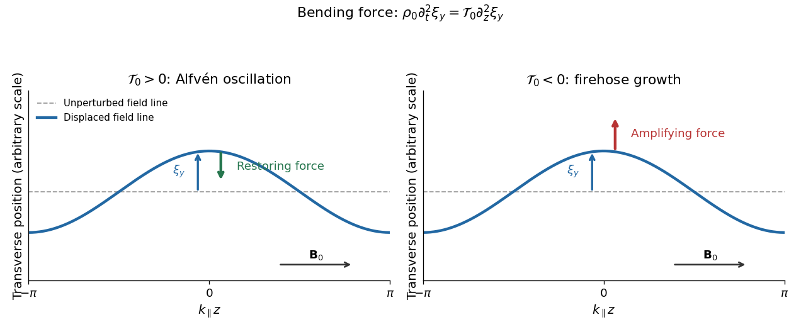
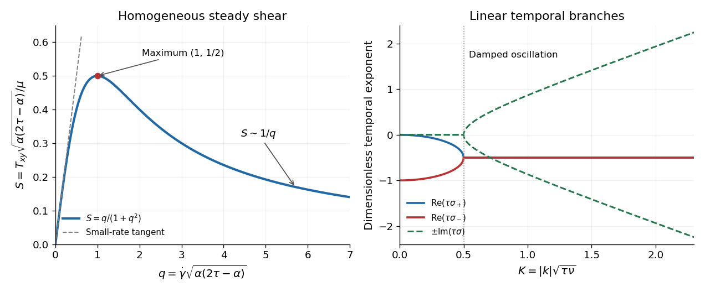

# 2016

↑ **Parent:** [Past exam of the advanced fluid dynamics course of the University of Oxford](../past-exam-of-the-advanced-fluid-dynamics-course-of-the-university-of-oxford.md)

Source paper: [https://www.whatdotheyknow.com/request/physics_past_papers_21/response/3037379/attach/2/FOI%20202505%20441%20Response.pdf?cookie_passthrough=1](https://www.whatdotheyknow.com/request/physics_past_papers_21/response/3037379/attach/2/FOI%20202505%20441%20Response.pdf?cookie_passthrough=1)

**Table of contents**

- [1](#1)
  - [a](#1/a)
    - [Solution](#1/a/solution)
  - [b](#1/b)
    - [Solution](#1/b/solution)
  - [c](#1/c)
    - [Solution](#1/c/solution)
  - [d](#1/d)
    - [Solution](#1/d/solution)
- [2](#2)
  - [a](#2/a)
    - [Solution](#2/a/solution)
  - [b](#2/b)
    - [i](#2/b/i)
      - [Solution](#2/b/i/solution)
    - [ii](#2/b/ii)
      - [Solution](#2/b/ii/solution)
    - [iii](#2/b/iii)
      - [Solution](#2/b/iii/solution)
  - [c](#2/c)
    - [i](#2/c/i)
      - [Solution](#2/c/i/solution)
    - [ii](#2/c/ii)
      - [Solution](#2/c/ii/solution)

## 1

↑ **Parent:** [2016](2016.md)

<h3 id="1/a">a</h3>

↑ **Parent:** [1](#1)

<h4 id="1/a/solution">Solution</h4>

↑ **Parent:** [A](#1/a)

Use the source's [Gaussian units](../electromagnetism.md#gaussian-units) and neglect the [displacement current](../maxwell-equations.md#displacement-current), as in nonrelativistic [magnetohydrodynamics](../magnetohydrodynamics.md). Write $\Delta p=p_\perp-p_\parallel$ for the [pressure anisotropy](../pressure.md#pressure-anisotropy). The [pressure tensor](../pressure.md#pressure-tensor) is $\mathsf P=p_\perp\mathsf I-\Delta p\,\mathbf b\mathbf b$, so its [force density](../force.md#force-density) is

$$
-\nabla\cdot\mathsf P=-\nabla p_\perp+\nabla\cdot(\Delta p\,\mathbf b\mathbf b).
$$

[Ampère's law](../maxwell-equations.md#ampere-s-circuital-law) and the [solenoidal magnetic-field constraint](../magnetic-field.md#solenoidal-magnetic-field-constraint) give the [Lorentz force](../relativistic-electromagnetism.md#lorentz-force) decomposition

$$
\frac{\mathbf j\times\mathbf B}{c}
=\frac{(\nabla\times\mathbf B)\times\mathbf B}{4\pi}
=-\nabla\frac{B^2}{8\pi}+\frac{(\mathbf B\cdot\nabla)\mathbf B}{4\pi}
=-\nabla\frac{B^2}{8\pi}+\nabla\cdot\frac{\mathbf B\mathbf B}{4\pi}.
$$

Adding these two [force densities](../force.md#force-density) and using $\mathbf B\mathbf B=B^2\mathbf b\mathbf b$ yields

$$
\boxed{\rho\frac{D\mathbf u}{Dt}=-\nabla\left(p_\perp+\frac{B^2}{8\pi}\right)+\nabla\cdot\left[\left(\Delta p+\frac{B^2}{4\pi}\right)\mathbf b\mathbf b\right].}
$$

The first term is the [gradient](../multivariable-calculus.md#gradient) of the modified [magnetohydrodynamic total pressure](../magnetohydrodynamics.md#magnetohydrodynamic-total-pressure); the second is the anisotropic [Maxwell stress tensor](../electromagnetism.md#maxwell-stress-tensor) contribution together with the directional [pressure force](../pressure.md#pressure-force). Their effective coefficient is the [pressure-anisotropy-modified magnetic tension](../pressure.md#pressure-anisotropy-modified-magnetic-tension), $\mathcal T=B^2/(4\pi)+\Delta p$. At fixed [magnetic field](../magnetic-field.md), positive [pressure anisotropy](../pressure.md#pressure-anisotropy) increases resistance to bending, while negative [pressure anisotropy](../pressure.md#pressure-anisotropy) reduces it. When $\mathcal T$ becomes negative, bending experiences an amplifying [force](../force.md) rather than a restoring [force](../force.md). Gradients of $\Delta p$ can also drive motion, so the curvature interpretation refers specifically to the bending contribution.

<h3 id="1/b">b</h3>

↑ **Parent:** [1](#1)

<h4 id="1/b/solution">Solution</h4>

↑ **Parent:** [B](#1/b)

Set $\Delta p_0=p_{\perp0}-p_{\parallel0}$ and $\mathcal T_0=\Delta p_0+B_0^2/(4\pi)$. Distinguish the scalar [magnetic field](../magnetic-field.md) strength perturbation $\delta B$ from the vector perturbation $\delta\mathbf B$. To first order,

$$
\delta\mathbf B=\delta B\,\widehat{\mathbf z}+B_0\delta\mathbf b,
\qquad \delta b_z=0,
\qquad k_\perp\delta b_x=-k_\parallel\frac{\delta B}{B_0},
$$

where the last identity is the [solenoidal magnetic-field constraint](../magnetic-field.md#solenoidal-magnetic-field-constraint). For a [Fourier mode](../fourier-analysis.md#fourier-mode) with the stated time convention, put

$$
\delta q=\delta p_\perp+\frac{B_0\delta B}{4\pi},\qquad
\delta\mathcal T=\delta p_\perp-\delta p_\parallel+\frac{B_0\delta B}{2\pi}.
$$

The linear [momentum conservation](../momentum.md#momentum-conservation) equation, after division by $i$, is

$$
-\omega\rho_0\mathbf u=-\mathbf k\,\delta q+k_\parallel\widehat{\mathbf z}\,\delta\mathcal T+\mathcal T_0\left[k_\parallel\delta\mathbf b+\widehat{\mathbf z}(\mathbf k\cdot\delta\mathbf b)\right].
$$

Use the [solenoidal magnetic-field constraint](../magnetic-field.md#solenoidal-magnetic-field-constraint) in its $z$ component. The coefficient of $\widehat{\mathbf z}$ reduces to $-k_\parallel[\delta p_\parallel+\Delta p_0\delta B/B_0]$. Thus

$$
\boxed{-\omega\rho_0\mathbf u=-k_\perp\widehat{\mathbf x}\left(\delta p_\perp+\frac{B_0\delta B}{4\pi}\right)-k_\parallel\widehat{\mathbf z}\left(\delta p_\parallel+\Delta p_0\frac{\delta B}{B_0}\right)+k_\parallel\mathcal T_0\delta\mathbf b.}
$$

Both scalar [pressure](../pressure.md) perturbations act within the $xz$ plane. The $y$ component therefore decouples, independently of their closure. The [ideal magnetohydrodynamic equations](../ideal-magnetohydrodynamics.md#ideal-magnetohydrodynamic-equations) give

$$
\partial_t\delta\mathbf B=B_0\partial_z\mathbf u-B_0\widehat{\mathbf z}\,\nabla\cdot\mathbf u,
\qquad
-\omega\delta b_y=k_\parallel u_y,
\qquad
-\omega\rho_0u_y=k_\parallel\mathcal T_0\delta b_y.
$$

Eliminating the amplitudes gives the [Alfvén wave](../ideal-magnetohydrodynamics.md#alfven-wave) [dispersion relation](../dispersion-relation.md)

$$
\boxed{\omega^2=\frac{k_\parallel^2\mathcal T_0}{\rho_0}=k_\parallel^2v_A^2\left(1+\frac{4\pi\Delta p_0}{B_0^2}\right),\qquad v_A^2=\frac{B_0^2}{4\pi\rho_0}.}
$$

For this [Shear Alfvén wave](../ideal-magnetohydrodynamics.md#alfven-wave), the [velocity](../classical-mechanics.md#velocity) and fluid displacement are along $y$, perpendicular to both $\mathbf k$ and the equilibrium [magnetic field](../magnetic-field.md). Let $\boldsymbol\xi=\xi_y\widehat{\mathbf y}$; then

$$
\mathbf u=-i\omega\boldsymbol\xi,\qquad
\delta\mathbf B=ik_\parallel B_0\boldsymbol\xi,\qquad
\delta\mathbf b=ik_\parallel\boldsymbol\xi.
$$

A real snapshot $\xi_y=\xi_0\cos(\mathbf k\cdot\mathbf r-\omega t)$ bends the [magnetic field lines](../magnetic-field.md#magnetic-field-line) sideways, with $\delta B_y=B_0\partial_z\xi_y$. There is no first-order compression or change of [magnetic field](../magnetic-field.md) strength: $\nabla\cdot\boldsymbol\xi=0$, $\delta\rho=0$ and $\delta B=0$. Scalar [pressure](../pressure.md) perturbations are unnecessary in this transverse subsystem. For a traveling stable branch, $\delta B_y/B_0=-k_\parallel u_y/\omega$, so the [velocity](../classical-mechanics.md#velocity) and transverse [magnetic field](../magnetic-field.md) perturbations are in phase or opposite phase according to the branch. At $k_\parallel=0$ the bending [force](../force.md) and this [angular frequency](../lagrangian-mechanics.md#angular-frequency) vanish.

**[Figure 1](#1/b/image-transverse-displacement-and-the-sign-of-the-effective-tension). Transverse displacement and the sign of the effective tension**. Original schematic for a Fourier displacement varying along the equilibrium magnetic field. With positive effective tension the force opposes the displacement; with negative effective tension it reinforces it.

<h3 id="1/c">c</h3>

↑ **Parent:** [1](#1)

<h4 id="1/c/solution">Solution</h4>

↑ **Parent:** [C](#1/c)

For $k_\parallel\ne0$ the [Alfvén wave](../ideal-magnetohydrodynamics.md#alfven-wave) becomes a [firehose instability](../pressure.md#firehose-instability) when its squared [angular frequency](../lagrangian-mechanics.md#angular-frequency) is negative:

$$
\boxed{p_{\parallel0}-p_{\perp0}>\frac{B_0^2}{4\pi},\qquad \frac{p_{\perp0}-p_{\parallel0}}{p_{\parallel0}}<-\frac{2}{\beta},\qquad \beta=\frac{8\pi p_{\parallel0}}{B_0^2}.}
$$

Equality is marginal, rather than exponential growth. The [pressure anisotropy](../pressure.md#pressure-anisotropy) must have negative sign; its absolute magnitude alone is insufficient.

For the intergalactic [plasma](../physics.md#plasma-physics), a negative relative [pressure anisotropy](../pressure.md#pressure-anisotropy) of $-10^{-2}$ reaches this fluid threshold only for $\beta>200$. In particular, the literal pair $\beta=100$ and relative [pressure anisotropy](../pressure.md#pressure-anisotropy) $-0.01$ is stable because the threshold is $-0.02$. Since the quoted numbers are approximate and allow larger [plasma beta](../astrophysical-disk.md#plasma-beta), this weakly magnetized [plasma](../physics.md#plasma-physics) is susceptible, rather than necessarily unstable at every quoted value. For example, $\beta=300$ and relative [pressure anisotropy](../pressure.md#pressure-anisotropy) $-0.01$ are unstable. Positive [pressure anisotropy](../pressure.md#pressure-anisotropy) does not excite this branch.

For the fusion-device [plasma](../physics.md#plasma-physics), $\beta\sim10^{-2}$ requires a negative relative [pressure anisotropy](../pressure.md#pressure-anisotropy) below roughly $-200$, whereas its magnitude is only about $0.1$. The stabilizing [magnetic tension](../magnetohydrodynamics.md#magnetic-tension) dominates, so it is not susceptible to this fluid [firehose instability](../pressure.md#firehose-instability) under the stated conditions. Indeed, nonnegative perpendicular [pressure](../pressure.md) requires the relative [pressure anisotropy](../pressure.md#pressure-anisotropy) to be no smaller than $-1$; at such a small [plasma beta](../astrophysical-disk.md#plasma-beta) even this extreme cannot satisfy the threshold.

<h3 id="1/d">d</h3>

↑ **Parent:** [1](#1)

<h4 id="1/d/solution">Solution</h4>

↑ **Parent:** [D](#1/d)

[Magnetic flux freezing](../ideal-magnetohydrodynamics.md#magnetic-flux-freezing) ties a transverse fluid displacement to a bend in the [magnetic field lines](../magnetic-field.md#magnetic-field-line). For the uniform background, the transverse displacement equation is

$$
\rho_0\partial_t^2\boldsymbol\xi_\perp=\mathcal T_0\partial_z^2\boldsymbol\xi_\perp.
$$

For a sinusoidal bend, $\partial_z^2\boldsymbol\xi_\perp=-k_\parallel^2\boldsymbol\xi_\perp$. Positive [pressure-anisotropy-modified magnetic tension](../pressure.md#pressure-anisotropy-modified-magnetic-tension) therefore gives a restoring [force](../force.md), and [inertia](../classical-mechanics.md#inertia) produces oscillation. In an isotropic [plasma](../physics.md#plasma-physics), this is precisely the positive [magnetic tension](../magnetohydrodynamics.md#magnetic-tension) $B_0^2/(4\pi)$.

Particles moving predominantly along bent [magnetic field lines](../magnetic-field.md#magnetic-field-line) contribute a transverse [momentum flux](../mathematical-physics.md#momentum-flux). Their larger parallel [pressure](../pressure.md) opposes the restoring curvature [force](../force.md) supplied by the [magnetic field](../magnetic-field.md) and perpendicular [pressure](../pressure.md). Once $p_{\parallel0}-p_{\perp0}>B_0^2/(4\pi)$, the net [force](../force.md) points along the original displacement: a larger bend produces a larger outward [force](../force.md), giving positive feedback. Equivalently, the bending contribution to the quadratic [potential energy](../energy.md#potential-energy) is $\frac12\mathcal T_0\lvert\partial_z\boldsymbol\xi_\perp\rvert^2$ and has become negative.

In this static, homogeneous fluid model the unstable roots are

$$
\boxed{\omega=\pm i\gamma,\qquad \gamma=|k_\parallel|\sqrt{\frac{p_{\parallel0}-p_{\perp0}-B_0^2/(4\pi)}{\rho_0}}.}
$$

With $e^{-i\omega t}$ the root $+i\gamma$ grows. Its real [angular frequency](../lagrangian-mechanics.md#angular-frequency) is zero, so the unstable pattern grows without propagation in the equilibrium rest frame; its partner decays. Advection by a background flow would change that frame-dependent statement. The growth increasing without bound as $|k_\parallel|$ increases is a limitation of this long-[wavelength](../wave-equation.md#wavelength) model: finite [gyroradius](../relativistic-electromagnetism.md#gyroradius) and other kinetic corrections cannot be neglected at sufficiently short scales.

## 2

↑ **Parent:** [2016](2016.md)

<h3 id="2/a">a</h3>

↑ **Parent:** [2](#2)

<h4 id="2/a/solution">Solution</h4>

↑ **Parent:** [A](#2/a)

Label a trajectory by $\mathbf a$ and write its [flow map](../dynamical-systems.md#flow-map) as $\mathbf X(\mathbf a,t)$, with $\partial_t\mathbf X=\mathbf u(\mathbf X,t)$. An infinitesimal [material line](../fluid-mechanics.md#material-curve) joining neighboring labels has tangent $\ell_i=F_{ij}\,d a_j$, where $F_{ij}=\partial X_i/\partial a_j$ is the [deformation gradient](../continuum-mechanics.md#deformation-gradient). Differentiating at fixed labels gives

$$
\frac{D\ell_i}{Dt}=\partial_j u_i\,\ell_j,
\qquad
\boxed{\partial_t\boldsymbol\ell+\mathbf u\cdot\nabla\boldsymbol\ell=(\boldsymbol\ell\cdot\nabla)\mathbf u.}
$$

This identity holds for an unnormalized [material line](../fluid-mechanics.md#material-curve) tangent even in a compressible flow. [Incompressibility](../fluid-mechanics.md#incompressible-flow) also makes an advected [magnetic field](../magnetic-field.md) obey the same stretching law. A unit tangent would instead require a projection removing its change of length.

Use the source's [velocity gradient](../continuum-mechanics.md#velocity-gradient) convention $G_{ij}=\partial_i u_j$. For a [outer product](../vector-space.md#outer-product) $A_{ij}=\ell_i\ell_j$, the [product rule](../calculus.md#product-rule) yields

$$
\frac{DA_{ij}}{Dt}=(\partial_k u_i)A_{kj}+A_{ik}(\partial_k u_j)
=(G^T\mathsf A+\mathsf A G)_{ij}.
$$

The same law holds for a sum or locally transported average of such [outer products](../vector-space.md#outer-product). Thus the [dyadic transport of material line elements](../rheology.md#dyadic-transport-of-material-line-elements) motivates

$$
\boxed{\overset{\triangledown}{\mathsf A}=\partial_t\mathsf A+\mathbf u\cdot\nabla\mathsf A-\mathsf A G-G^T\mathsf A.}
$$

This [upper-convected derivative](../rheology.md#upper-convected-derivative) vanishes for a symmetric [tensor](../multilinear-algebra.md#tensor) transported solely by stretching of [material lines](../fluid-mechanics.md#material-curve). It subtracts both advection and geometric deformation, allowing a [constitutive equation](../continuum-mechanics.md#constitutive-equation) to isolate intrinsic relaxation or production. More generally $\mathsf A=F\mathsf A_{\rm ref}F^T$ gives $\overset{\triangledown}{\mathsf A}=F\dot{\mathsf A}_{\rm ref}F^T$. Under a time-dependent rigid rotation $Q$, its value transforms as $Q\overset{\triangledown}{\mathsf A}Q^T$, making it an [objective time derivative](../rheology.md#objective-time-derivative). This is a suitable derivative for this transport type; symmetry alone does not make it the unique possible [objective time derivative](../rheology.md#objective-time-derivative).

<h3 id="2/b">b</h3>

↑ **Parent:** [2](#2)

<h4 id="2/b/i">i</h4>

↑ **Parent:** [B](#2/b)

<h5 id="2/b/i/solution">Solution</h5>

↑ **Parent:** [I](#2/b/i)

When deformation is stopped, the [rate-of-strain tensor](../viscous-fluid-flow.md#strain-rate-tensor) and [velocity gradient](../continuum-mechanics.md#velocity-gradient) vanish, leaving $\mathsf T+\tau\partial_t\mathsf T=0$. Hence

$$
\boxed{\mathsf T(t)=\mathsf T(0)e^{-t/\tau}.}
$$

The positive constant $\tau$ is the [viscoelastic relaxation time](../rheology.md#viscoelastic-relaxation-time). For slow weak deformation, all the transport and quadratic terms are smaller than $\mathsf T$, so $\mathsf T\simeq2\mu\mathsf E$. Thus $\mu>0$ is the zero-rate [dynamic viscosity](../dynamic-viscosity.md), measured in [stress](../continuum-mechanics.md#stress) times time. The corresponding short-time [shear modulus](../elasticity-physics.md#shear-modulus) of the [Maxwell fluid](../rheology.md#linear-maxwell-fluid) response is $G_{\rm el}=\mu/\tau$. The source's $\alpha$ has units of time, since $\alpha\mathsf T\mathsf E$ must have units of [stress](../continuum-mechanics.md#stress).

<h4 id="2/b/ii">ii</h4>

↑ **Parent:** [B](#2/b)

<h5 id="2/b/ii/solution">Solution</h5>

↑ **Parent:** [Ii](#2/b/ii)

Linearize about a relaxed state $\mathsf T=0$ with constant [mass density](../fluid-mechanics.md#density) $\rho_0$. In the unforced [momentum conservation](../momentum.md#momentum-conservation) equation $\rho_0D_t\mathbf u=-\nabla p+\nabla\cdot\mathsf T$, the $x$ component of the [pressure gradient](../fluid-mechanics.md#pressure-gradient) is zero for a freely evolving [unidirectional flow](../fluid-mechanics.md#unidirectional-flow) independent of $x$. A prescribed external [pressure gradient](../fluid-mechanics.md#pressure-gradient) would add a forcing term.

For $\mathbf u=u(y,t)\widehat{\mathbf x}$, [incompressibility](../fluid-mechanics.md#incompressible-flow) is automatic and the only nonzero entries of the [rate-of-strain tensor](../viscous-fluid-flow.md#strain-rate-tensor) are $E_{xy}=E_{yx}=\frac12\partial_yu$. Products of [stress](../continuum-mechanics.md#stress) and [velocity gradient](../continuum-mechanics.md#velocity-gradient) are quadratic in the small amplitude. The [constitutive equation](../continuum-mechanics.md#constitutive-equation) consequently becomes $\mathsf T+\tau\partial_t\mathsf T=2\mu\mathsf E$ to first order. With $T=T_{xy}=T_{yx}$, its shear component and the $x$ component of [momentum conservation](../momentum.md#momentum-conservation) are

$$
\boxed{\rho_0\partial_tu=\partial_yT,\qquad T+\tau\partial_tT=\mu\partial_yu.}
$$

The diagonal [stress](../continuum-mechanics.md#stress) components have only homogeneous relaxation at this order and vanish if initially relaxed. In particular, $\alpha$ does not enter this linear response.

<h4 id="2/b/iii">iii</h4>

↑ **Parent:** [B](#2/b)

<h5 id="2/b/iii/solution">Solution</h5>

↑ **Parent:** [Iii](#2/b/iii)

Eliminating the [shear stress](../viscous-fluid-flow.md#shear-stress) from the two linear equations gives the [Maxwell shear-wave dispersion](../rheology.md#maxwell-shear-wave-dispersion) equation in physical space,

$$
\tau\partial_t^2u+\partial_tu=\nu\partial_y^2u,
\qquad \nu=\frac{\mu}{\rho_0},
$$

where $\nu$ is the [kinematic viscosity](../dynamic-viscosity.md#kinematic-viscosity). Substitution of a [Fourier mode](../fourier-analysis.md#fourier-mode) $e^{iky+\sigma t}$ gives

$$
\tau\sigma^2+\sigma+\nu k^2=0,
\qquad
\boxed{\sigma_\pm=\frac{-1\pm\sqrt{1-4\tau\nu k^2}}{2\tau}.}
$$

These are temporal exponents: the oscillation [angular frequency](../lagrangian-mechanics.md#angular-frequency) is the imaginary part of $\sigma$, with the sign determined by the selected time convention. For $4\tau\nu k^2<1$ both exponents are real and nonpositive. At equality the repeated exponent is $-1/(2\tau)$; generic solutions include $t e^{-t/(2\tau)}$. Above the threshold the modes are damped propagating shear disturbances:

$$
\sigma_\pm=-\frac1{2\tau}\pm i\sqrt{\frac{\nu k^2}{\tau}-\frac1{4\tau^2}}.
$$

At large $|k|$ their [phase velocity](../dispersion-relation.md#phase-velocity) tends to $\sqrt{\nu/\tau}=\sqrt{G_{\rm el}/\rho_0}$.

For the limit $\tau\to0$ at fixed $\mu,\rho_0$ and $k$, expansion of the [square root](../algebra.md#square-root) gives

$$
\boxed{\sigma_{\rm slow}=-\nu k^2+O(\tau),\qquad \sigma_{\rm fast}=-\frac1\tau+\nu k^2+O(\tau).}
$$

After a short initial relaxation, the surviving branch obeys the [diffusion equation](../diffusion-equation.md) $u_t=\nu u_{yy}$ of a [Newtonian fluid](../viscous-fluid-flow.md#newtonian-fluid). The fast branch disappears on the vanishing [viscoelastic relaxation time](../rheology.md#viscoelastic-relaxation-time); at $k=0$ the two exponents are exactly $0$ and $-1/\tau$. This limit is not uniform in $k$: modes with $k$ of order $(\tau\nu)^{-1/2}$ still sample the oscillatory transition. If instead $G_{\rm el}=\mu/\tau$ is held fixed as $\tau\to0$, then $\mu\to0$ and the fixed-$k$ slow exponent tends to zero. The ordinary [Newtonian fluid](../viscous-fluid-flow.md#newtonian-fluid) limit therefore specifies which material parameter is held fixed.

<h3 id="2/c">c</h3>

↑ **Parent:** [2](#2)

<h4 id="2/c/i">i</h4>

↑ **Parent:** [C](#2/c)

<h5 id="2/c/i/solution">Solution</h5>

↑ **Parent:** [I](#2/c/i)

Let $g=\dot\gamma$ and use $G_{yx}=g$ for the source's [velocity gradient](../continuum-mechanics.md#velocity-gradient) convention. Seek the homogeneous stationary [stress](../continuum-mechanics.md#stress) reached under steady [simple shear flow](../viscous-fluid-flow.md#simple-shear-flow). The [material derivative](../continuum-mechanics.md#material-derivative) of that [stress tensor](../continuum-mechanics.md#cauchy-stress-tensor) vanishes. In the $xy$ plane,

$$
G=\begin{pmatrix}0&0\\g&0\end{pmatrix},\qquad
E=\frac12\begin{pmatrix}0&g\\g&0\end{pmatrix}.
$$

The $xx$, $yy$ and $zz$ components of the [constitutive equation](../continuum-mechanics.md#constitutive-equation) give, respectively,

$$
T_{xx}-(2\tau-\alpha)gT_{xy}=0,\qquad
T_{yy}+\alpha gT_{xy}=0,\qquad T_{zz}=0.
$$

Thus, putting $D=1+\alpha(2\tau-\alpha)g^2$ and using the [shear stress](../viscous-fluid-flow.md#shear-stress) calculated below,

$$
\boxed{T_{xx}=\frac{\mu(2\tau-\alpha)g^2}{D},\qquad T_{yy}=-\frac{\mu\alpha g^2}{D},\qquad T_{zz}=0.}
$$

The out-of-plane shear components vanish on the homogeneous branch. The two [normal-stress differences](../rheology.md#normal-stress-difference) are

$$
N_1=2\tau gT_{xy}=\frac{2\mu\tau g^2}{D},\qquad
N_2=-\alpha gT_{xy}=-\frac{\mu\alpha g^2}{D},
\qquad \boxed{\frac{N_2}{N_1}=-\frac{\alpha}{2\tau}.}
$$

The ratio is defined at nonzero shear when $N_1\ne0$; at $g=0$ both differences vanish, and the displayed constant is their limiting ratio. An arbitrary isotropic [pressure](../pressure.md) in the total [Cauchy stress tensor](../continuum-mechanics.md#cauchy-stress-tensor) cancels from both differences; it is not an arbitrary addition to the constitutively defined extra [stress](../continuum-mechanics.md#stress) $\mathsf T$ itself.

<h4 id="2/c/ii">ii</h4>

↑ **Parent:** [C](#2/c)

<h5 id="2/c/ii/solution">Solution</h5>

↑ **Parent:** [Ii](#2/c/ii)

The $xy$ component of the stationary [constitutive equation](../continuum-mechanics.md#constitutive-equation) is

$$
T_{xy}-\tau gT_{yy}+\frac{\alpha g}{2}(T_{xx}+T_{yy})=\mu g.
$$

Insert $T_{yy}=-\alpha gT_{xy}$ and $T_{xx}=(2\tau-\alpha)gT_{xy}$. The coefficient of $g^2T_{xy}$ becomes $\tau\alpha+\alpha(\tau-\alpha)=\alpha(2\tau-\alpha)$, giving

$$
\boxed{T_{xy}=\frac{\mu\dot\gamma}{1+\alpha(2\tau-\alpha)\dot\gamma^2},\qquad \eta_{\rm sh}=\frac{T_{xy}}{\dot\gamma}=\frac{\mu}{1+\alpha(2\tau-\alpha)\dot\gamma^2}.}
$$

For $C=\alpha(2\tau-\alpha)>0$, the small-rate [shear stress](../viscous-fluid-flow.md#shear-stress) is $T_{xy}=\mu\dot\gamma-\mu C\dot\gamma^3+O(\dot\gamma^5)$. At large positive rate, $T_{xy}\sim\mu/(C\dot\gamma)$ and the [shear viscosity](../dynamic-viscosity.md) decreases as $\mu/(C\dot\gamma^2)$. The [shear stress](../viscous-fluid-flow.md#shear-stress) is odd in rate, reaches a positive maximum at

$$
\dot\gamma_*=C^{-1/2},\qquad T_{xy,*}=\frac{\mu}{2\sqrt C},\qquad
\frac{dT_{xy}}{d\dot\gamma}=\mu\frac{1-C\dot\gamma^2}{(1+C\dot\gamma^2)^2},
$$

and decreases thereafter. The original plot displays this homogeneous constitutive curve. Its decreasing branch can permit [shear banding](../rheology.md#shear-banding); the local model alone supplies neither an interface-selection rule nor a guaranteed stable homogeneous realization.

**[Figure 2](#2/c/ii/image-homogeneous-shear-stress-and-the-two-temporal-branches-of-the-linear-response). Homogeneous shear stress and the two temporal branches of the linear response**. The steady curve uses q equal to the shear rate times the square root of alpha times (2 tau minus alpha). The spectral panel uses K equal to the wavenumber magnitude times the square root of tau times nu. These are distinct nondimensional variables.

This is a [Johnson-Segalman fluid](../rheology.md#johnson-segalman-oldroyd-model) without an added [Newtonian fluid](../viscous-fluid-flow.md#newtonian-fluid) solvent contribution. To identify conventions explicitly, set $a=1-\alpha/\tau$ and $L=G^T=E+W$, with $W$ the [spin tensor](../viscous-fluid-flow.md#spin-tensor). The derivative appearing in the [constitutive equation](../continuum-mechanics.md#constitutive-equation) becomes

$$
D_t\mathsf T-W\mathsf T+\mathsf TW-a(E\mathsf T+\mathsf TE),
$$

the [Gordon--Schowalter derivative](../rheology.md#gordon-schowalter-derivative). Its usual slip interval $|a|\le1$ corresponds to $0\le\alpha\le2\tau$, while a nonsingular genuinely [shear thinning](../rheology.md#shear-thinning) curve requires

$$
\boxed{\tau>0,\quad\mu>0,\quad0<\alpha<2\tau.}
$$

At $\alpha=0$ the model is the [Upper-convected Maxwell model](../rheology.md#upper-convected-maxwell-model); at $\alpha=2\tau$ it is the [lower-convected derivative](../rheology.md#lower-convected-derivative) counterpart, and both have constant [shear viscosity](../dynamic-viscosity.md) in this test. At $\alpha=\tau$ the derivative is the [Jaumann derivative](../rheology.md#jaumann-derivative), giving the [corotational Maxwell fluid](../rheology.md#corotational-maxwell-fluid). Merely requiring $\alpha>0$ is insufficient: for $\alpha=3\tau$ the denominator is $1-3\tau^2\dot\gamma^2$, which vanishes at $|\dot\gamma|=1/(\sqrt3\tau)$ and then gives a negative steady [shear viscosity](../dynamic-viscosity.md). There is no solvent-induced large-rate plateau in the stated equation.

## ↑ Ancestors (9)

1. [Past exam of the advanced fluid dynamics course of the University of Oxford](../past-exam-of-the-advanced-fluid-dynamics-course-of-the-university-of-oxford.md)
2. [Advanced fluid dynamics course of the University of Oxford](../university-of-oxford.md#advanced-fluid-dynamics-course-of-the-university-of-oxford)
3. [Year 4 of the mathematical and theoretical physics course of the University of Oxford](../university-of-oxford.md#year-4-of-the-mathematical-and-theoretical-physics-course-of-the-university-of-oxford)
4. [Mathematical and theoretical physics course of the University of Oxford](../university-of-oxford.md#mathematical-and-theoretical-physics-course-of-the-university-of-oxford)
5. [Undergraduate course of the University of Oxford](../university-of-oxford.md#undergraduate-course-of-the-university-of-oxford)
6. [Course of the University of Oxford](../university-of-oxford.md#course-of-the-university-of-oxford)
7. [University of Oxford](../university-of-oxford.md)
8. [List of universities](../README.md#list-of-universities)
9. [Codex Wiki](../README.md)
