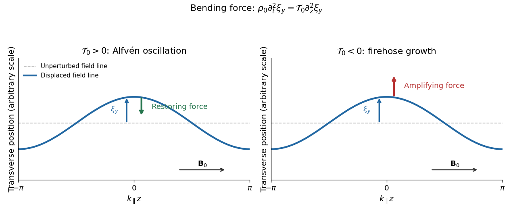

<h1 id="1/b/solution">Solution</h1>

↑ **Parent:** [B](../b.md)

Set $\Delta p_0=p_{\perp0}-p_{\parallel0}$ and $\mathcal T_0=\Delta p_0+B_0^2/(4\pi)$. Distinguish the scalar [magnetic field](../../../../magnetic-field-split.md) strength perturbation $\delta B$ from the vector perturbation $\delta\mathbf B$. To first order,

$$
\delta\mathbf B=\delta B\,\widehat{\mathbf z}+B_0\delta\mathbf b,
\qquad \delta b_z=0,
\qquad k_\perp\delta b_x=-k_\parallel\frac{\delta B}{B_0},
$$

where the last identity is the [solenoidal magnetic-field constraint](../../../../solenoidal-magnetic-field-constraint.md). For a [Fourier mode](../../../../fourier-mode.md) with the stated time convention, put

$$
\delta q=\delta p_\perp+\frac{B_0\delta B}{4\pi},\qquad
\delta\mathcal T=\delta p_\perp-\delta p_\parallel+\frac{B_0\delta B}{2\pi}.
$$

The linear [momentum conservation](../../../../momentum-conservation.md) equation, after division by $i$, is

$$
-\omega\rho_0\mathbf u=-\mathbf k\,\delta q+k_\parallel\widehat{\mathbf z}\,\delta\mathcal T+\mathcal T_0\left[k_\parallel\delta\mathbf b+\widehat{\mathbf z}(\mathbf k\cdot\delta\mathbf b)\right].
$$

Use the [solenoidal magnetic-field constraint](../../../../solenoidal-magnetic-field-constraint.md) in its $z$ component. The coefficient of $\widehat{\mathbf z}$ reduces to $-k_\parallel[\delta p_\parallel+\Delta p_0\delta B/B_0]$. Thus

$$
\boxed{-\omega\rho_0\mathbf u=-k_\perp\widehat{\mathbf x}\left(\delta p_\perp+\frac{B_0\delta B}{4\pi}\right)-k_\parallel\widehat{\mathbf z}\left(\delta p_\parallel+\Delta p_0\frac{\delta B}{B_0}\right)+k_\parallel\mathcal T_0\delta\mathbf b.}
$$

Both scalar [pressure](../../../../pressure-split.md) perturbations act within the $xz$ plane. The $y$ component therefore decouples, independently of their closure. The [ideal magnetohydrodynamic equations](../../../../ideal-magnetohydrodynamic-equations.md) give

$$
\partial_t\delta\mathbf B=B_0\partial_z\mathbf u-B_0\widehat{\mathbf z}\,\nabla\cdot\mathbf u,
\qquad
-\omega\delta b_y=k_\parallel u_y,
\qquad
-\omega\rho_0u_y=k_\parallel\mathcal T_0\delta b_y.
$$

Eliminating the amplitudes gives the [Alfvén wave](../../../../alfven-wave.md) [dispersion relation](../../../../dispersion-relation-split.md)

$$
\boxed{\omega^2=\frac{k_\parallel^2\mathcal T_0}{\rho_0}=k_\parallel^2v_A^2\left(1+\frac{4\pi\Delta p_0}{B_0^2}\right),\qquad v_A^2=\frac{B_0^2}{4\pi\rho_0}.}
$$

For this [Shear Alfvén wave](../../../../alfven-wave.md), the [velocity](../../../../velocity.md) and fluid displacement are along $y$, perpendicular to both $\mathbf k$ and the equilibrium [magnetic field](../../../../magnetic-field-split.md). Let $\boldsymbol\xi=\xi_y\widehat{\mathbf y}$; then

$$
\mathbf u=-i\omega\boldsymbol\xi,\qquad
\delta\mathbf B=ik_\parallel B_0\boldsymbol\xi,\qquad
\delta\mathbf b=ik_\parallel\boldsymbol\xi.
$$

A real snapshot $\xi_y=\xi_0\cos(\mathbf k\cdot\mathbf r-\omega t)$ bends the [magnetic field lines](../../../../magnetic-field-line.md) sideways, with $\delta B_y=B_0\partial_z\xi_y$. There is no first-order compression or change of [magnetic field](../../../../magnetic-field-split.md) strength: $\nabla\cdot\boldsymbol\xi=0$, $\delta\rho=0$ and $\delta B=0$. Scalar [pressure](../../../../pressure-split.md) perturbations are unnecessary in this transverse subsystem. For a traveling stable branch, $\delta B_y/B_0=-k_\parallel u_y/\omega$, so the [velocity](../../../../velocity.md) and transverse [magnetic field](../../../../magnetic-field-split.md) perturbations are in phase or opposite phase according to the branch. At $k_\parallel=0$ the bending [force](../../../../force-split.md) and this [angular frequency](../../../../angular-frequency.md) vanish.

**[Figure 1](#1/b/image-transverse-displacement-and-the-sign-of-the-effective-tension). Transverse displacement and the sign of the effective tension**. Original schematic for a Fourier displacement varying along the equilibrium magnetic field. With positive effective tension the force opposes the displacement; with negative effective tension it reinforces it.

## ↑ Ancestors (12)

1. [B](../b.md)
2. [1](../../1.md)
3. [2016](../../../2016-split.md)
4. [Past exam of the advanced fluid dynamics course of the University of Oxford](../../../split.md)
5. [Advanced fluid dynamics course of the University of Oxford](../../../../advanced-fluid-dynamics-course-of-the-university-of-oxford.md)
6. [Year 4 of the mathematical and theoretical physics course of the University of Oxford](../../../../year-4-of-the-mathematical-and-theoretical-physics-course-of-the-university-of-oxford.md)
7. [Mathematical and theoretical physics course of the University of Oxford](../../../../mathematical-and-theoretical-physics-course-of-the-university-of-oxford.md)
8. [Undergraduate course of the University of Oxford](../../../../undergraduate-course-of-the-university-of-oxford.md)
9. [Course of the University of Oxford](../../../../course-of-the-university-of-oxford.md)
10. [University of Oxford](../../../../university-of-oxford-split.md)
11. [List of universities](../../../../list-of-universities.md)
12. [Codex Wiki](../../../../split.md)
