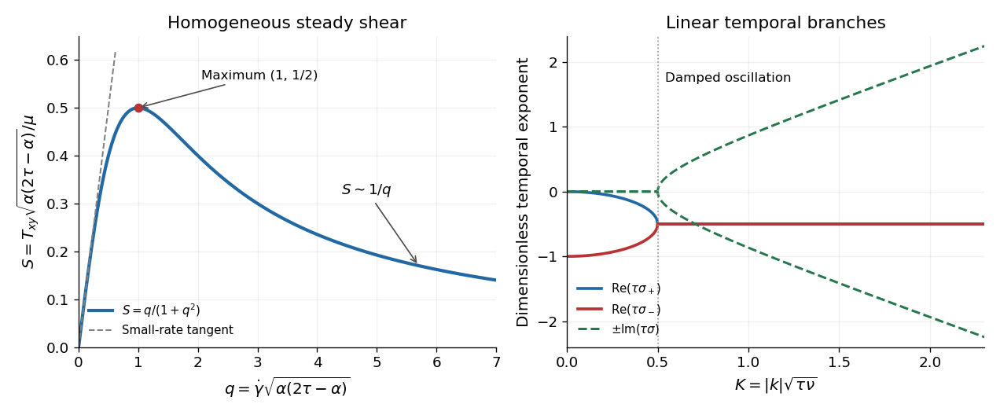

<h1 id="2/c/ii/solution">Solution</h1>

↑ **Parent:** [Ii](../ii.md)

The $xy$ component of the stationary [constitutive equation](../../../../../constitutive-equation.md) is

$$
T_{xy}-\tau gT_{yy}+\frac{\alpha g}{2}(T_{xx}+T_{yy})=\mu g.
$$

Insert $T_{yy}=-\alpha gT_{xy}$ and $T_{xx}=(2\tau-\alpha)gT_{xy}$. The coefficient of $g^2T_{xy}$ becomes $\tau\alpha+\alpha(\tau-\alpha)=\alpha(2\tau-\alpha)$, giving

$$
\boxed{T_{xy}=\frac{\mu\dot\gamma}{1+\alpha(2\tau-\alpha)\dot\gamma^2},\qquad \eta_{\rm sh}=\frac{T_{xy}}{\dot\gamma}=\frac{\mu}{1+\alpha(2\tau-\alpha)\dot\gamma^2}.}
$$

For $C=\alpha(2\tau-\alpha)>0$, the small-rate [shear stress](../../../../../shear-stress.md) is $T_{xy}=\mu\dot\gamma-\mu C\dot\gamma^3+O(\dot\gamma^5)$. At large positive rate, $T_{xy}\sim\mu/(C\dot\gamma)$ and the [shear viscosity](../../../../../dynamic-viscosity-split.md) decreases as $\mu/(C\dot\gamma^2)$. The [shear stress](../../../../../shear-stress.md) is odd in rate, reaches a positive maximum at

$$
\dot\gamma_*=C^{-1/2},\qquad T_{xy,*}=\frac{\mu}{2\sqrt C},\qquad
\frac{dT_{xy}}{d\dot\gamma}=\mu\frac{1-C\dot\gamma^2}{(1+C\dot\gamma^2)^2},
$$

and decreases thereafter. The original plot displays this homogeneous constitutive curve. Its decreasing branch can permit [shear banding](../../../../../shear-banding.md); the local model alone supplies neither an interface-selection rule nor a guaranteed stable homogeneous realization.

**[Figure 2](#2/c/ii/image-homogeneous-shear-stress-and-the-two-temporal-branches-of-the-linear-response). Homogeneous shear stress and the two temporal branches of the linear response**. The steady curve uses q equal to the shear rate times the square root of alpha times (2 tau minus alpha). The spectral panel uses K equal to the wavenumber magnitude times the square root of tau times nu. These are distinct nondimensional variables.

This is a [Johnson-Segalman fluid](../../../../../johnson-segalman-oldroyd-model.md) without an added [Newtonian fluid](../../../../../newtonian-fluid.md) solvent contribution. To identify conventions explicitly, set $a=1-\alpha/\tau$ and $L=G^T=E+W$, with $W$ the [spin tensor](../../../../../spin-tensor.md). The derivative appearing in the [constitutive equation](../../../../../constitutive-equation.md) becomes

$$
D_t\mathsf T-W\mathsf T+\mathsf TW-a(E\mathsf T+\mathsf TE),
$$

the [Gordon--Schowalter derivative](../../../../../gordon-schowalter-derivative.md). Its usual slip interval $|a|\le1$ corresponds to $0\le\alpha\le2\tau$, while a nonsingular genuinely [shear thinning](../../../../../shear-thinning.md) curve requires

$$
\boxed{\tau>0,\quad\mu>0,\quad0<\alpha<2\tau.}
$$

At $\alpha=0$ the model is the [Upper-convected Maxwell model](../../../../../upper-convected-maxwell-model.md); at $\alpha=2\tau$ it is the [lower-convected derivative](../../../../../lower-convected-derivative.md) counterpart, and both have constant [shear viscosity](../../../../../dynamic-viscosity-split.md) in this test. At $\alpha=\tau$ the derivative is the [Jaumann derivative](../../../../../jaumann-derivative.md), giving the [corotational Maxwell fluid](../../../../../corotational-maxwell-fluid.md). Merely requiring $\alpha>0$ is insufficient: for $\alpha=3\tau$ the denominator is $1-3\tau^2\dot\gamma^2$, which vanishes at $|\dot\gamma|=1/(\sqrt3\tau)$ and then gives a negative steady [shear viscosity](../../../../../dynamic-viscosity-split.md). There is no solvent-induced large-rate plateau in the stated equation.

## ↑ Ancestors (13)

1. [Ii](../ii.md)
2. [C](../../c.md)
3. [2](../../../2.md)
4. [2016](../../../../2016-split.md)
5. [Past exam of the advanced fluid dynamics course of the University of Oxford](../../../../split.md)
6. [Advanced fluid dynamics course of the University of Oxford](../../../../../advanced-fluid-dynamics-course-of-the-university-of-oxford.md)
7. [Year 4 of the mathematical and theoretical physics course of the University of Oxford](../../../../../year-4-of-the-mathematical-and-theoretical-physics-course-of-the-university-of-oxford.md)
8. [Mathematical and theoretical physics course of the University of Oxford](../../../../../mathematical-and-theoretical-physics-course-of-the-university-of-oxford.md)
9. [Undergraduate course of the University of Oxford](../../../../../undergraduate-course-of-the-university-of-oxford.md)
10. [Course of the University of Oxford](../../../../../course-of-the-university-of-oxford.md)
11. [University of Oxford](../../../../../university-of-oxford-split.md)
12. [List of universities](../../../../../list-of-universities.md)
13. [Codex Wiki](../../../../../split.md)
