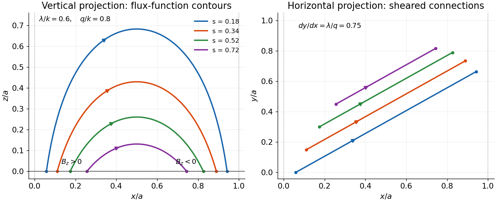
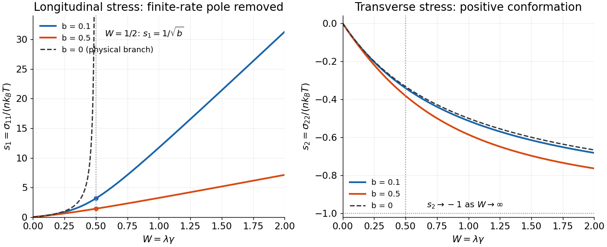

# 2017

↑ **Parent:** [Past exam of the advanced fluid dynamics course of the University of Oxford](../past-exam-of-the-advanced-fluid-dynamics-course-of-the-university-of-oxford.md)

Source paper: [https://www.whatdotheyknow.com/request/physics_past_papers_21/response/3037379/attach/2/FOI%20202505%20441%20Response.pdf?cookie_passthrough=1](https://www.whatdotheyknow.com/request/physics_past_papers_21/response/3037379/attach/2/FOI%20202505%20441%20Response.pdf?cookie_passthrough=1)

**Table of contents**

- [1](#1)
  - [a](#1/a)
    - [Solution](#1/a/solution)
  - [b](#1/b)
    - [Solution](#1/b/solution)
  - [c](#1/c)
    - [Solution](#1/c/solution)
  - [d](#1/d)
    - [Solution](#1/d/solution)
- [2](#2)
  - [a](#2/a)
    - [Solution](#2/a/solution)
  - [b](#2/b)
    - [Solution](#2/b/solution)
  - [c](#2/c)
    - [Solution](#2/c/solution)

## 1

↑ **Parent:** [2017](2017.md)

<h3 id="1/a">a</h3>

↑ **Parent:** [1](#1)

<h4 id="1/a/solution">Solution</h4>

↑ **Parent:** [A](#1/a)

Choose two independent labels for the [magnetic field lines](../magnetic-field.md#magnetic-field-line), constant along each line. These are [Euler potentials](../electromagnetism.md#euler-potentials): $\mathbf B\cdot\nabla\alpha=\mathbf B\cdot\nabla\beta=0$. Where the two [gradients](../multivariable-calculus.md#gradient) are independent, the vector [perpendicular](../inner-product.md#orthogonal-vectors) to both is $\nabla\alpha\times\nabla\beta$, so initially write

$$
\mathbf B=f\,\nabla\alpha\times\nabla\beta.
$$

The [solenoidal condition](../multivariable-calculus.md#solenoidal-vector-field) gives $0=\nabla\cdot\mathbf B=(\nabla\alpha\times\nabla\beta)\cdot\nabla f$. Thus $f$ is constant along a [field line](../magnetic-field.md#magnetic-field-line) and is locally a function of its labels. Redefining one label, for example $\widetilde\beta(\alpha,\beta)=\int^\beta f(\alpha,b)\,db$, absorbs this factor. Dropping the tilde gives

$$
\boxed{\mathbf B=\nabla\alpha\times\nabla\beta.}
$$

This representation automatically has zero [divergence](../multivariable-calculus.md#divergence), since it is also $\nabla\times(\alpha\nabla\beta)$.

For an [magnetic arcade](../magnetic-field.md#magnetic-arcade), assign the labels on one polarity of the footpoint surface and transport them along each line to its other footpoint. They specify both line identity and [magnetic flux](../magnetic-field.md#magnetic-flux): on a transverse surface, flux coordinates can be chosen so that the [directed flux](../magnetic-field.md#magnetic-flux) element is $d\alpha\,d\beta$. In particular,

$$
B_z(x,y,0)=\partial_x\alpha_0\,\partial_y\beta_0-
\partial_y\alpha_0\,\partial_x\beta_0.
$$

The [boundary labels](../electromagnetism.md#euler-potentials) at paired footpoints must agree, so prescribed [boundary functions](../differential-equation.md#boundary-condition) encode a compatible [footpoint mapping](../magnetic-field.md#magnetic-field-line), not independently arbitrary values at the two ends.

The construction assumes a smooth family of nonintersecting lines that can be labelled from a transverse boundary patch, with suitable patches at nulls or coordinate singularities. A local [Euler-potential representation](../electromagnetism.md#euler-potentials) does not establish the existence of two globally single-valued regular labels for every possible [solenoidal field](../multivariable-calculus.md#solenoidal-vector-field); closed, recurrent or more complicated [field topology](../magnetic-field.md#magnetic-field-line) can obstruct such a global choice. The line-tied [magnetic arcade](../magnetic-field.md#magnetic-arcade) geometry supplies the relevant simplifying assumption here.

<h3 id="1/b">b</h3>

↑ **Parent:** [1](#1)

<h4 id="1/b/solution">Solution</h4>

↑ **Parent:** [B](#1/b)

Use the [magnetic energy](../electromagnetic-wave.md#magnetic-energy) $E_B=(2\mu_0)^{-1}\int_V|\mathbf B|^2\,dV$. Vary the [Euler potentials](../electromagnetism.md#euler-potentials) while keeping their boundary values fixed. The [field variation](../calculus-of-variations.md) is

$$
\delta\mathbf B=\nabla\delta\alpha\times\nabla\beta+
\nabla\alpha\times\nabla\delta\beta
=\nabla\times\left(\delta\alpha\nabla\beta-\delta\beta\nabla\alpha\right).
$$

Let $\delta\mathbf A=\delta\alpha\nabla\beta-\delta\beta\nabla\alpha$. [Integration by parts](../calculus.md#integration-by-parts) gives

$$
\delta E_B=\frac1{\mu_0}\int_V\delta\mathbf A\cdot(\nabla\times\mathbf B)\,dV,
$$

because $\delta\mathbf A=0$ on the boundary. Therefore

$$
\delta E_B=\frac1{\mu_0}\int_V\left[
\delta\alpha\,\nabla\beta\cdot(\nabla\times\mathbf B)
-\delta\beta\,\nabla\alpha\cdot(\nabla\times\mathbf B)\right]dV.
$$

The two interior [variations](../calculus-of-variations.md) are independent. At a smooth [minimum](../analysis.md#local-minimum) their coefficients must vanish, so the [curl](../multivariable-calculus.md#curl) is [perpendicular](../inner-product.md#orthogonal-vectors) to both potential [gradients](../multivariable-calculus.md#gradient) and hence parallel to $\mathbf B$ wherever $\mathbf B\ne0$:

$$
\boxed{\nabla\times\mathbf B=\lambda(\mathbf x)\mathbf B,
\qquad\mathbf J\times\mathbf B=0,
\quad\mathbf J=\frac1{\mu_0}\nabla\times\mathbf B.}
$$

This is a [force-free magnetic field](../ideal-magnetohydrodynamics.md#force-free-magnetic-field): the [Lorentz force density](../relativistic-electromagnetism.md#lorentz-force-density) vanishes. Taking the [divergence](../multivariable-calculus.md#divergence) also gives $\mathbf B\cdot\nabla\lambda=0$, so the proportionality factor is constant along a [field line](../magnetic-field.md#magnetic-field-line) but need not be the same on different lines.

The fixed-label [variation](../calculus-of-variations.md) preserves the encoded [field-line connection](../magnetic-field.md#magnetic-field-line) rather than allowing arbitrary [reconnection](../resistive-magnetohydrodynamics.md#magnetic-reconnection) during minimization. The argument proves a necessary condition for a smooth [minimum](../analysis.md#local-minimum), not that every [force-free stationary field](../ideal-magnetohydrodynamics.md#force-free-magnetic-field) is a stable energy [minimum](../analysis.md#local-minimum). It also does not include [gas pressure](../pressure.md) or [gravity](../physics.md#gravity) in the minimized [functional](../calculus-of-variations.md#functional).

<h3 id="1/c">c</h3>

↑ **Parent:** [1](#1)

<h4 id="1/c/solution">Solution</h4>

↑ **Parent:** [C](#1/c)

A [linear force-free magnetic field](../ideal-magnetohydrodynamics.md#linear-force-free-magnetic-field) has a spatially constant proportionality factor, $\nabla\times\mathbf B=\lambda\mathbf B$. Taking its [curl](../multivariable-calculus.md#curl) and using $\nabla\cdot\mathbf B=0$ gives

$$
-\nabla^2\mathbf B
=\nabla\times(\nabla\times\mathbf B)
=\lambda\nabla\times\mathbf B=\lambda^2\mathbf B.
$$

Hence

$$
\boxed{\nabla^2\mathbf B+\lambda^2\mathbf B=0.}
$$

The constant $\lambda$ has dimensions of inverse length in this convention. If it varied in space, the extra term $\nabla\lambda\times\mathbf B$ would remain, so the same [Helmholtz equation](../partial-differential-equation.md#helmholtz-equation) would not follow merely from a [nonlinear force-free condition](../ideal-magnetohydrodynamics.md#force-free-magnetic-field).

<h3 id="1/d">d</h3>

↑ **Parent:** [1](#1)

<h4 id="1/d/solution">Solution</h4>

↑ **Parent:** [D](#1/d)

**Use the original scanned [boundary condition](../differential-equation.md#boundary-condition).** The scan fixes the [normal-field amplitude](../magnetic-field.md) at the corner $x=z=0$. The supplied TeX drops the condition $x=0$ and would instead prescribe a constant normal field on the entire bottom. Those are different [boundary-value problems](../boundary-value-problem.md); the solution below uses the legible original scan.

Choose a positive integer $n$, put $k=n\pi/a$, and seek a [separated decaying mode](../partial-differential-equation.md#separation-of-variables). A suitable [flux function](../ideal-magnetohydrodynamics.md#cartesian-magnetic-flux-function) is

$$
A(x,z)=\frac{B_0}{k}\sin(kx)e^{-qz},\qquad
\mathbf B=(-\partial_z A,\lambda A,\partial_x A).
$$

This is a [decaying linear force-free magnetic arcade](../ideal-magnetohydrodynamics.md#decaying-linear-force-free-magnetic-arcade). The first and third [curl components](../multivariable-calculus.md#curl) then satisfy the [force-free equation](../ideal-magnetohydrodynamics.md#force-free-magnetic-field) automatically; its second component requires $-(\partial_x^2+\partial_z^2)A=\lambda^2A$. Thus

$$
\boxed{q=\sqrt{k^2-\lambda^2},\qquad
\mathbf B=B_0e^{-qz}
\left(\frac qk\sin kx,\frac\lambda k\sin kx,\cos kx\right).}
$$

Direct [differentiation](../calculus.md#derivative) gives $\nabla\cdot\mathbf B=0$ and $\nabla\times\mathbf B=\lambda\mathbf B$. Both horizontal components vanish at $x=0,a$, and $B_z(0,0)=B_0$. The [magnetic field](../magnetic-field.md) on the bottom is $B_0\cos kx$, not a uniform $B_0$.

A strictly decaying real [normal mode](../wave-equation.md#normal-mode) requires $q>0$, so

$$
\boxed{|\lambda|<n\pi/a.}
$$

For the fundamental, single-arcade choice $n=1$, this becomes $|\lambda|<\pi/a$. Equality gives no vertical [exponential decay](../analysis.md#exponential-decay), while a larger magnitude gives an oscillatory rather than decaying vertical dependence for that [mode](../wave-equation.md#normal-mode). The data do not explicitly fix the [horizontal mode](../wave-equation.md#normal-mode) number. If arbitrarily fine higher-mode arcades are permitted, every finite real $\lambda$ admits some integer $n$ with $n\pi/a>|\lambda|$. The fundamental restriction must therefore not be advertised as a necessary bound for every possible field satisfying only the stated pointwise and wall data.

For a fundamental [field line](../magnetic-field.md#magnetic-field-line), $A$ is constant along its projection in the $(x,z)$ [plane](../geometry-and-topology.md#plane). If $0<s<1$ denotes its normalized flux-function value, its arch is

$$
z=\frac1q\log\frac{\sin(kx)}s,
\qquad x_-=\frac{\arcsin s}{k},\quad
x_+=\frac{\pi-\arcsin s}{k}.
$$

The maximum height is $q^{-1}\log(1/s)$ at $x=a/2$. In the horizontal projection,

$$
\boxed{\frac{dy}{dx}=\frac{B_y}{B_x}=\frac\lambda q,
\qquad y-y_-=\frac\lambda q(x-x_-).}
$$

Thus the vertical projections are arches and the horizontal projections are straight sheared segments joining their paired footpoints. Positive $\lambda$ gives positive horizontal slope, negative $\lambda$ reverses the shear, and $\lambda=0$ gives an unsheared [potential arcade](../electromagnetism.md#magnetic-scalar-potential). Higher $n$ repeats such cells across the width.

**[Figure 1](#1/d/image-vertical-arches-and-horizontal-shear-of-a-decaying-linear-force-free-arcade). Vertical arches and horizontal shear of a decaying linear force-free arcade**. An original fundamental-mode example has lambda divided by k equal to 0.6 and q divided by k equal to 0.8. Paired colours identify the same projected field lines; arrows follow the magnetic field for positive B0. The horizontal segments display the slope lambda divided by q.

The transcription's alternative uniform-bottom condition would be inconsistent with [exponential decay](../analysis.md#exponential-decay) and zero side flux for $B_0\ne0$: [solenoidality](../multivariable-calculus.md#solenoidal-vector-field) gives $d\int_0^aB_z\,dx/dz=-B_x(a,z)+B_x(0,z)=0$, whereas a uniform nonzero bottom would give a [conserved flux](../magnetic-field.md#magnetic-flux) $aB_0$ that cannot decay to zero. This integral check is an independent reason not to silently solve that mistranscribed problem.

## 2

↑ **Parent:** [2017](2017.md)

<h3 id="2/a">a</h3>

↑ **Parent:** [2](#2)

<h4 id="2/a/solution">Solution</h4>

↑ **Parent:** [A](#2/a)

Take $\mathbf R=\mathbf r_2-\mathbf r_1$ and label each [dumbbell](../polymer.md#hookean-dumbbell-model) once. Locally assume its [probability density](../wave-function.md#probability-density) and [number density](../statistical-physics.md#number-density) vary negligibly over a connector length. The [oriented connector crossing count](../polymer.md#oriented-connector-crossing-count) follows geometrically: a connector crosses a small [plane](../geometry-and-topology.md#plane) element precisely when its midpoint lies within a slab of normal thickness $|\mathbf R\cdot\mathbf n|$. For configurations in $d^3R$, the **unsigned** crossing number per unit area is therefore

$$
\boxed{n|\mathbf R\cdot\mathbf n|\psi(\mathbf x,\mathbf R,t)\,d^3R.}
$$

The expression without the [absolute value](../real-analysis.md#absolute-value) is an oriented crossing count, or an unsigned count restricted to $\mathbf R\cdot\mathbf n\ge0$. It cannot be an unrestricted nonnegative number: a connector $\mathbf R=-R\mathbf n$ gives a negative printed expression despite physically intersecting the [plane](../geometry-and-topology.md#plane).

To obtain [traction](../continuum-mechanics.md#traction), keep the [force](../force.md) orientation as well. For $\mathbf R\cdot\mathbf n>0$, the [spring force](../elasticity-physics.md#hooke-s-law) on the bead below the [plane](../geometry-and-topology.md#plane) exerted by the bead above it is $H\mathbf R$. For the opposite orientation it is $-H\mathbf R$. Multiplying that [force](../force.md) by the unsigned crossing count in either case gives

$$
d\mathbf t=nH\mathbf R(\mathbf R\cdot\mathbf n)\psi\,d^3R.
$$

Integrating over all labelled configurations yields

$$
\mathbf t=\left[nH\int\mathbf R\mathbf R^T\psi\,d^3R\right]\mathbf n,
\qquad
\boxed{\boldsymbol\sigma_{\rm spring}=nH\langle\mathbf R\mathbf R^T\rangle.}
$$

There is no extra factor of two: each [dumbbell](../polymer.md#hookean-dumbbell-model) was labelled and counted once, and the orientation-dependent [force](../force.md) has already supplied the sign. This is the local [continuum](../continuum-mechanics.md) [stress approximation](../continuum-mechanics.md#cauchy-stress-tensor); resolving appreciable spatial [variation](../calculus-of-variations.md) across a finite connector would require a nonlocal [stress](../continuum-mechanics.md#stress) construction.

<h3 id="2/b">b</h3>

↑ **Parent:** [2](#2)

<h4 id="2/b/solution">Solution</h4>

↑ **Parent:** [B](#2/b)

Let $p_T=nk_BT$, $C=\langle\mathbf R\mathbf R^T\rangle$, and $M=I+\alpha\sigma$, so the single-bead [mobility](../stokes-flow.md#hydrodynamic-mobility-matrix) is $M/\zeta$. Assume an [incompressible solvent](../fluid-mechanics.md#incompressible-flow), constant $n,H,T,\zeta$, negligible [bead inertia](../classical-mechanics.md#inertia), and a symmetric [positive-definite](../quadratic-form.md#positive-definite-matrix) $M$. The last requirement makes the [resistance](../stokes-flow.md#hydrodynamic-resistance-matrix) invertible and [Brownian diffusion](../thermodynamics.md#diffusion) physically admissible. At a given position and time, $M$ depends on the moment $C$ but not on the individual configuration $\mathbf R$.

Use the source's [gradient](../multivariable-calculus.md#gradient) convention $K_{ij}=\partial_i u_j$, and write $G=K^T$ for the [component-first gradient](../continuum-mechanics.md#velocity-gradient). Then $\mathbf u(\mathbf r_2)-\mathbf u(\mathbf r_1)\simeq G\mathbf R$. The [spring forces](../elasticity-physics.md#hooke-s-law) on the two beads are $\mathbf F_1=H\mathbf R$ and $\mathbf F_2=-H\mathbf R$. Their overdamped [probability currents](../probability-theory.md#fokker-planck-probability-current) are

$$
\mathbf j_i=\mathbf u_i\psi+\frac M\zeta
\left(\mathbf F_i\psi-k_BT\nabla_{\mathbf r_i}\psi\right).
$$

Here the [Brownian term](../brownian-motion.md) written as $-k_BT\nabla\psi$ is a [force](../force.md) weighted by [probability density](../wave-function.md#probability-density). Its corresponding conditional [osmotic force](../cell-membrane.md#osmotic-pressure) is $-k_BT\nabla\log\psi$; treating the given term as an unweighted deterministic [force](../force.md) per bead would not produce the stated [Fokker–Planck equation](../probability-theory.md#fokker-planck-equation).

With midpoint $\mathbf x=(\mathbf r_1+\mathbf r_2)/2$, the derivatives are $\nabla_{r_1}=\tfrac12\nabla_x-\nabla_R$ and $\nabla_{r_2}=\tfrac12\nabla_x+\nabla_R$. Subtracting the bead currents gives the [configuration current](../probability-theory.md#fokker-planck-probability-current)

$$
\boxed{\mathbf j_R=G\mathbf R\psi-
\frac{2H}{\zeta}M\mathbf R\psi-
\frac{2k_BT}{\zeta}M\nabla_R\psi.}
$$

The [midpoint current](../probability-theory.md#fokker-planck-probability-current) is $\mathbf u\psi$ after neglecting the specified spatial [Brownian diffusion](../thermodynamics.md#diffusion). [Configuration probability conservation](../mathematical-physics.md#continuity-equation) therefore gives

$$
\boxed{\partial_t\psi+\mathbf u\cdot\nabla_x\psi+
\nabla_R\cdot\left(G\mathbf R\psi-\frac{2H}{\zeta}M\mathbf R\psi\right)
=\frac{2k_BT}{\zeta}\nabla_R\cdot(M\nabla_R\psi).}
$$

Since $G\mathbf R$ has components $R_j\partial_j u_i$, this agrees with the source's $\mathbf R\cdot\nabla\mathbf u$. The factor two in both spring relaxation and configuration [diffusivity](../brownian-motion.md#diffusion-coefficient) comes from relative motion of both beads.

The [second moment](../expected-value.md#second-moment) $C$ is the unnormalized [conformation tensor](../rheology.md#conformation-tensor). Now multiply by $R_iR_j$ and integrate over [configuration space](../classical-mechanics.md#mechanical-configuration-space). Assume sufficiently decaying tails so every boundary term at infinite separation vanishes. The affine current gives $GC+CG^T$; spring drift gives $-(2H/\zeta)(MC+CM)$; two [integrations by parts](../calculus.md#integration-by-parts) of [diffusion](../thermodynamics.md#diffusion) give $(4k_BT/\zeta)M$. Hence

$$
D_tC-GC-CG^T=-\frac{2H}{\zeta}(MC+CM)+\frac{4k_BT}{\zeta}M,
\qquad D_t=\partial_t+\mathbf u\cdot\nabla_x.
$$

Because $\sigma=nHC-p_TI$, $M$ is a [polynomial](../polynomial.md) in $C$ and [commutes](../vector-space.md#commuting-operators) with it. Thus

$$
C^{\nabla}\equiv D_tC-GC-CG^T
=-\frac{4H}{\zeta}M\left(C-\frac{k_BT}{H}I\right).
$$

This is the [Hookean dumbbell conformation equation with anisotropic mobility](../polymer.md#hookean-dumbbell-conformation-equation-with-anisotropic-mobility), an exact [second-moment closure](../mathematical-biology.md#moment-closure) within the stated model; no [Gaussian approximation](../probability-distribution.md#normal-distribution) to $\psi$ was needed.

The [upper-convected derivative](../rheology.md#upper-convected-derivative) of the [identity](../vector-space.md#identity-matrix) is $I^{\nabla}=-(G+G^T)$. Applying it to the [polymer stress](../continuum-mechanics.md#stress) therefore gives

$$
\sigma^{\nabla}=-\frac{4H}{\zeta}M\sigma+p_T(G+G^T).
$$

Consequently the coefficients and the closed [stress equation](../continuum-mechanics.md#constitutive-equation) are

$$
\boxed{\lambda=\frac{\zeta}{4H},\qquad
\mu=\lambda p_T=\frac{n k_BT\zeta}{4H},\qquad
\lambda\sigma^{\nabla}+\sigma+\alpha\sigma^2
=\mu(K+K^T),}
$$

where $\sigma^{\nabla}=D_t\sigma-\sigma K-K^T\sigma$ in the printed convention. Here $\lambda$ is a [polymer relaxation time](../polymer.md#polymer-relaxation-time), unrelated to the inverse-length parameter of question [c](#1/c); $\mu$ is the [polymer viscosity](../dynamic-viscosity.md) scale. The coefficient $\alpha$ has inverse-stress units. In the [dimensional mobility parameter in the Giesekus model](../rheology.md#dimensional-mobility-parameter-in-the-giesekus-model), the dimensionless factor is $b=\alpha p_T$, not the dimensional $\alpha$ printed in this problem.

The [upper-convected rate](../rheology.md#upper-convected-derivative) removes the affine [stretching](../rheology.md#conformation-tensor) and [rotation of material connectors](../riemannian-geometry.md#rotation-mathematics). If $\dot F=GF$, then a [tensor](../multilinear-algebra.md#tensor) transported purely as $C=FC_0F^T$ has $C^{\nabla}=0$. Under a time-dependent [rigid rotation](../riemannian-geometry.md#rotation-mathematics) $Q$, the [rate transforms](../rheology.md#objective-time-derivative) as $Q C^{\nabla}Q^T$: this is [material frame indifference](../continuum-mechanics.md#material-frame-indifference), not an ordinary componentwise time derivative. The resulting equation is the [Giesekus model](../rheology.md#giesekus-model) in these dimensional conventions.

The [isotropic subtraction](../multilinear-algebra.md#isotropic-tensor) is fixed by **zero [polymer extra stress](../continuum-mechanics.md#stress) at [thermal equilibrium](../thermal-equilibrium.md)**. With no flow and [positive mobility](../stokes-flow.md#hydrodynamic-mobility-matrix), the [stationary distribution](../markov-chain.md#stationary-distribution) is

$$
\psi_{\rm eq}=\left(\frac{H}{2\pi k_BT}\right)^{3/2}
\exp\left(-\frac{H R^2}{2k_BT}\right),\qquad
C_{\rm eq}=\frac{k_BT}{H}I,
$$

so $\boxed{\sigma_{\rm eq}=0}$. The [constitutive equation](../continuum-mechanics.md#constitutive-equation) correspondingly has a zero-stress quiescent state and a [Newtonian low-rate limit](../viscous-fluid-flow.md#newtonian-fluid) $\sigma\simeq\mu(K+K^T)$. Without subtracting exactly $p_TI$, the spring contribution would retain an equilibrium [isotropic stress](../multilinear-algebra.md#isotropic-tensor) and the equation would acquire corresponding reference terms. Because [mobility](../stokes-flow.md#hydrodynamic-mobility-matrix) itself depends on $\sigma$, that reference cannot simply be shifted while retaining the same model. The separate [fluid pressure](../pressure.md) enforcing [incompressibility](../fluid-mechanics.md#incompressible-flow) is not included in this [polymer extra stress](../continuum-mechanics.md#stress).

<h3 id="2/c">c</h3>

↑ **Parent:** [2](#2)

<h4 id="2/c/solution">Solution</h4>

↑ **Parent:** [C](#2/c)

For [steady uniaxial extension of the Giesekus model](../rheology.md#steady-uniaxial-extension-of-the-giesekus-model), the component-first [velocity gradient](../continuum-mechanics.md#velocity-gradient) is [diagonal](../linear-algebra.md#diagonal-matrix), $G=\operatorname{diag}(\gamma,-\gamma/2,-\gamma/2)$. For a [steady](../dynamical-systems.md#steady-state) spatially uniform [diagonal stress](../continuum-mechanics.md#cauchy-stress-tensor), the [material derivative](../continuum-mechanics.md#material-derivative) vanishes and the [convected terms](../rheology.md#upper-convected-derivative) are $-2\gamma\sigma_{11}$ and $+\gamma\sigma_{22}$. The off-diagonal equations vanish identically, and symmetry permits equal transverse components. The remaining equations are

$$
\boxed{\alpha\sigma_{11}^2+(1-2\lambda\gamma)\sigma_{11}-2\mu\gamma=0,\qquad
\alpha\sigma_{22}^2+(1+\lambda\gamma)\sigma_{22}+\mu\gamma=0.}
$$

Set $W=\lambda\gamma\ge0$, $b=\alpha p_T$ and $s_i=\sigma_{ii}/p_T$, with $\mu=\lambda p_T$. For $b>0$, the branches continuously connected to zero [stress](../continuum-mechanics.md#stress) at zero rate are

$$
\boxed{s_1=\frac{2W-1+\sqrt{(1-2W)^2+8bW}}{2b},\qquad
s_2=\frac{-(1+W)+\sqrt{(1+W)^2-4bW}}{2b}.}
$$

A sufficient nondegenerate range for physical solutions at every nonnegative rate is $0<b<1$. Indeed $M=(1-b)I+bA$ with $A=HC/(k_BT)$, so positive [conformation](../rheology.md#conformation-tensor) implies [positive mobility](../stokes-flow.md#hydrodynamic-mobility-matrix). The longitudinal [quadratic equation](../polynomial.md#quadratic-equation) is nonpositive at $s_1=0$ and has a nonnegative [root of a polynomial](../polynomial.md#root-of-a-polynomial). The transverse [quadratic equation](../polynomial.md#quadratic-equation) has values $b-1<0$ at $s_2=-1$ and $W\ge0$ at $s_2=0$, so its larger [root of a polynomial](../polynomial.md#root-of-a-polynomial) lies in $(-1,0]$. Thus the displayed branches satisfy $s_i>-1$, giving $A_i=1+s_i>0$. The other [algebraic roots](../polynomial.md#root-of-a-polynomial) do not provide a physical branch connected to the [equilibrium distribution](../thermodynamics.md#boltzmann-distribution). For constant positive [diagonal](../linear-algebra.md#diagonal-matrix) $A$, the associated stationary configuration distribution is a [Gaussian with covariance](../probability-and-statistics.md#multivariate-normal-distribution) $C=(k_BT/H)A$.

For positive $\alpha$ on the physical branch, the [stretching stress](../continuum-mechanics.md#stress) remains finite through $W=1/2$. At that rate,

$$
\boxed{\sigma_{11}=\sqrt{\frac{p_T}{\alpha}}.}
$$

At large [extension rate](../rheology.md#extensional-strain-rate),

$$
\boxed{\sigma_{11}\sim\frac{2\lambda\gamma}{\alpha},\qquad
\frac{\sigma_{11}}\gamma\longrightarrow\frac{2\lambda}{\alpha}.}
$$

Thus the [stress](../continuum-mechanics.md#stress) continues to grow, but the [uniaxial extensional viscosity](../rheology.md#extensional-viscosity) $\eta_E=(\sigma_{11}-\sigma_{22})/\gamma$ approaches the finite plateau $2\lambda/\alpha$ rather than developing a finite-rate pole. The [transverse stress](../continuum-mechanics.md#stress) approaches $-p_T$ as its [conformation tensor](../rheology.md#conformation-tensor) variance becomes small. At small rate the two [stresses](../continuum-mechanics.md#stress) are $2\mu\gamma$ and $-\mu\gamma$, so $\eta_E\to3\mu$.

When $\alpha=0$, the physical [steady](../dynamical-systems.md#steady-state) branch instead is

$$
\boxed{\sigma_{11}=\frac{2\mu\gamma}{1-2\lambda\gamma},\qquad
\sigma_{22}=-\frac{\mu\gamma}{1+\lambda\gamma}.}
$$

The [stretching stress](../continuum-mechanics.md#stress) diverges as $W\to1/2$ from below. Above that threshold its algebraic continuation has $1+s_1=1/(1-2W)<0$ and cannot be a [conformation](../rheology.md#conformation-tensor) [covariance](../variance.md#covariance-matrix). There is no physical finite [steady](../dynamical-systems.md#steady-state) [stretching](../rheology.md#conformation-tensor) state. The transient equation

$$
\lambda\dot\sigma_{11}=(2W-1)\sigma_{11}+2p_TW
$$

gives linear growth at $W=1/2$ and exponential growth at larger rates, the [Hookean](../polymer.md#hookean-dumbbell-model) [coil-stretch](../polymer.md#coil-stretch-transition) failure of the [upper-convected Maxwell limit](../rheology.md#upper-convected-maxwell-model).

**[Figure 2](#2/c/image-anisotropic-mobility-rounds-the-hookean-extensional-stress-singularity). Anisotropic mobility rounds the Hookean extensional-stress singularity**. Dimensionless longitudinal and transverse stresses are plotted against the extension-rate parameter W. Positive dimensionless mobility factors 0.1 and 0.5 give regular equilibrium-connected branches. The isotropic-mobility longitudinal branch is shown only below its physical steady-state threshold W equal to one half.

**Parameter qualification.** Positivity of $\alpha$ alone, without a restriction on $b=\alpha nk_BT$, does not ensure real physical [steady](../dynamical-systems.md#steady-state) solutions for the entire [tensor](../multilinear-algebra.md#tensor). For example $b=2$, $W=1$ makes the transverse equation $2s_2^2+2s_2+1=0$, which has no real root. Its [diffusion](../thermodynamics.md#diffusion)/[resistance](../stokes-flow.md#hydrodynamic-resistance-matrix) interpretation is already inadmissible for some conformations. The physically positive-mobility regime stated above avoids that counterexample; the source's positive-$\alpha$ case must not be taken as a guarantee for arbitrary parameters.

## ↑ Ancestors (9)

1. [Past exam of the advanced fluid dynamics course of the University of Oxford](../past-exam-of-the-advanced-fluid-dynamics-course-of-the-university-of-oxford.md)
2. [Advanced fluid dynamics course of the University of Oxford](../university-of-oxford.md#advanced-fluid-dynamics-course-of-the-university-of-oxford)
3. [Year 4 of the mathematical and theoretical physics course of the University of Oxford](../university-of-oxford.md#year-4-of-the-mathematical-and-theoretical-physics-course-of-the-university-of-oxford)
4. [Mathematical and theoretical physics course of the University of Oxford](../university-of-oxford.md#mathematical-and-theoretical-physics-course-of-the-university-of-oxford)
5. [Undergraduate course of the University of Oxford](../university-of-oxford.md#undergraduate-course-of-the-university-of-oxford)
6. [Course of the University of Oxford](../university-of-oxford.md#course-of-the-university-of-oxford)
7. [University of Oxford](../university-of-oxford.md)
8. [List of universities](../README.md#list-of-universities)
9. [Codex Wiki](../README.md)
