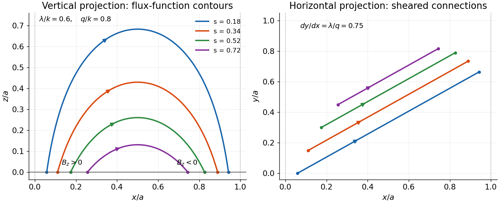

<h1 id="1/d/solution">Solution</h1>

↑ **Parent:** [D](../d.md)

**Use the original scanned [boundary condition](../../../../boundary-condition.md).** The scan fixes the [normal-field amplitude](../../../../magnetic-field-split.md) at the corner $x=z=0$. The supplied TeX drops the condition $x=0$ and would instead prescribe a constant normal field on the entire bottom. Those are different [boundary-value problems](../../../../boundary-value-problem-split.md); the solution below uses the legible original scan.

Choose a positive integer $n$, put $k=n\pi/a$, and seek a [separated decaying mode](../../../../separation-of-variables.md). A suitable [flux function](../../../../cartesian-magnetic-flux-function.md) is

$$
A(x,z)=\frac{B_0}{k}\sin(kx)e^{-qz},\qquad
\mathbf B=(-\partial_z A,\lambda A,\partial_x A).
$$

This is a [decaying linear force-free magnetic arcade](../../../../decaying-linear-force-free-magnetic-arcade.md). The first and third [curl components](../../../../curl.md) then satisfy the [force-free equation](../../../../force-free-magnetic-field.md) automatically; its second component requires $-(\partial_x^2+\partial_z^2)A=\lambda^2A$. Thus

$$
\boxed{q=\sqrt{k^2-\lambda^2},\qquad
\mathbf B=B_0e^{-qz}
\left(\frac qk\sin kx,\frac\lambda k\sin kx,\cos kx\right).}
$$

Direct [differentiation](../../../../derivative.md) gives $\nabla\cdot\mathbf B=0$ and $\nabla\times\mathbf B=\lambda\mathbf B$. Both horizontal components vanish at $x=0,a$, and $B_z(0,0)=B_0$. The [magnetic field](../../../../magnetic-field-split.md) on the bottom is $B_0\cos kx$, not a uniform $B_0$.

A strictly decaying real [normal mode](../../../../normal-mode.md) requires $q>0$, so

$$
\boxed{|\lambda|<n\pi/a.}
$$

For the fundamental, single-arcade choice $n=1$, this becomes $|\lambda|<\pi/a$. Equality gives no vertical [exponential decay](../../../../exponential-decay.md), while a larger magnitude gives an oscillatory rather than decaying vertical dependence for that [mode](../../../../normal-mode.md). The data do not explicitly fix the [horizontal mode](../../../../normal-mode.md) number. If arbitrarily fine higher-mode arcades are permitted, every finite real $\lambda$ admits some integer $n$ with $n\pi/a>|\lambda|$. The fundamental restriction must therefore not be advertised as a necessary bound for every possible field satisfying only the stated pointwise and wall data.

For a fundamental [field line](../../../../magnetic-field-line.md), $A$ is constant along its projection in the $(x,z)$ [plane](../../../../plane.md). If $0<s<1$ denotes its normalized flux-function value, its arch is

$$
z=\frac1q\log\frac{\sin(kx)}s,
\qquad x_-=\frac{\arcsin s}{k},\quad
x_+=\frac{\pi-\arcsin s}{k}.
$$

The maximum height is $q^{-1}\log(1/s)$ at $x=a/2$. In the horizontal projection,

$$
\boxed{\frac{dy}{dx}=\frac{B_y}{B_x}=\frac\lambda q,
\qquad y-y_-=\frac\lambda q(x-x_-).}
$$

Thus the vertical projections are arches and the horizontal projections are straight sheared segments joining their paired footpoints. Positive $\lambda$ gives positive horizontal slope, negative $\lambda$ reverses the shear, and $\lambda=0$ gives an unsheared [potential arcade](../../../../magnetic-scalar-potential.md). Higher $n$ repeats such cells across the width.

**[Figure 1](#1/d/image-vertical-arches-and-horizontal-shear-of-a-decaying-linear-force-free-arcade). Vertical arches and horizontal shear of a decaying linear force-free arcade**. An original fundamental-mode example has lambda divided by k equal to 0.6 and q divided by k equal to 0.8. Paired colours identify the same projected field lines; arrows follow the magnetic field for positive B0. The horizontal segments display the slope lambda divided by q.

The transcription's alternative uniform-bottom condition would be inconsistent with [exponential decay](../../../../exponential-decay.md) and zero side flux for $B_0\ne0$: [solenoidality](../../../../solenoidal-vector-field.md) gives $d\int_0^aB_z\,dx/dz=-B_x(a,z)+B_x(0,z)=0$, whereas a uniform nonzero bottom would give a [conserved flux](../../../../magnetic-flux.md) $aB_0$ that cannot decay to zero. This integral check is an independent reason not to silently solve that mistranscribed problem.

## ↑ Ancestors (12)

1. [D](../d.md)
2. [1](../../1.md)
3. [2017](../../../2017-split.md)
4. [Past exam of the advanced fluid dynamics course of the University of Oxford](../../../split.md)
5. [Advanced fluid dynamics course of the University of Oxford](../../../../advanced-fluid-dynamics-course-of-the-university-of-oxford.md)
6. [Year 4 of the mathematical and theoretical physics course of the University of Oxford](../../../../year-4-of-the-mathematical-and-theoretical-physics-course-of-the-university-of-oxford.md)
7. [Mathematical and theoretical physics course of the University of Oxford](../../../../mathematical-and-theoretical-physics-course-of-the-university-of-oxford.md)
8. [Undergraduate course of the University of Oxford](../../../../undergraduate-course-of-the-university-of-oxford.md)
9. [Course of the University of Oxford](../../../../course-of-the-university-of-oxford.md)
10. [University of Oxford](../../../../university-of-oxford-split.md)
11. [List of universities](../../../../list-of-universities.md)
12. [Codex Wiki](../../../../split.md)
