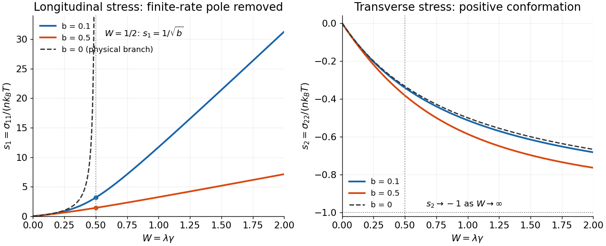

<h1 id="2/c/solution">Solution</h1>

↑ **Parent:** [C](../c.md)

For [steady uniaxial extension of the Giesekus model](../../../../steady-uniaxial-extension-of-the-giesekus-model.md), the component-first [velocity gradient](../../../../velocity-gradient.md) is [diagonal](../../../../diagonal-matrix.md), $G=\operatorname{diag}(\gamma,-\gamma/2,-\gamma/2)$. For a [steady](../../../../steady-state.md) spatially uniform [diagonal stress](../../../../cauchy-stress-tensor.md), the [material derivative](../../../../material-derivative.md) vanishes and the [convected terms](../../../../upper-convected-derivative.md) are $-2\gamma\sigma_{11}$ and $+\gamma\sigma_{22}$. The off-diagonal equations vanish identically, and symmetry permits equal transverse components. The remaining equations are

$$
\boxed{\alpha\sigma_{11}^2+(1-2\lambda\gamma)\sigma_{11}-2\mu\gamma=0,\qquad
\alpha\sigma_{22}^2+(1+\lambda\gamma)\sigma_{22}+\mu\gamma=0.}
$$

Set $W=\lambda\gamma\ge0$, $b=\alpha p_T$ and $s_i=\sigma_{ii}/p_T$, with $\mu=\lambda p_T$. For $b>0$, the branches continuously connected to zero [stress](../../../../stress.md) at zero rate are

$$
\boxed{s_1=\frac{2W-1+\sqrt{(1-2W)^2+8bW}}{2b},\qquad
s_2=\frac{-(1+W)+\sqrt{(1+W)^2-4bW}}{2b}.}
$$

A sufficient nondegenerate range for physical solutions at every nonnegative rate is $0<b<1$. Indeed $M=(1-b)I+bA$ with $A=HC/(k_BT)$, so positive [conformation](../../../../conformation-tensor.md) implies [positive mobility](../../../../hydrodynamic-mobility-matrix.md). The longitudinal [quadratic equation](../../../../quadratic-equation.md) is nonpositive at $s_1=0$ and has a nonnegative [root of a polynomial](../../../../root-of-a-polynomial.md). The transverse [quadratic equation](../../../../quadratic-equation.md) has values $b-1<0$ at $s_2=-1$ and $W\ge0$ at $s_2=0$, so its larger [root of a polynomial](../../../../root-of-a-polynomial.md) lies in $(-1,0]$. Thus the displayed branches satisfy $s_i>-1$, giving $A_i=1+s_i>0$. The other [algebraic roots](../../../../root-of-a-polynomial.md) do not provide a physical branch connected to the [equilibrium distribution](../../../../boltzmann-distribution.md). For constant positive [diagonal](../../../../diagonal-matrix.md) $A$, the associated stationary configuration distribution is a [Gaussian with covariance](../../../../multivariate-normal-distribution.md) $C=(k_BT/H)A$.

For positive $\alpha$ on the physical branch, the [stretching stress](../../../../stress.md) remains finite through $W=1/2$. At that rate,

$$
\boxed{\sigma_{11}=\sqrt{\frac{p_T}{\alpha}}.}
$$

At large [extension rate](../../../../extensional-strain-rate.md),

$$
\boxed{\sigma_{11}\sim\frac{2\lambda\gamma}{\alpha},\qquad
\frac{\sigma_{11}}\gamma\longrightarrow\frac{2\lambda}{\alpha}.}
$$

Thus the [stress](../../../../stress.md) continues to grow, but the [uniaxial extensional viscosity](../../../../extensional-viscosity.md) $\eta_E=(\sigma_{11}-\sigma_{22})/\gamma$ approaches the finite plateau $2\lambda/\alpha$ rather than developing a finite-rate pole. The [transverse stress](../../../../stress.md) approaches $-p_T$ as its [conformation tensor](../../../../conformation-tensor.md) variance becomes small. At small rate the two [stresses](../../../../stress.md) are $2\mu\gamma$ and $-\mu\gamma$, so $\eta_E\to3\mu$.

When $\alpha=0$, the physical [steady](../../../../steady-state.md) branch instead is

$$
\boxed{\sigma_{11}=\frac{2\mu\gamma}{1-2\lambda\gamma},\qquad
\sigma_{22}=-\frac{\mu\gamma}{1+\lambda\gamma}.}
$$

The [stretching stress](../../../../stress.md) diverges as $W\to1/2$ from below. Above that threshold its algebraic continuation has $1+s_1=1/(1-2W)<0$ and cannot be a [conformation](../../../../conformation-tensor.md) [covariance](../../../../covariance-matrix.md). There is no physical finite [steady](../../../../steady-state.md) [stretching](../../../../conformation-tensor.md) state. The transient equation

$$
\lambda\dot\sigma_{11}=(2W-1)\sigma_{11}+2p_TW
$$

gives linear growth at $W=1/2$ and exponential growth at larger rates, the [Hookean](../../../../hookean-dumbbell-model.md) [coil-stretch](../../../../coil-stretch-transition.md) failure of the [upper-convected Maxwell limit](../../../../upper-convected-maxwell-model.md).

**[Figure 2](#2/c/image-anisotropic-mobility-rounds-the-hookean-extensional-stress-singularity). Anisotropic mobility rounds the Hookean extensional-stress singularity**. Dimensionless longitudinal and transverse stresses are plotted against the extension-rate parameter W. Positive dimensionless mobility factors 0.1 and 0.5 give regular equilibrium-connected branches. The isotropic-mobility longitudinal branch is shown only below its physical steady-state threshold W equal to one half.

**Parameter qualification.** Positivity of $\alpha$ alone, without a restriction on $b=\alpha nk_BT$, does not ensure real physical [steady](../../../../steady-state.md) solutions for the entire [tensor](../../../../tensor.md). For example $b=2$, $W=1$ makes the transverse equation $2s_2^2+2s_2+1=0$, which has no real root. Its [diffusion](../../../../diffusion.md)/[resistance](../../../../hydrodynamic-resistance-matrix.md) interpretation is already inadmissible for some conformations. The physically positive-mobility regime stated above avoids that counterexample; the source's positive-$\alpha$ case must not be taken as a guarantee for arbitrary parameters.

## ↑ Ancestors (12)

1. [C](../c.md)
2. [2](../../2.md)
3. [2017](../../../2017-split.md)
4. [Past exam of the advanced fluid dynamics course of the University of Oxford](../../../split.md)
5. [Advanced fluid dynamics course of the University of Oxford](../../../../advanced-fluid-dynamics-course-of-the-university-of-oxford.md)
6. [Year 4 of the mathematical and theoretical physics course of the University of Oxford](../../../../year-4-of-the-mathematical-and-theoretical-physics-course-of-the-university-of-oxford.md)
7. [Mathematical and theoretical physics course of the University of Oxford](../../../../mathematical-and-theoretical-physics-course-of-the-university-of-oxford.md)
8. [Undergraduate course of the University of Oxford](../../../../undergraduate-course-of-the-university-of-oxford.md)
9. [Course of the University of Oxford](../../../../course-of-the-university-of-oxford.md)
10. [University of Oxford](../../../../university-of-oxford-split.md)
11. [List of universities](../../../../list-of-universities.md)
12. [Codex Wiki](../../../../split.md)
