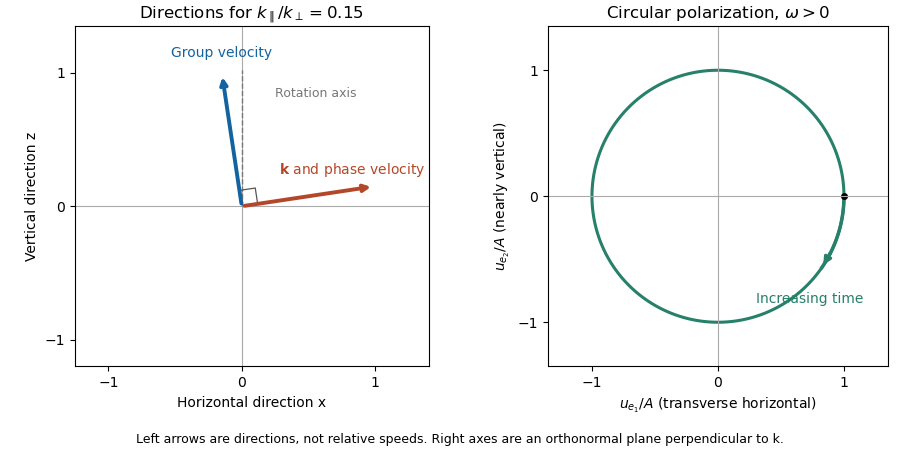

<h1 id="1/b/solution">Solution</h1>

↑ **Parent:** [B](../b.md)

The [group velocity](../../../../group-velocity.md), which gives wave-packet and [energy](../../../../energy-split.md) propagation, is the gradient of the [dispersion relation](../../../../dispersion-relation-split.md):

$$
\boxed{\mathbf v_g=\nabla_{\mathbf k}\omega_\sigma
=\frac{\sigma\,2\Omega}{k}\left(\widehat{\mathbf z}-\frac{k_\parallel}{k^2}\mathbf k\right).}
$$

For $\mathbf k=(k_\perp,0,k_\parallel)$ this becomes

$$
v_{g,x}=-\sigma\,2\Omega\frac{k_\perp k_\parallel}{k^3},\qquad
v_{g,z}=\sigma\,2\Omega\frac{k_\perp^2}{k^3},\qquad
\frac{v_{g,x}}{v_{g,z}}=-\frac{k_\parallel}{k_\perp}.
$$

Thus for $\epsilon=|k_\parallel|/k_\perp\ll1$, [energy](../../../../energy-split.md) travels almost along the rotation axis, with a small horizontal component. By contrast, the normal-to-phase-front [phase velocity](../../../../phase-velocity.md) $\mathbf v_{\rm ph}=\omega\mathbf k/k^2$ is almost horizontal. Indeed $\mathbf k\cdot\mathbf v_g=0$, so these phase and group directions are perpendicular. Specifying which meaning of propagation is intended matters for an [inertial wave](../../../../inertial-wave.md).

For the [wave polarization](../../../../polarization-waves.md), [incompressibility](../../../../incompressible-flow.md) and the $y$ equation in part [a](../a.md) give

$$
\boxed{\widehat u_x=-\frac{k_\parallel}{k_\perp}\widehat u_z,\qquad
\widehat u_y=\frac{\sigma i k}{k_\perp}\widehat u_z.}
$$

The horizontal component parallel to $\mathbf k_\perp$ is small, but $|\widehat u_y|\simeq|\widehat u_z|$: the other horizontal and vertical components are in quadrature. More exactly, introduce the orthonormal transverse basis

$$
\mathbf e_1=\widehat{\mathbf y},\qquad
\mathbf e_2=\widehat{\mathbf k}\times\widehat{\mathbf y}
=\frac1k(-k_\parallel,0,k_\perp).
$$

Then $\widehat{\mathbf u}=A(\mathbf e_1-\sigma i\mathbf e_2)$. The physical [velocity](../../../../velocity.md) at a fixed point traces a circle in the plane perpendicular to $\mathbf k$; its handedness reverses between branches. In the anisotropic limit this plane is nearly vertical. The [group velocity and polarization of an inertial wave](../../../../group-velocity-and-polarization-of-an-inertial-wave.md) therefore have quite different geometric roles.

**[Figure 1](#1/b/image-phase-and-energy-propagation-and-circular-velocity-polarization-of-a-low-frequency-inertial-wave). Phase and energy propagation and circular velocity polarization of a low-frequency inertial wave**. The positive-frequency example has k parallel divided by k perpendicular equal to 0.15. Left arrows show normalized directions only: group velocity is nearly vertical and perpendicular to the wavevector, while phase velocity is parallel to it. The right panel shows the velocity circle in an orthonormal plane normal to the wavevector; its arrow follows increasing time.

## ↑ Ancestors (12)

1. [B](../b.md)
2. [1](../../1.md)
3. [2018](../../../2018-split.md)
4. [Past exam of the advanced fluid dynamics course of the University of Oxford](../../../split.md)
5. [Advanced fluid dynamics course of the University of Oxford](../../../../advanced-fluid-dynamics-course-of-the-university-of-oxford.md)
6. [Year 4 of the mathematical and theoretical physics course of the University of Oxford](../../../../year-4-of-the-mathematical-and-theoretical-physics-course-of-the-university-of-oxford.md)
7. [Mathematical and theoretical physics course of the University of Oxford](../../../../mathematical-and-theoretical-physics-course-of-the-university-of-oxford.md)
8. [Undergraduate course of the University of Oxford](../../../../undergraduate-course-of-the-university-of-oxford.md)
9. [Course of the University of Oxford](../../../../course-of-the-university-of-oxford.md)
10. [University of Oxford](../../../../university-of-oxford-split.md)
11. [List of universities](../../../../list-of-universities.md)
12. [Codex Wiki](../../../../split.md)
