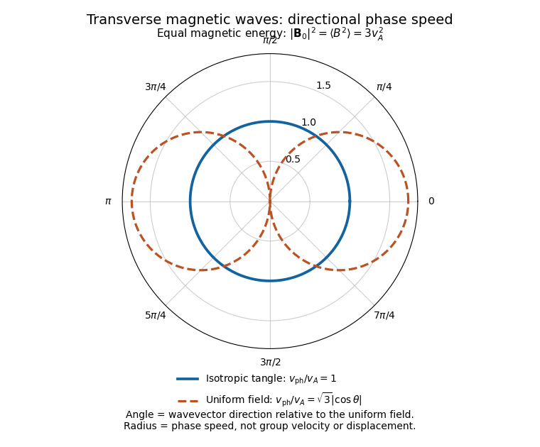

# 2019

↑ **Parent:** [Past exam of the advanced fluid dynamics course of the University of Oxford](../past-exam-of-the-advanced-fluid-dynamics-course-of-the-university-of-oxford.md)

Source paper: [https://www.whatdotheyknow.com/request/physics_past_papers_21/response/3037379/attach/2/FOI%20202505%20441%20Response.pdf?cookie_passthrough=1](https://www.whatdotheyknow.com/request/physics_past_papers_21/response/3037379/attach/2/FOI%20202505%20441%20Response.pdf?cookie_passthrough=1)

**Table of contents**

- [1](#1)
  - [a](#1/a)
    - [Solution](#1/a/solution)
  - [b](#1/b)
    - [Solution](#1/b/solution)
  - [c](#1/c)
    - [Solution](#1/c/solution)
  - [d](#1/d)
    - [Solution](#1/d/solution)
  - [e](#1/e)
    - [Solution](#1/e/solution)
  - [f](#1/f)
    - [Solution](#1/f/solution)
- [2](#2)
  - [a](#2/a)
    - [Solution](#2/a/solution)
  - [b](#2/b)
    - [Solution](#2/b/solution)
  - [c](#2/c)
    - [Solution](#2/c/solution)

## 1

↑ **Parent:** [2019](2019.md)

<h3 id="1/a">a</h3>

↑ **Parent:** [1](#1)

<h4 id="1/a/solution">Solution</h4>

↑ **Parent:** [A](#1/a)

Write the physical [magnetic field](../magnetic-field.md) as $\mathbf B_{\rm phys}$ and use the constant [mass density](../fluid-mechanics.md#density) $\rho_0$ to introduce [Alfvén velocity](../ideal-magnetohydrodynamics.md#alfven-velocity) units, $\mathbf B=\mathbf B_{\rm phys}/\sqrt{\mu_0\rho_0}$. If $P$ is the fluid's mechanical [pressure](../pressure.md), the [magnetohydrodynamic total pressure](../magnetohydrodynamics.md#magnetohydrodynamic-total-pressure) per unit [mass density](../fluid-mechanics.md#density) is $p=P/\rho_0+B^2/2$. The [ideal magnetohydrodynamic equations](../ideal-magnetohydrodynamics.md#ideal-magnetohydrodynamic-equations) then reduce to

$$
\boxed{
\begin{aligned}
\partial_t\mathbf u+(\mathbf u\cdot\nabla)\mathbf u
&=-\nabla p+(\mathbf B\cdot\nabla)\mathbf B,\\
\partial_t\mathbf B+(\mathbf u\cdot\nabla)\mathbf B
&=(\mathbf B\cdot\nabla)\mathbf u,\\
\nabla\cdot\mathbf u&=0,\qquad \nabla\cdot\mathbf B=0.
\end{aligned}}
$$

The first equation is [momentum conservation](../momentum.md#momentum-conservation): the [magnetic pressure](../magnetohydrodynamics.md#magnetic-pressure) has been included in $p$, leaving [magnetic tension](../magnetohydrodynamics.md#magnetic-tension) explicitly. The second is the [ideal magnetohydrodynamic induction equation](../ideal-magnetohydrodynamics.md#ideal-magnetohydrodynamic-induction-equation), expressing [magnetic flux freezing](../ideal-magnetohydrodynamics.md#magnetic-flux-freezing). The last two equations impose [incompressibility](../fluid-mechanics.md#incompressible-flow) and the [solenoidal magnetic-field constraint](../magnetic-field.md#solenoidal-magnetic-field-constraint).

The model assumes a smooth conducting-fluid continuum with constant [mass density](../fluid-mechanics.md#density) and constant [magnetic permeability](../maxwell-equations.md#permeability-electromagnetism), nonrelativistic [velocity](../classical-mechanics.md#velocity), and scales on which a single-fluid description is appropriate. Negligible [electrical resistivity](../electric-charge.md#electrical-resistivity) removes [magnetic diffusion](../magnetohydrodynamics.md#magnetic-diffusion); negligible [viscosity](../dynamic-viscosity.md) removes viscous [momentum diffusion](../dynamic-viscosity.md#momentum-diffusion). Equivalently, the [magnetic Reynolds number](../magnetohydrodynamics.md#magnetic-reynolds-number) and the [Reynolds number](../dynamic-viscosity.md#reynolds-number) are large on the scales being retained. The low-frequency approximation neglects the [displacement current](../maxwell-equations.md#displacement-current); Hall and other kinetic corrections to [Ohm's law](../electric-charge.md#ohm-s-law) are absent. [Incompressibility](../fluid-mechanics.md#incompressible-flow) is an imposed approximation, commonly justified when the [Mach number](../compressible-flow.md#mach-number) is small. There is no independently evolved thermodynamic [pressure](../pressure.md): $p$ enforces the [incompressibility condition](../fluid-mechanics.md#incompressible-flow). We omit external body forces; a conservative one could instead be absorbed into $p$.

<h3 id="1/b">b</h3>

↑ **Parent:** [1](#1)

<h4 id="1/b/solution">Solution</h4>

↑ **Parent:** [B](#1/b)

The [magnetic second-moment tensor](../ideal-magnetohydrodynamics.md#magnetic-second-moment-tensor) is $M_{ij}=B_iB_j$. This is the magnetic dyadic called the Maxwell tensor in the paper; the isotropic part of the usual [Maxwell stress tensor](../electromagnetism.md#maxwell-stress-tensor) is already contained in the [magnetohydrodynamic total pressure](../magnetohydrodynamics.md#magnetohydrodynamic-total-pressure). The [solenoidal magnetic-field constraint](../magnetic-field.md#solenoidal-magnetic-field-constraint) gives

$$
\partial_jM_{ij}
=B_j\partial_jB_i+B_i\partial_jB_j
=B_j\partial_jB_i.
$$

Consequently the [magnetohydrodynamic momentum equation](../magnetohydrodynamics.md#magnetohydrodynamic-momentum-equation) in part [a](#1/a) becomes $D_tu_i=-\partial_i p+\partial_jM_{ij}$, where $D_t=\partial_t+u_n\partial_n$ is the [material derivative](../continuum-mechanics.md#material-derivative). Applying its product rule and the [ideal magnetohydrodynamic induction equation](../ideal-magnetohydrodynamics.md#ideal-magnetohydrodynamic-induction-equation) gives

$$
\begin{aligned}
D_tM_{ij}
&=(D_tB_i)B_j+B_i(D_tB_j)\\
&=B_nB_j\partial_nu_i+B_iB_n\partial_nu_j
=\boxed{M_{nj}\partial_nu_i+M_{in}\partial_nu_j}.
\end{aligned}
$$

Thus the evolution uses only $\mathbf u,M,p$, together with $\partial_i u_i=0$. To determine $p$, take the [divergence](../multivariable-calculus.md#divergence) of the [magnetohydrodynamic momentum equation](../magnetohydrodynamics.md#magnetohydrodynamic-momentum-equation). Since $\partial_t\partial_i u_i=0$ and $u_j\partial_j\partial_i u_i=0$,

$$
\boxed{\nabla^2p=\partial_i\partial_jM_{ij}
-(\partial_i u_j)(\partial_j u_i).}
$$

This is the [pressure Poisson equation for incompressible flow](../viscous-fluid-flow.md#pressure-poisson-equation-for-incompressible-flow), with [boundary conditions](../differential-equation.md#boundary-condition) supplied by the imposed normal [acceleration](../classical-mechanics.md#acceleration) and normal [stress](../continuum-mechanics.md#stress), or by periodicity or decay at infinity as appropriate. For example, the normal component of the [magnetohydrodynamic momentum equation](../magnetohydrodynamics.md#magnetohydrodynamic-momentum-equation) requires $\mathbf n\cdot\nabla p=\mathbf n\cdot(\nabla\cdot M-D_t\mathbf u)$ at a prescribed boundary. The [pressure](../pressure.md) is determined up to a spatially constant function of [time](../classical-mechanics.md#time-in-physics).

For equivalence to one resolved [magnetic field](../magnetic-field.md), the initial $M$ must actually be $\mathbf B\mathbf B^T$ for a [divergence-free vector field](../fluid-mechanics.md#divergence-free-vector-field). In particular it is a symmetric [positive semidefinite matrix](../quadratic-form.md#positive-semidefinite-matrix) of [matrix rank](../vector-space.md#matrix-rank) at most one. The tensor equations also admit more general stresses; the averaged $M$ in part [d](#1/d) need not have [matrix rank](../vector-space.md#matrix-rank) one.

<h3 id="1/c">c</h3>

↑ **Parent:** [1](#1)

<h4 id="1/c/solution">Solution</h4>

↑ **Parent:** [C](#1/c)

With zero [velocity](../classical-mechanics.md#velocity) and no time dependence, the [magnetic second-moment tensor](../ideal-magnetohydrodynamics.md#magnetic-second-moment-tensor) equation holds automatically, but the [magnetohydrodynamic momentum equation](../magnetohydrodynamics.md#magnetohydrodynamic-momentum-equation) still requires

$$
\boxed{\partial_jM_{ij}^{(0)}=\partial_i p_0.}
$$

The [magnetic tension](../magnetohydrodynamics.md#magnetic-tension) must therefore be a [pressure gradient](../fluid-mechanics.md#pressure-gradient). Locally, its necessary integrability condition is

$$
\nabla\times\bigl(\nabla\cdot M^{(0)}\bigr)=0;
$$

on a simply connected region this is also sufficient for a scalar $p_0$, subject to the global [boundary conditions](../differential-equation.md#boundary-condition). In physical units the same balance is $\nabla P_0=\mathbf J_0\times\mathbf B_{{\rm phys},0}$: the [Lorentz force density](../relativistic-electromagnetism.md#lorentz-force-density) is balanced by mechanical [pressure](../pressure.md), rather than necessarily vanishing. A zero mean [magnetic field](../magnetic-field.md) does not make the local [magnetic tension](../magnetohydrodynamics.md#magnetic-tension) zero, so an arbitrary tangle is not automatically a static [equilibrium](../dynamical-systems.md#equilibrium-point-of-a-dynamical-system).

<h3 id="1/d">d</h3>

↑ **Parent:** [1](#1)

<h4 id="1/d/solution">Solution</h4>

↑ **Parent:** [D](#1/d)

Take the [trace](../linear-algebra.md#matrix-trace) of the statistically isotropic [magnetic second-moment tensor](../ideal-magnetohydrodynamics.md#magnetic-second-moment-tensor). There are three spatial directions, so

$$
\langle B^2\rangle
=\langle B_iB_i\rangle
=v_A^2\delta_{ii}=3v_A^2.
$$

Choosing the nonnegative [speed](../classical-mechanics.md#speed),

$$
\boxed{v_A=\sqrt{\frac{\langle B^2\rangle}{3}}
=\sqrt{\frac{\langle B_{\rm phys}^2\rangle}{3\mu_0\rho_0}}.}
$$

Thus $v_A$ is the root-mean-square value of any one Cartesian [magnetic field](../magnetic-field.md) component in [Alfvén velocity](../ideal-magnetohydrodynamics.md#alfven-velocity) units. It is not the magnitude of the mean [Alfvén velocity](../ideal-magnetohydrodynamics.md#alfven-velocity), which is zero here. [Statistical isotropy](../probability-and-statistics.md#statistical-isotropy) fixes a second moment even when the first moment vanishes.

<h3 id="1/e">e</h3>

↑ **Parent:** [1](#1)

<h4 id="1/e/solution">Solution</h4>

↑ **Parent:** [E](#1/e)

Average the equations in part [b](#1/b) and make exactly the prescribed scale-separation approximation: the retained perturbations vary on lengths much greater than $\ell$, and perturbations at the tangle scale are omitted. Products of two retained perturbations can then be neglected. Writing $\mathbf v=\delta\mathbf u$, $m=\delta M$ and $\pi=\delta p$, the [linearized equations](../differential-equation.md#linearized-equation) are

$$
\partial_tv_i=-\partial_i\pi+\partial_jm_{ij},\qquad
\partial_tm_{ij}=v_A^2(\partial_jv_i+\partial_iv_j),\qquad
\partial_iv_i=0.
$$

No unmodelled small-scale response has been inserted into this closure.

Introduce the [fluid displacement](../fluid-mechanics.md#lagrangian-displacement-fluid-mechanics) $\boldsymbol\xi$ by $\mathbf v=\partial_t\boldsymbol\xi$ and choose $\nabla\cdot\boldsymbol\xi=0$. Integrating the [magnetic second-moment tensor](../ideal-magnetohydrodynamics.md#magnetic-second-moment-tensor) equation gives

$$
\boxed{m_{ij}
=v_A^2(\partial_i\xi_j+\partial_j\xi_i)+s_{ij}(\mathbf r),}
$$

where $s$ is a time-independent integration tensor set by the initial [stress](../continuum-mechanics.md#stress). For a pure oscillatory [normal mode](../wave-equation.md#normal-mode), $s=0$. Its [restoring force](../force.md#restoring-force) is therefore $v_A^2\nabla^2\boldsymbol\xi$: the isotropic magnetic tangle has the same transverse response as an incompressible elastic medium with [shear modulus](../elasticity-physics.md#shear-modulus) $\rho_0v_A^2$.

For a [plane wave](../wave-function.md#plane-wave) proportional to $e^{i(\mathbf k\cdot\mathbf r-\omega t)}$, with $\omega\ne0$, [incompressibility](../fluid-mechanics.md#incompressible-flow) gives $\mathbf k\cdot\widehat{\mathbf v}=0$. The tensor equation and [magnetohydrodynamic momentum equation](../magnetohydrodynamics.md#magnetohydrodynamic-momentum-equation) become

$$
\widehat m_{ij}
=-\frac{v_A^2}{\omega}
(k_i\widehat v_j+k_j\widehat v_i),\qquad
-i\omega\widehat v_i=-ik_i\widehat\pi+ik_j\widehat m_{ij}.
$$

Dotting the second equation with $\mathbf k$ yields $\widehat\pi=0$ for $k\ne0$, since $k_i k_j\widehat m_{ij}=0$. Substitution then gives

$$
\boxed{\omega^2=v_A^2k^2,\qquad
\widehat m_{ij}=iv_A^2(k_i\widehat\xi_j+k_j\widehat\xi_i),\qquad
\mathbf k\cdot\widehat{\boldsymbol\xi}=0.}
$$

There are two independent [transverse polarizations](../wave-equation.md#transverse-polarization). The [phase speed](../dispersion-relation.md#phase-speed) is $v_A$ in every direction, and the two signs of $\omega$ give [group velocities](../dispersion-relation.md#group-velocity) $\pm v_A\widehat{\mathbf k}$. These [magnetoelastic waves in an isotropic magnetic tangle](../ideal-magnetohydrodynamics.md#magnetoelastic-wave-in-an-isotropic-magnetic-tangle) exist because a shear deformation distorts the second moment of the tangled [magnetic field](../magnetic-field.md), producing a restoring [magnetic tension](../magnetohydrodynamics.md#magnetic-tension) even though its mean is zero.

For comparison, a uniform [magnetic field](../magnetic-field.md) with [Alfvén velocity](../ideal-magnetohydrodynamics.md#alfven-velocity) $\mathbf B_0$ gives the incompressible [Alfvén wave](../ideal-magnetohydrodynamics.md#alfven-wave) relation $\omega^2=(\mathbf k\cdot\mathbf B_0)^2$. Its [frequency](../wave.md#frequency) depends on the direction of $\mathbf k$, and [energy](../energy.md) propagates along $\mathbf B_0$. Here the averaged restoring response is isotropic: there is no preferred mean-field direction. Both systems resist transverse deformation through [magnetic tension](../magnetohydrodynamics.md#magnetic-tension), rather than through compressive sound.

**[Figure 1](#1/e/image-directional-phase-speeds-for-a-magnetic-tangle-and-a-uniform-magnetic-field-with-the-same-mean-square-strength). Directional phase speeds for a magnetic tangle and a uniform magnetic field with the same mean-square strength**. The radial coordinate is phase speed divided by the tangle wave speed. The circular tangle curve is direction independent; the uniform-field curve is proportional to the absolute cosine of the propagation angle. These are phase-speed curves, not group-velocity trajectories.

**The propagating branch is not the entire perturbation space.** For example, $\mathbf v=0$, $m_{ij}=f(\mathbf r)\delta_{ij}$ and $\pi=f(\mathbf r)$ solve the [linearized equations](../differential-equation.md#linearized-equation) without propagation, for any small, slowly varying $f$. Such a [static stress perturbation in magnetoelastic wave equations](../ideal-magnetohydrodynamics.md#static-stress-perturbation-in-magnetoelastic-wave-equations) balances a [pressure gradient](../fluid-mechanics.md#pressure-gradient). Thus the requested [wave](../wave.md) conclusion applies to the oscillatory branch; it must not exclude stationary initial [stress](../continuum-mechanics.md#stress) perturbations.

<h3 id="1/f">f</h3>

↑ **Parent:** [1](#1)

<h4 id="1/f/solution">Solution</h4>

↑ **Parent:** [F](#1/f)

The common part of the [magnetohydrodynamic-viscoelastic analogy](../ideal-magnetohydrodynamics.md#magnetohydrodynamic-viscoelastic-analogy) is stretching and advection of a line element. With the component-first [velocity gradient](../continuum-mechanics.md#velocity-gradient) $L_{ij}=\partial_j u_i$, the ideal tensor equation is

$$
D_tM-LM-ML^T=0.
$$

Its left side is an [upper-convected derivative](../rheology.md#upper-convected-derivative), the same deformation law that appears for a [polymer](../polymer.md) [conformation tensor](../rheology.md#conformation-tensor) when its relaxation is neglected.

There are two important physical differences. First, the [solenoidal magnetic-field constraint](../magnetic-field.md#solenoidal-magnetic-field-constraint) prevents a [magnetic field line](../magnetic-field.md#magnetic-field-line) from having an isolated source or sink inside the fluid. A [polymer](../polymer.md) strand can have molecular endpoints, so there is no corresponding no-endpoint constraint on the strands. Second, a stretched [polymer](../polymer.md) has a preferred relaxed distribution of configurations and a finite [polymer relaxation time](../polymer.md#polymer-relaxation-time); it can recoil relative to the solvent through molecular drag and thermal motion. An ideal [magnetic field](../magnetic-field.md) has no analogous local tendency to return to a prescribed coil size. Real [polymers](../polymer.md) also have a finite contour length, a limitation absent from the ideal field-stretching law.

For example, a normalized [Hookean dumbbell conformation equation](../polymer.md#hookean-dumbbell-conformation-equation) has the dissipative extension

$$
\boxed{D_tC-LC-CL^T=-\frac1\tau(C-I).}
$$

This is local relaxation toward an isotropic thermal configuration. It remains nonzero for a spatially uniform stretched $C$. By contrast, constant [magnetic diffusivity](../magnetohydrodynamics.md#magnetic-diffusivity) $\eta_m$ adds $\eta_m\nabla^2\mathbf B$ to the [resistive induction equation](../resistive-magnetohydrodynamics.md#resistive-induction-equation). The product rule gives the [resistive evolution of the magnetic second-moment tensor](../ideal-magnetohydrodynamics.md#resistive-evolution-of-the-magnetic-second-moment-tensor):

$$
\boxed{D_tM_{ij}-L_{in}M_{nj}-M_{in}L_{jn}
=\eta_m\nabla^2M_{ij}
-2\eta_m(\partial_nB_i)(\partial_nB_j).}
$$

The magnetic correction involves spatial gradients, vanishes for a uniform [magnetic field](../magnetic-field.md), and does not create field-line endpoints: $\partial_t(\nabla\cdot\mathbf B)=\eta_m\nabla^2(\nabla\cdot\mathbf B)$. It permits slippage and [magnetic reconnection](../resistive-magnetohydrodynamics.md#magnetic-reconnection) while preserving the no-monopole constraint. After averaging, its gradient-product term generally needs additional information beyond the averaged $M$. One cannot replace it indiscriminately by the local [polymer](../polymer.md) relaxation term, or even by $\eta_m\nabla^2M$ alone.

## 2

↑ **Parent:** [2019](2019.md)

<h3 id="2/a">a</h3>

↑ **Parent:** [2](#2)

<h4 id="2/a/solution">Solution</h4>

↑ **Parent:** [A](#2/a)

Work in the laboratory frame, with the fluid at rest at infinity. Set

$$
f(r)=\frac{3a}{4r}+\frac{a^3}{4r^3},\qquad
g(r)=\frac{3a}{4r^3}-\frac{3a^3}{4r^5},
\qquad \mathbf u=f\mathbf U+g(\mathbf U\cdot\mathbf x)\mathbf x.
$$

At $r=a$, $f=1$ and $g=0$, so the [no-slip boundary condition](../viscous-fluid-flow.md#no-slip-boundary-condition) is $\mathbf u=\mathbf U$ on the translating [sphere](../euclidean-geometry.md#sphere). As $r\to\infty$, $\mathbf u=O(r^{-1})\to0$ and the gauge-fixed [pressure](../pressure.md) tends to zero.

It is also possible to check the exterior [Stokes equations](../stokes-flow.md#stokes-equation) directly. Differentiating the radial functions gives

$$
\nabla\cdot\mathbf u
=(\mathbf U\cdot\mathbf x)\left(\frac{f'}r+rg'+4g\right)=0,
$$

and

$$
\begin{aligned}
\nabla^2\mathbf u
&=\left(f''+\frac{2f'}r+2g\right)\mathbf U
+\left(g''+\frac{6g'}r\right)(\mathbf U\cdot\mathbf x)\mathbf x\\
&=\frac{3a}{2}\left(\frac{\mathbf U}{r^3}
-\frac{3(\mathbf U\cdot\mathbf x)\mathbf x}{r^5}\right)
=\frac{\nabla p}{\mu}.
\end{aligned}
$$

Thus the [Newtonian fluid stress tensor](../viscous-fluid-flow.md#newtonian-fluid-stress-tensor) $\sigma=-pI+\mu(\nabla\mathbf u+\nabla\mathbf u^T)$ satisfies $\nabla\cdot\sigma=0$ throughout $r>a$.

Let $\mathbf n$ point away from the common centre on each concentric [sphere](../euclidean-geometry.md#sphere). Applying the [divergence theorem](../multivariable-calculus.md#divergence-theorem) to the intervening fluid shell, whose inner normal is $-\mathbf n$, yields

$$
\boxed{\mathbf F_{\rm drag}
=\int_{r=a}\sigma\mathbf n\,dS
=\int_{r=R}\sigma\mathbf n\,dS,\qquad R>a.}
$$

This is the [force flux at infinity in Stokes flow](../stokes-flow.md#force-flux-at-infinity-in-stokes-flow). It is legitimate even though the [stress tensor](../continuum-mechanics.md#cauchy-stress-tensor) tends to zero pointwise, because the area of the large [sphere](../euclidean-geometry.md#sphere) grows as $R^2$.

For an explicit evaluation, put $A=3a/4$ and $\mathbf n=\mathbf x/R$. The leading terms are $\mathbf u=A[\mathbf U+(\mathbf U\cdot\mathbf n)\mathbf n]/R$ and $p=2\mu A(\mathbf U\cdot\mathbf n)/R^2$. Their [velocity gradient](../continuum-mechanics.md#velocity-gradient) is

$$
\partial_j u_i
=\frac{A}{R^2}\left[-U_i n_j+U_j n_i
+(\mathbf U\cdot\mathbf n)\delta_{ij}
-3(\mathbf U\cdot\mathbf n)n_i n_j\right]
+O\!\left(\frac{a^3|\mathbf U|}{R^4}\right).
$$

After symmetrizing and subtracting the [pressure](../pressure.md) contribution,

$$
\sigma\mathbf n
=-\frac{9\mu a}{2R^2}(\mathbf U\cdot\mathbf n)\mathbf n
+O\!\left(\frac{\mu a^3|\mathbf U|}{R^4}\right).
$$

By [rotational symmetry](../linear-algebra.md#rotational-symmetry), $\int n_i n_j\,d\Omega=(4\pi/3)\delta_{ij}$. Hence

$$
\mathbf F_{\rm drag}
=-\frac{9\mu a}{2}\int(\mathbf U\cdot\mathbf n)\mathbf n\,d\Omega
=\boxed{-6\pi\mu a\mathbf U}.
$$

This is [Stokes's law](../stokes-flow.md#stokes-s-law), with the [force](../force.md) on the [sphere](../euclidean-geometry.md#sphere) opposite its [velocity](../classical-mechanics.md#velocity). For a component calculation with $\mathbf U=U\mathbf e_z$, the same integral is $F_z=-(9\mu aU/2)\int\cos^2\theta\,d\Omega$.

<h3 id="2/b">b</h3>

↑ **Parent:** [2](#2)

<h4 id="2/b/solution">Solution</h4>

↑ **Parent:** [B](#2/b)

Neglect the [inertia](../classical-mechanics.md#inertia) of the [sphere](../euclidean-geometry.md#sphere) and balance the applied [force](../force.md) against [Stokes drag](../stokes-flow.md#stokes-s-law). The [sphere](../euclidean-geometry.md#sphere) translates with $\mathbf U=\mathbf F_1/\zeta$, where $\zeta=6\pi\mu a$. The applied [force](../force.md) is also the net [force](../force.md) transmitted to the fluid; the fluid's drag on the [sphere](../euclidean-geometry.md#sphere) has the opposite sign.

Translate the origin to $\mathbf r_1$. In the solution of part [a](#2/a), retain the terms of order $a/r$ and discard those of order $a^3/r^3$. With $\mathbf n=(\mathbf x-\mathbf r_1)/r$,

$$
\begin{aligned}
\mathbf u(\mathbf x)
&\sim\frac{3a}{4r}(I+\mathbf n\mathbf n^T)\mathbf U\\
&=\boxed{\frac1{8\pi\mu r}(I+\mathbf n\mathbf n^T)\mathbf F_1}.
\end{aligned}
$$

This is the [Stokeslet](../stokes-flow.md#stokeslet), or equivalently the [Oseen tensor](../stokes-flow.md#oseen-tensor) $\mathsf G(\mathbf r)=(I+\mathbf n\mathbf n^T)/(8\pi\mu r)$ acting on $\mathbf F_1$. The omitted finite-size [velocity](../classical-mechanics.md#velocity) is of order $a^2|\mathbf F_1|/(\mu r^3)$, so the displayed term is the leading far field for $r\gg a$. The singular [Stokeslet](../stokes-flow.md#stokeslet) must not be evaluated at its own centre to obtain a particle's self mobility.

<h3 id="2/c">c</h3>

↑ **Parent:** [2](#2)

<h4 id="2/c/solution">Solution</h4>

↑ **Parent:** [C](#2/c)

Use the deterministic [Hookean dumbbell model](../polymer.md#hookean-dumbbell-model), with a [zero-rest-length spring](../elasticity-physics.md#zero-rest-length-spring) and negligible connector drag. For $\mathbf R=\mathbf r_1-\mathbf r_2$, its elastic [forces](../force.md) on the two beads are

$$
\mathbf F_1=-H\mathbf R,\qquad \mathbf F_2=+H\mathbf R.
$$

Here $H>0$ is the [spring constant](../elasticity-physics.md#spring-constant). No independent thermal forcing from [Brownian motion](../brownian-motion.md) or bead [inertia](../classical-mechanics.md#inertia) is included. The unperturbed [linear velocity field](../fluid-mechanics.md#linear-velocity-field) is $\mathbf L\mathbf r$, with $\operatorname{tr}\mathbf L=0$ by [incompressibility](../fluid-mechanics.md#incompressible-flow).

The fluid [velocity](../classical-mechanics.md#velocity) used in each bead's drag law is the imposed flow plus the disturbance from the _other_ bead, with its own singular field omitted. At leading order in $a/R$, the evenness of the [Oseen tensor](../stokes-flow.md#oseen-tensor), $\mathsf G(-\mathbf R)=\mathsf G(\mathbf R)$, gives

$$
\begin{aligned}
\dot{\mathbf r}_1
&=\mathbf L\mathbf r_1+\mathsf G(\mathbf R)\mathbf F_2
+\frac{\mathbf F_1}{\zeta},\\
\dot{\mathbf r}_2
&=\mathbf L\mathbf r_2+\mathsf G(\mathbf R)\mathbf F_1
+\frac{\mathbf F_2}{\zeta},
\qquad \boxed{\zeta=6\pi\mu a}.
\end{aligned}
$$

These are the pair [hydrodynamic mobility matrix](../stokes-flow.md#hydrodynamic-mobility-matrix) relations. Their signs follow from balancing each spring [force](../force.md) with $-\zeta(\dot{\mathbf r}_i-\mathbf u_{{\rm ext},i})$, the fluid drag on that bead.

Adding the equations cancels both the direct spring slips and the cross-induced [velocities](../classical-mechanics.md#velocity), since $\mathbf F_1+\mathbf F_2=0$. For the midpoint $\mathbf r_c=(\mathbf r_1+\mathbf r_2)/2$,

$$
\boxed{\dot{\mathbf r}_c=\mathbf L\mathbf r_c.}
$$

The midpoint therefore follows the undisturbed [linear velocity field](../fluid-mechanics.md#linear-velocity-field). Subtracting the equations instead gives the [hydrodynamic interaction of a Hookean dumbbell](../polymer.md#hydrodynamic-interaction-of-a-hookean-dumbbell):

$$
\begin{aligned}
\dot{\mathbf R}
&=\mathbf L\mathbf R+
\left(\zeta^{-1}I-\mathsf G(\mathbf R)\right)
(\mathbf F_1-\mathbf F_2)\\
&=\boxed{\mathbf L\mathbf R-\frac{2H}{\zeta}
\left[I-\frac{\zeta}{8\pi\mu R}
(I+\widehat{\mathbf R}\widehat{\mathbf R}^T)\right]\mathbf R}.
\end{aligned}
$$

The dimensionless interaction matrix is

$$
\zeta\mathsf G(\mathbf R)
=\frac{3a}{4R}(I+\widehat{\mathbf R}\widehat{\mathbf R}^T).
$$

Its transverse and longitudinal [eigenvalues](../linear-operator-theory.md#eigenvalue) are $3a/(4R)$ and $3a/(2R)$, respectively. Since the spring [force](../force.md) is longitudinal, the separation equation can also be written

$$
\boxed{\dot{\mathbf R}
=\mathbf L\mathbf R-\frac{2H}{\zeta}
\left(1-\frac{3a}{2R}\right)\mathbf R.}
$$

The relative correction to the free-draining spring relaxation rate is therefore $3a/(2R)$, explicitly proportional to $a/R$. Entrainment by the other bead reduces their relative approach for given opposing spring [forces](../force.md).

This is a far-field [hydrodynamic interaction](../stokes-flow.md#hydrodynamic-interaction), valid for $R\gg a$; it is not a near-contact law and omits higher reflections and lubrication. The printed target also fixes the spring's rest length implicitly. For an ordinary [spring](../elasticity-physics.md#spring) obeying [Hooke's law](../elasticity-physics.md#hooke-s-law) with nonzero rest length $R_0$, the elastic [force](../force.md) would be $-H(R-R_0)\widehat{\mathbf R}$, and every spring term above would acquire the factor $1-R_0/R$. The displayed result uses the [zero-rest-length spring](../elasticity-physics.md#zero-rest-length-spring) convention appropriate to the ideal [Hookean dumbbell model](../polymer.md#hookean-dumbbell-model).

## ↑ Ancestors (9)

1. [Past exam of the advanced fluid dynamics course of the University of Oxford](../past-exam-of-the-advanced-fluid-dynamics-course-of-the-university-of-oxford.md)
2. [Advanced fluid dynamics course of the University of Oxford](../university-of-oxford.md#advanced-fluid-dynamics-course-of-the-university-of-oxford)
3. [Year 4 of the mathematical and theoretical physics course of the University of Oxford](../university-of-oxford.md#year-4-of-the-mathematical-and-theoretical-physics-course-of-the-university-of-oxford)
4. [Mathematical and theoretical physics course of the University of Oxford](../university-of-oxford.md#mathematical-and-theoretical-physics-course-of-the-university-of-oxford)
5. [Undergraduate course of the University of Oxford](../university-of-oxford.md#undergraduate-course-of-the-university-of-oxford)
6. [Course of the University of Oxford](../university-of-oxford.md#course-of-the-university-of-oxford)
7. [University of Oxford](../university-of-oxford.md)
8. [List of universities](../README.md#list-of-universities)
9. [Codex Wiki](../README.md)
