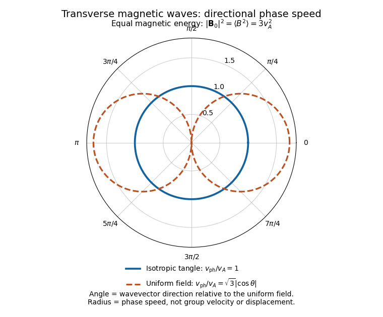

<h1 id="1/e/solution">Solution</h1>

↑ **Parent:** [E](../e.md)

Average the equations in part [b](../b.md) and make exactly the prescribed scale-separation approximation: the retained perturbations vary on lengths much greater than $\ell$, and perturbations at the tangle scale are omitted. Products of two retained perturbations can then be neglected. Writing $\mathbf v=\delta\mathbf u$, $m=\delta M$ and $\pi=\delta p$, the [linearized equations](../../../../linearized-equation.md) are

$$
\partial_tv_i=-\partial_i\pi+\partial_jm_{ij},\qquad
\partial_tm_{ij}=v_A^2(\partial_jv_i+\partial_iv_j),\qquad
\partial_iv_i=0.
$$

No unmodelled small-scale response has been inserted into this closure.

Introduce the [fluid displacement](../../../../lagrangian-displacement-fluid-mechanics.md) $\boldsymbol\xi$ by $\mathbf v=\partial_t\boldsymbol\xi$ and choose $\nabla\cdot\boldsymbol\xi=0$. Integrating the [magnetic second-moment tensor](../../../../magnetic-second-moment-tensor.md) equation gives

$$
\boxed{m_{ij}
=v_A^2(\partial_i\xi_j+\partial_j\xi_i)+s_{ij}(\mathbf r),}
$$

where $s$ is a time-independent integration tensor set by the initial [stress](../../../../stress.md). For a pure oscillatory [normal mode](../../../../normal-mode.md), $s=0$. Its [restoring force](../../../../restoring-force.md) is therefore $v_A^2\nabla^2\boldsymbol\xi$: the isotropic magnetic tangle has the same transverse response as an incompressible elastic medium with [shear modulus](../../../../shear-modulus.md) $\rho_0v_A^2$.

For a [plane wave](../../../../plane-wave.md) proportional to $e^{i(\mathbf k\cdot\mathbf r-\omega t)}$, with $\omega\ne0$, [incompressibility](../../../../incompressible-flow.md) gives $\mathbf k\cdot\widehat{\mathbf v}=0$. The tensor equation and [magnetohydrodynamic momentum equation](../../../../magnetohydrodynamic-momentum-equation.md) become

$$
\widehat m_{ij}
=-\frac{v_A^2}{\omega}
(k_i\widehat v_j+k_j\widehat v_i),\qquad
-i\omega\widehat v_i=-ik_i\widehat\pi+ik_j\widehat m_{ij}.
$$

Dotting the second equation with $\mathbf k$ yields $\widehat\pi=0$ for $k\ne0$, since $k_i k_j\widehat m_{ij}=0$. Substitution then gives

$$
\boxed{\omega^2=v_A^2k^2,\qquad
\widehat m_{ij}=iv_A^2(k_i\widehat\xi_j+k_j\widehat\xi_i),\qquad
\mathbf k\cdot\widehat{\boldsymbol\xi}=0.}
$$

There are two independent [transverse polarizations](../../../../transverse-polarization.md). The [phase speed](../../../../phase-speed.md) is $v_A$ in every direction, and the two signs of $\omega$ give [group velocities](../../../../group-velocity.md) $\pm v_A\widehat{\mathbf k}$. These [magnetoelastic waves in an isotropic magnetic tangle](../../../../magnetoelastic-wave-in-an-isotropic-magnetic-tangle.md) exist because a shear deformation distorts the second moment of the tangled [magnetic field](../../../../magnetic-field-split.md), producing a restoring [magnetic tension](../../../../magnetic-tension.md) even though its mean is zero.

For comparison, a uniform [magnetic field](../../../../magnetic-field-split.md) with [Alfvén velocity](../../../../alfven-velocity.md) $\mathbf B_0$ gives the incompressible [Alfvén wave](../../../../alfven-wave.md) relation $\omega^2=(\mathbf k\cdot\mathbf B_0)^2$. Its [frequency](../../../../frequency.md) depends on the direction of $\mathbf k$, and [energy](../../../../energy-split.md) propagates along $\mathbf B_0$. Here the averaged restoring response is isotropic: there is no preferred mean-field direction. Both systems resist transverse deformation through [magnetic tension](../../../../magnetic-tension.md), rather than through compressive sound.

**[Figure 1](#1/e/image-directional-phase-speeds-for-a-magnetic-tangle-and-a-uniform-magnetic-field-with-the-same-mean-square-strength). Directional phase speeds for a magnetic tangle and a uniform magnetic field with the same mean-square strength**. The radial coordinate is phase speed divided by the tangle wave speed. The circular tangle curve is direction independent; the uniform-field curve is proportional to the absolute cosine of the propagation angle. These are phase-speed curves, not group-velocity trajectories.

**The propagating branch is not the entire perturbation space.** For example, $\mathbf v=0$, $m_{ij}=f(\mathbf r)\delta_{ij}$ and $\pi=f(\mathbf r)$ solve the [linearized equations](../../../../linearized-equation.md) without propagation, for any small, slowly varying $f$. Such a [static stress perturbation in magnetoelastic wave equations](../../../../static-stress-perturbation-in-magnetoelastic-wave-equations.md) balances a [pressure gradient](../../../../pressure-gradient.md). Thus the requested [wave](../../../../wave-split.md) conclusion applies to the oscillatory branch; it must not exclude stationary initial [stress](../../../../stress.md) perturbations.

## ↑ Ancestors (12)

1. [E](../e.md)
2. [1](../../1.md)
3. [2019](../../../2019-split.md)
4. [Past exam of the advanced fluid dynamics course of the University of Oxford](../../../split.md)
5. [Advanced fluid dynamics course of the University of Oxford](../../../../advanced-fluid-dynamics-course-of-the-university-of-oxford.md)
6. [Year 4 of the mathematical and theoretical physics course of the University of Oxford](../../../../year-4-of-the-mathematical-and-theoretical-physics-course-of-the-university-of-oxford.md)
7. [Mathematical and theoretical physics course of the University of Oxford](../../../../mathematical-and-theoretical-physics-course-of-the-university-of-oxford.md)
8. [Undergraduate course of the University of Oxford](../../../../undergraduate-course-of-the-university-of-oxford.md)
9. [Course of the University of Oxford](../../../../course-of-the-university-of-oxford.md)
10. [University of Oxford](../../../../university-of-oxford-split.md)
11. [List of universities](../../../../list-of-universities.md)
12. [Codex Wiki](../../../../split.md)
