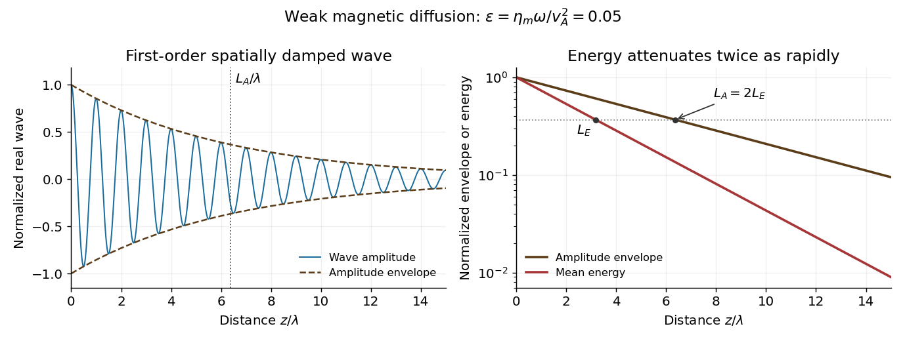
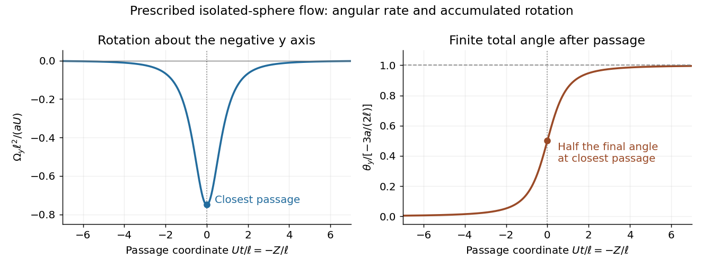

# 2023

↑ **Parent:** [Past exam of the advanced fluid dynamics course of the University of Oxford](../past-exam-of-the-advanced-fluid-dynamics-course-of-the-university-of-oxford.md)

Source PDF: [https://mmathphys.web.ox.ac.uk/sitefiles/adavanced-fluid-dynamics.pdf](https://mmathphys.web.ox.ac.uk/sitefiles/adavanced-fluid-dynamics.pdf)

Solutions to both questions and all eight parts. The diffusion coefficient and the amplitude-versus-energy damping convention are stated explicitly; the final rotation calculation uses the supplied isolated-sphere incident flow.

**Table of contents**

- [1](#1)
  - [a](#1/a)
    - [Solution](#1/a/solution)
  - [b](#1/b)
    - [Solution](#1/b/solution)
  - [c](#1/c)
    - [Solution](#1/c/solution)
  - [d](#1/d)
    - [Solution](#1/d/solution)
- [2](#2)
  - [a](#2/a)
    - [Solution](#2/a/solution)
  - [b](#2/b)
    - [Solution](#2/b/solution)
  - [c](#2/c)
    - [Solution](#2/c/solution)
  - [d](#2/d)
    - [Solution](#2/d/solution)

## 1

↑ **Parent:** [2023](2023.md)

<h3 id="1/a">a</h3>

↑ **Parent:** [1](#1)

<h4 id="1/a/solution">Solution</h4>

↑ **Parent:** [A](#1/a)

Take the inviscid limit of the [Navier-Stokes equation](../viscous-fluid-flow.md#navier-stokes-equation), neglect gravity, and use [ideal magnetohydrodynamics](../ideal-magnetohydrodynamics.md). The governing equations are

$$
\nabla\cdot\mathbf v=0,\qquad
\rho(\partial_t\mathbf v+\mathbf v\cdot\nabla\mathbf v)=-\nabla P+\frac{(\nabla\times\mathbf B)\times\mathbf B}{\mu_0},\qquad
\partial_t\mathbf B=\nabla\times(\mathbf v\times\mathbf B),\quad\nabla\cdot\mathbf B=0.
$$

The [continuity equation](../mathematical-physics.md#continuity-equation) also gives $D_t\rho=0$. Write the first-order magnetic perturbation as $\mathbf b=\mathbf B'$ and linearize about the uniform stationary background:

$$
\rho_0\partial_t\mathbf v=-\nabla\left(P'+\frac{B_0b_z}{\mu_0}\right)+\frac{B_0}{\mu_0}\partial_z\mathbf b,
\qquad\partial_t\mathbf b=B_0\partial_z\mathbf v,
\qquad\nabla\cdot\mathbf v=\nabla\cdot\mathbf b=0.
$$

For a nonzero-[wavenumber](../wave-equation.md#wavenumber) [plane wave](../wave-function.md#plane-wave) proportional to $e^{i(kz-\omega t)}$, the two divergence constraints imply $v_z=b_z=0$. The longitudinal momentum equation then gives $P'=0$ for that mode, and $\partial_t\rho'=0$ gives $\rho'=0$ for nonzero $\omega$. Thus the propagating [Alfvén wave](../ideal-magnetohydrodynamics.md#alfven-wave) is transverse. Its two independent transverse directions have the same [dispersion relation](../dispersion-relation.md).

The [Linear Alfvén wave equations](../ideal-magnetohydrodynamics.md#linear-alfven-wave-equations) reduce to

$$
-i\omega\rho_0\mathbf v=\frac{ikB_0}{\mu_0}\mathbf b,\qquad-i\omega\mathbf b=ikB_0\mathbf v.
$$

Eliminating either [amplitude](../wave.md#wave-amplitude) gives

$$
\boxed{\omega^2=k^2v_A^2,\qquad v_A=\frac{B_0}{\sqrt{\mu_0\rho_0}},\qquad\mathbf b=-\frac{kB_0}{\omega}\mathbf v.}
$$

For $B_0>0$, the branch traveling along $+z$ has $\omega=kv_A$ and $\mathbf b=-\sqrt{\mu_0\rho_0}\mathbf v$. The opposite branch reverses that [amplitude](../wave.md#wave-amplitude) sign. Finite [viscosity](../dynamic-viscosity.md) would additionally damp the motion; it is neglected in obtaining the real ideal [dispersion relation](../dispersion-relation.md).

<h3 id="1/b">b</h3>

↑ **Parent:** [1](#1)

<h4 id="1/b/solution">Solution</h4>

↑ **Parent:** [B](#1/b)

Subtract the constant equilibrium [magnetic energy](../electromagnetic-wave.md#magnetic-energy) density. Since $\mathbf B_0\cdot\mathbf b=0$, the perturbation densities are

$$
\mathcal E_K=\frac12\rho_0|\mathbf v|^2,\qquad
\mathcal E_B=\frac{|\mathbf b|^2}{2\mu_0}.
$$

The traveling-wave [amplitude](../wave.md#wave-amplitude) relation from part [a](#1/a) gives

$$
\boxed{\mathcal E_B=\mathcal E_K,\qquad\mathcal E=\mathcal E_K+\mathcal E_B=\rho_0|\mathbf v|^2=\frac{|\mathbf b|^2}{\mu_0}.}
$$

This is pointwise [Alfvén wave energy transport](../ideal-magnetohydrodynamics.md#alfven-wave-energy-transport) for one traveling wave, not a claim that every superposition or [standing wave](../mathematical-physics.md#standing-wave) has pointwise equipartition.

For the real fields written as $\mathbf v=\operatorname{Re}(\widehat{\mathbf v}e^{i(kz-\omega t)})$ and similarly for $\mathbf b$, the period averages are

$$
\langle\mathcal E_K\rangle=\frac{\rho_0}{4}|\widehat{\mathbf v}|^2,\qquad
\langle\mathcal E_B\rangle=\frac1{4\mu_0}|\widehat{\mathbf b}|^2,\qquad
\boxed{\langle\mathcal E\rangle=\frac{\rho_0}{2}|\widehat{\mathbf v}|^2.}
$$

The factors one half distinguish a sinusoid's peak [amplitude](../wave.md#wave-amplitude) from its mean squared value; the same complex-vector convention also covers circular [polarization of waves](../wave.md#polarization-waves).

<h3 id="1/c">c</h3>

↑ **Parent:** [1](#1)

<h4 id="1/c/solution">Solution</h4>

↑ **Parent:** [C](#1/c)

In [ideal magnetohydrodynamics](../ideal-magnetohydrodynamics.md), the first-order [electric field](../electric-field.md) is $\mathbf E_1=-\mathbf v\times B_0\mathbf e_z$. Retaining its product with both the background and first-order [magnetic field](../magnetic-field.md) gives the [Poynting vector](../electromagnetic-wave.md#poynting-vector)

$$
\mathbf S=\frac1{\mu_0}\mathbf E_1\times(B_0\mathbf e_z+\mathbf b)
=\frac{B_0^2}{\mu_0}\mathbf v-\frac{B_0}{\mu_0}(\mathbf v\cdot\mathbf b)\mathbf e_z.
$$

The first term is transverse and oscillatory, with zero period average. The second is quadratic and transports wave [energy](../energy.md). A potential quadratic ideal electric-field term $-\mathbf v\times\mathbf b$ vanishes here because the real traveling-wave fields are parallel or antiparallel.

For the $+z$ branch, $\mathbf b=-\sqrt{\mu_0\rho_0}\mathbf v$, so

$$
\boxed{\langle\mathbf S\rangle=\rho_0v_A\langle|\mathbf v|^2\rangle\mathbf e_z=v_A\langle\mathcal E\rangle\mathbf e_z.}
$$

For the opposite branch, its sign reverses. The averaged [Poynting flux](../electromagnetic-wave.md#poynting-flux) is the total wave [energy density](../statistical-physics.md#energy-density), including equal kinetic and magnetic shares, multiplied by the [group velocity](../dispersion-relation.md#group-velocity). This agrees with [Alfvén wave energy transport](../ideal-magnetohydrodynamics.md#alfven-wave-energy-transport). Although the flux in this expression is electromagnetic, it supplies the transport of both components of the coupled fluid-field wave.

<h3 id="1/d">d</h3>

↑ **Parent:** [1](#1)

<h4 id="1/d/solution">Solution</h4>

↑ **Parent:** [D](#1/d)

In this question, the coefficient multiplying $\nabla^2\mathbf B$ is the [magnetic diffusivity](../magnetohydrodynamics.md#magnetic-diffusivity). Denote it $\eta_m$; it is the paper's $\eta$, with dimensions of length squared per time. If $\eta_{\rm Ohm}$ denotes [electrical resistivity](../electric-charge.md#electrical-resistivity), then $\eta_m=\eta_{\rm Ohm}/\mu_0$. The two conventions must not be interchanged.

For an imposed real positive $\omega$, retain the momentum equation and use

$$
-i\omega\rho_0\mathbf v=\frac{ikB_0}{\mu_0}\mathbf b,\qquad
(-i\omega+\eta_mk^2)\mathbf b=ikB_0\mathbf v.
$$

Elimination gives the exact [Resistive damping of an Alfvén wave](../ideal-magnetohydrodynamics.md#resistive-damping-of-an-alfven-wave) relation

$$
\boxed{\omega^2+i\eta_m\omega k^2-v_A^2k^2=0,\qquad
k^2=\frac{\omega^2}{v_A^2-i\eta_m\omega}.}
$$

Here $k$ is complex because the driving [frequency](../wave.md#frequency) is real. Introduce the dimensionless diffusion parameter $\epsilon=\eta_m\omega/v_A^2\ll1$. For propagation and attenuation along $+z$, choose the square-root branch with $\operatorname{Re}k,\operatorname{Im}k>0$. The [spatial damping of a driven Alfvén wave](../ideal-magnetohydrodynamics.md#spatial-damping-of-a-driven-alfven-wave) is

$$
\boxed{k=\frac\omega{v_A}(1-i\epsilon)^{-1/2}=\frac\omega{v_A}\left(1+\frac{i\epsilon}{2}+O(\epsilon^2)\right).}
$$

With the convention $e^{i(kz-\omega t)}$, the [amplitude](../wave.md#wave-amplitude) decays as $e^{-\operatorname{Im}k\,z}$. Define its e-folding length $L_A=1/\operatorname{Im}k$ and the wavelength $\lambda=2\pi/\operatorname{Re}k$. Then

$$
\boxed{L_A\sim\frac{2v_A^3}{\eta_m\omega^2},\qquad\frac{L_A}{\lambda}\sim\frac1{\pi\epsilon}.}
$$

If damping length instead refers to wave [energy](../energy.md), the squared [amplitude](../wave.md#wave-amplitude) decays twice as fast: $L_E=L_A/2$ and $L_E/\lambda\sim1/(2\pi\epsilon)$. Stating the convention avoids a factor-of-two ambiguity. The temporal damping rate $\eta_mk^2/2$ at fixed real $k$ is a different specification from this imposed-frequency problem.

**[Figure 1](#1/d/image-weak-spatial-attenuation-of-a-driven-alfven-wave-and-its-amplitude-envelope). Weak spatial attenuation of a driven Alfvén wave and its amplitude envelope**.

## 2

↑ **Parent:** [2023](2023.md)

<h3 id="2/a">a</h3>

↑ **Parent:** [2](#2)

<h4 id="2/a/solution">Solution</h4>

↑ **Parent:** [A](#2/a)

Expand the given translating-sphere [Stokes flow](../stokes-flow.md) into its [Stokeslet](../stokes-flow.md#stokeslet) and [potential dipole](../fluid-mechanics.md#potential-dipole) parts:

$$
\mathbf u=\frac{3a}{4}\left(\frac{\mathbf U}{r}+\frac{(\mathbf U\cdot\mathbf x)\mathbf x}{r^3}\right)
+\frac{a^3}{4}\left(\frac{\mathbf U}{r^3}-\frac{3(\mathbf U\cdot\mathbf x)\mathbf x}{r^5}\right).
$$

The second parenthesis is $\nabla[(\mathbf U\cdot\mathbf x)/r^3]$ and has zero curl outside the sphere. For the first,

$$
\nabla\times\frac{\mathbf U}{r}=\frac{\mathbf U\times\mathbf x}{r^3},\qquad
\nabla\times\frac{(\mathbf U\cdot\mathbf x)\mathbf x}{r^3}=\frac{\mathbf U\times\mathbf x}{r^3}.
$$

Thus the [vorticity of translating-sphere Stokes flow](../stokes-flow.md#vorticity-of-translating-sphere-stokes-flow) is

$$
\boxed{\boldsymbol\omega=\nabla\times\mathbf u=\frac{3a}{2}\frac{\mathbf U\times\mathbf x}{r^3}.}
$$

The result is independent of the irrotational finite-size dipole correction. It holds in the exterior $r>a$; the singular solid harmonics are used only outside their source.

<h3 id="2/b">b</h3>

↑ **Parent:** [2](#2)

<h4 id="2/b/solution">Solution</h4>

↑ **Parent:** [B](#2/b)

Use the [force flux at infinity in Stokes flow](../stokes-flow.md#force-flux-at-infinity-in-stokes-flow). With an outward normal from a large sphere, the [force](../force.md) on the body is $\mathbf F=\int_{S_R}\sigma\mathbf n\,dS$. Let $C=3a/4$. The leading far-field [velocity](../classical-mechanics.md#velocity) and [pressure](../pressure.md) are

$$
u_i=C\left(\frac{U_i}{r}+\frac{(\mathbf U\cdot\mathbf x)x_i}{r^3}\right)+O(r^{-3}),\qquad
p=2\mu C\frac{\mathbf U\cdot\mathbf x}{r^3}.
$$

Their [rate-of-strain tensor](../viscous-fluid-flow.md#strain-rate-tensor) is

$$
e_{ij}=C(\mathbf U\cdot\mathbf x)\left(\frac{\delta_{ij}}{r^3}-\frac{3x_ix_j}{r^5}\right)+O(r^{-4}).
$$

In the [Newtonian fluid stress tensor](../viscous-fluid-flow.md#newtonian-fluid-stress-tensor) $\sigma_{ij}=-p\delta_{ij}+2\mu e_{ij}$, the isotropic pieces cancel. Consequently,

$$
\sigma\mathbf n=-\frac{6\mu C}{R^2}(\mathbf U\cdot\mathbf n)\mathbf n+O(R^{-4}).
$$

The [second spherical moment integral](../multivariable-calculus.md#second-spherical-moment-integral) $\int n_in_j\,d\Omega=(4\pi/3)\delta_{ij}$ follows from rotational symmetry and $\sum_i n_i^2=1$. Since $dS=R^2d\Omega$, taking $R\to\infty$ gives the [Stokes drag law](../stokes-flow.md#stokes-s-law):

$$
\boxed{\mathbf F=-6\mu C\frac{4\pi}{3}\mathbf U=-6\pi\mu a\mathbf U.}
$$

The omitted dipole contributes a surface integral of order $R^{-2}$ and vanishes in this limit. The sign refers to the fluid's drag on the moving sphere.

<h3 id="2/c">c</h3>

↑ **Parent:** [2](#2)

<h4 id="2/c/solution">Solution</h4>

↑ **Parent:** [C](#2/c)

At the [terminal velocity](../classical-mechanics.md#terminal-velocity), buoyancy-corrected weight balances the [Stokes drag law](../stokes-flow.md#stokes-s-law):

$$
\frac{4\pi a^3}{3}(\widetilde\rho-\rho)\mathbf g-6\pi\mu a\mathbf U=0.
$$

Hence

$$
\boxed{\mathbf U=\frac{2a^2(\widetilde\rho-\rho)}{9\mu}\mathbf g,\qquad
|\mathbf U|=\frac{2a^2|\widetilde\rho-\rho|}{9\mu}|\mathbf g|.}
$$

A denser sphere falls in the direction of $\mathbf g$; a lighter one rises. Equal densities give no sedimentation. The calculation assumes negligible fluid [Reynolds number](../dynamic-viscosity.md#reynolds-number), an unbounded fluid, and negligible transient body [acceleration](../classical-mechanics.md#acceleration) after terminal settling. The fluid [mass density](../fluid-mechanics.md#density) enters through [buoyancy](../fluid-mechanics.md#buoyancy) and through the small-[Reynolds number](../dynamic-viscosity.md#reynolds-number) condition.

<h3 id="2/d">d</h3>

↑ **Parent:** [2](#2)

<h4 id="2/d/solution">Solution</h4>

↑ **Parent:** [D](#2/d)

Take $z$ positive upward, let sphere A's centre be $Z(t)\mathbf e_z$, and write its downward [velocity](../classical-mechanics.md#velocity) as $-U\mathbf e_z$, with $\dot Z=-U$. At B's centre the displacement from A is $\mathbf r=\ell\mathbf e_x-Z\mathbf e_z$. The [vorticity of translating-sphere Stokes flow](../stokes-flow.md#vorticity-of-translating-sphere-stokes-flow) therefore gives

$$
\boldsymbol\omega_\infty=-\frac{3aU\ell}{2(\ell^2+Z^2)^{3/2}}\mathbf e_y.
$$

B is held in translation but has zero applied [torque](../momentum.md#torque). By [Faxén's rotational law](../stokes-flow.md#faxen-s-rotational-law), it rotates with half the incident [vorticity](../vorticity.md):

$$
\boldsymbol\Omega_B=-\frac{3aU\ell}{4(\ell^2+Z^2)^{3/2}}\mathbf e_y.
$$

Integrating the [rotation induced by a passing Stokes sphere](../stokes-flow.md#rotation-induced-by-a-passing-stokes-sphere) along the complete path cancels $U$:

$$
\Delta\boldsymbol\theta=\frac{3a\ell}{4}\mathbf e_y\int_{+\infty}^{-\infty}\frac{dZ}{(\ell^2+Z^2)^{3/2}}
=\boxed{-\frac{3a}{2\ell}\mathbf e_y.}
$$

Its magnitude is $3a/(2\ell)$ radians, with direction about the negative $y$ axis by the right-hand rule. All instantaneous rotations have this same axis, so the integrated [angular velocity](../rigid-body-dynamics.md#angular-velocity) gives the net angle without a noncommuting-rotation correction. The result is independent of B's radius in the prescribed incident-flow calculation.

**[Figure 2](#2/d/image-angular-velocity-and-cumulative-rotation-from-an-isolated-sphere-passing-a-torque-free-target). Angular velocity and cumulative rotation from an isolated sphere passing a torque-free target**.

The inequality $\ell>a+b$ ensures no overlap. It does not by itself make mutual [hydrodynamic interactions](../stokes-flow.md#hydrodynamic-interaction) negligible: the stated flow is the isolated-A solution, and a held finite B also disturbs A's flow. Thus the displayed angle is the result for that supplied incident flow, or the leading one-way approximation to separated bodies. A fully coupled two-sphere calculation uses the [method of reflections for Stokes flow](../stokes-flow.md#method-of-reflections-for-stokes-flow) or an exact pair resistance solution.

## ↑ Ancestors (9)

1. [Past exam of the advanced fluid dynamics course of the University of Oxford](../past-exam-of-the-advanced-fluid-dynamics-course-of-the-university-of-oxford.md)
2. [Advanced fluid dynamics course of the University of Oxford](../university-of-oxford.md#advanced-fluid-dynamics-course-of-the-university-of-oxford)
3. [Year 4 of the mathematical and theoretical physics course of the University of Oxford](../university-of-oxford.md#year-4-of-the-mathematical-and-theoretical-physics-course-of-the-university-of-oxford)
4. [Mathematical and theoretical physics course of the University of Oxford](../university-of-oxford.md#mathematical-and-theoretical-physics-course-of-the-university-of-oxford)
5. [Undergraduate course of the University of Oxford](../university-of-oxford.md#undergraduate-course-of-the-university-of-oxford)
6. [Course of the University of Oxford](../university-of-oxford.md#course-of-the-university-of-oxford)
7. [University of Oxford](../university-of-oxford.md)
8. [List of universities](../README.md#list-of-universities)
9. [Codex Wiki](../README.md)
