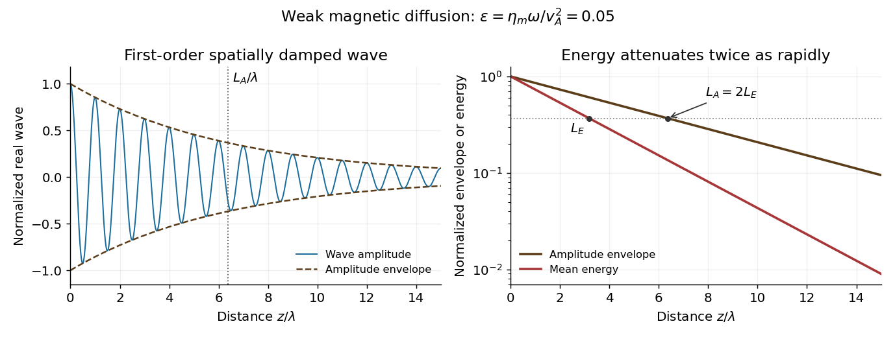

<h1 id="1/d/solution">Solution</h1>

↑ **Parent:** [D](../d.md)

In this question, the coefficient multiplying $\nabla^2\mathbf B$ is the [magnetic diffusivity](../../../../magnetic-diffusivity.md). Denote it $\eta_m$; it is the paper's $\eta$, with dimensions of length squared per time. If $\eta_{\rm Ohm}$ denotes [electrical resistivity](../../../../electrical-resistivity.md), then $\eta_m=\eta_{\rm Ohm}/\mu_0$. The two conventions must not be interchanged.

For an imposed real positive $\omega$, retain the momentum equation and use

$$
-i\omega\rho_0\mathbf v=\frac{ikB_0}{\mu_0}\mathbf b,\qquad
(-i\omega+\eta_mk^2)\mathbf b=ikB_0\mathbf v.
$$

Elimination gives the exact [Resistive damping of an Alfvén wave](../../../../resistive-damping-of-an-alfven-wave.md) relation

$$
\boxed{\omega^2+i\eta_m\omega k^2-v_A^2k^2=0,\qquad
k^2=\frac{\omega^2}{v_A^2-i\eta_m\omega}.}
$$

Here $k$ is complex because the driving [frequency](../../../../frequency.md) is real. Introduce the dimensionless diffusion parameter $\epsilon=\eta_m\omega/v_A^2\ll1$. For propagation and attenuation along $+z$, choose the square-root branch with $\operatorname{Re}k,\operatorname{Im}k>0$. The [spatial damping of a driven Alfvén wave](../../../../spatial-damping-of-a-driven-alfven-wave.md) is

$$
\boxed{k=\frac\omega{v_A}(1-i\epsilon)^{-1/2}=\frac\omega{v_A}\left(1+\frac{i\epsilon}{2}+O(\epsilon^2)\right).}
$$

With the convention $e^{i(kz-\omega t)}$, the [amplitude](../../../../wave-amplitude.md) decays as $e^{-\operatorname{Im}k\,z}$. Define its e-folding length $L_A=1/\operatorname{Im}k$ and the wavelength $\lambda=2\pi/\operatorname{Re}k$. Then

$$
\boxed{L_A\sim\frac{2v_A^3}{\eta_m\omega^2},\qquad\frac{L_A}{\lambda}\sim\frac1{\pi\epsilon}.}
$$

If damping length instead refers to wave [energy](../../../../energy-split.md), the squared [amplitude](../../../../wave-amplitude.md) decays twice as fast: $L_E=L_A/2$ and $L_E/\lambda\sim1/(2\pi\epsilon)$. Stating the convention avoids a factor-of-two ambiguity. The temporal damping rate $\eta_mk^2/2$ at fixed real $k$ is a different specification from this imposed-frequency problem.

**[Figure 1](#1/d/image-weak-spatial-attenuation-of-a-driven-alfven-wave-and-its-amplitude-envelope). Weak spatial attenuation of a driven Alfvén wave and its amplitude envelope**.

## ↑ Ancestors (12)

1. [D](../d.md)
2. [1](../../1.md)
3. [2023](../../../2023-split.md)
4. [Past exam of the advanced fluid dynamics course of the University of Oxford](../../../split.md)
5. [Advanced fluid dynamics course of the University of Oxford](../../../../advanced-fluid-dynamics-course-of-the-university-of-oxford.md)
6. [Year 4 of the mathematical and theoretical physics course of the University of Oxford](../../../../year-4-of-the-mathematical-and-theoretical-physics-course-of-the-university-of-oxford.md)
7. [Mathematical and theoretical physics course of the University of Oxford](../../../../mathematical-and-theoretical-physics-course-of-the-university-of-oxford.md)
8. [Undergraduate course of the University of Oxford](../../../../undergraduate-course-of-the-university-of-oxford.md)
9. [Course of the University of Oxford](../../../../course-of-the-university-of-oxford.md)
10. [University of Oxford](../../../../university-of-oxford-split.md)
11. [List of universities](../../../../list-of-universities.md)
12. [Codex Wiki](../../../../split.md)
