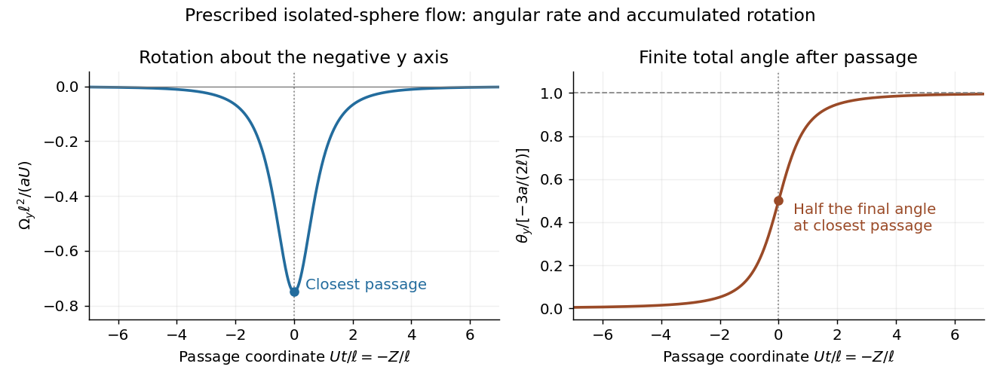

<h1 id="2/d/solution">Solution</h1>

↑ **Parent:** [D](../d.md)

Take $z$ positive upward, let sphere A's centre be $Z(t)\mathbf e_z$, and write its downward [velocity](../../../../velocity.md) as $-U\mathbf e_z$, with $\dot Z=-U$. At B's centre the displacement from A is $\mathbf r=\ell\mathbf e_x-Z\mathbf e_z$. The [vorticity of translating-sphere Stokes flow](../../../../vorticity-of-translating-sphere-stokes-flow.md) therefore gives

$$
\boldsymbol\omega_\infty=-\frac{3aU\ell}{2(\ell^2+Z^2)^{3/2}}\mathbf e_y.
$$

B is held in translation but has zero applied [torque](../../../../torque.md). By [Faxén's rotational law](../../../../faxen-s-rotational-law.md), it rotates with half the incident [vorticity](../../../../vorticity-split.md):

$$
\boldsymbol\Omega_B=-\frac{3aU\ell}{4(\ell^2+Z^2)^{3/2}}\mathbf e_y.
$$

Integrating the [rotation induced by a passing Stokes sphere](../../../../rotation-induced-by-a-passing-stokes-sphere.md) along the complete path cancels $U$:

$$
\Delta\boldsymbol\theta=\frac{3a\ell}{4}\mathbf e_y\int_{+\infty}^{-\infty}\frac{dZ}{(\ell^2+Z^2)^{3/2}}
=\boxed{-\frac{3a}{2\ell}\mathbf e_y.}
$$

Its magnitude is $3a/(2\ell)$ radians, with direction about the negative $y$ axis by the right-hand rule. All instantaneous rotations have this same axis, so the integrated [angular velocity](../../../../angular-velocity.md) gives the net angle without a noncommuting-rotation correction. The result is independent of B's radius in the prescribed incident-flow calculation.

**[Figure 2](#2/d/image-angular-velocity-and-cumulative-rotation-from-an-isolated-sphere-passing-a-torque-free-target). Angular velocity and cumulative rotation from an isolated sphere passing a torque-free target**.

The inequality $\ell>a+b$ ensures no overlap. It does not by itself make mutual [hydrodynamic interactions](../../../../hydrodynamic-interaction.md) negligible: the stated flow is the isolated-A solution, and a held finite B also disturbs A's flow. Thus the displayed angle is the result for that supplied incident flow, or the leading one-way approximation to separated bodies. A fully coupled two-sphere calculation uses the [method of reflections for Stokes flow](../../../../method-of-reflections-for-stokes-flow.md) or an exact pair resistance solution.

## ↑ Ancestors (12)

1. [D](../d.md)
2. [2](../../2.md)
3. [2023](../../../2023-split.md)
4. [Past exam of the advanced fluid dynamics course of the University of Oxford](../../../split.md)
5. [Advanced fluid dynamics course of the University of Oxford](../../../../advanced-fluid-dynamics-course-of-the-university-of-oxford.md)
6. [Year 4 of the mathematical and theoretical physics course of the University of Oxford](../../../../year-4-of-the-mathematical-and-theoretical-physics-course-of-the-university-of-oxford.md)
7. [Mathematical and theoretical physics course of the University of Oxford](../../../../mathematical-and-theoretical-physics-course-of-the-university-of-oxford.md)
8. [Undergraduate course of the University of Oxford](../../../../undergraduate-course-of-the-university-of-oxford.md)
9. [Course of the University of Oxford](../../../../course-of-the-university-of-oxford.md)
10. [University of Oxford](../../../../university-of-oxford-split.md)
11. [List of universities](../../../../list-of-universities.md)
12. [Codex Wiki](../../../../split.md)
