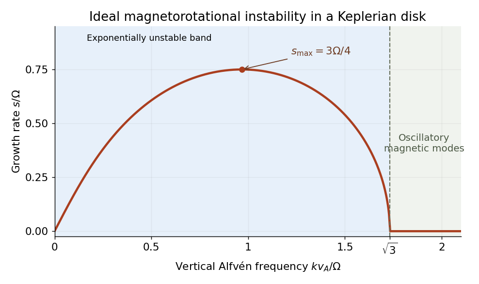

# 2024

↑ **Parent:** [Past exam of the advanced fluid dynamics course of the University of Oxford](../past-exam-of-the-advanced-fluid-dynamics-course-of-the-university-of-oxford.md)

Source PDF: [https://mmathphys.physics.ox.ac.uk/sites/g/files/vzsiac2991/files/mmathphys/documents/media/advanced_fluid_dynamics_2024.pdf](https://mmathphys.physics.ox.ac.uk/sites/g/files/vzsiac2991/files/mmathphys/documents/media/advanced_fluid_dynamics_2024.pdf)

Solutions to both questions and all nine parts. Part 2(d) contains a false identity in the source; its counterexample and the consistent free-energy balance are supplied.

**Table of contents**

- [1](#1)
  - [a](#1/a)
    - [Solution](#1/a/solution)
  - [b](#1/b)
    - [Solution](#1/b/solution)
  - [c](#1/c)
    - [Solution](#1/c/solution)
  - [d](#1/d)
    - [Solution](#1/d/solution)
  - [e](#1/e)
    - [Solution](#1/e/solution)
- [2](#2)
  - [a](#2/a)
    - [Solution](#2/a/solution)
  - [b](#2/b)
    - [Solution](#2/b/solution)
  - [c](#2/c)
    - [Solution](#2/c/solution)
  - [d](#2/d)
    - [Solution](#2/d/solution)

## 1

↑ **Parent:** [2024](2024.md)

<h3 id="1/a">a</h3>

↑ **Parent:** [1](#1)

<h4 id="1/a/solution">Solution</h4>

↑ **Parent:** [A](#1/a)

Start in an inertial frame with the inviscid [magnetohydrodynamic momentum equation](../magnetohydrodynamics.md#magnetohydrodynamic-momentum-equation),

$$
\rho D_t\mathbf v=-\nabla P+\mathbf J\times\mathbf B-\rho\nabla\Phi.
$$

Here $\rho$ is [mass density](../fluid-mechanics.md#density), $P$ is the isotropic fluid [pressure](../pressure.md), $\mathbf v$ is inertial-frame [velocity](../classical-mechanics.md#velocity), $\mathbf J$ is [electric current density](../electric-charge.md#current-density), $\mathbf B$ is the [magnetic field](../magnetic-field.md), and $\Phi$ is [gravitational potential](../newton-s-law-of-universal-gravitation.md#newtonian-potential-of-a-point-mass) per unit [mass](../classical-mechanics.md#mass). In the low-frequency approximation to [Ampère's law](../maxwell-equations.md#ampere-s-circuital-law), $\mathbf J=\nabla\times\mathbf B/\mu_0$. The [vector calculus identity](../multivariable-calculus.md#vector-calculus-identity)

$$
(\nabla\times\mathbf B)\times\mathbf B=(\mathbf B\cdot\nabla)\mathbf B-\nabla(B^2/2)
$$

separates the [Lorentz force density](../relativistic-electromagnetism.md#lorentz-force-density) into [magnetic tension](../magnetohydrodynamics.md#magnetic-tension) and a [magnetic pressure](../magnetohydrodynamics.md#magnetic-pressure) gradient. Transform the material [acceleration](../classical-mechanics.md#acceleration) to a rigid frame rotating with constant [angular velocity](../rigid-body-dynamics.md#angular-velocity) $\boldsymbol\Omega_0$, using the stated frame transformation. The [rotating-frame magnetohydrodynamic momentum equation](../magnetohydrodynamics.md#rotating-frame-magnetohydrodynamic-momentum-equation) is

$$
\boxed{\rho D_t\mathbf u=-\nabla\left(P+\frac{B^2}{2\mu_0}\right)+\frac{(\mathbf B\cdot\nabla)\mathbf B}{\mu_0}-\rho\nabla\Phi-2\rho\boldsymbol\Omega_0\times\mathbf u-\rho\boldsymbol\Omega_0\times(\boldsymbol\Omega_0\times\mathbf r).}
$$

The final terms are the [Coriolis force](../mathematical-physics.md#coriolis-force) and [centrifugal force](../mathematical-physics.md#centrifugal-force) densities; $\mathbf u$ is the [velocity](../classical-mechanics.md#velocity) relative to the rotating frame, and $D_t=\partial_t+\mathbf u\cdot\nabla$ uses that frame.

This requires a smooth conducting-fluid continuum with nonrelativistic motion, a constant [magnetic permeability](../maxwell-equations.md#permeability-electromagnetism) $\mu_0$, the [solenoidal magnetic-field constraint](../magnetic-field.md#solenoidal-magnetic-field-constraint), a negligible [displacement current](../maxwell-equations.md#displacement-current) and negligible net electric-charge force. Viscous forces and anisotropic fluid stresses are omitted. A time-dependent frame would add an [Euler force](../mathematical-physics.md#euler-force). [Incompressible flow](../fluid-mechanics.md#incompressible-flow) is not needed for this force equation. Finite [electrical resistivity](../electric-charge.md#electrical-resistivity) does not change its displayed instantaneous magnetic force; the later frozen-field calculation additionally uses [ideal magnetohydrodynamics](../ideal-magnetohydrodynamics.md). A differentially rotating fluid does not define a single rigid frame with spatially varying $\boldsymbol\Omega_0$: choose a fixed local reference rate and retain the fluid's shear in $\mathbf u$.

<h3 id="1/b">b</h3>

↑ **Parent:** [1](#1)

<h4 id="1/b/solution">Solution</h4>

↑ **Parent:** [B](#1/b)

In an inertial frame, a [circular orbit](../classical-mechanics.md#circular-orbit) at radius $R$ has radial [acceleration](../classical-mechanics.md#acceleration) $-R\Omega(R)^2\mathbf e_R$. Neglecting fluid and magnetic forces gives

$$
-\rho R\Omega(R)^2=-\rho\frac{d\Phi}{dR},\qquad\boxed{\frac{d\Phi}{dR}=R\Omega(R)^2.}
$$

In a local rotating frame with $\Omega_0=\Omega(R_0)$, the fluid is instantaneously at rest at the reference radius $R_0$. The radial [centrifugal force](../mathematical-physics.md#centrifugal-force) $+\rho R_0\Omega_0^2$ then balances the inward [gravitational force](../physics.md#gravitational-force). Away from $R_0$, the fluid's nonzero rotating-frame [velocity](../classical-mechanics.md#velocity) must also be retained; the entire differentially rotating disk is not at rest in that one frame.

<h3 id="1/c">c</h3>

↑ **Parent:** [1](#1)

<h4 id="1/c/solution">Solution</h4>

↑ **Parent:** [C](#1/c)

Take outward radial [force](../force.md) as positive and keep the displaced element's angular rate fixed at $\Omega_0=\Omega(R_0)$. Its imbalance is

$$
\Delta f_R=\rho\left[(R_0+\xi_R)\Omega_0^2-\Phi'(R_0+\xi_R)\right].
$$

Use the equilibrium relation from part [b](#1/b), $\Phi'(R)=R\Omega(R)^2$, and a first-order [Taylor expansion](../calculus.md#taylor-expansion):

$$
\boxed{\Delta f_R=-\rho R_0\left.\frac{d\Omega^2}{dR}\right|_{R_0}\xi_R+O(\xi_R^2),\qquad
|\Delta f_R|\simeq\rho\left|R_0\frac{d\Omega^2}{dR}\xi_R\right|.}
$$

The absolute values are needed for a magnitude. As printed, the proposed magnitude has a signed right side; it would be negative for outward displacement in a [Keplerian disk](../astrophysical-disk.md#keplerian-disk). For decreasing $\Omega^2$, the signed imbalance above points outward and therefore amplifies that fixed-angular-rate displacement. This calculation fixes the angular rate, rather than the [specific angular momentum](../celestial-mechanics.md#specific-angular-momentum); the latter is the conserved quantity for an uncoupled inviscid radial displacement and leads to the [Rayleigh centrifugal stability criterion](../astrophysical-disk.md#rayleigh-centrifugal-stability-criterion).

<h3 id="1/d">d</h3>

↑ **Parent:** [1](#1)

<h4 id="1/d/solution">Solution</h4>

↑ **Parent:** [D](#1/d)

Linearized [magnetic flux freezing](../ideal-magnetohydrodynamics.md#magnetic-flux-freezing) gives the Eulerian [magnetic field](../magnetic-field.md) perturbation

$$
\delta\mathbf B=\nabla\times(\boldsymbol\xi\times\mathbf B_0)=(\mathbf B_0\cdot\nabla)\boldsymbol\xi-\mathbf B_0\nabla\cdot\boldsymbol\xi.
$$

The background is uniform, and [incompressibility](../fluid-mechanics.md#incompressible-flow) gives $\nabla\cdot\boldsymbol\xi=0$. For a horizontal displacement proportional to $e^{ikz}$, $\delta\mathbf B=ikB_0\boldsymbol\xi$ and $\delta B_z=0$. Thus the first-order [magnetic pressure](../magnetohydrodynamics.md#magnetic-pressure) perturbation vanishes, and the [magnetic-tension response to an incompressible displacement](../magnetohydrodynamics.md#magnetic-tension-response-to-an-incompressible-displacement) is

$$
\boxed{\delta\mathbf f=\frac{B_0}{\mu_0}\partial_z\delta\mathbf B=-\frac{k^2B_0^2}{\mu_0}\boldsymbol\xi.}
$$

Bending a field line produces a restoring [force](../force.md) proportional to displacement, like a spring obeying [Hooke's law](../elasticity-physics.md#hooke-s-law). Per unit [mass](../classical-mechanics.md#mass), its squared spring [frequency](../wave.md#frequency) is $k^2v_A^2$, where $v_A=B_0/\sqrt{\mu_0\rho}$ is the [Alfvén speed](../ideal-magnetohydrodynamics.md#alfven-speed). The equilibrium can be independent of $z$ while the perturbation varies with $z$; neglect of background vertical structure does not set this perturbation's [wavenumber](../wave-equation.md#wavenumber) to zero.

<h3 id="1/e">e</h3>

↑ **Parent:** [1](#1)

<h4 id="1/e/solution">Solution</h4>

↑ **Parent:** [E](#1/e)

Work locally at $R_0$ with $\Omega=\Omega(R_0)$, and define

$$
D=\left.\frac{d\Omega^2}{d\ln R}\right|_{R_0},\qquad a=k^2v_A^2,\qquad v_A=\frac{B_0}{\sqrt{\mu_0\rho}},\qquad\kappa^2=4\Omega^2+D.
$$

Here $\kappa$ is the [radial epicyclic frequency](../astrophysical-disk.md#radial-epicyclic-frequency). Combining the radial imbalance, the [Coriolis force](../mathematical-physics.md#coriolis-force) and the magnetic spring gives the [spring model of magnetorotational instability](../astrophysical-disk.md#spring-model-of-magnetorotational-instability):

$$
\ddot\xi_R-2\Omega\dot\xi_\phi=-(D+a)\xi_R,\qquad
\ddot\xi_\phi+2\Omega\dot\xi_R=-a\xi_\phi.
$$

For a [normal mode](../wave-equation.md#normal-mode) proportional to $e^{-i\omega t}$, the coefficient [matrix](../vector-space.md#matrix) is

$$
\begin{pmatrix}a+D-\omega^2&2i\Omega\omega\\-2i\Omega\omega&a-\omega^2\end{pmatrix}.
$$

Setting its [determinant](../multilinear-algebra.md#determinant) to zero yields the [ideal magnetorotational dispersion relation](../astrophysical-disk.md#ideal-magnetorotational-dispersion-relation),

$$
\boxed{\omega^4-\omega^2(2a+4\Omega^2+D)+a(a+D)=0.}
$$

Its two values of $\omega^2$ are

$$
\omega_\pm^2=a+\frac{\kappa^2}{2}\pm\frac12\sqrt{(\kappa^2)^2+16a\Omega^2},
$$

so they are real. For $a>0$, their product is negative exactly when $a+D<0$, giving an exponentially growing [normal mode](../wave-equation.md#normal-mode). Conversely, $a+D>0$ also makes their sum positive and therefore gives two positive squared [frequencies](../wave.md#frequency). **A fixed nonzero magnetic mode is exponentially unstable for $k^2v_A^2+D<0$, oscillatory for $k^2v_A^2+D>0$, and marginal at equality.** Stability against every allowed nonzero [wavenumber](../wave-equation.md#wavenumber) in the unbounded ideal model requires $D\ge0$; finite-domain restrictions can remove the unstable band.

For $\Phi=-GM/R$, the equilibrium relation gives $\Omega^2=GM/R^3$, so $D=-3\Omega^2$ and $\kappa^2=\Omega^2$. Hence the [Keplerian disk](../astrophysical-disk.md#keplerian-disk) has the [magnetorotational instability](../astrophysical-disk.md#magnetorotational-instability) band

$$
\boxed{0<k^2v_A^2<3\Omega^2.}
$$

Without the [magnetic field](../magnetic-field.md), the polynomial becomes $\omega^2(\omega^2-\kappa^2)=0$. The [Rayleigh centrifugal stability criterion](../astrophysical-disk.md#rayleigh-centrifugal-stability-criterion) instead requires $\kappa^2>0$, equivalently $d(R^4\Omega^2)/dR>0$. A [Keplerian disk](../astrophysical-disk.md#keplerian-disk) satisfies that hydrodynamic criterion. Magnetic coupling therefore destabilizes a disk that has a restoring hydrodynamic [epicyclic oscillation](../astrophysical-disk.md#epicyclic-motion); the field couples angular-momentum exchange between elements, rather than acting only as an isolated restoring spring.

**[Figure 1](#1/e/image-unstable-band-and-fastest-growth-of-the-ideal-vertical-field-keplerian-mode). Unstable band and fastest growth of the ideal vertical-field Keplerian mode**.

The plotted maximum is the [maximum growth rate of ideal magnetorotational instability](../astrophysical-disk.md#maximum-growth-rate-of-ideal-magnetorotational-instability), $3\Omega/4$ at $k^2v_A^2=15\Omega^2/16$.

## 2

↑ **Parent:** [2024](2024.md)

<h3 id="2/a">a</h3>

↑ **Parent:** [2](#2)

<h4 id="2/a/solution">Solution</h4>

↑ **Parent:** [A](#2/a)

Using the given linear momentum balance, multiply by the [velocity](../classical-mechanics.md#velocity) and integrate over the fixed volume:

$$
\frac{d}{dt}\int_V\frac12\rho u_iu_i\,dV=\int_Vu_i\partial_j\sigma_{ij}\,dV
=\int_{\partial V}u_i\sigma_{ij}n_j\,dS-\int_V\sigma_{ij}\partial_j u_i\,dV.
$$

This is [integration by parts](../calculus.md#integration-by-parts) component by component, or the [divergence theorem](../multivariable-calculus.md#divergence-theorem). The first term is boundary [stress](../continuum-mechanics.md#stress) power. With component-first [velocity gradient](../continuum-mechanics.md#velocity-gradient) $K_{ij}=\partial_j u_i$, the second is the [double contraction](../multilinear-algebra.md#double-contraction) $\Phi=\sigma:K$.

For a [Newtonian fluid](../viscous-fluid-flow.md#newtonian-fluid), $\sigma=-pI+2\mu e$, where $e=(K+K^T)/2$ is the [rate-of-strain tensor](../viscous-fluid-flow.md#strain-rate-tensor) and $\mu\ge0$ is [dynamic viscosity](../dynamic-viscosity.md). [Incompressibility](../fluid-mechanics.md#incompressible-flow) removes the pressure contribution, and the [symmetric tensor](../multilinear-algebra.md#symmetric-tensor) $e$ is orthogonal to the antisymmetric part of $K$. Therefore

$$
\boxed{\Phi=2\mu e:e=2\mu\sum_{ij}e_{ij}^2\ge0.}
$$

The displayed energy identity follows for the stated linear balance. A full advective momentum equation in a fixed control volume would also contribute an advective [kinetic energy](../energy.md#kinetic-energy) flux. The nonnegativity statement here is for a purely Newtonian viscous stress; a [viscoelastic](../rheology.md#viscoelasticity) stress can exchange stored [free energy](../thermodynamic-potential.md#thermodynamic-free-energy) with the flow.

<h3 id="2/b">b</h3>

↑ **Parent:** [2](#2)

<h4 id="2/b/solution">Solution</h4>

↑ **Parent:** [B](#2/b)

Let $K_{ij}=\partial_j u_i$, $C_{ij}=\langle R_iR_j\rangle$, $\alpha=2H/\zeta$ and $D_R=2k_BT/\zeta$. The configuration equation of the [Hookean dumbbell model](../polymer.md#hookean-dumbbell-model) becomes

$$
\partial_t\psi=-\nabla_{\mathbf R}\cdot[(K\mathbf R-\alpha\mathbf R)\psi]+D_R\nabla_{\mathbf R}^2\psi.
$$

Here the paper's $k$ denotes the [Boltzmann constant](../thermodynamics.md#boltzmann-constant) $k_B$. Integrating the [second moment](../expected-value.md#second-moment) equation against $R_iR_j$ and discarding boundary terms at infinite separation gives

$$
\dot C_{ij}=K_{i\ell}C_{\ell j}+K_{j\ell}C_{i\ell}-2\alpha C_{ij}+2D_R\delta_{ij}.
$$

For example the spring drift differentiates each factor $R_i,R_j$, while the [Laplacian](../multivariable-calculus.md#laplacian) gives $\nabla_{\mathbf R}^2(R_iR_j)=2\delta_{ij}$. The [Hookean dumbbell conformation equation](../polymer.md#hookean-dumbbell-conformation-equation) is

$$
\boxed{\dot C-KC-CK^T=\frac{4k_BT}{\zeta}I-\frac{4H}{\zeta}C.}
$$

In the row-vector convention of $\mathbf R\cdot\nabla\mathbf u$, the displayed gradient tensor is $K^T$, giving exactly the transposes in the requested equation. The dimensionless [conformation tensor](../rheology.md#conformation-tensor) $A=HC/(k_BT)$ consequently has [upper-convected derivative](../rheology.md#upper-convected-derivative) $-(A-I)/\lambda$, with [polymer relaxation time](../polymer.md#polymer-relaxation-time) $\lambda=\zeta/(4H)$. This normalization matters: the unscaled $C$ has equilibrium value $(k_BT/H)I$, rather than $I$.

<h3 id="2/c">c</h3>

↑ **Parent:** [2](#2)

<h4 id="2/c/solution">Solution</h4>

↑ **Parent:** [C](#2/c)

Write the centre position as $\mathbf x$ and the bead positions as $\mathbf r_{1,2}=\mathbf x\mp\mathbf R/2$. In the [affine velocity field](../fluid-mechanics.md#affine-velocity-field), $\mathbf u(\mathbf r_{1,2})=\mathbf u(\mathbf x)\mp K\mathbf R/2$. The midpoint follows the flow, so its two slip [velocities](../classical-mechanics.md#velocity) are

$$
\dot{\mathbf r}_{1,2}-\mathbf u(\mathbf r_{1,2})=\mp\frac12(\dot{\mathbf R}-K\mathbf R).
$$

Each bead loses mechanical power $\zeta$ times its squared slip [speed](../classical-mechanics.md#speed). Adding the two powers proves the [drag dissipation of a bead-spring pair](../polymer.md#drag-dissipation-of-a-bead-spring-pair):

$$
\boxed{D_{\rm pair}=\zeta\left|\frac{\dot{\mathbf R}-K\mathbf R}{2}\right|^2+\zeta\left|\frac{\dot{\mathbf R}-K\mathbf R}{2}\right|^2=\frac\zeta2|\dot{\mathbf R}-K\mathbf R|^2.}
$$

The factor one half comes from two equal-and-opposite bead slips, not from assigning only one bead a drag force.

<h3 id="2/d">d</h3>

↑ **Parent:** [2](#2)

<h4 id="2/d/solution">Solution</h4>

↑ **Parent:** [D](#2/d)

**The claimed equality does not hold for the printed joint distribution.** The original PDF specifies a centered [Maxwell-Boltzmann distribution](../quantum-ideal-gas-statistics.md#maxwell-boltzmann-distribution) of $\mathbf v=\dot{\mathbf R}$ independent of $\mathbf R$, with

$$
\langle v_i\rangle=0,\qquad\langle v_iv_j\rangle=\frac{2k_BT}{m}\delta_{ij}.
$$

Since the double average includes number density $n$, evaluating the [Gaussian integrals](../integral.md#gaussian-integral) gives

$$
\boxed{\left\langle\!\left\langle\frac\zeta2|\mathbf v-K\mathbf R|^2\right\rangle\!\right\rangle
=\frac{3n\zeta k_BT}{m}+\frac{n\zeta}{2}\operatorname{tr}(KCK^T).}
$$

The cross term vanishes because the conditional mean of $\mathbf v$ is zero. In particular, set $K=0$ and take the equilibrium configuration [probability density](../wave-function.md#probability-density) $\psi_{\rm eq}\propto e^{-HR^2/(2k_BT)}$. The left side is $3n\zeta k_BT/m>0$, while $nHC:K=0$. This is a counterexample even at thermal equilibrium, so no rearrangement of the earlier [conformation tensor](../rheology.md#conformation-tensor) equation can prove the printed statement.

The discrepancy is [thermal bead drag and heat-bath power](../polymer.md#thermal-bead-drag-and-heat-bath-power): gross viscous loss of microscopic thermal motion is replenished by the thermal bath. It is not identical to mechanical polymer stress power. Moreover, $\dot{\mathbf R}$ in the earlier configuration continuity equation is a [probability current velocity](../probability-theory.md#probability-current-velocity), including a distribution-dependent osmotic drift; it cannot simultaneously be identified with an independently sampled centered Maxwellian velocity.

A consistent overdamped result is the [free-energy balance of a Hookean dumbbell](../polymer.md#free-energy-balance-of-a-hookean-dumbbell). Define $\mathbf q=H\mathbf R+k_BT\nabla_{\mathbf R}\log\psi$ and

$$
\mathcal F=nk_BT\int\psi\log\frac\psi{\psi_{\rm eq}}\,d\mathbf R,\qquad
\mathbf V=K\mathbf R-\frac2\zeta\mathbf q.
$$

Differentiate the [relative entropy](../f-divergence.md#kullback-leibler-divergence) and use the configuration [Fokker-Planck probability current](../probability-theory.md#fokker-planck-probability-current) $\psi\mathbf V$. After [integration by parts](../calculus.md#integration-by-parts),

$$
\dot{\mathcal F}=n\int\psi\,\mathbf q\cdot\mathbf V\,d\mathbf R
=nHC:K-\frac{2n}{\zeta}\int\psi|\mathbf q|^2\,d\mathbf R.
$$

The affine osmotic term is $nk_BT\int\nabla\psi\cdot K\mathbf R\,d\mathbf R=-nk_BT\operatorname{tr}K=0$. Hence

$$
\boxed{nHC:K=\dot{\mathcal F}+\mathcal D,\qquad\mathcal D=\frac{2n}{\zeta}\int\psi|\mathbf q|^2\,d\mathbf R\ge0.}
$$

The polymer [stress tensor](../continuum-mechanics.md#cauchy-stress-tensor) $\sigma_p=n(HC-k_BTI)$ has $\sigma_p:K=nHC:K$ in an [incompressible flow](../fluid-mechanics.md#incompressible-flow). It stores or releases [free energy](../thermodynamic-potential.md#thermodynamic-free-energy) as well as dissipating it, so the total stress-work term in part [a](#2/a) need not itself be a purely dissipative quantity for this [viscoelastic](../rheology.md#viscoelasticity) material. Stress power equals $\mathcal D$ only for stationary [free energy](../thermodynamic-potential.md#thermodynamic-free-energy), and $\mathcal D$ uses the probability-current slip. Neither condition turns the printed independent-Maxwellian average into that expression.

## ↑ Ancestors (9)

1. [Past exam of the advanced fluid dynamics course of the University of Oxford](../past-exam-of-the-advanced-fluid-dynamics-course-of-the-university-of-oxford.md)
2. [Advanced fluid dynamics course of the University of Oxford](../university-of-oxford.md#advanced-fluid-dynamics-course-of-the-university-of-oxford)
3. [Year 4 of the mathematical and theoretical physics course of the University of Oxford](../university-of-oxford.md#year-4-of-the-mathematical-and-theoretical-physics-course-of-the-university-of-oxford)
4. [Mathematical and theoretical physics course of the University of Oxford](../university-of-oxford.md#mathematical-and-theoretical-physics-course-of-the-university-of-oxford)
5. [Undergraduate course of the University of Oxford](../university-of-oxford.md#undergraduate-course-of-the-university-of-oxford)
6. [Course of the University of Oxford](../university-of-oxford.md#course-of-the-university-of-oxford)
7. [University of Oxford](../university-of-oxford.md)
8. [List of universities](../README.md#list-of-universities)
9. [Codex Wiki](../README.md)
