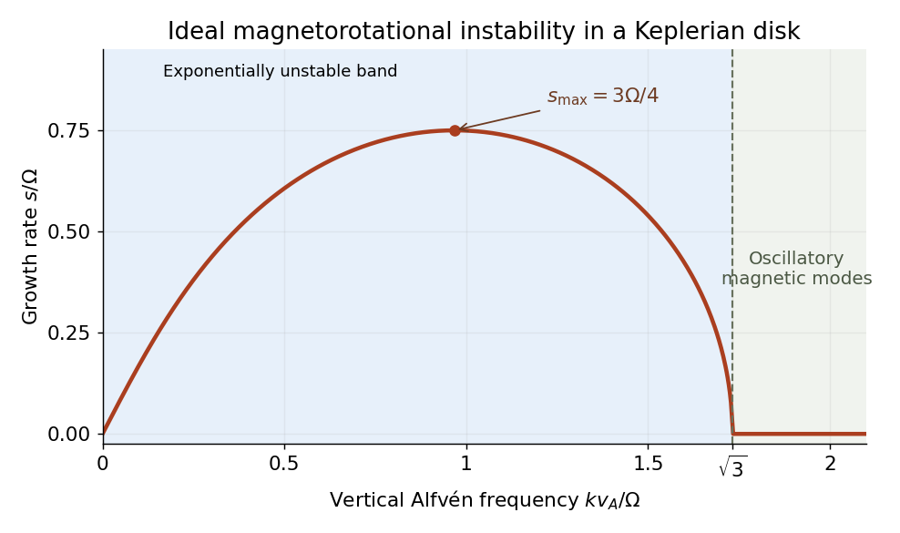

<h1 id="1/e/solution">Solution</h1>

↑ **Parent:** [E](../e.md)

Work locally at $R_0$ with $\Omega=\Omega(R_0)$, and define

$$
D=\left.\frac{d\Omega^2}{d\ln R}\right|_{R_0},\qquad a=k^2v_A^2,\qquad v_A=\frac{B_0}{\sqrt{\mu_0\rho}},\qquad\kappa^2=4\Omega^2+D.
$$

Here $\kappa$ is the [radial epicyclic frequency](../../../../radial-epicyclic-frequency.md). Combining the radial imbalance, the [Coriolis force](../../../../coriolis-force.md) and the magnetic spring gives the [spring model of magnetorotational instability](../../../../spring-model-of-magnetorotational-instability.md):

$$
\ddot\xi_R-2\Omega\dot\xi_\phi=-(D+a)\xi_R,\qquad
\ddot\xi_\phi+2\Omega\dot\xi_R=-a\xi_\phi.
$$

For a [normal mode](../../../../normal-mode.md) proportional to $e^{-i\omega t}$, the coefficient [matrix](../../../../matrix.md) is

$$
\begin{pmatrix}a+D-\omega^2&2i\Omega\omega\\-2i\Omega\omega&a-\omega^2\end{pmatrix}.
$$

Setting its [determinant](../../../../determinant.md) to zero yields the [ideal magnetorotational dispersion relation](../../../../ideal-magnetorotational-dispersion-relation.md),

$$
\boxed{\omega^4-\omega^2(2a+4\Omega^2+D)+a(a+D)=0.}
$$

Its two values of $\omega^2$ are

$$
\omega_\pm^2=a+\frac{\kappa^2}{2}\pm\frac12\sqrt{(\kappa^2)^2+16a\Omega^2},
$$

so they are real. For $a>0$, their product is negative exactly when $a+D<0$, giving an exponentially growing [normal mode](../../../../normal-mode.md). Conversely, $a+D>0$ also makes their sum positive and therefore gives two positive squared [frequencies](../../../../frequency.md). **A fixed nonzero magnetic mode is exponentially unstable for $k^2v_A^2+D<0$, oscillatory for $k^2v_A^2+D>0$, and marginal at equality.** Stability against every allowed nonzero [wavenumber](../../../../wavenumber.md) in the unbounded ideal model requires $D\ge0$; finite-domain restrictions can remove the unstable band.

For $\Phi=-GM/R$, the equilibrium relation gives $\Omega^2=GM/R^3$, so $D=-3\Omega^2$ and $\kappa^2=\Omega^2$. Hence the [Keplerian disk](../../../../keplerian-disk.md) has the [magnetorotational instability](../../../../magnetorotational-instability.md) band

$$
\boxed{0<k^2v_A^2<3\Omega^2.}
$$

Without the [magnetic field](../../../../magnetic-field-split.md), the polynomial becomes $\omega^2(\omega^2-\kappa^2)=0$. The [Rayleigh centrifugal stability criterion](../../../../rayleigh-centrifugal-stability-criterion.md) instead requires $\kappa^2>0$, equivalently $d(R^4\Omega^2)/dR>0$. A [Keplerian disk](../../../../keplerian-disk.md) satisfies that hydrodynamic criterion. Magnetic coupling therefore destabilizes a disk that has a restoring hydrodynamic [epicyclic oscillation](../../../../epicyclic-motion.md); the field couples angular-momentum exchange between elements, rather than acting only as an isolated restoring spring.

**[Figure 1](#1/e/image-unstable-band-and-fastest-growth-of-the-ideal-vertical-field-keplerian-mode). Unstable band and fastest growth of the ideal vertical-field Keplerian mode**.

The plotted maximum is the [maximum growth rate of ideal magnetorotational instability](../../../../maximum-growth-rate-of-ideal-magnetorotational-instability.md), $3\Omega/4$ at $k^2v_A^2=15\Omega^2/16$.

## ↑ Ancestors (12)

1. [E](../e.md)
2. [1](../../1.md)
3. [2024](../../../2024-split.md)
4. [Past exam of the advanced fluid dynamics course of the University of Oxford](../../../split.md)
5. [Advanced fluid dynamics course of the University of Oxford](../../../../advanced-fluid-dynamics-course-of-the-university-of-oxford.md)
6. [Year 4 of the mathematical and theoretical physics course of the University of Oxford](../../../../year-4-of-the-mathematical-and-theoretical-physics-course-of-the-university-of-oxford.md)
7. [Mathematical and theoretical physics course of the University of Oxford](../../../../mathematical-and-theoretical-physics-course-of-the-university-of-oxford.md)
8. [Undergraduate course of the University of Oxford](../../../../undergraduate-course-of-the-university-of-oxford.md)
9. [Course of the University of Oxford](../../../../course-of-the-university-of-oxford.md)
10. [University of Oxford](../../../../university-of-oxford-split.md)
11. [List of universities](../../../../list-of-universities.md)
12. [Codex Wiki](../../../../split.md)
