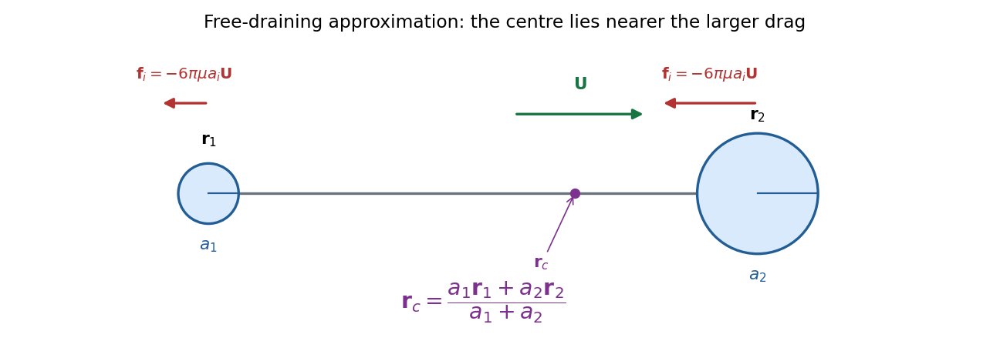

# 2025

↑ **Parent:** [Past exam of the advanced fluid dynamics course of the University of Oxford](../past-exam-of-the-advanced-fluid-dynamics-course-of-the-university-of-oxford.md)

Source PDF: [https://mmathphys.physics.ox.ac.uk/sites/g/files/vzsiac2991/files/mmathphys/documents/media/a15271h1.pdf](https://mmathphys.physics.ox.ac.uk/sites/g/files/vzsiac2991/files/mmathphys/documents/media/a15271h1.pdf)

Solutions to both questions and all nine parts. The two-sphere calculation uses the leading free-draining approximation, with negligible connector drag; the limitations of that approximation are made explicit.

**Table of contents**

- [1](#1)
  - [a](#1/a)
    - [Solution](#1/a/solution)
  - [b](#1/b)
    - [Solution](#1/b/solution)
  - [c](#1/c)
    - [Solution](#1/c/solution)
  - [d](#1/d)
    - [Solution](#1/d/solution)
- [2](#2)
  - [a](#2/a)
    - [Solution](#2/a/solution)
  - [b](#2/b)
    - [Solution](#2/b/solution)
  - [c](#2/c)
    - [Solution](#2/c/solution)
  - [d](#2/d)
    - [Solution](#2/d/solution)
  - [e](#2/e)
    - [Solution](#2/e/solution)

## 1

↑ **Parent:** [2025](2025.md)

<h3 id="1/a">a</h3>

↑ **Parent:** [1](#1)

<h4 id="1/a/solution">Solution</h4>

↑ **Parent:** [A](#1/a)

To first order in fluid [velocity](../classical-mechanics.md#velocity) divided by the [speed of light](../special-relativity.md#speed-of-light), the [Lorentz transformation of electromagnetic fields](../relativistic-electromagnetism.md#lorentz-transformation-of-electromagnetic-fields) gives $\mathbf E'=\mathbf E+\mathbf u\times\mathbf B$. Applying [Ohm's law](../electric-charge.md#ohm-s-law) in the local fluid frame gives $\mathbf E+\mathbf u\times\mathbf B=\eta\mathbf J$. Neglecting the [displacement current](../maxwell-equations.md#displacement-current) in [Ampère's law](../maxwell-equations.md#ampere-s-circuital-law), $\mathbf J=\nabla\times\mathbf B/\mu_0$. Substitution in [Faraday's law](../maxwell-equations.md#faraday-s-law-of-induction) gives

$$
\partial_t\mathbf B=\nabla\times(\mathbf u\times\mathbf B)-\frac\eta{\mu_0}\nabla\times(\nabla\times\mathbf B)
=\nabla\times(\mathbf u\times\mathbf B)+\eta_m\nabla^2\mathbf B,\qquad\eta_m=\frac\eta{\mu_0}.
$$

Here $\eta_m$ is the [magnetic diffusivity](../magnetohydrodynamics.md#magnetic-diffusivity); the paper's $\eta$ is [electrical resistivity](../electric-charge.md#electrical-resistivity), rather than [magnetic diffusivity](../magnetohydrodynamics.md#magnetic-diffusivity). Expanding the curl with the [solenoidal magnetic-field constraint](../magnetic-field.md#solenoidal-magnetic-field-constraint) gives the [resistive induction equation](../resistive-magnetohydrodynamics.md#resistive-induction-equation) in its compressible form:

$$
\boxed{\partial_t\mathbf B+(\mathbf u\cdot\nabla)\mathbf B=(\mathbf B\cdot\nabla)\mathbf u-\mathbf B\,\nabla\cdot\mathbf u+\frac\eta{\mu_0}\nabla^2\mathbf B.}
$$

The left side is the [material derivative](../continuum-mechanics.md#material-derivative) of the [magnetic field](../magnetic-field.md). The three right-hand terms respectively describe field-line stretching and reorientation, amplification or dilution by compression or expansion, and [magnetic diffusion](../magnetohydrodynamics.md#magnetic-diffusion). In particular, compression has $\nabla\cdot\mathbf u<0$ and amplifies a field component perpendicular to the compression.

The assumptions are nonrelativistic bulk motion, the low-frequency approximation permitting omission of the [displacement current](../maxwell-equations.md#displacement-current), a conducting-fluid continuum, isotropic local [Ohm's law](../electric-charge.md#ohm-s-law) with spatially constant scalar [electrical resistivity](../electric-charge.md#electrical-resistivity), constant [magnetic permeability](../maxwell-equations.md#permeability-electromagnetism) $\mu_0$, and $\nabla\cdot\mathbf B=0$. Hall, electron-pressure and other non-Ohmic corrections to the generalized [Ohm's law](../electric-charge.md#ohm-s-law) are excluded. [Incompressible flow](../fluid-mechanics.md#incompressible-flow) is not required: imposing it would remove the compression term.

<h3 id="1/b">b</h3>

↑ **Parent:** [1](#1)

<h4 id="1/b/solution">Solution</h4>

↑ **Parent:** [B](#1/b)

Let $E_B=\int_VB^2/(2\mu_0)\,dV$ be the total [magnetic energy](../electromagnetic-wave.md#magnetic-energy). Multiply the curl form of the [resistive induction equation](../resistive-magnetohydrodynamics.md#resistive-induction-equation) by $\mathbf B/\mu_0$ and integrate over the fixed volume. The identity

$$
\int_V\mathbf B\cdot\nabla\times\mathbf C\,dV=\int_V\mathbf C\cdot\nabla\times\mathbf B\,dV+\int_{\partial V}\mathbf n\cdot(\mathbf C\times\mathbf B)\,dS
$$

follows from the [divergence theorem](../multivariable-calculus.md#divergence-theorem). The stated zero boundary fields remove its surface term. Applying it to the motional and resistive contributions yields the [magnetic energy balance in resistive magnetohydrodynamics](../resistive-magnetohydrodynamics.md#magnetic-energy-balance-in-resistive-magnetohydrodynamics):

$$
\boxed{\dot E_B=\int_V(\mathbf u\times\mathbf B)\cdot\mathbf J\,dV-\frac\eta{\mu_0^2}\int_V|\nabla\times\mathbf B|^2\,dV
=-\int_V\mathbf u\cdot(\mathbf J\times\mathbf B)\,dV-\eta\int_VJ^2\,dV.}
$$

The first term is the negative of the mechanical power delivered to the fluid by the [Lorentz force density](../relativistic-electromagnetism.md#lorentz-force-density). It transfers [energy](../energy.md) between fluid motion and the [magnetic field](../magnetic-field.md), with either sign. The second is the nonpositive magnetic contribution to [Joule heating](../electric-charge.md#joule-heating). A nonzero positive [electrical resistivity](../electric-charge.md#electrical-resistivity) therefore dissipates [magnetic energy](../electromagnetic-wave.md#magnetic-energy) at rate $\eta\int_VJ^2\,dV$; it does not force the total [magnetic energy](../electromagnetic-wave.md#magnetic-energy) to decrease when fluid motion supplies a larger positive power.

<h3 id="1/c">c</h3>

↑ **Parent:** [1](#1)

<h4 id="1/c/solution">Solution</h4>

↑ **Parent:** [C](#1/c)

Choose a [magnetic vector potential](../electromagnetism.md#magnetic-vector-potential) with $\mathbf B=\nabla\times\mathbf A$. The [resistive induction equation](../resistive-magnetohydrodynamics.md#resistive-induction-equation) permits the evolution equation

$$
\partial_t\mathbf A=\mathbf u\times\mathbf B-\eta_m\nabla\times\mathbf B-\nabla\phi.
$$

A [gauge transformation](../electromagnetism.md#gauge-transformation) changes $H=\int_V\mathbf A\cdot\mathbf B\,dV$ by a surface integral of the normal [magnetic field](../magnetic-field.md), which is zero here. Thus the integrated [magnetic helicity](../electromagnetism.md#magnetic-helicity) has [gauge invariance](../relativistic-quantum-field.md#gauge-invariance) under the stated boundary conditions.

Differentiate both factors in $H$. Use the stated vanishing-boundary assumption to remove the helicity surface flux; this can be implemented in the usual closed-boundary gauge $\mathbf n\times\mathbf A=0$, or by extending the localized field and integrating over all space with sufficient decay. The curl [integration by parts](../calculus.md#integration-by-parts) identity then gives

$$
\dot H=\int_V\partial_t\mathbf A\cdot\mathbf B\,dV+\int_V\mathbf A\cdot\nabla\times\partial_t\mathbf A\,dV
=2\int_V\partial_t\mathbf A\cdot\mathbf B\,dV.
$$

The motional term is zero pointwise because $(\mathbf u\times\mathbf B)\cdot\mathbf B=0$. The scalar-potential term integrates to zero by $\nabla\cdot\mathbf B=0$ and the boundary condition. The [resistive magnetic-helicity balance](../electromagnetism.md#resistive-magnetic-helicity-balance) is therefore

$$
\boxed{\dot H=-\frac{2\eta}{\mu_0}\int_V\mathbf B\cdot(\nabla\times\mathbf B)\,dV.}
$$

Unlike the resistive [magnetic energy](../electromagnetic-wave.md#magnetic-energy) contribution, this signed [integral](../integral.md) need not have a fixed sign.

<h3 id="1/d">d</h3>

↑ **Parent:** [1](#1)

<h4 id="1/d/solution">Solution</h4>

↑ **Parent:** [D](#1/d)

A [magnetic field](../magnetic-field.md) varying over a length $\ell$ has $|\nabla\times\mathbf B|$ of order $B/\ell$. Consequently, the resistive [magnetic energy](../electromagnetic-wave.md#magnetic-energy) loss contains two inverse powers of $\ell$, while the [resistive magnetic-helicity balance](../electromagnetism.md#resistive-magnetic-helicity-balance) contains only one. Small-scale gradients can therefore dissipate substantial [magnetic energy](../electromagnetic-wave.md#magnetic-energy) while retaining an approximately conserved large-scale [magnetic helicity](../electromagnetism.md#magnetic-helicity).

A dimensionally consistent version is the [selective decay bound for magnetic helicity](../electromagnetism.md#selective-decay-bound-for-magnetic-helicity). With $D_B=\eta_m\int_V|\nabla\times\mathbf B|^2\,dV/\mu_0$, the [Cauchy-Schwarz inequality](../probability-and-statistics.md#cauchy-schwarz-inequality) gives

$$
|\dot H|\le2\eta_m\left(\int_VB^2\,dV\right)^{1/2}\left(\int_V|\nabla\times\mathbf B|^2\,dV\right)^{1/2}
=\boxed{2\mu_0\sqrt{2\eta_mE_BD_B}}.
$$

For bounded $E_B$ and bounded, possibly nonvanishing $D_B$ as $\eta_m\to0$, the resistive change in [magnetic helicity](../electromagnetism.md#magnetic-helicity) tends to zero, even though resistive [magnetic energy](../electromagnetic-wave.md#magnetic-energy) loss may remain finite. **Magnetic energy is preferentially dissipated, while magnetic helicity is approximately conserved in this bounded-energy, bounded-dissipation limit.**

This is not a comparison of quantities with different physical units or a universal ordering of fractional decay rates. For a single [Beltrami field](../electromagnetism.md#beltrami-field) satisfying $\nabla\times\mathbf B=k\mathbf B$, both integrated quantities have fractional decay rate $2\eta_mk^2$ without fluid motion. The boundedness assumptions and distribution of [magnetic helicity](../electromagnetism.md#magnetic-helicity) across spatial scales matter.

## 2

↑ **Parent:** [2025](2025.md)

<h3 id="2/a">a</h3>

↑ **Parent:** [2](#2)

<h4 id="2/a/solution">Solution</h4>

↑ **Parent:** [A](#2/a)

The [stress tensor](../continuum-mechanics.md#cauchy-stress-tensor) of the incompressible [Newtonian fluid](../viscous-fluid-flow.md#newtonian-fluid) is $\boldsymbol\sigma=-pI+2\mu e$, where $e=(\nabla\mathbf u+\nabla\mathbf u^T)/2$ is the [rate-of-strain tensor](../viscous-fluid-flow.md#strain-rate-tensor). The homogeneous [Stokes equations](../stokes-flow.md#stokes-equation) give $\nabla\cdot\boldsymbol\sigma=0$. Apply the [divergence theorem](../multivariable-calculus.md#divergence-theorem) to the fluid between the body and a surrounding sphere $S_R$. If $\mathbf n_B$ points from the body into the fluid, the fluid-domain normal on the inner boundary is $-\mathbf n_B$. Hence

$$
0=\int_{S_R}\boldsymbol\sigma\mathbf n\,dS-\int_{\partial B}\boldsymbol\sigma\mathbf n_B\,dS,
\qquad\boxed{\mathbf F=\int_{S_R}\boldsymbol\sigma\mathbf n\,dS.}
$$

This is the [force flux at infinity in Stokes flow](../stokes-flow.md#force-flux-at-infinity-in-stokes-flow). A nonzero resultant [force](../force.md) must be supported by a stress of order $R^{-2}$ on a surface of area of order $R^2$. More precisely, the leading exterior solution is a [Stokeslet](../stokes-flow.md#stokeslet) with force on the fluid $\mathbf f=-\mathbf F$:

$$
\mathbf u(\mathbf x)\sim\frac{(I+\widehat{\mathbf x}\widehat{\mathbf x}^{T})\mathbf f}{8\pi\mu R},\qquad
p(\mathbf x)-p_\infty\sim\frac{\mathbf f\cdot\widehat{\mathbf x}}{4\pi R^2}.
$$

Thus $\mathbf u=O(R^{-1})$, $p-p_\infty=O(R^{-2})$ and $e=O(R^{-2})$. These are leading generic orders for a translating body with nonzero drag; the integral alone does not determine every angular component, and force-free disturbances may decay faster.

<h3 id="2/b">b</h3>

↑ **Parent:** [2](#2)

<h4 id="2/b/solution">Solution</h4>

↑ **Parent:** [B](#2/b)

For two [Stokes flows](../stokes-flow.md) in the same fluid domain with the same [dynamic viscosity](../dynamic-viscosity.md), symmetry of the [Newtonian fluid stress tensor](../viscous-fluid-flow.md#newtonian-fluid-stress-tensor) and [incompressibility](../fluid-mechanics.md#incompressible-flow) give the local reciprocal identity

$$
\nabla\cdot(\boldsymbol\sigma\mathbf u'-\boldsymbol\sigma'\mathbf u)=0.
$$

In [index notation](../multilinear-algebra.md#index-notation), its remaining cross-gradient terms are both $2\mu e:e'$. On the remote sphere the integrated reciprocal flux tends to zero: the [velocity](../classical-mechanics.md#velocity) is $O(R^{-1})$, the [stress tensor](../continuum-mechanics.md#cauchy-stress-tensor) is $O(R^{-2})$ and the area is $O(R^2)$. On the body, the [no-slip boundary condition](../viscous-fluid-flow.md#no-slip-boundary-condition) makes the two [velocities](../classical-mechanics.md#velocity) the constants $\mathbf U,\mathbf U'$. The [Lorentz reciprocal theorem](../stokes-flow.md#lorentz-reciprocal-theorem-for-stokes-flow) therefore gives

$$
\boxed{\mathbf F\cdot\mathbf U'=\mathbf F'\cdot\mathbf U.}
$$

By the [Linearity of Stokes flow](../stokes-flow.md#linearity-of-stokes-flow), the sum of the two velocity-pressure fields satisfies the boundary conditions for body [velocity](../classical-mechanics.md#velocity) $\mathbf U+\mathbf U'$. Uniqueness of the exterior [Stokes flow](../stokes-flow.md) identifies it with the third solution. Since the [stress tensor](../continuum-mechanics.md#cauchy-stress-tensor) and its surface [integral](../integral.md) are linear too, $\mathbf F(\mathbf U+\mathbf U')=\mathbf F(\mathbf U)+\mathbf F(\mathbf U')$; scalar multiplication follows in the same way. Thus $\mathbf F=-A\mathbf U$ for a fixed-orientation [hydrodynamic resistance matrix](../stokes-flow.md#hydrodynamic-resistance-matrix) $A$. Substituting arbitrary $\mathbf U,\mathbf U'$ in the reciprocal identity yields

$$
\boxed{A=A^T,\qquad\mathbf F=-A\mathbf U.}
$$

The minus sign is natural because [viscous dissipation](../stokes-flow.md#viscous-dissipation) gives $-\mathbf F\cdot\mathbf U=2\mu\int e:e\,dV>0$ for nonzero rigid translation in an otherwise stationary fluid; $A$ is a [positive-definite matrix](../quadratic-form.md#positive-definite-matrix).

<h3 id="2/c">c</h3>

↑ **Parent:** [2](#2)

<h4 id="2/c/solution">Solution</h4>

↑ **Parent:** [C](#2/c)

Use the [free-draining approximation](../stokes-flow.md#free-draining-approximation): neglect the [hydrodynamic interaction](../stokes-flow.md#hydrodynamic-interaction) between the widely separated spheres and neglect the connector's viscous drag. [Stokes law](../stokes-flow.md#stokes-s-law) gives $\mathbf f_i=-6\pi\mu a_i\mathbf U$ for each sphere. Their resultant is

$$
\mathbf F=\mathbf f_1+\mathbf f_2=-6\pi\mu(a_1+a_2)\mathbf U,
\qquad\boxed{A\simeq6\pi\mu(a_1+a_2)I.}
$$

This is the leading two-sphere approximation, not an exact finite-separation [hydrodynamic resistance matrix](../stokes-flow.md#hydrodynamic-resistance-matrix). Writing $d=|\mathbf r_2-\mathbf r_1|$ and $\mathbf n=(\mathbf r_2-\mathbf r_1)/d$, the first [Stokeslet](../stokes-flow.md#stokeslet) reflection gives, if the connector remains negligible,

$$
A=6\pi\mu(a_1+a_2)I-\frac{9\pi\mu a_1a_2}{d}(I+\mathbf n\mathbf n^T)+O\!\left(\mu\frac{(a_1+a_2)^3}{d^2}\right).
$$

The negative correction expresses reduced drag from fluid entrainment by the other sphere. A very thin but arbitrarily long rod need not have negligible total drag: its typical transverse drag scales as $\mu d/\log(d/b)$ for rod radius $b$. Thus the simple boxed result uses the intended negligibly dragging connector limit as well as $a_i/d\ll1$; the two printed size inequalities alone do not specify a uniform limit in which rod drag vanishes.

<h3 id="2/d">d</h3>

↑ **Parent:** [2](#2)

<h4 id="2/d/solution">Solution</h4>

↑ **Parent:** [D](#2/d)

Hold the two-sphere object fixed in a uniform stream $\mathbf V$. In the [free-draining approximation](../stokes-flow.md#free-draining-approximation), its drag [forces](../force.md) are $\mathbf f_i=\zeta_i\mathbf V$, with $\zeta_i=6\pi\mu a_i$. The [hydrodynamic torque](../continuum-mechanics.md#hydrodynamic-torque) about $\mathbf r_c$ is

$$
\mathbf T_c=\sum_{i=1}^2(\mathbf r_i-\mathbf r_c)\times\zeta_i\mathbf V
=\left[\zeta_1\mathbf r_1+\zeta_2\mathbf r_2-(\zeta_1+\zeta_2)\mathbf r_c\right]\times\mathbf V.
$$

To make it zero for every incoming-stream direction, choose the [hydrodynamic centre of a two-sphere dumbbell](../stokes-flow.md#hydrodynamic-centre-of-a-two-sphere-dumbbell):

$$
\boxed{\mathbf r_c=\frac{\zeta_1\mathbf r_1+\zeta_2\mathbf r_2}{\zeta_1+\zeta_2}=\frac{a_1\mathbf r_1+a_2\mathbf r_2}{a_1+a_2}.}
$$

It lies closer to the larger sphere, whose larger drag requires a shorter lever arm. Uniform translation does not spin an isolated sphere, so no additional isolated-sphere spin [torque](../momentum.md#torque) enters this leading approximation.

**[Figure 1](#2/d/image-drag-weighted-hydrodynamic-centre-of-two-widely-separated-spheres). Drag-weighted hydrodynamic centre of two widely separated spheres**.

Finite-separation [hydrodynamic interactions](../stokes-flow.md#hydrodynamic-interaction) and connector drag can change the displayed location; the calculation has the same approximation as part [c](#2/c).

<h3 id="2/e">e</h3>

↑ **Parent:** [2](#2)

<h4 id="2/e/solution">Solution</h4>

↑ **Parent:** [E](#2/e)

For rotation about the [hydrodynamic centre of a two-sphere dumbbell](../stokes-flow.md#hydrodynamic-centre-of-a-two-sphere-dumbbell), the sphere centres have [velocities](../classical-mechanics.md#velocity) $\mathbf v_i=\boldsymbol\Omega\times(\mathbf r_i-\mathbf r_c)$. Their resultant drag [force](../force.md) in the [free-draining approximation](../stokes-flow.md#free-draining-approximation) is

$$
\mathbf F=-\sum_i\zeta_i\boldsymbol\Omega\times(\mathbf r_i-\mathbf r_c)
=-\boldsymbol\Omega\times\left(\sum_i\zeta_i\mathbf r_i-(\zeta_1+\zeta_2)\mathbf r_c\right)
=\boxed{\mathbf0.}
$$

Each sphere also experiences a spin drag [torque](../momentum.md#torque), but its isolated rotation causes no net [force](../force.md). Those spin contributions therefore do not alter the cancellation.

This illustrates [translation-rotation reciprocal coupling](../stokes-flow.md#translation-rotation-reciprocal-coupling). About any fixed origin, write the fluid's rigid-body [force](../force.md) and [torque](../momentum.md#torque) as

$$
\begin{pmatrix}\mathbf F\\\mathbf T\end{pmatrix}=-\begin{pmatrix}A&B\\B^T&C\end{pmatrix}\begin{pmatrix}\mathbf U\\\boldsymbol\Omega\end{pmatrix}.
$$

The transposed cross-blocks follow from the [Lorentz reciprocal theorem](../stokes-flow.md#lorentz-reciprocal-theorem-for-stokes-flow). If pure translation causes zero [torque](../momentum.md#torque) about an origin for every $\mathbf U$, then $B^T=0$, hence pure rotation about that origin causes zero [force](../force.md). This implication is general for linear [Stokes flow](../stokes-flow.md); the existence and leading location of such an origin here use the two-sphere geometry and the approximation in part [c](#2/c).

## ↑ Ancestors (9)

1. [Past exam of the advanced fluid dynamics course of the University of Oxford](../past-exam-of-the-advanced-fluid-dynamics-course-of-the-university-of-oxford.md)
2. [Advanced fluid dynamics course of the University of Oxford](../university-of-oxford.md#advanced-fluid-dynamics-course-of-the-university-of-oxford)
3. [Year 4 of the mathematical and theoretical physics course of the University of Oxford](../university-of-oxford.md#year-4-of-the-mathematical-and-theoretical-physics-course-of-the-university-of-oxford)
4. [Mathematical and theoretical physics course of the University of Oxford](../university-of-oxford.md#mathematical-and-theoretical-physics-course-of-the-university-of-oxford)
5. [Undergraduate course of the University of Oxford](../university-of-oxford.md#undergraduate-course-of-the-university-of-oxford)
6. [Course of the University of Oxford](../university-of-oxford.md#course-of-the-university-of-oxford)
7. [University of Oxford](../university-of-oxford.md)
8. [List of universities](../README.md#list-of-universities)
9. [Codex Wiki](../README.md)
