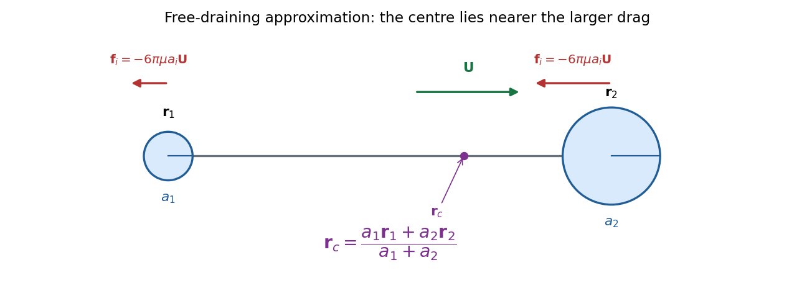

<h1 id="2/d/solution">Solution</h1>

↑ **Parent:** [D](../d.md)

Hold the two-sphere object fixed in a uniform stream $\mathbf V$. In the [free-draining approximation](../../../../free-draining-approximation.md), its drag [forces](../../../../force-split.md) are $\mathbf f_i=\zeta_i\mathbf V$, with $\zeta_i=6\pi\mu a_i$. The [hydrodynamic torque](../../../../hydrodynamic-torque.md) about $\mathbf r_c$ is

$$
\mathbf T_c=\sum_{i=1}^2(\mathbf r_i-\mathbf r_c)\times\zeta_i\mathbf V
=\left[\zeta_1\mathbf r_1+\zeta_2\mathbf r_2-(\zeta_1+\zeta_2)\mathbf r_c\right]\times\mathbf V.
$$

To make it zero for every incoming-stream direction, choose the [hydrodynamic centre of a two-sphere dumbbell](../../../../hydrodynamic-centre-of-a-two-sphere-dumbbell.md):

$$
\boxed{\mathbf r_c=\frac{\zeta_1\mathbf r_1+\zeta_2\mathbf r_2}{\zeta_1+\zeta_2}=\frac{a_1\mathbf r_1+a_2\mathbf r_2}{a_1+a_2}.}
$$

It lies closer to the larger sphere, whose larger drag requires a shorter lever arm. Uniform translation does not spin an isolated sphere, so no additional isolated-sphere spin [torque](../../../../torque.md) enters this leading approximation.

**[Figure 1](#2/d/image-drag-weighted-hydrodynamic-centre-of-two-widely-separated-spheres). Drag-weighted hydrodynamic centre of two widely separated spheres**.

Finite-separation [hydrodynamic interactions](../../../../hydrodynamic-interaction.md) and connector drag can change the displayed location; the calculation has the same approximation as part [c](../c.md).

## ↑ Ancestors (12)

1. [D](../d.md)
2. [2](../../2.md)
3. [2025](../../../2025-split.md)
4. [Past exam of the advanced fluid dynamics course of the University of Oxford](../../../split.md)
5. [Advanced fluid dynamics course of the University of Oxford](../../../../advanced-fluid-dynamics-course-of-the-university-of-oxford.md)
6. [Year 4 of the mathematical and theoretical physics course of the University of Oxford](../../../../year-4-of-the-mathematical-and-theoretical-physics-course-of-the-university-of-oxford.md)
7. [Mathematical and theoretical physics course of the University of Oxford](../../../../mathematical-and-theoretical-physics-course-of-the-university-of-oxford.md)
8. [Undergraduate course of the University of Oxford](../../../../undergraduate-course-of-the-university-of-oxford.md)
9. [Course of the University of Oxford](../../../../course-of-the-university-of-oxford.md)
10. [University of Oxford](../../../../university-of-oxford-split.md)
11. [List of universities](../../../../list-of-universities.md)
12. [Codex Wiki](../../../../split.md)
