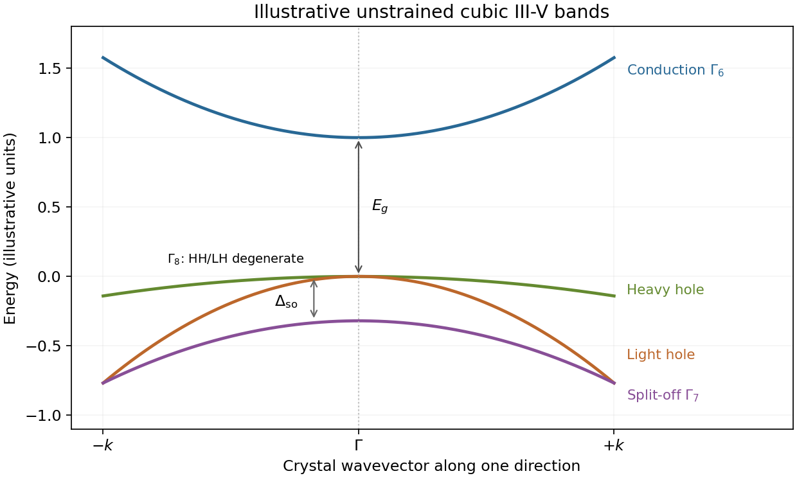

# Paper 1

↑ **Parent:** [2012](../2012.md)

[Original examination PDF, physical pages442–444](https://www.whatdotheyknow.com/request/natural_science_tripos_physics_e_2/response/2340776/attach/2/FOI%202023%20399%20Zahid%20materials.pdf?cookie_passthrough=1#page=442)

**Table of contents**

- [1](#1)
  - [Solution](#1/solution)
- [2](#2)
  - [Solution](#2/solution)
- [3](#3)
  - [a](#3/a)
    - [Solution](#3/a/solution)
  - [b](#3/b)
    - [Solution](#3/b/solution)
  - [c](#3/c)
    - [Solution](#3/c/solution)

## 1

↑ **Parent:** [Paper 1](paper-1.md)

<h3 id="1/solution">Solution</h3>

↑ **Parent:** [1](#1)

For a finite-range isotropic [Heisenberg model](../../angular-momentum-operator.md#heisenberg-model), the [Mermin-Wagner theorem](../../critical-phenomenon.md#mermin-wagner-theorem) excludes spontaneous magnetic order in one dimension at every nonzero [temperature](../../temperature.md). Long-wavelength rotations cost very little [energy](../../energy.md): a smooth orientational fluctuation has $\delta F=(\rho_s/2)\int dx\,(\partial_x\theta)^2$, so its thermal variance contains $(k_{\rm B}T/\rho_s)\int dq/q^2$, which diverges in the infrared. In a [Heisenberg ferromagnet](../../angular-momentum-operator.md#heisenberg-ferromagnet), the same obstruction appears as a divergent thermal occupation of quadratic long-wave [spin waves](../../critical-phenomenon.md#spin-wave). This explains why a finite magnetization cannot be supported, although correlations can be strong over a long finite distance. The rigorous statement requires short-range interactions and the stated continuous symmetry; interchain coupling and anisotropy change the problem. Symmetry forcing the mean to zero in a finite chain alone would not prove absence of thermodynamic order. [1966 abstract and theorem: finite-range isotropic spin models at nonzero temperature](../../physics-bibliography.md#absence-of-ferromagnetism-or-antiferromagnetism-in-one-or-two-dimensional-isotropic-heisenberg-models-by-n-d-mermin-and-h-wagner)

For the [Ising model](../../spin-model.md#ising-model), use dimensionless $s_i=2S_i^z=\pm1$, $h=g\mu_{\rm B}B$, $K=\beta J/2$ and $b=\beta h/2$. Its pair [Boltzmann factor](../../canonical-ensemble.md#boltzmann-factor) is

$$
P_{s,s'}=\exp\left[Kss'+\frac b2(s+s')\right].
$$

Multiplying N such factors around the periodic ring counts each bond once and each field term twice with weight one half. Summing the closed spin-index sequence therefore gives the [transfer matrix for the one-dimensional Ising model](../../spin-model.md#transfer-matrix-for-the-one-dimensional-ising-model)

$$
\boxed{P=\begin{pmatrix}e^{K+b}&e^{-K}\\e^{-K}&e^{K-b}\end{pmatrix},\qquad Z=\operatorname{Tr}P^N.}
$$

The two [eigenvalues](../../linear-operator-theory.md#eigenvalue) are

$$
\lambda_\pm=e^K\left[\cosh b\pm\sqrt{\sinh^2b+e^{-4K}}\right],\qquad
Z=\lambda_+^N+\lambda_-^N.
$$

At finite temperature every entry of P is positive, so the [Perron–Frobenius theorem](../../vector-space.md#perron-frobenius-theorem) gives $\lambda_+>|\lambda_-|$. Consequently

$$
\boxed{F=-\frac{NJ}{2}-Nk_{\rm B}T\ln\left[\cosh b+\sqrt{\sinh^2b+e^{-2\beta J}}\right]+o(N).}
$$

The exact finite-N correction to the extensive expression is $-k_{\rm B}T\ln[1+(\lambda_-/\lambda_+)^N]$. No assumption that $\lambda_-$ is positive is needed.

Differentiate at fixed temperature. For $D=\sqrt{\sinh^2b+e^{-2\beta J}}$, $\partial_b\ln(\cosh b+D)=\sinh b/D$. The [Ising-chain magnetization with spin-half normalization](../../spin-model.md#ising-chain-magnetization-with-spin-half-normalization) gives total [magnetic moment](../../electromagnetism.md#magnetic-dipole-moment)

$$
\boxed{M=-\frac{\partial F}{\partial B}=\frac{Ng\mu_{\rm B}}2\frac{\sinh(\beta g\mu_{\rm B}B/2)}{\sqrt{\sinh^2(\beta g\mu_{\rm B}B/2)+e^{-2\beta J}}}.}
$$

This is the thermodynamic-limit result; the moment per site is M/N. For every finite $T>0$, **$\lim_{B\to0}M/N=0$**, even with the thermodynamic limit taken first. The zero-field [magnetic susceptibility](../../statistical-physics.md#magnetic-susceptibility) per site is $(g\mu_{\rm B})^2e^{\beta J}/(4k_{\rm B}T)$, large but finite.

The [Ising-chain domain-wall energy convention](../../spin-model.md#ising-chain-domain-wall-energy-convention) explains the result for $J>0$: changing a parallel bond into an antiparallel bond costs J in this spin-half normalization. Domain walls, occurring in pairs on a ring, acquire a nonzero density at any nonzero temperature. Indeed the zero-field [correlation length](../../critical-phenomenon.md#correlation-length) is $\xi=-a/\ln[\tanh(\beta J/2)]\sim(a/2)e^{\beta J}$ at low temperature. The Ising symmetry is discrete, so this is a separate one-dimensional domain-wall mechanism rather than an application of the continuous-symmetry theorem. At zero temperature a ferromagnetic chain can select a fully polarized state; the $B\to0$ and $T\to0$ limits do not commute.

**[Figure 1](#1/image-ising-magnetization). Ising magnetization**. [Source](paper-1-aqc2012-ising-magnetization.py).

## 2

↑ **Parent:** [Paper 1](paper-1.md)

<h3 id="2/solution">Solution</h3>

↑ **Parent:** [2](#2)

The [joint density of states](../../quantum-ideal-gas-statistics.md#joint-density-of-states) counts vertical valence-to-conduction transitions at photon energy $\hbar\omega$. Optical absorption weights it by dipole or momentum [matrix elements](../../vector-space.md#matrix-element), occupation factors and optical-frequency prefactors. A [Van Hove singularity](../../quantum-ideal-gas-statistics.md#van-hove-singularity) occurs at a stationary transition energy $\nabla_{\mathbf k}(E_c-E_v)=0$. It can create a strong peak, edge or cusp in an absorption spectrum and thereby reveal [electronic band structure](../../bloch-s-theorem.md#electronic-band-structure). The relevant stationary quantity is the band difference, not necessarily either band separately. Forbidden optical transitions can suppress the feature; [excitons](../../quantum-mechanics.md#exciton), finite lifetimes and disorder can shift or broaden it. A two-dimensional saddle gives a logarithm, whereas a parabolic two-dimensional minimum gives a step. [Chapter4, printedpp.27–35, critical points and dimensional JDOS forms; Chapter5, absorption and transition weighting](../../physics-bibliography.md#optical-properties-of-solids-by-mildred-s-dresselhaus)

Put $\delta=\hbar\omega-E_g$, $A=\hbar^2/(2m^*)>0$ and $\eta=\delta/A$. For $\delta>0$, the [saddle-point optical transition contour](../../quantum-ideal-gas-statistics.md#saddle-point-optical-transition-contour) is the two-branch hyperbola

$$
\boxed{k_x^2-k_y^2=\eta,\qquad k_x=\pm r(k_y),\quad r(k_y)=\sqrt{k_y^2+\eta}.}
$$

For $\delta<0$ it opens along y instead; at zero the limiting contour is $k_x=\pm k_y$. On either positive-energy branch,

$$
dS=\frac{\sqrt{r^2+k_y^2}}r\,dk_y,\qquad
|\nabla(E_c-E_v)|=2A\sqrt{r^2+k_y^2},\qquad
\frac{dS}{|\nabla(E_c-E_v)|}=\frac{m^*}{\hbar^2}\frac{dk_y}{\sqrt{k_y^2+\eta}}.
$$

Using the opening spin factor2, one branch therefore contributes

$$
\boxed{J_{\rm branch}=\frac{m^*}{2\pi^2\hbar^2}\int_{-\Lambda_y}^{\Lambda_y}\frac{dk_y}{\sqrt{k_y^2+\eta}}.}
$$

**The displayed integral in the question is this one-branch expression with $\Lambda_y=\pi/a$.** With both hyperbola branches and the opening spin factor2, the full [joint density of states](../../quantum-ideal-gas-statistics.md#joint-density-of-states) is $J_{\rm full}=2J_{\rm branch}$. Equivalently, the printed coefficient describes the full two-branch contour if the spin degeneracy is1. The PDF itself has this factor-of-two mismatch; it cannot be removed by reparametrizing the complete contour.

There is also a cutoff qualification. For the strict square [first Brillouin zone](../../bloch-s-theorem.md#first-brillouin-zone), $|k_x|,|k_y|\leq\Lambda=\pi/a$, both coordinates must remain inside, giving $\Lambda_y=\sqrt{\Lambda^2-\eta}$ for $0<\eta<\Lambda^2$. Taking $\Lambda_y=\Lambda$ is a convenient local-saddle cutoff with the same leading singularity, not the exact intersection with that square. The quadratic dispersion is only a local band model, so the nonsingular constant depends on how the saddle region joins the actual bands.

For the source's cutoff, the [logarithmic two-dimensional saddle joint density of states](../../quantum-ideal-gas-statistics.md#logarithmic-two-dimensional-saddle-joint-density-of-states) follows directly:

$$
I(\eta)=\int_{-\Lambda}^{\Lambda}\frac{dy}{\sqrt{y^2+\eta}}
=2\operatorname{arsinh}\frac\Lambda{\sqrt\eta}
=2\ln\frac{\Lambda+\sqrt{\Lambda^2+\eta}}{\sqrt\eta}
=\ln\frac{4\Lambda^2}{\eta}+O(\eta/\Lambda^2).
$$

Thus, in the one-branch normalization of the requested integral,

$$
\boxed{J_{\rm branch}\simeq\frac{m^*}{2\pi^2\hbar^2}\ln\frac{4A\Lambda^2}{\hbar\omega-E_g},\qquad J_{\rm full}=2J_{\rm branch}.}
$$

The strict square cutoff has the same leading logarithm. This establishes the requested $C-\ln(\hbar\omega-E_g)$ shape, with a dimensionless logarithm after choosing the cutoff energy. Here $E_g$ is the saddle transition energy; it need not be the global minimum optical gap. The definition in the question has units of states per area per energy, despite being written as a function of frequency.

**[Figure 2](#2/image-saddle-contours-and-jdos). Saddle contours and JDOS**. [Source](paper-1-aqc2012-saddle-jdos.py).

## 3

↑ **Parent:** [Paper 1](paper-1.md)

<h3 id="3/a">a</h3>

↑ **Parent:** [3](#3)

<h4 id="3/a/solution">Solution</h4>

↑ **Parent:** [A](#3/a)

For a representative unstrained [zinc blende structure](../../physical-chemistry.md#zinc-blende-structure) [III-V semiconductor](../../semiconductor.md#iii-v-semiconductor) such as [gallium arsenide](../../chemical-substance.md#gallium-arsenide), take the valence-band maximum at the [Gamma point](../../bloch-s-theorem.md#gamma-point) as zero. The near-centre ordering is an s-like $\Gamma_{6c}$ [conduction band](../../quantum-mechanics.md#conduction-band) doublet above a p-like $\Gamma_{8v}$ valence quartet. [Spin-orbit interaction](../../atomic-physics.md#spin-orbit-interaction) puts the p-like $\Gamma_{7v}$ doublet below the quartet by $\Delta_{\rm so}$. These are the [zone-centre bands of a zinc-blende III-V semiconductor](../../semiconductor.md#zone-centre-bands-of-a-zinc-blende-iii-v-semiconductor).

The $j=3/2$ quartet produces the [heavy-hole and light-hole bands](../../quantum-mechanics.md#heavy-hole-and-light-hole-bands). Along a chosen symmetry direction, their components have $|m_j|=3/2$ and $1/2$ respectively; their different curvatures define different positive hole [effective masses](../../bloch-s-theorem.md#band-effective-mass). They are degenerate at zero wavevector in the unstrained cubic crystal, but separate away from it. The $j=1/2$ doublet is the [split-off valence band](../../quantum-mechanics.md#split-off-valence-band). To leading isotropic order,

$$
\boxed{E_c(k)\simeq E_g+\frac{\hbar^2k^2}{2m_c},\quad
E_{v,\rm hh/lh}(k)\simeq-\frac{\hbar^2k^2}{2m_{\rm hh/lh}},\quad
E_{v,\rm so}(k)\simeq-\Delta_{\rm so}-\frac{\hbar^2k^2}{2m_{\rm so}}.}
$$

Valence-band curvature is negative for electrons; the corresponding hole masses are positive. Real valence bands warp with direction, so these are illustrative effective-mass parabolas rather than an exact spherical band structure.

The [k·p perturbation theory](../../bloch-s-theorem.md#k·p-perturbation-theory) couples the s-like and p-like states through momentum matrix elements. It controls the conduction-band mass, nonparabolicity and mixing of hole characters. Strain or quantum confinement can split the heavy/light degeneracy even at zero in-plane wavevector. The lack of inversion symmetry in zinc blende also permits spin splitting away from the zone centre; time-reversal symmetry still protects the zone-centre doublets.

The s–p electric-dipole transitions near $\Gamma$ are optically important and produce structures at $E_g$ and $E_g+\Delta_{\rm so}$ with polarization-dependent weights. For [direct band gap](../../bloch-s-theorem.md#direct-band-gap) compounds the conduction minimum is also at $\Gamma$, allowing near-edge absorption and emission without a momentum-supplying phonon. **Not every III-V compound is direct-gap**, and wurtzite materials have an additional crystal-field splitting; the cubic scheme should not be imposed on every III-V semiconductor. [§3.4, spin-orbit interaction in solids;§6.2, band-structure optical features;§7.7, heavy/light GaAs valence states and confinement splitting](../../physics-bibliography.md#optical-properties-of-solids-by-mildred-s-dresselhaus)

**[Figure 3](#3/a/image-zone-centre-iii-v-bands). Zone-centre III-V bands**. [Source](paper-1-aqc2012-iii-v-bands.py).

<h3 id="3/b">b</h3>

↑ **Parent:** [3](#3)

<h4 id="3/b/solution">Solution</h4>

↑ **Parent:** [B](#3/b)

[Indirect exchange](../../electromagnetism.md#indirect-exchange) couples magnetic moments through intervening degrees of freedom. Its mechanism and sign depend on whether the mediators are virtual charge excitations or mobile carriers.

In [superexchange](../../electromagnetism.md#superexchange), electrons hop virtually through intermediate ligand orbitals in an insulating solid and return to the original charge sector. For two half-filled orbitals, virtual double occupation lowers the antiparallel-spin state more strongly. In a one-band reduction,

$$
\boxed{H_{\rm eff}=J_{\rm AF}\mathbf S_i\cdot\mathbf S_j,\qquad J_{\rm AF}\simeq\frac{4|t_{\rm eff}|^2}{U}>0.}
$$

This positive sign denotes antiferromagnetism in this convention, unlike the $-2J$ convention in Question1. A metal–ligand–metal path has $t_{\rm eff}\sim t_{pd}^2/\Delta$ and hence the scale $J_{\rm AF}\sim t_{pd}^4/(\Delta^2U)$. Orbital geometry, occupation and [Hund's coupling](../../chemistry.md#hund-s-coupling) can instead favour ferromagnetic channels; superexchange is not universally antiferromagnetic.

In the [RKKY interaction](../../electromagnetism.md#rkky-interaction), a localized moment polarizes conduction-electron spins through a local exchange, and another moment samples that polarization. Second-order response gives an effective coupling governed by the static spin susceptibility. For an ideal three-dimensional spherical [Fermi surface](../../fermi-liquid.md#fermi-surface), its long-distance form oscillates approximately as

$$
\boxed{J_{\rm RKKY}(R)\propto J_K^2\frac{\cos(2k_{\rm F}R)}{R^3}.}
$$

The overall sign convention and precise prefactor must be specified; the alternating sign and power-law range are the main features. This mechanism is useful for localized moments in metals, for example rare-earth systems. The Fermi surface and dimensionality change the range and oscillation pattern. [1954, conduction-electron-mediated indirect magnetic coupling](../../physics-bibliography.md#indirect-exchange-coupling-of-nuclear-magnetic-moments-by-conduction-electrons-by-m-a-ruderman-and-charles-kittel)

In [double exchange](../../electromagnetism.md#double-exchange-mechanism), carriers move between sites of different valence while strongly aligned by [Hund's coupling](../../chemistry.md#hund-s-coupling) to local core spins. In the strong-coupling classical-spin limit, the magnitude of their hopping is

$$
\boxed{|t_{\rm eff}(\theta)|=|t|\cos(\theta/2),\qquad0\leq\theta\leq\pi.}
$$

Parallel moments maximize the carrier bandwidth and lower its kinetic energy, favouring ferromagnetism. Doped mixed-valence manganites are the standard setting. The process involves real carrier motion and is distinct from a virtual insulating superexchange or weak-coupling conduction-electron response. [1951, connection between conduction and ferromagnetism underlying double exchange](../../physics-bibliography.md#interaction-between-the-d-shells-in-the-transition-metals-ii-ferromagnetic-compounds-of-manganese-with-perovskite-structure-by-clarence-zener)

In a real material several mechanisms compete. Ligand geometry, charge-transfer and repulsion energies, carrier concentration and the band susceptibility are therefore needed before predicting the net ordering.

<h3 id="3/c">c</h3>

↑ **Parent:** [3](#3)

<h4 id="3/c/solution">Solution</h4>

↑ **Parent:** [C](#3/c)

The clearest examples are the [cuprate superconductors](../../superconductivity.md#cuprate-superconductor). Their unusual properties should be compared with the clean, weak-coupling, fully gapped s-wave electron–phonon limit of [BCS theory](../../fermi-liquid.md#bcs-theory); that limit is not a definition of all possible BCS-like paired states.

Cuprates are layered copper oxides with strongly anisotropic transport. Their undoped parents are antiferromagnetic [Mott insulators](../../bloch-s-theorem.md#mott-insulator) or, more specifically for many compounds, [charge-transfer insulators](../../permittivity.md#charge-transfer-insulator), despite partially filled bands in a simple band picture. Doping produces a superconducting dome rather than simply improving an ordinary weakly interacting metal. This points to strong electronic correlations. Near optimal doping, an extended temperature range often shows approximately linear [electrical resistivity](../../electric-charge.md#electrical-resistivity), termed [strange-metal behaviour](../../electric-charge.md#strange-metal-behaviour), instead of the low-temperature $T^2$ law of a conventional [Fermi liquid](../../fermi-liquid.md). Neither law applies at every temperature and doping.

The dominant [Cooper pair](../../fermi-liquid.md#cooper-pair) symmetry is spin-singlet $d_{x^2-y^2}$, with a representative gap

$$
\boxed{\Delta(\mathbf k)=\frac{\Delta_0}{2}[\cos(k_xa)-\cos(k_ya)].}
$$

It changes sign under a quarter turn and has nodes on the zone diagonals. Phase-sensitive experiments detect that sign change; it is not established by a large transition temperature alone. [1994, half-flux-quantum phase-sensitive YBCO ring experiment](../../physics-bibliography.md#pairing-symmetry-and-flux-quantization-in-a-tricrystal-superconducting-ring-by-c-c-tsuei-and-others) Clean nodal quasiparticles give power-law low-temperature responses, for example electronic heat capacity $C\propto T^2$ and penetration-depth change $\lambda(T)-\lambda(0)\propto T$, in contrast with activated responses of a fully gapped s-wave state. Disorder, dimensional crossover and competing phases can alter these powers.

The [cuprate pseudogap](../../superconductivity.md#cuprate-pseudogap) is a partial, momentum-dependent loss of low-energy electronic spectral weight extending above the superconducting transition in underdoped materials. It need not be identical to the superconducting gap, and observing it alone does not identify its microscopic origin or prove preformed pairs. [2005 perspective, pseudogap above the transition and unresolved relationship to superconductivity](../../physics-bibliography.md#the-pseudogap-friend-or-foe-of-high-tc-by-michael-r-norman-and-others)

Short coherence lengths, anisotropy and low phase stiffness in underdoped systems make thermal phase and vortex fluctuations important. Many cuprates are strong [type-II superconductors](../../superconductivity.md#type-ii-superconductor), with large [London penetration depths](../../magnetic-field.md#london-penetration-depth) relative to their [superconducting coherence lengths](../../superconductivity.md#superconducting-coherence-length). Gap-to-transition-temperature ratios and isotope effects vary with doping and need not obey the simplest weak-coupling benchmarks $2\Delta(0)/(k_{\rm B}T_c)=3.53$ and $T_c\propto M_{\rm ion}^{-1/2}$. A weak or variable isotope effect by itself does not identify the pairing mechanism.

These features motivate strongly correlated pairing descriptions, often involving spin fluctuations, but do not uniquely establish a microscopic pairing glue. Other high-temperature families need not share every cuprate property: iron-based superconductors are multiband and may be nodeless. The robust distinction is the observed combination of correlated normal states, unusual gap symmetry and important collective fluctuations, rather than high $T_c$ alone.

## ↑ Ancestors (11)

1. [2012](../2012.md)
2. [Past exam of the advanced Quantum Condensed Matter Physics course of the University of Cambridge](../../past-exam-of-the-advanced-quantum-condensed-matter-physics-course-of-the-university-of-cambridge.md)
3. [Advanced Quantum Condensed Matter Physics course of the University of Cambridge](../../university-of-cambridge.md#advanced-quantum-condensed-matter-physics-course-of-the-university-of-cambridge)
4. [Physics course of the year 4 of the natural sciences course of the University of Cambridge](../../university-of-cambridge.md#physics-course-of-the-year-4-of-the-natural-sciences-course-of-the-university-of-cambridge)
5. [Year 4 of the natural sciences course of the University of Cambridge](../../university-of-cambridge.md#year-4-of-the-natural-sciences-course-of-the-university-of-cambridge)
6. [Year of the natural sciences course of the University of Cambridge](../../university-of-cambridge.md#year-of-the-natural-sciences-course-of-the-university-of-cambridge)
7. [Natural sciences course of the University of Cambridge](../../university-of-cambridge.md#natural-sciences-course-of-the-university-of-cambridge)
8. [Course of the University of Cambridge](../../university-of-cambridge.md#course-of-the-university-of-cambridge)
9. [University of Cambridge](../../university-of-cambridge.md)
10. [List of universities](../../README.md#list-of-universities)
11. [Codex Wiki](../../README.md)
