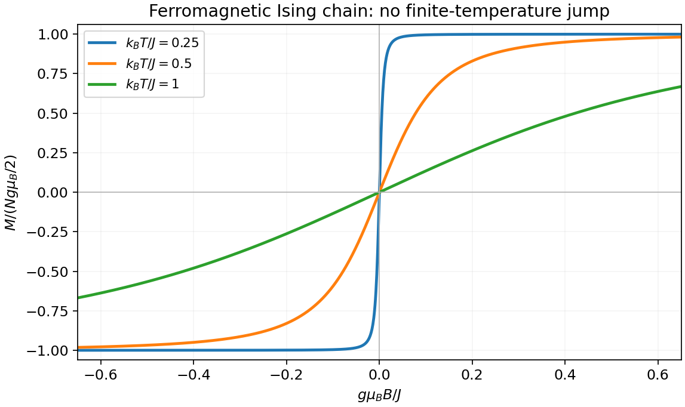

<h1 id="1/solution">Solution</h1>

↑ **Parent:** [1](../1.md)

For a finite-range isotropic [Heisenberg model](../../../../heisenberg-model.md), the [Mermin-Wagner theorem](../../../../mermin-wagner-theorem.md) excludes spontaneous magnetic order in one dimension at every nonzero [temperature](../../../../temperature-split.md). Long-wavelength rotations cost very little [energy](../../../../energy-split.md): a smooth orientational fluctuation has $\delta F=(\rho_s/2)\int dx\,(\partial_x\theta)^2$, so its thermal variance contains $(k_{\rm B}T/\rho_s)\int dq/q^2$, which diverges in the infrared. In a [Heisenberg ferromagnet](../../../../heisenberg-ferromagnet.md), the same obstruction appears as a divergent thermal occupation of quadratic long-wave [spin waves](../../../../spin-wave.md). This explains why a finite magnetization cannot be supported, although correlations can be strong over a long finite distance. The rigorous statement requires short-range interactions and the stated continuous symmetry; interchain coupling and anisotropy change the problem. Symmetry forcing the mean to zero in a finite chain alone would not prove absence of thermodynamic order. [1966 abstract and theorem: finite-range isotropic spin models at nonzero temperature](../../../../absence-of-ferromagnetism-or-antiferromagnetism-in-one-or-two-dimensional-isotropic-heisenberg-models-by-n-d-mermin-and-h-wagner.md)

For the [Ising model](../../../../ising-model.md), use dimensionless $s_i=2S_i^z=\pm1$, $h=g\mu_{\rm B}B$, $K=\beta J/2$ and $b=\beta h/2$. Its pair [Boltzmann factor](../../../../boltzmann-factor.md) is

$$
P_{s,s'}=\exp\left[Kss'+\frac b2(s+s')\right].
$$

Multiplying N such factors around the periodic ring counts each bond once and each field term twice with weight one half. Summing the closed spin-index sequence therefore gives the [transfer matrix for the one-dimensional Ising model](../../../../transfer-matrix-for-the-one-dimensional-ising-model.md)

$$
\boxed{P=\begin{pmatrix}e^{K+b}&e^{-K}\\e^{-K}&e^{K-b}\end{pmatrix},\qquad Z=\operatorname{Tr}P^N.}
$$

The two [eigenvalues](../../../../eigenvalue.md) are

$$
\lambda_\pm=e^K\left[\cosh b\pm\sqrt{\sinh^2b+e^{-4K}}\right],\qquad
Z=\lambda_+^N+\lambda_-^N.
$$

At finite temperature every entry of P is positive, so the [Perron–Frobenius theorem](../../../../perron-frobenius-theorem.md) gives $\lambda_+>|\lambda_-|$. Consequently

$$
\boxed{F=-\frac{NJ}{2}-Nk_{\rm B}T\ln\left[\cosh b+\sqrt{\sinh^2b+e^{-2\beta J}}\right]+o(N).}
$$

The exact finite-N correction to the extensive expression is $-k_{\rm B}T\ln[1+(\lambda_-/\lambda_+)^N]$. No assumption that $\lambda_-$ is positive is needed.

Differentiate at fixed temperature. For $D=\sqrt{\sinh^2b+e^{-2\beta J}}$, $\partial_b\ln(\cosh b+D)=\sinh b/D$. The [Ising-chain magnetization with spin-half normalization](../../../../ising-chain-magnetization-with-spin-half-normalization.md) gives total [magnetic moment](../../../../magnetic-dipole-moment.md)

$$
\boxed{M=-\frac{\partial F}{\partial B}=\frac{Ng\mu_{\rm B}}2\frac{\sinh(\beta g\mu_{\rm B}B/2)}{\sqrt{\sinh^2(\beta g\mu_{\rm B}B/2)+e^{-2\beta J}}}.}
$$

This is the thermodynamic-limit result; the moment per site is M/N. For every finite $T>0$, **$\lim_{B\to0}M/N=0$**, even with the thermodynamic limit taken first. The zero-field [magnetic susceptibility](../../../../magnetic-susceptibility.md) per site is $(g\mu_{\rm B})^2e^{\beta J}/(4k_{\rm B}T)$, large but finite.

The [Ising-chain domain-wall energy convention](../../../../ising-chain-domain-wall-energy-convention.md) explains the result for $J>0$: changing a parallel bond into an antiparallel bond costs J in this spin-half normalization. Domain walls, occurring in pairs on a ring, acquire a nonzero density at any nonzero temperature. Indeed the zero-field [correlation length](../../../../correlation-length.md) is $\xi=-a/\ln[\tanh(\beta J/2)]\sim(a/2)e^{\beta J}$ at low temperature. The Ising symmetry is discrete, so this is a separate one-dimensional domain-wall mechanism rather than an application of the continuous-symmetry theorem. At zero temperature a ferromagnetic chain can select a fully polarized state; the $B\to0$ and $T\to0$ limits do not commute.

**[Figure 1](#1/image-ising-magnetization). Ising magnetization**. [Source](paper-1-aqc2012-ising-magnetization.py).

## ↑ Ancestors (13)

1. [1](../1.md)
2. [Paper 1](../../paper-1-split.md)
3. [2012](../../split.md)
4. [Past exam of the advanced Quantum Condensed Matter Physics course of the University of Cambridge](../../../split.md)
5. [Advanced Quantum Condensed Matter Physics course of the University of Cambridge](../../../../advanced-quantum-condensed-matter-physics-course-of-the-university-of-cambridge.md)
6. [Physics course of the year 4 of the natural sciences course of the University of Cambridge](../../../../physics-course-of-the-year-4-of-the-natural-sciences-course-of-the-university-of-cambridge.md)
7. [Year 4 of the natural sciences course of the University of Cambridge](../../../../year-4-of-the-natural-sciences-course-of-the-university-of-cambridge.md)
8. [Year of the natural sciences course of the University of Cambridge](../../../../year-of-the-natural-sciences-course-of-the-university-of-cambridge.md)
9. [Natural sciences course of the University of Cambridge](../../../../natural-sciences-course-of-the-university-of-cambridge.md)
10. [Course of the University of Cambridge](../../../../course-of-the-university-of-cambridge.md)
11. [University of Cambridge](../../../../university-of-cambridge-split.md)
12. [List of universities](../../../../list-of-universities.md)
13. [Codex Wiki](../../../../split.md)
