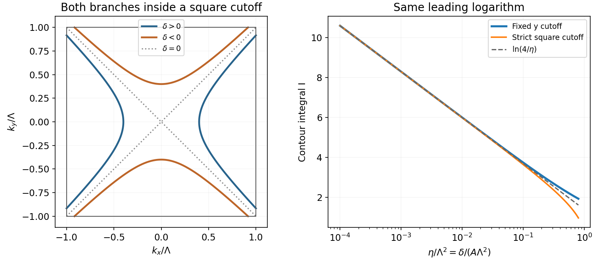

<h1 id="2/solution">Solution</h1>

↑ **Parent:** [2](../2.md)

The [joint density of states](../../../../joint-density-of-states.md) counts vertical valence-to-conduction transitions at photon energy $\hbar\omega$. Optical absorption weights it by dipole or momentum [matrix elements](../../../../matrix-element.md), occupation factors and optical-frequency prefactors. A [Van Hove singularity](../../../../van-hove-singularity.md) occurs at a stationary transition energy $\nabla_{\mathbf k}(E_c-E_v)=0$. It can create a strong peak, edge or cusp in an absorption spectrum and thereby reveal [electronic band structure](../../../../electronic-band-structure.md). The relevant stationary quantity is the band difference, not necessarily either band separately. Forbidden optical transitions can suppress the feature; [excitons](../../../../exciton.md), finite lifetimes and disorder can shift or broaden it. A two-dimensional saddle gives a logarithm, whereas a parabolic two-dimensional minimum gives a step. [Chapter4, printedpp.27–35, critical points and dimensional JDOS forms; Chapter5, absorption and transition weighting](../../../../optical-properties-of-solids-by-mildred-s-dresselhaus.md)

Put $\delta=\hbar\omega-E_g$, $A=\hbar^2/(2m^*)>0$ and $\eta=\delta/A$. For $\delta>0$, the [saddle-point optical transition contour](../../../../saddle-point-optical-transition-contour.md) is the two-branch hyperbola

$$
\boxed{k_x^2-k_y^2=\eta,\qquad k_x=\pm r(k_y),\quad r(k_y)=\sqrt{k_y^2+\eta}.}
$$

For $\delta<0$ it opens along y instead; at zero the limiting contour is $k_x=\pm k_y$. On either positive-energy branch,

$$
dS=\frac{\sqrt{r^2+k_y^2}}r\,dk_y,\qquad
|\nabla(E_c-E_v)|=2A\sqrt{r^2+k_y^2},\qquad
\frac{dS}{|\nabla(E_c-E_v)|}=\frac{m^*}{\hbar^2}\frac{dk_y}{\sqrt{k_y^2+\eta}}.
$$

Using the opening spin factor2, one branch therefore contributes

$$
\boxed{J_{\rm branch}=\frac{m^*}{2\pi^2\hbar^2}\int_{-\Lambda_y}^{\Lambda_y}\frac{dk_y}{\sqrt{k_y^2+\eta}}.}
$$

**The displayed integral in the question is this one-branch expression with $\Lambda_y=\pi/a$.** With both hyperbola branches and the opening spin factor2, the full [joint density of states](../../../../joint-density-of-states.md) is $J_{\rm full}=2J_{\rm branch}$. Equivalently, the printed coefficient describes the full two-branch contour if the spin degeneracy is1. The PDF itself has this factor-of-two mismatch; it cannot be removed by reparametrizing the complete contour.

There is also a cutoff qualification. For the strict square [first Brillouin zone](../../../../first-brillouin-zone.md), $|k_x|,|k_y|\leq\Lambda=\pi/a$, both coordinates must remain inside, giving $\Lambda_y=\sqrt{\Lambda^2-\eta}$ for $0<\eta<\Lambda^2$. Taking $\Lambda_y=\Lambda$ is a convenient local-saddle cutoff with the same leading singularity, not the exact intersection with that square. The quadratic dispersion is only a local band model, so the nonsingular constant depends on how the saddle region joins the actual bands.

For the source's cutoff, the [logarithmic two-dimensional saddle joint density of states](../../../../logarithmic-two-dimensional-saddle-joint-density-of-states.md) follows directly:

$$
I(\eta)=\int_{-\Lambda}^{\Lambda}\frac{dy}{\sqrt{y^2+\eta}}
=2\operatorname{arsinh}\frac\Lambda{\sqrt\eta}
=2\ln\frac{\Lambda+\sqrt{\Lambda^2+\eta}}{\sqrt\eta}
=\ln\frac{4\Lambda^2}{\eta}+O(\eta/\Lambda^2).
$$

Thus, in the one-branch normalization of the requested integral,

$$
\boxed{J_{\rm branch}\simeq\frac{m^*}{2\pi^2\hbar^2}\ln\frac{4A\Lambda^2}{\hbar\omega-E_g},\qquad J_{\rm full}=2J_{\rm branch}.}
$$

The strict square cutoff has the same leading logarithm. This establishes the requested $C-\ln(\hbar\omega-E_g)$ shape, with a dimensionless logarithm after choosing the cutoff energy. Here $E_g$ is the saddle transition energy; it need not be the global minimum optical gap. The definition in the question has units of states per area per energy, despite being written as a function of frequency.

**[Figure 2](#2/image-saddle-contours-and-jdos). Saddle contours and JDOS**. [Source](paper-1-aqc2012-saddle-jdos.py).

## ↑ Ancestors (13)

1. [2](../2.md)
2. [Paper 1](../../paper-1-split.md)
3. [2012](../../split.md)
4. [Past exam of the advanced Quantum Condensed Matter Physics course of the University of Cambridge](../../../split.md)
5. [Advanced Quantum Condensed Matter Physics course of the University of Cambridge](../../../../advanced-quantum-condensed-matter-physics-course-of-the-university-of-cambridge.md)
6. [Physics course of the year 4 of the natural sciences course of the University of Cambridge](../../../../physics-course-of-the-year-4-of-the-natural-sciences-course-of-the-university-of-cambridge.md)
7. [Year 4 of the natural sciences course of the University of Cambridge](../../../../year-4-of-the-natural-sciences-course-of-the-university-of-cambridge.md)
8. [Year of the natural sciences course of the University of Cambridge](../../../../year-of-the-natural-sciences-course-of-the-university-of-cambridge.md)
9. [Natural sciences course of the University of Cambridge](../../../../natural-sciences-course-of-the-university-of-cambridge.md)
10. [Course of the University of Cambridge](../../../../course-of-the-university-of-cambridge.md)
11. [University of Cambridge](../../../../university-of-cambridge-split.md)
12. [List of universities](../../../../list-of-universities.md)
13. [Codex Wiki](../../../../split.md)
