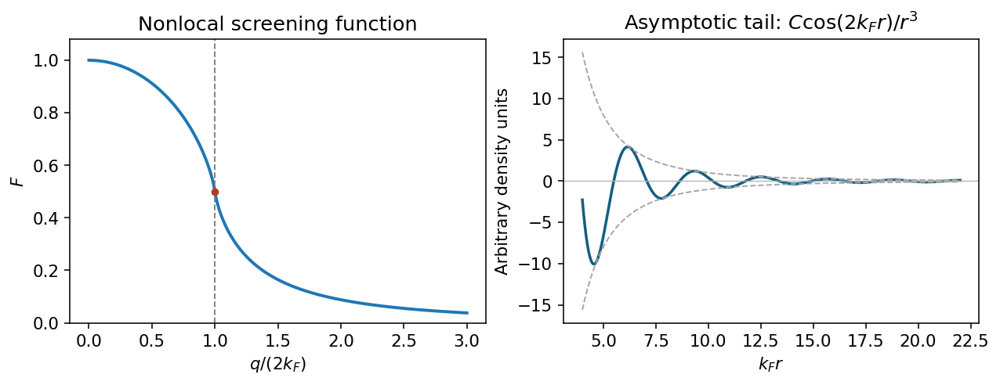
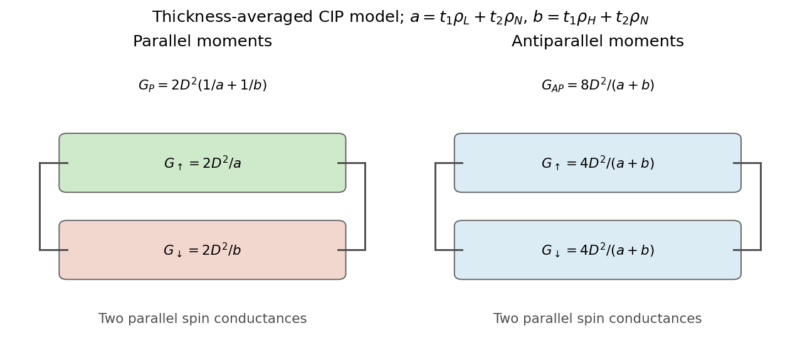
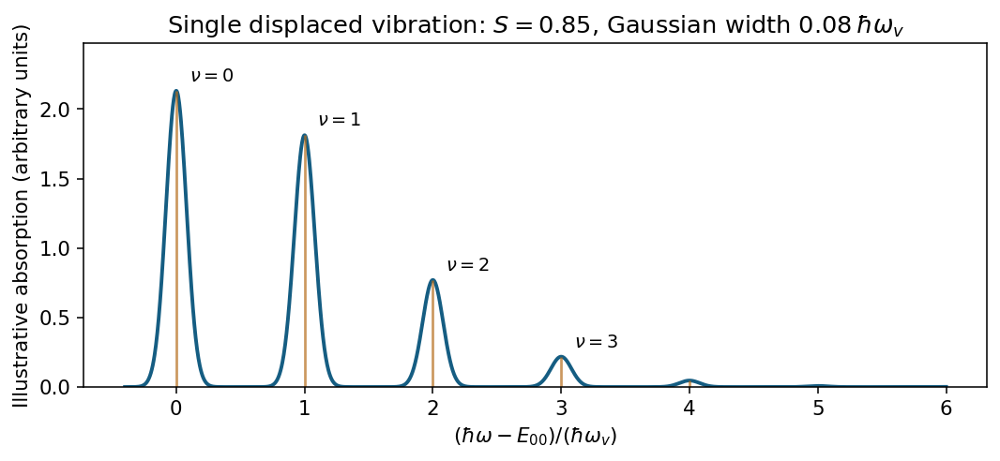

# Paper 1

↑ **Parent:** [2013](../2013.md)

[Original examination PDF, physical pages545–547](https://www.whatdotheyknow.com/request/natural_science_tripos_physics_e_2/response/2340776/attach/2/FOI%202023%20399%20Zahid%20materials.pdf?cookie_passthrough=1#page=545)

**Table of contents**

- [1](#1)
  - [Solution](#1/solution)
- [2](#2)
  - [Solution](#2/solution)
  - [a](#2/a)
    - [Solution](#2/a/solution)
  - [b](#2/b)
    - [Solution](#2/b/solution)
  - [c](#2/c)
    - [Solution](#2/c/solution)
  - [d](#2/d)
    - [Solution](#2/d/solution)
  - [Solution (magnetoresistance)](#2/solution-magnetoresistance)
- [3](#3)
  - [a](#3/a)
    - [Solution](#3/a/solution)
  - [b](#3/b)
    - [Solution](#3/b/solution)
  - [c](#3/c)
    - [Solution](#3/c/solution)

## 1

↑ **Parent:** [Paper 1](paper-1.md)

<h3 id="1/solution">Solution</h3>

↑ **Parent:** [1](#1)

The [static Lindhard dielectric function](../../quantum-mechanics.md#static-lindhard-dielectric-function) describes the real, zero-frequency [linear response](../../statistical-physics.md#linear-response-theory) of a uniform [free electron gas](../../physics.md#free-electron-model). Here $\epsilon_1=\operatorname{Re}\epsilon$, $\mathbf r$ is the position operator, and $\mathbf q$ is the perturbation [wavevector](../../elasticity-physics.md#wavevector), $q=|\mathbf q|$, $V$ the normalization volume, $e>0$ the elementary charge, and $\epsilon_0$ the vacuum [permittivity](../../permittivity.md). The normalized one-electron states are $\psi_{\mathbf k}=V^{-1/2}e^{i\mathbf k\cdot\mathbf r}$ with $E_{\mathbf k}=\hbar^2k^2/(2m_e)$; $f(E)$ is their [Fermi-Dirac distribution](../../quantum-ideal-gas-statistics.md#fermi-dirac-distribution) occupation. Both momentum sums exclude spin; the prefactor two counts the two equal [spin](../../angular-momentum-operator.md#spin) populations. The density-operator matrix element is $\delta_{\mathbf k',\mathbf k+\mathbf q}$. Coincident energy denominators are interpreted by the static limit or [Cauchy principal value](../../complex-analysis.md#cauchy-principal-value).

A weak total [electric potential](../../electric-field.md#electric-potential) $\phi_{\rm tot}$ perturbs an electron by $-e\phi_{\rm tot}$. First-order state mixing produces $\delta n=e\Pi_0(q)\phi_{\rm tot}$, where

$$
\Pi_0(q)=\frac2V\sum_{\mathbf k}\frac{f(E_{\mathbf k})-f(E_{\mathbf k+\mathbf q})}{E_{\mathbf k+\mathbf q}-E_{\mathbf k}}.
$$

The induced charge is $-e\delta n$. Self-consistent [Poisson equation](../../partial-differential-equation.md#poisson-s-equation) screening then gives $\phi_{\rm ext}=\epsilon\phi_{\rm tot}$, with $\epsilon=1+e^2\Pi_0/(\epsilon_0q^2)$. This is the [random phase approximation](../../statistical-physics.md#random-phase-approximation): use the independent-electron response to the self-consistent total field.[Chapter8,§8.3, printed pp.123–126: density response and the Lindhard function](../../physics-bibliography.md#lecture-notes-for-quantum-matter-by-steven-h-simon)

At zero temperature $f(E_{\mathbf k})=\Theta(k_F-k)$. Shifting the integration variable in the second occupation term gives

$$
\epsilon-1=\frac{4m_ee^2}{\epsilon_0\hbar^2q^2}\int_{k<k_F}\frac{d^3k}{(2\pi)^3}\left(\frac1{q^2+2\mathbf k\cdot\mathbf q}+\frac1{q^2-2\mathbf k\cdot\mathbf q}\right).
$$

The two angular integrals are equal. Using the supplied integral, with $x=q/(2k_F)$, gives

$$
\boxed{\epsilon(q,0)=1+\frac{\kappa^2}{q^2}F(x),\qquad
\kappa^2=\frac{m_ee^2k_F}{\epsilon_0\pi^2\hbar^2},\qquad
F(x)=\frac12+\frac{1-x^2}{4x}\log\left|\frac{1+x}{1-x}\right|.}
$$

The limits are $F(0)=1$, $F(1)=1/2$ and $F(x)\sim1/(3x^2)$ for large $x$. The first recovers [Thomas-Fermi screening](../../quantum-mechanics.md#thomas-fermi-screening); the logarithm produces the [Kohn singularity of static Lindhard screening](../../quantum-mechanics.md#kohn-singularity-of-static-lindhard-screening) at $q=2k_F$.

Use the [Fourier transform](../../fourier-transform.md) convention $\rho(\mathbf q)=\int d^3r\,e^{-i\mathbf q\cdot\mathbf r}\rho(\mathbf r)$. A point charge $Ze$ has total screened charge $Ze/\epsilon(q)$ and induced charge $-Ze[1-\epsilon(q)^{-1}]$. Angular inversion therefore gives the [radial induced-charge screening kernel](../../quantum-mechanics.md#radial-induced-charge-screening-kernel)

$$
\rho_{\rm ind}(r)=-\frac{Ze}{r}\int_0^\infty dq\,g(q)\sin(qr),\qquad
\boxed{g(q)=\frac{q}{2\pi^2}\left[1-\frac1{\epsilon(q)}\right]=\frac{q\kappa^2F(q/2k_F)}{2\pi^2[q^2+\kappa^2F(q/2k_F)]}.}
$$

In particular, $\rho_{\rm ind}(\mathbf q=0)=-Ze$: the total screening charge is negative although its local density can oscillate in sign.

Integrate the sine transform by parts twice; $g(0)=g(\infty)=0$ removes the boundary terms. For the [Friedel density tail from a derivative singularity](../../quantum-mechanics.md#friedel-density-tail-from-a-derivative-singularity), write $Q=2k_F$ and $g''(q)\sim C/(q-Q)$. Then

$$
\rho_{\rm ind}(r)=\frac{Ze}{r^3}\int_0^\infty g''(q)\sin(qr)\,dq
\sim\frac{ZeC\pi}{r^3}\cos(Qr).
$$

Indeed, near $Q$ the [principal value](../../complex-analysis.md#cauchy-principal-value) transform is $\int_{-\infty}^{\infty}\sin[(Q+s)r]\,ds/s=\pi\cos(Qr)$ for $r>0$. Smooth terms do not remove this leading oscillatory long-range contribution. Thus **$\rho_{\rm ind}\propto\cos(2k_Fr)/r^3$**.

For a three-dimensional, single-valley gas with two [spin](../../angular-momentum-operator.md#spin) states, the [Friedel oscillation wavelength from carrier density](../../quantum-mechanics.md#friedel-oscillation-wavelength-from-carrier-density) is

$$
\boxed{k_F=(3\pi^2n)^{1/3}=3.90\times10^8\,\mathrm{m^{-1}},\qquad
\lambda=\frac{\pi}{k_F}=8.06\,\mathrm{nm}.}
$$

Low-temperature [scanning tunneling spectroscopy](../../quantum-mechanics.md#scanning-tunneling-spectroscopy) near exposed dopants can map the oscillatory [local density of states](../../quantum-ideal-gas-statistics.md#local-density-of-states), with a Fourier feature near $2k_F$ at the [Fermi energy](../../quantum-ideal-gas-statistics.md#fermi-energy). An energy-resolved tunnelling image measures local spectral weight, not directly the bulk energy-integrated charge: comparing occupied-bias maps and accounting for the surface geometry is necessary. In actual [GaAs](../../chemical-substance.md#gallium-arsenide), the background [relative permittivity](../../quantum-mechanics.md#relative-permittivity) and band [effective mass](../../bloch-s-theorem.md#band-effective-mass) change screening strengths; they do not change this wavelength at the stated density.

**[Figure 1](#1/image-static-lindhard-screening-has-a-singular-slope-at-twice-the-fermi-wavevector-and-an-oscillatory-far-field-density-tail). Static Lindhard screening has a singular slope at twice the Fermi wavevector and an oscillatory far-field density tail**. [Source](paper-1-aqc2013-screening-and-tail.py).

## 2

↑ **Parent:** [Paper 1](paper-1.md)

<h3 id="2/solution">Solution</h3>

↑ **Parent:** [2](#2)

The [Mott two-current model](../../electric-charge.md#mott-two-current-model) treats the two [spin](../../angular-momentum-operator.md#spin) populations as parallel conduction channels when [spin-flip scattering](../../angular-momentum-operator.md#spin-flip-scattering) is weak. Thus $\sigma=\sigma_\uparrow+\sigma_\downarrow$ and $\rho^{-1}=\rho_\uparrow^{-1}+\rho_\downarrow^{-1}$. Light, broad-band carriers conduct efficiently; scattering into narrow $d$-like states relaxes their current. In a simple spin-conserving $s$–$d$ picture,

$$
\tau_\sigma^{-1}\propto|V_{sd,\sigma}|^2D_{d,\sigma}(E_F),\qquad
\sigma_\sigma\simeq\frac{e^2}{3}D_\sigma(E_F)\langle v_\sigma^2\tau_\sigma\rangle.
$$

In [copper](../../chemical-substance.md#copper), the filled $d$ bands supply little final-state phase space at $E_F$, so both spin channels have low resistivity. In [cobalt](../../chemical-substance.md#cobalt), the nearly filled majority $d$ band suppresses majority-channel scattering, while minority $d$ states remain available. The stated [iron](../../chemical-substance.md#iron) reversal corresponds to stronger scattering-weighted majority-channel phase space: its majority $d$ band is not closed as in cobalt. Band filling, exchange splitting, velocities and scattering matrix elements set this [scattering-weighted spin-channel asymmetry](../../electric-charge.md#scattering-weighted-spin-channel-asymmetry); majority population alone does not select the better conductor. **The given iron ordering is a material/scattering input, not a universal consequence of the two-current postulate.** Different impurities and interfaces can change the asymmetry.[§2.1, printed p.947: intrinsic transport weights and impurity-dependent asymmetry](../../physics-bibliography.md#spin-dependent-transport-gmr-and-tmr-by-alain-schuhl-and-daniel-lacour)

<h3 id="2/a">a</h3>

↑ **Parent:** [2](#2)

<h4 id="2/a/solution">Solution</h4>

↑ **Parent:** [A](#2/a)

The spacer electrons mediate [interlayer exchange coupling](../../electromagnetism.md#interlayer-exchange-coupling). Spin-dependent reflection at the two magnetic interfaces changes their electronic energy as the spacer thickness varies. In the [oscillatory spacer-mediated exchange](../../electromagnetism.md#oscillatory-spacer-mediated-exchange) picture, Fermi-surface spanning wavevectors produce terms such as $J(t_2)\propto\cos(Qt_2+\varphi)$ with a decaying envelope; real spacers can have several periods.

Define the coupling energy per area by $E_{\rm ex}=-J(t_2)\hat{\mathbf m}_1\cdot\hat{\mathbf m}_2$. **$J>0$ favours parallel moments and $J<0$ antiparallel moments.** The oscillation period and phase depend on spacer band structure and interface reflection; there is no universal monotone rule or numerical crossover thickness from $t_2$ alone. Roughness and nonuniform thickness average and weaken the coupling. This is conduction-electron-mediated exchange, not a requirement that the nonmagnetic spacer itself be ferromagnetic.

<h3 id="2/b">b</h3>

↑ **Parent:** [2](#2)

<h4 id="2/b/solution">Solution</h4>

↑ **Parent:** [B](#2/b)

Put $D=t_1+t_2$, $a=t_1\rho_{\rm FM}^L+t_2\rho_{\rm NM}$ and $b=t_1\rho_{\rm FM}^H+t_2\rho_{\rm NM}$. In the [CIP thickness-averaged two-current model](../../electric-charge.md#cip-thickness-averaged-two-current-model), assume spin is conserved and electron trajectories sample the layers, so each channel's effective resistivity is the thickness average: $\bar\rho_L=a/D$, $\bar\rho_H=b/D$. This uses averaged relaxation rates with comparable transport weights, neglecting additional interface resistance. Here $\rho_{\rm NM}$ is the per-spin-channel resistivity, twice the measured nonmagnetic bulk resistivity. The stated long [mean free path](../../ideal-gas.md#mean-free-path) motivates sampling more than one layer.

A four-layer period has thickness $2D$. For an in-plane square, $R_\sigma=\bar\rho_\sigma L/(2DL)=\bar\rho_\sigma/(2D)$, hence the two parallel spin conductances add:

$$
\boxed{G_P=\frac1{R_{\uparrow,\uparrow}}=2D^2\left(\frac1a+\frac1b\right).}
$$

The square's side $L$ cancels. The layers are not being treated as four macroscopic resistors in series along the in-plane current; the averaging is over the traversing carriers' scattering histories.

<h3 id="2/c">c</h3>

↑ **Parent:** [2](#2)

<h4 id="2/c/solution">Solution</h4>

↑ **Parent:** [C](#2/c)

With opposite magnetic moments, a fixed global [spin](../../angular-momentum-operator.md#spin) is the low-resistivity species in one ferromagnetic layer and the high-resistivity species in the other. Thus both spin channels have the same four-layer averaged resistivity

$$
\bar\rho_{AP}=\frac{t_1\rho_{\rm FM}^L+t_1\rho_{\rm FM}^H+2t_2\rho_{\rm NM}}{2D}=\frac{a+b}{2D}.
$$

Each channel's square resistance is $(a+b)/(4D^2)$, and the two channels run in parallel. Therefore

$$
\boxed{\frac1{R_{\uparrow,\downarrow}}=\frac{8D^2}{a+b}.}
$$

Both channels encounter the strongly scattering magnetic layer; neither retains the uniformly favourable path available for parallel magnetizations.

<h3 id="2/d">d</h3>

↑ **Parent:** [2](#2)

<h4 id="2/d/solution">Solution</h4>

↑ **Parent:** [D](#2/d)

An in-plane [magnetic field](../../magnetic-field.md) lowers the [Zeeman energy](../../electromagnetism.md#zeeman-energy) when moments align with it. It competes with antiferromagnetic [interlayer exchange coupling](../../electromagnetism.md#interlayer-exchange-coupling); the layers generally cant or switch toward a parallel configuration and ultimately saturate if the field overcomes coupling and [magnetic anisotropy](../../electromagnetism.md#magnetic-anisotropy). **The high-resistance antiparallel state evolves toward the lower-resistance parallel state.** The switching path and field scale depend on anisotropy, pinning and coupling strength, which are not numerically specified.

<h3 id="2/solution-magnetoresistance">Solution (magnetoresistance)</h3>

↑ **Parent:** [2](#2)

Combining the two results gives the [GMR ratio for identical thickness-averaged layers](../../electric-charge.md#gmr-ratio-for-identical-thickness-averaged-layers):

$$
R_P=\frac{ab}{2D^2(a+b)},\qquad R_{AP}=\frac{a+b}{8D^2},\qquad
R_{AP}-R_P=\frac{(a-b)^2}{8D^2(a+b)}\ge0.
$$

Thus a field that aligns initially antiparallel moments produces **a resistance decrease**. One spin channel conducts well throughout the aligned stack; in the antiparallel stack both channels sample strong scattering. For the low-resistance-state normalization,

$$
\boxed{\frac{R_{AP}-R_P}{R_P}=\frac{(a-b)^2}{4ab}.}
$$

Normalizing the field-induced drop by $R_{AP}$ instead gives $(a-b)^2/(a+b)^2$. Large channel contrast can produce a large [giant magnetoresistance](../../electric-charge.md#giant-magnetoresistance); equal channels give none, and common nonmagnetic scattering dilutes the contrast. This is the spin-dependent alignment effect, distinct from [anisotropic magnetoresistance](../../electric-charge.md#anisotropic-magnetoresistance) of an individual magnetic layer.

**[Figure 2](#2/image-parallel-layer-moments-preserve-a-favourable-spin-channel-antiparallel-moments-equalize-the-two-averaged-channels). Parallel layer moments preserve a favourable spin channel; antiparallel moments equalize the two averaged channels**. [Source](paper-1-aqc2013-spin-channel-conductance.py).

## 3

↑ **Parent:** [Paper 1](paper-1.md)

<h3 id="3/a">a</h3>

↑ **Parent:** [3](#3)

<h4 id="3/a/solution">Solution</h4>

↑ **Parent:** [A](#3/a)

An [organic semiconductor](../../semiconductor.md#organic-semiconductor) has conjugated molecular units with strong intramolecular bonding and comparatively weak intermolecular electronic overlap. Optical excitation commonly promotes a $\pi$ electron from an occupied molecular orbital toward an unoccupied one. Weak dielectric screening and narrow bands favour bound [Frenkel excitons](../../quantum-mechanics.md#frenkel-exciton), sometimes mixed with intermolecular charge-transfer states, rather than immediate production of free carriers. The optical excitation energy is below the unbound electron–hole threshold by the [exciton binding energy](../../quantum-mechanics.md#exciton-binding-energy), with relaxation conventions specified when comparing measured gaps.

The [electric-dipole interaction](../../quantum-mechanics.md#electric-dipole-interaction) selects bright states through their transition dipoles, producing polarization-dependent absorption in oriented samples. From a singlet ground state, strong electric-dipole absorption normally preserves spin and reaches singlet excitons; direct triplet excitation is weak without spin mixing. The [Franck-Condon principle](../../atomic-physics.md#franck-condon-principle) treats excitation as vertical on the nuclear-motion timescale. For one displaced harmonic vibration at low temperature, the [displaced-oscillator Franck-Condon progression](../../atomic-physics.md#displaced-oscillator-franck-condon-progression) has relative strengths

$$
\boxed{I_\nu\propto e^{-S}\frac{S^\nu}{\nu!},\qquad
\hbar\omega_\nu=E_{00}+\nu\hbar\omega_v.}
$$

Here the [Huang-Rhys factor](../../atomic-physics.md#huang-rhys-factor) $S$ measures the displacement and $E_{00}$ is the zero-vibration transition energy. Vibrational relaxation before emission produces a [Stokes shift](../../fluorescence.md#stokes-shift). Molecular packing and excitonic coupling shift or split bright features and change their intensities; disorder and vibrations broaden them. Consequently a universal parabolic-band absorption edge is inappropriate for a localized molecular excitation.[Lectures4–7: molecular levels, Franck–Condon shifts, aggregates and Frenkel/charge-transfer excitons](../../physics-bibliography.md#organic-optoelectronics-lecture-notes-by-vladimir-bulovic)

**[Figure 3](#3/a/image-illustrative-low-temperature-vibronic-absorption-progression-from-a-displaced-molecular-vibration). Illustrative low-temperature vibronic absorption progression from a displaced molecular vibration**. [Source](paper-1-aqc2013-vibronic-absorption.py).

<h3 id="3/b">b</h3>

↑ **Parent:** [3](#3)

<h4 id="3/b/solution">Solution</h4>

↑ **Parent:** [B](#3/b)

In [quasi-one-dimensional quantum transport](../../quantum-mechanics.md#quasi-one-dimensional-quantum-transport), transverse confinement makes discrete subbands while motion along a [quantum wire](../../quantum-mechanics.md#quantum-wire) remains continuous. Only occupied propagating subbands conduct. For elastic scattering between equilibrated reservoirs, the [Landauer formula](../../quantum-mechanics.md#landauer-formula) is

$$
\boxed{G=\frac{e^2}{h}\sum_{n,\sigma}\int dE\,[-f'(E)]T_{n\sigma}(E).}
$$

The sum explicitly counts spin. A perfectly transmitting spin-degenerate subband gives $2e^2/h$ at low temperature; a [quantum point contact](../../quantum-ideal-gas-statistics.md#quantum-point-contact) shows steps as a gate opens additional subbands. The one-dimensional [density of states](../../quantum-ideal-gas-statistics.md#density-of-states) cancels the carrier velocity in the current, giving a conductance quantum rather than a material-dependent velocity factor. Finite two-terminal [contact resistance](../../electric-charge.md#contact-resistance) remains even without internal scattering.

Transport is [ballistic transport](../../fluid-mechanics.md#ballistic-transport) for length $L\ll\ell$, where $\ell$ is the [mean free path](../../ideal-gas.md#mean-free-path). In a multichannel wire with $\ell\ll L$ below its localization length, scattering reduces transmission and gives approximately Ohmic behaviour. If the [phase coherence length](../../quantum-mechanics.md#phase-coherence-length) exceeds the sample length, amplitudes interfere; [weak localization](../../wave.md#weak-localization) and sample-dependent [universal conductance fluctuations](../../quantum-mechanics.md#universal-conductance-fluctuations) can appear. At greater lengths, generic coherent disordered wires undergo [Anderson localization](../../wave.md#anderson-localization), with localization length of order the channel number times $\ell$, up to symmetry-dependent factors. Thermal averaging and dephasing smear the quantum features.

Strong interactions require more than independent-electron transmission. A clean single-channel interacting wire is described at low energy by a [Luttinger liquid](../../statistical-physics.md#luttinger-liquid), with collective modes and possible [spin-charge separation](../../statistical-physics.md#spin-charge-separation); impurities can generate temperature-dependent power laws. Ideal contacts to noninteracting leads can still fix the two-terminal conductance of a clean wire, so it must not automatically be multiplied by a bulk Luttinger parameter.

<h3 id="3/c">c</h3>

↑ **Parent:** [3](#3)

<h4 id="3/c/solution">Solution</h4>

↑ **Parent:** [C](#3/c)

[Density functional theory](../../chemistry.md#density-functional-theory) replaces the interacting many-electron [ground state](../../quantum-mechanics.md#ground-state) [wavefunction](../../wave-function.md) by its spatial density $n(\mathbf r)$. For fixed interaction and a nondegenerate ground state, the [Hohenberg-Kohn theorem](../../quantum-mechanics.md#hohenberg-kohn-theorem) fixes the external potential up to an additive constant. If two distinct potentials gave the same density, their strict variational energy inequalities would sum to the contradiction $E_0+E'_0<E_0+E'_0$.

The [density functional variational principle](../../chemistry.md#density-functional-variational-principle) minimizes

$$
E_v[n]=F[n]+\int v(\mathbf r)n(\mathbf r)\,d^3r,\qquad
F[n]=\min_{\Psi\to n}\langle\Psi|T+W|\Psi\rangle,
$$

over admissible densities of the correct particle number. The universal $F$ contains the kinetic and interaction energies. This is exact in principle; an explicit useful functional is the practical difficulty.[1964: density-potential uniqueness and density variational principle](../../physics-bibliography.md#inhomogeneous-electron-gas-by-pierre-hohenberg-and-walter-kohn)

The [Kohn-Sham equations](../../chemistry.md#kohn-sham-equations) introduce noninteracting orbitals with the same density and decompose $F=T_s+E_H+E_{\rm xc}$. With $n=\sum_i f_i|\phi_i|^2$,

$$
\left[-\frac{\hbar^2\nabla^2}{2m_e}+v+v_H[n]+v_{\rm xc}[n]\right]\phi_i=\epsilon_i\phi_i,\qquad
v_H=\frac{e^2}{4\pi\epsilon_0}\int\frac{n(\mathbf r')}{|\mathbf r-\mathbf r'|}\,d^3r',\quad
v_{\rm xc}=\frac{\delta E_{\rm xc}}{\delta n}.
$$

The [exchange-correlation functional](../../chemistry.md#exchange-correlation-functional) includes exchange, correlation and the interacting kinetic-energy correction relative to $T_s$. Guess a density, construct the potentials, solve and occupy orbitals, then mix and iterate to [self-consistent field](../../chemistry.md#self-consistent-field) convergence. The [local density approximation](../../quantum-mechanics.md#local-density-approximation) uses $E_{\rm xc}^{\rm LDA}=\int n\epsilon_{\rm xc}^{\rm uniform}(n)\,d^3r$; a [generalized gradient approximation](../../quantum-mechanics.md#generalized-gradient-approximation) also depends on density gradients.

**Kohn–Sham orbital energies are not generally excitation energies**, and their sum double counts interactions. The [Kohn-Sham energy double-counting correction](../../chemistry.md#kohn-sham-energy-double-counting-correction) is

$$
\boxed{E=\sum_i f_i\epsilon_i-E_H+E_{\rm xc}-\int n v_{\rm xc}\,d^3r,}
$$

with ion–ion energy added for a total crystal energy. Approximate functionals can miss self-interaction cancellation, band gaps and strong correlation; convergence alone does not prove the global ground state.[1965: auxiliary noninteracting system and effective density-dependent equations](../../chemistry-bibliography.md#self-consistent-equations-including-exchange-and-correlation-effects-by-walter-kohn-and-lu-jeu-sham)

## ↑ Ancestors (11)

1. [2013](../2013.md)
2. [Past exam of the advanced Quantum Condensed Matter Physics course of the University of Cambridge](../../past-exam-of-the-advanced-quantum-condensed-matter-physics-course-of-the-university-of-cambridge.md)
3. [Advanced Quantum Condensed Matter Physics course of the University of Cambridge](../../university-of-cambridge.md#advanced-quantum-condensed-matter-physics-course-of-the-university-of-cambridge)
4. [Physics course of the year 4 of the natural sciences course of the University of Cambridge](../../university-of-cambridge.md#physics-course-of-the-year-4-of-the-natural-sciences-course-of-the-university-of-cambridge)
5. [Year 4 of the natural sciences course of the University of Cambridge](../../university-of-cambridge.md#year-4-of-the-natural-sciences-course-of-the-university-of-cambridge)
6. [Year of the natural sciences course of the University of Cambridge](../../university-of-cambridge.md#year-of-the-natural-sciences-course-of-the-university-of-cambridge)
7. [Natural sciences course of the University of Cambridge](../../university-of-cambridge.md#natural-sciences-course-of-the-university-of-cambridge)
8. [Course of the University of Cambridge](../../university-of-cambridge.md#course-of-the-university-of-cambridge)
9. [University of Cambridge](../../university-of-cambridge.md)
10. [List of universities](../../README.md#list-of-universities)
11. [Codex Wiki](../../README.md)
