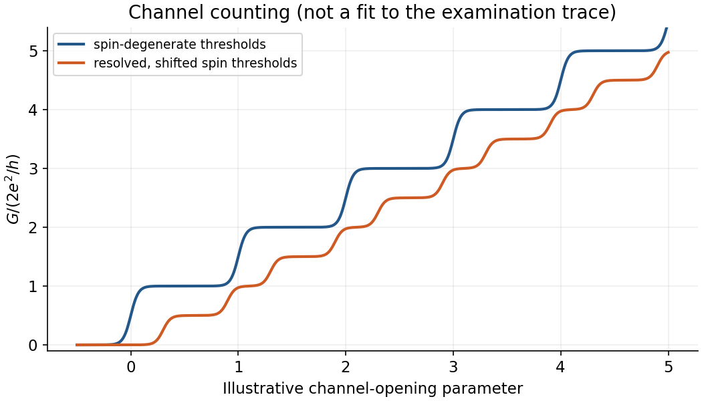
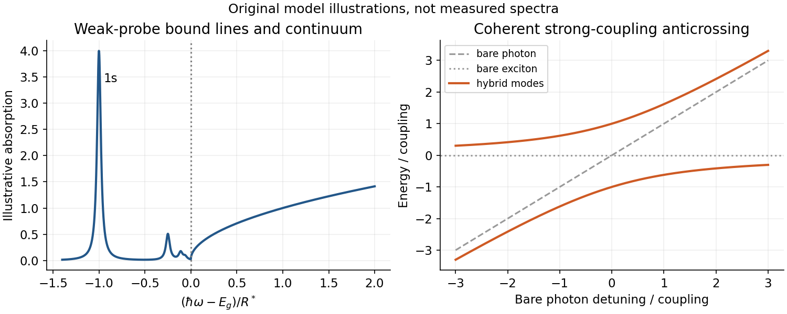

# Paper 1

↑ **Parent:** [2014](../2014.md)

[Original examination PDF, physical pages 638–642](https://www.whatdotheyknow.com/request/natural_science_tripos_physics_e_2/response/2340776/attach/2/FOI%202023%20399%20Zahid%20materials.pdf?cookie_passthrough=1#page=638)

**Table of contents**

- [1](#1)
  - [Solution](#1/solution)
- [2](#2)
  - [Solution](#2/solution)
- [3](#3)
  - [a](#3/a)
    - [Solution](#3/a/solution)
  - [b](#3/b)
    - [Solution](#3/b/solution)
  - [c](#3/c)
    - [Solution](#3/c/solution)

## 1

↑ **Parent:** [Paper 1](paper-1.md)

<h3 id="1/solution">Solution</h3>

↑ **Parent:** [1](#1)

A normal [Fermi liquid](../../fermi-liquid.md) is an interacting fermion phase continuously connected to a [Fermi gas](../../quantum-ideal-gas-statistics.md#fermi-gas) without broken symmetry. Its [Landau quasiparticles](../../fermi-liquid.md#landau-quasiparticle) are dressed particle/hole excitations near the [Fermi surface](../../fermi-liquid.md#fermi-surface), with the same conserved quantum numbers, finite [quasiparticle residue](../../fermi-liquid.md#quasiparticle-residue) and a decay width small compared with their excitation energy. Their reference dispersion already includes zero-temperature interaction renormalization; “bare quasiparticle” here does not mean a free atom.[Low-energy quasiparticles and effective dispersion](../../physics-bibliography.md#the-theory-of-a-fermi-liquid-by-lev-davidovich-landau)

The rate assumes $k_BT,|\xi|\ll E_F$, $\xi=\epsilon-\mu$, regular scattering amplitudes and [density of states](../../quantum-ideal-gas-statistics.md#density-of-states), equilibrium [Fermi-Dirac distributions](../../quantum-ideal-gas-statistics.md#fermi-dirac-distribution), and two-body collisions conserving energy and momentum. [Pauli exclusion principle](../../tensor-product-of-quantum-systems.md#pauli-exclusion-principle) restricts the available phase space. It describes a regular three-dimensional normal liquid, not a one-dimensional interacting electron liquid. On the surface, $\tau^{-1}\propto T^2$; at $T=0$ and $\xi>0$, it is proportional to $\xi^2$. Hence excitations become increasingly sharp. The quoted asymmetric occupation factor is for particle out-scattering: a hole decay or full spectral width also needs the complementary in-scattering process; it does not imply exponentially stable deep holes.

Symmetry $f_{ab}=f_{ba}$ cancels the quadratic functional's factor one-half, giving the [thermal Landau quasiparticle energy shift](../../fermi-liquid.md#thermal-landau-quasiparticle-energy-shift)

$$
\boxed{\widetilde\epsilon_a=\epsilon_a+\frac1V\sum_b f_{ab}\delta n_b+O(\delta n^2).}
$$

Here $a=(\mathbf k,\lambda)$, and the derivative is with respect to an occupation, not particle density. Replacing the homogeneous momentum sum by an energy integral defines a smooth angularly averaged kernel $H_a(\epsilon)$. With $\delta n=n_F(\epsilon;\mu,T)-\Theta(\mu_0-\epsilon)$,

$$
\delta\epsilon_a=H_a(\mu_0)\delta\mu+\frac{\pi^2}{6}(k_BT)^2H_a'(\mu_0)+O(T^4).
$$

Fixed density gives $\delta\mu=-(\pi^2/6)(k_BT)^2D'(\mu_0)/D(\mu_0)+O(T^4)$; fixed chemical potential instead has $\delta\mu=0$. Thus **$\widetilde\epsilon_a=\epsilon_a+O(T^2)$** in either case, provided the kernels are smooth and no instability intervenes. This is the [Sommerfeld expansion](../../quantum-ideal-gas-statistics.md#sommerfeld-expansion); singular spectra require separate treatment.[§3.6.4, fixed-density Sommerfeld expansion](../../physics-bibliography.md#statistical-physics-by-david-tong)

The leading entropy is therefore that of quasiparticles with their zero-temperature [effective mass](../../bloch-s-theorem.md#band-effective-mass):

$$
\boxed{C_V/T\longrightarrow\gamma=\frac{\pi^2k_B^2}{3}D^*(\mu_0).}
$$

$D^*$ here is the total, spin-summed [density of states](../../quantum-ideal-gas-statistics.md#density-of-states). The plotted low-temperature slopes require the enhanced masses $5.4m$ at molar volume $26.2\,\mathrm{cm^3\,mol^{-1}}$ and $2.7m$ at $36.8\,\mathrm{cm^3\,mol^{-1}}$, rather than the bare-mass predictions. At fixed molar particle number, $\gamma_{\rm mol}\propto m^*V_{\rm mol}^{2/3}$. Agreement is restricted to the low-temperature limit: the measured curves depart markedly from a fixed-mass ideal-gas extrapolation at higher temperature. This supports long-lived quasiparticles with smooth low-energy parameters, but heat capacity alone does not measure their lifetime or prove adiabatic continuity.

## 2

↑ **Parent:** [Paper 1](paper-1.md)

<h3 id="2/solution">Solution</h3>

↑ **Parent:** [2](#2)

A [GaAs](../../chemical-substance.md#gallium-arsenide)–AlGaAs [semiconductor heterostructure](../../semiconductor.md#semiconductor-heterostructure) confines electrons normal to the interface in a [semiconductor quantum well](../../semiconductor.md#quantum-well). Remote [modulation doping](../../semiconductor.md#modulation-doping) supplies a high-mobility [two-dimensional electron gas](../../quantum-ideal-gas-statistics.md#two-dimensional-electron-gas). Negative split gates deplete it laterally, leaving a narrow [quantum point contact](../../quantum-ideal-gas-statistics.md#quantum-point-contact) with discrete transverse subbands and continuous longitudinal momentum. A single occupied subband requires transverse excitation gaps larger than thermal and applied-bias energies.

Take $e>0$ and count **one spin-resolved channel**. In a length $L$, right-moving states have density $L\,dk/(2\pi)$; each contributes charge current $-ev_k/L$. Thus

$$
I^+=-\frac e{2\pi}\int_0^\infty v_k f_L\,dk,\qquad I^-_{\rm signed}=+\frac e{2\pi}\int_0^\infty v_k f_R\,dk.
$$

The second expression is the right reservoir's left-moving contribution expressed in the same left-to-right conventional-current sign. Since $v_k\,dk=dE/\hbar$,

$$
I=\frac eh\int_{E_0}^\infty[f(E;\mu,T)-f(E;\mu-eV,T)]\,dE,
\qquad\boxed{G=\frac{e^2}{h}f(E_0;\mu,T)\longrightarrow\frac{e^2}{h}.}
$$

The limit needs $k_BT,|eV|\ll\mu-E_0$ and [ballistic transport](../../fluid-mechanics.md#ballistic-transport). Velocity cancels the one-dimensional state density. Two degenerate spin channels give $2e^2/h$, not an extra factor hidden in the quoted single-channel result.

For elastic phase-coherent scattering, expand each incident flux-normalized mode in outgoing lead modes. Its transmitted fraction is $|(t_E)_{nm}|^2$; sum over all open outgoing $n$ and occupied incident $m$. Linearizing the reservoir occupations gives the [Landauer formula](../../quantum-mechanics.md#landauer-formula)

$$
\boxed{G=\frac{e^2}{h}\int dE\,[-f'(E)]\operatorname{tr}(t_E^\dagger t_E).}
$$

The source's $T_E^+$ denotes this amplitude matrix, not temperature or a probability matrix. Flux normalization is essential: ordinary wave-amplitude ratios need a velocity factor. Reservoirs equilibrate, contacts supply incoming Fermi distributions, and inelastic processes within the channel are neglected. Spin is included among channel labels. At $T\to0$, only transmissions at $\mu$ contribute; perfect channels each add one quantum. This is a two-terminal conductance including contact resistance, even with no internal backscattering.

Trace I has steps near integer $2e^2/h$ as less-negative gate voltage opens successive spin-degenerate subbands. At the printed parallel field $11\,\mathrm T$, [Zeeman splitting](../../atomic-physics.md#zeeman-splitting) separates the two spin thresholds, allowing approximately half-sized steps in the plotted units; the onset also shifts. Thermal broadening, imperfect transmission and unresolved thresholds round the plateaux. A parallel field primarily resolves spin in the ideal thin-interface model; finite layer thickness can also shift subband energies. The plot alone does not determine a unique effective $g$ factor or microscopic disorder model.

**[Figure 1](#2/image-illustrative-spin-resolved-channel-thresholds-produce-full-or-half-sized-conductance-steps). Illustrative spin-resolved channel thresholds produce full or half-sized conductance steps**. [Source](paper-1-aqc2014-channel-steps.py).

## 3

↑ **Parent:** [Paper 1](paper-1.md)

<h3 id="3/a">a</h3>

↑ **Parent:** [3](#3)

<h4 id="3/a/solution">Solution</h4>

↑ **Parent:** [A](#3/a)

In weak-probe [optical absorption](../../optics.md#optical-absorption), [Fermi's golden rule](../../quantum-mechanics.md#fermi-s-golden-rule) creates an [electron-hole pair](../../quantum-mechanics.md#electron-hole-pair), with negligible population depletion. Negligible photon momentum makes a [direct band gap](../../bloch-s-theorem.md#direct-band-gap) transition nearly vertical in crystal momentum:

$$
\alpha(\omega)\propto\frac1\omega\sum_{cv\mathbf k}|\mathbf e\cdot\mathbf p_{cv}|^2(f_v-f_c)\delta(E_c-E_v-\hbar\omega).
$$

For allowed transitions between three-dimensional parabolic bands, the [joint density of states](../../quantum-ideal-gas-statistics.md#joint-density-of-states) yields **$\alpha\propto\sqrt{\hbar\omega-E_g}/\omega$** above the gap. Selection rules and polarization enter the dipole matrix element. An [indirect band gap](../../bloch-s-theorem.md#indirect-band-gap) needs an additional phonon to conserve crystal momentum, with phonon absorption/emission weights and shifted thresholds.

Electron-hole attraction produces [Wannier excitons](../../quantum-mechanics.md#wannier-mott-exciton) below the continuum, approximately $E_n=E_g-R^*/n^2$, with bright $s$-state oscillator strength decreasing as $n^{-3}$. It also enhances the continuum edge. Screening, disorder and phonons broaden these features; heavy/light valence bands can create distinct series. This linear-response picture includes Coulomb binding but excludes a resolved coherent photon–exciton anticrossing: that would require a strong light–matter coupling treatment. “Weak coupling” here is distinguished from neglecting the electron-hole interaction altogether.

**[Figure 2](#3/a/image-bound-exciton-lines-below-a-continuum-edge-differ-from-coherent-exciton-photon-anticrossing). Bound exciton lines below a continuum edge differ from coherent exciton–photon anticrossing**. [Source](paper-1-aqc2014-absorption-and-hybridization.py).

<h3 id="3/b">b</h3>

↑ **Parent:** [3](#3)

<h4 id="3/b/solution">Solution</h4>

↑ **Parent:** [B](#3/b)

In mixed-valence manganites, mobile $e_g$ electrons hop between sites whose localized $t_{2g}$ core spins are coupled to them by strong [Hund's coupling](../../chemistry.md#hund-s-coupling). Projecting onto local spin-aligned states gives the [double-exchange mechanism](../../electromagnetism.md#double-exchange-mechanism)

$$
\boxed{|t_{ij}^{\rm eff}|=|t|\cos(\theta_{ij}/2).}
$$

Alignment maximizes the hopping bandwidth and lowers carrier kinetic energy, favouring [ferromagnetism](../../electromagnetism.md#ferromagnetism). This involves real charge transfer, unlike insulating [superexchange](../../electromagnetism.md#superexchange). Heating disorders core spins and reduces coherent transport; a [magnetic field](../../magnetic-field.md) aligns spins, increasing mobility and reducing resistivity. The large negative response near the magnetic transition is [colossal magnetoresistance](../../electric-charge.md#colossal-magnetoresistance).

Double exchange supplies the conduction–magnetism link, but its simplest spin-only model is insufficient for the full resistivity change. Lattice distortions, [Jahn-Teller effect](../../chemistry.md#jahn-teller-effect) and carrier localization can amplify the effect; materials need not obey a universal resistivity-versus-magnetization law.[Double exchange and magnetic conduction](../../physics-bibliography.md#interaction-between-the-d-shells-in-the-transition-metals-ii-ferromagnetic-compounds-of-manganese-with-perovskite-structure-by-clarence-zener)[1995 abstract: limitations of the spin-only model and electron–phonon coupling](../../physics-bibliography.md#double-exchange-alone-does-not-explain-the-resistivity-of-la1-xsrxmno3-by-a-j-millis-and-others)

<h3 id="3/c">c</h3>

↑ **Parent:** [3](#3)

<h4 id="3/c/solution">Solution</h4>

↑ **Parent:** [C](#3/c)

An [exciton](../../quantum-mechanics.md#exciton) is an electron-hole bound state and behaves approximately as a boson when the gas is dilute compared with the inverse exciton volume. A condensation experiment needs a long enough lifetime for cooling, high phase-space density and evidence of spontaneous coherence; excessive density causes ionization or a [Mott transition](../../quantum-mechanics.md#mott-transition) instead.

Bulk Cu₂O offers long-lived excitons, but heating, losses and [Auger recombination](../../quantum-mechanics.md#auger-recombination) complicate interpretation. Spectral narrowing or anomalous transport alone is insufficient: early claims required reinterpretation. Coupled quantum wells separate electron and hole layers, increasing lifetime and enabling cold indirect-exciton gases, though disorder, trapping and nonequilibrium flow must be distinguished from condensation.[2012 preprint: experimental history, losses and reinterpreted signatures](../../physics-bibliography.md#bose-einstein-condensation-of-excitons-in-cu2o-progress-over-thirty-years-by-david-snoke-and-g-m-kavoulakis)

In a semiconductor microcavity, coherent strong coupling mixes an exciton with a light cavity photon to form [polaritons](../../quantum-mechanics.md#polariton) with very small effective mass. Nonresonant pumping supplies particles without imposing the condensate's phase. The 2006 CdTe experiment reported a threshold, strong low-momentum occupation, increased temporal coherence and long-range spatial coherence. These combined signatures support an [exciton-polariton condensate](../../quantum-ideal-gas-statistics.md#exciton-polariton-condensate); a threshold or bright emission alone does not distinguish it from photon lasing. Check that strong coupling persists above threshold. Finite lifetime and pumping make this an open, driven system, so thermalization must be demonstrated rather than inferred merely from the word condensate.[2006: occupation, coherence and polarization measurements](../../physics-bibliography.md#bose-einstein-condensation-of-exciton-polaritons-by-j-kasprzak-and-others)

## ↑ Ancestors (11)

1. [2014](../2014.md)
2. [Past exam of the advanced Quantum Condensed Matter Physics course of the University of Cambridge](../../past-exam-of-the-advanced-quantum-condensed-matter-physics-course-of-the-university-of-cambridge.md)
3. [Advanced Quantum Condensed Matter Physics course of the University of Cambridge](../../university-of-cambridge.md#advanced-quantum-condensed-matter-physics-course-of-the-university-of-cambridge)
4. [Physics course of the year 4 of the natural sciences course of the University of Cambridge](../../university-of-cambridge.md#physics-course-of-the-year-4-of-the-natural-sciences-course-of-the-university-of-cambridge)
5. [Year 4 of the natural sciences course of the University of Cambridge](../../university-of-cambridge.md#year-4-of-the-natural-sciences-course-of-the-university-of-cambridge)
6. [Year of the natural sciences course of the University of Cambridge](../../university-of-cambridge.md#year-of-the-natural-sciences-course-of-the-university-of-cambridge)
7. [Natural sciences course of the University of Cambridge](../../university-of-cambridge.md#natural-sciences-course-of-the-university-of-cambridge)
8. [Course of the University of Cambridge](../../university-of-cambridge.md#course-of-the-university-of-cambridge)
9. [University of Cambridge](../../university-of-cambridge.md)
10. [List of universities](../../README.md#list-of-universities)
11. [Codex Wiki](../../README.md)
