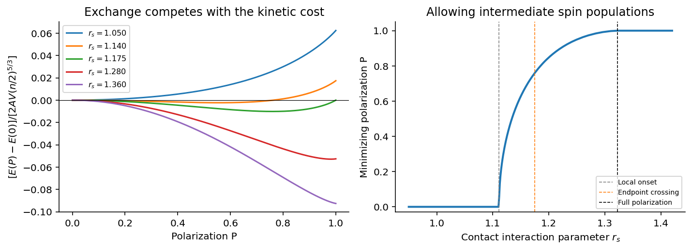
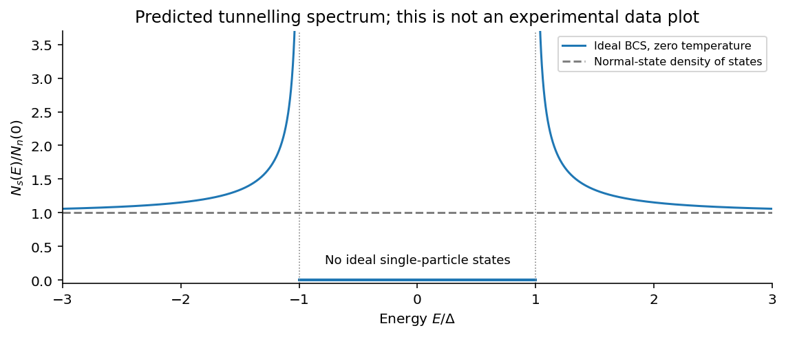
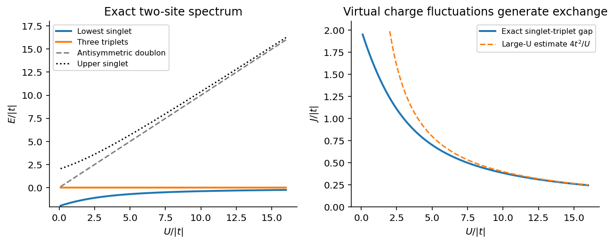

# Paper 1

↑ **Parent:** [2015](../2015.md)

[Original public PDF, physical pages 713–716; examination dated 12 January 2015](https://www.whatdotheyknow.com/request/natural_science_tripos_physics_e_2/response/2340776/attach/2/FOI%202023%20399%20Zahid%20materials.pdf?cookie_passthrough=1#page=713)

**Table of contents**

- [1](#1)
  - [Solution](#1/solution)
  - [a](#1/a)
    - [Solution](#1/a/solution)
  - [b](#1/b)
    - [Solution](#1/b/solution)
  - [c](#1/c)
    - [Solution](#1/c/solution)
  - [d](#1/d)
    - [Solution](#1/d/solution)
- [2](#2)
  - [a](#2/a)
    - [Solution](#2/a/solution)
  - [b](#2/b)
    - [Solution](#2/b/solution)
  - [c](#2/c)
    - [Solution](#2/c/solution)
- [3](#3)
  - [a](#3/a)
    - [Solution](#3/a/solution)
  - [b](#3/b)
    - [Solution](#3/b/solution)
  - [c](#3/c)
    - [Solution](#3/c/solution)
  - [d](#3/d)
    - [Solution](#3/d/solution)
  - [e](#3/e)
    - [Solution](#3/e/solution)
  - [f](#3/f)
    - [Solution](#3/f/solution)

## 1

↑ **Parent:** [Paper 1](paper-1.md)

<h3 id="1/solution">Solution</h3>

↑ **Parent:** [1](#1)

The [Hartree-Fock method](../../chemistry.md#hartree-fock-method) minimizes the expectation of an interacting-electron [Hamiltonian](../../hamiltonian-mechanics.md#hamiltonian) over normalized [Slater determinants](../../tensor-product-of-quantum-systems.md#slater-determinant) of orthonormal one-particle [spin](../../angular-momentum-operator.md#spin) orbitals. It is a variational, self-consistent mean-field approximation. The determinant enforces fermionic antisymmetry exactly within that class, while each orbital responds to the mean charge [density](../../fluid-mechanics.md#density) and a nonlocal exchange operator generated by the occupied orbitals.

For an [electron gas](../../physics.md#electron-gas), this accounts for kinetic pressure, the average electrostatic field, same-spin exchange and the associated exchange [hole](../../quantum-mechanics.md#electron-hole), and possible [spin polarization](../../angular-momentum-operator.md#spin-polarization). It does not account for general dynamical [electron correlation](../../physics.md#electron-correlation), such as the correlated avoidance of opposite-spin [electrons](../../physics.md#electron), and cannot capture all screening or collective fluctuations merely by optimizing one determinant. Uniform plane waves are an additional restriction, not the definition of Hartree-Fock itself.

In the [energy](../../energy.md) functional, the one-body term is the sum of [electron](../../physics.md#electron) [kinetic energy](../../energy.md#kinetic-energy) and ionic-potential [energy](../../energy.md). The direct two-body term is the [Hartree energy](../../physics.md#hartree-energy): the classical interaction of the mean [electron](../../physics.md#electron) [density](../../fluid-mechanics.md#density) with itself. Its factor $1/2$ avoids counting every pair twice. The negative Fock term comes from exchanging the two indistinguishable [electron](../../physics.md#electron) labels in the antisymmetric state. For a spin-independent interaction, [spin](../../angular-momentum-operator.md#spin) [orthogonality](../../inner-product.md#orthogonal-vectors) makes this exchange act only between equal [spin](../../angular-momentum-operator.md#spin) components. For an orbital interacting with itself, direct and exchange contributions cancel exactly; the exchange term removes the spurious one-electron self-interaction. Ionic background terms and their prescribed cancellation must be included consistently with the direct term.

<h3 id="1/a">a</h3>

↑ **Parent:** [1](#1)

<h4 id="1/a/solution">Solution</h4>

↑ **Parent:** [A](#1/a)

Use normalized plane-wave [spin](../../angular-momentum-operator.md#spin) orbitals $V^{-1/2}e^{i\mathbf k\cdot\mathbf r}\chi_\sigma$ and fill a separate [Fermi sphere](../../fermi-liquid.md#fermi-sphere) for each [spin](../../angular-momentum-operator.md#spin) species. Each [spin](../../angular-momentum-operator.md#spin) state counts once, so

$$
n_\sigma=\int_{|\mathbf k|<k_{F\sigma}}\frac{d^3k}{(2\pi)^3}
=\frac{k_{F\sigma}^3}{6\pi^2}.
$$

Its [kinetic energy](../../energy.md#kinetic-energy) per [volume](../../geometry-and-topology.md#volume) is

$$
\frac{T_\sigma}{V}=\int_{|\mathbf k|<k_{F\sigma}}\frac{d^3k}{(2\pi)^3}
\frac{\hbar^2k^2}{2m_e}
=\frac{\hbar^2 k_{F\sigma}^5}{20\pi^2m_e}
=A n_\sigma^{5/3},
\qquad
\boxed{A=\frac{3\hbar^2}{10m_e}(6\pi^2)^{2/3}.}
$$

The spin-independent contact interaction has uncancelled direct [energy](../../energy.md) $E_H/V=\gamma n^2/2$, with $n=n_\uparrow+n_\downarrow$. By the imposed background assumption this direct contribution cancels. For the Fock term the contact delta function sets the two spatial positions equal; its [spin](../../angular-momentum-operator.md#spin) factors then select equal spins. The local one-body [density](../../fluid-mechanics.md#density) matrix for each [spin](../../angular-momentum-operator.md#spin) has diagonal value $n_\sigma$, giving

$$
\frac{E_X}{V}=-\frac\gamma2\sum_\sigma n_\sigma^2.
$$

Combining these results gives the [contact-interaction Hartree-Fock spin energy](../../chemistry.md#contact-interaction-hartree-fock-spin-energy)

$$
\boxed{\frac{E_0}{V}=A(n_\uparrow^{5/3}+n_\downarrow^{5/3})
-\frac\gamma2(n_\uparrow^2+n_\downarrow^2).}
$$

Here $\gamma$ has units of [energy](../../energy.md) times [volume](../../geometry-and-topology.md#volume). The result is the model with the stated background subtraction; an isolated contact-interacting gas without that subtraction retains its direct contribution.

<h3 id="1/b">b</h3>

↑ **Parent:** [1](#1)

<h4 id="1/b/solution">Solution</h4>

↑ **Parent:** [B](#1/b)

For the unpolarized gas write $x=n/2$. The positive direct [Hartree energy](../../physics.md#hartree-energy) before background cancellation and the [kinetic energy](../../energy.md#kinetic-energy) are

$$
\frac{E_H}{V}=\frac\gamma2(2x)^2=2\gamma x^2,
\qquad \frac TV=2Ax^{5/3}.
$$

Their ratio is therefore

$$
\boxed{r_s=\frac{E_H}{T}=\frac\gamma A\left(\frac n2\right)^{1/3}.}
$$

This compares the separate direct and kinetic terms. The net Hartree-plus-background contribution after the stipulated cancellation is zero, so it would be incorrect to interpret $r_s$ as that residual contribution divided by $T$. The exchange-energy magnitude in the unpolarized state is $E_H/2$, not $E_H$.

<h3 id="1/c">c</h3>

↑ **Parent:** [1](#1)

<h4 id="1/c/solution">Solution</h4>

↑ **Parent:** [C](#1/c)

At fixed total [density](../../fluid-mechanics.md#density), the unpolarized and fully polarized candidate energies are

$$
\frac{E_u}{V}=A2^{-2/3}n^{5/3}-\frac{\gamma n^2}{4},\qquad
\frac{E_p}{V}=An^{5/3}-\frac{\gamma n^2}{2}.
$$

Polarization increases the [kinetic energy](../../energy.md#kinetic-energy) because one [spin](../../angular-momentum-operator.md#spin) species must occupy a larger [Fermi sphere](../../fermi-liquid.md#fermi-sphere), but gains negative exchange [energy](../../energy.md). The fully polarized candidate wins this endpoint comparison if

$$
A n^{5/3}(1-2^{-2/3})-\frac{\gamma n^2}{4}<0.
$$

Using the defined $r_s$ gives

$$
\boxed{r_s>4\,2^{-1/3}(1-2^{-2/3})=2^{5/3}-2=1.174802\ldots.}
$$

Thus the specified two-state comparison indeed predicts a polarized state below the unpolarized state's [energy](../../energy.md) for $r_s>1.175$.

The [endpoint and continuous polarization thresholds of a contact electron gas](../../chemistry.md#endpoint-and-continuous-polarization-thresholds-of-a-contact-electron-gas) are different. To check the actual onset within the same uniform Hartree-Fock model, allow $P=(n_\uparrow-n_\downarrow)/n$ to vary continuously. In units $2A(n/2)^{5/3}$,

$$
f(P)=\frac{(1+P)^{5/3}+(1-P)^{5/3}}2-\frac{r_s}{2}(1+P^2),
$$

$$
f(P)-f(0)=\left(\frac59-\frac{r_s}{2}\right)P^2+\frac5{243}P^4+O(P^6).
$$

The unpolarized state loses local stability already at **$r_s=10/9\simeq1.111$**. Full polarization becomes the minimizing endpoint only when $f'(1)\le0$, or $r_s\ge(5/6)2^{2/3}\simeq1.323$. Between those values the optimum is partly polarized. Consequently $1.175$ is the requested endpoint crossing, not the exact onset of spontaneous polarization after all [spin](../../angular-momentum-operator.md#spin) populations are allowed.

**[Figure 1](#1/c/image-contact-interaction-spin-energies-showing-partial-polarization-between-the-local-onset-and-full-saturation). Contact-interaction spin energies showing partial polarization between the local onset and full saturation**.

<h3 id="1/d">d</h3>

↑ **Parent:** [1](#1)

<h4 id="1/d/solution">Solution</h4>

↑ **Parent:** [D](#1/d)

The central limitation is that a [Hartree-Fock electron gas](../../chemistry.md#hartree-fock-electron-gas) includes exchange but omits the correlation [energy](../../energy.md) that is not representable by one determinant. Opposite-spin [electrons](../../physics.md#electron) can lower their repulsion by avoiding one another in a correlated unpolarized state. Hartree-Fock misses that avoidance while retaining the exchange advantage of aligned spins, so it need not place a magnetic instability at a reliable interaction strength. The relevant [energy](../../energy.md) differences between competing [spin](../../angular-momentum-operator.md#spin) states can be much smaller than their total energies. Correlation calculations of the [electron](../../physics.md#electron) gas explicitly address this competition.[Author manuscript, physical PDF pages 4–8: competing phases, correlated trial functions and [energy](../../energy.md) differences](../../physics-bibliography.md#ground-state-of-the-electron-gas-by-a-stochastic-method-by-d-m-ceperley-and-b-j-alder)

There are further model restrictions. A constant contact coupling discards the [momentum](../../momentum.md) dependence of the [Coulomb interaction](../../electrostatics.md#coulomb-interaction) and the resulting nontrivial screening. Real materials have a [lattice](../../mathematical-logic.md#lattice), band structure and material-dependent effective interactions. Spatial magnetic textures or other competing states are excluded by a comparison restricted to uniform Fermi spheres. Even before those changes, part c's two endpoints do not find the continuous polarization onset.

The symbol $r_s$ also needs care. Here it is an [energy](../../energy.md) ratio proportional to $\gamma n^{1/3}$. The usual [Dimensionless Wigner-Seitz radius](../../quantum-mechanics.md#dimensionless-wigner-seitz-radius) of a three-dimensional Coulomb [electron](../../physics.md#electron) gas is $r_s^{\rm WS}=[3/(4\pi n)]^{1/3}/a_B$, proportional to $n^{-1/3}$. They are not the same [density](../../fluid-mechanics.md#density) parameter. A quoted experimental value of the latter cannot be compared numerically to $1.175$ without a model-specific mapping. **The contact interaction, missing correlations, restricted variational class and parameter convention prevent the number $1.175$ from being a quantitative experimental prediction.** The paper supplies no particular experimental threshold, so none is invented here.

## 2

↑ **Parent:** [Paper 1](paper-1.md)

<h3 id="2/a">a</h3>

↑ **Parent:** [2](#2)

<h4 id="2/a/solution">Solution</h4>

↑ **Parent:** [A](#2/a)

[Landau quasiparticles](../../fermi-liquid.md#landau-quasiparticle) describe the long-lived low-energy excitations of an interacting normal [Fermi liquid](../../fermi-liquid.md). Starting from a free [Fermi gas](../../quantum-ideal-gas-statistics.md#fermi-gas), imagine switching on interactions without changing the phase or destroying the one-to-one labelling of low-energy states. The resulting excitation carries the quantum numbers of a dressed particle but has a renormalized [energy](../../energy.md) and interactions with other excitations. Its microscopic [wavefunction](../../wave-function.md) need not resemble a bare [electron](../../physics.md#electron) state. The occupied momenta define a [Fermi surface](../../fermi-liquid.md#fermi-surface), and the quasiparticle [energy](../../energy.md) measured from the [chemical potential](../../chemical-potential.md) vanishes on that surface.

The [Landau quasiparticle energy functional](../../fermi-liquid.md#landau-quasiparticle-energy-functional) expresses the change near equilibrium in terms of occupation changes:

$$
\delta(E-\mu N)=\sum_{\mathbf p\sigma}\xi^*_{\mathbf p}\delta n_{\mathbf p\sigma}
+\frac1{2V}\sum_{\mathbf p\sigma,\mathbf p'\sigma'}
f_{\sigma\sigma'}(\mathbf p,\mathbf p')\delta n_{\mathbf p\sigma}\delta n_{\mathbf p'\sigma'}.
$$

Differentiation gives the [energy](../../energy.md) of one quasiparticle in the distorted distribution. This is a phenomenological expansion around the true interacting ground state, not the assertion that its total [energy](../../energy.md) equals that of independent particles. For an isotropic system, spin-symmetric and spin-antisymmetric components of $f$ are expanded in Legendre polynomials. Multiplication by the appropriate Fermi-surface [density of states](../../quantum-ideal-gas-statistics.md#density-of-states) defines dimensionless [Landau parameters](../../fermi-liquid.md#landau-parameter) $F_l^s,F_l^a$. The original formulation relates a change in the distribution to the [energy](../../energy.md) shift.[Page 70, quasiparticle interaction and distribution variation](../../physics-bibliography.md#on-the-theory-of-the-fermi-liquid-by-lev-davidovich-landau)

[Pauli blocking](../../tensor-product-of-quantum-systems.md#pauli-blocking) makes the low-energy excitations sharp. The phase space for a quasiparticle to scatter while creating another particle–[hole](../../quantum-mechanics.md#electron-hole) pair shrinks as the [Fermi surface](../../fermi-liquid.md#fermi-surface) is approached, giving the regular three-dimensional [low-energy Fermi-liquid quasiparticle lifetime](../../fermi-liquid.md#low-energy-fermi-liquid-quasiparticle-lifetime)

$$
\tau^{-1}\propto(\epsilon-\mu)^2+(\pi k_BT)^2.
$$

Thus at zero [temperature](../../temperature.md) its width is small compared with its excitation [energy](../../energy.md). The single-particle spectral function has a pole with [quasiparticle residue](../../fermi-liquid.md#quasiparticle-residue) $Z$, generally less than one, and an incoherent remainder. In a conventional [Fermi liquid](../../fermi-liquid.md) the occupation distribution has a discontinuity of height $Z$ at the [Fermi surface](../../fermi-liquid.md#fermi-surface), rather than a unit free-particle step.

For an isotropic three-dimensional system, define $N^*(0)$ to include both spins. The quasiparticle [density of states](../../quantum-ideal-gas-statistics.md#density-of-states) determines the low-temperature electronic [heat capacity](../../heat.md#heat-capacity), $C_V/V=(\pi^2/3)k_B^2N^*(0)T$. In the usual Landau-parameter normalization, the [spin](../../angular-momentum-operator.md#spin) response is modified by $1/(1+F_0^a)$ and the [compressibility](../../thermodynamics.md#compressibility) by $1/(1+F_0^s)$. In a Galilean-invariant continuum, $m^*/m=1+F_1^s/3$; that particular relation must not be imposed unchanged on a crystal band. A denominator approaching zero signals a possible instability of the assumed normal state.

The same interaction functional and a kinetic equation describe collective [zero sound](../../fermi-liquid.md#zero-sound) when the excitation frequency exceeds the collision rate. Ordinary [first sound](../../physics.md#first-sound) is the collision-dominated hydrodynamic limit. **The theory organizes thermodynamics, response and transport through a small set of measured effective parameters while explaining why interactions coexist with long-lived fermionic excitations.** It is not applicable without qualification in phases where the Fermi-liquid quasiparticle pole disappears or a gap opens over the relevant [Fermi surface](../../fermi-liquid.md#fermi-surface).

<h3 id="2/b">b</h3>

↑ **Parent:** [2](#2)

<h4 id="2/b/solution">Solution</h4>

↑ **Parent:** [B](#2/b)

A [Wannier-Mott exciton](../../quantum-mechanics.md#wannier-mott-exciton) is a bound conduction-band [electron](../../physics.md#electron) and valence-band [hole](../../quantum-mechanics.md#electron-hole) whose envelope extends over many [lattice](../../mathematical-logic.md#lattice) cells. That large radius permits an [effective mass](../../bloch-s-theorem.md#band-effective-mass) description and dielectric screening of the [electron](../../physics.md#electron)–[hole](../../quantum-mechanics.md#electron-hole) attraction. With [electron](../../physics.md#electron) and [hole](../../quantum-mechanics.md#electron-hole) masses $m_e^*,m_h^*$, define reduced mass $\mu=m_e^*m_h^*/(m_e^*+m_h^*)$ and center-of-mass mass $M=m_e^*+m_h^*$. The bulk relative-motion [Hamiltonian](../../hamiltonian-mechanics.md#hamiltonian) is hydrogenic with an appropriate [relative permittivity](../../quantum-mechanics.md#relative-permittivity) $\epsilon_r$:

$$
H_{\rm rel}=-\frac{\hbar^2\nabla^2}{2\mu}-\frac{e^2}{4\pi\epsilon_0\epsilon_r r},\qquad
a_X=\frac{4\pi\epsilon_0\epsilon_r\hbar^2}{\mu e^2},\qquad
R_X=\frac{\mu e^4}{2(4\pi\epsilon_0\epsilon_r)^2\hbar^2}.
$$

A [semiconductor](../../semiconductor.md) [quantum well](../../semiconductor.md#quantum-well) confines the [electron](../../physics.md#electron) and [hole](../../quantum-mechanics.md#electron-hole) perpendicular to the plane while leaving approximately free in-plane center-of-mass motion. If the well width is small compared with the bulk [exciton Bohr radius](../../quantum-mechanics.md#exciton-bohr-radius), their relative motion becomes quasi-two-dimensional. The ideal zero-width, same-dielectric limit is

$$
H_\rho=-\frac{\hbar^2\nabla_\rho^2}{2\mu}-\frac{e^2}{4\pi\epsilon_0\epsilon_r\rho},\qquad
\boxed{E_n=-\frac{R_X}{(n-1/2)^2},\quad n=1,2,\ldots.}
$$

Its ground-state binding is $4R_X$, compared with $R_X$ in three dimensions, and the ground envelope decays on the scale $a_X/2$. Stronger binding follows because confinement prevents the pair from separating in the third direction.

For a [finite-width quantum-well exciton](../../quantum-mechanics.md#finite-width-quantum-well-exciton), average the Coulomb attraction over the normalized [electron](../../physics.md#electron) and [hole](../../quantum-mechanics.md#electron-hole) confinement envelopes:

$$
V_{\rm eff}(\rho)=-\frac{e^2}{4\pi\epsilon_0\epsilon_r}
\int dz_e\,dz_h\,
\frac{|\chi_e(z_e)|^2|\chi_h(z_h)|^2}{\sqrt{\rho^2+(z_e-z_h)^2}}.
$$

This smooths the strict planar singularity and changes the binding. The ideal factor four is a useful reference, not a universal value for every real well. Finite barriers, dielectric mismatch, several confinement subbands and nonparabolic valence bands can require a coupled treatment.

Optical absorption creates a nearly zero in-plane center-of-mass wavevector [exciton](../../quantum-mechanics.md#exciton). For the lowest confinement subbands, its line lies approximately at

$$
\hbar\omega=E_g+E_{e,z}+E_{h,z}-E_b+\frac{\hbar^2K_\parallel^2}{2M}.
$$

The discrete bound-state peaks occur below the free [electron](../../physics.md#electron)–[hole](../../quantum-mechanics.md#electron-hole) continuum. Dipole-allowed envelope states have nonzero relative [wavefunction](../../wave-function.md) at zero separation; the absorption strength also contains the confinement overlap $|\int\chi_e^*(z)\chi_h(z)\,dz|^2$. Confinement can increase the overlap and the binding, making excitonic optical structure more prominent. A perpendicular electric field shifts and separates the confinement envelopes, changing the transition [energy](../../energy.md) and usually reducing their optical overlap: this is the [quantum-confined Stark effect](../../semiconductor.md#quantum-confined-stark-effect).

**[Figure 2](#2/b/image-ideal-bulk-and-planar-exciton-binding-series-measured-relative-to-their-respective-continuum-edges). Ideal bulk and planar exciton binding series measured relative to their respective continuum edges**.

**[Quantum wells](../../semiconductor.md#quantum-well) tune both the continuum threshold and the bound-state [energy](../../energy.md); an optical line shift is not automatically a change in binding alone.** The hydrogenic envelope model requires a Wannier-sized state, rather than an [exciton](../../quantum-mechanics.md#exciton) localized to one [lattice](../../mathematical-logic.md#lattice) cell.

<h3 id="2/c">c</h3>

↑ **Parent:** [2](#2)

<h4 id="2/c/solution">Solution</h4>

↑ **Parent:** [C](#2/c)

Experimental tests of [BCS theory](../../fermi-liquid.md#bcs-theory) compare several properties of the same superconducting state. In the conventional weak-coupling setting, phonon-mediated attraction pairs opposite momenta and spins, and the [BCS quasiparticle spectrum](../../fermi-liquid.md#bcs-quasiparticle-spectrum) is $E_k=\sqrt{\xi_k^2+\Delta^2(T)}$. Agreement with a single [energy](../../energy.md) scale and its [temperature](../../temperature.md) dependence is more discriminating than observing zero resistance alone.

The [superconducting isotope effect](../../fermi-liquid.md#superconducting-isotope-effect) tests the [lattice](../../mathematical-logic.md#lattice)'s role. Replacing one [isotope](../../chemical-substance.md#isotope) by another changes ionic masses while leaving the chemical valence nearly unchanged. [Phonon](../../quantum-ideal-gas-statistics.md#phonon) frequencies scale approximately as $M^{-1/2}$, so a weak-coupling [phonon](../../quantum-ideal-gas-statistics.md#phonon) mechanism predicts $T_c\propto M^{-\alpha}$ with $\alpha\simeq1/2$ when other parameters stay fixed. The shift was measured in mercury before the microscopic pairing theory was developed.[1950 primary report, transition-temperature comparison of mercury [isotopes](../../chemical-substance.md#isotope)](../../physics-bibliography.md#isotope-effect-in-the-superconductivity-of-mercury-by-emanuel-maxwell) Deviations from $1/2$ can result from Coulomb, anharmonic and strong-coupling effects; the [isotope](../../chemical-substance.md#isotope) observation supports lattice-mediated pairing without uniquely proving every assumption of the simplest model.

Thermodynamic measurements test the gapped excitations and condensation [energy](../../energy.md). An isotropic fully gapped [superconductor](../../superconductivity.md#superconductor) has exponentially small low-temperature electronic [heat capacity](../../heat.md#heat-capacity), rather than the normal linear law. At the transition the [weak-coupling BCS thermodynamic ratios](../../fermi-liquid.md#weak-coupling-bcs-thermodynamic-ratios) are

$$
\boxed{\frac{2\Delta(0)}{k_BT_c}=2\pi e^{-\gamma_E}\simeq3.528,
\qquad \frac{C_s(T_c^-)-C_n(T_c)}{C_n(T_c)}
=\frac{12}{7\zeta(3)}\simeq1.426.}
$$

Here $C_n$ means the electronic contribution after subtracting the [lattice](../../mathematical-logic.md#lattice) background. The gap closes at $T_c$, and the same framework predicts the [temperature](../../temperature.md) dependence of penetration depth and thermodynamic critical field. These quantities were quantitative comparisons in the original theory.[Abstract and thermodynamic discussion: [energy](../../energy.md) gap, specific heat and penetration depth](../../physics-bibliography.md#theory-of-superconductivity-by-john-bardeen-and-others)

[Electron](../../physics.md#electron) tunnelling measures the excitation spectrum more directly. A normal-metal–insulator–[superconductor](../../superconductivity.md#superconductor) junction has, at sufficiently low [temperature](../../temperature.md) and nearly constant tunnelling matrix element, $dI/dV$ proportional to the superconducting [density of states](../../quantum-ideal-gas-statistics.md#density-of-states) at $E=eV$:

$$
\frac{N_s(E)}{N_n(0)}=
\operatorname{Re}\frac{|E|}{\sqrt{E^2-\Delta^2}}.
$$

The suppression below the gap and enhancement at its edges test the [BCS electronic density of states](../../fermi-liquid.md#bcs-electronic-density-of-states). Giaever's thin oxide-barrier junction measurements established such energy-gap structure.[Physical Review Letters 5, 147–148; tunnel-current and differential-conductance measurements](../../physics-bibliography.md#energy-gap-in-superconductors-measured-by-electron-tunneling-by-ivar-giaever) For a junction between two [superconductors](../../superconductivity.md#superconductor) the threshold involves the sum of their gaps, so it must not be read as a normal-metal single-gap spectrum without accounting for the two electrodes.

**[Figure 3](#2/c/image-ideal-bcs-density-of-states-illustrating-gap-edge-spectroscopy-model-prediction-not-experimental-measurements). Ideal BCS density of states illustrating gap-edge spectroscopy; model prediction, not experimental measurements**.

Nuclear spin-lattice relaxation supplies a phase-coherence-sensitive test. In the conventional s-wave case, the [Hebel-Slichter coherence peak](../../fermi-liquid.md#hebel-slichter-coherence-peak) just below $T_c$ is followed by a falling rate at lower [temperature](../../temperature.md). [Density of states](../../quantum-ideal-gas-statistics.md#density-of-states) alone is not enough: the [BCS coherence factors](../../fermi-liquid.md#bcs-coherence-factors) enter the transition matrix elements. The contrast between nuclear relaxation and ultrasonic attenuation was explained using the paired state, unlike a simple two-fluid population model.[Abstract: field-cycling method and comparison of nuclear relaxation with ultrasonic absorption](../../physics-bibliography.md#nuclear-spin-relaxation-in-normal-and-superconducting-aluminum-by-l-c-hebel-and-charles-pence-slichter)

Finally, [magnetic flux](../../magnetic-field.md#magnetic-flux) quantization in units $h/(2e)$ and [Josephson effects](../../superconductivity.md#josephson-effect) support a coherent charge-$2e$ condensate. Those observations establish pairing and phase coherence more broadly; their existence alone does not specify a [phonon](../../quantum-ideal-gas-statistics.md#phonon) mechanism or an isotropic weak-coupling gap. **The converging [isotope](../../chemical-substance.md#isotope), spectroscopic, thermodynamic and coherence-factor tests support conventional BCS [superconductivity](../../superconductivity.md), with explicit limits to its simplest universal ratios.**

## 3

↑ **Parent:** [Paper 1](paper-1.md)

<h3 id="3/a">a</h3>

↑ **Parent:** [3](#3)

<h4 id="3/a/solution">Solution</h4>

↑ **Parent:** [A](#3/a)

The first term assigns [energy](../../energy.md) $\epsilon_i$ to occupying the localized orbital at site $i$. The hopping term moves an [electron](../../physics.md#electron) between neighbouring sites, producing kinetic delocalization and band dispersion; [Hermitian](../../hilbert-space.md#hermitian-operator) conjugate hops make the [Hamiltonian](../../hamiltonian-mechanics.md#hamiltonian) [Hermitian](../../hilbert-space.md#hermitian-operator). The final term costs $U>0$ only when both [spin](../../angular-momentum-operator.md#spin) states occupy the same local orbital. This is a [Hubbard model](../../statistical-physics.md#hubbard-model) with an on-site Coulomb penalty, not a classical interaction between magnetic dipoles.

At one [electron](../../physics.md#electron) per site and large $U$, a real hop is energetically costly, but a virtual hop into a doubly occupied intermediate state is possible. Opposite-spin states can exploit these virtual processes and lower their [energy](../../energy.md), while parallel spins cannot occupy the same one-orbital site. The resulting singlet–triplet splitting produces antiferromagnetic [Hubbard kinetic exchange](../../statistical-physics.md#hubbard-kinetic-exchange).

There is a terminology qualification. The paper calls this overlap-mediated process “[direct exchange](../../electromagnetism.md#direct-exchange)” because the hopping is directly between neighbouring magnetic orbitals. In the stricter distinction between [direct Coulomb exchange versus kinetic exchange](../../electromagnetism.md#direct-coulomb-exchange-versus-kinetic-exchange), the displayed [Hamiltonian](../../hamiltonian-mechanics.md#hamiltonian) omits an explicit intersite Coulomb exchange integral. The antiferromagnetic $t^2/U$ mechanism derived below is kinetic exchange; a genuine intersite [direct exchange](../../electromagnetism.md#direct-exchange) term is separate and can compete with it. This distinction also separates the model from ligand-mediated [superexchange](../../electromagnetism.md#superexchange) in part f.

<h3 id="3/b">b</h3>

↑ **Parent:** [3](#3)

<h4 id="3/b/solution">Solution</h4>

↑ **Parent:** [B](#3/b)

Expand the field operator in orthonormal localized orbitals, $\hat\psi(\mathbf r)=\sum_i\phi_i(\mathbf r)c_i$. For a one-electron continuum [Hamiltonian](../../hamiltonian-mechanics.md#hamiltonian) $h_0=\hat p^2/(2m^*)+V(\mathbf r)$, projection gives

$$
H_0=\sum_{ij}h_{ij}c_i^\dagger c_j,\qquad
h_{12}=\int d^3r\,\phi_1^*(\mathbf r)
\left[\frac{\hat p^2}{2m^*}+V(\mathbf r)\right]\phi_2(\mathbf r).
$$

The coefficient in the displayed [lattice](../../mathematical-logic.md#lattice) [Hamiltonian](../../hamiltonian-mechanics.md#hamiltonian) is $-t_{12}$. Thus the [projected hopping matrix element and sign convention](../../bloch-s-theorem.md#projected-hopping-matrix-element-and-sign-convention) require

$$
\boxed{-t_{12}=h_{12}=K_{12}+V_{12},\qquad
K_{12}=\int d^3r\,\phi_1^*\frac{\hat p^2}{2m^*}\phi_2.}
$$

[Orthogonality](../../inner-product.md#orthogonal-vectors) states $\int\phi_1^*\phi_2=0$; it does not imply $\int\phi_1^*V\phi_2=0$ for a spatially varying potential. If the off-diagonal potential is assumed zero, for example when it is a constant, the hopping coefficient is $h_{12}=K_{12}$. This is the kinetic integral requested by the paper, but it equals $-t_{12}$ under the paper's own leading-minus convention. A convention writing the hopping term with a plus sign would instead call $h_{12}$ itself $t_{12}$.

**The printed positive equality is not a consequence of the stated [orthogonality](../../inner-product.md#orthogonal-vectors) assumption and the displayed sign convention.** [Orthogonality does not diagonalize a varying potential](../../inner-product.md#orthogonality-does-not-diagonalize-a-varying-potential) gives an explicit counterexample to the underlying inference. The general projected relation above states the supported result; setting $V_{12}=0$ still leaves $-t_{12}=K_{12}$ in the question's convention. Rephasing an orbital changes both $h_{12}$ and the coefficient of the corresponding operator together; it does not remove this algebraic sign mismatch in a fixed convention. The spectrum in the remaining two-site calculation depends on $|t|^2$, so those parts are unaffected.

<h3 id="3/c">c</h3>

↑ **Parent:** [3](#3)

<h4 id="3/c/solution">Solution</h4>

↑ **Parent:** [C](#3/c)

Fix canonical single-particle order $(1\uparrow,1\downarrow,2\uparrow,2\downarrow)$ and write the occupation ket as $|n_1n_2n_3n_4\rangle$. The six states in the printed order are $|1010\rangle$, $|1001\rangle$, $|0110\rangle$, $|0101\rangle$, $|1100\rangle$, $|0011\rangle$. The last state is [double occupancy](../../statistical-physics.md#double-occupancy) on site 2.

For a [fermionic raising and lowering operator](../../quantum-mechanics.md#fermionic-raising-and-lowering-operator) acting on mode $j$, the sign is $(-1)^{\sum_{k<j}n_k}$, and annihilation requires that mode occupied while creation requires it empty. Starting from the second basis state, the hop that reaches the last state is

$$
c_{2\uparrow}^\dagger c_{1\uparrow}|1001\rangle
=c_{2\uparrow}^\dagger|0001\rangle=|0011\rangle.
$$

It therefore contributes **$H_{6,2}=-t$**. Starting from the third state instead,

$$
c_{2\downarrow}^\dagger c_{1\downarrow}|0110\rangle
=c_{2\downarrow}^\dagger|0010\rangle=-|0011\rangle,
$$

because the occupied $2\uparrow$ mode precedes $2\downarrow$. The [Hamiltonian](../../hamiltonian-mechanics.md#hamiltonian)'s leading $-t$ makes **$H_{6,3}=+t$**. Finally $n_{2\uparrow}n_{2\downarrow}|0011\rangle=|0011\rangle$, so **$H_{6,6}=U$**. No other displayed basis state reaches $|0011\rangle$ in one allowed hop. These signs verify the three nonzero entries without assigning distinguishable-particle hopping signs to fermions.

<h3 id="3/d">d</h3>

↑ **Parent:** [3](#3)

<h4 id="3/d/solution">Solution</h4>

↑ **Parent:** [D](#3/d)

Use $|j\rangle$ for the six printed basis vectors. The three singly occupied triplets are

$$
|T_+\rangle=|1\rangle,\qquad
|T_0\rangle=\frac{|2\rangle+|3\rangle}{\sqrt2},\qquad
|T_-\rangle=|4\rangle.
$$

Each has **[energy](../../energy.md) zero**: either Pauli exclusion prevents hopping to [double occupancy](../../statistical-physics.md#double-occupancy) or the two contributions cancel. Define

$$
|S\rangle=\frac{|2\rangle-|3\rangle}{\sqrt2},\quad
|D_+\rangle=\frac{|5\rangle+|6\rangle}{\sqrt2},\quad
|D_-\rangle=\frac{|5\rangle-|6\rangle}{\sqrt2}.
$$

The state $D_-$ has [energy](../../energy.md) $U$. In the $S,D_+$ subspace the [Hamiltonian](../../hamiltonian-mechanics.md#hamiltonian) is $\bigl(\begin{smallmatrix}0&-2t\\-2t&U\end{smallmatrix}\bigr)$, with

$$
E_\pm=\frac{U\pm\sqrt{U^2+16t^2}}2.
$$

For $U\gg|t|>0$, the fourth low-energy eigenstate is the normalized singlet

$$
\boxed{|\psi_-\rangle=\mathcal N\left(|S\rangle-\frac{E_-}{2t}|D_+\rangle\right)
\simeq\mathcal N\left(|S\rangle+\frac{2t}{U}|D_+\rangle\right),}
$$

where $\mathcal N=[1+(E_-/(2t))^2]^{-1/2}$. Its [energy](../../energy.md) is

$$
\boxed{E_-=-\frac{4t^2}{U}+O(t^4/U^3).}
$$

The **four lowest energies are $-4t^2/U,0,0,0$ to leading order**, with the singlet and triplets just given. The upper pair lie near $U$ and $U+4t^2/U$.

The low-energy [Hamiltonian](../../hamiltonian-mechanics.md#hamiltonian) can be written

$$
\boxed{H_{\rm eff}=J\left(\mathbf S_1\cdot\mathbf S_2-\frac14\right),\qquad
J=\frac{4t^2}{U}>0,}
$$

using dimensionless spin-half operators. It places the singlet below the triplet by $J$, hence favors antiferromagnetic alignment. A [lattice](../../mathematical-logic.md#lattice) of such bonds can support [antiferromagnetism](../../electromagnetism.md#antiferromagnetism), although its ordering pattern also depends on geometry and competing couplings. The physical [energy](../../energy.md) gain comes from virtual charge fluctuations, not from a permanent [double occupancy](../../statistical-physics.md#double-occupancy) in the large-$U$ limit.

**[Figure 4](#3/d/image-exact-singlet-triplet-spectrum-of-the-two-site-repulsive-hubbard-model-and-the-large-u-exchange-scale). Exact singlet-triplet spectrum of the two-site repulsive Hubbard model and the large-U exchange scale**.

<h3 id="3/e">e</h3>

↑ **Parent:** [3](#3)

<h4 id="3/e/solution">Solution</h4>

↑ **Parent:** [E](#3/e)

An overlap estimate must use nearest magnetic-ion separations. For the [face-centered cubic lattice](../../quantum-scattering.md#face-centered-cubic-lattice) of Mn, $d_{\rm Mn}=a_{\rm Mn}/\sqrt2=3.147\ \mathrm{\mathring A}$; for the [body-centered cubic lattice](../../quantum-scattering.md#body-centered-cubic-lattice) of Fe, $d_{\rm Fe}=\sqrt3a_{\rm Fe}/2=2.477\ \mathrm{\mathring A}$. The supplied radial functions have inverse decay lengths $\kappa_Z=Z/(3a_B)$. Their intersite overlap therefore contains approximately $e^{-\kappa_Zd}$, up to polynomial and angular factors. The decisive exponent difference is

$$
\kappa_{\rm Mn}d_{\rm Mn}-\kappa_{\rm Fe}d_{\rm Fe}
=\frac{25(4.45/\sqrt2)-26(\sqrt3\,2.86/2)}{3(0.529)}
\simeq8.99.
$$

The [exponential orbital-tail estimate of exchange](../../electromagnetism.md#exponential-orbital-tail-estimate-of-exchange) thus gives a hopping suppression approximately $e^{-8.99}\simeq1.25\times10^{-4}$ before polynomial corrections. Keeping the supplied $Z^{7/2}r^2$ radial prefactor in a midpoint overlap proxy gives

$$
\frac{\phi_{\rm Mn}(d_{\rm Mn}/2)^2}{\phi_{\rm Fe}(d_{\rm Fe}/2)^2}
\sim\left(\frac{25}{26}\right)^7
\left(\frac{d_{\rm Mn}}{d_{\rm Fe}}\right)^4e^{-8.99}
\simeq2.5\times10^{-4}.
$$

This proxy is not an evaluated [hopping integral](../../bloch-s-theorem.md#hopping-integral), but confirms that the polynomial factors do not undo the exponential loss. If comparable Coulomb denominators and nonexponential prefactors are assumed, a kinetic-exchange scale proportional to $t^2/U$ is suppressed by roughly $10^{-8}$–$10^{-7}$. Direct intersite Coulomb exchange likewise contains products of the small tails. Coordination-number differences cannot compensate for many orders of magnitude.

By contrast, the measured ordering-temperature ratio supplied in the question is **$122/1043\simeq0.117$**, not an exponentially tiny number. **Within this overlap model, direct Mn–Mn exchange cannot explain MnO's substantial magnetic ordering scale by extrapolating the Fe mechanism.** Another exchange path is required.

This is an order-of-magnitude argument, not an exact relation between an itinerant [Curie temperature](../../electromagnetism.md#curie-temperature) and a localized-spin [Néel temperature](../../electromagnetism.md#neel-temperature). The hydrogenic functions use the printed bare $Z$ values; actual solid-state orbitals are screened and hybridized. Their literal absolute exchange scales should not be treated as quantitative predictions for Fe or MnO.

<h3 id="3/f">f</h3>

↑ **Parent:** [3](#3)

<h4 id="3/f/solution">Solution</h4>

↑ **Parent:** [F](#3/f)

Use an oxygen-mediated [superexchange](../../electromagnetism.md#superexchange) path between two magnetic metal orbitals. A minimal one-active-orbital [three-site charge-transfer superexchange](../../electromagnetism.md#three-site-charge-transfer-superexchange) [Hamiltonian](../../hamiltonian-mechanics.md#hamiltonian) is clearest in a [hole](../../quantum-mechanics.md#electron-hole) representation:

$$
H=\Delta\sum_\sigma n_{p\sigma}
+U_d\sum_{i=1,2}n_{di\uparrow}n_{di\downarrow}
+U_p n_{p\uparrow}n_{p\downarrow}
-t_{pd}\sum_{i=1,2;\sigma}(d_{i\sigma}^\dagger p_\sigma+p_\sigma^\dagger d_{i\sigma}).
$$

Here $d_i$ describes a metal [hole](../../quantum-mechanics.md#electron-hole), $p$ a ligand [hole](../../quantum-mechanics.md#electron-hole), and $\Delta>0$ is the [energy](../../energy.md) needed to create the virtual ligand [hole](../../quantum-mechanics.md#electron-hole). The low-energy configuration has one [hole](../../quantum-mechanics.md#electron-hole) on each metal orbital and no ligand [hole](../../quantum-mechanics.md#electron-hole), corresponding to a filled bridging ligand orbital in the [electron](../../physics.md#electron) picture. $U_d$ and $U_p$ penalize double [hole](../../quantum-mechanics.md#electron-hole) occupancy on the corresponding sites.

Virtual metal–ligand hopping transfers charge through oxygen without producing a real mobile carrier. Eliminating the ligand gives an effective metal–metal hopping $t_{dd}^{\rm eff}\sim t_{pd}^2/\Delta$. Combining it with the large metal repulsion gives

$$
\boxed{J_{\rm AF}\sim\frac{4t_{pd}^4}{\Delta^2U_d}>0.}
$$

A ligand double-occupancy channel adds a contribution of the same sign for the simple half-filled straight-bond model, often organized as $J\sim(4t_{pd}^4/\Delta^2)[1/U_d+2/(2\Delta+U_p)]$. The precise coefficients depend on the orbitals and hopping conventions; the essential mechanism is virtual charge transfer plus spin-selective access to intermediate states. The effective [spin](../../angular-momentum-operator.md#spin) interaction favors antiparallel alignment while the material can remain insulating.

For MnO's [rock salt structure](../../ionic-bonding.md#rock-salt-structure), the strong approximately $180^\circ$ Mn–O–Mn path joins next-nearest Mn sites. It is not the nearest fcc Mn–Mn separation used in the direct-overlap estimate of part e. The oxygen-mediated path avoids relying on the tiny direct overlap of the two distant 3d tails. A realistic model includes several Mn 3d orbitals, Hund coupling and the high-spin Mn ion; the single-orbital [Hamiltonian](../../hamiltonian-mechanics.md#hamiltonian) above isolates the antiferromagnetic exchange channel. Approximately $90^\circ$ paths and different orbital occupancies need not have the same sign.

## ↑ Ancestors (11)

1. [2015](../2015.md)
2. [Past exam of the advanced Quantum Condensed Matter Physics course of the University of Cambridge](../../past-exam-of-the-advanced-quantum-condensed-matter-physics-course-of-the-university-of-cambridge.md)
3. [Advanced Quantum Condensed Matter Physics course of the University of Cambridge](../../university-of-cambridge.md#advanced-quantum-condensed-matter-physics-course-of-the-university-of-cambridge)
4. [Physics course of the year 4 of the natural sciences course of the University of Cambridge](../../university-of-cambridge.md#physics-course-of-the-year-4-of-the-natural-sciences-course-of-the-university-of-cambridge)
5. [Year 4 of the natural sciences course of the University of Cambridge](../../university-of-cambridge.md#year-4-of-the-natural-sciences-course-of-the-university-of-cambridge)
6. [Year of the natural sciences course of the University of Cambridge](../../university-of-cambridge.md#year-of-the-natural-sciences-course-of-the-university-of-cambridge)
7. [Natural sciences course of the University of Cambridge](../../university-of-cambridge.md#natural-sciences-course-of-the-university-of-cambridge)
8. [Course of the University of Cambridge](../../university-of-cambridge.md#course-of-the-university-of-cambridge)
9. [University of Cambridge](../../university-of-cambridge.md)
10. [List of universities](../../README.md#list-of-universities)
11. [Codex Wiki](../../README.md)
