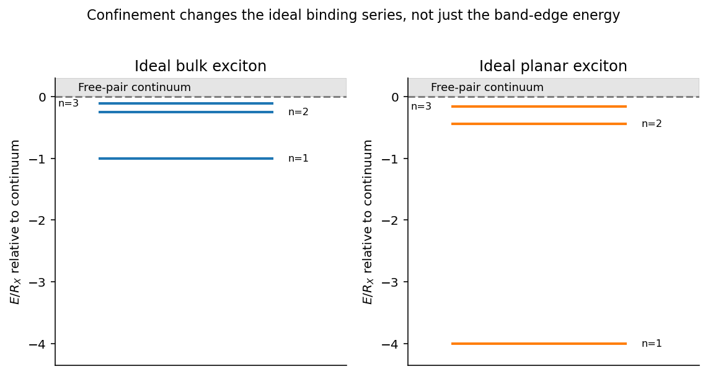

<h1 id="2/b/solution">Solution</h1>

↑ **Parent:** [B](../b.md)

A [Wannier-Mott exciton](../../../../../wannier-mott-exciton.md) is a bound conduction-band [electron](../../../../../electron.md) and valence-band [hole](../../../../../electron-hole.md) whose envelope extends over many [lattice](../../../../../lattice.md) cells. That large radius permits an [effective mass](../../../../../band-effective-mass.md) description and dielectric screening of the [electron](../../../../../electron.md)–[hole](../../../../../electron-hole.md) attraction. With [electron](../../../../../electron.md) and [hole](../../../../../electron-hole.md) masses $m_e^*,m_h^*$, define reduced mass $\mu=m_e^*m_h^*/(m_e^*+m_h^*)$ and center-of-mass mass $M=m_e^*+m_h^*$. The bulk relative-motion [Hamiltonian](../../../../../hamiltonian.md) is hydrogenic with an appropriate [relative permittivity](../../../../../relative-permittivity.md) $\epsilon_r$:

$$
H_{\rm rel}=-\frac{\hbar^2\nabla^2}{2\mu}-\frac{e^2}{4\pi\epsilon_0\epsilon_r r},\qquad
a_X=\frac{4\pi\epsilon_0\epsilon_r\hbar^2}{\mu e^2},\qquad
R_X=\frac{\mu e^4}{2(4\pi\epsilon_0\epsilon_r)^2\hbar^2}.
$$

A [semiconductor](../../../../../semiconductor-split.md) [quantum well](../../../../../quantum-well.md) confines the [electron](../../../../../electron.md) and [hole](../../../../../electron-hole.md) perpendicular to the plane while leaving approximately free in-plane center-of-mass motion. If the well width is small compared with the bulk [exciton Bohr radius](../../../../../exciton-bohr-radius.md), their relative motion becomes quasi-two-dimensional. The ideal zero-width, same-dielectric limit is

$$
H_\rho=-\frac{\hbar^2\nabla_\rho^2}{2\mu}-\frac{e^2}{4\pi\epsilon_0\epsilon_r\rho},\qquad
\boxed{E_n=-\frac{R_X}{(n-1/2)^2},\quad n=1,2,\ldots.}
$$

Its ground-state binding is $4R_X$, compared with $R_X$ in three dimensions, and the ground envelope decays on the scale $a_X/2$. Stronger binding follows because confinement prevents the pair from separating in the third direction.

For a [finite-width quantum-well exciton](../../../../../finite-width-quantum-well-exciton.md), average the Coulomb attraction over the normalized [electron](../../../../../electron.md) and [hole](../../../../../electron-hole.md) confinement envelopes:

$$
V_{\rm eff}(\rho)=-\frac{e^2}{4\pi\epsilon_0\epsilon_r}
\int dz_e\,dz_h\,
\frac{|\chi_e(z_e)|^2|\chi_h(z_h)|^2}{\sqrt{\rho^2+(z_e-z_h)^2}}.
$$

This smooths the strict planar singularity and changes the binding. The ideal factor four is a useful reference, not a universal value for every real well. Finite barriers, dielectric mismatch, several confinement subbands and nonparabolic valence bands can require a coupled treatment.

Optical absorption creates a nearly zero in-plane center-of-mass wavevector [exciton](../../../../../exciton.md). For the lowest confinement subbands, its line lies approximately at

$$
\hbar\omega=E_g+E_{e,z}+E_{h,z}-E_b+\frac{\hbar^2K_\parallel^2}{2M}.
$$

The discrete bound-state peaks occur below the free [electron](../../../../../electron.md)–[hole](../../../../../electron-hole.md) continuum. Dipole-allowed envelope states have nonzero relative [wavefunction](../../../../../wave-function-split.md) at zero separation; the absorption strength also contains the confinement overlap $|\int\chi_e^*(z)\chi_h(z)\,dz|^2$. Confinement can increase the overlap and the binding, making excitonic optical structure more prominent. A perpendicular electric field shifts and separates the confinement envelopes, changing the transition [energy](../../../../../energy-split.md) and usually reducing their optical overlap: this is the [quantum-confined Stark effect](../../../../../quantum-confined-stark-effect.md).

**[Figure 2](#2/b/image-ideal-bulk-and-planar-exciton-binding-series-measured-relative-to-their-respective-continuum-edges). Ideal bulk and planar exciton binding series measured relative to their respective continuum edges**.

**[Quantum wells](../../../../../quantum-well.md) tune both the continuum threshold and the bound-state [energy](../../../../../energy-split.md); an optical line shift is not automatically a change in binding alone.** The hydrogenic envelope model requires a Wannier-sized state, rather than an [exciton](../../../../../exciton.md) localized to one [lattice](../../../../../lattice.md) cell.

## ↑ Ancestors (14)

1. [B](../b.md)
2. [2](../../2.md)
3. [Paper 1](../../../paper-1-split.md)
4. [2015](../../../split.md)
5. [Past exam of the advanced Quantum Condensed Matter Physics course of the University of Cambridge](../../../../split.md)
6. [Advanced Quantum Condensed Matter Physics course of the University of Cambridge](../../../../../advanced-quantum-condensed-matter-physics-course-of-the-university-of-cambridge.md)
7. [Physics course of the year 4 of the natural sciences course of the University of Cambridge](../../../../../physics-course-of-the-year-4-of-the-natural-sciences-course-of-the-university-of-cambridge.md)
8. [Year 4 of the natural sciences course of the University of Cambridge](../../../../../year-4-of-the-natural-sciences-course-of-the-university-of-cambridge.md)
9. [Year of the natural sciences course of the University of Cambridge](../../../../../year-of-the-natural-sciences-course-of-the-university-of-cambridge.md)
10. [Natural sciences course of the University of Cambridge](../../../../../natural-sciences-course-of-the-university-of-cambridge.md)
11. [Course of the University of Cambridge](../../../../../course-of-the-university-of-cambridge.md)
12. [University of Cambridge](../../../../../university-of-cambridge-split.md)
13. [List of universities](../../../../../list-of-universities.md)
14. [Codex Wiki](../../../../../split.md)
