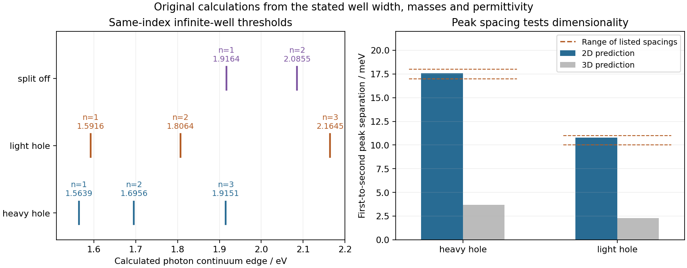

<h1 id="1/c/solution">Solution</h1>

↑ **Parent:** [C](../c.md)

[electron](../../../../../electron.md) confinement raises the conduction edge and hole confinement lowers the corresponding valence edge, so their positive confinement energies add. With $L=120\,\mathring{\mathrm A}=12$ nm, the common bare-mass scale is

$$
A_L=\frac{\pi^2\hbar^2}{2m_eL^2}\simeq0.0026111\,\mathrm{eV}.
$$

Writing $\eta_e=0.067$ and $\eta_j=m_{h,j}^*/m_e$, the [quantum-well interband thresholds](../../../../../quantum-well-interband-threshold.md) are

$$
\boxed{E_{j,n}^{\rm edge}=E_{g,j}+A_Ln^2(\eta_e^{-1}+\eta_j^{-1}).}
$$

Use $E_{g,\rm hh}=E_{g,\rm lh}=1.52$ eV and $E_{g,\rm so}=1.86$ eV. The thresholds in the requested window, using the printed masses without fitting, are

$$
\begin{array}{c|c|r}
\text{hole branch}&n& E_{j,n}^{\rm edge}/\mathrm{eV}\\\hline
\mathrm{hh}&1&1.56390\\
\mathrm{lh}&1&1.59161\\
\mathrm{hh}&2&1.69560\\
\mathrm{lh}&2&1.80645\\
\mathrm{hh}&3&1.91509\\
\mathrm{so}&1&1.91638\\
\mathrm{so}&2&2.08552\\
\mathrm{lh}&3&2.16450
\end{array}
$$

The next heavy-hole and split-off thresholds are about $2.2224$ and $2.3674$ eV, outside the interval. Each threshold marks a continuum onset or shoulder, not the stronger bound-exciton peak below it. The six heavy- and light-hole onsets follow the six paired peak groups in the supplied diagram. Their first members lie roughly 20 and 12 meV below their respective onsets, as the common solution above explains.

A qualification is necessary for the split-off branch. Its p-like $j=1/2$ [bloch states](../../../../../bloch-state.md) have nonzero $p_x$ [matrix elements](../../../../../matrix-element.md) to the s-like conduction states, so in-plane [polarization](../../../../../polarization-waves.md) does not generally forbid them. For example, a $j=1/2$ state has a nonzero $p_x\pm ip_y$ orbital component with the appropriate [spin](../../../../../spin.md), which couples to an s-like state through $p_x$. The same-envelope rule therefore allows the two split-off thresholds in the table. The first nearly coincides with the third heavy-hole edge, while the second would give an additional onset near 2.086 eV. **The supplied figure and twelve peak energies appear to retain only the heavy- and light-hole series; they do not specify a split-off-series oscillator strength or identify its extra features.** Omitting the split-off transitions would require an additional approximation beyond the four-band information and [polarization](../../../../../polarization-waves.md) given. Their expected ideal two-dimensional first-state peaks would be near 1.9010 and 2.0701 eV; these are predictions of the stated model, not additional listed data.

**[Figure 1](#1/c/image-original-calculated-continuum-edge-map-for-all-supplied-bands-and-comparison-of-heavy-and-light-hole-peak-pair-splittings). Original calculated continuum-edge map for all supplied bands and comparison of heavy- and light-hole peak-pair splittings**.

## ↑ Ancestors (14)

1. [C](../c.md)
2. [1](../../1.md)
3. [Paper 1](../../../paper-1-split.md)
4. [2016](../../../split.md)
5. [Past exam of the advanced Quantum Condensed Matter Physics course of the University of Cambridge](../../../../split.md)
6. [Advanced Quantum Condensed Matter Physics course of the University of Cambridge](../../../../../advanced-quantum-condensed-matter-physics-course-of-the-university-of-cambridge.md)
7. [Physics course of the year 4 of the natural sciences course of the University of Cambridge](../../../../../physics-course-of-the-year-4-of-the-natural-sciences-course-of-the-university-of-cambridge.md)
8. [Year 4 of the natural sciences course of the University of Cambridge](../../../../../year-4-of-the-natural-sciences-course-of-the-university-of-cambridge.md)
9. [Year of the natural sciences course of the University of Cambridge](../../../../../year-of-the-natural-sciences-course-of-the-university-of-cambridge.md)
10. [Natural sciences course of the University of Cambridge](../../../../../natural-sciences-course-of-the-university-of-cambridge.md)
11. [Course of the University of Cambridge](../../../../../course-of-the-university-of-cambridge.md)
12. [University of Cambridge](../../../../../university-of-cambridge-split.md)
13. [List of universities](../../../../../list-of-universities.md)
14. [Codex Wiki](../../../../../split.md)
