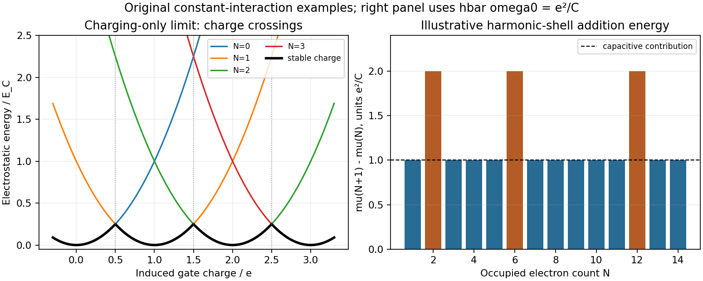

<h1 id="3/b/solution">Solution</h1>

↑ **Parent:** [B](../b.md)

A [quantum dot](../../../../../quantum-dot.md) confines electronic motion in all three directions. A [semiconductor](../../../../../semiconductor-split.md) dot can be thin enough that only one transverse subband is occupied, with discrete lateral states controlled by gates. In a rectangular hard-wall model,

$$
\epsilon_{n_xn_yn_z}=\frac{\pi^2\hbar^2}{2m^*}\left(\frac{n_x^2}{L_x^2}+\frac{n_y^2}{L_y^2}+\frac{n_z^2}{L_z^2}\right).
$$

A smooth circular lateral confinement is often better approximated by $m^*\omega_0^2r^2/2$, giving $\epsilon_{n_xn_y}=\hbar\omega_0(n_x+n_y+1)$ above the transverse ground [energy](../../../../../energy-split.md). Shell $q=n_x+n_y$ contains $q+1$ orbitals, twice that many [electrons](../../../../../electron.md) before interactions split the [spin degeneracy](../../../../../spin-degeneracy.md). Hence closed-shell [electron](../../../../../electron.md) numbers are $2,6,12,20,\ldots$. These are single-particle [quantum numbers](../../../../../quantum-number.md); an interacting dot's states are many-electron eigenstates, not simply one orbital occupied by a whole charged island.

A perpendicular [magnetic field](../../../../../magnetic-field-split.md) changes the harmonic spectrum to the [Fock-Darwin spectrum](../../../../../fock-darwin-spectrum.md). For an [electron](../../../../../electron.md) of charge $-e$, take $\omega_c=eB/m^*>0$ and $L_z=\ell\hbar$ in the usual symmetric gauge. Then

$$
\epsilon_{n\ell s}=\hbar\Omega(2n+|\ell|+1)+\frac{\ell\hbar\omega_c}{2}+g^*\mu_BBs,\qquad \Omega=\sqrt{\omega_0^2+\frac{\omega_c^2}{4}},\quad s=\pm\frac12.
$$

Reversing the definition of the angular label changes the displayed sign of its orbital term, not the set of energies. The Zeeman term lifts [spin degeneracy](../../../../../spin-degeneracy.md), while exchange can favor parallel-spin filling in partially filled shells. These effects are distinguished by how peaks evolve with field rather than by identifying every irregular peak spacing with one-particle confinement.

For electrostatics, let $C_\Sigma=C_s+C_d+C_g$ and $Q_g=C_sV_s+C_dV_d+C_gV_g+Q_0$, where $Q_0$ represents a fixed offset charge in the chosen convention. The [constant interaction model](../../../../../constant-interaction-model.md) gives

$$
U(N)=\sum_{i=1}^N\epsilon_i+\frac{(Ne-Q_g)^2}{2C_\Sigma},\qquad \mu_N=U(N)-U(N-1)=\epsilon_N+\frac{(N-1/2)e^2-eQ_g}{C_\Sigma}.
$$

The [charging energy](../../../../../charging-energy.md) is conventionally $E_C=e^2/(2C_\Sigma)$, whereas adjacent charge-state potentials differ by

$$
\boxed{\mu_{N+1}-\mu_N=\frac{e^2}{C_\Sigma}+\epsilon_{N+1}-\epsilon_N.}
$$

This [addition energy](../../../../../addition-energy.md) separates a capacitive contribution from orbital spacing. Exchange, nonuniform screening and correlations are corrections to the [constant interaction model](../../../../../constant-interaction-model.md); a change in dot shape or effective [capacitance](../../../../../capacitance.md) can also alter spacings.

Connect the island weakly to source and drain reservoirs through tunnel barriers. [sequential tunnelling](../../../../../sequential-tunnelling.md) is suppressed in a charge-stable region when neither adding nor removing an [electron](../../../../../electron.md) is energetically accessible. Sweeping the gate brings a charge [electrochemical potential](../../../../../electrochemical-potential.md) through the reservoir Fermi level, giving a Coulomb-blockade conductance peak. The gate lever arm is $\alpha_g=C_g/C_\Sigma$, so $\Delta V_g=E_{\rm add}/(e\alpha_g)$ locally if the [capacitances](../../../../../capacitance.md) and level spectrum do not vary appreciably. At finite source-drain bias, alignment with either reservoir defines the boundaries of a [Coulomb diamond](../../../../../coulomb-diamond.md). Its slopes constrain [capacitance](../../../../../capacitance.md) ratios, and lines parallel to its edges can reveal excited-state transport. The conversion from a diamond's bias height to an [energy](../../../../../energy-split.md) depends on bias convention; a full-height/half-height factor must not be assumed without declaring the circuit.

A clear charging spectrum requires $k_BT$ and [tunnel broadening](../../../../../tunnel-broadening.md) $\hbar\Gamma$ smaller than the relevant [addition energy](../../../../../addition-energy.md); resolving individual orbital levels additionally requires them smaller than the orbital spacing. Tunnel resistances large compared with $h/e^2$ suppress strong charge fluctuations in the usual weak-junction regime. Blockade is not an assertion of mathematically zero current: higher-order [cotunnelling](../../../../../cotunnelling.md) can remain, and strong coupling or low-temperature [spin](../../../../../spin.md) correlations can invalidate the sequential model. An experimental check therefore combines gate sweeps with bias spectroscopy, [temperature](../../../../../temperature-split.md) dependence and barrier tuning to separate level structure from broadening or uncontrolled charge traps.

In a primary vertical-dot experiment, gate-controlled current oscillations were converted into [addition energies](../../../../../addition-energy.md) using finite-bias diamond spectroscopy; varying [magnetic field](../../../../../magnetic-field-split.md) then followed shell and [spin](../../../../../spin.md) filling. Reproducing enhanced [addition energies](../../../../../addition-energy.md) at [electron](../../../../../electron.md) numbers 2 and 6 in several devices strengthened the shell assignment. The [electron](../../../../../electron.md) [temperature](../../../../../temperature-split.md) was independently estimated above the refrigerator base [temperature](../../../../../temperature-split.md), an essential distinction when judging spectral resolution. Field-dependent reordering also revealed exchange effects beyond a purely spin-degenerate orbital model.[pp. 3613–3616, gate control, finite-bias calibration, sample comparisons, electron-temperature estimate and field-dependent spin filling](../../../../../shell-filling-and-spin-effects-in-a-few-electron-quantum-dot-by-s-tarucha-and-others.md)

**[Figure 2](#3/b/image-original-constant-interaction-charge-parabolas-and-addition-energy-example-showing-charging-spin-pairing-and-shell-closure). Original constant-interaction charge parabolas and addition-energy example showing charging, spin pairing and shell closure**.

## ↑ Ancestors (14)

1. [B](../b.md)
2. [3](../../3.md)
3. [Paper 1](../../../paper-1-split.md)
4. [2016](../../../split.md)
5. [Past exam of the advanced Quantum Condensed Matter Physics course of the University of Cambridge](../../../../split.md)
6. [Advanced Quantum Condensed Matter Physics course of the University of Cambridge](../../../../../advanced-quantum-condensed-matter-physics-course-of-the-university-of-cambridge.md)
7. [Physics course of the year 4 of the natural sciences course of the University of Cambridge](../../../../../physics-course-of-the-year-4-of-the-natural-sciences-course-of-the-university-of-cambridge.md)
8. [Year 4 of the natural sciences course of the University of Cambridge](../../../../../year-4-of-the-natural-sciences-course-of-the-university-of-cambridge.md)
9. [Year of the natural sciences course of the University of Cambridge](../../../../../year-of-the-natural-sciences-course-of-the-university-of-cambridge.md)
10. [Natural sciences course of the University of Cambridge](../../../../../natural-sciences-course-of-the-university-of-cambridge.md)
11. [Course of the University of Cambridge](../../../../../course-of-the-university-of-cambridge.md)
12. [University of Cambridge](../../../../../university-of-cambridge-split.md)
13. [List of universities](../../../../../list-of-universities.md)
14. [Codex Wiki](../../../../../split.md)
