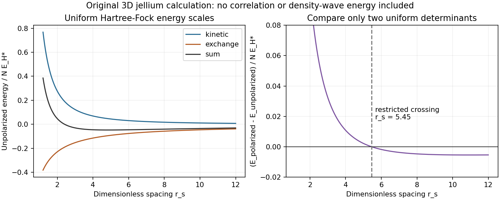

<h1 id="3/c/solution">Solution</h1>

↑ **Parent:** [C](../c.md)

Use a three-dimensional [electron gas](../../../../../electron-gas.md) with a uniform positive background, the [jellium model](../../../../../jellium-model.md). The [Hartree-Fock method](../../../../../hartree-fock-method.md) minimizes the expectation of the interacting Hamiltonian over normalized [Slater determinants](../../../../../slater-determinant.md). Antisymmetry is exact within that trial class, but correlations requiring a superposition of determinants are omitted. For orthonormal occupied [spin](../../../../../spin.md) orbitals $\phi_i$, the [energy](../../../../../energy-split.md) is

$$
E_{\rm HF}=\sum_i\langle i|h_0|i\rangle+\frac12\sum_{ij}(J_{ij}-K_{ij})+E_{\rm background},
$$

where $J_{ij}$ is the direct [Coulomb integral](../../../../../coulomb-integral.md) and $K_{ij}$ the [exchange integral](../../../../../exchange-integral.md); the [spin](../../../../../spin.md) overlap makes exchange vanish between opposite-spin orbitals. The self-interaction terms $J_{ii}$ and $K_{ii}$ cancel. Variation gives a self-consistent [Fock operator](../../../../../fock-operator.md) $\hat f=h_0+\sum_j(\hat J_j-\hat K_j)$; exchange is nonlocal. Its [eigenfunctions](../../../../../eigenfunction.md) define occupied orbitals of a stationary determinant, and the determinant must be compared with competing self-consistent solutions to select a variational [ground state](../../../../../ground-state.md).

The [eigenvalues](../../../../../eigenvalue.md) are orbital Lagrange multipliers. Their sum counts each interaction twice:

$$
E_{\rm HF}=\sum_{i\in\rm occ}\epsilon_i-\frac12\sum_{ij}(J_{ij}-K_{ij})+E_{\rm background}.
$$

Frozen-orbital removal energies may be estimated using [Koopmans' theorem](../../../../../koopmans-theorem.md), but measured quasiparticle energies can contain relaxation and correlations absent from this approximation. Unoccupied orbital energies are not automatically an exact excitation spectrum. In particular, unscreened exchange in a uniform three-dimensional gas produces an unphysical logarithmic slope singularity at its [Fermi surface](../../../../../fermi-surface.md); a one-determinant mean field does not reproduce the interacting [Fermi liquid](../../../../../fermi-liquid-split.md)'s screened response.

For a spatially uniform plane-wave determinant, electron-background and background-background terms cancel the uniform direct Coulomb contribution. Retain the background when making this cancellation: an isolated infinite [electron](../../../../../electron.md) charge distribution would have a divergent direct [energy](../../../../../energy-split.md). The surviving contributions per particle are kinetic [energy](../../../../../energy-split.md) and negative same-spin exchange [energy](../../../../../energy-split.md). Let $(3/(4\pi n))^{1/3}=r_sa_B^*$ define the [Dimensionless Wigner-Seitz radius](../../../../../dimensionless-wigner-seitz-radius.md), with $a_B^*=4\pi\varepsilon\hbar^2/(m^*e^2)$, $E_H^*=\hbar^2/(m^*a_B^{*2})$ and $\zeta=(n_\uparrow-n_\downarrow)/n$. Then

$$
\frac{E_{\rm HF}(r_s,\zeta)}{NE_H^*}=\frac{3(9\pi/4)^{2/3}}{10r_s^2}\frac{(1+\zeta)^{5/3}+(1-\zeta)^{5/3}}2-\frac{3(9\pi/4)^{1/3}}{4\pi r_s}\frac{(1+\zeta)^{4/3}+(1-\zeta)^{4/3}}2.
$$

For the unpolarized state this is approximately $1.105/r_s^2-0.4582/r_s$. The kinetic contribution penalizes [spin](../../../../../spin.md) [polarization](../../../../../polarization-waves.md) because it enlarges an occupied Fermi sphere; exchange favors [polarization](../../../../../polarization-waves.md) because equal-spin occupation gains more exchange [energy](../../../../../energy-split.md). As density falls, the $r_s^{-1}$ exchange scale overtakes the $r_s^{-2}$ kinetic scale. The uniform fully polarized and unpolarized energies cross at

$$
r_s=\frac{[3(9\pi/4)^{2/3}/10](2^{2/3}-1)}{[3(9\pi/4)^{1/3}/(4\pi)](2^{1/3}-1)}\simeq5.45.
$$

This is a variational comparison within the homogeneous [Hartree-Fock electron gas](../../../../../hartree-fock-electron-gas.md), not an exact physical ferromagnetic phase boundary. It demonstrates how Pauli kinetic [energy](../../../../../energy-split.md) and exchange compete and why the allowed trial states matter.

Allowing spatial symmetry breaking changes the result: the [Overhauser instability](../../../../../overhauser-instability.md) lowers the paramagnetic determinant's Hartree-Fock [energy](../../../../../energy-split.md) through a [spin density wave](../../../../../spin-density-wave.md), even in the high-density limit. A calculation restricted to uniform Fermi spheres therefore does not give the unrestricted Hartree-Fock [ground state](../../../../../ground-state.md).[abstract and p. 1437, instability of the uniform paramagnetic state to spin-density waves](../../../../../spin-density-waves-in-an-electron-gas-by-a-w-overhauser.md) At still lower density, localization and a [Wigner crystal](../../../../../wigner-crystal.md) compete with fluid states. [electron-gas correlation energy](../../../../../electron-gas-correlation-energy.md) beyond a single determinant is important in assessing their competition. [Quantum Monte Carlo](../../../../../quantum-monte-carlo.md) provides a concrete route to comparing correlated fluid and [crystal](../../../../../crystal.md) energies; the original stochastic calculation demonstrates why exchange-only [energy](../../../../../energy-split.md) differences are insufficient.[abstract and pp. 566–569, correlation energies and competing fluid/crystal states](../../../../../ground-state-of-the-electron-gas-by-a-stochastic-method-by-d-m-ceperley-and-b-j-alder.md)

**Hartree-Fock is a useful variational baseline with exact exchange, not a controlled complete low-density phase diagram.** At high density the kinetic scale dominates, but even a small symmetry-breaking [energy](../../../../../energy-split.md) gain can invalidate a restricted determinant as the exact Hartree-Fock minimizer. At low density neglected correlations, screening and localization can change both transition locations and the ordering of candidate phases. A numerical phase boundary should therefore state dimension, [spin](../../../../../spin.md) constraints, background model and whether correlation and spatially modulated states were included.

**[Figure 3](#3/c/image-original-homogeneous-hartree-fock-kinetic-and-exchange-energy-comparison-the-crossing-is-a-restricted-variational-result). Original homogeneous Hartree-Fock kinetic and exchange energy comparison; the crossing is a restricted variational result**.

## ↑ Ancestors (14)

1. [C](../c.md)
2. [3](../../3.md)
3. [Paper 1](../../../paper-1-split.md)
4. [2016](../../../split.md)
5. [Past exam of the advanced Quantum Condensed Matter Physics course of the University of Cambridge](../../../../split.md)
6. [Advanced Quantum Condensed Matter Physics course of the University of Cambridge](../../../../../advanced-quantum-condensed-matter-physics-course-of-the-university-of-cambridge.md)
7. [Physics course of the year 4 of the natural sciences course of the University of Cambridge](../../../../../physics-course-of-the-year-4-of-the-natural-sciences-course-of-the-university-of-cambridge.md)
8. [Year 4 of the natural sciences course of the University of Cambridge](../../../../../year-4-of-the-natural-sciences-course-of-the-university-of-cambridge.md)
9. [Year of the natural sciences course of the University of Cambridge](../../../../../year-of-the-natural-sciences-course-of-the-university-of-cambridge.md)
10. [Natural sciences course of the University of Cambridge](../../../../../natural-sciences-course-of-the-university-of-cambridge.md)
11. [Course of the University of Cambridge](../../../../../course-of-the-university-of-cambridge.md)
12. [University of Cambridge](../../../../../university-of-cambridge-split.md)
13. [List of universities](../../../../../list-of-universities.md)
14. [Codex Wiki](../../../../../split.md)
