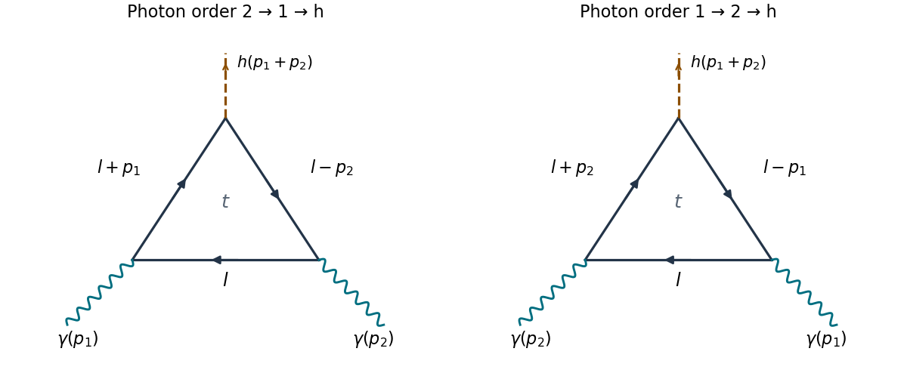
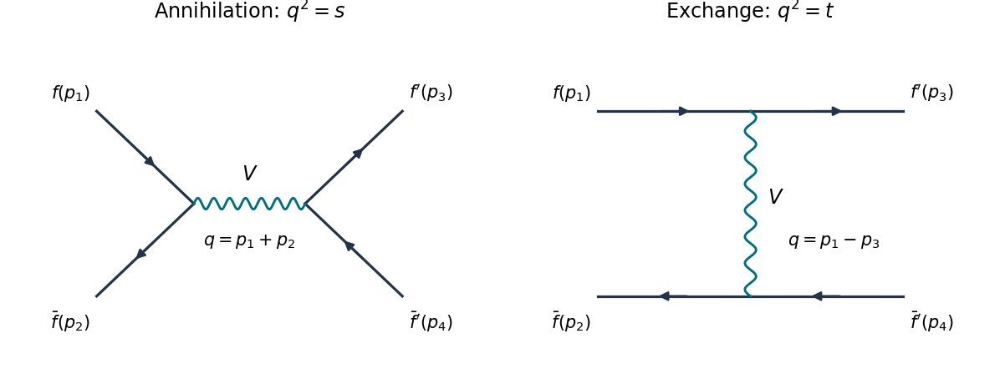

# 2022

↑ **Parent:** [Past exam of the advanced quantum field theory course of the University of Oxford](../past-exam-of-the-advanced-quantum-field-theory-course-of-the-university-of-oxford.md)

Source: [https://www.whatdotheyknow.com/request/oxford_physics_past_papers_2/response/2340696/attach/10/Physics%20Papers%202021.pdf?cookie_passthrough=1](https://www.whatdotheyknow.com/request/oxford_physics_past_papers_2/response/2340696/attach/10/Physics%20Papers%202021.pdf?cookie_passthrough=1)

Source bundle pages 111–115. The paper cover establishes 2022; the attachment filename uses 2021.

**Table of contents**

- [1](#1)
  - [i](#1/i)
    - [Solution](#1/i/solution)
  - [ii](#1/ii)
    - [Solution](#1/ii/solution)
  - [iii](#1/iii)
    - [Solution](#1/iii/solution)
  - [iv](#1/iv)
    - [Solution](#1/iv/solution)
  - [v](#1/v)
    - [Solution](#1/v/solution)
- [2](#2)
  - [a](#2/a)
    - [Solution](#2/a/solution)
  - [b](#2/b)
    - [i](#2/b/i)
      - [Solution](#2/b/i/solution)
    - [ii](#2/b/ii)
      - [Solution](#2/b/ii/solution)
    - [iii](#2/b/iii)
      - [Solution](#2/b/iii/solution)
- [3](#3)
  - [a](#3/a)
    - [i](#3/a/i)
      - [Solution](#3/a/i/solution)
    - [ii](#3/a/ii)
      - [Solution](#3/a/ii/solution)
    - [iii](#3/a/iii)
      - [Solution](#3/a/iii/solution)
  - [b](#3/b)
    - [Solution](#3/b/solution)

## 1

↑ **Parent:** [2022](2022.md)

<h3 id="1/i">i</h3>

↑ **Parent:** [1](#1)

<h4 id="1/i/solution">Solution</h4>

↑ **Parent:** [I](#1/i)

There are **two** [one-loop Feynman diagrams](../perturbative-quantum-field-theory.md#one-loop-feynman-diagram): the two orders of the labelled [photons](../quantum-mechanics.md#photon) around a [top quark](../standard-model.md#top-quark) [fermion loop](../perturbative-quantum-field-theory.md#fermion-loop), with one [Yukawa interaction](../standard-model.md#yukawa-interaction) insertion for the outgoing [Higgs boson](../standard-model.md#higgs-boson). They are added, rather than identified by a [Feynman-diagram symmetry factor](../perturbative-quantum-field-theory.md#feynman-diagram-symmetry-factor). Each has the same [color charge](../standard-model.md#color-charge) trace $N_c=3$.

**[Figure 1](#1/i/image-the-two-photon-orders-and-consistent-directed-loop-momenta). The two photon orders and consistent directed loop momenta**. Original [Feynman diagrams](../perturbative-quantum-field-theory.md#feynman-diagram). Solid arrows show [fermion flow](../perturbative-quantum-field-theory.md#fermion-flow) and the labelled internal four-[momenta](../momentum.md). Wavy external lines are incoming [photons](../quantum-mechanics.md#photon); the dashed external line is the outgoing [Higgs boson](../standard-model.md#higgs-boson). The two panels use independent dummy [loop momenta](../perturbative-quantum-field-theory.md#loop-momentum).

In the first routing, traverse the [fermion loop](../perturbative-quantum-field-theory.md#fermion-loop) from the $p_2$ insertion to the $p_1$ insertion with [momentum](../momentum.md) $l$, then to the [Higgs boson](../standard-model.md#higgs-boson) insertion with [momentum](../momentum.md) $l+p_1$, then back to the $p_2$ insertion with [momentum](../momentum.md) $l-p_2$. Conservation at the [Higgs boson](../standard-model.md#higgs-boson) insertion gives $p_h=p_1+p_2$. The second routing exchanges $(p_1,\mu)$ and $(p_2,\nu)$: its three internal [momenta](../momentum.md) are $l$, $l+p_2$ and $l-p_1$. Reversing the orientation is another way to represent this second ordering. Two vector insertions give no [Furry theorem](../quantum-field-theory.md#furry-s-theorem) cancellation.

<h3 id="1/ii">ii</h3>

↑ **Parent:** [1](#1)

<h4 id="1/ii/solution">Solution</h4>

↑ **Parent:** [Ii](#1/ii)

Use [Minkowski metric](../special-relativity.md#minkowski-metric) $g=\operatorname{diag}(1,-1,-1,-1)$ and the convention $S_{fi}=\delta_{fi}+i(2\pi)^4\delta^{(4)}(p_f-p_i)\mathcal M_{fi}$. Put $m=m_t$, $y=\lambda_t/\sqrt2$, $Q=e_t=2/3$ and

$$
D_0=l^2-m^2+i0,\qquad D_1=(l+p_1)^2-m^2+i0,\qquad D_2=(l-p_2)^2-m^2+i0.
$$

The [Feynman i-epsilon prescription](../quantum-field-theory.md#feynman-i-epsilon-prescription) is understood in subsequent denominators. Contracting the [spinor](../algebra-over-a-field.md#spinor) indices around the [fermion loop](../perturbative-quantum-field-theory.md#fermion-loop) gives the [trace](../linear-algebra.md#matrix-trace)

$$
T_{\mu\nu}(l)=\operatorname{tr}\!\left[\gamma_\mu(\not l+m)\gamma_\nu(\not l-\not p_2+m)(\not l+\not p_1+m)\right].
$$

Here $\not p=\gamma^\rho p_\rho$ is [Feynman slash notation](../algebra-over-a-field.md#feynman-slash-notation). The [closed fermion loop sign](../perturbative-quantum-field-theory.md#closed-fermion-loop-sign) is $-1$, the three [interaction vertices](../perturbative-quantum-field-theory.md#interaction-vertex) contribute $(-iy)(-ieQ)^2$, and the three [Dirac propagators](../quantum-field-theory.md#dirac-propagator) contribute $i^3$. Their product, including the [color charge](../standard-model.md#color-charge) trace, is $-N_cye^2Q^2$. Thus one ordering has

$$
i\mathcal M^{(1)}_{\mu\nu}=-N_cye^2Q^2\int\frac{d^4l}{(2\pi)^4}\frac{T_{\mu\nu}(l)}{D_0D_1D_2},\qquad
\boxed{\mathcal M^{(1)}_{\mu\nu}=iN_cye^2Q^2\int\frac{d^4l}{(2\pi)^4}\frac{T_{\mu\nu}(l)}{D_0D_1D_2}.}
$$

Multiplying by the incoming [polarization vectors](../relativistic-quantum-field.md#polarization-vector) and adding the exchanged [Feynman diagram](../perturbative-quantum-field-theory.md#feynman-diagram) gives

$$
\boxed{\mathcal M=\epsilon_1^\mu\epsilon_2^\nu\left[\mathcal M^{(1)}_{\mu\nu}(p_1,p_2)+\mathcal M^{(1)}_{\nu\mu}(p_2,p_1)\right].}
$$

The displayed four-dimensional [Feynman integral](../perturbative-quantum-field-theory.md#feynman-integral) is formal until regularized; subsequent manipulations use [dimensional regularization](../perturbative-quantum-field-theory.md#dimensional-regularization), which permits the required [loop momentum](../perturbative-quantum-field-theory.md#loop-momentum) shifts.

<h3 id="1/iii">iii</h3>

↑ **Parent:** [1](#1)

<h4 id="1/iii/solution">Solution</h4>

↑ **Parent:** [Iii](#1/iii)

Set $s=(p_1+p_2)^2=m_h^2$, so $p_1^2=p_2^2=0$ and $p_1\cdot p_2=s/2$. The physical [polarization vectors](../relativistic-quantum-field.md#polarization-vector) obey $\epsilon_1\cdot p_1=\epsilon_2\cdot p_2=0$. Write $X_{\mu\nu}\simeq Y_{\mu\nu}$ when they agree after contraction with these [polarization vectors](../relativistic-quantum-field.md#polarization-vector); terms proportional to $p_{1,\mu}$ or $p_{2,\nu}$ may then be discarded.

The [gamma matrix trace identities](../algebra-over-a-field.md#gamma-matrix-trace-identities) kill the terms with an odd number of [gamma matrices](../algebra-over-a-field.md#gamma-matrices). The remaining three two-[momentum](../momentum.md) terms and the term with three factors of $m$ are

$$
\begin{aligned}
\frac{T_{\mu\nu}}{4m}={}&m^2g_{\mu\nu}
+l_\mu(l-p_2)_\nu+(l-p_2)_\mu l_\nu-g_{\mu\nu}l\cdot(l-p_2)\\
&+l_\mu(l+p_1)_\nu+(l+p_1)_\mu l_\nu-g_{\mu\nu}l\cdot(l+p_1)\\
&+g_{\mu\nu}(l-p_2)\cdot(l+p_1)-(l-p_2)_\mu(l+p_1)_\nu+(l+p_1)_\mu(l-p_2)_\nu.
\end{aligned}
$$

In the $g_{\mu\nu}$ coefficient the terms linear in $l\cdot p_i$ cancel, leaving $m^2-l^2-s/2$. Among the other terms, the surviving mixed products of $l$ and $p_i$ also cancel. Consequently

$$
T_{\mu\nu}\simeq4m\left[4l_\mu l_\nu+p_{2,\mu}p_{1,\nu}+(m^2-s/2-l^2)g_{\mu\nu}\right].
$$

In the second [Feynman diagram](../perturbative-quantum-field-theory.md#feynman-diagram), exchange the external labels and change the dummy [loop momentum](../perturbative-quantum-field-theory.md#loop-momentum) $l\mapsto-l$. Its projected numerator and denominator become identical to those of the first [Feynman diagram](../perturbative-quantum-field-theory.md#feynman-diagram). Hence

$$
\boxed{\mathcal M'_{\mu\nu}=8iN_cye^2Q^2m\int\frac{d^4l}{(2\pi)^4}
\frac{4l_\mu l_\nu+p_{2,\mu}p_{1,\nu}+(m^2-s/2-l^2)g_{\mu\nu}}{D_0D_1D_2}.}
$$

With the common factor $8m$ extracted, the primitive integer coefficients are

$$
\boxed{A=4,\qquad B=1,\qquad C=1,\qquad \text{prefactor}=8iN_c\frac{\lambda_t}{\sqrt2}e^2e_t^2m_t.}
$$

Equivalently, extracting only $m$ gives $(A,B,C)=(32,8,8)$ and prefactor $iN_c\lambda_te^2e_t^2m_t/\sqrt2$. A common rescaling of all three coefficients changes the prefactor inversely. The physical [scattering amplitude](../quantum-scattering.md#scattering-amplitude) is $\epsilon_1^\mu\epsilon_2^\nu\mathcal M'_{\mu\nu}$; the projected integrand is not an identity for an arbitrary uncontracted off-shell [tensor](../multilinear-algebra.md#tensor).

<h3 id="1/iv">iv</h3>

↑ **Parent:** [1](#1)

<h4 id="1/iv/solution">Solution</h4>

↑ **Parent:** [Iv](#1/iv)

Continue the [loop momentum](../perturbative-quantum-field-theory.md#loop-momentum) to $D=4-\varepsilon$ dimensions, keeping $\operatorname{tr}1=4$ and the external physical [polarization vectors](../relativistic-quantum-field.md#polarization-vector) four dimensional. Introduce [Feynman parameters](../perturbative-quantum-field-theory.md#feynman-parameter) $x,y\geq0$, $x+y\leq1$, denoting this integration triangle by $\mathcal T$. Completing the square gives

$$
\frac1{D_0D_1D_2}=2\int_{\mathcal T}dx\,dy\,\frac1{(k^2-\Delta+i0)^3},\qquad
k=l+xp_1-yp_2,\qquad \Delta=m^2-sxy.
$$

Odd terms in $k$ integrate to zero. [Lorentz invariance](../special-relativity.md#lorentz-invariance) of [dimensional regularization](../perturbative-quantum-field-theory.md#dimensional-regularization) gives $k_\mu k_\nu\mapsto g_{\mu\nu}k^2/D$. The general projected numerator therefore becomes, under the [Feynman integral](../perturbative-quantum-field-theory.md#feynman-integral),

$$
g_{\mu\nu}\left[\left(\frac AD-C\right)k^2+C(m^2-s/2+sxy)\right]
+(B-Axy)p_{2,\mu}p_{1,\nu}.
$$

Only the $k^2$ term can give an [ultraviolet divergence](../perturbative-quantum-field-theory.md#ultraviolet-divergence). Define, with the conventional scale factor implicit,

$$
J_n(\Delta)=\mu_R^{\varepsilon}\int\frac{d^Dk}{(2\pi)^D}(k^2-\Delta+i0)^{-n},\qquad
I_2=J_2+\Delta J_3.
$$

The [gamma function](../complex-analysis.md#gamma-function) formula gives

$$
J_2=\frac{i}{16\pi^2}\frac2\varepsilon+O(1),\qquad
J_3=-\frac{i}{32\pi^2\Delta}+O(\varepsilon).
$$

Thus the pole of the numerator integral, including $2\int_{\mathcal T}dx\,dy=1$, is

$$
g_{\mu\nu}\left(\frac A4-C\right)\frac{i}{8\pi^2\varepsilon},
\qquad \boxed{A=4C.}
$$

The coefficients $(4,1,1)$ satisfy this condition. A nonzero local divergence would have to be removed by a [counterterm](../perturbative-quantum-field-theory.md#counterterm). The [Ward identity](../perturbative-quantum-field-theory.md#ward-identity) forbids a local $hA_\mu A^\mu$ term, and the first electromagnetic [gauge-invariant](../relativistic-quantum-field.md#gauge-invariance) coupling with one [Higgs boson](../standard-model.md#higgs-boson) and two [photons](../quantum-mechanics.md#photon) has the form $hF_{\mu\nu}F^{\mu\nu}$, of [engineering dimension](../critical-phenomenon.md#engineering-dimension) five. It is not an independent [counterterm](../perturbative-quantum-field-theory.md#counterterm) of the [Standard Model](../standard-model.md), a [renormalizable quantum field theory](../perturbative-quantum-field-theory.md#renormalizable-quantum-field-theory). The [top quark](../standard-model.md#top-quark) contribution is separately electromagnetic [gauge-invariant](../relativistic-quantum-field.md#gauge-invariance); no additional [W boson](../standard-model.md#w-boson) [loop Feynman diagram](../perturbative-quantum-field-theory.md#loop-feynman-diagram) is needed to cancel this pole.

**The finite remainder must still be retained.** For $A=4C$,

$$
\frac AD-C=\frac{C\varepsilon}{4-\varepsilon},\qquad
\lim_{\varepsilon\to0}\left(\frac AD-C\right)I_2=\frac{iC}{32\pi^2}.
$$

Putting $D=4$ before evaluating the divergent [Feynman integral](../perturbative-quantum-field-theory.md#feynman-integral) would incorrectly set this finite contribution to zero.

<h3 id="1/v">v</h3>

↑ **Parent:** [1](#1)

<h4 id="1/v/solution">Solution</h4>

↑ **Parent:** [V](#1/v)

Use the [Feynman parameters](../perturbative-quantum-field-theory.md#feynman-parameter) and $J_3$ defined in [Solution](#1/iv/solution). With $A=4C$, the finite term just found is $-C\Delta J_3$. Combining it with the remaining $g_{\mu\nu}$ coefficient gives

$$
C[-\Delta+m^2-s/2+sxy]J_3
=-\frac{sC}{2}(1-4xy)J_3.
$$

The other coefficient is $(B-4Cxy)J_3$. Thus, writing $\mathscr I_{\mu\nu}$ for the [Feynman integral](../perturbative-quantum-field-theory.md#feynman-integral) without the overall prefactor,

$$
\mathscr I_{\mu\nu}=2\int_{\mathcal T}dx\,dy\,J_3(\Delta)
\left[-\frac{sC}{2}(1-4xy)g_{\mu\nu}+(B-4Cxy)p_{2,\mu}p_{1,\nu}\right].
$$

For $T_{\mu\nu}=\frac s2g_{\mu\nu}-p_{2,\mu}p_{1,\nu}$, the two coefficients must have the corresponding ratio. The mismatch is simply $(B-C)J_3$, independent of $xy$. Therefore the required relation is

$$
\boxed{B=C,}
$$

which is satisfied. In the primitive normalization the result is

$$
\mathscr I_{\mu\nu}=\frac{i}{16\pi^2}\int_0^1dx\int_0^{1-x}dy\,
\frac{1-4xy}{m^2-sxy-i0}\,T_{\mu\nu},
$$

and the full [top quark](../standard-model.md#top-quark) [scattering amplitude](../quantum-scattering.md#scattering-amplitude), in our stated $S$ convention, is

$$
\boxed{\mathcal M=-\frac{N_cye^2Q^2m}{2\pi^2}\,
\epsilon_1^\mu\epsilon_2^\nu T_{\mu\nu}
\int_0^1dx\int_0^{1-x}dy\,\frac{1-4xy}{m^2-sxy-i0}.}
$$

Indeed $p_1^\mu T_{\mu\nu}=p_2^\nu T_{\mu\nu}=0$: replacing either [polarization vector](../relativistic-quantum-field.md#polarization-vector) by its [photon](../quantum-mechanics.md#photon) [momentum](../momentum.md) makes the [scattering amplitude](../quantum-scattering.md#scattering-amplitude) vanish. This is the [Ward identity](../perturbative-quantum-field-theory.md#ward-identity), expressing electromagnetic [gauge invariance](../relativistic-quantum-field.md#gauge-invariance). The result also is symmetric under exchange of the two [photons](../quantum-mechanics.md#photon). The finite term in [Solution](#1/iv/solution) is essential for this [Ward identity](../perturbative-quantum-field-theory.md#ward-identity).

As an independent low-[energy](../energy.md) check, for $s/m^2\to0$ the [Feynman parameter](../perturbative-quantum-field-theory.md#feynman-parameter) integral is

$$
\frac1{m^2}\int_{\mathcal T}(1-4xy)\,dx\,dy+O(s/m^4)
=\frac1{3m^2}+O(s/m^4).
$$

The coefficient is consequently $-N_cye^2Q^2/(6\pi^2m)$ at leading order. It has the inverse-[mass](../classical-mechanics.md#mass) dimension required for an effective $hF_{\mu\nu}F^{\mu\nu}$ coupling. If $y=m/v$, this coefficient stays finite in the large-$m$ limit at fixed $v$; that limit increases the [Yukawa coupling](../standard-model.md#yukawa-interaction), so it is not a fixed-coupling [heavy-field decoupling](../quantum-field-theory.md#heavy-field-decoupling) limit.

## 2

↑ **Parent:** [2022](2022.md)

<h3 id="2/a">a</h3>

↑ **Parent:** [2](#2)

<h4 id="2/a/solution">Solution</h4>

↑ **Parent:** [A](#2/a)

At the stated order the [renormalization-group beta function](../perturbative-quantum-field-theory.md#beta-function-physics) is separable:

$$
\int_{\alpha_i}^{\alpha_f}\frac{d\alpha}{\alpha^2}
=b_0\int_{\mu_i}^{\mu_f}\frac{d\mu}{\mu}.
$$

Consequently

$$
\boxed{\frac1{\alpha_f}=\frac1{\alpha_i}-b_0\ln\frac{\mu_f}{\mu_i},\qquad
\alpha_f=\frac{\alpha_i}{1-b_0\alpha_i\ln(\mu_f/\mu_i)}.}
$$

For a positive initial [running coupling](../perturbative-quantum-field-theory.md#running-coupling), this expression is used on the connected interval containing $\mu_i$ where its denominator is positive and [perturbation theory](../asymptotic-expansion.md#perturbation-theory) remains valid.

If $b_0<0$, the [running coupling](../perturbative-quantum-field-theory.md#running-coupling) decreases at high [renormalization scale](../perturbative-quantum-field-theory.md#renormalization-scale) and tends to zero: this is [asymptotic freedom](../perturbative-quantum-field-theory.md#asymptotic-freedom). Decreasing the [renormalization scale](../perturbative-quantum-field-theory.md#renormalization-scale) increases the [running coupling](../perturbative-quantum-field-theory.md#running-coupling), with a formal infrared pole at $\Lambda=\mu_i\exp[1/(b_0\alpha_i)]$. Near $\Lambda$, [perturbation theory](../asymptotic-expansion.md#perturbation-theory) fails; the pole alone is not a proof of [confinement](../standard-model.md#confinement). Both [QCD](../standard-model.md#quantum-chromodynamics) and the [SU(2)](../topological-group.md#su-2-group) weak [gauge coupling](../relativistic-quantum-field.md#gauge-coupling) have this sign for the [Standard Model](../standard-model.md) particle content above the relevant thresholds.

If $b_0>0$, the [running coupling](../perturbative-quantum-field-theory.md#running-coupling) decreases towards low [renormalization scale](../perturbative-quantum-field-theory.md#renormalization-scale) and grows towards high [renormalization scale](../perturbative-quantum-field-theory.md#renormalization-scale). The formal ultraviolet [Landau pole](../perturbative-quantum-field-theory.md#landau-pole) is $\mu_L=\mu_i\exp[1/(b_0\alpha_i)]$. The pole signals failure of this perturbative evolution, rather than a controlled physical infinity. The [hypercharge](../standard-model.md#hypercharge) [gauge coupling](../relativistic-quantum-field.md#gauge-coupling) and ordinary [QED](../perturbative-quantum-field-theory.md#quantum-electrodynamics) with charged matter have this sign.

If $b_0=0$, the [running coupling](../perturbative-quantum-field-theory.md#running-coupling) is constant **at this order**; higher-order terms may still make it run. No [Standard Model](../standard-model.md) gauge factor has a vanishing one-[loop order](../perturbative-quantum-field-theory.md#loop-order) coefficient for the usual particle content.

For precise normalization, take $\alpha_i=g_i^2/(4\pi)$ and $Q=T_3+Y$. The [Standard Model one-loop gauge coefficients](../perturbative-quantum-field-theory.md#standard-model-one-loop-gauge-coefficients) then give

$$
(b_0^Y,b_0^2,b_0^3)=\frac1{2\pi}\left(\frac{41}{6},-\frac{19}{6},-7\right).
$$

These coefficients use $d/d\ln\mu$, not $d/d\ln\mu^2$. Threshold matching changes the active particle content, so the single constant-$b_0$ expression is applied piecewise across thresholds.

<h3 id="2/b">b</h3>

↑ **Parent:** [2](#2)

<h4 id="2/b/i">i</h4>

↑ **Parent:** [B](#2/b)

<h5 id="2/b/i/solution">Solution</h5>

↑ **Parent:** [I](#2/b/i)

There is one [tree-level Feynman diagram](../perturbative-quantum-field-theory.md#tree-level-feynman-diagram): annihilation of the [up quark](../standard-model.md#up-quark) and its [antiquark](../standard-model.md#antiquark) into an $s$-channel [gluon](../standard-model.md#gluon), followed by production of the [down quark](../standard-model.md#down-quark) and its [antiquark](../standard-model.md#antiquark). A [gluon](../standard-model.md#gluon) [interaction vertex](../perturbative-quantum-field-theory.md#interaction-vertex) preserves [quark flavor](../standard-model.md#quark-flavor), so a $t$-channel line joining the incoming [up quark](../standard-model.md#up-quark) to the outgoing [down quark](../standard-model.md#down-quark) is impossible.

**[Figure 2](#2/b/i/image-annihilation-and-exchange-channels-with-labelled-external-momenta). Annihilation and exchange channels with labelled external momenta**. Original [Feynman diagrams](../perturbative-quantum-field-theory.md#feynman-diagram), with arrows denoting [fermion flow](../perturbative-quantum-field-theory.md#fermion-flow). The left panel with $V=g$ and $f'=d$ is the distinct-[quark flavor](../standard-model.md#quark-flavor) process. Both panels with $V=\gamma$ describe [Bhabha scattering](../perturbative-quantum-field-theory.md#bhabha-scattering); both with $V=g$ and $f'=f=u$ describe identical-[quark flavor](../standard-model.md#quark-flavor) scattering. The wavy internal line stands for the indicated vector mediator.

Let $i,j,k,l$ label the initial [quark](../standard-model.md#quark), initial [antiquark](../standard-model.md#antiquark), final [quark](../standard-model.md#quark), final [antiquark](../standard-model.md#antiquark) [color charges](../standard-model.md#color-charge). Up to an irrelevant common sign, the [scattering amplitude](../quantum-scattering.md#scattering-amplitude) is

$$
\mathcal M_s=\frac{g^2}{s}(T^a)_{ji}(T^a)_{kl}
[\bar v(p_2)\gamma^\mu u(p_1)][\bar u(p_3)\gamma_\mu v(p_4)].
$$

The [Mandelstam variables](../special-relativity.md#mandelstam-variables) are $s=(p_1+p_2)^2$, $t=(p_1-p_3)^2$, $u=(p_1-p_4)^2$, with $s+t+u=0$ in the zero-[mass](../classical-mechanics.md#mass) limit. The [spin sum](../relativistic-quantum-field.md#spin-sum) uses $\sum u\bar u=\sum v\bar v=\not p$, and the initial [spin average](../relativistic-quantum-field.md#spin-average) contributes $1/4$. The resulting two [gamma matrix](../algebra-over-a-field.md#gamma-matrices) [traces](../linear-algebra.md#matrix-trace) contract to

$$
\begin{aligned}
\frac14\operatorname{tr}(\not p_2\gamma^\mu\not p_1\gamma^\nu)
\operatorname{tr}(\not p_3\gamma_\mu\not p_4\gamma_\nu)
&=8[(p_2\cdot p_3)(p_1\cdot p_4)+(p_2\cdot p_4)(p_1\cdot p_3)]\\
&=2(t^2+u^2).
\end{aligned}
$$

The initial [color average](../standard-model.md#color-average) contributes $1/N_c^2$. Summing final [color charges](../standard-model.md#color-charge) gives the [distinct-flavor quark scattering color factor](../standard-model.md#distinct-flavor-quark-scattering-color-factor)

$$
K_{ss}=\frac1{N_c^2}\sum_{a,b}\operatorname{tr}(T^aT^b)\operatorname{tr}(T^aT^b)
=\frac{N_c^2-1}{4N_c^2}.
$$

Therefore

$$
\boxed{\overline{|\mathcal M_s|^2}=g^4\frac{N_c^2-1}{2N_c^2}\frac{t^2+u^2}{s^2}
=\frac{4g^4}{9}\frac{t^2+u^2}{s^2},\qquad C=\frac{4g^4}{9}.}
$$

Equivalently $C=64\pi^2\alpha_s^2/9$ for the [QCD coupling](../standard-model.md#strong-coupling-constant) $\alpha_s=g^2/(4\pi)$. There is no initial [gluon](../standard-model.md#gluon) [spin average](../relativistic-quantum-field.md#spin-average): the [gluon](../standard-model.md#gluon) is internal.

<h4 id="2/b/ii">ii</h4>

↑ **Parent:** [B](#2/b)

<h5 id="2/b/ii/solution">Solution</h5>

↑ **Parent:** [Ii](#2/b/ii)

The two [Bhabha scattering](../perturbative-quantum-field-theory.md#bhabha-scattering) [tree-level Feynman diagrams](../perturbative-quantum-field-theory.md#tree-level-feynman-diagram) are the two panels of [Solution](#2/b/i/solution) with a [photon](../quantum-mechanics.md#photon) mediator: $s$-channel annihilation with internal [momentum](../momentum.md) $p_1+p_2$, and $t$-channel exchange with internal [momentum](../momentum.md) $p_1-p_3$. Each [interaction vertex](../perturbative-quantum-field-theory.md#interaction-vertex) preserves the [electron](../physics.md#electron) species. There is no independent $u$-channel [Feynman diagram](../perturbative-quantum-field-theory.md#feynman-diagram), since the outgoing [electron](../physics.md#electron) and [Positron](../physics.md#positron) are distinguishable.

Removing the [color charge](../standard-model.md#color-charge) factor from [Solution](#2/b/i/solution) and replacing $g$ by $e$ gives

$$
\overline{|\mathcal M_s|^2}=2e^4\frac{t^2+u^2}{s^2}.
$$

[Crossing symmetry](../quantum-scattering.md#crossing-symmetry) interchanges $s$ and $t$ for the exchange [Feynman diagram](../perturbative-quantum-field-theory.md#feynman-diagram), giving

$$
\overline{|\mathcal M_t|^2}=2e^4\frac{s^2+u^2}{t^2}.
$$

Squaring the sum of the two [scattering amplitudes](../quantum-scattering.md#scattering-amplitude) also produces the [interference](../physical-optics.md#interference-wave-propagation) term $2\operatorname{Re}\overline{\mathcal M_s\mathcal M_t^*}$. The given third term must be this cross term: it has both [propagator](../quantum-field-theory.md#propagator) denominators $st$, whereas a squared individual [Feynman diagram](../perturbative-quantum-field-theory.md#feynman-diagram) has $s^2$ or $t^2$. With the correct relative [fermionic sign](../perturbative-quantum-field-theory.md#fermionic-sign), its value is $4e^4u^2/(st)$. Thus

$$
\boxed{\overline{|\mathcal M|^2}=2e^4\left[\frac{t^2+u^2}{s^2}+\frac{s^2+u^2}{t^2}+\frac{2u^2}{st}\right].}
$$

The coefficient of the last displayed fraction is positive, but $s>0$ and $t<0$ in the physical scattering region, so this [interference](../physical-optics.md#interference-wave-propagation) is destructive. The relative sign originates in the two possible external [fermion](../tensor-product-of-quantum-systems.md#fermion) contractions; changing an external-state phase changes both [scattering amplitudes](../quantum-scattering.md#scattering-amplitude) together.[§6.6, Electron Positron Scattering: annihilation and exchange spinor contractions and their relative sign](../physics-bibliography.md#quantum-field-theory-by-david-tong)

<h4 id="2/b/iii">iii</h4>

↑ **Parent:** [B](#2/b)

<h5 id="2/b/iii/solution">Solution</h5>

↑ **Parent:** [Iii](#2/b/iii)

Both $s$-channel annihilation and $t$-channel [gluon](../standard-model.md#gluon) exchange are now allowed. Their [spin sum](../relativistic-quantum-field.md#spin-sum) factors are the [Bhabha scattering](../perturbative-quantum-field-theory.md#bhabha-scattering) factors with $e\mapsto g$. Their [color charge](../standard-model.md#color-charge) tensors, with the external indices of [Solution](#2/b/i/solution), are

$$
c_s=(T^a)_{ji}(T^a)_{kl},\qquad
c_t=(T^a)_{ki}(T^a)_{jl}.
$$

Each squared term has $K_{ss}=K_{tt}=(N_c^2-1)/(4N_c^2)$. The cross term instead has the [color average](../standard-model.md#color-average)

$$
K_{st}=\frac1{N_c^2}\sum_{a,b}\operatorname{tr}(T^aT^bT^aT^b).
$$

To evaluate it, use the [SU(N) fundamental completeness relation](../semisimple-lie-algebra.md#su-n-fundamental-completeness-relation)

$$
\sum_a(T^a)_{ij}(T^a)_{kl}=\frac12\left(\delta_{il}\delta_{jk}-\frac1{N_c}\delta_{ij}\delta_{kl}\right).
$$

This follows by completing the orthogonal basis of traceless [Hermitian matrices](../hilbert-space.md#hermitian-operator) with the identity. Since $\operatorname{tr}T^b=0$, it gives $\sum_aT^aT^bT^a=-T^b/(2N_c)$, and hence

$$
\boxed{K_{st}=-\frac{N_c^2-1}{4N_c^3}=-\frac1{N_c}K_{ss}.}
$$

Multiplying the two squared [Bhabha scattering](../perturbative-quantum-field-theory.md#bhabha-scattering) terms by $K_{ss}$ and its cross term by $K_{st}$ gives

$$
\boxed{\overline{|\mathcal M|^2}=g^4\frac{N_c^2-1}{2N_c^2}
\left[\frac{t^2+u^2}{s^2}+\frac{s^2+u^2}{t^2}-\frac2{N_c}\frac{u^2}{st}\right].}
$$

For the [SU(3)](../topological-group.md#su-3-group) [gauge group](../relativistic-quantum-field.md#gauge-group), this is

$$
\boxed{\overline{|\mathcal M|^2}=\frac{4g^4}{9}\left[\frac{t^2+u^2}{s^2}+\frac{s^2+u^2}{t^2}\right]
-\frac{8g^4}{27}\frac{u^2}{st}.}
$$

The negative [color charge](../standard-model.md#color-charge) overlap reverses the sign of the [QED](../perturbative-quantum-field-theory.md#quantum-electrodynamics) [interference](../physical-optics.md#interference-wave-propagation). Since $st<0$, this cross contribution is positive in the physical region. No additional [spinor](../algebra-over-a-field.md#spinor) calculation is needed; all the new information is in the [SU(N) fundamental completeness relation](../semisimple-lie-algebra.md#su-n-fundamental-completeness-relation).

## 3

↑ **Parent:** [2022](2022.md)

<h3 id="3/a">a</h3>

↑ **Parent:** [3](#3)

<h4 id="3/a/i">i</h4>

↑ **Parent:** [A](#3/a)

<h5 id="3/a/i/solution">Solution</h5>

↑ **Parent:** [I](#3/a/i)

The [Goldstone theorem](../quantum-field-theory.md#goldstone-theorem) states that spontaneous breaking of a continuous internal [global symmetry in field theory](../classical-field-theory.md#global-symmetry-in-field-theory) in a local relativistic [quantum field theory](../quantum-field-theory.md) produces a zero-[mass](../classical-mechanics.md#mass) [Goldstone boson](../critical-phenomenon.md#goldstone-boson) for each independent broken generator, under the usual positive-state-space and conserved-current hypotheses. For $G\to H$ there are $\dim G-\dim H$ symmetry-required [Goldstone bosons](../critical-phenomenon.md#goldstone-boson). This count assumes a Lorentz-invariant [vacuum state](../quantum-field-theory.md#vacuum-state); nonrelativistic counting can differ.

At the classical level, invariance of the [scalar potential](../classical-field-theory.md#scalar-potential) gives $\partial_iV\,(T^a\phi)_i=0$. Differentiating at a stationary [vacuum expectation value](../quantum-field-theory.md#vacuum-expectation-value) $\phi_0$ yields

$$
\boxed{(M^2)_{ij}(T^a\phi_0)_j=0,\qquad (M^2)_{ij}=\left.\partial_i\partial_jV\right|_{\phi_0}.}
$$

These are the [Goldstone directions in the scalar mass matrix](../quantum-field-theory.md#goldstone-directions-in-the-scalar-mass-matrix). Broken generators have $T^a\phi_0\ne0$, so their independent directions have zero quadratic [mass](../classical-mechanics.md#mass) with a canonical [kinetic term](../classical-field-theory.md#kinetic-term). The theorem guarantees these modes; it does not exclude further accidental zero-[mass](../classical-mechanics.md#mass) modes. A local [gauge symmetry](../relativistic-quantum-field.md#gauge-invariance) is a redundancy and does not meet the physical global-symmetry hypothesis: the [Higgs mechanism](../standard-model.md#higgs-mechanism) can instead supply longitudinal [particle polarizations](../special-relativity.md#particle-polarization) of massive [gauge bosons](../relativistic-quantum-field.md#gauge-boson).

<h4 id="3/a/ii">ii</h4>

↑ **Parent:** [A](#3/a)

<h5 id="3/a/ii/solution">Solution</h5>

↑ **Parent:** [Ii](#3/a/ii)

Put $r^2=\phi_i\phi_i$. Completing the square in the [scalar potential](../classical-field-theory.md#scalar-potential) gives

$$
V=\frac\lambda4\left(r^2-\frac{\mu^2}{\lambda}\right)^2-\frac{\mu^4}{4\lambda}.
$$

Since $\lambda>0$, its global minima form the [vacuum manifold](../quantum-field-theory.md#vacuum-manifold)

$$
\boxed{r=v,\qquad v=\frac{\mu}{\sqrt\lambda}.}
$$

Here $\mu$ denotes the positive square root of the parameter $\mu^2$. The origin is a local maximum, not a [ground state](../quantum-mechanics.md#ground-state). Choose $\langle\boldsymbol\phi\rangle=(v,0,0)$. Its [stabilizer subgroup](../group-action.md#stabilizer-subgroup) is the [SO(2)](../linear-algebra.md#special-orthogonal-group-in-two-dimensions) subgroup of rotations in the $(2,3)$ plane, so the stated [SO(3)](../linear-algebra.md#so-3-group) [global symmetry in field theory](../classical-field-theory.md#global-symmetry-in-field-theory) is spontaneously broken to [SO(2)](../linear-algebra.md#special-orthogonal-group-in-two-dimensions).

Write $\phi_1=v+h$, $\phi_2=\pi_2$, $\phi_3=\pi_3$. The [kinetic terms](../classical-field-theory.md#kinetic-term) stay canonically normalized, while the [scalar mass matrix](../quantum-field-theory.md#scalar-mass-matrix) is

$$
(M^2)_{ij}=(-\mu^2+\lambda\phi^2)\delta_{ij}+2\lambda\phi_i\phi_j,
\qquad
M^2\big|_{(v,0,0)}=\operatorname{diag}(2\mu^2,0,0).
$$

Equivalently, the quadratic [scalar potential](../classical-field-theory.md#scalar-potential) is $\mu^2h^2$. Therefore the particle [masses](../classical-mechanics.md#mass) are

$$
\boxed{m_h=\sqrt2\mu,\qquad m_{\pi_2}=m_{\pi_3}=0.}
$$

The two angular [Goldstone bosons](../critical-phenomenon.md#goldstone-boson) match $\dim SO(3)-\dim SO(2)=3-1=2$. The radial displacement changes $r$ and costs [potential energy](../energy.md#potential-energy), giving the massive [Higgs mode](../quantum-field-theory.md#higgs-mode). These are tree-level [masses](../classical-mechanics.md#mass); the [Goldstone theorem](../quantum-field-theory.md#goldstone-theorem) protects the angular zero-[mass](../classical-mechanics.md#mass) modes in the exact global theory.

<h4 id="3/a/iii">iii</h4>

↑ **Parent:** [A](#3/a)

<h5 id="3/a/iii/solution">Solution</h5>

↑ **Parent:** [Iii](#3/a/iii)

For any fixed $r\geq0$, the source contribution obeys $c\phi_1\geq cr$, because $c<0$ and $\phi_1\leq r$. Equality occurs only at $(\phi_1,\phi_2,\phi_3)=(r,0,0)$ when $r>0$. Thus the global [ground state](../quantum-mechanics.md#ground-state) lies on the positive first axis. Minimize there:

$$
f(r)=-\frac12\mu^2r^2+\frac14\lambda r^4+cr,\qquad
f'(r)=\lambda r^3-\mu^2r+c.
$$

For $0\leq r\leq v=\mu/\sqrt\lambda$, $f'(r)<0$. For $r>v$, $f''(r)=3\lambda r^2-\mu^2>0$, so $f'$ increases strictly from $c$ to $+\infty$. There is exactly one root $\tilde v>v$, and it is the unique global minimum. Therefore

$$
\boxed{\langle\boldsymbol\phi\rangle=(\tilde v,0,0),\qquad
\lambda\tilde v^3-\mu^2\tilde v+c=0,\qquad \tilde v>\frac\mu{\sqrt\lambda}>0.}
$$

This argument selects the true [ground state](../quantum-mechanics.md#ground-state) even if the full cubic has additional negative stationary roots.

Expand $\phi_1=\tilde v+h$, $\phi_2=\pi_2$, $\phi_3=\pi_3$. The source is linear, so it shifts the expansion point but has zero [Hessian matrix](../multivariable-calculus.md#hessian-matrix). The [scalar mass matrix](../quantum-field-theory.md#scalar-mass-matrix) is diagonal at the new [vacuum expectation value](../quantum-field-theory.md#vacuum-expectation-value):

$$
m_h^2=-\mu^2+3\lambda\tilde v^2,\qquad
m_{\pi_2}^2=m_{\pi_3}^2=-\mu^2+\lambda\tilde v^2.
$$

Eliminating $\lambda$ with the stationary equation gives

$$
\boxed{m_h^2=2\mu^2-\frac{3c}{\tilde v},\qquad
m_{\pi_2}^2=m_{\pi_3}^2=-\frac c{\tilde v}.}
$$

All three squared [masses](../classical-mechanics.md#mass) are positive. The [masses](../classical-mechanics.md#mass) themselves are the positive square roots of these expressions.

The source explicitly reduces the stated [SO(3)](../linear-algebra.md#so-3-group) [symmetry](../physics.md#symmetry-physics) to [SO(2)](../linear-algebra.md#special-orthogonal-group-in-two-dimensions); the selected [vacuum state](../quantum-field-theory.md#vacuum-state) preserves that remaining [SO(2)](../linear-algebra.md#special-orthogonal-group-in-two-dimensions). There is consequently no spontaneously broken exact continuous [global symmetry in field theory](../classical-field-theory.md#global-symmetry-in-field-theory) to which the [Goldstone theorem](../quantum-field-theory.md#goldstone-theorem) applies. For small $|c|$, the two angular excitations are [pseudo-Goldstone bosons](../quantum-field-theory.md#pseudo-goldstone-boson). Their squared [masses](../classical-mechanics.md#mass) vanish as $c\to0^-$, while $\tilde v\to\mu/\sqrt\lambda$ and $m_h^2\to2\mu^2$.

<h3 id="3/b">b</h3>

↑ **Parent:** [3](#3)

<h4 id="3/b/solution">Solution</h4>

↑ **Parent:** [B](#3/b)

In [unitary gauge](../standard-model.md#unitary-gauge) the quadratic [action](../lagrangian-mechanics.md#action) is that of a [Proca field](../electromagnetism.md#proca-field). Use [Minkowski metric](../special-relativity.md#minkowski-metric) $(+---)$ and add a source $J_\mu A^\mu$. [Integration by parts](../calculus.md#integration-by-parts), dropping the boundary term, gives

$$
S[A]=\frac12\int d^4x\,A_\mu K^{\mu\nu}A_\nu,\qquad
K^{\mu\nu}=g^{\mu\nu}(\Box+M^2)-\partial^\mu\partial^\nu.
$$

With [Fourier transform](../fourier-transform.md) convention $A(x)=\int d^4k\,e^{-ik\cdot x}A(k)/(2\pi)^4$, its kernel is

$$
K^{\mu\nu}(k)=(M^2-k^2)g^{\mu\nu}+k^\mu k^\nu.
$$

For $k^2\ne0$, introduce the [transverse and longitudinal momentum projectors](../quantum-field-theory.md#transverse-and-longitudinal-momentum-projectors)

$$
P_T^{\mu\nu}=g^{\mu\nu}-\frac{k^\mu k^\nu}{k^2},\qquad
P_L^{\mu\nu}=\frac{k^\mu k^\nu}{k^2}.
$$

They obey $P_TP_L=0$ and $P_T+P_L=1$ as mixed-index [linear operators](../vector-space.md#linear-operator). Hence

$$
K=(M^2-k^2)P_T+M^2P_L,\qquad
K^{-1}=\frac{P_T}{M^2-k^2}+\frac{P_L}{M^2}
=-\frac{g-kk/M^2}{k^2-M^2}.
$$

The final expression is regular at $k^2=0$; the apparent singularities of the individual [projectors](../vector-space.md#projection-linear-algebra) have cancelled.

The normalized [Gaussian functional integral](../quantum-field-theory.md#gaussian-functional-integral) is evaluated by [completing the square](../polynomial.md#completing-the-square) with $A\mapsto A+K^{-1}J$:

$$
\frac{Z[J]}{Z[0]}=
\frac{\int\mathcal DA\,\exp\{i(\frac12AKA+JA)\}}{\int\mathcal DA\,\exp\{i\frac12AKA\}}
=\exp\left[-\frac i2\int\frac{d^4k}{(2\pi)^4}J_\mu(-k)(K^{-1})^{\mu\nu}(k)J_\nu(k)\right].
$$

The source-independent [functional determinant](../quantum-field-theory.md#functional-determinant) cancels in this ratio. Two source derivatives insert two fields, so the covariant [Feynman propagator](../quantum-field-theory.md#feynman-propagator) is $iK^{-1}$, with the [Feynman i-epsilon prescription](../quantum-field-theory.md#feynman-i-epsilon-prescription) at the physical pole:

$$
\boxed{D_{\mu\nu}(k)=\frac{-i}{k^2-M^2+i0}\left(g_{\mu\nu}-\frac{k_\mu k_\nu}{M^2}\right),\qquad
D_{\mu\nu}(x-y)=\int\frac{d^4k}{(2\pi)^4}e^{-ik\cdot(x-y)}D_{\mu\nu}(k).}
$$

This is the [Proca propagator](../electromagnetism.md#proca-propagator). Its pole residue has the three physical [particle polarizations](../special-relativity.md#particle-polarization) of a massive spin-one [gauge boson](../relativistic-quantum-field.md#gauge-boson). No additional gauge-fixing term is needed to invert this already gauge-fixed massive quadratic [action](../lagrangian-mechanics.md#action). In a full interacting [Higgs mechanism](../standard-model.md#higgs-mechanism) calculation, any field-dependent [unitary gauge](../standard-model.md#unitary-gauge) measure belongs to the interacting theory; the free quadratic [gauge boson](../relativistic-quantum-field.md#gauge-boson) [propagator](../quantum-field-theory.md#propagator) above is unaffected.

## ↑ Ancestors (9)

1. [Past exam of the advanced quantum field theory course of the University of Oxford](../past-exam-of-the-advanced-quantum-field-theory-course-of-the-university-of-oxford.md)
2. [Advanced quantum field theory course of the University of Oxford](../university-of-oxford.md#advanced-quantum-field-theory-course-of-the-university-of-oxford)
3. [Year 4 of the mathematical and theoretical physics course of the University of Oxford](../university-of-oxford.md#year-4-of-the-mathematical-and-theoretical-physics-course-of-the-university-of-oxford)
4. [Mathematical and theoretical physics course of the University of Oxford](../university-of-oxford.md#mathematical-and-theoretical-physics-course-of-the-university-of-oxford)
5. [Undergraduate course of the University of Oxford](../university-of-oxford.md#undergraduate-course-of-the-university-of-oxford)
6. [Course of the University of Oxford](../university-of-oxford.md#course-of-the-university-of-oxford)
7. [University of Oxford](../university-of-oxford.md)
8. [List of universities](../README.md#list-of-universities)
9. [Codex Wiki](../README.md)
