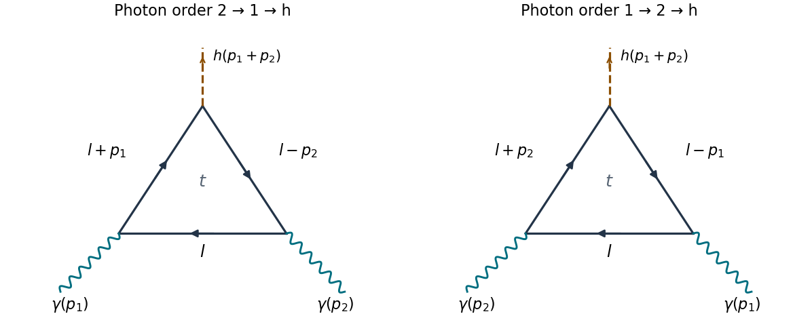

<h1 id="1/i/solution">Solution</h1>

↑ **Parent:** [I](../i.md)

There are **two** [one-loop Feynman diagrams](../../../../one-loop-feynman-diagram.md): the two orders of the labelled [photons](../../../../photon.md) around a [top quark](../../../../top-quark.md) [fermion loop](../../../../fermion-loop.md), with one [Yukawa interaction](../../../../yukawa-interaction.md) insertion for the outgoing [Higgs boson](../../../../higgs-boson.md). They are added, rather than identified by a [Feynman-diagram symmetry factor](../../../../feynman-diagram-symmetry-factor.md). Each has the same [color charge](../../../../color-charge.md) trace $N_c=3$.

**[Figure 1](#1/i/image-the-two-photon-orders-and-consistent-directed-loop-momenta). The two photon orders and consistent directed loop momenta**. Original [Feynman diagrams](../../../../feynman-diagram.md). Solid arrows show [fermion flow](../../../../fermion-flow.md) and the labelled internal four-[momenta](../../../../momentum-split.md). Wavy external lines are incoming [photons](../../../../photon.md); the dashed external line is the outgoing [Higgs boson](../../../../higgs-boson.md). The two panels use independent dummy [loop momenta](../../../../loop-momentum.md).

In the first routing, traverse the [fermion loop](../../../../fermion-loop.md) from the $p_2$ insertion to the $p_1$ insertion with [momentum](../../../../momentum-split.md) $l$, then to the [Higgs boson](../../../../higgs-boson.md) insertion with [momentum](../../../../momentum-split.md) $l+p_1$, then back to the $p_2$ insertion with [momentum](../../../../momentum-split.md) $l-p_2$. Conservation at the [Higgs boson](../../../../higgs-boson.md) insertion gives $p_h=p_1+p_2$. The second routing exchanges $(p_1,\mu)$ and $(p_2,\nu)$: its three internal [momenta](../../../../momentum-split.md) are $l$, $l+p_2$ and $l-p_1$. Reversing the orientation is another way to represent this second ordering. Two vector insertions give no [Furry theorem](../../../../furry-s-theorem.md) cancellation.

## ↑ Ancestors (12)

1. [I](../i.md)
2. [1](../../1.md)
3. [2022](../../../2022-split.md)
4. [Past exam of the advanced quantum field theory course of the University of Oxford](../../../split.md)
5. [Advanced quantum field theory course of the University of Oxford](../../../../advanced-quantum-field-theory-course-of-the-university-of-oxford.md)
6. [Year 4 of the mathematical and theoretical physics course of the University of Oxford](../../../../year-4-of-the-mathematical-and-theoretical-physics-course-of-the-university-of-oxford.md)
7. [Mathematical and theoretical physics course of the University of Oxford](../../../../mathematical-and-theoretical-physics-course-of-the-university-of-oxford.md)
8. [Undergraduate course of the University of Oxford](../../../../undergraduate-course-of-the-university-of-oxford.md)
9. [Course of the University of Oxford](../../../../course-of-the-university-of-oxford.md)
10. [University of Oxford](../../../../university-of-oxford-split.md)
11. [List of universities](../../../../list-of-universities.md)
12. [Codex Wiki](../../../../split.md)
