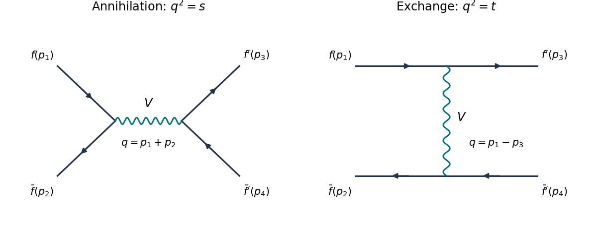

<h1 id="2/b/i/solution">Solution</h1>

↑ **Parent:** [I](../i.md)

There is one [tree-level Feynman diagram](../../../../../tree-level-feynman-diagram.md): annihilation of the [up quark](../../../../../up-quark.md) and its [antiquark](../../../../../antiquark.md) into an $s$-channel [gluon](../../../../../gluon.md), followed by production of the [down quark](../../../../../down-quark.md) and its [antiquark](../../../../../antiquark.md). A [gluon](../../../../../gluon.md) [interaction vertex](../../../../../interaction-vertex.md) preserves [quark flavor](../../../../../quark-flavor.md), so a $t$-channel line joining the incoming [up quark](../../../../../up-quark.md) to the outgoing [down quark](../../../../../down-quark.md) is impossible.

**[Figure 2](#2/b/i/image-annihilation-and-exchange-channels-with-labelled-external-momenta). Annihilation and exchange channels with labelled external momenta**. Original [Feynman diagrams](../../../../../feynman-diagram.md), with arrows denoting [fermion flow](../../../../../fermion-flow.md). The left panel with $V=g$ and $f'=d$ is the distinct-[quark flavor](../../../../../quark-flavor.md) process. Both panels with $V=\gamma$ describe [Bhabha scattering](../../../../../bhabha-scattering.md); both with $V=g$ and $f'=f=u$ describe identical-[quark flavor](../../../../../quark-flavor.md) scattering. The wavy internal line stands for the indicated vector mediator.

Let $i,j,k,l$ label the initial [quark](../../../../../quark.md), initial [antiquark](../../../../../antiquark.md), final [quark](../../../../../quark.md), final [antiquark](../../../../../antiquark.md) [color charges](../../../../../color-charge.md). Up to an irrelevant common sign, the [scattering amplitude](../../../../../scattering-amplitude.md) is

$$
\mathcal M_s=\frac{g^2}{s}(T^a)_{ji}(T^a)_{kl}
[\bar v(p_2)\gamma^\mu u(p_1)][\bar u(p_3)\gamma_\mu v(p_4)].
$$

The [Mandelstam variables](../../../../../mandelstam-variables.md) are $s=(p_1+p_2)^2$, $t=(p_1-p_3)^2$, $u=(p_1-p_4)^2$, with $s+t+u=0$ in the zero-[mass](../../../../../mass.md) limit. The [spin sum](../../../../../spin-sum.md) uses $\sum u\bar u=\sum v\bar v=\not p$, and the initial [spin average](../../../../../spin-average.md) contributes $1/4$. The resulting two [gamma matrix](../../../../../gamma-matrices.md) [traces](../../../../../matrix-trace.md) contract to

$$
\begin{aligned}
\frac14\operatorname{tr}(\not p_2\gamma^\mu\not p_1\gamma^\nu)
\operatorname{tr}(\not p_3\gamma_\mu\not p_4\gamma_\nu)
&=8[(p_2\cdot p_3)(p_1\cdot p_4)+(p_2\cdot p_4)(p_1\cdot p_3)]\\
&=2(t^2+u^2).
\end{aligned}
$$

The initial [color average](../../../../../color-average.md) contributes $1/N_c^2$. Summing final [color charges](../../../../../color-charge.md) gives the [distinct-flavor quark scattering color factor](../../../../../distinct-flavor-quark-scattering-color-factor.md)

$$
K_{ss}=\frac1{N_c^2}\sum_{a,b}\operatorname{tr}(T^aT^b)\operatorname{tr}(T^aT^b)
=\frac{N_c^2-1}{4N_c^2}.
$$

Therefore

$$
\boxed{\overline{|\mathcal M_s|^2}=g^4\frac{N_c^2-1}{2N_c^2}\frac{t^2+u^2}{s^2}
=\frac{4g^4}{9}\frac{t^2+u^2}{s^2},\qquad C=\frac{4g^4}{9}.}
$$

Equivalently $C=64\pi^2\alpha_s^2/9$ for the [QCD coupling](../../../../../strong-coupling-constant.md) $\alpha_s=g^2/(4\pi)$. There is no initial [gluon](../../../../../gluon.md) [spin average](../../../../../spin-average.md): the [gluon](../../../../../gluon.md) is internal.

## ↑ Ancestors (13)

1. [I](../i.md)
2. [B](../../b.md)
3. [2](../../../2.md)
4. [2022](../../../../2022-split.md)
5. [Past exam of the advanced quantum field theory course of the University of Oxford](../../../../split.md)
6. [Advanced quantum field theory course of the University of Oxford](../../../../../advanced-quantum-field-theory-course-of-the-university-of-oxford.md)
7. [Year 4 of the mathematical and theoretical physics course of the University of Oxford](../../../../../year-4-of-the-mathematical-and-theoretical-physics-course-of-the-university-of-oxford.md)
8. [Mathematical and theoretical physics course of the University of Oxford](../../../../../mathematical-and-theoretical-physics-course-of-the-university-of-oxford.md)
9. [Undergraduate course of the University of Oxford](../../../../../undergraduate-course-of-the-university-of-oxford.md)
10. [Course of the University of Oxford](../../../../../course-of-the-university-of-oxford.md)
11. [University of Oxford](../../../../../university-of-oxford-split.md)
12. [List of universities](../../../../../list-of-universities.md)
13. [Codex Wiki](../../../../../split.md)

## ← Incoming links (2)

- [Solution](../ii/solution.md)
- [Solution](../iii/solution.md)
