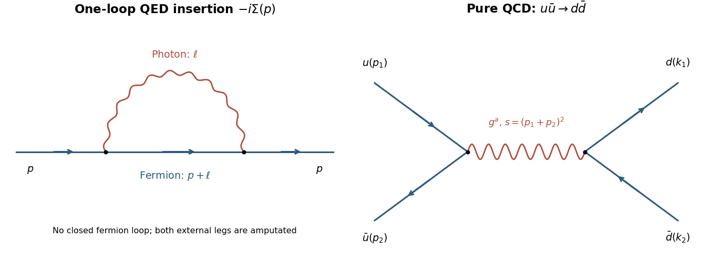

# 2016

↑ **Parent:** [Past exam of the advanced quantum field theory for particle physics course of the University of Oxford](../past-exam-of-the-advanced-quantum-field-theory-for-particle-physics-course-of-the-university-of-oxford.md)

Source paper: [https://www.whatdotheyknow.com/request/oxford_physics_past_papers_2/response/2340696/attach/4/Physics%20Papers%202015.pdf?cookie_passthrough=1.](https://www.whatdotheyknow.com/request/oxford_physics_past_papers_2/response/2340696/attach/4/Physics%20Papers%202015.pdf?cookie_passthrough=1.) The held cover dates this sitting to 19 April 2016; the annual bundle's filename does not determine the year. We use $d=4-\epsilon$ for the ultraviolet regulator, reserving $i0$ for the causal prescription. The supplied propagators correspond to $g=\operatorname{diag}(-,+,+,+)$ and $\{\gamma^\mu,\gamma^\nu\}=-2g^{\mu\nu}$. Q1 and Q3 are readable. A duplicate cover obscures Q2 on printed page 3; its known a–c scopes retain explicit source-gap TODOs.

**Table of contents**

- [1](#1)
  - [a](#1/a)
    - [i](#1/a/i)
      - [Solution](#1/a/i/solution)
    - [ii](#1/a/ii)
      - [Solution](#1/a/ii/solution)
    - [iii](#1/a/iii)
      - [Solution](#1/a/iii/solution)
  - [b](#1/b)
    - [i](#1/b/i)
      - [Solution](#1/b/i/solution)
    - [ii](#1/b/ii)
      - [Solution](#1/b/ii/solution)
- [2](#2)
  - [a](#2/a)
    - [Solution](#2/a/solution)
  - [b](#2/b)
    - [Solution](#2/b/solution)
  - [c](#2/c)
    - [Solution](#2/c/solution)
- [3](#3)
  - [a](#3/a)
    - [Solution](#3/a/solution)
  - [b](#3/b)
    - [Solution](#3/b/solution)
  - [c](#3/c)
    - [Solution](#3/c/solution)

## 1

↑ **Parent:** [2016](2016.md)

<h3 id="1/a">a</h3>

↑ **Parent:** [1](#1)

<h4 id="1/a/i">i</h4>

↑ **Parent:** [A](#1/a)

<h5 id="1/a/i/solution">Solution</h5>

↑ **Parent:** [I](#1/a/i)

Choose the [covariant derivative](../general-relativity.md#covariant-derivative) $D_\mu=\partial_\mu+i\mu^{\epsilon/2}eA_\mu$, so the [interaction term](../statistical-model.md#interaction-term) is $-\mu^{\epsilon/2}e\bar\psi\gamma^\mu A_\mu\psi$. The [gauge transformation](../electromagnetism.md#gauge-transformation) is $A_\mu\mapsto A_\mu+\partial_\mu\alpha$ and $\psi\mapsto e^{-i\mu^{\epsilon/2}e\alpha}\psi$. The derivative of this local phase cancels the added vector-potential term in $D_\mu\psi$, making $i\bar\psi\gamma^\mu D_\mu\psi$ [gauge-invariant](../relativistic-quantum-field.md#gauge-invariance).

For renormalized fields and parameters, a complete local [QED](../perturbative-quantum-field-theory.md#quantum-electrodynamics) [counterterm](../perturbative-quantum-field-theory.md#counterterm) parametrization is

$$
\boxed{\begin{aligned}
\mathcal L={}&i\bar\psi\not\partial\psi-m\bar\psi\psi-\frac14F_{\mu\nu}F^{\mu\nu}
-\mu^{\epsilon/2}e\bar\psi\gamma^\mu A_\mu\psi+\mathcal L_{\rm ct},\\
\mathcal L_{\rm ct}={}&i\delta Z_2\bar\psi\not\partial\psi-\delta m_L\bar\psi\psi
-\frac{\delta Z_3}{4}F_{\mu\nu}F^{\mu\nu}
-\mu^{\epsilon/2}e\delta Z_1\bar\psi\gamma^\mu A_\mu\psi.
\end{aligned}}
$$

With $\psi_0=\sqrt{Z_2}\psi$, $A_0=\sqrt{Z_3}A$, the definitions are $\delta Z_i=Z_i-1$, $\delta m_L=Z_2m_0-m$, and $e_0=\mu^{\epsilon/2}eZ_1/(Z_2\sqrt{Z_3})$. In particular $\delta m_L$ is the coefficient in the [Lagrangian density](../classical-field-theory.md#lagrangian-density), not just $m_0-m$.

The [Ward identity](../perturbative-quantum-field-theory.md#ward-identity) requires $Z_1=Z_2$ in a gauge-preserving [renormalization scheme](../perturbative-quantum-field-theory.md#renormalization-scheme). The kinetic and vertex [counterterms](../perturbative-quantum-field-theory.md#counterterm) then combine into $i\delta Z_2\bar\psi\not D\psi$, so [gauge invariance](../relativistic-quantum-field.md#gauge-invariance) is explicit and $e_0=\mu^{\epsilon/2}e/\sqrt{Z_3}$. A [photon](../quantum-mechanics.md#photon) [mass](../classical-mechanics.md#mass) term is not an allowed [counterterm](../perturbative-quantum-field-theory.md#counterterm) in unbroken [QED](../perturbative-quantum-field-theory.md#quantum-electrodynamics). For perturbative inversion one separately adds [gauge fixing](../relativistic-quantum-field.md#gauge-fixing), $\mathcal L_{\rm gf}=-(\partial_\mu A^\mu)^2/(2\xi)$, taking $\xi=1$ in [Feynman gauge](../relativistic-quantum-field.md#feynman-gauge). That quantization term is not itself part of the gauge-invariant density. The Abelian [Faddeev-Popov determinant](../relativistic-quantum-field.md#faddeev-popov-determinant) is field independent for this linear gauge and introduces no interacting ghost contribution.

<h4 id="1/a/ii">ii</h4>

↑ **Parent:** [A](#1/a)

<h5 id="1/a/ii/solution">Solution</h5>

↑ **Parent:** [Ii](#1/a/ii)

At second order in the [interaction term](../statistical-model.md#interaction-term), attach the two external [fermion](../tensor-product-of-quantum-systems.md#fermion) fields to different vertices and contract the remaining two [fermion](../tensor-product-of-quantum-systems.md#fermion) fields with each other and the two vector fields with each other. The factor $1/2!$ in the expansion is cancelled by the two ways to assign the external ends. There is no closed [fermion loop](../perturbative-quantum-field-theory.md#fermion-loop), and hence no extra closed-loop [fermionic sign](../perturbative-quantum-field-theory.md#fermionic-sign).

After removing the two external [Dirac propagators](../quantum-field-theory.md#dirac-propagator), the internal [momentum](../momentum.md) assignment $l$ for the [photon](../quantum-mechanics.md#photon) and $p+l$ for the [fermion](../tensor-product-of-quantum-systems.md#fermion) gives the one-loop insertion

$$
\boxed{\mathcal I(p)=(-ie\mu^{\epsilon/2})^2\int\frac{d^dl}{(2\pi)^d}
\gamma^\nu\widetilde S(p+l)\gamma^\mu\widetilde\Delta_{\mu\nu}(l)
=-e^2\mu^\epsilon\int\frac{d^dl}{(2\pi)^d}
\gamma^\nu\widetilde S(p+l)\gamma^\mu\widetilde\Delta_{\mu\nu}(l).}
$$

Thus the insertion is proportional to exactly the propagator product specified in the source. Define $\mathcal I=-i\Sigma$. With Fourier convention $\psi(x)\sim e^{ip\cdot x}$, the reduced free inverse [kernel](../kernel-of-a-linear-map.md) is $K_0(p)=-\not p-m$, since the printed [Dirac propagator](../quantum-field-theory.md#dirac-propagator) equals $iK_0^{-1}$. Repeated insertions give

$$
S=i(K_0-\Sigma)^{-1},\qquad
\Gamma^{(2)}=K_0-\Sigma+K_{\rm ct}.
$$

The factors of $i$ and the sign of the named [self-energy](../perturbative-quantum-field-theory.md#self-energy) are convention dependent; the cancelling [counterterm](../perturbative-quantum-field-theory.md#counterterm) is fixed once this insertion convention is specified. The internal [photon](../quantum-mechanics.md#photon) joins two vertices on one directed [fermion](../tensor-product-of-quantum-systems.md#fermion) line, as in the first panel of the figure in 1b.

<h4 id="1/a/iii">iii</h4>

↑ **Parent:** [A](#1/a)

<h5 id="1/a/iii/solution">Solution</h5>

↑ **Parent:** [Iii](#1/a/iii)

Multiply the supplied [Feynman gauge](../relativistic-quantum-field.md#feynman-gauge) propagators before reducing the numerator. Their two factors $-i$ and the source's [Clifford algebra](../algebra-over-a-field.md#clifford-algebra) imply

$$
\gamma^\nu\widetilde S(p+l)\gamma^\mu\widetilde\Delta_{\mu\nu}(l)
=\frac{(d-2)(\not p+\not l)+dm}
{(l^2-i0)[(p+l)^2+m^2-i0]}.
$$

For example, contracting the numerator before the propagator factors gives $\gamma^\nu[-(\not p+\not l)+m]\gamma_\nu=-(d-2)(\not p+\not l)-dm$; the extra minus from $(-i)^2$ reverses both signs.

Use a [Feynman parameter](../perturbative-quantum-field-theory.md#feynman-parameter) $x$ on the massive denominator and shift $q=l+xp$. The combined denominator is

$$
x[(p+l)^2+m^2]+(1-x)l^2=q^2+D(x),\qquad
D(x)=xm^2+x(1-x)p^2.
$$

The term odd in $q$ integrates to zero in [dimensional regularization](../perturbative-quantum-field-theory.md#dimensional-regularization). The pole can be evaluated away from on-shell infrared singularities; its local ultraviolet coefficient is independent of $D$. With the source's master integral,

$$
\begin{aligned}
\mathcal I_{\rm UV}(p)
&=-\frac{ie^2}{8\pi^2\epsilon}\int_0^1dx\,[2(1-x)\not p+4m]\\
&=-\frac{ie^2}{8\pi^2\epsilon}(\not p+4m),\qquad
\Sigma_{\rm UV}(p)=\frac{e^2}{8\pi^2\epsilon}(\not p+4m).
\end{aligned}
$$

Terms proportional to $d-4$ multiply the pole into a finite term, so they do not change this result. The [counterterm](../perturbative-quantum-field-theory.md#counterterm) [kernel](../kernel-of-a-linear-map.md) from 1ai is $K_{\rm ct}=-\delta Z_2\not p-\delta m_L$. Cancelling $-\Sigma_{\rm UV}+K_{\rm ct}$ therefore gives

$$
\boxed{\delta Z_2=-\frac{e^2}{8\pi^2\epsilon},\qquad
\delta m_L=-\frac{e^2m}{2\pi^2\epsilon}.}
$$

The distinction between [mass](../classical-mechanics.md#mass) definitions matters. Since $Z_2m_0=m+\delta m_L$,

$$
\boxed{m_0-m=\delta m_L-m\delta Z_2=-\frac{3e^2m}{8\pi^2\epsilon},\qquad
Z_m-1=-\frac{3e^2}{8\pi^2\epsilon}\quad(m_0=Z_mm).}
$$

Equivalently the mass-dependent part of the [counterterm](../perturbative-quantum-field-theory.md#counterterm) density is $+e^2m\bar\psi\psi/(2\pi^2\epsilon)$, because its definition includes the explicit minus sign in $-\delta m_L\bar\psi\psi$. In the alternative convention $d=4-2\varepsilon$, replace every $1/\epsilon$ here by $1/(2\varepsilon)$. These are ultraviolet minimal-subtraction poles, not the finite on-shell [mass](../classical-mechanics.md#mass) correction. The [Ward identity](../perturbative-quantum-field-theory.md#ward-identity) also fixes $\delta Z_1=\delta Z_2$; the [photon](../quantum-mechanics.md#photon) coefficient $\delta Z_3$ requires its own two-point function and is not obtained from this graph.

<h3 id="1/b">b</h3>

↑ **Parent:** [1](#1)

<h4 id="1/b/i">i</h4>

↑ **Parent:** [B](#1/b)

<h5 id="1/b/i/solution">Solution</h5>

↑ **Parent:** [I](#1/b/i)

In pure [QCD](../standard-model.md#quantum-chromodynamics), different incoming and outgoing [quark flavours](../standard-model.md#quark-flavor) allow only the tree-level $s$-channel [gluon](../standard-model.md#gluon) graph. A [quark-gluon vertex](../standard-model.md#quark-gluon-vertex) preserves flavour, so no flavour-changing $t$-channel exchange is available. Label the incoming momenta $p_1,p_2$ and outgoing momenta $k_1,k_2$. For transparent [spin](../angular-momentum-operator.md#spin) [traces](../linear-algebra.md#matrix-trace), use the auxiliary metric $\eta=-g$ and its usual [gamma matrices](../algebra-over-a-field.md#gamma-matrices); the positive-energy [Mandelstam variables](../special-relativity.md#mandelstam-variables) are

$$
s=(p_1+p_2)_\eta^2,\qquad t=(p_1-k_1)_\eta^2,\qquad u=(p_1-k_2)_\eta^2,\qquad s+t+u=0.
$$

This is a consistent change of metric notation, not a change of the physical invariants. Define the fixed-index colour tensor $C_{ji;kl}=\sum_a(T^a)_{ji}(T^a)_{kl}$. Up to an irrelevant common phase,

$$
\mathcal M=\frac{g_s^2}{s}C_{ji;kl}
[\bar v(p_2)\gamma^\mu u(p_1)]
[\bar u(k_1)\gamma_\mu v(k_2)].
$$

The indices $i,j$ label incoming colours and $k,l$ outgoing colours. Averaging over the two [spins](../angular-momentum-operator.md#spin) of each incoming [particle](../physics.md#particle-physics) and summing the outgoing [spins](../angular-momentum-operator.md#spin) gives

$$
\overline{|\mathcal M|^2}_{\rm spin}
=\frac{g_s^4|C_{ji;kl}|^2}{4s^2}
\operatorname{tr}(\not p_2\gamma^\mu\not p_1\gamma^\nu)
\operatorname{tr}(\not k_1\gamma_\mu\not k_2\gamma_\nu).
$$

The [gamma-matrix trace](../relativistic-quantum-field.md#gamma-matrix-trace) identity makes the contraction

$$
32[(p_1\cdot k_1)(p_2\cdot k_2)+(p_1\cdot k_2)(p_2\cdot k_1)]
=8(t^2+u^2).
$$

For instance $p_1\cdot k_1=p_2\cdot k_2=-t/2$ and the crossed products are $-u/2$. Therefore, before the remaining colour sum and average,

$$
\boxed{\overline{|\mathcal M|^2}_{\rm spin}
=2g_s^4|C_{ji;kl}|^2\frac{t^2+u^2}{s^2}.}
$$

Here the bar averages [spins](../angular-momentum-operator.md#spin) only; it does not silently include the colour average requested next.

**[Figure 1](#1/b/i/image-one-loop-qed-fermion-self-energy-and-different-flavour-quark-annihilation). One-loop QED fermion self-energy and different-flavour quark annihilation**. The left panel shows the internal fermion and photon in the self-energy insertion. The right panel is the single pure-QCD tree topology for the specified flavour-changing pair final state; arrows show fermion-number flow.

<h4 id="1/b/ii">ii</h4>

↑ **Parent:** [B](#1/b)

<h5 id="1/b/ii/solution">Solution</h5>

↑ **Parent:** [Ii](#1/b/ii)

Use the fundamental [SU(3)](../topological-group.md#su-3-group) [normalization](../mathematics.md#normalization) $\operatorname{tr}(T^aT^b)=\delta^{ab}/2$, with [Hermitian](../hilbert-space.md#hermitian-operator) generators. The average over the $3\times3$ incoming colours and sum over the outgoing colours gives

$$
\begin{aligned}
C_{\rm col}
&=\frac1{N_c^2}\sum_{i,j,k,l}\left|\sum_a(T^a)_{ji}(T^a)_{kl}\right|^2\\
&=\frac1{N_c^2}\sum_{a,b}\operatorname{tr}(T^aT^b)\operatorname{tr}(T^aT^b)
=\frac{N_c^2-1}{4N_c^2}=\frac29\qquad(N_c=3).
\end{aligned}
$$

The complete [spin](../angular-momentum-operator.md#spin) and colour averaged result is consequently

$$
\boxed{\overline{|\mathcal M|^2}
=\frac{4g_s^4}{9}\frac{t^2+u^2}{s^2}
=\frac{64\pi^2\alpha_s^2}{9}\frac{t^2+u^2}{s^2},\qquad
\alpha_s=\frac{g_s^2}{4\pi}.}
$$

For massless two-body centre-of-momentum [kinematics](../classical-mechanics.md#kinematics), $t=-s(1-\cos\theta)/2$ and $u=-s(1+\cos\theta)/2$, so the same answer is $2g_s^4(1+\cos^2\theta)/9$. This checks positivity, the symmetry under exchanging the outgoing directions, and the absence of a forward $t$-channel singularity in this particular process.

## 2

↑ **Parent:** [2016](2016.md)

<h3 id="2/a">a</h3>

↑ **Parent:** [2](#2)

<h4 id="2/a/solution">Solution</h4>

↑ **Parent:** [A](#2/a)

**TODO (source data):** the original held printed page 3 has an opaque duplicate cover over the action, equations and most of this request. The reviewed transcription confirms the obstruction. The visible label identifies part a, but the surviving fragments do not specify a mathematical problem well enough to solve it. A readable copy of this same A15272W1 sitting is required; no hidden interaction, source functional or [normalization](../mathematics.md#normalization) is inferred from another year.

<h3 id="2/b">b</h3>

↑ **Parent:** [2](#2)

<h4 id="2/b/solution">Solution</h4>

↑ **Parent:** [B](#2/b)

**TODO (source data):** part b is obscured by the same duplicate-cover overlay. Its required equations, hypotheses and marks cannot be recovered from the held page. Without those data, assigning a particular field-theory derivation to this scope would invent the request. This scope remains incomplete pending a readable matching original.

<h3 id="2/c">c</h3>

↑ **Parent:** [2](#2)

<h4 id="2/c/solution">Solution</h4>

↑ **Parent:** [C](#2/c)

**TODO (source data):** the label c survives but the mathematical content beneath the duplicate cover does not. In particular the held source cannot establish any further inline subparts inside this block. Those must be checked if a readable same-sitting source is obtained. No solution or extra subpart labels are fabricated.

## 3

↑ **Parent:** [2016](2016.md)

<h3 id="3/a">a</h3>

↑ **Parent:** [3](#3)

<h4 id="3/a/solution">Solution</h4>

↑ **Parent:** [A](#3/a)

Work entirely with left-handed [Weyl fermions](../relativistic-quantum-field.md#weyl-spinor); a right-handed field is counted through its left-handed charge conjugate. For a simple non-Abelian group $G$, define

$$
\operatorname{tr}_{R}(T^aT^b)=T(R)\delta^{ab},\qquad
D_R^{abc}=\operatorname{tr}_{R}[T^a\{T^b,T^c\}].
$$

The two orientations of a chiral triangle supply the symmetrized [trace](../linear-algebra.md#matrix-trace). Spectator representation dimensions multiply each [trace](../linear-algebra.md#matrix-trace). The perturbative [gauge anomaly](../relativistic-quantum-field.md#gauge-anomaly) conditions for $G\times U(1)$ are therefore

$$
\boxed{\sum_iD_{R_i}^{abc}=0\quad\text{for every }a,b,c,\qquad
\sum_iQ_iT(R_i)=0,\qquad
\sum_i\dim(R_i)Q_i^3=0.}
$$

The first concerns $G^3$, the second $G^2U(1)$, and the third $U(1)^3$. A $GU(1)^2$ triangle has group factor $\sum_iQ_i^2\operatorname{tr}_{R_i}T^a=0$, because non-Abelian generators of a semisimple group are traceless. If coupling to gravity is required, also impose the mixed gauge-gravitational condition $\sum_i\dim(R_i)Q_i=0$. Cancellation of these local triangles is not a universal substitute for checking global anomalies; the [Witten SU(2) anomaly](../relativistic-quantum-field.md#witten-su-2-anomaly) is the relevant additional test here.[§§3.4.1–3.4.4: local gauge anomalies, mixed gravitational condition, [SU(2)](../topological-group.md#su-2-group) [global anomaly](../relativistic-quantum-field.md#global-anomaly) and [Standard Model](../standard-model.md)](../physics-bibliography.md#gauge-theory-by-david-tong)

For the [Standard Model](../standard-model.md), one generation consists of $Q_L:(3,2)_{1/6}$, $u^c:(\bar3,1)_{-2/3}$, $d^c:(\bar3,1)_{1/3}$, $L_L:(1,2)_{-1/2}$ and $e^c:(1,1)_1$. These are precisely the all-left-handed representations; conjugating the singlets reverses their [hypercharges](../standard-model.md#hypercharge) relative to right-handed [particles](../physics.md#particle-physics). Check the requested triangles separately:

For $3$–$3$–$3$, normalize the cubic coefficient of a fundamental to $+1$. Its conjugate has $-1$, so the weak-doublet multiplicity gives

$$
\mathcal A_{333}=2-1-1=0.
$$

For $2$–$2$–$2$, the doublet generators obey $\{T^b,T^c\}=\delta^{bc}I/2$, so $\operatorname{tr}(T^a\{T^b,T^c\})=0$. Thus every doublet separately has zero local cubic weak anomaly. For the global [Witten SU(2) anomaly](../relativistic-quantum-field.md#witten-su-2-anomaly), each generation has three coloured [quark](../standard-model.md#quark) doublets and one lepton doublet, an even total of four. All three generations give twelve, so the global obstruction also cancels.

For $3$–$3$–$1$, use $T(3)=T(\bar3)=1/2$. The two conjugate triplets have the same quadratic index, not its negative:

$$
\mathcal A_{331}=2\left(\frac16\right)\frac12
+\left(-\frac23\right)\frac12
+\left(\frac13\right)\frac12=0.
$$

For $2$–$2$–$1$, the three [quark](../standard-model.md#quark) colours and one lepton doublet give

$$
\mathcal A_{221}=3\left(\frac16\right)\frac12
+\left(-\frac12\right)\frac12=0.
$$

For $1$–$1$–$1$, count every coloured and weak component:

$$
\mathcal A_{111}=6\left(\frac16\right)^3+3\left(-\frac23\right)^3
+3\left(\frac13\right)^3+2\left(-\frac12\right)^3+1
=\frac{1-32+4-9+36}{36}=0.
$$

The mixed gauge-gravitational coefficient also vanishes:

$$
6\left(\frac16\right)+3\left(-\frac23\right)+3\left(\frac13\right)
+2\left(-\frac12\right)+1=0.
$$

Unlisted gauge combinations contain a single generator of at least one simple factor. For example, $3$–$2$–$1$ has $\operatorname{tr}_3T^a\operatorname{tr}_2t^b\,Y$, and $3$–$3$–$2$ has $\operatorname{tr}_3(T^aT^b)\operatorname{tr}_2t^c$; both vanish. The same reasoning covers $3$–$1$–$1$, $2$–$1$–$1$ and $3$–$2$–$2$, including permutations of the legs. [Scalars](../vector-space.md#scalar) contribute no chiral triangle anomaly. Therefore

$$
\boxed{\text{All the listed gauge anomalies cancel within each generation; three generations remain anomaly free.}}
$$

<h3 id="3/b">b</h3>

↑ **Parent:** [3](#3)

<h4 id="3/b/solution">Solution</h4>

↑ **Parent:** [B](#3/b)

For $\lambda>0$, the [scalar potential](../classical-field-theory.md#scalar-potential) is minimized at $\phi^\dagger\phi=v^2/2$. With the specified upper-component [vacuum expectation value](../quantum-field-theory.md#vacuum-expectation-value) $\phi_0=(v,0)^T/\sqrt2$ and [hypercharge](../standard-model.md#hypercharge) $Y=-I/2$, the unbroken generator is

$$
Q=T^3+Y=\begin{pmatrix}0&0\\0&-1\end{pmatrix},\qquad Q\phi_0=0.
$$

The other three independent generator directions act nontrivially on $\phi_0$. Thus the connected unbroken gauge subgroup is $U(1)_{\rm em}$, while three gauge directions are broken. The [normalization](../mathematics.md#normalization) here is $Q=T^3+Y$, not the alternative convention in which [hypercharge](../standard-model.md#hypercharge) is doubled.

Apply the [covariant derivative](../general-relativity.md#covariant-derivative) directly to the vacuum:

$$
D_\mu\phi_0=-\frac{iv}{2\sqrt2}
\begin{pmatrix}g_2A_\mu^3-g_1B_\mu\\g_2(A_\mu^1+iA_\mu^2)\end{pmatrix}.
$$

In the mostly-plus convention the canonical [scalar](../vector-space.md#scalar) kinetic term is $-(D_\mu\phi)^\dagger D^\mu\phi$. Its quadratic vector terms are

$$
\mathcal L_{\rm mass}=-\frac{v^2}{8}
\left[g_2^2(A_\mu^1A^{1\mu}+A_\mu^2A^{2\mu})
+(g_2A_\mu^3-g_1B_\mu)(g_2A^{3\mu}-g_1B^\mu)\right].
$$

Define $s_W=\sin\theta_W=g_1/\sqrt{g_1^2+g_2^2}$ and $c_W=\cos\theta_W=g_2/\sqrt{g_1^2+g_2^2}$. Diagonalization gives

$$
\boxed{W_\mu^\pm=\frac{A_\mu^1\mp iA_\mu^2}{\sqrt2},\qquad
Z_\mu=c_WA_\mu^3-s_WB_\mu,\qquad
A_\mu^\gamma=s_WA_\mu^3+c_WB_\mu.}
$$

The neutral combination $Z$ lies along the nonzero [eigenvector](../linear-operator-theory.md#eigenvector) $(g_2,-g_1)$; the orthogonal combination $(g_1,g_2)$ is the massless [photon](../quantum-mechanics.md#photon). Comparing the [mass](../classical-mechanics.md#mass) terms with $-m_W^2W^+\cdot W^--m_Z^2Z^2/2$ yields

$$
\boxed{m_W=\frac{g_2v}{2},\qquad
m_Z=\frac v2\sqrt{g_1^2+g_2^2},\qquad
m_\gamma=0,\qquad\frac{m_W}{m_Z}=\cos\theta_W.}
$$

Finally insert the inverse neutral rotation into the coupling:

$$
g_2T^3A_\mu^3+g_1YB_\mu
=(g_2s_WT^3+g_1c_WY)A_\mu^\gamma
+(g_2c_WT^3-g_1s_WY)Z_\mu.
$$

Both coefficients in the [photon](../quantum-mechanics.md#photon) term agree, giving

$$
\boxed{e=g_2\sin\theta_W=g_1\cos\theta_W
=\frac{g_1g_2}{\sqrt{g_1^2+g_2^2}},\qquad D_\mu\supset-ieQA_\mu^\gamma.}
$$

The upper vacuum component is electrically neutral and the lower [scalar](../vector-space.md#scalar) component has charge $-e$, consistently with the source's negative [hypercharge](../standard-model.md#hypercharge). This doublet is the conjugate convention to the commonly displayed positive-hypercharge doublet; it does not change the vector masses or the electromagnetic coupling. The four real [scalar](../vector-space.md#scalar) components supply three would-be [Goldstone modes](../critical-phenomenon.md#goldstone-boson) and one physical radial Higgs mode, preserving the total physical degrees of freedom.

<h3 id="3/c">c</h3>

↑ **Parent:** [3](#3)

<h4 id="3/c/solution">Solution</h4>

↑ **Parent:** [C](#3/c)

For $M>0$, integrate the vector action by parts, dropping the boundary term, and write it as a quadratic functional:

$$
S_0[A]=\frac12\int d^4x\,A_\mu K^{\mu\nu}A_\nu,\qquad
K^{\mu\nu}=(\Box-M^2)g^{\mu\nu}-\partial^\mu\partial^\nu.
$$

The explicit [mass](../classical-mechanics.md#mass) makes this Proca [kernel](../kernel-of-a-linear-map.md) invertible: the displayed action alone has no gauge redundancy left to fix. It is interpreted as [unitary gauge](../standard-model.md#unitary-gauge) when obtained from a Higgs or Stückelberg completion with its would-be Goldstone field removed.

Introduce a source $J_\mu$ and complete the square, $A=A'-K^{-1}J$. The normalized Gaussian [path integral](../quantum-field-theory.md#path-integral) is

$$
\boxed{\frac{Z[J]}{Z[0]}=\exp\left[-\frac i2\int d^4x\,d^4y\,
J_\mu(x)(K^{-1})^{\mu\nu}(x,y)J_\nu(y)\right],\qquad
\widetilde D_{\mu\nu}=i(\widetilde K^{-1})_{\mu\nu}.}
$$

The source-independent [functional determinant](../quantum-field-theory.md#functional-determinant) cancels in $Z[J]/Z[0]$. For Fourier [momentum](../momentum.md) $k$, the mixed-index [kernel](../kernel-of-a-linear-map.md) is $\widetilde K^\mu{}_{\nu}=-(k^2+M^2)\delta^\mu{}_{\nu}+k^\mu k_\nu$. For $k^2\ne0$, use the [projectors](../vector-space.md#projection-linear-algebra)

$$
P_L{}^\mu{}_{\nu}=\frac{k^\mu k_\nu}{k^2},\qquad P_T=I-P_L.
$$

Their orthogonality gives

$$
\widetilde K=-(k^2+M^2)P_T-M^2P_L,\qquad
\widetilde K^{-1}=-\frac{P_T}{k^2+M^2}-\frac{P_L}{M^2}.
$$

Combining the [projectors](../vector-space.md#projection-linear-algebra) removes their apparent massless denominator. Adding the Feynman prescription gives the unitary-gauge propagator

$$
\boxed{\widetilde D_{\mu\nu}(k)=\frac{-i}{k^2+M^2-i0}
\left(g_{\mu\nu}+\frac{k_\mu k_\nu}{M^2}\right).}
$$

Multiplication by $\widetilde K$ verifies that it inverts the quadratic operator. On the physical pole $k^2=-M^2$, the numerator is transverse to $k$, as required for the three physical massive-vector polarizations.

The drawback is its off-shell ultraviolet behaviour: at large spacelike [momentum](../momentum.md) the transverse term falls as $1/k^2$, but the longitudinal tensor term remains of order $1/M^2$. Naive loop [power counting](../perturbative-quantum-field-theory.md#power-counting-in-quantum-field-theory) therefore looks worse and [renormalizability](../perturbative-quantum-field-theory.md#renormalizable-quantum-field-theory) is not manifest. In a finite $R_\xi$ gauge the corresponding expression is

$$
D_\xi=-i\left[\frac{P_T}{k^2+M^2-i0}+\frac{\xi P_L}{k^2+\xi M^2-i0}\right],
$$

which falls as $1/k^2$ at fixed finite $\xi$. Its $\xi\to\infty$ limit gives the unitary-gauge longitudinal term, so taking that limit before the ultraviolet limit changes [power counting](../perturbative-quantum-field-theory.md#power-counting-in-quantum-field-theory).

This is not a claim that a renormalizable Higgs theory ceases to be physically renormalizable in this gauge. Nor does it mean that the free Proca [Gaussian integral](../integral.md#gaussian-integral) is inconsistent. For conserved external sources $k\cdot J=0$, the longitudinal numerator drops out of $J^\mu D_{\mu\nu}J^\nu$ and the tree exchange again falls as $1/k^2$. The difficulty concerns off-shell [Green functions](../green-s-function.md) and manifest control of loop divergences, not the number of physical polarizations.

## ↑ Ancestors (9)

1. [Past exam of the advanced quantum field theory for particle physics course of the University of Oxford](../past-exam-of-the-advanced-quantum-field-theory-for-particle-physics-course-of-the-university-of-oxford.md)
2. [Advanced quantum field theory for particle physics course of the University of Oxford](../university-of-oxford.md#advanced-quantum-field-theory-for-particle-physics-course-of-the-university-of-oxford)
3. [Year 4 of the mathematical and theoretical physics course of the University of Oxford](../university-of-oxford.md#year-4-of-the-mathematical-and-theoretical-physics-course-of-the-university-of-oxford)
4. [Mathematical and theoretical physics course of the University of Oxford](../university-of-oxford.md#mathematical-and-theoretical-physics-course-of-the-university-of-oxford)
5. [Undergraduate course of the University of Oxford](../university-of-oxford.md#undergraduate-course-of-the-university-of-oxford)
6. [Course of the University of Oxford](../university-of-oxford.md#course-of-the-university-of-oxford)
7. [University of Oxford](../university-of-oxford.md)
8. [List of universities](../README.md#list-of-universities)
9. [Codex Wiki](../README.md)
