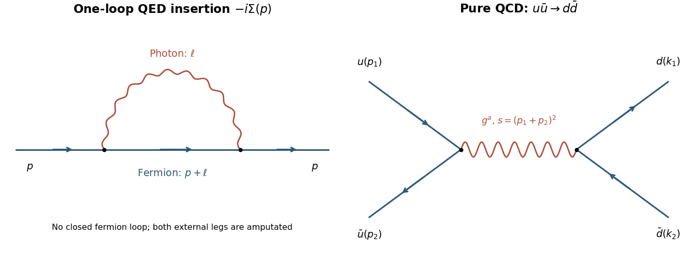

<h1 id="1/b/i/solution">Solution</h1>

↑ **Parent:** [I](../i.md)

In pure [QCD](../../../../../quantum-chromodynamics.md), different incoming and outgoing [quark flavours](../../../../../quark-flavor.md) allow only the tree-level $s$-channel [gluon](../../../../../gluon.md) graph. A [quark-gluon vertex](../../../../../quark-gluon-vertex.md) preserves flavour, so no flavour-changing $t$-channel exchange is available. Label the incoming momenta $p_1,p_2$ and outgoing momenta $k_1,k_2$. For transparent [spin](../../../../../spin.md) [traces](../../../../../matrix-trace.md), use the auxiliary metric $\eta=-g$ and its usual [gamma matrices](../../../../../gamma-matrices.md); the positive-energy [Mandelstam variables](../../../../../mandelstam-variables.md) are

$$
s=(p_1+p_2)_\eta^2,\qquad t=(p_1-k_1)_\eta^2,\qquad u=(p_1-k_2)_\eta^2,\qquad s+t+u=0.
$$

This is a consistent change of metric notation, not a change of the physical invariants. Define the fixed-index colour tensor $C_{ji;kl}=\sum_a(T^a)_{ji}(T^a)_{kl}$. Up to an irrelevant common phase,

$$
\mathcal M=\frac{g_s^2}{s}C_{ji;kl}
[\bar v(p_2)\gamma^\mu u(p_1)]
[\bar u(k_1)\gamma_\mu v(k_2)].
$$

The indices $i,j$ label incoming colours and $k,l$ outgoing colours. Averaging over the two [spins](../../../../../spin.md) of each incoming [particle](../../../../../particle-physics.md) and summing the outgoing [spins](../../../../../spin.md) gives

$$
\overline{|\mathcal M|^2}_{\rm spin}
=\frac{g_s^4|C_{ji;kl}|^2}{4s^2}
\operatorname{tr}(\not p_2\gamma^\mu\not p_1\gamma^\nu)
\operatorname{tr}(\not k_1\gamma_\mu\not k_2\gamma_\nu).
$$

The [gamma-matrix trace](../../../../../gamma-matrix-trace.md) identity makes the contraction

$$
32[(p_1\cdot k_1)(p_2\cdot k_2)+(p_1\cdot k_2)(p_2\cdot k_1)]
=8(t^2+u^2).
$$

For instance $p_1\cdot k_1=p_2\cdot k_2=-t/2$ and the crossed products are $-u/2$. Therefore, before the remaining colour sum and average,

$$
\boxed{\overline{|\mathcal M|^2}_{\rm spin}
=2g_s^4|C_{ji;kl}|^2\frac{t^2+u^2}{s^2}.}
$$

Here the bar averages [spins](../../../../../spin.md) only; it does not silently include the colour average requested next.

**[Figure 1](#1/b/i/image-one-loop-qed-fermion-self-energy-and-different-flavour-quark-annihilation). One-loop QED fermion self-energy and different-flavour quark annihilation**. The left panel shows the internal fermion and photon in the self-energy insertion. The right panel is the single pure-QCD tree topology for the specified flavour-changing pair final state; arrows show fermion-number flow.

## ↑ Ancestors (13)

1. [I](../i.md)
2. [B](../../b.md)
3. [1](../../../1.md)
4. [2016](../../../../2016-split.md)
5. [Past exam of the advanced quantum field theory for particle physics course of the University of Oxford](../../../../split.md)
6. [Advanced quantum field theory for particle physics course of the University of Oxford](../../../../../advanced-quantum-field-theory-for-particle-physics-course-of-the-university-of-oxford.md)
7. [Year 4 of the mathematical and theoretical physics course of the University of Oxford](../../../../../year-4-of-the-mathematical-and-theoretical-physics-course-of-the-university-of-oxford.md)
8. [Mathematical and theoretical physics course of the University of Oxford](../../../../../mathematical-and-theoretical-physics-course-of-the-university-of-oxford.md)
9. [Undergraduate course of the University of Oxford](../../../../../undergraduate-course-of-the-university-of-oxford.md)
10. [Course of the University of Oxford](../../../../../course-of-the-university-of-oxford.md)
11. [University of Oxford](../../../../../university-of-oxford-split.md)
12. [List of universities](../../../../../list-of-universities.md)
13. [Codex Wiki](../../../../../split.md)
