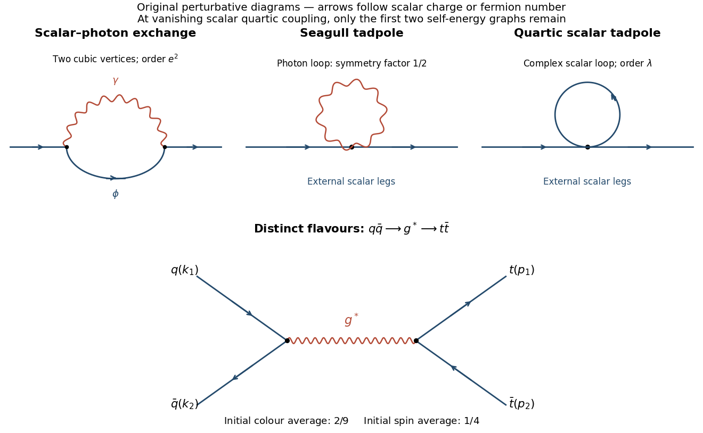

# 2017

↑ **Parent:** [Past exam of the advanced quantum field theory for particle physics course of the University of Oxford](../past-exam-of-the-advanced-quantum-field-theory-for-particle-physics-course-of-the-university-of-oxford.md)

Source paper: [https://www.whatdotheyknow.com/request/oxford_physics_past_papers_2/response/2340696/attach/5/Physics%20Papers%202016.pdf?cookie_passthrough=1.](https://www.whatdotheyknow.com/request/oxford_physics_past_papers_2/response/2340696/attach/5/Physics%20Papers%202016.pdf?cookie_passthrough=1.) The held cover dates this paper to 19 April 2017; the bundle filename does not determine the year. We use the stated [mostly-plus](../special-relativity.md#minkowski-metric) [spacetime metric](../special-relativity.md#minkowski-metric), $d=4-\epsilon$, and the source's loop-insertion convention $i\Pi$. Several printed formulas need corrections, justified where they occur below.

**Table of contents**

- [1](#1)
  - [a](#1/a)
    - [Solution](#1/a/solution)
  - [b](#1/b)
    - [Solution](#1/b/solution)
  - [c](#1/c)
    - [Solution](#1/c/solution)
  - [d](#1/d)
    - [Solution](#1/d/solution)
  - [e](#1/e)
    - [Solution](#1/e/solution)
  - [f](#1/f)
    - [Solution](#1/f/solution)
- [2](#2)
  - [a](#2/a)
    - [i](#2/a/i)
      - [Solution](#2/a/i/solution)
    - [ii](#2/a/ii)
      - [Solution](#2/a/ii/solution)
  - [b](#2/b)
    - [i](#2/b/i)
      - [Solution](#2/b/i/solution)
    - [ii](#2/b/ii)
      - [Solution](#2/b/ii/solution)
- [3](#3)
  - [a](#3/a)
    - [i](#3/a/i)
      - [Solution](#3/a/i/solution)
    - [ii](#3/a/ii)
      - [Solution](#3/a/ii/solution)
  - [b](#3/b)
    - [i](#3/b/i)
      - [Solution](#3/b/i/solution)
    - [ii](#3/b/ii)
      - [Solution](#3/b/ii/solution)

## 1

↑ **Parent:** [2017](2017.md)

<h3 id="1/a">a</h3>

↑ **Parent:** [1](#1)

<h4 id="1/a/solution">Solution</h4>

↑ **Parent:** [A](#1/a)

[Gauge invariance](../relativistic-quantum-field.md#gauge-invariance) and [power counting](../perturbative-quantum-field-theory.md#power-counting-in-quantum-field-theory) permit the same local operators as in the original [renormalizable action](../perturbative-quantum-field-theory.md#renormalizable-quantum-field-theory). With renormalized fields, a convenient [counterterm](../perturbative-quantum-field-theory.md#counterterm) parametrization is

$$
\boxed{\mathcal L_{\mathrm{ct}}=-\delta Z_\phi(D_\mu\phi)^\dagger D^\mu\phi-\delta M^2\phi^\dagger\phi-\frac{\mu^\epsilon\delta\lambda}{4}(\phi^\dagger\phi)^2-\frac{\delta Z_A}{4}F_{\mu\nu}F^{\mu\nu}.}
$$

Here $D_\mu=\partial_\mu-i\mu^{\epsilon/2}eA_\mu$. Expanding the first term supplies kinetic, scalar-scalar-photon, and [seagull](../perturbative-quantum-field-theory.md#seagull-vertex) [counterterms](../perturbative-quantum-field-theory.md#counterterm) with the relative coefficients required by the [Ward identity](../perturbative-quantum-field-theory.md#ward-identity). Equivalently introduce separate [vertex](../graph.md#vertex-graph-theory) constants first and then impose that identity. For $\phi_0=Z_\phi^{1/2}\phi$, $A_0=Z_A^{1/2}A$, and $e_0=\mu^{\epsilon/2}Z_e e$, it gives $Z_eZ_A^{1/2}=1$. Thus [charge renormalization](../perturbative-quantum-field-theory.md#charge-renormalization) can be represented through the [photon](../quantum-mechanics.md#photon) field factor, rather than adding an independent gauge-noninvariant [interaction](../statistical-model.md#interaction-term).

The [mass](../classical-mechanics.md#mass) coefficient defined here is $\delta M^2=Z_\phi m_0^2-m^2$; it must be distinguished from $m_0^2-m^2$. [Gauge fixing](../relativistic-quantum-field.md#gauge-fixing) may require the corresponding [gauge-parameter](../relativistic-quantum-field.md#gauge-fixing-parameter) redefinition, and [vacuum diagrams](../perturbative-quantum-field-theory.md#vacuum-feynman-diagram) can require an additive [vacuum-energy](../perturbative-quantum-field-theory.md#vacuum-energy) [counterterm](../perturbative-quantum-field-theory.md#counterterm). No [photon](../quantum-mechanics.md#photon) [mass](../classical-mechanics.md#mass) [counterterm](../perturbative-quantum-field-theory.md#counterterm) is allowed by the [unbroken gauge symmetry](../relativistic-quantum-field.md#gauge-invariance). The [quartic](../scalar-field-theory.md#quartic-interaction) [scalar](../classical-field-theory.md#scalar-field) [counterterm](../perturbative-quantum-field-theory.md#counterterm) remains necessary for the full theory even at a scale where the renormalized $\lambda$ is zero, because gauge [interactions](../statistical-model.md#interaction-term) generate [scalar](../classical-field-theory.md#scalar-field) [four-point](../critical-phenomenon.md#four-point-correlation-function) divergences.

<h3 id="1/b">b</h3>

↑ **Parent:** [1](#1)

<h4 id="1/b/solution">Solution</h4>

↑ **Parent:** [B](#1/b)

The [one-particle-irreducible](../perturbative-quantum-field-theory.md#one-particle-irreducible-feynman-diagram) [scalar](../classical-field-theory.md#scalar-field) [two-point function](../critical-phenomenon.md#two-point-correlation-function) has three [one-loop](../perturbative-quantum-field-theory.md#loop-feynman-diagram) topologies: a scalar-photon exchange loop built from two [cubic vertices](../statistical-model.md#interaction-term); a [photon tadpole](../perturbative-quantum-field-theory.md#tadpole-diagram) at one [seagull vertex](../perturbative-quantum-field-theory.md#seagull-vertex); and a [scalar tadpole](../perturbative-quantum-field-theory.md#tadpole-diagram) at one [quartic](../scalar-field-theory.md#quartic-interaction) [vertex](../graph.md#vertex-graph-theory). The last is absent when $\lambda=0$. Reducible chains of [self-energy](../perturbative-quantum-field-theory.md#self-energy) insertions belong to the [Dyson expansion](../perturbative-quantum-field-theory.md#dyson-series) and are not additional [one-loop](../perturbative-quantum-field-theory.md#loop-feynman-diagram) [self-energy](../perturbative-quantum-field-theory.md#self-energy) graphs. The [scalar-QED photon-tadpole symmetry factor](../perturbative-quantum-field-theory.md#scalar-qed-photon-tadpole-symmetry-factor) is $1/2$ because its two identical [photon](../quantum-mechanics.md#photon) legs are joined; the oriented complex-scalar [tadpole](../perturbative-quantum-field-theory.md#tadpole-diagram) has no such identical-real-line factor.

**[Figure 1](#1/b/image-one-loop-scalar-self-energy-topologies-and-tree-level-quark-antiquark-annihilation). One-loop scalar self-energy topologies and tree-level quark-antiquark annihilation**.

<h3 id="1/c">c</h3>

↑ **Parent:** [1](#1)

<h4 id="1/c/solution">Solution</h4>

↑ **Parent:** [C](#1/c)

Route the [photon](../quantum-mechanics.md#photon) [momentum](../momentum.md) as $l$ and the internal [scalar](../classical-field-theory.md#scalar-field) [momentum](../momentum.md) as $l+k$. The [transverse projector](../relativistic-quantum-field.md#transverse-projector-of-a-vector-field) obeys $P_{\alpha\beta}l^\beta=0$, so the two [cubic vertices](../statistical-model.md#interaction-term) give

$$
(2k+l)^\alpha P_{\alpha\beta}(l)(2k+l)^\beta=4k^\alpha P_{\alpha\beta}(l)k^\beta.
$$

Multiplying the two [vertices](../graph.md#vertex-graph-theory) and propagators therefore gives

$$
\boxed{i\Pi_{\mathrm{ex}}(k)=4e^2\mu^\epsilon\int\frac{d^dl}{(2\pi)^d}\frac{k^2-(k\cdot l)^2/l^2}{l^2[(l+k)^2+m^2]}.}
$$

For the [seagull](../perturbative-quantum-field-theory.md#seagull-vertex), $g^{\alpha\beta}P_{\alpha\beta}=d-1$. Including the photon-loop [symmetry factor](../perturbative-quantum-field-theory.md#feynman-diagram-symmetry-factor) gives instead

$$
\boxed{i\Pi_{\mathrm{sg}}=\frac12(-2ie^2)\mu^\epsilon\int\frac{d^dl}{(2\pi)^d}\frac{-i(d-1)}{l^2+m_\gamma^2}
=-(d-1)e^2\mu^\epsilon\int\frac{d^dl}{(2\pi)^d}\frac1{l^2+m_\gamma^2}.}
$$

**The printed [seagull](../perturbative-quantum-field-theory.md#seagull-vertex) coefficient is twice this result.** The [vertex](../graph.md#vertex-graph-theory)'s factor two differentiates the two [photon](../quantum-mechanics.md#photon) fields; closing them into one line requires the compensating [symmetry factor](../perturbative-quantum-field-theory.md#feynman-diagram-symmetry-factor). Direct expansion of the [action](../lagrangian-mechanics.md#action) gives the same check: the [interaction density](../classical-field-theory.md#lagrangian-density) $-e^2A^2\phi^\dagger\phi$ has one [photon](../quantum-mechanics.md#photon) [contraction](../perturbative-quantum-field-theory.md#wick-contraction), yielding coefficient $-e^2$, not $-2e^2$. The identical-photon origin of the [vertex](../graph.md#vertex-graph-theory) factor is also explicit in the standard scalar-electrodynamics rules.[§6.5.1, charged scalars: the seagull vertex factor two comes from the two identical photon fields](../physics-bibliography.md#quantum-field-theory-by-david-tong) This discrepancy does not affect the massless-photon limit in part d or the [ultraviolet pole](../perturbative-quantum-field-theory.md#ultraviolet-divergence) in part f.

<h3 id="1/d">d</h3>

↑ **Parent:** [1](#1)

<h4 id="1/d/solution">Solution</h4>

↑ **Parent:** [D](#1/d)

Apply the [dimensionally regulated](../perturbative-quantum-field-theory.md#dimensional-regularization) [tadpole](../perturbative-quantum-field-theory.md#tadpole-diagram) integral before removing the [infrared regulator](../quantum-field-theory.md#infrared-regularization):

$$
I_\gamma(m_\gamma)=\mu^\epsilon\int\frac{d^dl}{(2\pi)^d}\frac1{l^2+m_\gamma^2}
=\frac{i\mu^\epsilon}{(4\pi)^{2-\epsilon/2}}\Gamma\left(-1+\frac\epsilon2\right)(m_\gamma^2)^{1-\epsilon/2}.
$$

At fixed regulator $0<\operatorname{Re}\epsilon<2$ away from [gamma-function poles](../complex-analysis.md#gamma-function), the power of $m_\gamma^2$ has positive real part. Consequently

$$
\boxed{\lim_{m_\gamma\to0}I_\gamma(m_\gamma)=0.}
$$

Both the correctly weighted [tadpole](../perturbative-quantum-field-theory.md#tadpole-diagram) and the source's doubled version vanish. This is the near-four-dimensional limit appropriate to the question; the order of limits is important. Equivalently the exactly massless [tadpole](../perturbative-quantum-field-theory.md#tadpole-diagram) is a [scaleless integral](../perturbative-quantum-field-theory.md#scaleless-integral) and is zero in [dimensional regularization](../perturbative-quantum-field-theory.md#dimensional-regularization). The statement is not valid for every arbitrary fixed dimension: for example, $\epsilon=5/2$ gives a nonzero prefactor and growth as $m_\gamma^{-1/2}$. One must keep the regulator in its stated near-four-dimensional domain.

<h3 id="1/e">e</h3>

↑ **Parent:** [1](#1)

<h4 id="1/e/solution">Solution</h4>

↑ **Parent:** [E](#1/e)

First remove the [projector](../vector-space.md#projection-linear-algebra) denominator explicitly:

$$
i\Pi_{\mathrm{ex}}=4e^2\mu^\epsilon\int\frac{d^dl}{(2\pi)^d}\frac{l^2k^2-(l\cdot k)^2}{(l^2)^2[(l+k)^2+m^2]}.
$$

Let $A=(l+k)^2+m^2$ and $B=l^2$. The [Feynman parameter for a simple and a squared propagator](../perturbative-quantum-field-theory.md#feynman-parameter-for-a-simple-and-a-squared-propagator) follows by differentiating the elementary two-denominator [Feynman formula](../perturbative-quantum-field-theory.md#feynman-parameter) with respect to $B$ gives

$$
\boxed{\frac1{AB^2}=2\int_0^1dx\frac{1-x}{[xA+(1-x)B]^3}.}
$$

Shift $q=l+xk$. Then $xA+(1-x)B=q^2+D$, with $D=x(1-x)k^2+xm^2$. The numerator is unchanged by this parallel shift:

$$
l^2k^2-(l\cdot k)^2=q^2k^2-(q\cdot k)^2.
$$

Therefore the correctly combined integral is

$$
\boxed{i\Pi_{\mathrm{ex}}=8e^2\mu^\epsilon\int_0^1(1-x)dx\int\frac{d^dq}{(2\pi)^d}\frac{q^2k^2-(q\cdot k)^2}{(q^2+D)^3}.}
$$

**The printed weight $x/2$ is not compatible with this denominator and prefactor.** Exchanging $x$ with $1-x$ changes the [mass term](../classical-mechanics.md#mass) in $D$ as well and cannot supply the missing [normalization](../mathematics.md#normalization). A concrete counterexample is $m=0$ with nonzero spacelike [external momentum](../special-relativity.md#four-momentum) and $2<d<4$: after [Wick rotation](../perturbative-quantum-field-theory.md#wick-rotation), the remaining integral is nonzero and symmetric under $x\leftrightarrow1-x$. The source's $4e^2\int(x/2)dx$ expression is then exactly one quarter of the correct expression. Thus the claimed equality cannot be imposed when computing the pole.

<h3 id="1/f">f</h3>

↑ **Parent:** [1](#1)

<h4 id="1/f/solution">Solution</h4>

↑ **Parent:** [F](#1/f)

[Lorentz-covariant](../special-relativity.md#lorentz-covariance) [tensor integration](../perturbative-quantum-field-theory.md#lorentz-covariant-rank-two-loop-reduction) replaces $q_\mu q_\nu$ by $g_{\mu\nu}q^2/d$. The numerator consequently contributes $(d-1)k^2q^2/d$. The supplied master integral with powers $a=1,b=3$ gives

$$
\int\frac{d^dq}{(2\pi)^d}\frac{q^2}{(q^2+D)^3}
=\frac{i}{(4\pi)^{d/2}}\frac d4\Gamma(\epsilon/2)D^{-\epsilon/2}.
$$

Inserting the corrected parameter integral gives

$$
i\Pi_{\mathrm{ex}}=\frac{2i(d-1)e^2\mu^\epsilon k^2}{(4\pi)^{d/2}}\Gamma(\epsilon/2)\int_0^1(1-x)D^{-\epsilon/2}dx.
$$

The pole uses $\Gamma(\epsilon/2)=2/\epsilon+O(1)$, $D^{-\epsilon/2}=1+O(\epsilon)$ and $\int_0^1(1-x)dx=1/2$. Thus

$$
\boxed{i\Pi_{\mathrm{loop,div}}=i\frac{3e^2}{8\pi^2\epsilon}k^2.}
$$

There is no momentum-independent pole at $\lambda=0$ in this transverse gauge after removing the [photon tadpole](../perturbative-quantum-field-theory.md#tadpole-diagram). The [two-point](../critical-phenomenon.md#two-point-correlation-function) [counterterm](../perturbative-quantum-field-theory.md#counterterm) insertion is $-i(\delta Z_\phi k^2+\delta M^2)$, so [minimal subtraction](../perturbative-quantum-field-theory.md#minimal-subtraction-scheme) requires

$$
\boxed{\delta Z_\phi=\frac{3e^2}{8\pi^2\epsilon},\qquad \delta M^2=0\qquad(d=4-\epsilon).}
$$

These coefficients cancel the actual [one-loop](../perturbative-quantum-field-theory.md#loop-feynman-diagram) insertion derived from the [action](../lagrangian-mechanics.md#action). Applying the misprinted weight in part e would give a wave-function pole four times too small. In a $d=4-2\varepsilon$ convention the same answer is $\delta Z_\phi=3e^2/(16\pi^2\varepsilon)$. Finally, $\delta M^2=0$ does not mean that the bare [mass parameter](../classical-mechanics.md#mass) is unchanged: $Z_\phi m_0^2=m^2$ gives $m_0^2-m^2=-m^2\delta Z_\phi+O(e^4)$. [Photon](../quantum-mechanics.md#photon), charge and [quartic](../scalar-field-theory.md#quartic-interaction) [counterterms](../perturbative-quantum-field-theory.md#counterterm) require their respective [Green functions](../green-s-function.md) and cannot be determined from this [scalar](../classical-field-theory.md#scalar-field) [two-point function](../critical-phenomenon.md#two-point-correlation-function) alone.

## 2

↑ **Parent:** [2017](2017.md)

<h3 id="2/a">a</h3>

↑ **Parent:** [2](#2)

<h4 id="2/a/i">i</h4>

↑ **Parent:** [A](#2/a)

<h5 id="2/a/i/solution">Solution</h5>

↑ **Parent:** [I](#2/a/i)

Use the source term $\int d^4x[J\phi+\bar\varsigma\psi+\bar\psi\varsigma]$ and left [Grassmann functional derivatives](../multilinear-algebra.md#grassmann-derivative). Differentiating its exponential inserts fields according to

$$
\boxed{\phi\ \longleftrightarrow\ \frac1i\frac\delta{\delta J},\qquad
\bar\psi\ \longleftrightarrow\ i\frac\delta{\delta\varsigma},\qquad
\psi\ \longleftrightarrow\ \frac1i\frac\delta{\delta\bar\varsigma}.}
$$

The sign for $\bar\psi$ follows because a [left derivative](../multilinear-algebra.md#left-grassmann-derivative) with respect to $\varsigma$ must cross $\bar\psi$. Keep the order $\bar\psi\gamma_5\psi\phi$ when replacing these fields. Expand $e^{iS_{\mathrm{int}}}$ in the original [path integral](../quantum-field-theory.md#path-integral); each field monomial can now be generated by these ordered derivatives acting on the [free functional](../perturbative-quantum-field-theory.md#generating-functional). Resumming gives

$$
\boxed{Z[J,\bar\varsigma,\varsigma]=\mathcal N\exp\left\{i\int d^4x\,\mathcal L_{\mathrm{int}}\left(\frac1i\frac\delta{\delta J},\ i\frac\delta{\delta\varsigma},\ \frac1i\frac\delta{\delta\bar\varsigma}\right)\right\}Z_0[J,\bar\varsigma,\varsigma].}
$$

The arguments refer respectively to $\phi,\bar\psi,\psi$ at $x$. The [free functional](../perturbative-quantum-field-theory.md#generating-functional) arises by performing the free [Gaussian](../integral.md#gaussian-integral) field integrals, and $\mathcal N$ may be chosen so that $Z[0]=1$.

**No additional field-integration measure remains in this differential-operator formula.** Such a measure is printed outside the operator in the source even though $Z_0$ has already integrated out those fields. At $\lambda=0$, that literal expression would contain $\int\mathcal D\phi\mathcal D\bar\psi\mathcal D\psi\,1$ rather than simply $Z_0$, which is not the [free generating functional](../perturbative-quantum-field-theory.md#generating-functional). Also, when $\mathcal L_{\mathrm{int}}$ denotes a density, the spacetime integral in the exponent is required.

<h4 id="2/a/ii">ii</h4>

↑ **Parent:** [A](#2/a)

<h5 id="2/a/ii/solution">Solution</h5>

↑ **Parent:** [Ii](#2/a/ii)

At first order the [Dyson expansion](../perturbative-quantum-field-theory.md#dyson-series) inserts $iS_{\mathrm{int}}=\lambda\int d^4x\,\bar\psi_\alpha(x)(\gamma_5)_{\alpha\beta}\psi_\beta(x)\phi(x)$. Contract the [scalar field](../classical-field-theory.md#scalar-field) at the [vertex](../graph.md#vertex-graph-theory) with the external [scalar](../classical-field-theory.md#scalar-field). The four remaining [fermion](../tensor-product-of-quantum-systems.md#fermion) fields have two admissible pairings: both external [fermions](../tensor-product-of-quantum-systems.md#fermion) attach to the [vertex](../graph.md#vertex-graph-theory), or the two [vertex](../graph.md#vertex-graph-theory) [fermions](../tensor-product-of-quantum-systems.md#fermion) contract with each other while the external pair contracts freely. [Wick's theorem](../perturbative-quantum-field-theory.md#wick-s-theorem) gives

$$
\boxed{\begin{aligned}
\langle T\phi(y)\psi_\rho(z)\bar\psi_\sigma(w)\rangle
={}&\lambda(\gamma_5)_{\alpha\beta}\int d^4x\,i\Delta_F(y-x)\Bigl[
 iS_F(x-w)_{\beta\sigma}\,iS_F(z-x)_{\rho\alpha}\\
&\hspace{40pt}-iS_F(0)_{\beta\alpha}\,iS_F(z-w)_{\rho\sigma}\Bigr]+O(\lambda^3).
\end{aligned}}
$$

The minus sign in the second term is the [fermion sign](../perturbative-quantum-field-theory.md#fermionic-sign) of the closed [contraction](../perturbative-quantum-field-theory.md#wick-contraction): $\langle T\bar\psi_\alpha(x)\psi_\beta(x)\rangle=-iS_F(0)_{\beta\alpha}$. The first term is connected; the second is a scalar-attached [fermion](../tensor-product-of-quantum-systems.md#fermion) [tadpole](../perturbative-quantum-field-theory.md#tadpole-diagram) multiplied by a disconnected free external [fermion propagator](../quantum-field-theory.md#dirac-propagator). The full time-ordered expectation includes both topologies, whereas the connected [generating functional](../perturbative-quantum-field-theory.md#generating-functional) retains only the first. There is no order-$\lambda^2$ contribution in this pure Yukawa expansion because the total number of [scalar fields](../classical-field-theory.md#scalar-field) would be odd.

For a [parity-preserving](../quantum-mechanics.md#parity) free propagator, the [tadpole](../perturbative-quantum-field-theory.md#tadpole-diagram) coefficient is $\operatorname{tr}[\gamma_5S_F(0)]$, whose integrand contains only $\operatorname{tr}\gamma_5$ and $\operatorname{tr}(\gamma_5\gamma^\mu)$. Both vanish. Thus the second term is a legitimate formal [Wick contraction](../perturbative-quantum-field-theory.md#wick-contraction) but is zero with a compatible regulator; [normal ordering](../perturbative-quantum-field-theory.md#normal-ordering) the [interaction](../statistical-model.md#interaction-term) removes it from the outset.

<h3 id="2/b">b</h3>

↑ **Parent:** [2](#2)

<h4 id="2/b/i">i</h4>

↑ **Parent:** [B](#2/b)

<h5 id="2/b/i/solution">Solution</h5>

↑ **Parent:** [I](#2/b/i)

The [different-flavour quark annihilation into a massive pair](../standard-model.md#different-flavour-quark-annihilation-into-a-massive-pair) has only an $s$-channel [gluon](../standard-model.md#gluon) graph at tree level when the two [quark flavours](../standard-model.md#quark-flavor) differ. Its [amplitude](../quantum-scattering.md#scattering-amplitude) contains one incoming and one outgoing [colour current](../standard-model.md#color-charge), with common magnitude factor $g_s^2/s$. [On-shell](../classical-field-theory.md#on-shell) current conservation removes the gauge-parameter-dependent longitudinal part of the [gluon](../standard-model.md#gluon) propagator. To display the [Dirac](../relativistic-quantum-field.md#dirac-field) signs transparently, evaluate [spin traces](../relativistic-quantum-field.md#gamma-matrix-trace) with the auxiliary [mostly-minus](../special-relativity.md#minkowski-metric) [metric](../special-relativity.md#minkowski-metric) $\eta=-g$ and $\{\gamma^\mu,\gamma^\nu\}=2\eta^{\mu\nu}$; the invariants $s,t$ are then the usual positive-energy [Mandelstam invariants](../special-relativity.md#mandelstam-variables), numerically identical to those defined in the paper.

The incoming [colour average](../standard-model.md#color-factor) and outgoing [colour sum](../standard-model.md#color-factor) give

$$
C_{\mathrm{col}}=\frac1{3^2}\sum_{a,b}\operatorname{tr}(T^aT^b)\operatorname{tr}(T^aT^b)
=\frac19\frac14\delta^{ab}\delta^{ab}=\frac29.
$$

Averaging over the two [spins](../angular-momentum-operator.md#spin) of each incident [particle](../physics.md#particle-physics) supplies an additional $1/4$. The physical [spin sums](../relativistic-quantum-field.md#spin-sum) are $\sum u\bar u=\not p+M$ and $\sum v\bar v=\not p-M$. Therefore

$$
\boxed{\overline{|T|^2}=\frac{g_s^4}{18s^2}
\operatorname{tr}[\gamma_\mu(\not p_2-M)\gamma_\alpha(\not p_1+M)]\,
\operatorname{tr}[\gamma^\mu\not k_1\gamma^\alpha\not k_2].}
$$

The coefficient is equivalently $8\pi^2\alpha_s^2/(9s^2)$, with $\alpha_s=g_s^2/(4\pi)$.

**The two top projectors cannot both contain $-M$.** The printed expression has that error. It is not repaired by changing the [metric](../special-relativity.md#minkowski-metric) convention consistently: a [particle](../physics.md#particle-physics) and [antiparticle](../relativistic-quantum-field.md#antiparticle) still require the appropriate distinct projectors. In the auxiliary convention, its outgoing [tensor](../multilinear-algebra.md#tensor) would obey $q_\mu H_{\mathrm{printed}}^{\mu\alpha}=8M^2q^\alpha$, rather than zero for $q=p_1+p_2$. At [threshold](../quantum-scattering.md#particle-production-threshold) it gives a zero contracted [trace](../linear-algebra.md#matrix-trace), while the correctly averaged vector-current production [amplitude](../quantum-scattering.md#scattering-amplitude) squared has a nonzero limit $4g_s^4/9$. The [phase-space](../relativistic-quantum-field.md#lorentz-invariant-phase-space) [cross section](../physics.md#cross-section-physics) still vanishes at [threshold](../quantum-scattering.md#particle-production-threshold) because the final [velocity](../classical-mechanics.md#velocity) tends to zero. The [colour](../standard-model.md#color-charge) and [spin](../angular-momentum-operator.md#spin) prefactor above is consequently the prefactor for the corrected [trace](../linear-algebra.md#matrix-trace); no overall constant can make the misprinted massive [trace](../linear-algebra.md#matrix-trace) the physical answer for all kinematics.

<h4 id="2/b/ii">ii</h4>

↑ **Parent:** [B](#2/b)

<h5 id="2/b/ii/solution">Solution</h5>

↑ **Parent:** [Ii](#2/b/ii)

Continue with $\eta=-g$ and dot products in that auxiliary [metric](../special-relativity.md#minkowski-metric). Odd [gamma traces](../relativistic-quantum-field.md#gamma-matrix-trace) vanish. The two current [tensors](../multilinear-algebra.md#tensor) are

$$
\begin{aligned}
H_{\mu\alpha}&=4[p_{2\mu}p_{1\alpha}+p_{2\alpha}p_{1\mu}-\eta_{\mu\alpha}(p_1\cdot p_2+M^2)],\\
L^{\mu\alpha}&=4[k_1^\mu k_2^\alpha+k_1^\alpha k_2^\mu-\eta^{\mu\alpha}(k_1\cdot k_2)].
\end{aligned}
$$

Contracting gives

$$
H_{\mu\alpha}L^{\mu\alpha}=32[(p_1\cdot k_1)(p_2\cdot k_2)+(p_1\cdot k_2)(p_2\cdot k_1)+M^2(k_1\cdot k_2)].
$$

Let $u=2M^2-s-t$. The [on-shell products](../special-relativity.md#mass-shell) are $p_1\cdot k_1=p_2\cdot k_2=(M^2-t)/2$, $p_1\cdot k_2=p_2\cdot k_1=(M^2-u)/2$, and $k_1\cdot k_2=s/2$. Substitution yields

$$
\boxed{\overline{|T|^2}=\frac{4g_s^4}{9s^2}[(M^2-t)^2+(M^2-u)^2+2M^2s]
=\frac{64\pi^2\alpha_s^2}{9s^2}[(M^2-t)^2+(s+t-M^2)^2+2M^2s].}
$$

The result is already averaged over incoming [colours](../standard-model.md#color-charge) and [spins](../angular-momentum-operator.md#spin) and summed over outgoing ones. For $M\to0$, it becomes $4g_s^4(t^2+u^2)/(9s^2)$.

An additional check uses the [centre-of-mass](../special-relativity.md#center-of-momentum-frame) angle and [velocity](../classical-mechanics.md#velocity) $\beta_t=\sqrt{1-4M^2/s}$:

$$
\overline{|T|^2}=\frac{2g_s^4}{9}\left[1+\cos^2\theta+\frac{4M^2}{s}\sin^2\theta\right].
$$

It tends to $4g_s^4/9$ at [threshold](../quantum-scattering.md#particle-production-threshold) and is positive throughout the physical region. Keeping both printed minus signs would instead give $4g_s^4[(M^2-t)^2+(M^2-u)^2-2M^2s]/(9s^2)$, displaying the incorrect [mass](../classical-mechanics.md#mass) contribution explicitly.

## 3

↑ **Parent:** [2017](2017.md)

<h3 id="3/a">a</h3>

↑ **Parent:** [3](#3)

<h4 id="3/a/i">i</h4>

↑ **Parent:** [A](#3/a)

<h5 id="3/a/i/solution">Solution</h5>

↑ **Parent:** [I](#3/a/i)

The gauge-invariant [functional integral](../quantum-field-theory.md#path-integral) counts every [gauge orbit](../relativistic-quantum-field.md#gauge-orbit) repeatedly. Insert a gauge-orbit identity

$$
1=\Delta_{\mathrm{FP}}[A,\phi]\int\mathcal D\theta\,\delta(G[A^\theta,\phi^\theta]-f),\qquad
\Delta_{\mathrm{FP}}=\det\left(\frac{\delta G(x)}{\delta\theta(y)}\right).
$$

Dividing by the [gauge-group](../relativistic-quantum-field.md#gauge-group) volume and averaging $f$ with a [Gaussian](../integral.md#gaussian-integral) weight produces the term $-G^2/(2\xi)$. The [determinant](../multilinear-algebra.md#determinant) is represented by a pair of independent [anticommuting scalar fields](../relativistic-quantum-field.md#faddeev-popov-ghost) $c,\bar c$, giving the prescribed [ghost](../relativistic-quantum-field.md#faddeev-popov-ghost) density $-\bar c\mathcal M c$, where $\mathcal M=\delta G/\delta\theta$. The [Grassmann integral](../supersymmetric-quantum-mechanics.md#berezin-integral) gives a [determinant](../multilinear-algebra.md#determinant) rather than the inverse [determinant](../multilinear-algebra.md#determinant) of a [commuting](../lie-algebra.md#commutator) [Gaussian integral](../integral.md#gaussian-integral); field-independent constants and overall [determinant](../multilinear-algebra.md#determinant) signs are absorbed in [normalization](../mathematics.md#normalization).

Although the [gauge group](../relativistic-quantum-field.md#gauge-group) is [Abelian](../group.md#abelian-group), the [determinant](../multilinear-algebra.md#determinant) here is field dependent because the [gauge condition](../relativistic-quantum-field.md#gauge-fixing) contains the [scalar](../classical-field-theory.md#scalar-field) fluctuation $b$. Thus [Abelian](../group.md#abelian-group) [ghosts](../relativistic-quantum-field.md#faddeev-popov-ghost) need not decouple in a broken-phase $R_\xi$ gauge. The fields implement gauge-orbit counting and are not physical external [particles](../physics.md#particle-physics).

<h4 id="3/a/ii">ii</h4>

↑ **Parent:** [A](#3/a)

<h5 id="3/a/ii/solution">Solution</h5>

↑ **Parent:** [Ii](#3/a/ii)

For the [ghost coupling in a linear Cartesian Abelian Higgs gauge](../relativistic-quantum-field.md#ghost-coupling-in-a-linear-cartesian-abelian-higgs-gauge), the common factor in the [scalar](../classical-field-theory.md#scalar-field) parametrization cancels from the [gauge transformation](../electromagnetism.md#gauge-transformation). Separating real and imaginary parts gives

$$
\delta h=g\theta b,\qquad \delta b=-g\theta(v+h),\qquad \delta(\partial\cdot A)=-\Box\theta.
$$

Consequently

$$
\mathcal M=-\Box+\xi g^2v(v+h),\qquad
\boxed{\mathcal L_{\mathrm{gh}}=\bar c\Box c-\xi g^2v^2\bar cc-\xi g^2v h\bar cc.}
$$

For the variables and [gauge function](../relativistic-quantum-field.md#gauge-fixing) actually printed, the [ghost mass](../relativistic-quantum-field.md#faddeev-popov-ghost) and [Higgs-ghost](../relativistic-quantum-field.md#ghost-coupling-in-a-linear-cartesian-abelian-higgs-gauge) [vertex](../graph.md#vertex-graph-theory) are therefore

$$
\boxed{m_c^2=\xi g^2v^2,\qquad V_{h\bar cc}=-i\xi g^2v.}
$$

For the usual nonnegative [gauge parameter](../relativistic-quantum-field.md#gauge-fixing-parameter), $m_c=\sqrt\xi\,g|v|$. The momentum-space [ghost propagator](../relativistic-quantum-field.md#ghost-propagator) is $-i/(k^2+m_c^2-i0)$ in this kinetic convention. There is no direct [ghost-photon](../relativistic-quantum-field.md#faddeev-popov-ghost) [vertex](../graph.md#vertex-graph-theory) or ghost-$b$ [vertex](../graph.md#vertex-graph-theory). At $\xi=0$ the [ghost](../relativistic-quantum-field.md#faddeev-popov-ghost) becomes massless and decouples.

**The [scalar](../classical-field-theory.md#scalar-field) prefactor $1/4$ is incompatible with the stated [canonical](../perturbative-quantum-field-theory.md#canonical-field-normalization) broken-vacuum interpretation.** At $h=b=0$ it gives $|\phi|^2=v^2/16$, whereas the [potential](../classical-field-theory.md#scalar-potential) is minimized at $|\phi|^2=v^2/2$. In fact the printed parametrization gives

$$
\left.\frac{\partial V}{\partial h}\right|_{h=b=0}=-\frac{7\lambda v^3}{256}\ne0.
$$

Its $h,b$ [kinetic terms](../classical-field-theory.md#kinetic-term) have coefficient $-1/16$, not $-1/2$, and its vector [mass parameter](../classical-mechanics.md#mass) is $g^2v^2/8$. The given [gauge function](../relativistic-quantum-field.md#gauge-fixing) consequently does not cancel the vector-scalar mixing in those literal variables. The [ghost](../relativistic-quantum-field.md#faddeev-popov-ghost) operator computed above nevertheless follows algebraically from that [gauge function](../relativistic-quantum-field.md#gauge-fixing) without changing the printed fields.

With a [canonical Abelian Higgs shift](../perturbative-quantum-field-theory.md#canonical-abelian-higgs-shift) $\phi=(v+h+ib)/\sqrt2$, the expansion is about a true [minimum](../set.md#minimum-of-a-subset-of-a-total-order), the vector [mass](../classical-mechanics.md#mass) is $m_A=g|v|$, the [gauge fixing](../relativistic-quantum-field.md#gauge-fixing) cancels the mixing, and the same [ghost](../relativistic-quantum-field.md#faddeev-popov-ghost) formulas acquire the usual interpretation $m_c^2=\xi m_A^2$. For the literal $1/4$ parametrization, a [canonical](../perturbative-quantum-field-theory.md#canonical-field-normalization) fluctuation is $h_{\mathrm{can}}=h/\sqrt8$, so its [ghost](../relativistic-quantum-field.md#faddeev-popov-ghost) [vertex](../graph.md#vertex-graph-theory) would instead be $-i\sqrt8\,\xi g^2v$; the non-vacuum background problem still remains. These two interpretations must not be silently mixed.

<h3 id="3/b">b</h3>

↑ **Parent:** [3](#3)

<h4 id="3/b/i">i</h4>

↑ **Parent:** [B](#3/b)

<h5 id="3/b/i/solution">Solution</h5>

↑ **Parent:** [I](#3/b/i)

[Gauge invariance](../relativistic-quantum-field.md#gauge-invariance) of the [scalar potential](../classical-field-theory.md#scalar-potential) implies the infinitesimal identity

$$
\frac{\partial V}{\partial\phi_i}(T^a)_{ij}\phi_j=0.
$$

The irrelevant common factor $i$ from the real representation's infinitesimal rotation has been divided out. Differentiate with respect to $\phi_k$ and evaluate at the [stationary](../calculus-of-variations.md#stationary-point) [vacuum](../quantum-field-theory.md#vacuum-state) $v$:

$$
\left.\frac{\partial^2V}{\partial\phi_k\partial\phi_i}\right|_v(T^a)_{ij}v_j
+\left.\frac{\partial V}{\partial\phi_i}\right|_v(T^a)_{ik}=0.
$$

The second term vanishes by [stationarity](../calculus-of-variations.md#stationary-point), leaving

$$
\boxed{(M_\phi^2)_{ki}(T^av)_i=0.}
$$

Whenever $T^av\ne0$, this is a nonzero vector in the [kernel](../kernel-of-a-linear-map.md) of the [scalar](../classical-field-theory.md#scalar-field) [mass-squared matrix](../finite-element-method.md#mass-matrix), so it is a zero-eigenvalue direction. It is tangent to the degenerate [vacuum](../quantum-field-theory.md#vacuum-state) orbit. In a global theory it is a [Goldstone direction](../quantum-field-theory.md#goldstone-directions-in-the-scalar-mass-matrix); in the gauged theory the corresponding would-be [Goldstone field](../critical-phenomenon.md#goldstone-boson) supplies a [longitudinal polarization](../relativistic-quantum-field.md#longitudinal-polarization-of-a-massive-vector-boson) of a massive vector.

For the specific [potential](../classical-field-theory.md#scalar-potential), [stationarity](../calculus-of-variations.md#stationary-point) at a nonzero [vacuum](../quantum-field-theory.md#vacuum-state) gives $v^2=m^2/(4\lambda)$, assuming $m^2>0$ and $\lambda>0$. Its [Hessian](../multivariable-calculus.md#hessian-matrix) is

$$
(M_\phi^2)_{ij}=(-m^2+4\lambda v^2)\delta_{ij}+8\lambda v_iv_j=8\lambda v_iv_j.
$$

The antisymmetry of the [triplet generators](../lie-algebra.md#adjoint-representation-of-a-lie-algebra) gives $v_i(T^av)_i=0$, verifying the claimed [kernel](../kernel-of-a-linear-map.md) directly.

<h4 id="3/b/ii">ii</h4>

↑ **Parent:** [B](#3/b)

<h5 id="3/b/ii/solution">Solution</h5>

↑ **Parent:** [Ii](#3/b/ii)

Since the [hypercharge](../standard-model.md#hypercharge) is zero, [electric neutrality](../electric-charge.md) means $T^3v=0$. Choose the real-triplet [vacuum](../quantum-field-theory.md#vacuum-state) $v_i=v\delta_{i3}$, with $v^2=m^2/(4\lambda)$. With [canonical](../perturbative-quantum-field-theory.md#canonical-field-normalization) real-scalar kinetic density $-\tfrac12(D_\mu\Phi)^T D^\mu\Phi$, insert this [vacuum](../quantum-field-theory.md#vacuum-state) into the [covariant derivative](../general-relativity.md#covariant-derivative). The [hypercharge](../standard-model.md#hypercharge) field $B_\mu$ has no coupling to this [scalar](../classical-field-theory.md#scalar-field), while only $T^1v,T^2v$ are nonzero. Thus

$$
\boxed{M_V^2=g^2v^2\operatorname{diag}(1,1,0,0)\quad\text{in }(W^1,W^2,W^3,B).}
$$

The [charged](../electric-charge.md) combinations $W^\pm=(W^1\mp iW^2)/\sqrt2$ have

$$
\boxed{m_{W^\pm}^2=g^2v^2=\frac{g^2m^2}{4\lambda},\qquad m_{W^3}=m_B=0.}
$$

Both $T^3$ and the independent [hypercharge](../standard-model.md#hypercharge) generator annihilate the [vacuum](../quantum-field-theory.md#vacuum-state). The connected [unbroken subgroup](../group-action.md#stabilizer-subgroup) is therefore

$$
\boxed{U(1)_{T^3}\times U(1)_Y.}
$$

The electromagnetic generator $Q=T^3+Y/2$ belongs to it, but it is only one linear combination of two surviving neutral generators. This model has two massless [neutral gauge fields](../relativistic-quantum-field.md#gauge-field), rather than the single massless [photon](../quantum-mechanics.md#photon) and massive neutral vector of the usual scalar-doublet electroweak model. A neutral-field rotation does not create a massive [eigenvalue](../linear-operator-theory.md#eigenvalue) from this zero block.

The two transverse triplet components are eaten, leaving one real, electrically neutral radial [scalar](../classical-field-theory.md#scalar-field) $H=\phi_3-v$. The radial [eigenvalue](../linear-operator-theory.md#eigenvalue) of the [Hessian](../multivariable-calculus.md#hessian-matrix) found in part i is

$$
\boxed{m_H^2=8\lambda v^2=2m^2,\qquad m_H=\sqrt2\,m.}
$$

Indeed the radial [potential](../classical-field-theory.md#scalar-potential) is a constant plus $4\lambda v^2H^2+4\lambda vH^3+\lambda H^4$, fixing the factor of two between its quadratic coefficient and its [mass squared](../classical-mechanics.md#mass). The physical degree-of-freedom count is preserved: three real [scalars](../classical-field-theory.md#scalar-field) plus four massless vectors give $3+4\times2=11$, while one [scalar](../classical-field-theory.md#scalar-field), two massive vectors and two massless vectors give $1+2\times3+2\times2=11$.

## ↑ Ancestors (9)

1. [Past exam of the advanced quantum field theory for particle physics course of the University of Oxford](../past-exam-of-the-advanced-quantum-field-theory-for-particle-physics-course-of-the-university-of-oxford.md)
2. [Advanced quantum field theory for particle physics course of the University of Oxford](../university-of-oxford.md#advanced-quantum-field-theory-for-particle-physics-course-of-the-university-of-oxford)
3. [Year 4 of the mathematical and theoretical physics course of the University of Oxford](../university-of-oxford.md#year-4-of-the-mathematical-and-theoretical-physics-course-of-the-university-of-oxford)
4. [Mathematical and theoretical physics course of the University of Oxford](../university-of-oxford.md#mathematical-and-theoretical-physics-course-of-the-university-of-oxford)
5. [Undergraduate course of the University of Oxford](../university-of-oxford.md#undergraduate-course-of-the-university-of-oxford)
6. [Course of the University of Oxford](../university-of-oxford.md#course-of-the-university-of-oxford)
7. [University of Oxford](../university-of-oxford.md)
8. [List of universities](../README.md#list-of-universities)
9. [Codex Wiki](../README.md)
