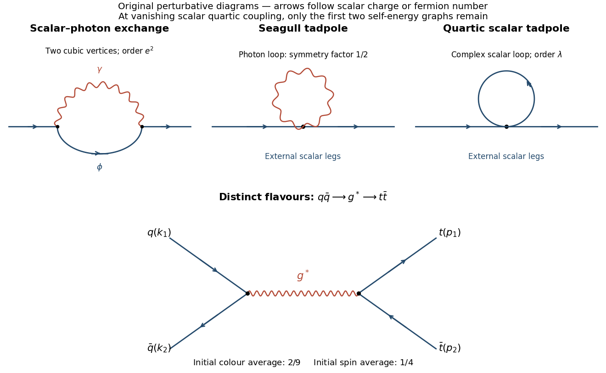

<h1 id="1/b/solution">Solution</h1>

↑ **Parent:** [B](../b.md)

The [one-particle-irreducible](../../../../one-particle-irreducible-feynman-diagram.md) [scalar](../../../../scalar-field.md) [two-point function](../../../../two-point-correlation-function.md) has three [one-loop](../../../../loop-feynman-diagram.md) topologies: a scalar-photon exchange loop built from two [cubic vertices](../../../../interaction-term.md); a [photon tadpole](../../../../tadpole-diagram.md) at one [seagull vertex](../../../../seagull-vertex.md); and a [scalar tadpole](../../../../tadpole-diagram.md) at one [quartic](../../../../quartic-interaction.md) [vertex](../../../../vertex-graph-theory.md). The last is absent when $\lambda=0$. Reducible chains of [self-energy](../../../../self-energy.md) insertions belong to the [Dyson expansion](../../../../dyson-series.md) and are not additional [one-loop](../../../../loop-feynman-diagram.md) [self-energy](../../../../self-energy.md) graphs. The [scalar-QED photon-tadpole symmetry factor](../../../../scalar-qed-photon-tadpole-symmetry-factor.md) is $1/2$ because its two identical [photon](../../../../photon.md) legs are joined; the oriented complex-scalar [tadpole](../../../../tadpole-diagram.md) has no such identical-real-line factor.

**[Figure 1](#1/b/image-one-loop-scalar-self-energy-topologies-and-tree-level-quark-antiquark-annihilation). One-loop scalar self-energy topologies and tree-level quark-antiquark annihilation**.

## ↑ Ancestors (12)

1. [B](../b.md)
2. [1](../../1.md)
3. [2017](../../../2017-split.md)
4. [Past exam of the advanced quantum field theory for particle physics course of the University of Oxford](../../../split.md)
5. [Advanced quantum field theory for particle physics course of the University of Oxford](../../../../advanced-quantum-field-theory-for-particle-physics-course-of-the-university-of-oxford.md)
6. [Year 4 of the mathematical and theoretical physics course of the University of Oxford](../../../../year-4-of-the-mathematical-and-theoretical-physics-course-of-the-university-of-oxford.md)
7. [Mathematical and theoretical physics course of the University of Oxford](../../../../mathematical-and-theoretical-physics-course-of-the-university-of-oxford.md)
8. [Undergraduate course of the University of Oxford](../../../../undergraduate-course-of-the-university-of-oxford.md)
9. [Course of the University of Oxford](../../../../course-of-the-university-of-oxford.md)
10. [University of Oxford](../../../../university-of-oxford-split.md)
11. [List of universities](../../../../list-of-universities.md)
12. [Codex Wiki](../../../../split.md)
