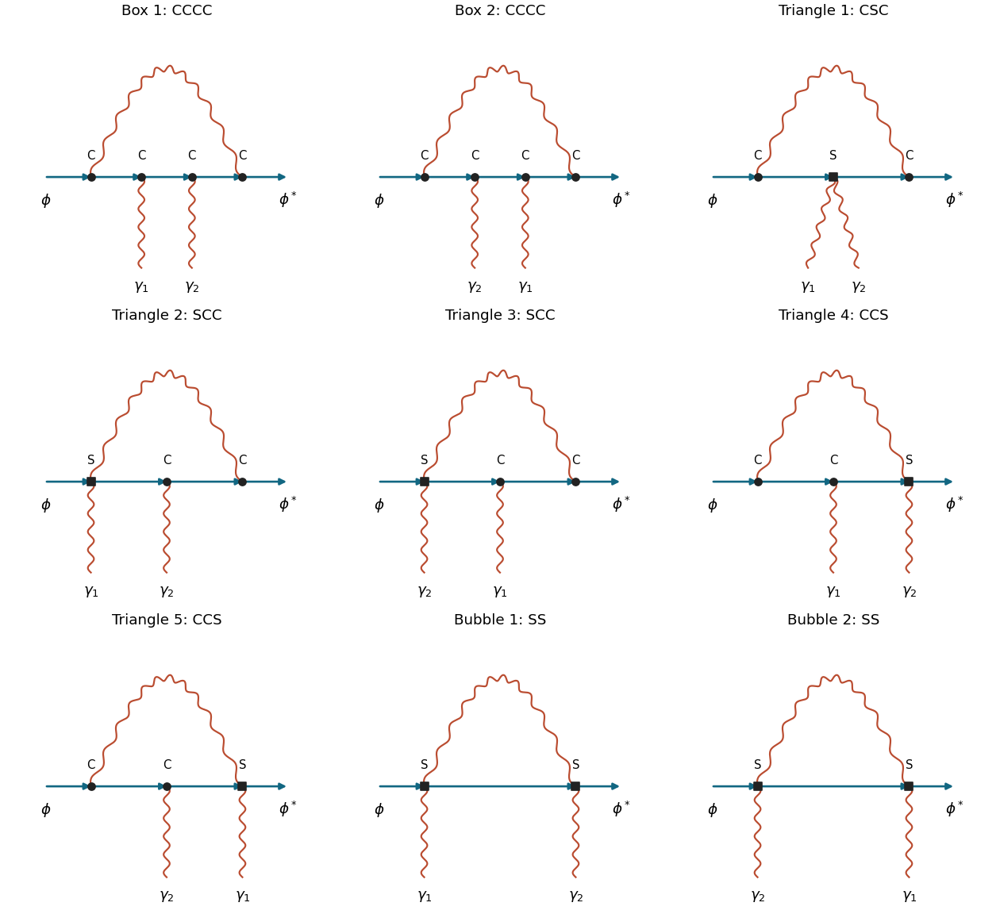
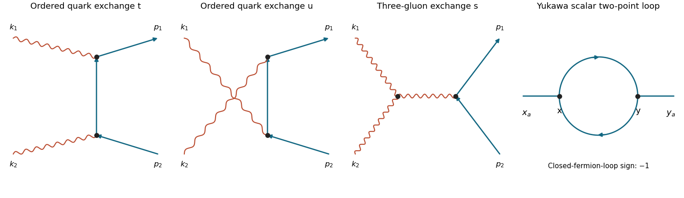

# 2018

↑ **Parent:** [Past exam of the advanced quantum field theory for particle physics course of the University of Oxford](../past-exam-of-the-advanced-quantum-field-theory-for-particle-physics-course-of-the-university-of-oxford.md)

Source paper: [https://www.whatdotheyknow.com/request/oxford_physics_past_papers_2/response/2340696/attach/6/Physics%20Papers%202017.pdf?cookie_passthrough=1](https://www.whatdotheyknow.com/request/oxford_physics_past_papers_2/response/2340696/attach/6/Physics%20Papers%202017.pdf?cookie_passthrough=1)

The dated cover establishes Trinity Term 2018, despite the containing bundle's 2017 filename. Use [natural units](../mathematical-physics.md#natural-units), the [Minkowski metric](../special-relativity.md#minkowski-metric) $g=\operatorname{diag}(1,-1,-1,-1)$ and the [Feynman i-epsilon prescription](../quantum-field-theory.md#feynman-i-epsilon-prescription). In question 1(a), $D=4-\epsilon$ and $e_D=\mu^{\epsilon/2}e$. The supplied transverse [photon propagator](../quantum-field-theory.md#photon-propagator) selects [Landau gauge](../quantum-theory.md#landau-gauge-for-a-uniform-magnetic-field) within the Lorenz-gauge family. In question 2(a), distinguish the kernels in the stated [generating functional](../perturbative-quantum-field-theory.md#generating-functional) from time-ordered [Wick contractions](../perturbative-quantum-field-theory.md#wick-contraction), as explained below.

**Table of contents**

- [1](#1)
  - [a](#1/a)
    - [i](#1/a/i)
      - [Solution](#1/a/i/solution)
    - [ii](#1/a/ii)
      - [Solution](#1/a/ii/solution)
    - [iii](#1/a/iii)
      - [Solution](#1/a/iii/solution)
  - [b](#1/b)
    - [i](#1/b/i)
      - [Solution](#1/b/i/solution)
    - [ii](#1/b/ii)
      - [Solution](#1/b/ii/solution)
- [2](#2)
  - [a](#2/a)
    - [i](#2/a/i)
      - [Solution](#2/a/i/solution)
    - [ii](#2/a/ii)
      - [Solution](#2/a/ii/solution)
    - [iii](#2/a/iii)
      - [Solution](#2/a/iii/solution)
  - [b](#2/b)
    - [i](#2/b/i)
      - [Solution](#2/b/i/solution)
    - [ii](#2/b/ii)
      - [Solution](#2/b/ii/solution)
- [3](#3)
  - [a](#3/a)
    - [i](#3/a/i)
      - [Solution](#3/a/i/solution)
    - [ii](#3/a/ii)
      - [Solution](#3/a/ii/solution)
    - [iii](#3/a/iii)
      - [Solution](#3/a/iii/solution)
    - [iv](#3/a/iv)
      - [Solution](#3/a/iv/solution)
    - [v](#3/a/v)
      - [Solution](#3/a/v/solution)
  - [b](#3/b)
    - [i](#3/b/i)
      - [Solution](#3/b/i/solution)
    - [ii](#3/b/ii)
      - [Solution](#3/b/ii/solution)

## 1

↑ **Parent:** [2018](2018.md)

<h3 id="1/a">a</h3>

↑ **Parent:** [1](#1)

<h4 id="1/a/i">i</h4>

↑ **Parent:** [A](#1/a)

<h5 id="1/a/i/solution">Solution</h5>

↑ **Parent:** [I](#1/a/i)

Let $\phi_0=\sqrt{Z_2}\phi$, $A_{0\mu}=\sqrt{Z_3}A_\mu$, and define the [renormalized coupling](../perturbative-quantum-field-theory.md#renormalized-coupling) by $e_0=e_DZ_1/(Z_2\sqrt{Z_3})$. Write $Z_2m_0^2=m^2+\delta m^2$ and $Z_2^2\lambda_0=\mu^\epsilon(\lambda+\delta\lambda)$. The complete [renormalized](../perturbative-quantum-field-theory.md#renormalization) [Lagrangian density](../classical-field-theory.md#lagrangian-density), with its [counterterms](../perturbative-quantum-field-theory.md#counterterm) already included, is

$$
\begin{aligned}
\mathcal L={}&Z_2\partial_\mu\phi^*\partial^\mu\phi-(m^2+\delta m^2)\phi^*\phi
-\frac{\mu^\epsilon(\lambda+\delta\lambda)}4(\phi^*\phi)^2-\frac{Z_3}4F^2\\
&-ie_DZ_1A_\mu[\phi^*\partial^\mu\phi-(\partial^\mu\phi^*)\phi]
+e_D^2Z_4A^2\phi^*\phi+\mathcal L_{\rm gf}.
\end{aligned}
$$

Separating off the classical renormalized terms leaves the [counterterm Lagrangian](../perturbative-quantum-field-theory.md#counterterm-lagrangian)

$$
\boxed{\begin{aligned}
\mathcal L_{\rm ct}={}&\delta_2\partial_\mu\phi^*\partial^\mu\phi-\delta m^2\phi^*\phi
-\frac{\mu^\epsilon\delta\lambda}{4}(\phi^*\phi)^2-\frac{\delta_3}{4}F_{\mu\nu}F^{\mu\nu}\\
&-ie_D\delta_1 A_\mu\big[\phi^*\partial^\mu\phi-(\partial^\mu\phi^*)\phi\big]
+e_D^2\delta_4 A_\mu A^\mu\phi^*\phi,
\qquad Z_i=1+\delta_i.
\end{aligned}}
$$

The [seagull vertex](../perturbative-quantum-field-theory.md#seagull-vertex) factor is thus $2ie_D^2Z_4g^{\mu\nu}$. The bare [covariant derivative](../general-relativity.md#covariant-derivative) fixes $Z_4=Z_1^2/Z_2$, rather than supplying an unrelated fourth charge parameter. The [scalar QED Ward identity](../perturbative-quantum-field-theory.md#scalar-quantum-electrodynamics-ward-identity), for a symmetry-preserving [regularization](../statistical-learning.md#regularization), gives $Z_1=Z_2$ and hence $Z_4=Z_2$.

For an invertible quadratic [gauge field](../relativistic-quantum-field.md#gauge-field) operator, also include $\mathcal L_{\rm gf}=-(\partial\cdot A)^2/(2\xi)$. One may choose $\xi_0=Z_3\xi$, so this term needs no independent [counterterm](../perturbative-quantum-field-theory.md#counterterm). The strict transverse limit is $\xi\to0$. Even if the renormalized quartic coupling is set to zero at one scale, its [counterterm](../perturbative-quantum-field-theory.md#counterterm) need not vanish: [photon](../quantum-mechanics.md#photon) graphs generate a four-scalar interaction. The [renormalized](../perturbative-quantum-field-theory.md#renormalization) [Lagrangian density](../classical-field-theory.md#lagrangian-density) must retain this allowed operator.

<h4 id="1/a/ii">ii</h4>

↑ **Parent:** [A](#1/a)

<h5 id="1/a/ii/solution">Solution</h5>

↑ **Parent:** [Ii](#1/a/ii)

For the proper four-point [interaction vertex](../perturbative-quantum-field-theory.md#interaction-vertex), retain [one-particle-irreducible Feynman diagrams](../perturbative-quantum-field-theory.md#one-particle-irreducible-feynman-diagram) with two labelled external [photons](../quantum-mechanics.md#photon) and the two ends of a directed scalar line. Put $C$ for a cubic scalar–[photon](../quantum-mechanics.md#photon) vertex and $S$ for a [seagull vertex](../perturbative-quantum-field-theory.md#seagull-vertex). The one-loop counting identities require $V_C+2V_S=4$. There are three possibilities, giving the **nine** [proper scalar-QED seagull-vertex diagrams](../perturbative-quantum-field-theory.md#proper-scalar-qed-seagull-vertex-diagrams):

- Four cubic vertices: two box graphs, with scalar-line order $C\gamma_1\gamma_2C$ or $C\gamma_2\gamma_1C$, where the end vertices are joined by the internal [photon](../quantum-mechanics.md#photon).
- Two cubic vertices and one seagull: one triangle with order $CSC$, both external [photons](../quantum-mechanics.md#photon) on the middle vertex; two with order $SCC$, distinguished by which external [photon](../quantum-mechanics.md#photon) is on the seagull; and two with order $CCS$, with the same two choices.
- Two seagulls: two bubble graphs with order $SS$, distinguished by the external-photon assignment.

**[Figure 1](#1/a/ii/image-the-nine-proper-one-loop-scalar-qed-four-point-diagrams-at-zero-quartic-coupling). The nine proper one-loop scalar-QED four-point diagrams at zero quartic coupling**. Solid arrows form the scalar line; wavy curves are photons. C denotes a cubic vertex and S a seagull vertex. External photon labels are fixed, so their interchanges are separate graphs. Only the two SS graphs survive the zero-momentum transverse-gauge evaluation.

Each graph has [Feynman-diagram symmetry factor](../perturbative-quantum-field-theory.md#feynman-diagram-symmetry-factor) one with these external labels: the internal [photon](../quantum-mechanics.md#photon) and scalar are different species, and the charged scalar endpoints cannot be exchanged. The list is complete because the internal [photon](../quantum-mechanics.md#photon) must join the ends of the open scalar chain for the graph to remain connected after any one internal line is cut. If it joined two interior points, an outside scalar segment would be a bridge and the graph would be one-particle reducible.

External-leg [self-energy](../perturbative-quantum-field-theory.md#self-energy) insertions contribute to an unamputated four-point [correlation function](../critical-phenomenon.md#correlation-function), not this proper vertex. The local four-point [counterterm](../perturbative-quantum-field-theory.md#counterterm) from [i](#1/a/i) is included separately when constructing the renormalized answer; it is not another one-loop topology. Abelian [Faddeev-Popov ghosts](../relativistic-quantum-field.md#faddeev-popov-ghost) do not interact in this linear gauge and add no diagram.

<h4 id="1/a/iii">iii</h4>

↑ **Parent:** [A](#1/a)

<h5 id="1/a/iii/solution">Solution</h5>

↑ **Parent:** [Iii](#1/a/iii)

Set the external [four-momenta](../special-relativity.md#four-momentum) to zero after identifying the proper diagrams. In each box or triangle, at least one endpoint of the internal [photon](../quantum-mechanics.md#photon) is a cubic vertex adjacent to an external scalar of zero [momentum](../momentum.md). That vertex is proportional to $l_\rho$, whereas the supplied numerator obeys $l^\rho P_{\rho\sigma}(l)=0$. All seven such graphs vanish algebraically. This use of the transverse numerator is stronger than merely saying that one has chosen a generic [Lorenz gauge](../relativistic-electromagnetism.md#lorenz-gauge-condition).

The two surviving [seagull vertex](../perturbative-quantum-field-theory.md#seagull-vertex) bubbles have vertex factors $2ie_D^2g^{\mu\rho}$ and $2ie_D^2g^{\sigma\nu}$. Combining their two [propagators](../quantum-field-theory.md#propagator) gives

$$
\boxed{i\Gamma_{\rm loop}^{\mu\nu}(0)
=-4e_D^4\int\frac{d^Dl}{(2\pi)^D}
\frac{g^{\mu\rho}P_{\rho\sigma}(l)g^{\sigma\nu}}
{(l^2+i0)(l^2-m^2+i0)}+(\mu\leftrightarrow\nu).}
$$

This [scalar-QED four-point vertex pole in transverse gauge](../perturbative-quantum-field-theory.md#scalar-qed-four-point-vertex-pole-in-transverse-gauge) calculation determines the proportionality constant as well as the required tensor structure. Keep $m>0$ while extracting the [ultraviolet pole](../perturbative-quantum-field-theory.md#ultraviolet-pole). [Lorentz covariance](../special-relativity.md#lorentz-covariance) inside the regulated integral replaces $l^\mu l^\nu$ by $g^{\mu\nu}l^2/D$, giving the factor $(D-1)g^{\mu\nu}/D$.

For its scalar integral, [Feynman parameter](../perturbative-quantum-field-theory.md#feynman-parameter) gives

$$
\begin{aligned}
I_D&=\int\frac{d^Dl}{(2\pi)^D}\frac1{(l^2+i0)(l^2-m^2+i0)}\\
&=\frac{i\Gamma(2-D/2)}{(4\pi)^{D/2}}
\int_0^1 dx\,[(1-x)m^2]^{D/2-2}\\
&=\frac{i\Gamma(2-D/2)(m^2)^{D/2-2}}
{(4\pi)^{D/2}(D/2-1)}
=\frac{i}{8\pi^2\epsilon}+O(1),\qquad D=4-\epsilon.
\end{aligned}
$$

There is no infrared divergence at $l=0$ with nonzero $m$. At pole order the two [photon](../quantum-mechanics.md#photon) assignments and the factor $3/4$ therefore yield

$$
i\Gamma_{\rm loop}^{\mu\nu}\big|_{\rm pole}
=-\frac{3ie_D^2e^2}{4\pi^2\epsilon}g^{\mu\nu}.
$$

The common engineering scale factor is included in $e_D^2$; finite logarithms are immaterial to the pole. Adding $2ie_D^2\delta_4g^{\mu\nu}$ cancels it when

$$
\boxed{Z_4=1+\frac{3e^2}{8\pi^2\epsilon}+O(e^4)\quad(D=4-\epsilon).}
$$

This is [minimal subtraction scheme](../perturbative-quantum-field-theory.md#minimal-subtraction-scheme), up to optional finite terms. It agrees with the transverse-gauge [scalar QED wave-function pole](../perturbative-quantum-field-theory.md#scalar-qed-wave-function-pole) and $Z_4=Z_2$. Setting $m=0$ at the outset would instead make the zero-momentum integral scaleless and obscure its separate ultraviolet divergence.

<h3 id="1/b">b</h3>

↑ **Parent:** [1](#1)

<h4 id="1/b/i">i</h4>

↑ **Parent:** [B](#1/b)

<h5 id="1/b/i/solution">Solution</h5>

↑ **Parent:** [I](#1/b/i)

The [tree-level Feynman diagrams](../perturbative-quantum-field-theory.md#tree-level-feynman-diagram) are the two ordered quark-exchange graphs and the $s$-channel gluon-exchange graph with a three-gluon vertex. There is no two-gluon-two-quark contact term in the ordinary [QCD](../standard-model.md#quantum-chromodynamics) [Lagrangian density](../classical-field-theory.md#lagrangian-density). Let $q=k_1+k_2=p_1+p_2$, $r_t=p_1-k_1$, $r_u=p_1-k_2$, and $s=q^2$, $t=r_t^2$, $u=r_u^2$. Define $i\mathcal M$ as the product of the stated [Feynman rules](../perturbative-quantum-field-theory.md#feynman-rules).

**[Figure 2](#1/b/i/image-the-three-gluon-fusion-tree-diagrams-and-the-yukawa-fermion-loop-correction). The three gluon-fusion tree diagrams and the Yukawa fermion-loop correction**. The first three panels show ordered quark exchange and three-gluon exchange. The last panel shows a directed closed fermion loop between two scalar insertions. Crossings without dots are not vertices.

Suppressing external colour indices, the [quark](../standard-model.md#quark) graphs are

$$
\mathcal M_t^{\mu\nu}=-g^2\bar u(p_1)T^aT^b\gamma^\mu\frac{\not r_t}{t}\gamma^\nu v(p_2),
\qquad
\mathcal M_u^{\mu\nu}=-g^2\bar u(p_1)T^bT^a\gamma^\nu\frac{\not r_u}{u}\gamma^\mu v(p_2).
$$

The massless [Dirac equations](../relativistic-quantum-field.md#dirac-equation) give $\bar u\not p_1=0$ and $\not p_2v=0$. Consequently

$$
\frac{\bar u\not k_1\not r_t\not k_2v}{t}=-\bar u\not k_2v=\bar u\not k_1v,
\qquad
\frac{\bar u\not k_2\not r_u\not k_1v}{u}=-\bar u\not k_1v.
$$

The last equality uses $\bar u\not qv=0$. The quark-exchange sum is therefore $-g^2\bar u\not k_1[T^a,T^b]v$.

For the [gluon](../standard-model.md#gluon) graph, use all incoming [momenta](../momentum.md) $(k_1,k_2,-q)$ in the three-gluon tensor:

$$
V^{\mu\nu\rho}=(k_1-k_2)^\rho g^{\mu\nu}
+(k_2+q)^\mu g^{\nu\rho}-(q+k_1)^\nu g^{\rho\mu}.
$$

Its double contraction is $k_{1\mu}k_{2\nu}V^{\mu\nu\rho}=s(k_2-k_1)^\rho/2$. The vertex and [gluon](../standard-model.md#gluon) [propagator](../quantum-field-theory.md#propagator) give

$$
\mathcal M_s^{\mu\nu}=-\frac{ig^2f^{abc}}s\,
\bar u\gamma_\rho T^cv\,V^{\mu\nu\rho},
\qquad
k_{1\mu}k_{2\nu}\mathcal M_s^{\mu\nu}
=ig^2f^{abc}\bar u\not k_1T^cv.
$$

Combining the graphs yields

$$
\boxed{k_1^\mu k_2^\nu\mathcal M_{\mu\nu}
=-g^2\bar u(p_1)\not k_1
\big([T^a,T^b]-if^{abc}T^c\big)v(p_2).}
$$

Thus the requested [spinor](../algebra-over-a-field.md#spinor) proportionality factor is $-g^2\bar u(p_1)\not k_1v(p_2)$ when the colour matrix is displayed separately; retaining it inside the [spinor](../algebra-over-a-field.md#spinor) bilinear makes its external colour indices explicit. For a convention calling the Feynman-rule product itself $\mathcal M$, rather than $i\mathcal M$, the entire result gains one factor of $i$.

<h4 id="1/b/ii">ii</h4>

↑ **Parent:** [B](#1/b)

<h5 id="1/b/ii/solution">Solution</h5>

↑ **Parent:** [Ii](#1/b/ii)

The [double-longitudinal Ward identity for gluon fusion](../relativistic-quantum-field.md#double-longitudinal-ward-identity-for-gluon-fusion) uses the defining [Lie algebra](../lie-algebra.md) identity $[T^a,T^b]=if^{abc}T^c$ makes the boxed amplitude vanish:

$$
\boxed{k_1^\mu k_2^\nu\mathcal M_{\mu\nu}=0.}
$$

In [QED](../perturbative-quantum-field-theory.md#quantum-electrodynamics), both external gauge bosons are [photons](../quantum-mechanics.md#photon), the charge matrices commute, and there is no three-photon vertex. The two fermion-exchange graphs then cancel without a third graph. In [QCD](../standard-model.md#quantum-chromodynamics), omitting the three-gluon interaction would leave a generally nonzero colour commutator: gauge-boson self-interaction is essential to the cancellation.

This is a tree-level manifestation of a [Ward identity](../perturbative-quantum-field-theory.md#ward-identity) and, more generally in a gauge-fixed non-Abelian theory, the [Slavnov-Taylor identities](../relativistic-quantum-field.md#slavnov-taylor-identity). They connect the matter representation, the structure constants and the gauge interactions, ensuring that auxiliary longitudinal polarizations do not enter physical probabilities. With all other external legs physical and on shell, replacing one external massless gauge-boson polarization by its [momentum](../momentum.md) leaves zero. The double-contraction result proved here is one consequence, not by itself a proof that every open-index amplitude tensor is transverse off shell. At loop order the corresponding non-Abelian identities also involve [Faddeev-Popov ghosts](../relativistic-quantum-field.md#faddeev-popov-ghost) and a consistent symmetry-preserving renormalization.

## 2

↑ **Parent:** [2018](2018.md)

<h3 id="2/a">a</h3>

↑ **Parent:** [2](#2)

<h4 id="2/a/i">i</h4>

↑ **Parent:** [A](#2/a)

<h5 id="2/a/i/solution">Solution</h5>

↑ **Parent:** [I](#2/a/i)

Use the source action $S_{\rm src}=\int d^4x\,[J\phi+\bar\eta_\alpha\psi_\alpha+\bar\psi_\alpha\eta_\alpha]$, with independent [Grassmann variables](../multilinear-algebra.md#grassmann-variable) used as sources $\eta,\bar\eta$ and left [functional derivatives](../calculus-of-variations.md#functional-derivative). A scalar insertion is $(1/i)\delta/\delta J$. For the odd fields the ordered rules are

$$
\boxed{\phi\longleftrightarrow\frac1i\frac\delta{\delta J},\qquad
\bar\psi_\alpha\longleftrightarrow i\frac\delta{\delta\eta_\alpha},\qquad
\psi_\alpha\longleftrightarrow\frac1i\frac\delta{\delta\bar\eta_\alpha}.}
$$

The middle sign is not arbitrary: differentiating the rightmost odd source in $\bar\psi\eta$ from the left gives $\delta_L(\bar\psi\eta)/\delta\eta=-\bar\psi$. Derivative ordering must consequently match the displayed order of the fields; the rightmost derivative acts first.

Expand $\exp[ig\int\phi\bar\psi\psi]$ in its [power series](../sequence-and-series.md#power-series). Replace each field in every term by its source insertion, preserving the [fermion](../tensor-product-of-quantum-systems.md#fermion) order. These derivatives can be pulled outside the free [path integral](../quantum-field-theory.md#path-integral). Re-exponentiation gives the unnormalized [generating functional](../perturbative-quantum-field-theory.md#generating-functional)

$$
\boxed{Z[J,\bar\eta,\eta]=
\exp\left[ig\int d^4x
\left(\frac1i\frac\delta{\delta J(x)}\right)
\left(i\frac\delta{\delta\eta_\alpha(x)}\right)
\left(\frac1i\frac\delta{\delta\bar\eta_\alpha(x)}\right)\right]Z_0[J,\bar\eta,\eta].}
$$

Summation over the [spinor](../algebra-over-a-field.md#spinor) index is understood. Normalized [correlation functions](../critical-phenomenon.md#correlation-function) require division by the same interacting $Z[0,0,0]$, which cancels [vacuum](../physics.md#vacuum) factors; that division is separate from this operator identity.

<h4 id="2/a/ii">ii</h4>

↑ **Parent:** [A](#2/a)

<h5 id="2/a/ii/solution">Solution</h5>

↑ **Parent:** [Ii](#2/a/ii)

First fix the [propagator kernels in a positive-sign Gaussian generating functional](../perturbative-quantum-field-theory.md#propagator-kernels-in-a-positive-sign-gaussian-generating-functional). From its scalar exponent, $i^{-2}\delta^2Z_0/\delta J\delta J$ gives the contraction $D(x-y)=-i\Delta(x-y)$. The fermionic insertion rules similarly give $F(x-y)=\langle T\psi(x)\bar\psi(y)\rangle_0=-iS(x-y)$, writing $S$ for the kernel labelled $S_F$ in that exponent. Thus the kernels in the question do not already include the factors of $i$ in the actual time-ordered contractions.

At order $g^2$, expand the interaction operator to its second term, or equivalently apply [Wick's theorem](../perturbative-quantum-field-theory.md#wick-s-theorem) to

$$
\frac{(ig)^2}{2}\int d^4x\,d^4y\,
\left\langle T\phi(x_a)\phi(y_a)
\phi(x)\bar\psi(x)\psi(x)\phi(y)\bar\psi(y)\psi(y)\right\rangle_0.
$$

For a connected contribution, the external scalar insertions attach to different interaction points. The two assignments are equal after exchanging $x,y$ and cancel $1/2$. The connected fermionic contraction is

$$
\left\langle T\bar\psi_\alpha(x)\psi_\alpha(x)
\bar\psi_\beta(y)\psi_\beta(y)\right\rangle_{0,c}
=-F_{\alpha\beta}(x-y)F_{\beta\alpha}(y-x)
=-\operatorname{tr}[F(x-y)F(y-x)].
$$

The minus sign is the [closed fermion loop sign](../perturbative-quantum-field-theory.md#closed-fermion-loop-sign). The alternative pairing gives two separate [fermion](../tensor-product-of-quantum-systems.md#fermion) tadpoles and belongs to disconnected external components, not the requested connected function. A free external scalar line multiplying a [vacuum](../physics.md#vacuum) graph also cancels in the normalized result.

Combining $(ig)^2=-g^2$ with the loop minus sign gives

$$
G^{(2)}_c\big|_{g^2}=g^2\int d^4x\,d^4y\,
D(x_a-x)D(y_a-y)\operatorname{tr}[F(x-y)F(y-x)].
$$

There are four contractions, so replacing $D=-i\Delta$ and $F=-iS$ introduces $(-i)^4=1$. Therefore

$$
\boxed{G^{(2)}_c\big|_{g^2}=g^2\int d^4x\,d^4y\,
\Delta(x_a-x)\Delta(y_a-y)\operatorname{tr}[S(x-y)S(y-x)].}
$$

This is the fermion-loop diagram in the last panel of [i](#1/b/i). The [trace](../linear-algebra.md#matrix-trace) contracts [spinor](../algebra-over-a-field.md#spinor) indices around the loop; it is not an additional degeneracy factor. A convention using physical contractions directly obtains the preceding formula in $D,F$ with the same coefficient. Mixing one convention's Gaussian kernels with another's insertion factors would change its apparent signs.

<h4 id="2/a/iii">iii</h4>

↑ **Parent:** [A](#2/a)

<h5 id="2/a/iii/solution">Solution</h5>

↑ **Parent:** [Iii](#2/a/iii)

For two distinct commuting [real scalar fields](../scalar-field-theory.md#real-scalar-field) $\chi_1,\chi_2$ in place of the labelled [fermion](../tensor-product-of-quantum-systems.md#fermion) pair, with interaction $g\phi\chi_1\chi_2$, there is no anticommutation sign on closing the loop and no [spinor](../algebra-over-a-field.md#spinor) [trace](../linear-algebra.md#matrix-trace). The two [propagators](../quantum-field-theory.md#propagator) are simply multiplied. In terms of physical time-ordered scalar contractions $C_1,C_2$, the connected contribution is

$$
\boxed{-g^2\int d^4x\,d^4y\,
D(x_a-x)D(y_a-y)C_1(x-y)C_2(y-x).}
$$

The [statistics and symmetry factors of a two-propagator loop](../perturbative-quantum-field-theory.md#statistics-and-symmetry-factors-of-a-two-propagator-loop) determine the replacement. Relative to the fermionic formula in [ii](#2/a/ii), the loop-statistics sign reverses. Scalar source kernels normalized like the stated Gaussian give the same overall minus sign after the four contraction factors are converted. There is no spin multiplicity.

If both replacement fields instead mean the same real field $\chi$, the coupling normalization and the identical-line [symmetry factor](../perturbative-quantum-field-theory.md#feynman-diagram-symmetry-factor) must be specified. With interaction $(g/2)\phi\chi^2$, the cubic vertex is $ig$ and its two-identical-line loop carries $1/2$, giving coefficient $-g^2/2$. With the literal coefficient $g\phi\chi^2$, its vertex is $2ig$ and the coefficient is $-2g^2$. These cases are distinct from two separately labelled real fields; suppressing their combinatorics would hide a factor-of-two ambiguity in the replacement.

<h3 id="2/b">b</h3>

↑ **Parent:** [2](#2)

<h4 id="2/b/i">i</h4>

↑ **Parent:** [B](#2/b)

<h5 id="2/b/i/solution">Solution</h5>

↑ **Parent:** [I](#2/b/i)

Choose an infinitesimal [gauge transformation](../electromagnetism.md#gauge-transformation) $\delta A_\mu^a=D_\mu^{ab}\omega^b$, where $D_\mu^{ab}=\delta^{ab}\partial_\mu+g f^{acb}A_\mu^c$. Varying the axial gauge function at fixed $\sigma$ gives

$$
\delta f^a(x)=n^\mu D_\mu^{ab}\omega^b(x),\qquad
\boxed{M^{ab}(x,y)=n^\mu D_\mu^{ab}(x)\delta^{(4)}(x-y).}
$$

This is the [Faddeev-Popov operator](../relativistic-quantum-field.md#faddeev-popov-operator). The [Faddeev-Popov determinant](../relativistic-quantum-field.md#faddeev-popov-determinant) has a Grassmann representation $\det M\propto\int\mathcal D\bar c\,\mathcal Dc\,e^{i\int\bar cMc}$. Choosing this normalization for the antighost gives

$$
\boxed{\mathcal L_{\rm gh}=\bar c^a n\cdot\partial c^a
+g f^{acb}\bar c^a n^\mu A_\mu^c c^b.}
$$

A simultaneous antighost rephasing changes the overall ghost-action sign and vertex conventions, but not the determinant's field-dependent content. The essential facts are the kinetic operator $n\cdot\partial$ and a ghost-gluon vertex proportional to $n^\mu$.

Now average the fixed-$\sigma$ constraint with the stated Gaussian:

$$
\int\mathcal D\sigma\,\delta[n\cdot A-\sigma]
\exp\left[-\frac{i}{2\xi}\int d^4x\,\sigma^a\sigma^a\right]
=\exp\left[-\frac{i}{2\xi}\int d^4x\,(n\cdot A^a)^2\right]
$$

up to a field-independent normalization. Consequently

$$
\boxed{\mathcal L_{\rm gf}=-\frac1{2\xi}(n^\mu A_\mu^a)^2.}
$$

The [Faddeev-Popov ghost](../relativistic-quantum-field.md#faddeev-popov-ghost) determinant is not generally field independent before imposing the strict axial condition: its interaction term contains $n\cdot A$. In the $\xi\to0$ gauge this quantity vanishes on the integration slice, giving the decoupling established next. Defining the inverse of $n\cdot\partial$ still requires boundary conditions for residual gauge transformations.

<h4 id="2/b/ii">ii</h4>

↑ **Parent:** [B](#2/b)

<h5 id="2/b/ii/solution">Solution</h5>

↑ **Parent:** [Ii](#2/b/ii)

Contract the numerator of the quoted [light cone gauge](../relativistic-quantum-field.md#light-cone-gauge) [propagator](../quantum-field-theory.md#propagator) with $n_\mu$:

$$
n_\mu\left[g^{\mu\nu}-\frac{n^\mu p^\nu+n^\nu p^\mu}{n\cdot p}\right]
=n^\nu-\frac{n^2p^\nu+(n\cdot p)n^\nu}{n\cdot p}
=-\frac{n^2p^\nu}{n\cdot p}=0.
$$

Thus every internal [gluon](../standard-model.md#gluon) emerging from a [ghost-gluon vertex](../relativistic-quantum-field.md#ghost-gluon-vertex) contributes a factor $n_\mu\widetilde\Delta^{\mu\nu}=0$. Every ghost-dependent contribution to a physical [gluon](../standard-model.md#gluon) or matter amplitude vanishes. Equivalently, the strict condition $n\cdot A=0$ removes the [Faddeev-Popov ghost](../relativistic-quantum-field.md#faddeev-popov-ghost) interaction in [i](#2/b/i), leaving the field-independent determinant $\det(n\cdot\partial)$, which cancels from normalized correlators.

This is [ghost decoupling in strict axial gauge](../relativistic-quantum-field.md#ghost-decoupling-in-strict-axial-gauge), not a statement that the free [Faddeev-Popov ghost](../relativistic-quantum-field.md#faddeev-popov-ghost) [propagator](../quantum-field-theory.md#propagator) itself is zero. The algebra assumes a consistent [axial-gauge pole prescription](../relativistic-quantum-field.md#axial-gauge-pole-prescription) for $n\cdot p=0$ and treatment of residual gauge zero modes. The overall sign assigned to the displayed vector [propagator](../quantum-field-theory.md#propagator) does not enter the contraction proof. With the mostly-minus convention and the usual $-F^2/4$ action, its conventional prefactor is $-i/(p^2+i0)$; the source prints $+i$. Either prefactor gives the same zero contraction, so no sign correction is needed to obtain the requested ghost-decoupling result.

## 3

↑ **Parent:** [2018](2018.md)

<h3 id="3/a">a</h3>

↑ **Parent:** [3](#3)

<h4 id="3/a/i">i</h4>

↑ **Parent:** [A](#3/a)

<h5 id="3/a/i/solution">Solution</h5>

↑ **Parent:** [I](#3/a/i)

Because $(\gamma_5)^2=\mathbf1$, its even and odd powers are $\gamma_5^{2r}=\mathbf1$ and $\gamma_5^{2r+1}=\gamma_5$. Separate the [matrix exponential](../linear-operator-theory.md#matrix-exponential) into these two [power series](../sequence-and-series.md#power-series):

$$
\begin{aligned}
e^{i\alpha\gamma_5}
&=\mathbf1\sum_{r=0}^\infty\frac{(i\alpha)^{2r}}{(2r)!}
+\gamma_5\sum_{r=0}^\infty\frac{(i\alpha)^{2r+1}}{(2r+1)!}\\
&=\boxed{\mathbf1\cos\alpha+i\gamma_5\sin\alpha.}
\end{aligned}
$$

No representation of the [gamma matrices](../algebra-over-a-field.md#gamma-matrices) is needed. Hermiticity of $\gamma_5$ also makes this exponential unitary for real $\alpha$, while the projectors $(1\pm\gamma_5)/2$ acquire opposite phases.

<h4 id="3/a/ii">ii</h4>

↑ **Parent:** [A](#3/a)

<h5 id="3/a/ii/solution">Solution</h5>

↑ **Parent:** [Ii](#3/a/ii)

Put $U=e^{-i\alpha\gamma_5/2}$. The transformed [Dirac adjoint](../relativistic-quantum-field.md#dirac-adjoint) is $\bar\psi'=\psi^\dagger U^\dagger\gamma^0=\bar\psi U$, since $\gamma^0$ anticommutes with $\gamma_5$. It is therefore incorrect to transform the two sides of a Yukawa bilinear with mutually inverse matrices.

Write $M(\phi)=\phi_1+i\gamma_5\phi_2$. The transformed [Yukawa interaction](../standard-model.md#yukawa-interaction) is invariant exactly when

$$
U M(\phi')U=M(\phi).
$$

Since $M$ commutes with $\gamma_5$, this is $M(\phi')=e^{i\alpha\gamma_5}M(\phi)$. Use [i](#3/a/i) and equate the coefficients of $\mathbf1$ and $i\gamma_5$:

$$
\boxed{\begin{pmatrix}\phi_1'\\\phi_2'\end{pmatrix}
=\begin{pmatrix}\cos\alpha&-\sin\alpha\\\sin\alpha&\cos\alpha\end{pmatrix}
\begin{pmatrix}\phi_1\\\phi_2\end{pmatrix}.}
$$

This is the global [SO(2)](../linear-algebra.md#special-orthogonal-group-in-two-dimensions) rotation of a [chiral scalar-doublet Yukawa model](../standard-model.md#chiral-scalar-doublet-yukawa-model). Equivalently, $\Phi=\phi_1+i\phi_2$ transforms as $\Phi'=e^{i\alpha}\Phi$, while the two chiral [spinor](../algebra-over-a-field.md#spinor) components transform with opposite half-angle phases. The sign of the scalar rotation follows from the negative sign in the specified [fermion](../tensor-product-of-quantum-systems.md#fermion) transformation.

<h4 id="3/a/iii">iii</h4>

↑ **Parent:** [A](#3/a)

<h5 id="3/a/iii/solution">Solution</h5>

↑ **Parent:** [Iii](#3/a/iii)

The scalar kinetic and potential terms depend only on the rotation-invariant combinations $\partial_\mu\phi_1\partial^\mu\phi_1+\partial_\mu\phi_2\partial^\mu\phi_2$ and $\phi_1^2+\phi_2^2$. They are unchanged by the constant [SO(2)](../linear-algebra.md#special-orthogonal-group-in-two-dimensions) rotation. The Yukawa term is invariant by [ii](#3/a/ii). Finally, anticommutation gives $U\gamma^\mu=\gamma^\mu U^{-1}$, so

$$
\bar\psi'i\gamma^\mu\partial_\mu\psi'
=\bar\psi U i\gamma^\mu U\partial_\mu\psi
=\bar\psi i\gamma^\mu\partial_\mu\psi.
$$

No derivative of $U$ appears because the parameter is global. Thus the entire classical [Lagrangian density](../classical-field-theory.md#lagrangian-density) has the combined [chiral symmetry](../standard-model.md#chiral-symmetry).

An explicit [Dirac mass term](../relativistic-quantum-field.md#dirac-mass-term) instead changes as

$$
-m\bar\psi\psi\longmapsto
-m\bar\psi e^{-i\alpha\gamma_5}\psi
=-m\cos\alpha\,\bar\psi\psi+im\sin\alpha\,\bar\psi\gamma_5\psi.
$$

It is not invariant for arbitrary $\alpha$ unless $m=0$. For the concrete choice $\alpha=\pi$, the original [mass term](../classical-field-theory.md#mass-term) reverses sign. The invariant Yukawa term can nevertheless generate a [mass](../classical-mechanics.md#mass) after a [vacuum](../physics.md#vacuum) is selected, because the scalar field transforms along with the [fermions](../tensor-product-of-quantum-systems.md#fermion); this is spontaneous rather than explicit breaking.

<h4 id="3/a/iv">iv</h4>

↑ **Parent:** [A](#3/a)

<h5 id="3/a/iv/solution">Solution</h5>

↑ **Parent:** [Iv](#3/a/iv)

The scalar potential is

$$
V=-\frac{\mu^2}{2}(\phi_1^2+\phi_2^2)
+\frac\lambda4(\phi_1^2+\phi_2^2)^2
=\frac\lambda4\left(\phi_1^2+\phi_2^2-\frac{\mu^2}{\lambda}\right)^2
-\frac{\mu^4}{4\lambda}.
$$

Since $\mu^2,\lambda>0$, all minima form the [circle](../topology.md#circle) $\phi_1^2+\phi_2^2=v^2$, with $v=\mu/\sqrt\lambda>0$. Choose the representative [vacuum](../physics.md#vacuum) $\langle\phi_1\rangle=v$, $\langle\phi_2\rangle=0$, and write $\phi_1=v+h$, $\phi_2=\pi$. A nontrivial scalar rotation moves this [vacuum](../physics.md#vacuum) to another minimum, so the continuous symmetry undergoes [spontaneous symmetry breaking](../quantum-field-theory.md#spontaneous-symmetry-breaking). The invariant action and the selected ground state have different stabilizers; the [circle](../topology.md#circle) of equivalent minima is not evidence that the action lost its symmetry.

The Yukawa terms become

$$
\mathcal L_Y=-gv\bar\psi\psi-gh\bar\psi\psi-ig\pi\bar\psi\gamma_5\psi.
$$

Comparison with the free [Dirac equation](../relativistic-quantum-field.md#dirac-equation) gives

$$
\boxed{m_\psi=gv\ \text{as the signed mass coefficient},\qquad
m_{\rm physical}=|g|v.}
$$

For the usual choice $g>0$, this is simply $gv$. The absolute value matters if the real coupling is negative: the dispersion depends on $m_\psi^2$, and a field redefinition can change the [mass](../classical-mechanics.md#mass) coefficient's sign. There is no explicit symmetry-breaking [fermion](../tensor-product-of-quantum-systems.md#fermion) [mass](../classical-mechanics.md#mass) parameter in the original theory.

The scalar symmetry is broken completely. Because the [spinor](../algebra-over-a-field.md#spinor) transformation uses a half angle, $\alpha=2\pi$ leaves the scalars fixed while sending $\psi\to-\psi$; this discrete [fermion](../tensor-product-of-quantum-systems.md#fermion) parity is unbroken in the full combined transformation group. It does not remove the broken continuous generator or the associated [Goldstone boson](../critical-phenomenon.md#goldstone-boson).

<h4 id="3/a/v">v</h4>

↑ **Parent:** [A](#3/a)

<h5 id="3/a/v/solution">Solution</h5>

↑ **Parent:** [V](#3/a/v)

Using $\mu^2=\lambda v^2$, expand the potential around the chosen [vacuum](../physics.md#vacuum):

$$
V=V_{\min}+\lambda v^2h^2+\lambda vh(h^2+\pi^2)
+\frac\lambda4(h^2+\pi^2)^2.
$$

The linear term vanishes at the minimum. With canonical real-field kinetic terms, comparison with $m_h^2h^2/2+m_\pi^2\pi^2/2$ gives

$$
\boxed{m_h^2=2\lambda v^2=2\mu^2,\qquad m_\pi^2=0.}
$$

The massive radial scalar changes the magnitude of the [vacuum](../physics.md#vacuum) field; the massless [Goldstone boson](../critical-phenomenon.md#goldstone-boson) changes its orientation. The symmetry is global here, so no gauge field eats that mode.

The genuinely new scalar cubic interactions are $-\lambda v h^3-\lambda v h\pi^2$. Including identical-field factorials, their [Feynman vertex](../perturbative-quantum-field-theory.md#interaction-vertex) factors are

$$
\boxed{hhh:\ -6i\lambda v,\qquad h\pi\pi:\ -2i\lambda v.}
$$

The quartic interactions remain $-\lambda h^4/4-\lambda h^2\pi^2/2-\lambda\pi^4/4$, with respective vertex factors $-6i\lambda,-2i\lambda,-6i\lambda$. The shifted Yukawa terms from [iv](#3/a/iv) give $h\bar\psi\psi$ vertex $-ig$ and $\pi\bar\psi\psi$ vertex $g\gamma_5$. These Yukawa structures were present before the shift; the new [fermion](../tensor-product-of-quantum-systems.md#fermion) bilinear is the [mass term](../classical-field-theory.md#mass-term), not an additional independent interaction coupling. There are no derivative interactions from the linear Cartesian field shift.

<h3 id="3/b">b</h3>

↑ **Parent:** [3](#3)

<h4 id="3/b/i">i</h4>

↑ **Parent:** [B](#3/b)

<h5 id="3/b/i/solution">Solution</h5>

↑ **Parent:** [I](#3/b/i)

The quadratic part of the covariant-derivative term contains $g^2v^2A_\mu A^\mu/2-gvA_\mu\partial^\mu b$. Its mixing term cancels the $+gvA_\mu\partial^\mu b$ in the stated [gauge fixing](../relativistic-quantum-field.md#gauge-fixing) term. Thus the vector [mass](../classical-mechanics.md#mass) and diagonal quadratic action are

$$
\boxed{M_A^2=g^2v^2,\qquad M_A=|gv|,}
\qquad
\mathcal L_{A,2}=-\frac14F^2+\frac12M_A^2A^2-\frac1{2\xi}(\partial\cdot A)^2.
$$

For nonzero $p^2$ introduce the transverse and longitudinal [transverse and longitudinal momentum projectors](../quantum-field-theory.md#transverse-and-longitudinal-momentum-projectors) $P_T^{\mu\nu}=g^{\mu\nu}-p^\mu p^\nu/p^2$ and $P_L^{\mu\nu}=p^\mu p^\nu/p^2$. After integration by parts, the inverse quadratic kernel is

$$
K^{\mu\nu}=-(p^2-M_A^2)P_T^{\mu\nu}
-\frac{p^2-\xi M_A^2}{\xi}P_L^{\mu\nu}.
$$

Their orthogonality makes the inversion immediate. The [gauge-boson propagator](../relativistic-quantum-field.md#gauge-boson-propagator) is

$$
\boxed{D_A^{\mu\nu}(p)=-i\left[
\frac{P_T^{\mu\nu}}{p^2-M_A^2+i0}
+\frac{\xi P_L^{\mu\nu}}{p^2-\xi M_A^2+i0}\right].}
$$

Equivalently,

$$
D_A^{\mu\nu}(p)=\frac{-i}{p^2-M_A^2+i0}
\left[g^{\mu\nu}-(1-\xi)\frac{p^\mu p^\nu}{p^2-\xi M_A^2+i0}\right].
$$

The projector formula explains the physical massive pole and the gauge-dependent longitudinal pole. The apparent $1/p^2$ in the projectors cancels in the equivalent expression; it is not an extra massless physical state. At $\xi=1$ the numerator reduces to $g^{\mu\nu}$. At fixed [momentum](../momentum.md) the $\xi\to\infty$ limit gives the [unitary gauge](../standard-model.md#unitary-gauge) [propagator](../quantum-field-theory.md#propagator) $-i(g^{\mu\nu}-p^\mu p^\nu/M_A^2)/(p^2-M_A^2+i0)$. The relation between this limit and ultraviolet power counting is not uniform in [momentum](../momentum.md).[§2.7.3, Higgs-phase gauge-boson masses and the distinction between gauge descriptions and physical spectrum](../physics-bibliography.md#gauge-theory-by-david-tong)

<h4 id="3/b/ii">ii</h4>

↑ **Parent:** [B](#3/b)

<h5 id="3/b/ii/solution">Solution</h5>

↑ **Parent:** [Ii](#3/b/ii)

At a stationary symmetry-breaking [vacuum](../physics.md#vacuum) of a gauge-invariant scalar potential, the angular field has zero potential curvature. Its free [kinetic term](../classical-field-theory.md#kinetic-term) is $(\partial b)^2/2$, while the displayed gauge-fixing term adds $-\xi g^2v^2b^2/2$. Hence

$$
\boxed{D_b(p)=\frac{i}{p^2-\xi M_A^2+i0},\qquad m_b^2=\xi M_A^2.}
$$

This is the would-be [Goldstone boson](../critical-phenomenon.md#goldstone-boson), whose gauge-dependent pole accompanies the longitudinal pole in [i](#3/b/i); it is not an additional physical scalar particle of that [mass](../classical-mechanics.md#mass). For $M_A\ne0$, fixed finite $p$ and $\xi\to+\infty$,

$$
D_b(p)\sim-\frac{i}{\xi M_A^2}\longrightarrow0.
$$

The angular field becomes infinitely heavy in this gauge and is absent from the [unitary gauge](../standard-model.md#unitary-gauge) propagating description. The qualification about fixed [momentum](../momentum.md) matters: loop integrations probe arbitrarily large $p$, so one cannot automatically interchange the $\xi\to\infty$ limit with ultraviolet integration. If $gv=0$, there is no massive Higgs phase and the asserted heavy-field limit does not follow. A separate radial [Higgs boson](../standard-model.md#higgs-boson) may remain; its [mass](../classical-mechanics.md#mass) depends on the unspecified potential and is not determined by this gauge-fixing term.

## ↑ Ancestors (9)

1. [Past exam of the advanced quantum field theory for particle physics course of the University of Oxford](../past-exam-of-the-advanced-quantum-field-theory-for-particle-physics-course-of-the-university-of-oxford.md)
2. [Advanced quantum field theory for particle physics course of the University of Oxford](../university-of-oxford.md#advanced-quantum-field-theory-for-particle-physics-course-of-the-university-of-oxford)
3. [Year 4 of the mathematical and theoretical physics course of the University of Oxford](../university-of-oxford.md#year-4-of-the-mathematical-and-theoretical-physics-course-of-the-university-of-oxford)
4. [Mathematical and theoretical physics course of the University of Oxford](../university-of-oxford.md#mathematical-and-theoretical-physics-course-of-the-university-of-oxford)
5. [Undergraduate course of the University of Oxford](../university-of-oxford.md#undergraduate-course-of-the-university-of-oxford)
6. [Course of the University of Oxford](../university-of-oxford.md#course-of-the-university-of-oxford)
7. [University of Oxford](../university-of-oxford.md)
8. [List of universities](../README.md#list-of-universities)
9. [Codex Wiki](../README.md)
