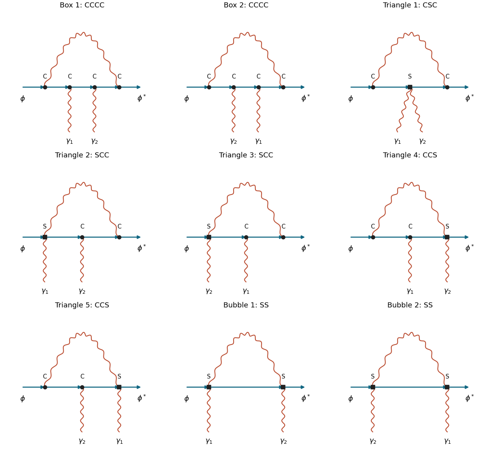

<h1 id="1/a/ii/solution">Solution</h1>

↑ **Parent:** [Ii](../ii.md)

For the proper four-point [interaction vertex](../../../../../interaction-vertex.md), retain [one-particle-irreducible Feynman diagrams](../../../../../one-particle-irreducible-feynman-diagram.md) with two labelled external [photons](../../../../../photon.md) and the two ends of a directed scalar line. Put $C$ for a cubic scalar–[photon](../../../../../photon.md) vertex and $S$ for a [seagull vertex](../../../../../seagull-vertex.md). The one-loop counting identities require $V_C+2V_S=4$. There are three possibilities, giving the **nine** [proper scalar-QED seagull-vertex diagrams](../../../../../proper-scalar-qed-seagull-vertex-diagrams.md):

- Four cubic vertices: two box graphs, with scalar-line order $C\gamma_1\gamma_2C$ or $C\gamma_2\gamma_1C$, where the end vertices are joined by the internal [photon](../../../../../photon.md).
- Two cubic vertices and one seagull: one triangle with order $CSC$, both external [photons](../../../../../photon.md) on the middle vertex; two with order $SCC$, distinguished by which external [photon](../../../../../photon.md) is on the seagull; and two with order $CCS$, with the same two choices.
- Two seagulls: two bubble graphs with order $SS$, distinguished by the external-photon assignment.

**[Figure 1](#1/a/ii/image-the-nine-proper-one-loop-scalar-qed-four-point-diagrams-at-zero-quartic-coupling). The nine proper one-loop scalar-QED four-point diagrams at zero quartic coupling**. Solid arrows form the scalar line; wavy curves are photons. C denotes a cubic vertex and S a seagull vertex. External photon labels are fixed, so their interchanges are separate graphs. Only the two SS graphs survive the zero-momentum transverse-gauge evaluation.

Each graph has [Feynman-diagram symmetry factor](../../../../../feynman-diagram-symmetry-factor.md) one with these external labels: the internal [photon](../../../../../photon.md) and scalar are different species, and the charged scalar endpoints cannot be exchanged. The list is complete because the internal [photon](../../../../../photon.md) must join the ends of the open scalar chain for the graph to remain connected after any one internal line is cut. If it joined two interior points, an outside scalar segment would be a bridge and the graph would be one-particle reducible.

External-leg [self-energy](../../../../../self-energy.md) insertions contribute to an unamputated four-point [correlation function](../../../../../correlation-function.md), not this proper vertex. The local four-point [counterterm](../../../../../counterterm.md) from [i](../i.md) is included separately when constructing the renormalized answer; it is not another one-loop topology. Abelian [Faddeev-Popov ghosts](../../../../../faddeev-popov-ghost.md) do not interact in this linear gauge and add no diagram.

## ↑ Ancestors (13)

1. [Ii](../ii.md)
2. [A](../../a.md)
3. [1](../../../1.md)
4. [2018](../../../../2018-split.md)
5. [Past exam of the advanced quantum field theory for particle physics course of the University of Oxford](../../../../split.md)
6. [Advanced quantum field theory for particle physics course of the University of Oxford](../../../../../advanced-quantum-field-theory-for-particle-physics-course-of-the-university-of-oxford.md)
7. [Year 4 of the mathematical and theoretical physics course of the University of Oxford](../../../../../year-4-of-the-mathematical-and-theoretical-physics-course-of-the-university-of-oxford.md)
8. [Mathematical and theoretical physics course of the University of Oxford](../../../../../mathematical-and-theoretical-physics-course-of-the-university-of-oxford.md)
9. [Undergraduate course of the University of Oxford](../../../../../undergraduate-course-of-the-university-of-oxford.md)
10. [Course of the University of Oxford](../../../../../course-of-the-university-of-oxford.md)
11. [University of Oxford](../../../../../university-of-oxford-split.md)
12. [List of universities](../../../../../list-of-universities.md)
13. [Codex Wiki](../../../../../split.md)
