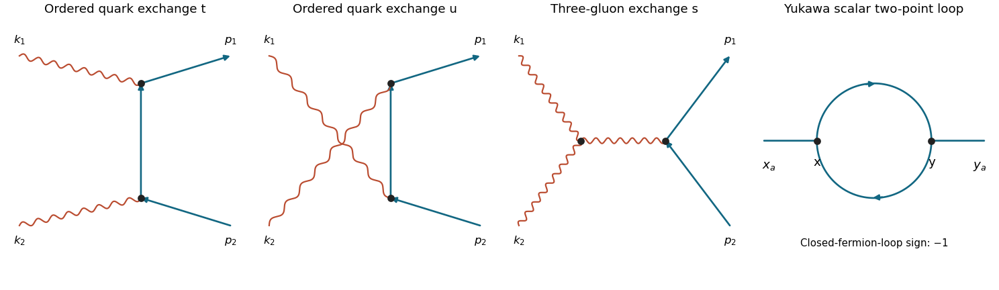

<h1 id="1/b/i/solution">Solution</h1>

↑ **Parent:** [I](../i.md)

The [tree-level Feynman diagrams](../../../../../tree-level-feynman-diagram.md) are the two ordered quark-exchange graphs and the $s$-channel gluon-exchange graph with a three-gluon vertex. There is no two-gluon-two-quark contact term in the ordinary [QCD](../../../../../quantum-chromodynamics.md) [Lagrangian density](../../../../../lagrangian-density.md). Let $q=k_1+k_2=p_1+p_2$, $r_t=p_1-k_1$, $r_u=p_1-k_2$, and $s=q^2$, $t=r_t^2$, $u=r_u^2$. Define $i\mathcal M$ as the product of the stated [Feynman rules](../../../../../feynman-rules.md).

**[Figure 2](#1/b/i/image-the-three-gluon-fusion-tree-diagrams-and-the-yukawa-fermion-loop-correction). The three gluon-fusion tree diagrams and the Yukawa fermion-loop correction**. The first three panels show ordered quark exchange and three-gluon exchange. The last panel shows a directed closed fermion loop between two scalar insertions. Crossings without dots are not vertices.

Suppressing external colour indices, the [quark](../../../../../quark.md) graphs are

$$
\mathcal M_t^{\mu\nu}=-g^2\bar u(p_1)T^aT^b\gamma^\mu\frac{\not r_t}{t}\gamma^\nu v(p_2),
\qquad
\mathcal M_u^{\mu\nu}=-g^2\bar u(p_1)T^bT^a\gamma^\nu\frac{\not r_u}{u}\gamma^\mu v(p_2).
$$

The massless [Dirac equations](../../../../../dirac-equation.md) give $\bar u\not p_1=0$ and $\not p_2v=0$. Consequently

$$
\frac{\bar u\not k_1\not r_t\not k_2v}{t}=-\bar u\not k_2v=\bar u\not k_1v,
\qquad
\frac{\bar u\not k_2\not r_u\not k_1v}{u}=-\bar u\not k_1v.
$$

The last equality uses $\bar u\not qv=0$. The quark-exchange sum is therefore $-g^2\bar u\not k_1[T^a,T^b]v$.

For the [gluon](../../../../../gluon.md) graph, use all incoming [momenta](../../../../../momentum-split.md) $(k_1,k_2,-q)$ in the three-gluon tensor:

$$
V^{\mu\nu\rho}=(k_1-k_2)^\rho g^{\mu\nu}
+(k_2+q)^\mu g^{\nu\rho}-(q+k_1)^\nu g^{\rho\mu}.
$$

Its double contraction is $k_{1\mu}k_{2\nu}V^{\mu\nu\rho}=s(k_2-k_1)^\rho/2$. The vertex and [gluon](../../../../../gluon.md) [propagator](../../../../../propagator.md) give

$$
\mathcal M_s^{\mu\nu}=-\frac{ig^2f^{abc}}s\,
\bar u\gamma_\rho T^cv\,V^{\mu\nu\rho},
\qquad
k_{1\mu}k_{2\nu}\mathcal M_s^{\mu\nu}
=ig^2f^{abc}\bar u\not k_1T^cv.
$$

Combining the graphs yields

$$
\boxed{k_1^\mu k_2^\nu\mathcal M_{\mu\nu}
=-g^2\bar u(p_1)\not k_1
\big([T^a,T^b]-if^{abc}T^c\big)v(p_2).}
$$

Thus the requested [spinor](../../../../../spinor.md) proportionality factor is $-g^2\bar u(p_1)\not k_1v(p_2)$ when the colour matrix is displayed separately; retaining it inside the [spinor](../../../../../spinor.md) bilinear makes its external colour indices explicit. For a convention calling the Feynman-rule product itself $\mathcal M$, rather than $i\mathcal M$, the entire result gains one factor of $i$.

## ↑ Ancestors (13)

1. [I](../i.md)
2. [B](../../b.md)
3. [1](../../../1.md)
4. [2018](../../../../2018-split.md)
5. [Past exam of the advanced quantum field theory for particle physics course of the University of Oxford](../../../../split.md)
6. [Advanced quantum field theory for particle physics course of the University of Oxford](../../../../../advanced-quantum-field-theory-for-particle-physics-course-of-the-university-of-oxford.md)
7. [Year 4 of the mathematical and theoretical physics course of the University of Oxford](../../../../../year-4-of-the-mathematical-and-theoretical-physics-course-of-the-university-of-oxford.md)
8. [Mathematical and theoretical physics course of the University of Oxford](../../../../../mathematical-and-theoretical-physics-course-of-the-university-of-oxford.md)
9. [Undergraduate course of the University of Oxford](../../../../../undergraduate-course-of-the-university-of-oxford.md)
10. [Course of the University of Oxford](../../../../../course-of-the-university-of-oxford.md)
11. [University of Oxford](../../../../../university-of-oxford-split.md)
12. [List of universities](../../../../../list-of-universities.md)
13. [Codex Wiki](../../../../../split.md)
